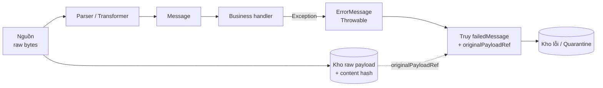
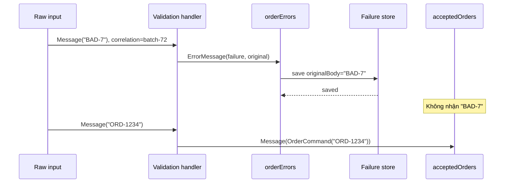
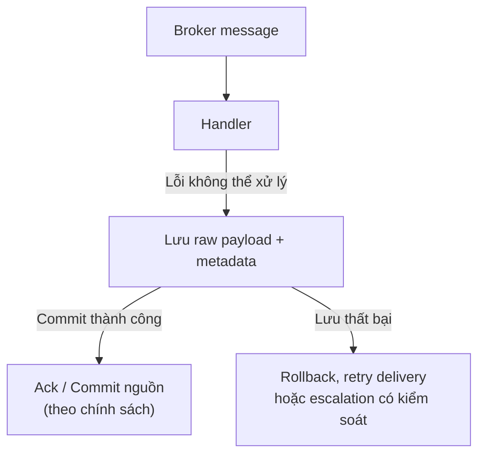

# Không làm mất payload gốc của lỗi

## 1. Bài toán: có lỗi nhưng không còn dữ liệu để điều tra

Một ứng dụng Spring Integration tiếp nhận đơn hàng từ HTTP hoặc broker, chuyển JSON thành object, chuẩn hóa dữ liệu bằng Transformer, phân nhánh bằng Router và gọi dịch vụ đối tác. Nếu một bước ném exception, người vận hành cần biết **message nào đã gây lỗi, payload gốc thực sự là gì và có thể phát lại an toàn hay không**.

Tình huống thường gặp: dữ liệu gốc chứa trường `orderId` bị sai định dạng. Một Transformer đã đổi dữ liệu thành object rút gọn rồi một handler mới báo lỗi. Nếu chỉ lưu `exception.getMessage()` hoặc `message.getPayload().toString()` tại handler cuối, ta có thể mất trường đầu vào, mất encoding, mất ngữ cảnh correlation hoặc không thể tái hiện lỗi ban đầu.

**Không làm mất payload gốc của lỗi** không có nghĩa lưu bừa toàn bộ dữ liệu vào log. Mục tiêu là:

- Giữ bằng chứng **đủ chính xác và đủ an toàn** để điều tra, đối soát và replay.
- Phân biệt **raw payload tại ingress** với **payload của message ở nơi exception xảy ra**.
- Giữ các định danh, headers cần thiết và liên kết đến lỗi, nhưng không làm rò rỉ bí mật.
- Không tuyên bố message đã được lưu an toàn trước khi thực sự commit vào nơi lưu bền vững.
- Thử lại hoặc đưa vào quarantine có kiểm soát, tránh side effect trùng.

Bài thuộc chương **Error channel** của module **SPRING_INTEGRATION_PATTERN**, chuyên học triển khai Enterprise Integration Patterns với Spring Integration: Router, Filter, Transformer, Splitter, Aggregator, Gateway, retry, error channel, correlation cùng kiểm thử và theo dõi các nhánh.

Sau bài học, bạn có thể nhận diện những nơi payload dễ bị mất, dùng `MessagingException.getFailedMessage()` và `ErrorMessage.getOriginalMessage()` khi phù hợp, chủ động bảo toàn dữ liệu ở đầu vào và thiết kế kiểm thử xác minh nội dung gốc vẫn được truy xuất.

## 2. Ba khái niệm rất dễ bị nhầm

| Khái niệm | Ví dụ | Ý nghĩa |
| --- | --- | --- |
| **Raw payload tại ingress** | Dãy byte JSON nhận từ broker/HTTP | Bằng chứng dữ liệu đầu vào **trước** khi parse, mapping, lọc hoặc biến đổi |
| **Failed message** | `Message<Order>` đưa vào handler bị lỗi | Message liên quan trực tiếp đến exception; có thể đã **khác raw payload** |
| **Error message** | `ErrorMessage` có payload là `Throwable` | Message **mô tả lỗi**, có thể mang failed/original message hoặc thông tin tham chiếu |

Ví dụ một message ban đầu:

```json
{
  "orderId": "BAD-7",
  "customer": {
    "externalCode": "A-009"
  },
  "schemaVersion": 2
}
```

Sau bước chuyển đổi, handler có thể chỉ còn:

```java
record OrderCommand(String orderId) {}
```

Lúc đó, `MessagingException.getFailedMessage()` của lỗi tại handler có thể chứa `OrderCommand("BAD-7")`, **không chứa** trường `customer.externalCode` hay `schemaVersion` từ JSON gốc.

Vì vậy:

> **Bảo toàn failed message chưa tự động đồng nghĩa bảo toàn raw payload đầu tiên.** Muốn đảm bảo có bản gốc, phải thu nhận hoặc lưu nó **trước bước có thể làm mất thông tin**.

### Sơ đồ đường đi



Nếu chỉ gửi exception vào một channel, dữ liệu nguyên bản không nhất thiết còn truy xuất được. Giữ một **tham chiếu bền vững** đến dữ liệu gốc thường tốt hơn đặt toàn bộ payload nhạy cảm vào mọi header.

## 3. Spring Integration chuyển lỗi đi như thế nào?

Spring Messaging có một số đối tượng quan trọng:

- `Message<?>`: mang payload và headers của thông điệp nghiệp vụ.
- `MessagingException`: một exception có khả năng chứa tham chiếu tới `failedMessage`.
- `MessageHandlingException`: một dạng `MessagingException` liên quan đến xử lý message.
- `ErrorMessage`: một `Message<Throwable>`; khi được tạo với original message, có thể truy cập qua `getOriginalMessage()`.
- **Error channel**: channel nhận `ErrorMessage` và chuyển tới handler hoặc flow xử lý lỗi.

Cách đọc cơ bản:

```java
import org.springframework.messaging.Message;
import org.springframework.messaging.MessagingException;
import org.springframework.messaging.support.ErrorMessage;

public Message<?> findFailedMessage(ErrorMessage error) {
    Throwable problem = error.getPayload();

    if (problem instanceof MessagingException messagingProblem
            && messagingProblem.getFailedMessage() != null) {
        return messagingProblem.getFailedMessage();
    }

    return error.getOriginalMessage();
}
```

Đoạn này là **đường đi tối thiểu**, không phải thuật toán khôi phục mọi exception lồng nhau. Trong thực tế có thể phải xem chuỗi `getCause()` để tìm một `MessagingException` được bọc bên trong. Khi nhiều exception chứa nhiều failed message khác nhau, phải chọn message **thuộc điểm thất bại cần điều tra**, thay vì lấy ngẫu nhiên message đầu tiên.

Một cách duyệt cause có giới hạn:

```java
import org.springframework.messaging.Message;
import org.springframework.messaging.MessagingException;
import org.springframework.messaging.support.ErrorMessage;

public final class FailedMessageResolver {

    private FailedMessageResolver() {
    }

    public static Message<?> resolve(ErrorMessage error) {
        Throwable cursor = error.getPayload();

        while (cursor != null) {
            if (cursor instanceof MessagingException messaging) {
                Message<?> failed = messaging.getFailedMessage();
                if (failed != null) {
                    return failed;
                }
            }
            cursor = cursor.getCause();
        }

        return error.getOriginalMessage();
    }
}
```

**Giới hạn:** không có luật chung rằng mọi `ErrorMessage` đều chứa đầy đủ failed message hoặc raw payload. Lỗi có thể xảy ra **trước khi một Message được tạo**, tại source, trong deserializer hoặc ở một adapter không giữ raw body. Trong trường hợp đó, phải có đường xử lý lỗi riêng ở ingress, ví dụ broker DLQ hoặc bộ thu lỗi parse lưu raw bytes cùng metadata.

### 3.1. Đồng bộ và bất đồng bộ

| Đường xử lý | Lỗi thường xuất hiện ở đâu? | Ý nghĩa với payload gốc |
| --- | --- | --- |
| `DirectChannel` + handler đồng bộ | Exception thường truyền ngược về caller | Không mặc định có `ErrorMessage` trên global `errorChannel` |
| Polling endpoint | Error handler của tác vụ poll có thể publish `ErrorMessage` tùy cấu hình | Có thể có failed message; phải kiểm tra vị trí phát lỗi |
| `ExecutorChannel` hoặc consumer bất đồng bộ | Lỗi có thể được xử lý trên thread khác qua error flow | Caller `send()` không nhất thiết nhận lỗi và raw payload có thể không còn ở caller |
| Inbound adapter từ broker | Phụ thuộc adapter, ack, transaction, deserialization | Raw bytes có thể cần được giữ tại broker hoặc hạ tầng nhận |

Chỉ tạo channel tên `errorChannel` không bảo đảm **mọi** exception đều tới đó, cũng không biến channel thành kho dữ liệu bền vững.

## 4. Những điểm làm payload gốc bị mất

### 4.1. Biến đổi mất thông tin

Ví dụ:

```text
HTTP JSON:
  {"orderId":"BAD-7","schemaVersion":2,"unknownField":"..."}
    -> JSON parser
    -> Transformer chỉ giữ orderId
    -> Handler ném exception
```

Nếu lỗi được tạo tại handler, failed message có thể chỉ chứa object đã biến đổi. Không thể dựng lại JSON nguyên thủy từ object đã bỏ bớt trường. Trình tự khóa JSON, whitespace, encoding và một số giá trị có thể cũng đã thay đổi khi parse/serialize.

**Cách xử lý:** lưu snapshot raw bytes hoặc tham chiếu đến snapshot tại điểm nhận, rồi đưa `originalPayloadRef`, `originalMessageId` và correlation metadata đi cùng flow.

### 4.2. Tái tạo Message nhưng bỏ headers

Một Transformer có thể tạo message mới mà không giữ các header quan trọng như correlation ID, tenant, source hoặc raw payload reference.

```java
// Chỉ có payload mới, không chủ động gắn context cần thiết.
Message<OrderCommand> transformed =
        MessageBuilder.withPayload(new OrderCommand("ORD-101"))
                .build();
```

Việc tạo message mới không nhất thiết “sai”; nhưng nếu metadata cần truy ngược không được giữ, error flow có thể không liên hệ được message thất bại với đầu vào gốc.

### 4.3. Mutable payload và dữ liệu thay đổi sau khi nhận

Một `byte[]`, `Map` hay object mutable có thể bị sửa tại chỗ:

```java
byte[] incoming = receiveBytes();

// Đây là cùng một mảng; caller khác sửa incoming thì snapshot cũng đổi.
byte[] notASnapshot = incoming;

// Cần bản sao byte độc lập khi muốn giữ raw payload trong bộ nhớ.
byte[] snapshot = java.util.Arrays.copyOf(
        incoming, incoming.length);
```

Đối với dữ liệu cần bền vững, snapshot còn phải được ghi vào storage an toàn. Sao chép trong bộ nhớ **không** cứu được message khi JVM hoặc node gặp sự cố.

### 4.4. Log payload bằng `toString()`

`toString()` của object thường là cách hiển thị chẩn đoán, không phải định dạng có thể replay. Nó có thể bỏ field, đổi thứ tự dữ liệu, hoặc vô tình làm lộ thông tin cá nhân và token. Không coi log chuỗi ấy là “đã lưu payload gốc”.

### 4.5. Bỏ qua lỗi khi ghi kho quarantine

Nếu error handler nuốt exception khi lưu và nguồn đã ack, bản gốc có thể mất vĩnh viễn. Cần liên kết **ghi bền vững** với **ack/commit** theo hợp đồng adapter/transaction. Trong hệ thống phân tán, có thể phải dùng outbox, broker DLQ hoặc cơ chế hồi phục khác; không tự hứa exactly-once.

## 5. Chiến lược: giữ dữ liệu ở ingress, giữ tham chiếu qua flow

Trong production, một thiết kế khả thi gồm:

1. Nhận raw bytes từ nguồn với metadata đáng tin (topic/partition/offset, HTTP request id, file path, v.v.).
2. Tính checksum để phát hiện bản ghi bị thay đổi không mong muốn.
3. Lưu **bản raw** tại kho bền vững được mã hóa và phân quyền; chỉ xác nhận thành công khi cơ chế lưu đạt yêu cầu.
4. Tạo message nghiệp vụ mang `originalPayloadRef`, `originalMessageId` và `correlationId`.
5. Transformer và Router phải giữ metadata được cho phép này khi tạo message mới.
6. Error flow dùng `failedMessage` để lấy context, sau đó truy cập bản gốc qua tham chiếu.
7. Quarantine record lưu lý do lỗi, schema version, trạng thái và thông tin phục vụ replay.

### 5.1. Ví dụ giữ tham chiếu trước Transformer

Đoạn sau minh họa thao tác ở ranh giới ingress. `RawPayloadRepository` và `OrderParser` là **giao diện ứng dụng cần tự triển khai**, không phải API có sẵn của Spring Integration.

```java
// Minh họa ý tưởng; repository/parser là thành phần ứng dụng.
byte[] snapshot = java.util.Arrays.copyOf(
        requestBytes, requestBytes.length);

// save(...) phải bảo đảm độ bền cần thiết trước khi trả rawRef.
String rawRef = rawPayloadRepository.save(snapshot);

OrderCommand order = orderParser.parse(snapshot);

Message<OrderCommand> businessMessage =
        MessageBuilder.withPayload(order)
                .setHeader("originalPayloadRef", rawRef)
                .setHeader("sourceSystem", "orders-http")
                .setHeader("correlationId", correlationId)
                .build();
```

Nếu parser có thể ném lỗi **trước khi tạo được `businessMessage`**, bước lưu raw đã diễn ra nên đường bắt lỗi parse vẫn có `rawRef` để tạo bản ghi quarantine.

Trong giải pháp thực tế, cần xác định transaction/failure boundary giữa raw storage và nguồn. Chẳng hạn một HTTP endpoint có thể trả lỗi và yêu cầu client gửi lại nếu raw store không khả dụng; với broker cần quyết định ack, retry, dead-letter hoặc rollback theo adapter.

### 5.2. Không dồn raw payload nhạy cảm vào mọi header

Giữ raw JSON hoặc bytes trong `originalPayload` header giúp demo thuận tiện nhưng có thể gây:

- Sao chép dữ liệu nhạy cảm qua nhiều flow và hệ thống.
- Tăng kích thước message, ảnh hưởng broker và network.
- Vấn đề serialization/whitelist khi chuyển message qua ranh giới process.
- Log header làm lộ payload.
- Tăng chi phí bộ nhớ khi nhiều message hoặc aggregator group đang chờ.

Đối với dữ liệu nhạy cảm, hãy truyền **ID tham chiếu hoặc object key giới hạn quyền**, còn raw payload ở kho chuyên trách. Header có thể vẫn chứa dữ liệu nhạy cảm như tenant ID; phải có chính sách log/masking phù hợp.

## 6. Ví dụ tự chứa: ErrorMessage giữ message gốc

Để minh họa một trường hợp có thể kiểm chứng được, ta dùng raw payload dạng `String` trong một `Message<String>`. Handler kiểm tra định dạng mã đơn hàng. Nếu sai, nó chủ động tạo `MessageHandlingException` gắn với **message đầu vào**, sau đó tạo `ErrorMessage` với `originalMessage` và đưa vào một channel lỗi riêng.

Đây là **đường lỗi validation có chủ đích**, không khẳng định Spring Integration tự động bắt mọi lỗi đồng bộ và chuyển vào channel này.

### 6.1. Dependencies

Ví dụ dựa trên Spring Boot 3.x và Java 17+, để Spring Boot quản lý phiên bản Spring Integration:

```gradle
dependencies {
    implementation("org.springframework.boot:spring-boot-starter-integration")
    testImplementation("org.springframework.boot:spring-boot-starter-test")
}
```

### 6.2. Mô hình dữ liệu thành công và lỗi

Tạo `OrderCommand.java`:

```java
package example.originalpayload;

public record OrderCommand(String orderId) {
}
```

Tạo `OriginalFailureRecord.java`:

```java
package example.originalpayload;

import java.time.Instant;
import java.util.UUID;

public record OriginalFailureRecord(
        UUID quarantineId,
        UUID originalMessageId,
        String originalBody,
        String correlationId,
        String reasonCode,
        Instant recordedAt) {
}
```

Tạo `InMemoryFailureStore.java`:

```java
package example.originalpayload;

import java.util.List;
import java.util.concurrent.ConcurrentLinkedQueue;

public class InMemoryFailureStore {

    private final ConcurrentLinkedQueue<OriginalFailureRecord> records =
            new ConcurrentLinkedQueue<>();

    public void save(OriginalFailureRecord record) {
        records.add(record);
    }

    public List<OriginalFailureRecord> all() {
        return List.copyOf(records);
    }
}
```

**Quan trọng:** `originalBody` lưu trực tiếp dữ liệu gốc **chỉ để kiểm thử**. Không dùng kho trong bộ nhớ này để bảo đảm không mất message qua restart. Trong production, nên lưu raw payload vào kho bền vững có mã hóa và lưu một `originalPayloadRef` trong record.

### 6.3. Cấu hình hai flow

Tạo `OriginalPayloadConfiguration.java`:

```java
package example.originalpayload;

import java.time.Instant;
import java.util.UUID;

import org.springframework.beans.factory.annotation.Qualifier;
import org.springframework.context.annotation.Bean;
import org.springframework.context.annotation.Configuration;
import org.springframework.integration.channel.DirectChannel;
import org.springframework.integration.channel.QueueChannel;
import org.springframework.integration.config.EnableIntegration;
import org.springframework.integration.dsl.IntegrationFlow;
import org.springframework.messaging.Message;
import org.springframework.messaging.MessageChannel;
import org.springframework.messaging.MessageDeliveryException;
import org.springframework.messaging.MessageHandlingException;
import org.springframework.messaging.support.ErrorMessage;
import org.springframework.messaging.support.MessageBuilder;

@Configuration
@EnableIntegration
public class OriginalPayloadConfiguration {

    @Bean
    public MessageChannel rawOrders() {
        return new DirectChannel();
    }

    @Bean
    public MessageChannel orderErrors() {
        return new DirectChannel();
    }

    @Bean
    public QueueChannel acceptedOrders() {
        return new QueueChannel();
    }

    @Bean
    public InMemoryFailureStore failureStore() {
        return new InMemoryFailureStore();
    }

    @Bean
    public IntegrationFlow orderValidationFlow(
            @Qualifier("orderErrors") MessageChannel orderErrors,
            @Qualifier("acceptedOrders") QueueChannel acceptedOrders) {

        return IntegrationFlow.from("rawOrders")
                .handle(message -> {
                    if (!(message.getPayload() instanceof String raw)) {
                        throw new MessageHandlingException(
                                message, "Expected String payload");
                    }

                    if (!raw.matches("ORD-[0-9]{3,}")) {
                        MessageHandlingException failure =
                                new MessageHandlingException(
                                        message, "INVALID_ORDER_ID");

                        // Cố ý giữ message raw tại nơi phát hiện lỗi.
                        ErrorMessage error = new ErrorMessage(failure, message);
                        if (!orderErrors.send(error)) {
                            throw new MessageDeliveryException(
                                    message, "Error channel rejected message");
                        }
                        // Đường validation lỗi kết thúc tại đây.
                        return;
                    }

                    Message<OrderCommand> converted = MessageBuilder
                            .withPayload(new OrderCommand(raw))
                            .setHeader(
                                    "originalMessageId",
                                    message.getHeaders().getId().toString())
                            .build();

                    if (!acceptedOrders.send(converted)) {
                        throw new MessageDeliveryException(
                                message, "Accepted channel rejected message");
                    }
                })
                .get();
    }

    @Bean
    public IntegrationFlow orderErrorFlow(
            InMemoryFailureStore failureStore) {

        return IntegrationFlow.from("orderErrors")
                .handle(message -> {
                    if (!(message instanceof ErrorMessage error)) {
                        throw new IllegalArgumentException(
                                "Expected ErrorMessage");
                    }

                    Message<?> original =
                            FailedMessageResolver.resolve(error);

                    if (original == null
                            || !(original.getPayload() instanceof String raw)) {
                        // Không tự chế ra raw payload khi không tìm thấy.
                        throw new IllegalStateException(
                                "Original String payload unavailable");
                    }

                    Object correlation = original
                            .getHeaders().get("correlationId");

                    failureStore.save(new OriginalFailureRecord(
                            UUID.randomUUID(),
                            original.getHeaders().getId(),
                            raw,
                            correlation == null ? null
                                    : correlation.toString(),
                            "INVALID_ORDER_ID",
                            Instant.now()));
                })
                .get();
    }
}
```

`FailedMessageResolver` là utility ở phần 3, đặt cùng package `example.originalpayload` hoặc import đúng package.

**Điểm cốt lõi của ví dụ:**

- Input đầu tiên là `Message<String>` chứa giá trị thô.
- Nếu validation thất bại, `MessageHandlingException` nhận **chính message đầu vào**, không chỉ chuỗi mô tả lỗi.
- `ErrorMessage(failure, message)` mang thông tin lỗi và original message.
- Error flow truy xuất message gốc, giữ mã đơn hàng ban đầu, message ID và correlation.
- Message hợp lệ được đổi thành `OrderCommand` và đi tới `acceptedOrders`; đó là **đường nghiệp vụ khác** với error channel.
- Việc chuyển dữ liệu hợp lệ thành object minh họa lý do cần phân biệt payload sau Transformer với payload ban đầu.

Trên `DirectChannel` đồng bộ, lỗi do `failureStore.save(...)` hoặc chính error flow ném ra có thể truyền ngược cho caller. Không nên bắt lỗi ghi thất bại rồi coi message đã quarantine thành công. Với broker, ack/transaction phải được thiết kế để chỉ xác nhận kết quả khi kho lưu lỗi đã đáp ứng yêu cầu.

### 6.4. Dòng chạy cụ thể



Ví dụ này chỉ giữ được bản raw vì ngay tại điểm kiểm tra, message vẫn chứa raw String. Nếu luồng có parser/Transformer ở phía trước, cần **thực hiện snapshot hoặc lưu tham chiếu từ ingress** như phần 5.

## 7. Kiểm thử: không mất chính xác payload và correlation

Tạo `OriginalPayloadTest.java`:

```java
package example.originalpayload;

import static org.assertj.core.api.Assertions.assertThat;

import org.junit.jupiter.api.Test;
import org.springframework.beans.factory.annotation.Autowired;
import org.springframework.beans.factory.annotation.Qualifier;
import org.springframework.integration.channel.QueueChannel;
import org.springframework.messaging.Message;
import org.springframework.messaging.MessageChannel;
import org.springframework.messaging.support.MessageBuilder;
import org.springframework.test.context.junit.jupiter.SpringJUnitConfig;

@SpringJUnitConfig(OriginalPayloadConfiguration.class)
class OriginalPayloadTest {

    @Autowired
    @Qualifier("rawOrders")
    MessageChannel rawOrders;

    @Autowired
    @Qualifier("acceptedOrders")
    QueueChannel acceptedOrders;

    @Autowired
    InMemoryFailureStore failureStore;

    @Test
    void retainsExactOriginalStringAndCorrelationOnValidationFailure() {
        String originalBody = "BAD-7 / unexpected field = x";

        Message<String> invalid = MessageBuilder
                .withPayload(originalBody)
                .setHeader("correlationId", "batch-72")
                .build();

        assertThat(rawOrders.send(invalid)).isTrue();
        assertThat(acceptedOrders.receive(0)).isNull();

        assertThat(failureStore.all()).hasSize(1);
        OriginalFailureRecord record = failureStore.all().get(0);

        assertThat(record.originalMessageId())
                .isEqualTo(invalid.getHeaders().getId());
        assertThat(record.originalBody()).isEqualTo(originalBody);
        assertThat(record.correlationId()).isEqualTo("batch-72");
        assertThat(record.reasonCode()).isEqualTo("INVALID_ORDER_ID");
    }

    @Test
    void validOrderIsConvertedWithoutCreatingFailureRecord() {
        Message<String> valid = MessageBuilder
                .withPayload("ORD-1234")
                .build();

        int before = failureStore.all().size();
        assertThat(rawOrders.send(valid)).isTrue();

        Message<?> converted = acceptedOrders.receive(0);
        assertThat(converted).isNotNull();
        assertThat(converted.getPayload())
                .isEqualTo(new OrderCommand("ORD-1234"));
        assertThat(converted.getHeaders().get("originalMessageId"))
                .isEqualTo(valid.getHeaders().getId().toString());

        assertThat(failureStore.all()).hasSize(before);
    }
}
```

Các test giả định context được cô lập, không có thread khác ghi vào `acceptedOrders` và số message trong store ban đầu được kiểm soát. Khi hệ thống có nhiều test dùng chung context, nên dọn store và queue hoặc tạo context riêng để tránh test phụ thuộc thứ tự.

Những tình huống kiểm thử nên bổ sung trong hệ thống thực:

1. Input có Unicode, khoảng trắng, ký tự escape và encoding khác nhau: snapshot **raw bytes** phải bảo toàn đúng các byte ban đầu.
2. Transformer làm mất trường: failed message chứa object sau biến đổi nhưng `originalPayloadRef` vẫn trỏ đến raw content.
3. Exception không chứa `failedMessage`: error flow phải có fallback an toàn hoặc báo rằng chưa thể replay, không bịa message.
4. Thất bại khi ghi kho raw/quarantine: nguồn không được ack như đã lưu thành công.
5. Replay sau sửa lỗi: idempotency ngăn trùng side effect, correlation metadata cho phép truy xuất lịch sử.
6. Payload nhạy cảm: log và dashboard không vô tình hiển thị raw dữ liệu, kể cả trong stack trace.

## 8. Khi lỗi phát sinh trước khi tạo Message

Một tình huống đặc biệt quan trọng là deserialization từ byte sang object:

```text
Broker/HTTP raw bytes
    -> JSON parser ném exception
    -> Không có Message<OrderCommand> hợp lệ
```

Trong trường hợp này, handler downstream chưa có `Message<OrderCommand>`. `MessagingException.getFailedMessage()` vì thế có thể không có dữ liệu để lấy; lỗi parse ở tầng adapter có thể có một cơ chế error record khác.

Giải pháp cần triển khai tại **ranh giới nhận**:

- Giữ raw bytes và metadata nguồn trước khi parse, nếu công nghệ adapter cho phép.
- Nếu broker có DLQ hoặc cơ chế ghi raw record khi deserialization lỗi, cấu hình rõ điều kiện giữ lại, retention và quyền truy cập.
- Ghi lý do parse thất bại cùng charset, content type và schema version cần thiết.
- Tránh giả lập object nghiệp vụ từ payload hỏng để “đủ failed message”, vì dữ liệu giả sẽ khiến replay hoặc đối soát sai.
- Chỉ ack/commit sau khi lỗi đã được xử lý theo hợp đồng nguồn và bản ghi cần giữ đã lưu bền vững.

Việc bảo toàn một payload có lỗi cú pháp còn phụ thuộc cả **bộ mã hóa/giải mã**: parse rồi serialize lại một object không bảo đảm tạo lại cùng raw bytes, ngay cả khi dữ liệu về mặt ý nghĩa giống nhau.

## 9. Retry, ErrorMessageSendingRecoverer và message gốc

Khi dùng `RequestHandlerRetryAdvice` với `ErrorMessageSendingRecoverer`, lỗi có thể được chuyển tới error channel sau khi hết số lần retry. Recoverer đưa thông tin lỗi vào `ErrorMessage`, nhưng đường truy cập failed/original message cần được xác minh theo loại exception và cách handler/advice tạo lỗi.

Các bước nên làm:

1. Dùng một định danh gốc ổn định, chẳng hạn `originalPayloadRef` hoặc business idempotency key, ngay từ ingress.
2. Áp dụng retry có giới hạn cho lỗi tạm thời; lỗi validation có tính xác định thường không nên retry nhiều lần.
3. Khi hết lượt, đưa lỗi vào error flow với context đủ để xác định message và đối tượng xử lý.
4. Error flow thử trích `failedMessage` hoặc `originalMessage`, nhưng nếu chúng vắng mặt vẫn có thể tra bản raw bằng tham chiếu do ứng dụng giữ.
5. Kiểm tra trạng thái nghiệp vụ trước khi replay để tránh thực thi side effect lặp.

Không coi `ErrorMessageSendingRecoverer` là một kho lưu payload: nó là **thành phần phát lỗi**, còn khả năng lưu giữ, tính bền vững và điều kiện replay phải được xây dựng riêng.

### Retry có thể làm thay đổi trạng thái payload

Nếu handler sửa trực tiếp một object mutable rồi ném exception, lần thử tiếp theo có thể nhận object đã bị sửa. Điều này có thể gây lỗi rất khó tái hiện.

- Ưu tiên object dữ liệu bất biến khi có thể.
- Nếu handler cần biến đổi, tạo giá trị mới thay vì sửa payload dùng chung.
- Khi cần giữ raw mutable bytes, chụp bản sao không thể bị các bước downstream sửa; lưu bền vững nếu cần.
- Không dùng `messageId` của object sau biến đổi làm bằng chứng duy nhất về đầu vào thô.

## 10. Transaction, ack và việc lưu payload

Một nguyên tắc quan trọng:

> **Ghi nhận “đã xử lý lỗi” không được xảy ra trước khi bản gốc cần giữ đã được lưu theo mức độ bền vững yêu cầu.**

Ví dụ một message broker được nhận:



Cần chú ý rằng **transaction xuyên broker và database** không tự tồn tại chỉ vì một ứng dụng dùng Spring Integration. Khi hai hệ thống commit độc lập, vẫn có các khoảng lỗi dẫn tới redelivery hoặc bản ghi trùng. Muốn chống mất/trùng cần thiết kế với transaction phù hợp, outbox, deduplication hoặc cơ chế idempotent có bằng chứng.

Các tình huống cần phân tích:

| Lúc phát sinh lỗi | Nguy cơ | Hướng xử lý |
| --- | --- | --- |
| Parse thất bại trước khi tạo message | Không có object để lấy qua `failedMessage` | Giữ raw tại source/adapter |
| Lưu bản gốc thất bại | Nguồn có thể ack sai và mất message | Không coi lỗi là đã xử lý; rollback/redelivery hoặc fallback |
| Đã lưu bản gốc nhưng ack thất bại | Message có thể được giao lại và ghi trùng | Unique key và idempotent write |
| Handler đã tạo side effect rồi mới lỗi | Replay có thể lặp giao dịch nghiệp vụ | Reconciliation, idempotency và audit |
| App restart, store trong bộ nhớ mất | Không còn bản gốc để replay | Kho bền vững và chính sách retention |
| Nhiều instance cùng nhận message | Nhiều bản ghi lỗi cho cùng business event | Correlation/idempotency key và coordination |

Không nên tự tuyên bố **exactly-once**. Cần chứng minh bảo đảm cụ thể ở từng ranh giới: nhận message, ghi bản gốc, chuyển tiếp, ack, replay và side effect bên ngoài.

## 11. Tác động đến các mẫu EIP khác

| Mẫu EIP | Payload gốc có thể bị ảnh hưởng ra sao? | Khuyến nghị |
| --- | --- | --- |
| **Filter** | Message bị loại trước handler; nếu không có discard flow sẽ khó điều tra | Lưu lý do loại và raw reference khi chính sách cần |
| **Transformer** | Bỏ trường, đổi kiểu, chuẩn hóa format | Chụp raw trước khi transform; giữ `originalPayloadRef` |
| **Router** | Message đi nhiều nhánh; lỗi chỉ ở một nhánh | Giữ source, route key và correlation metadata |
| **Splitter** | Message thành nhiều mảnh; mảnh lỗi không chứa toàn bộ payload batch | Lưu batch ID, sequence number và raw batch reference |
| **Aggregator** | Chỉ có phần đã gom; có thể thiếu mảnh hoặc hết hạn group | Giữ correlation ID, metadata group và message store |
| **Gateway** | Có request/reply; exception có thể truyền về caller hoặc timeout | Bảo toàn request ID, reply/error contract và trạng thái thực thi |
| **Retry** | Handler bị gọi nhiều lần; payload mutable có thể bị thay đổi | Dùng immutable payload/snapshot và idempotency |
| **Error channel** | Có thể nhận `ErrorMessage` mà không đủ failed message | Xử lý fallback rõ ràng và lưu raw reference |
| **Correlation** | Liên kết message lỗi với nguồn hoặc batch | Giữ key gốc và cân nhắc correlation mới khi replay |

Ví dụ, một Splitter chia batch thành năm message. Mảnh thứ ba lỗi tại Transformer; `getFailedMessage()` có thể chỉ chứa mảnh đó. Nếu người vận hành cần xây lại cả batch, kho raw cần lưu **batch gốc**, không chỉ một payload mảnh riêng lẻ. Replay mảnh cần xét Aggregator group còn tồn tại hay đã expire; không dùng lại correlation ID một cách máy móc.

## 12. Replay an toàn từ payload gốc

Replay không đơn giản là lấy chuỗi gốc từ error log rồi gửi lại. Quy trình nên có:

1. **Xác minh nguồn:** raw payload phải là bản đã lưu đúng định danh, có checksum hoặc metadata kiểm tra toàn vẹn.
2. **Phân quyền:** người được xem metadata lỗi không nhất thiết được đọc raw payload, sửa dữ liệu hoặc replay.
3. **Xác định trạng thái nghiệp vụ:** message có thể đã tạo side effect trước khi lỗi; cần reconciliation/idempotency.
4. **Xác định phiên bản schema:** dữ liệu cũ có thể cần parser tương thích hoặc bước chuyển đổi đã được review.
5. **Ghi quyết định:** record gốc nên bất biến; nếu sửa, lưu một phiên bản mới với người duyệt và lý do.
6. **Replay qua entrypoint chính thức:** cho validation, Transformer, Router và các bước bắt buộc chạy lại.
7. **Theo dõi kết quả:** lưu request ID, replay attempt, thời gian, trạng thái và lỗi phát sinh sau replay.
8. **Ngăn vòng lặp:** giới hạn số lượt replay, phân loại lỗi tái phát, dùng quarantine khi vẫn không thể xử lý.

Một cấu trúc metadata gợi ý:

```json
{
  "quarantineId": "f86bb67a-9840-48e2-bd0d-e8913a333bc6",
  "originalMessageId": "db2df3fa-a7c3-44dd-90dc-1da2f8a2acbd",
  "originalPayloadRef": "secure-store/orders/2026/11/21/record-8721",
  "source": "orders-inbound",
  "correlationId": "batch-72",
  "reasonCode": "INVALID_ORDER_ID",
  "status": "QUARANTINED",
  "replayAttempt": 0
}
```

Đây là **mẫu do ứng dụng tự thiết kế**, không phải cấu trúc được Spring Integration tạo sẵn. Tránh dùng khóa storage có thể truy xuất trực tiếp không kiểm soát; cần kiểm tra quyền truy cập khi giải tham chiếu.

## 13. Bảo mật và quyền riêng tư khi giữ payload

Giữ nguyên payload không đồng nghĩa cho mọi nơi nhìn thấy payload.

- **Mã hóa:** dùng kho có mã hóa khi lưu và khi truyền, quản lý khóa theo chính sách tổ chức.
- **Phân quyền:** tách vai trò xem metadata, xem raw, sửa/replay và xóa dữ liệu.
- **Data minimization:** không sao chép payload lớn hoặc nhạy cảm vào mọi header/error log.
- **Retention:** đặt thời hạn lưu, chính sách xóa và các trường hợp legal hold nếu có.
- **Audit:** ghi ai đã truy cập raw payload, ai phê duyệt replay và kết quả xử lý.
- **Masking:** log lỗi thường chỉ nên có reason code, original message ID, correlation ID và thông tin chẩn đoán đã làm sạch.
- **Integrity:** lưu checksum, content type và schema version để phát hiện biến đổi dữ liệu không mong muốn.

Một `Throwable.getMessage()` hoặc stack trace có thể vô tình chứa dữ liệu đầu vào. Error handler phải kiểm soát nội dung log và hệ thống giám sát; không đưa raw JSON hoặc token vào metric label có cardinality cao.

## 14. Quan sát và chẩn đoán

Những tín hiệu nên theo dõi gồm:

| Chỉ số | Câu hỏi trả lời |
| --- | --- |
| `error_messages_total` theo reason code | Loại lỗi nào tăng bất thường? |
| `missing_failed_message_total` | Có bao nhiêu lỗi không trích được failed message? |
| `missing_original_payload_ref_total` | Có bao nhiêu lỗi không truy ra raw payload? |
| `raw_payload_store_failure_total` | Có trường hợp ghi raw thất bại không? |
| `quarantine_backlog` | Có bao nhiêu message chưa được điều tra? |
| `quarantine_oldest_age` | Bản ghi lâu nhất chờ bao nhiêu thời gian? |
| `replay_attempts_total` và `replay_failures_total` | Replay có cải thiện hay lặp lỗi? |
| `aggregator_pending_groups` | Có batch nào đang thiếu mảnh do lỗi không? |

Các tên metric trên là **đề xuất để ứng dụng triển khai**, không phải metric mặc định của mọi phiên bản Spring Integration.

Khi thấy error message không có payload gốc, quy trình điều tra nên là:

1. Lỗi xảy ra **trước** hay **sau** khi có message?
2. Throwable có bọc `MessagingException` không? `failedMessage` có tồn tại không?
3. `ErrorMessage.getOriginalMessage()` có chứa message nào, và đó có phải dữ liệu ingress không?
4. Có Transformer/Splitter nào đã thay đổi hoặc chia payload trước khi lỗi?
5. Có `originalPayloadRef` trong headers hoặc storage index không?
6. Kho raw có lưu thành công, checksum hợp lệ và quyền truy xuất còn hiệu lực không?
7. Nếu không có bản gốc, có thể lấy lại từ broker, DLQ hoặc nhật ký nguồn đáng tin không?
8. Có cần đánh dấu bản ghi **không thể replay** và yêu cầu xử lý thủ công không?

Không nên tạo một payload “na ná” từ `toString()` rồi coi như raw data chính xác.

## 15. Lỗi thường gặp và cách sửa

| Hiện tượng | Nguyên nhân thường gặp | Hướng xử lý |
| --- | --- | --- |
| `getFailedMessage()` trả `null` | Throwable không phải MessagingException, lỗi trước khi tạo message hoặc message không được gắn | Dùng originalMessage khi có; lưu raw tại ingress |
| Failed message chỉ có object đã biến đổi | Transformer chạy trước điểm phát lỗi | Giữ raw snapshot/ref trước transform |
| Payload gốc bị thay đổi khi retry | Handler sửa object/byte[] mutable tại chỗ | Copy hoặc thiết kế object immutable |
| Mất correlation ID | Tạo Message mới mà không giữ metadata cần thiết | Chuyển tiếp explicit header/reference được phép |
| Message lỗi mất khi JVM restart | `QueueChannel` hoặc store trong bộ nhớ | Ghi bền vững theo hợp đồng nguồn |
| Đã lưu quarantine nhưng replay bị trùng | Nguồn redeliver hoặc side effect đã commit | Dùng unique key, idempotency và reconciliation |
| Error flow không nhận lỗi | Lỗi đồng bộ truyền thẳng về caller; không có publisher | Cấu hình đúng nơi phát ErrorMessage hoặc xử lý exception tại caller |
| Error flow lại ném lỗi | Kho raw/quarantine lỗi, serialization lỗi | Không nuốt lỗi; fallback/rollback/escalation |
| Header chứa raw payload làm lộ dữ liệu | Log/broker/trace sao chép header | Dùng reference, masking và phân quyền |
| Aggregator không release | Thiếu mảnh lỗi hoặc group đã expire | Theo dõi correlation group và chính sách expiration |
| Replay không giống dữ liệu nhận | Parse rồi serialize lại khác raw bytes | Lưu bytes nguyên thủy và metadata encoding |
| Metadata có original ID nhưng không tìm được raw | Tham chiếu không bền vững hoặc retention hết | Kiểm tra policy lưu/xóa, storage và cảnh báo |

## 16. Bài tập thực hành

**Bài 1 — Bảo toàn String gốc.** Chạy cấu hình ví dụ, gửi `"BAD-7 / unexpected field = x"` cùng correlation ID. Kiểm tra record lỗi giữ chính xác chuỗi, original message ID và correlation ID; message không đi vào `acceptedOrders`.

**Bài 2 — Transformer mất trường.** Tạo raw JSON có `schemaVersion` và trường mở rộng. Transformer chỉ giữ `orderId`. Cho handler sau Transformer lỗi và chứng minh `failedMessage` không đủ để tái tạo JSON gốc. Bổ sung `originalPayloadRef` từ ingress.

**Bài 3 — Payload mutable.** Dùng `byte[]` hoặc mutable Map. Cho handler sửa payload trước khi lỗi. Viết test chứng minh tham chiếu trực tiếp không bảo toàn dữ liệu và snapshot có sao chép thì bảo toàn được.

**Bài 4 — Lỗi parser tại đầu vào.** Cho parser gặp JSON không hợp lệ trước khi tạo object. Thiết kế cách lưu raw bytes, charset/content type và reason code mà không đòi hỏi `Message<OrderCommand>` tồn tại.

**Bài 5 — Ghi kho lỗi thất bại.** Giả lập store ném exception. Xác định lúc nào nguồn được ack, khi nào phải rollback/redelivery và log nào cần có để không đánh dấu giả “đã lưu”.

**Bài 6 — Retry và idempotency.** Handler ghi DB thành công rồi ném exception; message được retry. Chỉ ra cách dùng khóa nghiệp vụ để không ghi trùng, đồng thời giữ raw payload để điều tra.

**Bài 7 — Splitter/Aggregator.** Tách batch thành nhiều phần, một phần lỗi và đi vào quarantine. Xây mô hình liên kết raw batch ID, correlation key, sequence number và replay attempt, kèm chính sách khi group đã expire.

**Bài 8 — Bảo mật dữ liệu.** Với một payload chứa thông tin cá nhân, thiết kế metadata dashboard chỉ chứa trường tối thiểu; xác định vai trò được phép đọc raw, thời hạn lưu và audit khi replay.

## 17. Câu hỏi tự kiểm tra

1. Vì sao `MessagingException.getFailedMessage()` chưa chắc là dữ liệu đầu vào thô nhất?
2. `ErrorMessage` có payload là gì? `getOriginalMessage()` được dùng khi nào?
3. Vì sao raw bytes phải được giữ **trước** parser hoặc Transformer nếu cần đối soát chính xác?
4. Cách sao chép `byte[]` khác gì việc gán một biến tham chiếu thứ hai?
5. Vì sao ghi payload vào log không thay thế một kho raw bền vững và phân quyền?
6. Khi không tìm được failed/original message, có nên tạo object giả để replay không?
7. Điều gì xảy ra nếu đã ack broker nhưng ghi quarantine thất bại?
8. Replay payload gốc có tự bảo đảm không tạo side effect trùng không?
9. Cần giữ metadata nào khi một mảnh của Splitter bị lỗi trong lúc Aggregator đang chờ?
10. Vì sao không mặc định mọi exception từ flow đồng bộ đều đi vào global `errorChannel`?

**Ghi nhớ:** `ErrorMessage` và `MessagingException.getFailedMessage()` giúp truy ngược lỗi tới message liên quan, nhưng **message tại điểm thất bại có thể đã khác payload ban đầu**. Muốn không mất dữ liệu để điều tra và khôi phục, hãy giữ raw payload tại ingress bằng một bản sao hoặc tham chiếu tới kho bền vững, truyền metadata cần thiết qua các bước biến đổi, xử lý error channel đúng ngữ cảnh và replay với phân quyền, idempotency cùng audit đầy đủ.

