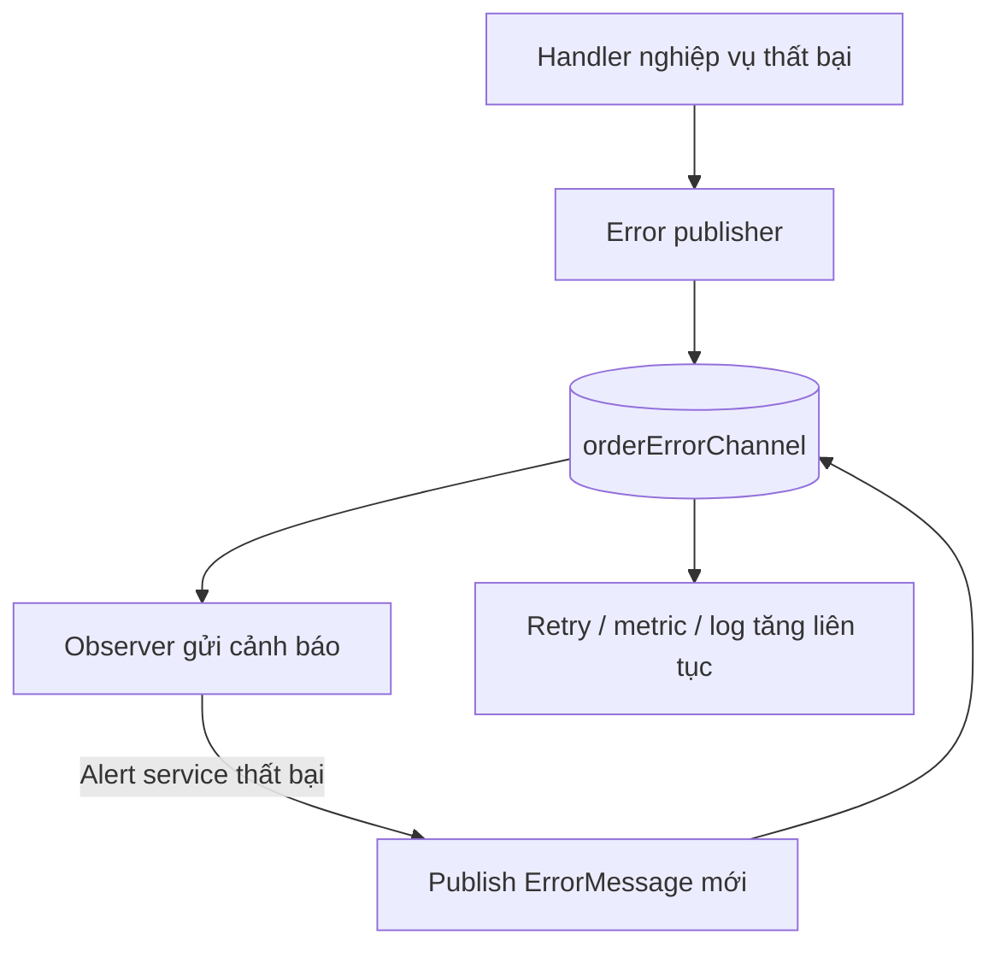
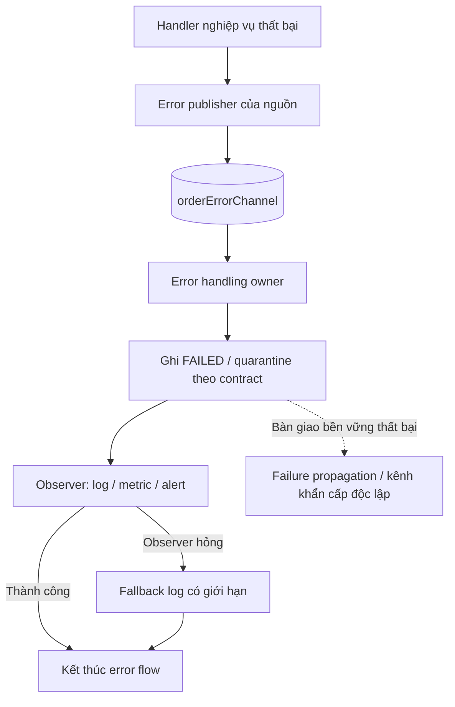

# Theo dõi lỗi không tạo vòng error flow trong Spring Integration

## 1. Bài toán: chính error handler cũng có thể thất bại

Trong module `SPRING_INTEGRATION_PATTERN`, chúng ta học triển khai **Enterprise Integration Patterns** với Spring Integration để tạo luồng thông điệp ít phụ thuộc và dễ mở rộng. Một message có thể đi qua Router, Filter, Transformer, Splitter, Aggregator và Gateway; khi xử lý lỗi, ứng dụng còn cần retry, Error Channel, correlation và các cách kiểm thử, quan sát từng nhánh.

Giả sử một polling endpoint xử lý đơn hàng thất bại, sau đó tạo `ErrorMessage` gửi đến `orderErrorChannel`. Một error flow nhận message lỗi và thực hiện ba việc: ghi trạng thái `FAILED`, tăng metric và gửi cảnh báo. Nếu hệ thống metric hoặc dịch vụ cảnh báo đang hỏng, **error flow lại phát sinh exception**. Nếu ứng dụng biến exception mới thành một `ErrorMessage` rồi **gửi ngược về chính `orderErrorChannel`**, lỗi có thể tự gọi lại error flow vô hạn.

Đây là hiện tượng **vòng error flow** (recursive error handling/error loop). Nó có thể gây:

- Lặp vô hạn hoặc gọi lồng nhau đến `StackOverflowError` khi channel đồng bộ.
- Bùng nổ số lượng `ErrorMessage`, log, retry, cảnh báo và queue backlog khi bất đồng bộ.
- Lỗi giám sát che mất nguyên nhân nghiệp vụ ban đầu.
- Lặp side effect như ghi dead-letter, gửi email hoặc cập nhật trạng thái nhiều lần.
- Khó xác định giao dịch thực sự thất bại ở đâu và lỗi nào chỉ là lỗi thứ cấp.

**Mục tiêu bài này:** Thiết kế Error Channel và observer sao cho hệ thống vẫn phát hiện, ghi nhận và khắc phục lỗi nghiệp vụ **mà không biến chính nhánh xử lý lỗi thành nguồn sinh lỗi lặp**.

Sau bài học, bạn có thể:

1. Phân biệt **lỗi nguồn** (*primary/business-processing failure*) và **lỗi thứ cấp trong error flow** (*secondary failure*).
2. Giải thích vì sao `errorChannel` không phải bộ bắt mọi exception và vì sao rethrow từ error handler không tự quay về caller gốc.
3. Tách người sở hữu phục hồi khỏi observer chuyên ghi metric, log hoặc cảnh báo.
4. Viết Java DSL có kênh lỗi riêng, xử lý lỗi tường minh và observer không tự republish khi thất bại.
5. Kiểm thử monitor hỏng, message thiếu ngữ cảnh, đường thành công và số lần publish để phát hiện vòng lặp.
6. Thiết kế guard theo `errorDepth`/nguồn lỗi, giới hạn retry, deduplication, fallback bền vững và observability.

## 2. Hai tầng lỗi không được đánh đồng

Xét hai lỗi xảy ra liên tiếp:

| Thời điểm | Sự kiện | Câu hỏi cần giải quyết |
| --- | --- | --- |
| Tầng 1 — xử lý nghiệp vụ | Handler gọi backend và gặp timeout. | Message gốc đã được hoàn tất, rollback hay cần retry/quarantine? |
| Tầng 2 — xử lý lỗi | Error handler không ghi được metric, log/audit hoặc alert. | Quan sát lỗi có thể bỏ qua có kiểm soát hay đây là thất bại bàn giao bắt buộc? |

Lỗi tầng 2 **không chứng minh lỗi tầng 1 đã được giải quyết**, và cũng không mặc nhiên yêu cầu xử lý lại nghiệp vụ. Ví dụ bộ đếm metric gặp exception không phải lý do hợp lệ để tự trừ tiền hoặc phát lại đơn hàng thêm một lần.

### Vòng lặp nguy hiểm



Nếu `orderErrorChannel` là `DirectChannel`, việc gửi lại có thể tạo một chuỗi lời gọi lồng nhau ngay trên cùng thread. Nếu dùng `ExecutorChannel` hoặc queue, vòng lặp có thể biến thành **bão message bất đồng bộ**. Việc đổi loại channel **không** tự sửa lỗi thiết kế.

### Thiết kế có điểm dừng



Điểm quan trọng là **không có mũi tên từ lỗi của observer quay về `orderErrorChannel`**. Nếu bước ghi thất bại bền vững là bắt buộc và chính nó gặp lỗi, không được âm thầm đánh dấu message là đã phục hồi; cần một chính sách escalation riêng, có giới hạn, không tự phát lại vô hạn qua cùng kênh.

## 3. Error Channel nhận lỗi như thế nào?

Trong Spring Integration, lỗi được biểu diễn bằng `ErrorMessage` với payload là một `Throwable`. Tùy nguồn phát, nó còn có thể chứa `originalMessage`; một `MessagingException` có thể có `failedMessage`.

Framework có channel quy ước `errorChannel`, thường là điểm tiếp nhận mặc định của các thành phần **thực sự có cơ chế publish lỗi**. Ứng dụng cũng có thể khai báo kênh riêng như `orderErrorChannel`, `paymentErrorChannel` hoặc `inventoryErrorChannel`.

**Không phải mọi exception tự động được publish.** Với `DirectChannel` đồng bộ, exception từ handler thường lan về thread gọi `send(...)` hoặc Gateway. Với poller, adapter hay ranh giới async, một error handler/publisher phù hợp mới quyết định có tạo `ErrorMessage` hay không và gửi tới đâu.

| Vị trí lỗi | Ai thường quan sát exception trước? | Vì sao phải quan tâm vòng lặp? |
| --- | --- | --- |
| Handler đồng bộ sau `DirectChannel` | Caller hoặc advice bao quanh handler. | Catch rồi publish, sau đó lại rethrow cho publisher khác có thể tạo hai lỗi. |
| Handler do poller thực thi | Poller/error handler của polling endpoint nếu được cấu hình. | Lỗi thứ cấp từ error subscriber có thể tiếp tục lan về poller. |
| Handler sau `ExecutorChannel` | Worker/dispatcher/error handler thuộc ranh giới đó. | Không quay lại thread gửi gốc; việc republish có thể khuếch đại async. |
| Error observer trên `errorChannel` | Thread đang phân phối `ErrorMessage` cho subscriber. | Nếu tự phát lại cùng lỗi vào channel, observer có thể gọi chính nó. |

**Global logging subscriber không phải recovery.** Việc một `ErrorMessage` được ghi log không chứng minh công việc đã retry thành công, đã được lưu quarantine hoặc đã rollback/ACK đúng thời điểm.

## 4. Nguyên tắc kiến trúc: owner xử lý lỗi, observer chỉ quan sát

Một cách giảm độ phức tạp là xác định **một chủ sở hữu quyết định kết quả cuối cùng** cho từng message thất bại:

| Trách nhiệm | Owner recovery / failure handling | Observer |
| --- | --- | --- |
| Ghi trạng thái cuối, quarantine hoặc bù trừ | Có | Không |
| Quyết định retry, backoff, idempotency | Có | Không |
| Phân loại nguyên nhân và giữ correlation | Có | Đọc metadata đã chuẩn hóa |
| Ghi metric, tracing hoặc alert | Có thể ghi nhận | Có |
| Khi dependency giám sát hỏng | Không được đổi kết quả nghiệp vụ thành success giả | Ghi fallback có kiểm soát, không republish cùng lỗi |
| Khi lưu thất bại bắt buộc hỏng | Fail/escalate theo contract đã định | Không tự thay owner và gửi message vòng lặp |

Một số nguyên tắc thực hành:

1. **Đặt recovery trước observability không thiết yếu.** Nếu bắt buộc giữ một message lỗi để phát lại, ưu tiên chuyển giao bền vững rồi mới gửi metric/alert. Trong hệ thống có transaction, cần xác minh bước đó thật sự commit.
2. **Observer là side effect phụ.** Không để một metric client tạm thời hỏng tạo retry nghiệp vụ vô hạn.
3. **Không catch mọi exception để im lặng bỏ qua.** Chỉ cô lập lỗi của bước quan sát; thất bại ở nơi lưu bền vững hoặc cập nhật trạng thái phải có xử lý theo contract.
4. **Một lỗi nguồn không được phát hai lần vì hai cơ chế cùng sở hữu.** Tránh tự publish `ErrorMessage` rồi ném lại cho một auto-publisher khác nếu chưa có cơ chế chống trùng.
5. **Không dùng `nullChannel` làm nơi chứa mọi error.** `nullChannel` loại bỏ message có chủ đích; nó không lưu được lỗi cho điều tra hoặc phục hồi.

### “Catch rồi không throw” có luôn đúng?

Không. Nó chỉ hợp lý cho **sự cố observer không thiết yếu**, khi outcome nghiệp vụ và việc lưu thất bại đã được đảm bảo theo contract. Nếu lưu quarantine thất bại, không nên catch và return như thể đã hoàn tất. Ở trường hợp này cần cho phép error publisher/caller biết việc bàn giao thất bại, hoặc sử dụng fallback độc lập có kiểm soát.

## 5. Mẫu dễ gây vòng lặp và cách sửa

### Mẫu sai: observer phát lỗi trở lại cùng channel

```java
// Anti-pattern — mã giả nhằm minh họa, KHÔNG đưa vào production.
void onError(ErrorMessage originalError) {
    try {
        alertService.send(originalError);
    } catch (RuntimeException monitoringFailure) {
        // Nếu chính listener này đang nhận từ "orderErrorChannel",
        // việc publish trở lại nó có thể gọi lại onError vô hạn.
        orderErrorChannel.send(new ErrorMessage(monitoringFailure));
    }
}
```

Ở đây mỗi lần gửi alert thất bại lại sinh thêm một `ErrorMessage`. Exception thứ cấp còn có thể làm mất dấu message gốc nếu không giữ `eventId` hoặc `correlationId`.

### Mẫu đúng cho observer không thiết yếu

```java
void observeWithoutRepublishing(ErrorMessage error) {
    try {
        metrics.recordError(error);
        alertService.notifyIfNeeded(error);
    } catch (RuntimeException observerFailure) {
        // Đã tách khỏi bước lưu thất bại bắt buộc.
        fallbackLogger.warn(
            "Error observation failed; do not republish to errorChannel",
            observerFailure);
    }
}
```

Đây là **mã minh họa**, các service cần được ứng dụng định nghĩa. Trong production, fallback logger cũng có thể bị nghẽn hoặc sinh nhiều log; cần sampling/rate limit và chính sách escalation. Cách này không có nghĩa mất metric là vô hại trong mọi hệ thống: yêu cầu giám sát tuân thủ pháp lý/audit bắt buộc có thể phải dùng kho bền vững hoặc outbox riêng.

## 6. Ví dụ Java DSL: Failure Journal và observer được cô lập

Ví dụ sử dụng **Java 17**, Spring Integration Java DSL, `DirectChannel` và một error publisher **tường minh** để kiểm chứng chính xác điểm phát lỗi. Nó giữ hai trách nhiệm riêng:

- `FailureJournal` đóng vai trò **owner ghi lại công việc thất bại**. Ở ví dụ nó chỉ dùng bộ nhớ để test; production cần thay bằng cơ chế ghi bền vững.
- `ErrorObserver` mô phỏng gửi metric/cảnh báo và có thể cố tình ném exception. Error flow bắt riêng lỗi này, ghi log fallback **một lần** và **không phát thêm `ErrorMessage`**.

Với Spring Boot, có thể dùng `spring-boot-starter-integration`; test dùng JUnit 5, Spring Test và AssertJ, chẳng hạn qua `spring-boot-starter-test`. Mẫu cố ý tránh broker và database để minh họa được vòng lặp ngay trong ứng dụng.

```java
import java.util.List;
import java.util.concurrent.ConcurrentLinkedQueue;
import java.util.concurrent.atomic.AtomicBoolean;
import java.util.concurrent.atomic.AtomicInteger;

import org.slf4j.Logger;
import org.slf4j.LoggerFactory;
import org.springframework.beans.factory.annotation.Qualifier;
import org.springframework.context.annotation.Bean;
import org.springframework.context.annotation.Configuration;
import org.springframework.integration.channel.DirectChannel;
import org.springframework.integration.config.EnableIntegration;
import org.springframework.integration.dsl.IntegrationFlow;
import org.springframework.messaging.Message;
import org.springframework.messaging.MessageChannel;
import org.springframework.messaging.MessagingException;
import org.springframework.messaging.support.ErrorMessage;

@Configuration
@EnableIntegration
public class LoopSafeErrorFlowConfig {

    private static final Logger LOG =
        LoggerFactory.getLogger(LoopSafeErrorFlowConfig.class);

    public record WorkItem(String id, boolean fail) {}
    public record FailureRecord(String eventId, String errorType) {}

    public static class BusinessService {
        private final ConcurrentLinkedQueue<String> completed =
            new ConcurrentLinkedQueue<>();

        public void process(WorkItem item) {
            if (item.fail()) {
                throw new IllegalStateException("Order backend unavailable");
            }
            completed.add(item.id());
        }

        public List<String> completedIds() {
            return List.copyOf(completed);
        }

        public void reset() {
            completed.clear();
        }
    }

    // Mô phỏng việc lưu trạng thái FAILED, KHÔNG phải kho bền vững.
    public static class FailureJournal {
        private final ConcurrentLinkedQueue<FailureRecord> failures =
            new ConcurrentLinkedQueue<>();

        public void record(FailureRecord record) {
            failures.add(record);
        }

        public List<FailureRecord> snapshot() {
            return List.copyOf(failures);
        }

        public void reset() {
            failures.clear();
        }
    }

    public static class ErrorObserver {
        private final AtomicBoolean broken = new AtomicBoolean();
        private final AtomicInteger calls = new AtomicInteger();
        private final AtomicInteger successes = new AtomicInteger();

        public void setBroken(boolean value) {
            broken.set(value);
        }

        public void observe(FailureRecord record) {
            calls.incrementAndGet();
            if (broken.get()) {
                throw new IllegalStateException("Metrics backend unavailable");
            }
            successes.incrementAndGet();
        }

        public int calls() {
            return calls.get();
        }

        public int successes() {
            return successes.get();
        }

        public void reset() {
            broken.set(false);
            calls.set(0);
            successes.set(0);
        }
    }

    public static class ErrorPublisher {
        private final MessageChannel errors;
        private final AtomicInteger published = new AtomicInteger();

        public ErrorPublisher(MessageChannel errors) {
            this.errors = errors;
        }

        public void publish(RuntimeException failure, Message<?> source) {
            published.incrementAndGet();
            if (!errors.send(new ErrorMessage(failure, source))) {
                throw new IllegalStateException(
                    "Cannot hand off ErrorMessage", failure);
            }
        }

        public int publishedCount() {
            return published.get();
        }

        public void reset() {
            published.set(0);
        }
    }

    @Bean
    public BusinessService businessService() {
        return new BusinessService();
    }

    @Bean
    public FailureJournal failureJournal() {
        return new FailureJournal();
    }

    @Bean
    public ErrorObserver errorObserver() {
        return new ErrorObserver();
    }

    @Bean
    public MessageChannel ordersInput() {
        return new DirectChannel();
    }

    @Bean
    public MessageChannel orderErrorChannel() {
        return new DirectChannel();
    }

    @Bean
    public ErrorPublisher errorPublisher(
            @Qualifier("orderErrorChannel") MessageChannel errors) {
        return new ErrorPublisher(errors);
    }

    @Bean
    public IntegrationFlow businessFlow(
            BusinessService service,
            ErrorPublisher publisher) {

        return IntegrationFlow.from("ordersInput")
            .handle((Message<?> message) -> {
                try {
                    service.process((WorkItem) message.getPayload());
                } catch (RuntimeException originalFailure) {
                    // Publisher duy nhất trong ví dụ; không ném lại
                    // sau khi việc bàn giao lỗi đã thành công.
                    publisher.publish(originalFailure, message);
                }
            })
            .get();
    }

    @Bean
    public IntegrationFlow orderErrorFlow(
            FailureJournal journal, ErrorObserver observer) {

        return IntegrationFlow.from("orderErrorChannel")
            .handle((Message<?> message) -> {
                if (!(message instanceof ErrorMessage error)) {
                    throw new IllegalArgumentException(
                        "Error flow expects ErrorMessage");
                }

                FailureRecord record = new FailureRecord(
                    findEventId(error),
                    error.getPayload().getClass().getSimpleName());

                // Bước bắt buộc: KHÔNG nuốt lỗi nếu ghi FAILED thất bại.
                journal.record(record);

                // Bước quan sát phụ: nếu thất bại, không tái phát cùng lỗi.
                try {
                    observer.observe(record);
                } catch (RuntimeException monitoringFailure) {
                    LOG.warn(
                        "Error observer failed for event {}; "
                            + "failure already recorded; no republish",
                        record.eventId(), monitoringFailure);
                }
            })
            .get();
    }

    private static String findEventId(ErrorMessage error) {
        String id = header(error.getOriginalMessage(), "eventId");
        if (id != null) {
            return id;
        }

        int depth = 0;
        for (Throwable cause = error.getPayload();
             cause != null && depth++ < 16;
             cause = cause.getCause()) {
            if (cause instanceof MessagingException messaging) {
                id = header(messaging.getFailedMessage(), "eventId");
                if (id != null) {
                    return id;
                }
            }
        }
        return "unknown";
    }

    private static String header(Message<?> message, String name) {
        if (message == null) {
            return null;
        }
        Object value = message.getHeaders().get(name);
        return value == null ? null : value.toString();
    }
}
```

### Lần theo một lỗi nghiệp vụ

1. Caller gửi message chứa `WorkItem("order-501", true)` và header `eventId=evt-501` vào `ordersInput`.
2. `BusinessService` ném `IllegalStateException`. `businessFlow` bắt lỗi và **chỉ có một chỗ** gọi `ErrorPublisher.publish(...)`.
3. Publisher tạo `ErrorMessage` chứa exception và original message, rồi gửi tới `orderErrorChannel`.
4. `orderErrorFlow` ghi `FailureRecord` vào `FailureJournal`.
5. Observer nhận bản tóm tắt lỗi. Nếu observer thất bại, exception được catch tại **đúng ranh giới quan sát**; flow ghi một log fallback và **không gửi message nào quay lại `orderErrorChannel`**.
6. Sau khi bàn giao lỗi thành công trong bản demo, business handler kết thúc. Giá trị `send() == true` lúc này **không được diễn giải là đơn hàng thành công**: nó chỉ phản ánh lời gọi vào flow đã hoàn tất; outcome nghiệp vụ vẫn là thất bại được ghi lại.

**Giới hạn quan trọng:** `FailureJournal` chỉ lưu trong bộ nhớ. Ví dụ kiểm tra **không có vòng lỗi**, không chứng minh trạng thái `FAILED` sống sót qua crash/restart. Trong hệ thống thật, cần DB/quarantine bền vững, transaction/outbox phù hợp, ACK/redelivery được kiểm soát và kiểm thử độ tin cậy riêng.

## 7. JUnit: khi observer hỏng vẫn không tạo vòng lỗi

Bốn test sau kiểm tra các tình huống có ý nghĩa khác nhau: một lỗi nguồn chỉ được phát một lần; observer bị lỗi không tái publish; message thành công không có error; và `ErrorMessage` thiếu original message vẫn được xử lý an toàn.

```java
import org.junit.jupiter.api.BeforeEach;
import org.junit.jupiter.api.Test;
import org.springframework.beans.factory.annotation.Autowired;
import org.springframework.beans.factory.annotation.Qualifier;
import org.springframework.messaging.MessageChannel;
import org.springframework.messaging.support.ErrorMessage;
import org.springframework.messaging.support.MessageBuilder;
import org.springframework.test.context.junit.jupiter.SpringJUnitConfig;

import static org.assertj.core.api.Assertions.assertThat;

@SpringJUnitConfig(LoopSafeErrorFlowConfig.class)
class LoopSafeErrorFlowTest {

    @Autowired
    @Qualifier("ordersInput")
    MessageChannel ordersInput;

    @Autowired
    @Qualifier("orderErrorChannel")
    MessageChannel orderErrors;

    @Autowired
    LoopSafeErrorFlowConfig.BusinessService business;

    @Autowired
    LoopSafeErrorFlowConfig.FailureJournal journal;

    @Autowired
    LoopSafeErrorFlowConfig.ErrorObserver observer;

    @Autowired
    LoopSafeErrorFlowConfig.ErrorPublisher publisher;

    @BeforeEach
    void reset() {
        business.reset();
        journal.reset();
        observer.reset();
        publisher.reset();
    }

    @Test
    void businessFailureIsPublishedAndRecordedExactlyOnce() {
        var job = new LoopSafeErrorFlowConfig.WorkItem("order-501", true);

        assertThat(ordersInput.send(
            MessageBuilder.withPayload(job)
                .setHeader("eventId", "evt-501")
                .build())).isTrue();

        assertThat(journal.snapshot()).containsExactly(
            new LoopSafeErrorFlowConfig.FailureRecord(
                "evt-501", "IllegalStateException"));
        assertThat(publisher.publishedCount()).isEqualTo(1);
        assertThat(observer.calls()).isEqualTo(1);
        assertThat(observer.successes()).isEqualTo(1);
        assertThat(business.completedIds()).isEmpty();
    }

    @Test
    void monitoringFailureDoesNotPublishErrorRecursively() {
        observer.setBroken(true);
        var job = new LoopSafeErrorFlowConfig.WorkItem("order-502", true);

        assertThat(ordersInput.send(
            MessageBuilder.withPayload(job)
                .setHeader("eventId", "evt-502")
                .build())).isTrue();

        assertThat(journal.snapshot()).containsExactly(
            new LoopSafeErrorFlowConfig.FailureRecord(
                "evt-502", "IllegalStateException"));
        assertThat(publisher.publishedCount()).isEqualTo(1);
        assertThat(observer.calls()).isEqualTo(1);
        assertThat(observer.successes()).isZero();
        assertThat(business.completedIds()).isEmpty();
    }

    @Test
    void successfulWorkProducesNoErrorMessage() {
        var job = new LoopSafeErrorFlowConfig.WorkItem("order-503", false);

        assertThat(ordersInput.send(
            MessageBuilder.withPayload(job).build())).isTrue();

        assertThat(business.completedIds()).containsExactly("order-503");
        assertThat(journal.snapshot()).isEmpty();
        assertThat(publisher.publishedCount()).isZero();
        assertThat(observer.calls()).isZero();
    }

    @Test
    void missingOriginalMessageDoesNotCrashObserver() {
        assertThat(orderErrors.send(
            new ErrorMessage(new IllegalArgumentException("Bad input"))))
            .isTrue();

        assertThat(journal.snapshot()).containsExactly(
            new LoopSafeErrorFlowConfig.FailureRecord(
                "unknown", "IllegalArgumentException"));
        assertThat(observer.calls()).isEqualTo(1);
        // Test chủ động gửi vào channel, không qua ErrorPublisher.
        assertThat(publisher.publishedCount()).isZero();
    }
}
```

### Test này chứng minh điều gì?

- Số lần publish vào error flow của publisher trong ví dụ là **1**, kể cả khi observer ném exception.
- Failure Journal có đúng **một bản ghi** cho một message lỗi đã được xử lý.
- Observer hỏng không khiến error flow chạy lại, không tạo thêm cảnh báo lặp hoặc message lỗi vòng tròn.
- Thiếu `originalMessage` không làm error flow ném thêm exception thứ cấp khi tìm correlation.

Đây là test **đồng bộ, in-memory và có publisher tường minh**. Nó không kiểm tra cơ chế auto-publishing của một poller/adapter riêng hoặc lỗi do broker redelivery. Để đánh giá một pipeline production, cần thêm integration test ở chính endpoint phát lỗi, nhiều consumer, queue/backpressure và việc lưu trạng thái thất bại bền vững.

## 8. Khi thật sự phải xử lý lỗi thứ cấp

Không phải lỗi của error flow đều được phép catch rồi bỏ qua. Cần tách **lỗi giám sát phụ** khỏi **lỗi ảnh hưởng khả năng phục hồi**:

| Lỗi trong error flow | Hậu quả | Chính sách phù hợp |
| --- | --- | --- |
| Metric backend không nhận được bộ đếm | Thiếu dữ liệu quan sát, công việc vẫn có thể đã được ghi thất bại. | Catch, ghi fallback có giới hạn, không republish cùng error. |
| Alert provider timeout | Có thể không có cảnh báo tức thời. | Retry alert ở đường riêng có ngân sách hoặc fallback độc lập; dedup theo incident. |
| Formatter log gặp payload không hợp lệ | Lỗi ngay trong observer. | Chỉ log metadata an toàn, có xử lý thiếu/null và giảm thiểu dữ liệu. |
| Ghi `FAILED` vào database thất bại | Trạng thái công việc có thể mất hoặc sai. | Không tự đánh dấu hoàn tất; fail/escalate theo transaction/adapter contract. |
| Lưu message vào quarantine/DLQ thất bại | Không có dữ liệu để phục hồi. | Fallback bền vững độc lập hoặc cho publisher thấy thất bại bàn giao. |
| Error handler tự ném exception rồi được publish về cùng channel | Tạo vòng lặp hoặc bão lỗi. | Ngăn tái nhập, không republish vào kênh nguồn; route escalation riêng có điểm dừng. |

Nếu recovery owner không thể ghi trạng thái bền vững, một `throw` có thể cần thiết để adapter/poller áp dụng rollback hoặc redelivery đúng contract. Nhưng **rethrow từ error subscriber đi về thread đang gửi `ErrorMessage`**, không tự quay về người gọi nghiệp vụ ban đầu. Khi thiết kế `ExecutorChannel` hoặc poller, phải kiểm tra rõ cơ chế đó làm gì với lỗi thứ cấp.

### Kênh escalation riêng không có nghĩa tự động an toàn

Chuyển lỗi giám sát sang `observerFailureChannel` có thể hữu ích nếu đây là một pipeline **độc lập**, có giới hạn số lần thử, giới hạn hàng đợi và cơ chế lưu/alert cuối cùng. Nếu handler của kênh đó lại gửi exception về kênh cũ, vòng lặp vẫn tồn tại.

**Một điểm dừng cuối cùng** cần được định nghĩa: ví dụ ghi vào local emergency log có sampling, đưa vào một kho bền vững độc lập, hoặc báo trạng thái vận hành qua cơ chế ngoài pipeline. Không xây một chuỗi vô hạn các channel lỗi gọi lẫn nhau.

## 9. Chống vòng lặp bằng metadata và giới hạn

Tách owner và observer là biện pháp chính. Ngoài ra có thể thêm **guard** để tránh lỗi tự quay lại sau khi một endpoint hoặc adapter phát lỗi thứ cấp:

| Guard | Vai trò | Ghi chú |
| --- | --- | --- |
| `originEndpoint` | Ghi nguồn phát sự kiện lỗi đầu tiên. | Giúp tránh chuyển nhầm lỗi quan sát thành lỗi nghiệp vụ. |
| `rootErrorId` | Nhận diện chuỗi lỗi gốc để dedup. | Không dùng ID đơn lẻ làm metric label. |
| `errorDepth` / hop count | Giới hạn số vòng xử lý lỗi. | Khi vượt ngưỡng, chuyển sang điểm dừng an toàn, không gửi lại cùng channel. |
| `attempt` | Ghi số lần retry một thao tác cụ thể. | Phân biệt retry nghiệp vụ và retry gửi alert. |
| Thời hạn/deadline | Không giữ công việc lỗi mãi. | Kiểm soát total elapsed time, không chỉ attempts. |
| Bounded queue/rate limiter | Chặn bão lỗi khi một dependency sụp đổ. | Khi đầy cần chính sách mất mát hoặc lưu bền vững rõ ràng. |

Mã giả guard:

```text
onError(message):
  if message.origin == "error-observer" or message.errorDepth >= 1:
      escalateOnceToIndependentFallback(message)
      return  // Không send trở lại errorChannel đang xử lý

  persistBusinessFailure(message)
  try:
      observe(message)
  catch observerFailure:
      recordFallbackWithRateLimit(observerFailure)
      return
```

Các metadata trên là **quy ước ứng dụng**, không phải mọi `ErrorMessage` đều tự có `errorDepth` hoặc `rootErrorId`. Khi một publisher tạo `ErrorMessage` mới, cần chủ động bảo toàn ngữ cảnh; headers của ErrorMessage không mặc định sao chép nguyên bản headers nghiệp vụ.

**Không dựa vào hop count như giải pháp duy nhất.** Một vòng publish qua queue có thể tạo nhiều message mới mà không giữ header gốc; nếu metadata bị mất, guard sẽ không hiệu quả. Tốt nhất vẫn là **không tạo cạnh quay lại kênh đang xử lý lỗi**.

## 10. Correlation, retry và các EIP liên quan

### Giữ đúng message liên quan đến lỗi

`ErrorMessage.getOriginalMessage()` có thể chứa message mà publisher chọn cung cấp. `MessagingException.getFailedMessage()` có thể chứa message ở bước gặp lỗi. Cả hai đều có thể thiếu hoặc mang dữ liệu **khác nhau** sau một Transformer hay Splitter.

Khi cần lấy `eventId`, `correlationId` hoặc thông tin sequence, kiểm tra nguồn thực sự hiện diện rồi fallback về `unknown` thay vì giả tạo một ID hợp lệ. Đừng cố `toString()` toàn bộ payload để log lỗi: payload có thể lớn, nhạy cảm hoặc chính việc format có thể ném exception.

### Retry của nghiệp vụ khác retry của observer

Một lỗi backend 503 có thể cần **retry nghiệp vụ hữu hạn** với backoff và idempotency. Lỗi gửi alert/metric có thể cần **retry quan sát riêng** với ngân sách nhỏ hơn. Không để các lần thử gửi alert làm tăng lại số attempts thanh toán hoặc giữ nguyên một poller trong thời gian dài.

Trong luồng async, dùng `send() == true` chỉ xác nhận channel đã nhận message, **không** bảo đảm worker, recovery hoặc observer đã hoàn thành. Tách metric `accepted`, `failed`, `persisted` và `observed`.

### Gateway và request-reply

Một Gateway có contract trả reply hoặc ném exception cho caller. Error flow bất đồng bộ ghi cảnh báo không tự tạo reply lỗi cho Gateway đang chờ. Nếu caller cần biết kết quả, phải có error reply hoặc trạng thái công việc với timeout/correlation phù hợp.

### Splitter/Aggregator

Nếu một message con thất bại và được đưa vào Error Channel, Aggregator có thể chờ thiếu `sequenceSize`. Error flow phải có trách nhiệm xác định nhóm cần retry, fail, partial release hoặc timeout. Nếu observer của nhóm đó lại tạo một message lỗi vào cùng kênh, vòng lặp có thể nhân lên **theo từng phần tử**. Correlation ID có ích cho dedup, nhưng **không tự làm Aggregator hoàn thành**.

### Router và Filter

Một Error Router có thể định tuyến theo loại exception: lỗi dữ liệu sang quarantine, timeout sang retry budget, lỗi chưa phân loại sang triage. Nhánh không nhận diện **không nên** mặc định chuyển `ErrorMessage` sang `nullChannel`. Filter để loại một alert trùng có thể hợp lệ, nhưng phải bảo đảm đã có bản ghi lỗi gốc theo contract.

## 11. Observability để phát hiện chính lỗi của error flow

Không chỉ đo số lượng lỗi nghiệp vụ, hãy theo dõi **chất lượng và kết quả của nhánh xử lý lỗi**:

| Metric/tín hiệu minh họa | Ý nghĩa |
| --- | --- |
| `integration_errors_published_total{source,channel}` | Số lỗi nguồn đã được phát tới channel. |
| `integration_failures_persisted_total{flow,result}` | Bao nhiêu trạng thái lỗi/quarantine đã được lưu thành công. |
| `integration_observer_attempts_total{flow,result}` | Số lần gửi metric/alert và tỷ lệ thất bại. |
| `integration_error_flow_reentry_blocked_total{flow}` | Số lần guard chặn phát lỗi quay về error flow. |
| `integration_error_handler_failures_total{flow,stage}` | Lỗi thứ cấp ở bước lưu, phân loại, cảnh báo hoặc logging. |
| `integration_error_queue_depth{flow}` | Backlog error flow bất đồng bộ. |
| `integration_error_oldest_age_seconds{flow}` | Tuổi message lỗi cũ nhất để phát hiện tắc nghẽn. |

Những tên metric này là **gợi ý do ứng dụng triển khai**, không tự tồn tại khi bật Spring Integration. Giá trị `source`, `flow`, `stage` nên là tập nhãn có giới hạn; không dùng từng `eventId`, `orderId` hay `rootErrorId` làm metric label vì tạo cardinality quá cao.

Nếu observer hỏng đồng loạt, việc ghi một stack trace cho **mỗi** ErrorMessage có thể tạo bão log mới. Cần cân nhắc sampling, rate limit, gom cảnh báo theo nguyên nhân, và để lại bộ đếm các lần bị bỏ giám sát nếu cơ chế độc lập còn hoạt động. Với audit có tính pháp lý, việc chấp nhận mất dữ liệu phải được quyết định bằng policy, không tự coi là best-effort.

### Bảng xử lý sự cố

| Triệu chứng | Nguyên nhân có thể | Kiểm tra trước tiên |
| --- | --- | --- |
| Một lỗi tạo hàng nghìn log | Handler gửi lỗi thứ cấp về cùng Error Channel hoặc retry alert không giới hạn. | Vẽ đường publish của observer; tìm cạnh quay lại cùng channel. |
| CPU/stack tăng mạnh khi xử lý ErrorMessage | Recursion qua `DirectChannel`. | Kiểm tra subscriber phát lại `ErrorMessage` trên cùng thread. |
| Backlog lỗi tăng mãi nhưng không thấy recursion | Republish trên queue/executor hoặc sink giám sát quá chậm. | Đo số error published/processed, queue depth và oldest age. |
| Monitor hỏng làm message nghiệp vụ retry lại | Monitor exception thoát ra ngoài recovery owner. | Cô lập khối observer, tách policy retry và transaction. |
| Không có log lỗi nhưng message bị mất | ErrorMessage đi vào `nullChannel` hoặc bị catch rồi bỏ. | Kiểm tra đích lỗi và bước lưu failure bắt buộc. |
| Trạng thái `FAILED` không tồn tại dù error flow đã chạy | Lưu journal thất bại hoặc bị rollback. | Kiểm tra commit/transaction và xử lý lỗi lưu bền vững. |
| Alert trùng cho cùng một lỗi | Nhiều subscriber cùng alert, retry/redelivery hoặc publisher kép. | Chọn owner, dùng dedup key và đo số lần phát thực tế. |

## 12. Checklist trước khi đưa error flow vào production

1. **Nguồn phát:** Mỗi poller/adapter/handler đã có error publisher đúng contract chưa? Có tránh publisher kép không?
2. **Ownership:** Endpoint nào quyết định `FAILED`, retry, quarantine và bù trừ? Observer nào chỉ được ghi log/metric?
3. **Lưu thất bại:** Nếu không ghi được trạng thái hoặc DLQ, liệu upstream có biết và có chính sách rollback/redelivery phù hợp không?
4. **Không tái nhập:** Observer có thể gửi `ErrorMessage` về cùng channel, trực tiếp hoặc qua một service trung gian, không?
5. **Ngân sách:** Error observer có timeout, concurrency limit, bounded queue và giới hạn retry/alert không?
6. **Ngữ cảnh:** Có giữ `eventId`, `correlationId`, endpoint nguồn, cause và trạng thái cuối khi cần không?
7. **Tính toàn vẹn:** Có integration test khi journal/quarantine lỗi, observer lỗi và framework error publisher lỗi thứ cấp không?
8. **Quan sát lỗi của quan sát:** Có cách nhận biết metric/alert pipeline đã hỏng mà không tạo bão log hoặc vòng gửi lỗi không?

## 13. Bài tập thực hành

**Bối cảnh:** Một luồng xử lý thanh toán chạy trên poller. Khi payment provider timeout, endpoint tạo `ErrorMessage`. Error flow vừa lưu trạng thái thất bại, vừa gửi metric và thông báo tới một dịch vụ cảnh báo thường xuyên gặp HTTP 503.

1. Vẽ đường đi khi error observer ném exception và tái publish vào chính `paymentErrorChannel`. Phân tích khác biệt giữa `DirectChannel` và một queue bất đồng bộ.
2. Dựa trên ví dụ `LoopSafeErrorFlowConfig`, cho `ErrorObserver` thất bại. Giải thích vì sao `FailureJournal` có một bản ghi nhưng `ErrorPublisher` không phát thêm ErrorMessage.
3. Viết test cho trường hợp error handler nhận `ErrorMessage` thiếu `originalMessage`, rồi thêm fallback đọc `MessagingException.getFailedMessage()`.
4. Thay `FailureJournal` trong bộ nhớ bằng một kho bền vững giả lập có thể thất bại. Chỉ ra vì sao không được bắt lỗi lưu thất bại và coi công việc là thành công.
5. Thiết kế một kênh escalation **độc lập** có bounded queue, retry hữu hạn và điểm dừng khi cả alert provider cũng không hoạt động.
6. Cho một đơn hàng bị broker redelivery hai lần. Đề xuất `rootErrorId` hoặc dedup key và cách đảm bảo không ghi hai bản ghi phục hồi có side effect không idempotent.
7. Một message con của Splitter thất bại và làm Aggregator thiếu phần. Xác định metadata cần giữ để error flow xử lý nhóm mà không gửi lỗi liên tục.
8. Đề xuất metric phát hiện sự gia tăng bất thường của lỗi thứ cấp và một chính sách rate limiting cho fallback log.

**Câu hỏi tự kiểm tra:** Vì sao một monitor ném exception khác với một failure journal không ghi được dữ liệu? Rethrow từ error subscriber đi về caller nào? Có thể chỉ thêm header `errorDepth` rồi xem như đã ngăn được mọi vòng lặp không? Vì sao không nên đưa `ErrorMessage` tới `nullChannel` để tắt cảnh báo?

## 14. Ghi nhớ

**Theo dõi lỗi an toàn là theo dõi mà không làm lỗi thứ cấp quay lại chính error flow.** Trong Spring Integration, hãy xác định đúng error publisher, phân biệt lỗi nghiệp vụ với lỗi observer, đặt một owner cho việc phục hồi, cô lập metric/alert best-effort và bảo đảm đường fallback có điểm dừng. Đừng để rethrow hoặc republish từ observer kích hoạt lại cùng kênh lỗi; đồng thời đừng nuốt thất bại lưu trạng thái/quarantine bắt buộc. Kiểm thử số lần publish, correlation, retry budget và các tình huống observer hỏng để hệ thống vừa minh bạch vừa không tạo bão lỗi.
