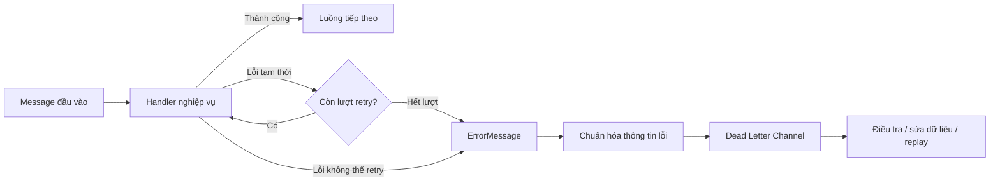

# Dead Letter Channel giữ message không xử lý được

Trong **Spring Integration Pattern** (`SPRING_INTEGRATION_PATTERN`), các thành phần trao đổi với nhau qua message channel để xây dựng luồng thông điệp ít phụ thuộc, dễ mở rộng. Tuy nhiên, một message có thể đi đến handler rồi thất bại liên tiếp: hệ thống đích ngừng hoạt động, dữ liệu sai quy tắc, hoặc một nhánh xử lý không còn đáp ứng điều kiện nghiệp vụ. **Dead Letter Channel (DLC)** là nơi tách riêng những message mà luồng chính không thể xử lý, để điều tra, khắc phục và phát lại có kiểm soát.

Bài này tập trung vào ý nghĩa của DLC, cách kết hợp retry và error channel trong Spring Integration, cách giữ thông tin message gốc, cùng các tình huống cần kiểm thử và theo dõi.

## 1. Vấn đề cần giải quyết

Giả sử hệ thống nhận sự kiện `OrderCreated` và gọi dịch vụ thanh toán. Khi dịch vụ thanh toán tạm thời không phản hồi, ta có thể thử lại. Nhưng nếu thử mãi, luồng sẽ tắc; nếu chỉ ghi log rồi bỏ qua, dữ liệu có thể mất; nếu đưa lại ngay vào đầu luồng, một message lỗi có thể lặp vô hạn.

DLC giải quyết điểm cuối của việc xử lý thất bại:

- Giữ một bản ghi về **message không xử lý được** cùng nguyên nhân lỗi và ngữ cảnh cần thiết.
- Cô lập message lỗi để message hợp lệ tiếp tục được xử lý.
- Cho phép đội vận hành điều tra, sửa nguyên nhân và phát lại theo quy tắc.
- Tạo dấu vết để theo dõi tỷ lệ lỗi và kiểm tra dữ liệu bị kẹt.

**DLC không tự sửa lỗi.** Nó là một *kênh chuyển giao trách nhiệm* từ xử lý tự động sang quy trình xử lý ngoại lệ. Việc message đã được gửi tới DLC chỉ có giá trị nếu nơi nhận lưu được thông tin và có cách xử lý tiếp.

### Luồng xử lý điển hình



Trong một hệ thống thực tế, hai chính sách cần được xác định rõ: **lỗi nào được thử lại** và **khi nào chuyển sang DLC**. Retry nên có giới hạn, có backoff và được phân loại theo nguyên nhân. Lỗi dữ liệu không hợp lệ thường nên chuyển sang nhánh xử lý ngoại lệ ngay, còn timeout tạm thời có thể thử lại.

## 2. Phân biệt `errorChannel`, Dead Letter Channel và broker DLQ

| Thành phần | Vai trò | Điều cần lưu ý |
| --- | --- | --- |
| `errorChannel` của Spring Integration | Vận chuyển `ErrorMessage` chứa ngoại lệ để một error flow xử lý | Là cơ chế phát lỗi, không mặc nhiên là nơi lưu message lỗi lâu dài |
| Dead Letter Channel | Đích logic nhận các message đã được xác định là không thể tiếp tục xử lý | Do ứng dụng thiết kế; có thể là channel, hàng đợi, bảng dữ liệu hoặc adapter ra broker |
| Dead-letter queue (DLQ) của RabbitMQ/JMS hoặc cơ chế tương đương ở broker | Đích lưu message theo chính sách dead-letter/redelivery của hạ tầng | Cần cấu hình broker, xác nhận/rollback và chính sách tiêu thụ riêng; không tự xuất hiện chỉ vì khai báo Spring Integration channel |

Spring Integration thường gửi ngoại lệ dưới dạng `org.springframework.messaging.support.ErrorMessage`: **payload của ErrorMessage là `Throwable`**, thường là `MessagingException`. Message ban đầu có thể được tìm từ `ErrorMessage.getOriginalMessage()` hoặc `MessagingException.getFailedMessage()`, tùy cách lỗi được tạo. Không nên giả định mọi `ErrorMessage` đều có message gốc.

Một chi tiết quan trọng liên quan đến ngữ cảnh thực thi:

- Với `DirectChannel` và handler chạy đồng bộ, ngoại lệ thường truyền ngược về người gửi. Nó **không tự động** được chuyển sang global `errorChannel`.
- Với poller hoặc phần xử lý bất đồng bộ do Spring Integration quản lý, framework có thể phát `ErrorMessage` tới error channel. Nếu message có header `errorChannel`, kênh đó được ưu tiên; nếu không, cơ chế error handler thường sử dụng global bean `errorChannel`.
- Có thể chủ động dùng `RequestHandlerRetryAdvice` và `ErrorMessageSendingRecoverer` để chuyển ngoại lệ cuối cùng sau retry sang kênh chỉ định, kể cả khi luồng ban đầu là đồng bộ.

Vì vậy, **đặt tên kênh là “deadLetters” không đủ để mọi ngoại lệ đi vào đó**. Cần cấu hình điểm phát lỗi, tuyến định hướng và nơi lưu.

## 3. Quyết định message có đi vào DLC hay không

| Loại lỗi | Ví dụ | Chính sách thường dùng |
| --- | --- | --- |
| Tạm thời (*transient*) | Timeout, lỗi mạng ngắn hạn, HTTP 503 | Retry giới hạn với backoff; hết lượt thì chuyển DLC |
| Không thể phục hồi bằng retry (*permanent*) | Thiếu trường bắt buộc, schema sai, mã nghiệp vụ không hợp lệ | Bỏ qua retry không có ích; chuyển DLC hoặc nhánh dữ liệu lỗi |
| Trùng lặp | Event có `eventId` đã xử lý | Xử lý idempotent hoặc bỏ qua có kiểm soát; không nhất thiết là dead letter |
| Lỗi hệ thống nghiêm trọng | Cấu hình sai, chứng thực hết hạn, kho DLC không ghi được | Báo động và xử lý sự cố; không được âm thầm coi là xử lý thành công |

Tùy mức độ tin cậy yêu cầu, cần có **kho lưu bền vững** cho DLC. `QueueChannel` mặc định lưu trong bộ nhớ thích hợp để minh họa, nhưng không bảo đảm message sống sót sau khi ứng dụng khởi động lại. Với dữ liệu quan trọng, cân nhắc kho dữ liệu giao dịch, Message Store phù hợp hoặc DLQ của broker; kiểm tra cả thời điểm xác nhận message nguồn và việc lưu bản ghi lỗi.

## 4. Ví dụ Spring Integration: retry rồi chuyển message vào DLC

Ví dụ dùng **Spring Integration 6.x, Spring Retry và Java 17+**. Mỗi message chứa một `orderId` kiểu `String`. Handler mô phỏng dịch vụ đích bị lỗi với ID bắt đầu bằng `FAIL-`. Sau tối đa **3 lần gọi handler** (bao gồm lần đầu), `ErrorMessageSendingRecoverer` gửi lỗi vào `ordersErrors`; error flow chuyển lỗi thành `DeadLetterRecord` và đưa vào `ordersDeadLetters`.

Phụ thuộc cần có trong dự án Spring Boot dùng Spring Integration 6.x: `spring-boot-starter-integration` và `org.springframework.retry:spring-retry`. Ví dụ dùng kho `QueueChannel` trong bộ nhớ chỉ để quan sát hành vi.

```java
import java.time.Instant;
import java.util.UUID;
import java.util.concurrent.atomic.AtomicInteger;

import org.springframework.beans.factory.annotation.Qualifier;
import org.springframework.context.annotation.Bean;
import org.springframework.context.annotation.Configuration;
import org.springframework.integration.channel.DirectChannel;
import org.springframework.integration.channel.QueueChannel;
import org.springframework.integration.config.EnableIntegration;
import org.springframework.integration.dsl.IntegrationFlow;
import org.springframework.integration.handler.advice.ErrorMessageSendingRecoverer;
import org.springframework.integration.handler.advice.RequestHandlerRetryAdvice;
import org.springframework.messaging.Message;
import org.springframework.messaging.MessageChannel;
import org.springframework.messaging.MessagingException;
import org.springframework.messaging.support.ErrorMessage;
import org.springframework.retry.backoff.FixedBackOffPolicy;
import org.springframework.retry.policy.SimpleRetryPolicy;
import org.springframework.retry.support.RetryTemplate;

@Configuration
@EnableIntegration
public class DeadLetterExample {

    @Bean
    MessageChannel ordersInput() {
        return new DirectChannel();
    }

    @Bean
    MessageChannel ordersErrors() {
        return new DirectChannel();
    }

    @Bean
    QueueChannel ordersDeadLetters() {
        return new QueueChannel(100); // Chỉ dùng để demo; chưa bền vững
    }

    @Bean
    OrderProcessor orderProcessor() {
        return new OrderProcessor();
    }

    @Bean
    RequestHandlerRetryAdvice ordersRetry(
            @Qualifier("ordersErrors") MessageChannel errors) {
        RetryTemplate retry = new RetryTemplate();
        retry.setRetryPolicy(new SimpleRetryPolicy(3)); // Tổng cộng 3 lần

        FixedBackOffPolicy backoff = new FixedBackOffPolicy();
        backoff.setBackOffPeriod(200); // 200 ms giữa các lần thử
        retry.setBackOffPolicy(backoff);

        RequestHandlerRetryAdvice advice = new RequestHandlerRetryAdvice();
        advice.setRetryTemplate(retry);
        advice.setRecoveryCallback(new ErrorMessageSendingRecoverer(errors));
        return advice;
    }

    @Bean
    IntegrationFlow ordersFlow(
            OrderProcessor processor, RequestHandlerRetryAdvice ordersRetry) {
        return IntegrationFlow.from("ordersInput")
                .handle(processor, "process", spec -> spec.advice(ordersRetry))
                .get();
    }

    @Bean
    IntegrationFlow ordersDeadLetterFlow() {
        return IntegrationFlow.from("ordersErrors")
                .<ErrorMessage, DeadLetterRecord>transform(
                        DeadLetterExample::toDeadLetter)
                .channel("ordersDeadLetters")
                .get();
    }

    private static DeadLetterRecord toDeadLetter(ErrorMessage error) {
        Message<?> source = error.getOriginalMessage();

        // Một số nguồn lỗi chỉ lưu message gốc trong MessagingException.
        if (source == null) {
            for (Throwable current = error.getPayload();
                    current != null; current = current.getCause()) {
                if (current instanceof MessagingException messagingException
                        && messagingException.getFailedMessage() != null) {
                    source = messagingException.getFailedMessage();
                    break;
                }
            }
        }

        Throwable rootCause = error.getPayload();
        while (rootCause.getCause() != null) {
            rootCause = rootCause.getCause();
        }

        Object correlation = source == null
                ? null : source.getHeaders().get("correlationId");

        return new DeadLetterRecord(
                UUID.randomUUID().toString(),
                source == null ? null : source.getHeaders().getId().toString(),
                correlation == null ? null : correlation.toString(),
                source == null ? null : String.valueOf(source.getPayload()),
                rootCause.getClass().getName(),
                rootCause.getMessage(),
                Instant.now());
    }

    public static class OrderProcessor {
        private final AtomicInteger attempts = new AtomicInteger();

        public void process(String orderId) {
            attempts.incrementAndGet();
            if (orderId.startsWith("FAIL-")) {
                throw new IllegalStateException("Demo: dịch vụ đích tạm lỗi");
            }
            // Xử lý nghiệp vụ với orderId hợp lệ.
        }

        public int attemptCount() {
            return attempts.get();
        }
    }

    public record DeadLetterRecord(
            String deadLetterId,
            String sourceMessageId,
            String correlationId,
            String originalPayload,
            String errorType,
            String errorMessage,
            Instant failedAt) {}
}
```

Điểm cần quan sát trong ví dụ:

1. `ordersInput` là `DirectChannel`. Thành công thì handler kết thúc bình thường; không có bản ghi DLC.
2. `ordersRetry` bọc **riêng handler nghiệp vụ**. Ba lần thử thất bại dẫn đến `ErrorMessageSendingRecoverer` phát `ErrorMessage` tới `ordersErrors`.
3. `ordersDeadLetterFlow` cố lấy message nguồn, ghi dấu vết, chuyển sang `ordersDeadLetters`. `sourceMessageId` và `correlationId` giúp truy vết, còn mã `deadLetterId` nhận diện riêng lần ghi lỗi.
4. `ordersDeadLetters` là một `QueueChannel` giới hạn 100 bản ghi. Khi hàng đợi đầy, flow xử lý lỗi có thể tiếp tục thất bại. Hệ thống sản xuất cần bảo đảm sức chứa, lưu bền vững và cảnh báo.

**Giới hạn của ví dụ:** `SimpleRetryPolicy(3)` đang thử lại tất cả ngoại lệ phù hợp chính sách mặc định, kể cả lỗi giả lập bằng `IllegalStateException`. Trong ứng dụng thật, phân loại exception để tránh retry lỗi dữ liệu vĩnh viễn. Ví dụ cũng chưa giải quyết tính nguyên tử giữa nhận message đầu vào và lưu DLC, không bảo đảm exactly-once, và việc ghi `errorMessage` thẳng từ exception cần được kiểm soát để không lộ thông tin nhạy cảm.

### Gửi thử message

Trong một test hoặc thành phần gọi luồng:

```java
Message<?> request = org.springframework.messaging.support.MessageBuilder
        .withPayload("FAIL-42")
        .setHeader("correlationId", "order-42")
        .build();

ordersInput.send(request);
Message<?> dead = ordersDeadLetters.receive(1_000);
// dead.getPayload() là DeadLetterRecord với originalPayload = "FAIL-42".
```

`ordersDeadLetters.receive(...)` **lấy và loại phần tử ra khỏi queue**; thao tác này chỉ nên dùng khi kiểm tra ví dụ hoặc khi đã có quy trình tiêu thụ phù hợp. Không dùng thao tác đọc tiêu hủy này như cách xem dashboard DLC trong sản xuất.

## 5. Cần lưu gì trong một dead letter?

Một bản ghi DLC hữu ích phải cho biết **message nào, hỏng ở đâu, vì sao, vào lúc nào và có thể xử lý lại bằng cách nào**.

| Nhóm dữ liệu | Gợi ý trường | Công dụng |
| --- | --- | --- |
| Định danh | `deadLetterId`, `messageId`, `eventId`, `correlationId` | Truy vết, khử trùng lặp, nối các nhánh splitter/aggregator/gateway |
| Nội dung nguồn | Payload hoặc tham chiếu đến payload gốc, schema version, content type | Khôi phục dữ liệu đúng định dạng ban đầu |
| Vị trí lỗi | Component/flow name, destination, exception class, mã lỗi ổn định | Xác định nhánh bị lỗi và nhóm nguyên nhân |
| Retry | Số lần thử, thời điểm thử cuối, chính sách retry đã áp dụng | Phân biệt lỗi nhất thời và hết lượt retry |
| Vòng đời | `failedAt`, trạng thái `NEW / TRIAGED / REPLAYED / DISCARDED`, người thao tác | Quản lý SLA và vòng đời xử lý |
| Replay | `replayCount`, `lastReplayAt`, `replayOf`, khóa idempotency | Ngăn lặp vô hạn và tránh thực thi nghiệp vụ trùng |

Không nhất thiết lưu toàn bộ object Java đã serialize: cấu trúc có thể đổi theo phiên bản, hoặc payload chứa thông tin cá nhân. Với hệ thống lớn, có thể lưu payload dưới dạng dữ liệu có version tại kho riêng và để DLC giữ một tham chiếu được kiểm soát truy cập. Chỉ log metadata và mã lỗi cần thiết; áp dụng thời hạn lưu, che dữ liệu nhạy cảm và quyền xem/phát lại theo vai trò.

## 6. Vận hành, điều tra và replay an toàn

Một quy trình xử lý dead letter thực tế có thể đi theo thứ tự:

1. **Phát hiện:** cảnh báo khi `dlc_received_total` tăng bất thường, khi message nằm trong DLC quá SLA hoặc lưu DLC thất bại.
2. **Phân loại:** nhóm theo lỗi dữ liệu, lỗi kết nối, cấu hình hoặc phụ thuộc bên ngoài; xác định lỗi còn tái hiện hay đã được khắc phục.
3. **Khắc phục:** sửa dữ liệu ở nguồn có thẩm quyền hoặc sửa hệ thống đích; ghi lại nguyên nhân và tác động.
4. **Replay có kiểm soát:** chọn những message đủ điều kiện, đưa lại vào luồng phù hợp với giới hạn tốc độ, đánh dấu số lần replay và bảo toàn correlation.
5. **Đóng hồ sơ:** chỉ chuyển trạng thái khi đã xác nhận kết quả, có audit trail; giữ chính sách retention hoặc xóa theo quy định dữ liệu.

Replay cần quan tâm tới **idempotency**: nếu handler từng thực hiện một phần thao tác trước khi lỗi (ví dụ đã trừ tiền nhưng chưa ghi nhận phản hồi), chạy lại có thể gây tác dụng phụ lần hai. Nên dùng khóa nghiệp vụ như `orderId + operationType` hoặc `eventId` để kiểm tra đã xử lý, và cân nhắc transactional outbox/inbox khi yêu cầu tin cậy cao.

Nếu một message từng đến DLC mà sau replay lại thất bại, cần tăng `replayCount`, ghi phiên replay và có giới hạn số vòng. Không cấu hình `deadLetters → ordersInput` theo vòng kín vô điều kiện.

### Theo dõi những tín hiệu nào?

- Tốc độ nhận message và tỷ lệ chuyển DLC theo endpoint, loại lỗi và phiên bản triển khai.
- Tuổi của message cũ nhất, số message chưa xử lý và tỷ lệ replay thành công.
- Độ trễ từ lúc phát hiện lỗi đến khi đã lưu bền vững; số lần ghi DLC thất bại.
- `correlationId` và dấu vết từng nhánh xử lý (đặc biệt khi dùng Router, Splitter, Aggregator); tránh ghi trực tiếp payload nhạy cảm vào metrics label.

Số liệu nên thể hiện rõ message **đã xử lý thành công**, **đã được giữ tại DLC** và **đang chờ điều tra** là các trạng thái khác nhau. Tỷ lệ lỗi thấp không đồng nghĩa luồng an toàn nếu kênh nhận dead letter âm thầm mất dữ liệu.

## 7. Kiểm thử các nhánh xử lý

Với cấu hình demo trên, có thể kiểm thử luồng Spring Integration bằng `spring-test`, JUnit 5 và AssertJ. Kiểm tra tối thiểu:

- Message hợp lệ được xử lý một lần và **không** xuất hiện trong DLC.
- Message `FAIL-42` được thử ba lần, rồi xuất hiện **một bản ghi** trong DLC với `sourceMessageId` và `correlationId`.
- Khi thử riêng phần chuyển lỗi, thiếu `originalMessage` không gây `NullPointerException`; error flow vẫn giữ được thông tin lỗi hoặc đánh dấu thiếu dữ liệu nguồn.
- Khi kho DLC không khả dụng, hệ thống phát hiện được lỗi ghi và không báo sai rằng đã lưu thành công.
- Replay không tạo lại tác vụ nghiệp vụ đã được hoàn tất trước đó.

Ví dụ kiểm thử nhánh lỗi:

```java
import static org.assertj.core.api.Assertions.assertThat;

import org.junit.jupiter.api.Test;
import org.springframework.beans.factory.annotation.Autowired;
import org.springframework.beans.factory.annotation.Qualifier;
import org.springframework.messaging.Message;
import org.springframework.messaging.MessageChannel;
import org.springframework.messaging.PollableChannel;
import org.springframework.messaging.support.MessageBuilder;
import org.springframework.test.context.junit.jupiter.SpringJUnitConfig;

@SpringJUnitConfig(DeadLetterExample.class)
class DeadLetterExampleTest {
    @Autowired
    @Qualifier("ordersInput")
    MessageChannel input;

    @Autowired
    @Qualifier("ordersDeadLetters")
    PollableChannel deadLetters;

    @Autowired
    DeadLetterExample.OrderProcessor processor;

    @Test
    void exhaustedRetriesGoToDeadLetterChannel() {
        Message<String> request = MessageBuilder.withPayload("FAIL-42")
                .setHeader("correlationId", "order-42")
                .build();
        int attemptsBefore = processor.attemptCount();

        assertThat(input.send(request)).isTrue();

        Message<?> stored = deadLetters.receive(1_000);
        assertThat(stored).isNotNull();
        var record = (DeadLetterExample.DeadLetterRecord) stored.getPayload();

        assertThat(processor.attemptCount() - attemptsBefore).isEqualTo(3);
        assertThat(record.originalPayload()).isEqualTo("FAIL-42");
        assertThat(record.sourceMessageId())
                .isEqualTo(request.getHeaders().getId().toString());
        assertThat(record.correlationId()).isEqualTo("order-42");
        assertThat(deadLetters.receive(0)).isNull();
    }
}
```

Đây là **minh họa về hành vi**; test cần chạy trong dự án có các thư viện tương ứng. Bài không khẳng định đã thực thi test trên repository. Khi chuyển sang broker hoặc kho dữ liệu thật, cần bổ sung integration test về transaction, redelivery, hỏng kết nối và khả năng khôi phục sau khi ứng dụng restart.

## 8. Lỗi triển khai thường gặp

| Sai sót | Hậu quả | Cách khắc phục |
| --- | --- | --- |
| Nghĩ rằng global `errorChannel` tự lưu mọi message thất bại | Có thể chỉ log lỗi, hoặc lỗi đồng bộ ném thẳng về caller | Xác định cơ chế phát lỗi và cấu hình flow chuyển sang DLC |
| Retry vô hạn, không phân loại lỗi | Nghẽn luồng, tăng tải hệ thống đích | Đặt ngân sách retry và backoff; không retry lỗi dữ liệu vĩnh viễn |
| Coi `QueueChannel` trong bộ nhớ là kho bền vững | Mất message khi restart hoặc đầy queue | Sử dụng kho bền vững, kiểm tra giao dịch và cảnh báo lỗi lưu |
| Chỉ lưu stack trace, bỏ `messageId/correlationId` | Khó xác định dữ liệu lỗi và nhánh xử lý | Lưu metadata nguồn, loại lỗi và thời gian dưới schema ổn định |
| Replay ngay khi chưa chữa nguyên nhân | Tạo vòng lặp dead letter | Triaging, giới hạn replay và lưu lịch sử |
| Replay thiếu idempotency | Có thể tạo giao dịch, email hoặc thanh toán trùng | Khóa idempotency, đối chiếu trạng thái xử lý trước khi phát lại |

## 9. Câu hỏi tự kiểm tra

1. Vì sao `errorChannel` và DLC có vai trò khác nhau? Khi nào lỗi của `DirectChannel` đi thẳng về caller?
2. Với `SimpleRetryPolicy(3)`, handler thất bại bao nhiêu lần trước khi gọi recovery callback?
3. Vì sao nên giữ cả `sourceMessageId` và `correlationId` cho message bị lỗi sau một luồng có nhiều nhánh?
4. Điều gì xảy ra nếu message đã ghi vào DLC trong bộ nhớ và tiến trình bị restart?
5. Trước khi phát lại sự kiện thanh toán từ DLC, cần kiểm tra những điều kiện nào để tránh trừ tiền hai lần?

## Tham khảo

- [Spring Integration 6.4 — Error Handling](https://docs.spring.io/spring-integration/reference/6.4/error-handling.html): kênh lỗi, `ErrorMessage`, xử lý đồng bộ và bất đồng bộ.
- [Spring Integration 6.4 — Provided Advice Classes](https://docs.spring.io/spring-integration/reference/6.4/handler-advice/classes.html): `RequestHandlerRetryAdvice`, retry và `ErrorMessageSendingRecoverer`.

> **Ghi nhớ:** Dead Letter Channel là một nhánh được thiết kế có chủ đích để **giữ, giải thích và xử lý tiếp** các message mà luồng chính không thể hoàn tất. Chỉ nên coi thao tác chuyển sang DLC là thành công khi thông tin cần phục hồi đã thực sự được lưu theo mức độ tin cậy mà hệ thống yêu cầu.
