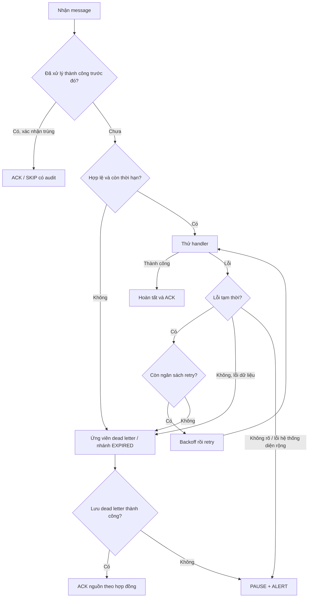

# Điều kiện đưa message vào dead letter

Trong module **SPRING_INTEGRATION_PATTERN**, ta sử dụng Spring Integration để triển khai các **Enterprise Integration Patterns** (EIP): Router, Filter, Transformer, Splitter, Aggregator, Gateway, retry, error channel và correlation. Các thành phần được nối qua message channel, nhờ đó luồng xử lý ít phụ thuộc nhau và dễ mở rộng. Tuy nhiên, khi một message không thể tiếp tục đi qua một nhánh xử lý, hệ thống phải quyết định: **thử lại, loại bỏ có chủ đích, tạm dừng để xử lý sự cố, hay chuyển vào dead letter?**

**Dead Letter Channel (DLC)** là đích logic dùng để giữ thông điệp không thể xử lý theo chính sách đã định, cùng thông tin phục vụ điều tra và phát lại (*replay*). Nếu triển khai đích này bằng hàng đợi do broker quản lý, ta thường gọi là **dead-letter queue (DLQ)**. Một message không nên bị đưa vào DLC chỉ vì xuất hiện exception: quyết định còn phụ thuộc **loại lỗi, ngân sách retry, thời hạn nghiệp vụ, khả năng xử lý trùng lặp và độ tin cậy của nơi lưu**.

Mục tiêu bài học:

1. Xác định các điều kiện cụ thể khiến message trở thành dead letter.
2. Phân biệt lỗi nên retry, lỗi vĩnh viễn, lỗi mang tính hệ thống và message đã xử lý.
3. Thiết kế thứ tự ra quyết định và ánh xạ vào error flow của Spring Integration.
4. Kiểm thử, theo dõi và bảo vệ hệ thống khỏi mất message hoặc vòng lặp retry/replay.

## 1. Dead letter là kết quả của chính sách xử lý lỗi

Giả sử luồng nhận `OrderCreated`, kiểm tra dữ liệu, rồi gọi hệ thống thanh toán:

- `orderId` thiếu hoặc định dạng sai: gửi lại nguyên message nhiều lần cũng không làm nó hợp lệ.
- Dịch vụ thanh toán timeout: thử lại với khoảng nghỉ có thể giải quyết được.
- Dịch vụ thanh toán timeout sau toàn bộ các lần thử: giữ message để điều tra và replay khi dịch vụ hồi phục.
- Hệ thống mất quyền truy cập thanh toán do cấu hình chung sai: nếu toàn bộ message đều được đẩy vào DLQ, kho lỗi sẽ đầy mà không giải quyết được sự cố. Cần cảnh báo và có thể tạm ngừng nhận.
- Message có `eventId` đã xử lý thành công: có thể xác nhận là trùng và bỏ qua một cách an toàn; đó không phải lý do tự động đưa vào DLC.

Điểm khác biệt quan trọng là **một lần thất bại không đồng nghĩa đã hết cơ hội xử lý**. Ta chỉ gọi một message là dead letter khi có quy tắc rõ ràng rằng nhánh xử lý hiện tại không được phép hoặc không thể tiếp tục.

### Bốn kết quả xử lý thường gặp

| Kết quả | Khi nào | Hành động |
| --- | --- | --- |
| `ACK / SKIP` | Đã xử lý, trùng lặp được xác nhận, hoặc sự kiện được phép bỏ qua | Ghi nhận kết quả rồi xác nhận nguồn theo chính sách |
| `RETRY` | Lỗi tạm thời, còn lượt thử và còn thời hạn xử lý | Thử lại với backoff, giới hạn số lần |
| `DEAD_LETTER` | Lỗi vĩnh viễn, hoặc lỗi tạm thời đã hết ngân sách retry, hoặc quá thời hạn theo chính sách | Lưu message gốc và lý do lỗi vào nơi lưu DLC đáng tin cậy |
| `PAUSE_AND_ALERT` | Sự cố hệ thống diện rộng, lỗi không xác định cần can thiệp, hoặc chính kho dead letter không dùng được | Dừng/giảm tốc nhận, cảnh báo, giữ quyền phát lại từ nguồn nếu có |

`ACK` trong bảng là khái niệm xác nhận/hoàn tất ở mức ứng dụng. Cách ack thực tế tùy adapter và broker (JMS, AMQP, Kafka...), transaction và cấu hình consumer.

## 2. Điều kiện cụ thể để đưa message vào dead letter

### 2.1. Dữ liệu đầu vào vi phạm quy tắc không thể tự sửa

**Điều kiện:** payload không giải mã được, thiếu trường bắt buộc, vi phạm schema, hoặc vi phạm quy tắc nghiệp vụ mà việc thử lại nguyên dữ liệu sẽ không thay đổi kết quả.

Ví dụ: một message yêu cầu tạo đơn hàng có `quantity = -3` hoặc `currency = "XYZ"` không được hệ thống chấp nhận. Dù gọi handler ba lần, dữ liệu vẫn sai.

**Quyết định điển hình:** `DEAD_LETTER` ngay sau lần đánh giá đầu tiên, với mã lỗi ổn định như `INVALID_PAYLOAD` hoặc `BUSINESS_RULE_REJECTED`; không retry một cách máy móc.

Lưu ý: trong một số bài toán, dữ liệu sai là sự kiện bị từ chối hợp lệ, được trả lỗi cho client và ghi audit, **không nhất thiết** phải đi DLC. Chọn DLC khi cần giữ message bất đồng bộ để điều tra, sửa ở nguồn hoặc xử lý lại.

### 2.2. Lỗi tạm thời đã dùng hết ngân sách retry

**Điều kiện:** handler lỗi do nguyên nhân có thể phục hồi như timeout hoặc HTTP 503, nhưng đã thử đủ số lần theo chính sách và vẫn thất bại.

Ví dụ: cấu hình tổng cộng **3 lần gọi** (lần đầu + 2 lần thử lại). Nếu tất cả thất bại, chuyển tới error flow để tạo dead letter với lý do `RETRY_EXHAUSTED`.

Phải tách ba giá trị khác nhau:

- `attemptsMade`: số lần handler **đã được gọi**, bao gồm lần đầu.
- `maxAttempts`: giới hạn tổng số lần gọi handler tại tầng retry đang xét.
- `replayCount`: số lần message đã được người vận hành hoặc cơ chế replay gửi lại **từ DLC**; không đồng nhất với `attemptsMade`.

Thời gian backoff, timeout của mỗi request và số tầng retry có thể khiến thời gian thực tế lớn hơn nhiều so với dự kiến. Nếu vừa retry trong Spring Integration, vừa retry ở HTTP client, lại còn có broker redelivery, cần tính **ngân sách retry tổng** để tránh khuếch đại tải.

### 2.3. Message không còn giá trị khi xử lý muộn

**Điều kiện:** deadline nghiệp vụ đã qua hoặc TTL của message hết hạn và nghiệp vụ không cho phép xử lý tiếp.

Ví dụ: cập nhật giá vé chỉ có hiệu lực tới 10:00; đến 10:30, việc đẩy lại sự kiện cập nhật giá có thể tạo kết quả sai.

**Quyết định:** tùy hợp đồng dữ liệu, chuyển tới DLC với mã `BUSINESS_DEADLINE_EXCEEDED` để có bằng chứng, hoặc đưa sang một nhánh `EXPIRED` để thống kê. **Không mặc định** message hết hạn phải vào DLQ của broker: TTL của broker và deadline nghiệp vụ là hai cơ chế khác nhau.

### 2.4. Message lặp đi lặp lại với cùng lỗi không thể xử lý (*poison message*)

**Điều kiện:** một message liên tục gây thất bại có tính quyết định, chẳng hạn payload luôn làm parser ném exception hoặc thiếu dữ liệu mà downstream không thể tiêu thụ.

**Quyết định:** cô lập vào DLC/quarantine sau khi xác định lỗi hoặc hết số lần thử theo cấu hình; tránh để consumer đọc lại cùng message vô hạn, làm kẹt các message ở phía sau.

Ngược lại, một lỗi xuất hiện ở nhiều message vì **toàn hệ thống đích đang ngừng hoạt động** có thể cần `PAUSE_AND_ALERT` hoặc circuit breaker. Nếu không, DLC sẽ trở thành nơi chứa toàn bộ lưu lượng chứ không còn là nơi cô lập số ít message bất thường.

### 2.5. Không có tuyến xử lý hợp lệ và không thể khắc phục trong luồng hiện tại

Trong **Router**, nếu một loại sự kiện không có handler phù hợp, có thể áp dụng chính sách đưa vào nhánh `UNROUTABLE`/DLC để bảo toàn dữ liệu. Tuy nhiên, nhiều Router hỗ trợ `defaultOutputChannel` hoặc chính sách bỏ qua; đó là lựa chọn thiết kế, **không phải hành vi tự động** của mọi Router.

Trong **Splitter/Aggregator**, thiếu nhánh hoặc quá thời gian chờ correlation có thể dẫn đến nhóm message không hoàn chỉnh. Có chuyển nhóm đó vào DLC hay dùng partial result, timeout flow, hoặc quy trình bù trừ phải do nghiệp vụ quyết định. Khi lưu, nên giữ `correlationId` và metadata chuỗi như `sequenceNumber`, `sequenceSize` nếu có.

### 2.6. Replay vẫn thất bại hoặc chạm giới hạn replay

Một message đã vào DLC có thể được sửa dữ liệu rồi phát lại. Nếu nó tiếp tục thất bại, phải có giới hạn vòng lặp, ví dụ:

- Cho phép tối đa 2 lần replay có kiểm soát sau khi sửa nguyên nhân.
- Ghi `replayCount`, `replayOf`, người thao tác và lần xử lý mới.
- Khi hết giới hạn, chuyển sang trạng thái `QUARANTINED` hoặc `MANUAL_REVIEW`, thay vì tự đưa về đầu luồng mãi.

Đừng nối `deadLetterChannel → inputChannel` thành vòng kín vô điều kiện.

## 3. Những trường hợp không nên tự động đưa vào DLC

| Tình huống | Vì sao không tự động dead-letter? | Hướng xử lý phù hợp |
| --- | --- | --- |
| Bản sao của event đã hoàn tất | Không phải một lần xử lý thất bại thực sự | Idempotent receiver, ghi nhận `DUPLICATE_HANDLED` và xác nhận |
| Lỗi timeout mới xảy ra một lần | Vẫn có khả năng phục hồi | Retry còn ngân sách, có backoff |
| Mất thông tin xác thực chung của ứng dụng | Có thể ảnh hưởng hàng nghìn message | Cảnh báo, dừng hoặc giảm tốc consumer, khắc phục cấu hình |
| Không gửi được vào kho DLC | Chưa bảo toàn được dữ liệu lỗi | Không tuyên bố đã xử lý; áp dụng cơ chế rollback/redelivery hoặc báo lỗi |
| Bị Filter loại theo chủ đích | Loại message là hành vi thành công theo chính sách lọc | Ghi metric/audit nếu cần |
| Aggregator đang chờ đủ các phần hợp lệ | Chưa kết luận message không thể xử lý | Chờ, timeout theo policy, hoặc xử lý partial result |

Đặc biệt, **không được xác nhận thành công với nguồn chỉ vì đã gọi hàm gửi vào DLC**. Cần biết dữ liệu đã được kho nhận theo mức độ bền vững yêu cầu hay chưa. Nếu việc ack message nguồn và ghi vào DLC nằm ở hai hệ thống khác nhau, có thể xảy ra mất dữ liệu hoặc ghi trùng khi một bước thành công và bước kia thất bại; hãy sử dụng transaction/outbox/inbox hoặc cơ chế idempotency phù hợp.

## 4. Quy trình ra quyết định



Ở bước `L`, “thành công” phải tương ứng với đảm bảo của hệ thống lưu: với `QueueChannel` trong bộ nhớ, gửi thành công **không** đồng nghĩa lưu bền vững; với broker, cần hiểu confirm/transaction và redelivery. Sơ đồ biểu diễn chính sách nghiệp vụ, không cam kết một giao dịch nguyên tử giữa các hệ thống.

### Thứ tự kiểm tra nên rõ ràng

1. **Đã xử lý?** Tra khóa idempotency/`eventId` trước khi gây tác dụng phụ.
2. **Có hợp lệ và còn hạn?** Phân loại dữ liệu vĩnh viễn sai và deadline đã qua.
3. **Lỗi hiện tại thuộc loại nào?** Sử dụng exception, HTTP status hoặc mã lỗi nghiệp vụ đã chuẩn hóa, tránh chỉ tìm chuỗi trong stack trace.
4. **Còn ngân sách retry?** Xem tổng số lần thử, thời lượng, backoff và broker redelivery.
5. **Đích dead letter có khả năng lưu?** Chỉ ack khi đường lưu lỗi đã đạt đảm bảo mong muốn.
6. **Có thể replay?** Giữ metadata đầy đủ, tránh xử lý lặp và lưu vết can thiệp.

## 5. Viết chính sách quyết định bằng Java

Sau đây là một **ví dụ độc lập trên Java 17+**. Nó diễn đạt rõ quy tắc nghiệp vụ trước khi liên kết với channel của Spring Integration. Các giới hạn là giả định của ví dụ, cần chỉnh theo SLA và hợp đồng dữ liệu thực tế.

```java
package demo.integration;

public final class DeadLetterPolicy {
    private DeadLetterPolicy() {}

    public enum Cause {
        INVALID_DATA,
        TRANSIENT_TIMEOUT,
        DUPLICATE_ALREADY_HANDLED,
        SYSTEM_CONFIGURATION,
        UNKNOWN
    }

    public enum Action {
        ACK_SKIP,
        RETRY,
        DEAD_LETTER,
        PAUSE_AND_ALERT
    }

    public record FailureContext(
            Cause cause,
            int attemptsMade,
            boolean businessDeadlineExceeded,
            int replayCount) {
        public FailureContext {
            if (cause == null || attemptsMade < 1 || replayCount < 0) {
                throw new IllegalArgumentException("Invalid failure context");
            }
        }
    }

    public record Decision(Action action, String reasonCode) {}

    private static final int MAX_ATTEMPTS = 3;
    private static final int MAX_REPLAY = 2;

    public static Decision decide(FailureContext context) {
        // Chỉ ACK bản sao khi đã xác nhận xử lý thành công trước đó.
        if (context.cause() == Cause.DUPLICATE_ALREADY_HANDLED) {
            return new Decision(Action.ACK_SKIP, "DUPLICATE_HANDLED");
        }

        // Giới hạn replay để ngăn vòng lặp vô hạn.
        if (context.replayCount() >= MAX_REPLAY) {
            return new Decision(Action.PAUSE_AND_ALERT, "REPLAY_LIMIT");
        }

        // Đây là quy tắc nghiệp vụ ví dụ: hết deadline phải lưu để audit.
        if (context.businessDeadlineExceeded()) {
            return new Decision(Action.DEAD_LETTER, "BUSINESS_EXPIRED");
        }

        return switch (context.cause()) {
            case INVALID_DATA ->
                    new Decision(Action.DEAD_LETTER, "INVALID_DATA");
            case TRANSIENT_TIMEOUT -> context.attemptsMade() < MAX_ATTEMPTS
                    ? new Decision(Action.RETRY, "TRANSIENT_TIMEOUT")
                    : new Decision(Action.DEAD_LETTER, "RETRY_EXHAUSTED");
            case SYSTEM_CONFIGURATION ->
                    new Decision(Action.PAUSE_AND_ALERT, "SYSTEM_CONFIGURATION");
            case UNKNOWN ->
                    new Decision(Action.PAUSE_AND_ALERT, "UNCLASSIFIED_FAILURE");
            case DUPLICATE_ALREADY_HANDLED ->
                    new Decision(Action.ACK_SKIP, "DUPLICATE_HANDLED");
        };
    }
}
```

Ví dụ sử dụng:

```java
import static demo.integration.DeadLetterPolicy.*;

Decision invalid = decide(
        new FailureContext(Cause.INVALID_DATA, 1, false, 0));
// invalid.action() == DEAD_LETTER: không thử lại dữ liệu sai.

Decision timeoutFirst = decide(
        new FailureContext(Cause.TRANSIENT_TIMEOUT, 1, false, 0));
// timeoutFirst.action() == RETRY.

Decision timeoutExhausted = decide(
        new FailureContext(Cause.TRANSIENT_TIMEOUT, 3, false, 0));
// timeoutExhausted.action() == DEAD_LETTER.

Decision replayLoop = decide(
        new FailureContext(Cause.TRANSIENT_TIMEOUT, 3, false, 2));
// replayLoop.action() == PAUSE_AND_ALERT.
```

Đây là **decision policy**, chưa phải cơ chế chuyển message hay ack nguồn. Trên thực tế, cần thêm việc phân loại exception, lưu dead letter, cập nhật trạng thái và xử lý lỗi khi lưu. Trong ví dụ, `PAUSE_AND_ALERT` là một kết quả để tầng vận hành/consumer thực thi; trả enum không tự dừng broker consumer.

## 6. Kết hợp chính sách với Spring Integration và retry

Spring Integration cung cấp `RequestHandlerRetryAdvice` để bao quanh lời gọi handler và `ErrorMessageSendingRecoverer` để phát `ErrorMessage` sau khi không thể retry tiếp. Error flow sẽ quyết định message nào được **lưu vào DLC**, message nào cần **cảnh báo hoặc dừng consumer**.

Ví dụ cấu hình sau dùng **Spring Integration 6.x**, **Spring Retry 2.x** và Java 17+. Nó minh họa **chỉ retry `TransientDependencyException`**, với tối đa 3 lần gọi handler; các lỗi khác chuyển sang recovery callback ngay khi bị policy từ chối retry.

```java
import java.util.Map;

import org.springframework.beans.factory.annotation.Qualifier;
import org.springframework.context.annotation.Bean;
import org.springframework.context.annotation.Configuration;
import org.springframework.integration.channel.DirectChannel;
import org.springframework.integration.handler.advice.ErrorMessageSendingRecoverer;
import org.springframework.integration.handler.advice.RequestHandlerRetryAdvice;
import org.springframework.messaging.MessageChannel;
import org.springframework.retry.backoff.ExponentialBackOffPolicy;
import org.springframework.retry.policy.SimpleRetryPolicy;
import org.springframework.retry.support.RetryTemplate;

@Configuration
public class OrderRetryConfiguration {
    @Bean
    MessageChannel orderRecoveryChannel() {
        return new DirectChannel();
    }

    @Bean
    RequestHandlerRetryAdvice orderRetryAdvice(
            @Qualifier("orderRecoveryChannel") MessageChannel recoveryChannel) {

        // Mặc định KHÔNG retry lỗi ngoài danh sách; tìm cả nguyên nhân lồng nhau.
        var retryable = Map.<Class<? extends Throwable>, Boolean>of(
                TransientDependencyException.class, true);
        var retryPolicy = new SimpleRetryPolicy(
                3, retryable, true, false);

        var backoff = new ExponentialBackOffPolicy();
        backoff.setInitialInterval(250);
        backoff.setMultiplier(2.0);
        backoff.setMaxInterval(2_000);

        var template = new RetryTemplate();
        template.setRetryPolicy(retryPolicy);
        template.setBackOffPolicy(backoff);

        var advice = new RequestHandlerRetryAdvice();
        advice.setRetryTemplate(template);
        advice.setRecoveryCallback(
                new ErrorMessageSendingRecoverer(recoveryChannel));
        return advice;
    }

    // Ví dụ loại lỗi do ứng dụng định nghĩa.
    public static final class TransientDependencyException
            extends RuntimeException {
        public TransientDependencyException(String message) {
            super(message);
        }
    }
}
```

Để advice có hiệu lực, cần gắn nó vào handler endpoint, chẳng hạn khi cấu hình Java DSL:

```java
@Bean
IntegrationFlow orderFlow(OrderService service,
                          RequestHandlerRetryAdvice orderRetryAdvice) {
    return IntegrationFlow.from("ordersInput")
            .handle(service, "processOrder",
                    spec -> spec.advice(orderRetryAdvice))
            .get();
}
```

Đoạn DSL này là **mảnh cấu hình minh họa**, giả định ứng dụng đã khai báo `ordersInput`, `OrderService` và một flow tiêu thụ `orderRecoveryChannel`. Không thể chỉ thêm `RequestHandlerRetryAdvice` rồi mặc định mọi lỗi trở thành dead letter. Recovery channel nhận lỗi đã hết retry **hoặc không được policy cho retry**; chính error flow phải phân loại và định tuyến:

- `INVALID_DATA` → chuẩn hóa bản ghi lỗi → ghi **bền vững** vào DLC.
- `TRANSIENT_TIMEOUT` đã retry hết → ghi DLC với `RETRY_EXHAUSTED`.
- `SYSTEM_CONFIGURATION` hoặc lỗi không xác định → cảnh báo, dừng/giảm tốc luồng khi phù hợp; **không** lặng lẽ đưa toàn bộ message vào DLC.

Trong Spring Integration, `ErrorMessage` chứa exception ở payload; message nguồn có thể nằm ở `getOriginalMessage()` hoặc trong `MessagingException.getFailedMessage()`. Error flow cần xử lý trường hợp thiếu message nguồn. Với luồng đồng bộ dùng `DirectChannel`, exception thông thường có thể ném thẳng về caller; việc đưa tới recovery/error channel phải được cấu hình có chủ đích. Với poller hoặc endpoint xử lý bất đồng bộ, Spring Integration có cơ chế phát lỗi qua `errorChannel` tương ứng. **Tên channel không quyết định điều kiện dead-letter; chính sách và đường xử lý lỗi mới quyết định.**

### Không nhầm số lần retry

Với `SimpleRetryPolicy(3)`, số 3 **bao gồm lần đầu**, nên lỗi tạm thời có nhiều nhất 3 lần gọi handler trong chu kỳ retry này. Nếu một exception không thuộc tập được retry, nó thường chuyển sang recovery sau lần thất bại đầu tiên (khi có recovery callback); đây không phải “đã retry đủ 3 lần”. Khi dùng thêm broker redelivery hoặc replay, hãy đo riêng từng loại lượt thử.

## 7. Bản ghi dead letter cần đủ thông tin để giải thích điều kiện

Một bản ghi chỉ chứa exception message không đủ để biết **vì sao** message đã bị cách ly. Schema nên có:

| Trường | Ví dụ | Mục đích |
| --- | --- | --- |
| `deadLetterId` | UUID mới | Định danh bản ghi lỗi, kể cả khi cùng message lỗi nhiều lần |
| `originalMessageId` / `eventId` | `evt-304` | Đối chiếu nguồn và phục vụ idempotency |
| `correlationId` | `order-19` | Nối các nhánh Router/Splitter/Aggregator |
| `failureCategory` | `PERMANENT`, `RETRY_EXHAUSTED` | Truy vết quyết định |
| `reasonCode` | `INVALID_DATA` | Mã lỗi ổn định để thống kê |
| `attemptsMade` / `replayCount` | `3 / 0` | Phân biệt retry hiện tại và replay |
| `failedComponent` / `route` | `paymentHandler` | Xác định nhánh lỗi |
| `failedAt` / `businessDeadline` | Mốc thời gian UTC | Kiểm tra SLA và tuổi message |
| `payloadRef` / `schemaVersion` | Tham chiếu dữ liệu | Phục hồi payload gốc đúng phiên bản |
| `status` | `NEW`, `TRIAGED`, `REPLAYED`, `QUARANTINED` | Quản lý vòng đời và điều tra |

Nếu payload chứa thông tin nhạy cảm, chỉ lưu tham chiếu hoặc bản mã hóa với quyền truy cập và retention thích hợp. Không đưa payload hay exception message nhạy cảm vào metric label.

## 8. Kiểm thử quyết định và các nhánh xử lý

Phải kiểm tra **ngưỡng, thứ tự ưu tiên và hậu quả** của từng kết quả, thay vì chỉ xác nhận một message xuất hiện trong channel.

| Tình huống thử | Số lần handler kỳ vọng | Quyết định | Điều cần xác nhận |
| --- | ---: | --- | --- |
| Message hợp lệ | 1 | Thành công | Không có dead letter, tác dụng phụ đúng một lần |
| Payload sai schema | 1 hoặc 0 nếu chặn ở đầu vào | `DEAD_LETTER` theo chính sách | Mã `INVALID_DATA`, có message nguồn |
| Timeout lần đầu, `maxAttempts=3` | 1 đã thất bại | `RETRY` | Có backoff, chưa dead-letter |
| Timeout sau 3 lần gọi | 3 | `DEAD_LETTER` | Một bản ghi `RETRY_EXHAUSTED` |
| Sự kiện đã xử lý được gửi lại | 0 lời gọi nghiệp vụ mới | `ACK_SKIP` | Không thực thi nghiệp vụ trùng |
| Hết business deadline | Theo vị trí kiểm tra | `DEAD_LETTER` hoặc `EXPIRED` | Có reason code và dấu thời gian |
| Hết giới hạn replay | Không replay tự động nữa | `PAUSE_AND_ALERT` | Cảnh báo và trạng thái quarantine |
| Lỗi cấu hình xảy ra diện rộng | Theo thời điểm phát hiện | `PAUSE_AND_ALERT` | Không làm ngập DLC bằng cùng lỗi hệ thống |
| Kho DLC ghi thất bại | Không coi là đã lưu | Xử lý lỗi/rollback/alert | Không ack sai, có đường khôi phục |
| Lỗi trong một nhánh Splitter | Theo chính sách từng nhánh | Có thể chuyển dead letter | Giữ `correlationId` và thông tin sequence |

Ví dụ JUnit 5 kiểm tra chính sách thuần Java:

```java
import static org.junit.jupiter.api.Assertions.assertEquals;
import static demo.integration.DeadLetterPolicy.*;

import org.junit.jupiter.api.Test;

class DeadLetterPolicyTest {
    @Test
    void invalidDataGoesStraightToDeadLetter() {
        var decision = decide(
                new FailureContext(Cause.INVALID_DATA, 1, false, 0));
        assertEquals(Action.DEAD_LETTER, decision.action());
        assertEquals("INVALID_DATA", decision.reasonCode());
    }

    @Test
    void timeoutRetriesBeforeExhaustion() {
        assertEquals(Action.RETRY, decide(
                new FailureContext(Cause.TRANSIENT_TIMEOUT, 2, false, 0)
        ).action());
        assertEquals(Action.DEAD_LETTER, decide(
                new FailureContext(Cause.TRANSIENT_TIMEOUT, 3, false, 0)
        ).action());
    }

    @Test
    void replayLimitStopsAutomaticProcessing() {
        var decision = decide(
                new FailureContext(Cause.TRANSIENT_TIMEOUT, 3, false, 2));
        assertEquals(Action.PAUSE_AND_ALERT, decision.action());
    }

    @Test
    void duplicateEventDoesNotBecomeDeadLetter() {
        var decision = decide(new FailureContext(
                Cause.DUPLICATE_ALREADY_HANDLED, 1, false, 0));
        assertEquals(Action.ACK_SKIP, decision.action());
    }
}
```

Đây là test **chính sách thuần Java**, chưa thay thế được kiểm thử tích hợp Spring Integration. Với một flow thực tế, hãy gửi message qua inbound adapter hoặc `MessageChannel` và kiểm tra đúng channel nhận, số lần gọi handler, headers, trạng thái bản ghi lỗi. Nếu nguồn là broker, bổ sung trường hợp lỗi giữa việc lưu DLC và ack, broker redelivery và restart consumer.

## 9. Giám sát và vận hành theo nguyên nhân

Không chỉ đếm số message ở DLC. Cần phân biệt các nhóm:

- **Tỷ lệ dead-letter theo reason code**, endpoint, phiên bản và nhánh xử lý.
- **Retry exhaustion rate**, tổng số lần handler đã thử và thời gian đến khi thất bại.
- **Tuổi message chưa xử lý**, số bản ghi chờ điều tra và số bản ghi replay thành công.
- **Số lỗi ghi DLC**, số lần broker redelivery và số lần replay bị chặn.
- **Tỷ lệ lỗi hệ thống chung**: khi nhiều message cùng lỗi cấu hình/kết nối, cảnh báo vận hành thay vì chỉ tăng DLQ.

Một ví dụ về cảnh báo có ý nghĩa: “Trong 5 phút, `RETRY_EXHAUSTED` ở `paymentHandler` tăng đột biến và lỗi cùng trỏ tới dịch vụ thanh toán.” Cảnh báo nên cung cấp mã nguyên nhân và vị trí lỗi để đội vận hành biết cần kiểm tra gì. Khi lỗi được sửa, replay cần kiểm tra idempotency và giới hạn tốc độ, không phát lại hàng loạt vô điều kiện.

### Sai sót phổ biến

| Sai sót | Hệ quả |
| --- | --- |
| Retry tất cả exception, kể cả lỗi dữ liệu vĩnh viễn | Tăng tải mà không thể thành công |
| Chỉ nhìn vào exception class, bỏ qua nguyên nhân lồng nhau | Có thể retry sai khi lỗi bị bọc trong `MessagingException` |
| Cấu hình `maxAttempts` nhưng quên retry của HTTP client/broker | Tổng lượt thử lớn hơn dự kiến |
| Gửi tất cả lỗi hệ thống sang DLC | DLQ tràn, che mất sự cố gốc |
| Ack nguồn trước khi lưu dead letter đáng tin cậy | Mất message khi kho DLC lỗi |
| Replay không kiểm tra tác dụng phụ đã xảy ra | Thanh toán, gửi email hoặc cập nhật dữ liệu trùng |
| Không lưu `reasonCode` / `correlationId` | Khó điều tra đúng nhánh bị lỗi |

## 10. Câu hỏi tự kiểm tra

1. Vì sao `HTTP 503` ở lần gọi đầu thường chưa đủ để đưa message vào DLC?
2. Một message sai schema có nên retry 3 lần không? Trường hợp nào chỉ cần trả lỗi và ghi audit?
3. Với `SimpleRetryPolicy(3)`, handler được gọi tối đa bao nhiêu lần trong một chu kỳ retry?
4. Nếu `orderId` đã được ghi nhận thanh toán thành công nhưng event xuất hiện lần nữa, cần điều kiện nào để xác nhận là trùng?
5. Khi mất quyền kết nối tới hệ thống đích ở mọi request, vì sao `PAUSE_AND_ALERT` có thể phù hợp hơn đưa hàng loạt message vào DLC?
6. Một message được đưa vào `QueueChannel` trong bộ nhớ có bảo đảm sống sót sau restart không?
7. Khi retry và broker redelivery cùng được bật, làm thế nào xác định ngân sách retry thực tế?
8. Vì sao phải kiểm tra kết quả lưu DLC trước khi xác nhận message ở nguồn?

## Tài liệu tham khảo

- [Spring Integration Reference — Error Handling](https://docs.spring.io/spring-integration/reference/error-handling.html): cơ chế phát lỗi, `ErrorMessage` và kênh lỗi.
- [Spring Integration Reference — Provided Advice Classes](https://docs.spring.io/spring-integration/reference/handler-advice/classes.html): `RequestHandlerRetryAdvice` và `ErrorMessageSendingRecoverer`.
- [Spring Retry API — SimpleRetryPolicy](https://docs.spring.io/spring-retry/docs/current/apidocs/spring.retry/org/springframework/retry/policy/SimpleRetryPolicy.html): số lần thử, phân loại exception và nguyên nhân lồng nhau.

**Ghi nhớ:** Điều kiện đưa message vào dead letter phải được xác định từ **lỗi không thể khắc phục, retry đã hết, deadline nghiệp vụ và chính sách replay**, rồi được thực thi qua error flow cùng cơ chế lưu đáng tin cậy. Một exception đơn lẻ hoặc một channel tên “dead letter” không đủ để xác định quyết định đó.
