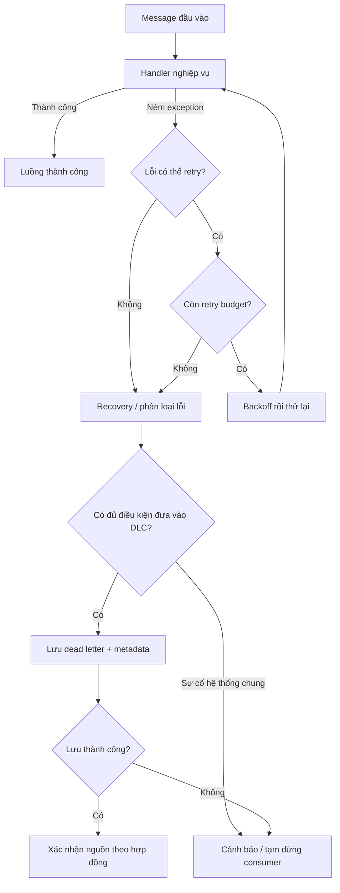

# Retry trước khi chuyển dead letter

Trong module **SPRING_INTEGRATION_PATTERN**, chúng ta triển khai các **Enterprise Integration Patterns** bằng Spring Integration để ghép nối Router, Filter, Transformer, Splitter, Aggregator, Gateway và các handler thông qua message channel. Mục tiêu là xây dựng luồng thông điệp **ít phụ thuộc, dễ mở rộng**, đồng thời kiểm thử và theo dõi được từng nhánh xử lý. Khi một handler lỗi, retry giúp vượt qua sự cố tạm thời; **Dead Letter Channel (DLC)** giữ lại những message mà hệ thống không thể xử lý tiếp theo chính sách.

Câu hỏi của bài này là: **Nên thử lại bao nhiêu lần, trong bao lâu, với những lỗi nào, và khi nào phải dừng retry để chuyển message sang dead letter?** Câu trả lời đòi hỏi phối hợp giữa **phân loại lỗi, backoff, retry budget, recovery callback, error channel, correlation và bảo đảm lưu message**.

> **Quy tắc nền tảng:** Retry là bước xử lý có giới hạn. Chỉ gửi sang dead letter khi không nên hoặc không thể tiếp tục xử lý tự động. “Đã gửi tới DLC” chỉ có ý nghĩa bảo toàn dữ liệu khi nơi nhận thực sự lưu được message theo mức độ tin cậy yêu cầu.

## 1. Vì sao cần retry trước khi đưa vào dead letter?

Một hệ thống nhận sự kiện `OrderCreated` rồi gọi cổng thanh toán. Trong điều kiện bình thường, handler xử lý thành công ngay. Nhưng đôi lúc cổng thanh toán trả HTTP 503, kết nối bị reset hoặc request timeout; các lỗi này có thể tự phục hồi sau vài trăm mili giây.

Nếu mọi lỗi đều đưa ngay vào DLC, đội vận hành sẽ phải điều tra hàng loạt sự cố ngắn hạn vốn có thể tự hết. Ngược lại, nếu thử lại vô hạn, message “độc” (*poison message*) hoặc dịch vụ đích bị lỗi lâu dài sẽ giữ tài nguyên, làm nghẽn consumer và gây tác dụng phụ trùng lặp.

Một chiến lược hợp lý là:

1. **Nhận diện lỗi:** phân biệt lỗi tạm thời, lỗi dữ liệu vĩnh viễn, lỗi trùng lặp đã xử lý và lỗi hệ thống diện rộng.
2. **Xét điều kiện:** chỉ retry lỗi có khả năng phục hồi, khi còn số lần/thời gian cho phép.
3. **Nghỉ giữa các lần thử:** áp dụng backoff và cân nhắc jitter để giảm dồn tải.
4. **Dừng đúng lúc:** nếu thử thành công thì hoàn tất; nếu hết ngân sách thì phát lỗi sang recovery flow; nếu lỗi không thể retry thì xử lý theo chính sách lỗi vĩnh viễn.
5. **Giữ thông tin:** lưu message gốc, lý do lỗi, correlation và số lần xử lý để điều tra hoặc replay có kiểm soát.

### Luồng retry rồi chuyển dead letter



Trong hệ thống thật, một số adapter có broker redelivery bên ngoài RetryAdvice. Sơ đồ trên minh họa **một chu kỳ retry trong ứng dụng**, không tự định nghĩa cách ACK/NACK của mọi nguồn message.

## 2. Quy tắc chọn lỗi được retry

Điều kiện quan trọng nhất là **thử lại cùng thao tác có khả năng thành công mà không gây tác dụng phụ không mong muốn**.

| Nhóm lỗi | Ví dụ | Quyết định gợi ý | Lý do |
| --- | --- | --- | --- |
| Tạm thời, có khả năng phục hồi | Timeout, mất kết nối ngắn, HTTP 502/503/504 | Retry giới hạn, có backoff | Lần gọi sau có thể thành công |
| Hệ thống đích quá tải | HTTP 429, rate limit | Retry sau thời gian được yêu cầu nếu SLA cho phép | Cần tôn trọng `Retry-After`/quota và tránh dồn tải |
| Dữ liệu sai hoặc thiếu | JSON không parse được, thiếu mã đơn, số lượng âm | Không retry, đưa tới error flow thích hợp | Gọi lại không sửa dữ liệu |
| Sai quyền/cấu hình chung | HTTP 401/403 do token hết hạn, cấu hình endpoint sai | Tạm dừng và cảnh báo; chỉ retry sau khắc phục | Có thể ảnh hưởng mọi message |
| Đã xử lý trước đó | `eventId` trùng, đã hoàn tất giao dịch | Bỏ qua có kiểm soát nếu đã xác minh | Không phải lỗi cần thử lại |
| Trạng thái nghiệp vụ cạnh tranh | HTTP 409 hoặc optimistic lock | Tùy nguyên nhân: đọc lại trạng thái rồi retry hoặc từ chối | Không phải mọi `409` đều có thể retry |
| Lỗi chưa rõ nguyên nhân | Exception không phân loại được | Cảnh báo/triage theo policy | Retry mù có thể che lỗi |

**Không phân loại chỉ dựa vào mã HTTP.** Ví dụ HTTP 400 thường là lỗi không retry được, nhưng một API đặc thù có thể định nghĩa mã khác. Ngược lại HTTP 503 có thể kéo dài hàng giờ, nên vẫn cần giới hạn retry và có thể dùng circuit breaker. Hãy chuẩn hóa mã lỗi của adapter ngoài trước khi áp dụng policy.

### Trường hợp có tác dụng phụ

Giả sử cổng thanh toán đã trừ tiền nhưng phản hồi bị timeout. Client nhìn thấy timeout, song giao dịch có thể đã thành công. Nếu retry một request thanh toán mới mà không có khóa idempotency, người dùng có thể bị trừ tiền hai lần.

Vì vậy, một thao tác có tác dụng phụ chỉ nên retry khi đáp ứng được một trong các điều kiện:

- Endpoint hỗ trợ **idempotency key** và dùng cùng khóa cho các lần thử của một yêu cầu nghiệp vụ.
- Handler có thể kiểm tra trạng thái bên ngoài để xác nhận thao tác đã hoàn tất trước khi gọi lại.
- Có cơ chế transaction/outbox/inbox hoặc deduplication đủ mạnh cho hợp đồng xử lý đã chọn.

`messageId` của Spring Messaging giúp truy vết nhưng không phải lúc nào cũng là khóa nghiệp vụ bền vững: nếu phát lại một sự kiện dưới dạng message mới, `messageId` có thể thay đổi. Dùng `eventId` hoặc khóa nghiệp vụ ổn định cho idempotency.

## 3. Thiết kế retry budget: số lần, thời gian và độ trễ

Một chính sách retry nên quy định đồng thời:

| Tham số | Ý nghĩa | Ví dụ minh họa |
| --- | --- | --- |
| `maxAttempts` | **Tổng** số lần handler được gọi trong một chu kỳ, kể cả lần đầu | 3 lần |
| `initialInterval` | Thời gian nghỉ sau lần thất bại đầu | 250 ms |
| `multiplier` | Hệ số tăng thời gian chờ | 2 |
| `maxInterval` | Trần thời gian chờ giữa hai lần thử | 2.000 ms |
| `maxElapsedTime` | Thời gian tối đa cho toàn bộ chu kỳ nếu cần giới hạn theo thời gian | Theo SLA; cần chính sách riêng |
| `retryableExceptions` | Loại lỗi được thử lại | `TemporaryPartnerException` |
| `replayLimit` | Số vòng phát lại **sau khi đã vào DLC** | Theo quy trình vận hành, tách khỏi retry |

Với `maxAttempts = 3`, initial interval = 250 ms và multiplier = 2:

| Lần gọi handler | Khi nào | Kết quả ví dụ |
| ---: | --- | --- |
| 1 | Ngay khi message đến | Timeout |
| 2 | Sau khoảng 250 ms | Timeout |
| 3 | Sau khoảng 500 ms nữa | Timeout |
| Recovery | Sau khi lần 3 lỗi | Chuyển sang error flow, xem xét dead letter |

Tổng thời gian nghỉ xấp xỉ **750 ms**, cộng thời gian thực thi/timeout của từng lần gọi. Không phải ba lần “retry thêm”: **3 attempts = 1 lần đầu + 2 lần thử lại**.

### Backoff cố định, lũy thừa và jitter

- **Fixed backoff:** nghỉ cùng một khoảng giữa các lần thử, dễ dự đoán nhưng có thể tạo đợt gọi đồng loạt.
- **Exponential backoff:** khoảng nghỉ tăng dần, giảm áp lực lên dịch vụ đang quá tải.
- **Exponential backoff + jitter:** bổ sung ngẫu nhiên để nhiều consumer không cùng gọi lại đúng một thời điểm.

Retry với nhiều message có thể gây hiện tượng *retry storm*: dịch vụ đích vừa hồi phục đã nhận một đợt request lớn hơn lưu lượng bình thường. Nên kết hợp giới hạn đồng thời, rate limiting, circuit breaker và jitter phù hợp.

**Cần tính retry ở mọi tầng.** Nếu Spring Integration thử 3 lần, HTTP client bên dưới tự thử 2 lần cho mỗi lần gọi, và broker redeliver message thêm 2 chu kỳ, số lần gửi request tiềm năng có thể lớn hơn rất nhiều. Phải phân biệt số lần gọi handler, số request HTTP và số lần broker redelivery khi đo đạc.

## 4. Retry trong Spring Integration hoạt động ở đâu?

Spring Integration có thể tổ chức retry bằng **`RequestHandlerRetryAdvice`**: lời gọi handler endpoint được bọc trong `RetryTemplate` của Spring Retry. Nếu lỗi nằm trong tập cho phép, template thử lại theo chính sách. Khi retry bị từ chối hoặc đã hết lượt, có thể gọi **`ErrorMessageSendingRecoverer`** để phát `ErrorMessage` tới một channel dành cho recovery.

Các thành phần giữ vai trò khác nhau:

| Thành phần | Trách nhiệm |
| --- | --- |
| `RequestHandlerRetryAdvice` | Bọc xử lý handler để retry theo policy |
| `RetryTemplate` | Thực thi số lần thử, quyết định retry và backoff |
| `RetryPolicy` | Chọn exception nào có thể retry, tối đa bao nhiêu lần |
| `BackOffPolicy` | Quy định khoảng nghỉ giữa các lần thử |
| `ErrorMessageSendingRecoverer` | Đưa lỗi cuối chu kỳ đến một `MessageChannel` |
| `ErrorMessage` | Message chứa `Throwable`; có thể kèm message gốc |
| Error flow | Phân loại lỗi, thu thập metadata, gửi sang DLC hoặc cảnh báo |
| DLC/DLQ | Đích cách ly/lưu dữ liệu lỗi để điều tra và replay |

**Error channel không đồng nghĩa DLC.** `ErrorMessageSendingRecoverer` chỉ gửi thông tin lỗi; cần có một flow nhận lỗi và một kho lưu phù hợp. Một `QueueChannel` mặc định trong bộ nhớ thích hợp để thử nghiệm nhưng không phải kho lưu bền vững.

### Đồng bộ và bất đồng bộ

Với `DirectChannel`, lời gọi handler thường đồng bộ với bên gửi. Nếu không dùng cơ chế recovery hoặc error handler phù hợp, exception có thể truyền thẳng về caller thay vì tự động xuất hiện trong global `errorChannel`.

Với polling adapter hoặc xử lý bất đồng bộ do framework quản lý, lỗi có thể được đóng gói thành `ErrorMessage` rồi gửi tới error channel đã cấu hình. Nếu nguồn là RabbitMQ, Kafka hoặc JMS, còn cần xét cơ chế ACK, transaction, rollback, redelivery và chính sách DLQ của broker. **Retry trong handler** và **redelivery của broker** là hai tầng độc lập.

## 5. Ví dụ đầy đủ: retry lỗi tạm thời rồi chuyển sang dead letter

Ví dụ sau dùng **Spring Integration 6.x**, Spring Retry và Java 17+. Giả định module đã có phụ thuộc `spring-boot-starter-integration` (hoặc các module Spring Integration tương ứng) và `org.springframework.retry:spring-retry`. Chúng ta tạo:

- `ordersInput`: nhận message chứa một mã đơn hàng.
- `OrderHandler`: xử lý nghiệp vụ, mô phỏng timeout khi mã bắt đầu bằng `TEMP-` và dữ liệu sai khi bắt đầu bằng `BAD-`.
- `orderRetryAdvice`: **chỉ retry** `TemporaryPartnerException`, tối đa 3 lần.
- `retryErrors`: nhận `ErrorMessage` sau khi retry hết hoặc gặp lỗi không được retry.
- `deadLetters`: `QueueChannel` trong bộ nhớ, dùng để quan sát kết quả thử nghiệm.

```java
package demo.integration;

import java.time.Instant;
import java.util.Map;
import java.util.UUID;
import java.util.concurrent.atomic.AtomicInteger;

import org.springframework.beans.factory.annotation.Qualifier;
import org.springframework.context.annotation.Bean;
import org.springframework.context.annotation.Configuration;
import org.springframework.integration.channel.DirectChannel;
import org.springframework.integration.channel.QueueChannel;
import org.springframework.integration.config.EnableIntegration;
import org.springframework.integration.dsl.IntegrationFlow;
import org.springframework.integration.handler.advice.ErrorMessageSendingRecoverer;
import org.springframework.integration.handler.advice.RequestHandlerRetryAdvice;
import org.springframework.messaging.Message;
import org.springframework.messaging.MessageChannel;
import org.springframework.messaging.MessagingException;
import org.springframework.messaging.support.ErrorMessage;
import org.springframework.retry.backoff.ExponentialBackOffPolicy;
import org.springframework.retry.policy.SimpleRetryPolicy;
import org.springframework.retry.support.RetryTemplate;

@Configuration
@EnableIntegration
public class RetryThenDeadLetterExample {

    @Bean
    MessageChannel ordersInput() {
        return new DirectChannel();
    }

    @Bean
    MessageChannel retryErrors() {
        return new DirectChannel();
    }

    @Bean
    QueueChannel deadLetters() {
        return new QueueChannel(100); // Chỉ dùng demo, không bền vững
    }

    @Bean
    OrderHandler orderHandler() {
        return new OrderHandler();
    }

    @Bean
    RequestHandlerRetryAdvice orderRetryAdvice(
            @Qualifier("retryErrors") MessageChannel errors) {

        // 3 lần gọi tổng cộng; chỉ retry lỗi tạm thời.
        // true: tìm exception được cấu hình cả trong cause chain.
        // false: các exception còn lại mặc định không được retry.
        Map<Class<? extends Throwable>, Boolean> retryable = Map.of(
                TemporaryPartnerException.class, true);
        SimpleRetryPolicy retryPolicy =
                new SimpleRetryPolicy(3, retryable, true, false);

        ExponentialBackOffPolicy backoff = new ExponentialBackOffPolicy();
        backoff.setInitialInterval(250);  // ms
        backoff.setMultiplier(2.0);
        backoff.setMaxInterval(2_000);    // ms

        RetryTemplate template = new RetryTemplate();
        template.setRetryPolicy(retryPolicy);
        template.setBackOffPolicy(backoff);

        RequestHandlerRetryAdvice advice = new RequestHandlerRetryAdvice();
        advice.setRetryTemplate(template);
        advice.setRecoveryCallback(
                new ErrorMessageSendingRecoverer(errors));
        return advice;
    }

    @Bean
    IntegrationFlow orderFlow(
            OrderHandler handler, RequestHandlerRetryAdvice orderRetryAdvice) {
        return IntegrationFlow.from("ordersInput")
                .handle(handler, "process",
                        spec -> spec.advice(orderRetryAdvice))
                .get();
    }

    @Bean
    IntegrationFlow recoveryFlow() {
        return IntegrationFlow.from("retryErrors")
                .<ErrorMessage, DeadLetterRecord>transform(
                        RetryThenDeadLetterExample::toDeadLetter)
                .channel("deadLetters")
                .get();
    }

    private static DeadLetterRecord toDeadLetter(ErrorMessage error) {
        Throwable failure = error.getPayload();
        Message<?> original = error.getOriginalMessage();

        // Một số đường xử lý lỗi chỉ đặt message gốc
        // vào MessagingException.getFailedMessage().
        if (original == null) {
            for (Throwable cause = failure;
                    cause != null; cause = cause.getCause()) {
                if (cause instanceof MessagingException me
                        && me.getFailedMessage() != null) {
                    original = me.getFailedMessage();
                    break;
                }
            }
        }

        String reasonCode =
                containsCause(failure, InvalidOrderException.class)
                        ? "INVALID_DATA"
                        : containsCause(failure, TemporaryPartnerException.class)
                                ? "RETRY_EXHAUSTED"
                                : "UNCLASSIFIED_FAILURE";

        Object correlation = original == null ? null
                : original.getHeaders().get("correlationId");

        return new DeadLetterRecord(
                UUID.randomUUID().toString(),
                original == null ? null
                        : String.valueOf(original.getHeaders().getId()),
                correlation == null ? null : correlation.toString(),
                original == null ? null
                        : String.valueOf(original.getPayload()),
                reasonCode,
                failure.getClass().getName(),
                Instant.now());
    }

    private static boolean containsCause(
            Throwable failure, Class<? extends Throwable> target) {
        for (Throwable current = failure;
                current != null; current = current.getCause()) {
            if (target.isInstance(current)) {
                return true;
            }
        }
        return false;
    }

    public static final class OrderHandler {
        private final AtomicInteger attempts = new AtomicInteger();

        public void process(String orderId) {
            attempts.incrementAndGet();

            if (orderId.startsWith("TEMP-")) {
                throw new TemporaryPartnerException(
                        "Partner temporarily unavailable");
            }
            if (orderId.startsWith("BAD-")) {
                throw new InvalidOrderException("Invalid order data");
            }
            // Đây là nhánh xử lý thành công.
        }

        public int attemptCount() {
            return attempts.get();
        }
    }

    public static final class TemporaryPartnerException
            extends RuntimeException {
        public TemporaryPartnerException(String message) {
            super(message);
        }
    }

    public static final class InvalidOrderException
            extends RuntimeException {
        public InvalidOrderException(String message) {
            super(message);
        }
    }

    public record DeadLetterRecord(
            String deadLetterId,
            String originalMessageId,
            String correlationId,
            String originalPayload,
            String reasonCode,
            String exceptionType,
            Instant failedAt) {}
}
```

### Cách đọc ví dụ

1. Message hợp lệ như `OK-100` được xử lý trong một lần. Không phát dead letter.
2. Message `TEMP-100` gây lỗi `TemporaryPartnerException`. `RetryTemplate` gọi handler tối đa **3 lần**, nghỉ với backoff rồi chạy recovery callback.
3. Message `BAD-100` gây `InvalidOrderException`. Vì exception không nằm trong nhóm retryable, callback recovery được gọi **sau lần lỗi đầu tiên**, không đợi đến lần thứ ba.
4. `ErrorMessageSendingRecoverer` đưa lỗi vào `retryErrors`. Flow khôi phục thông tin message gốc khi có, tạo bản ghi với mã `RETRY_EXHAUSTED` hoặc `INVALID_DATA`, rồi gửi vào `deadLetters`.
5. Nếu exception ngoài hai nhóm xuất hiện, ví dụ vẫn gắn mã `UNCLASSIFIED_FAILURE` và chuyển vào cùng queue. **Trong sản xuất**, cần nhánh phân loại riêng để cảnh báo hoặc tạm dừng với lỗi hệ thống chung; đừng mặc định mọi exception lạ đều có thể replay.

Giới hạn kỹ thuật của ví dụ: `QueueChannel(100)` là kho trong bộ nhớ, có thể đầy và mất dữ liệu sau restart; bản ghi chưa lưu `attemptsMade` từ retry context; ví dụ chưa cấu hình giao dịch giữa nguồn và DLC, chưa bảo đảm exactly-once. Không ghi payload hoặc exception chứa dữ liệu nhạy cảm vào log/metrics của hệ thống thật.

### Vì sao cần phân loại exception trong retry policy?

Nếu thay `SimpleRetryPolicy(3, retryable, true, false)` bằng chính sách retry mọi exception, lỗi `InvalidOrderException` cũng được thử lại ba lần dù dữ liệu sai không thể tự sửa. Điều đó tăng tải, trì hoãn phát hiện lỗi và có thể che giấu việc validation đang thất bại.

Đồng thời, handler trong Spring Integration có thể bọc exception nghiệp vụ trong `MessagingException`. Việc bật **traverse causes** cho phép policy xét nguyên nhân lồng nhau. Tuy nhiên, cần kiểm tra cách exception thực tế được tạo ra trong ứng dụng; nếu adapter đổi loại lỗi hoặc làm mất nguyên nhân gốc, policy có thể phân loại khác mong muốn.

## 6. Kiểm thử ba nhánh: thành công, retry hết, lỗi không retry

Bài học về retry chỉ có ý nghĩa khi chứng minh được **số lần handler thực sự chạy** và **message có đi đúng nhánh**. Với ví dụ trên, dùng JUnit 5, AssertJ và Spring Test để kiểm thử tích hợp trong ApplicationContext.

```java
package demo.integration;

import static org.assertj.core.api.Assertions.assertThat;

import org.junit.jupiter.api.Test;
import org.springframework.beans.factory.annotation.Autowired;
import org.springframework.beans.factory.annotation.Qualifier;
import org.springframework.messaging.Message;
import org.springframework.messaging.MessageChannel;
import org.springframework.messaging.PollableChannel;
import org.springframework.messaging.support.MessageBuilder;
import org.springframework.test.context.junit.jupiter.SpringJUnitConfig;

@SpringJUnitConfig(RetryThenDeadLetterExample.class)
class RetryThenDeadLetterExampleTest {

    @Autowired
    @Qualifier("ordersInput")
    MessageChannel input;

    @Autowired
    @Qualifier("deadLetters")
    PollableChannel deadLetters;

    @Autowired
    RetryThenDeadLetterExample.OrderHandler handler;

    @Test
    void transientFailureRetriesThreeTimesThenDeadLetters() {
        int before = handler.attemptCount();
        Message<String> request = MessageBuilder.withPayload("TEMP-100")
                .setHeader("correlationId", "order-100")
                .build();

        assertThat(input.send(request)).isTrue();

        Message<?> stored = deadLetters.receive(1_000);
        assertThat(stored).isNotNull();
        var record = (RetryThenDeadLetterExample.DeadLetterRecord)
                stored.getPayload();

        assertThat(handler.attemptCount() - before).isEqualTo(3);
        assertThat(record.reasonCode()).isEqualTo("RETRY_EXHAUSTED");
        assertThat(record.originalPayload()).isEqualTo("TEMP-100");
        assertThat(record.correlationId()).isEqualTo("order-100");
        assertThat(deadLetters.receive(0)).isNull();
    }

    @Test
    void invalidDataGoesToRecoveryWithoutRetry() {
        int before = handler.attemptCount();

        assertThat(input.send(
                MessageBuilder.withPayload("BAD-100").build())).isTrue();

        Message<?> stored = deadLetters.receive(1_000);
        assertThat(stored).isNotNull();
        var record = (RetryThenDeadLetterExample.DeadLetterRecord)
                stored.getPayload();

        assertThat(handler.attemptCount() - before).isEqualTo(1);
        assertThat(record.reasonCode()).isEqualTo("INVALID_DATA");
        assertThat(deadLetters.receive(0)).isNull();
    }

    @Test
    void validOrderSucceedsWithoutDeadLetter() {
        int before = handler.attemptCount();

        assertThat(input.send(
                MessageBuilder.withPayload("OK-100").build())).isTrue();

        assertThat(handler.attemptCount() - before).isEqualTo(1);
        assertThat(deadLetters.receive(0)).isNull();
    }
}
```

**Cách chạy đúng:** đặt hai class trong package `demo.integration` với các dependencies Spring Integration, Spring Retry, JUnit Jupiter, Spring Test và AssertJ. Ví dụ là tài liệu hướng dẫn; bài này **không khẳng định đã chạy test** trong repository. Khi thử trên dự án thật, tách dữ liệu thử nghiệm để các test không dùng chung queue, đồng thời kiểm tra hành vi timeout nếu adapter hoạt động bất đồng bộ.

### Các ca biên cần bổ sung

| Tình huống | Kỳ vọng kiểm thử |
| --- | --- |
| `maxAttempts = 1` | Không có lần gọi lại; recovery sau lỗi đầu |
| Lỗi tạm thời lần 1, thành công lần 2 | Không tạo dead letter |
| Lỗi không nằm trong tập retryable | Recovery ngay sau lần đầu |
| Lỗi được bọc trong `MessagingException` | Policy phân loại đúng qua chuỗi cause |
| Deadline nghiệp vụ hết trước lượt thử kế tiếp | Dừng retry theo chính sách thời gian đã thiết kế |
| Kho DLC không nhận message | Không xác nhận giả rằng dữ liệu đã được giữ an toàn |
| Consumer restart giữa các lượt | Thực hiện đúng chính sách redelivery của nguồn |
| Hai worker xử lý cùng `eventId` | Có idempotency, không thực thi tác dụng phụ hai lần |
| Một message đã replay lại thất bại | Giới hạn replay và lưu lịch sử vòng xử lý |

## 7. Retry, error channel và broker DLQ: tránh đếm trùng số lần thử

Giả sử nguồn là một broker có redelivery khi handler ném exception. Có ít nhất **ba vòng đời** cần theo dõi:

1. **Retry tại handler:** `RequestHandlerRetryAdvice` dùng `RetryTemplate` để gọi lại cùng handler trong một lần nhận.
2. **Redelivery tại broker:** message có thể được gửi lại sau rollback/NACK hoặc khi consumer mất kết nối; một lần broker redelivery có thể khởi tạo chu kỳ handler retry mới.
3. **Replay từ DLC:** sau khi đã cách ly, hệ thống/nhân viên vận hành chủ động gửi lại thông điệp hoặc yêu cầu nghiệp vụ; đây là một vòng đời khác.

Không nên cộng nhầm ba số này vào một trường `retryCount`. Một bộ metadata hữu ích có thể chứa:

- `eventId`, `messageId` và `correlationId`: định danh nghiệp vụ và dấu vết.
- `handlerAttemptCount` và `maxAttempts`: số lần trong **chu kỳ hiện tại**.
- `deliveryCount` hoặc delivery tag do broker cung cấp: số lần nhận lại từ nguồn, nếu broker/adapter hỗ trợ.
- `deadLetterId`, `replayCount` và `replayOf`: lịch sử các lần cách ly và phát lại.
- `failureCategory`, `reasonCode`, `failedComponent`, `failedAt`: lý do dừng retry.

Với nghiệp vụ có rủi ro xử lý trùng, luôn đặt **idempotency** ở vị trí có thể bao quát cả retry trong ứng dụng lẫn redelivery từ broker.

### Giữ an toàn ở điểm chuyển sang DLC

Lời gọi gửi tới `QueueChannel` trả về thành công chỉ chứng tỏ queue đã nhận trong tiến trình hiện tại; không chứng tỏ dữ liệu tồn tại sau restart. Khi dùng kho bền vững, phải làm rõ:

- Message nguồn được xác nhận ở thời điểm nào?
- Việc ghi dead letter đã được commit/confirmed chưa?
- Nếu ghi dead letter thành công nhưng ACK nguồn thất bại, message có bị gửi lại không?
- Nếu ACK nguồn thành công nhưng ghi dead letter thất bại, có mất dữ liệu không?
- Có dùng transaction chung, outbox/inbox hoặc khóa idempotency để khôi phục sau lỗi giữa hai bước không?

Mức bảo đảm end-to-end phụ thuộc adapter và kiến trúc lưu trữ. **Không có cấu hình retry nào tự động biến hai hệ thống độc lập thành một giao dịch nguyên tử.**

## 8. Khi nào nên dừng retry trước ngưỡng `maxAttempts`?

Đôi khi không cần chờ đủ số lần. Các điều kiện dừng sớm gồm:

- **Lỗi dữ liệu vĩnh viễn:** parse/validation thất bại; gửi ngay vào nhánh lỗi dữ liệu hoặc DLC theo hợp đồng.
- **Business deadline đã hết:** hoàn thành muộn có thể tạo kết quả sai (ví dụ sự kiện giá hết hiệu lực).
- **Hết thời gian SLA:** còn lượt nhưng không đủ thời gian để đợi backoff và gọi downstream.
- **Phụ thuộc đang mở circuit:** tránh gây thêm tải vào một dịch vụ đã xác định không khỏe.
- **Sự cố hệ thống diện rộng:** khóa xác thực hết hạn hoặc tất cả request trả lỗi cùng một nguyên nhân; báo động và có thể tạm ngừng nhận.
- **Quá số vòng replay:** cần triage thủ công thay vì thử vô hạn.

`SimpleRetryPolicy` đơn thuần giới hạn số lượt. Các ràng buộc về thời gian, deadline và vận hành cần được áp dụng thêm qua policy thích hợp, tầng điều phối, timeout hoặc circuit breaker. Đừng ghi tài liệu rằng chỉ đặt `maxAttempts` là đã kiểm soát toàn bộ thời gian.

## 9. Theo dõi retry và dead letter trong vận hành

Số liệu nên giúp nhận ra **lỗi nào đang tự phục hồi** và **lỗi nào đang đi vào DLC**.

| Metric / tín hiệu | Ý nghĩa | Hướng xử lý |
| --- | --- | --- |
| `handler_attempts_total` | Số lần gọi handler theo flow và kết quả | Phát hiện tăng tải do retry |
| `retry_success_after_failure_total` | Message thành công sau ít nhất một lần lỗi | Đo giá trị thực tế của retry |
| `retry_exhausted_total` | Message đã thử hết số lần | Cảnh báo khi tăng bất thường |
| `dead_letter_persist_failed_total` | Lỗi lưu DLC bền vững | Cảnh báo mức cao, tránh mất dữ liệu |
| `dead_letter_pending` | Số bản ghi còn chờ điều tra | Theo dõi backlog |
| `dead_letter_oldest_age_seconds` | Tuổi message chờ lâu nhất | Kiểm soát SLA xử lý ngoại lệ |
| `replay_failure_total` | Lỗi khi phát lại từ DLC | Giới hạn vòng lặp và rà soát nguyên nhân |

Các tên metric trên là **gợi ý đặt tên**, không phải metric Spring Integration tự sinh sẵn. Có thể dùng Micrometer, quan sát tại endpoint, advice và error flow; tránh dùng `orderId`/`eventId` làm nhãn metric do cardinality cao. Dùng correlation và trace ID trong log/tracing có kiểm soát truy cập.

Một quy trình điều tra mẫu:

1. Kiểm tra `retry_exhausted_total` theo endpoint, khoảng thời gian và nhóm lỗi.
2. Đối chiếu timeout, rate limit và circuit breaker của downstream.
3. Kiểm tra bản ghi DLC với `correlationId` và message gốc/phiên bản schema.
4. Sửa nguyên nhân, xác minh idempotency rồi replay có giới hạn tốc độ.
5. Ghi lại kết quả replay và đóng sự cố khi dữ liệu đã nhất quán.

## 10. Lỗi thiết kế thường gặp

| Sai sót | Hậu quả | Cách tránh |
| --- | --- | --- |
| Retry mọi exception | Dữ liệu sai tiếp tục gây tải | Phân loại retryable và non-retryable |
| Hiểu `maxAttempts=3` là “3 lượt thử thêm” | Đếm sai retry budget | Nhớ tổng 3 lần = 1 lần đầu + 2 lần retry |
| Không có backoff hoặc jitter | Retry storm khi dịch vụ lỗi | Dùng backoff, rate limiting và jitter khi cần |
| Retry ở nhiều tầng mà không thống kê | Khuếch đại số request | Định nghĩa ngân sách toàn luồng và theo dõi từng tầng |
| Coi `errorChannel` là kho DLC bền vững | Message có thể không được giữ | Xây error flow và đích lưu đáng tin cậy |
| Chỉ lưu exception, mất message nguồn | Không điều tra/replay được | Lưu định danh, correlation, payload/metadata an toàn |
| Ack nguồn trước khi ghi DLC | Có nguy cơ mất message | Xác định transaction/confirm và xử lý lỗi ghi |
| Replay không có idempotency | Tạo tác dụng phụ hai lần | Dùng khóa nghiệp vụ ổn định và đối chiếu trạng thái |
| Retry một dịch vụ đang lỗi diện rộng | Gây áp lực và backlog lớn | Circuit breaker, tạm ngừng nhận, cảnh báo |

## 11. Câu hỏi tự kiểm tra

1. Với `SimpleRetryPolicy(3)`, handler được gọi tối đa bao nhiêu lần trước khi recovery callback chạy?
2. Vì sao lỗi JSON sai schema không nên được retry giống lỗi HTTP 503?
3. Một handler timeout sau khi gửi yêu cầu thanh toán có thể đã thực hiện tác dụng phụ nào? Khóa idempotency giúp gì?
4. `RequestHandlerRetryAdvice`, `ErrorMessageSendingRecoverer` và Dead Letter Channel khác nhau ở vai trò nào?
5. Nếu broker redeliver message hai lần và mỗi lần handler retry tối đa ba lượt, điều gì có thể xảy ra với tổng lượt gọi downstream?
6. Trong ví dụ trên, message `BAD-100` và `TEMP-100` được gọi handler bao nhiêu lần trước khi tới error flow?
7. Vì sao một queue trong bộ nhớ không đủ cho yêu cầu “không mất message”?
8. Khi lưu dead letter thất bại, vì sao không thể coi message nguồn là đã xử lý thành công?
9. Khi nào circuit breaker hoặc tạm dừng consumer phù hợp hơn là tiếp tục retry?
10. Metadata nào giúp phân biệt retry trong handler, broker redelivery và replay từ DLC?

## Tài liệu tham khảo

- [Spring Integration Reference — Error Handling](https://docs.spring.io/spring-integration/reference/error-handling.html): `ErrorMessage`, error channel và cơ chế phát lỗi.
- [Spring Integration Reference — Provided Advice Classes](https://docs.spring.io/spring-integration/reference/handler-advice/classes.html): `RequestHandlerRetryAdvice` và `ErrorMessageSendingRecoverer`.
- [Spring Retry — SimpleRetryPolicy API](https://docs.spring.io/spring-retry/docs/current/apidocs/spring.retry/org/springframework/retry/policy/SimpleRetryPolicy.html): cấu hình số lần retry và phân loại exception.
- [Spring Retry — RetryTemplate API](https://docs.spring.io/spring-retry/docs/current/apidocs/spring.retry/org/springframework/retry/support/RetryTemplate.html): chu kỳ thực thi retry và recovery.

**Ghi nhớ:** Retry trước khi chuyển dead letter cần trả lời chính xác **lỗi nào được retry**, **tối đa bao nhiêu lần/trong bao lâu**, **nghỉ giữa các lần như thế nào**, và **cách giữ message an toàn khi không thể xử lý tiếp**. Kiểm thử phải xác nhận số lần handler được gọi, đường recovery, metadata lỗi và tình huống nơi lưu DLC thất bại.
