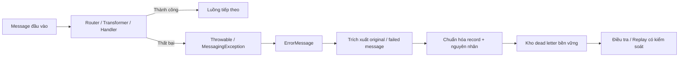

# Lưu original message và exception

Trong module **SPRING_INTEGRATION_PATTERN**, các **Enterprise Integration Patterns** được triển khai qua Spring Integration để xây dựng luồng message ít phụ thuộc và dễ mở rộng. Một message có thể đi qua Router, Filter, Transformer, Splitter, Aggregator, Gateway, rồi thất bại ở một handler. Khi retry không còn phù hợp hoặc đã hết lượt, đưa message sang **Dead Letter Channel (DLC)** mới giải quyết được bước *cách ly*. Muốn điều tra nguyên nhân và phát lại an toàn, ta còn phải **lưu được message gốc cùng thông tin exception**.

Đây là vấn đề của bài **“Lưu original message và exception”**: làm sao biết message nào gây lỗi, lỗi xuất hiện ở bước nào, vì sao thất bại, và dữ liệu nào cần giữ để có thể xử lý lại? Bài học bao gồm cơ chế lỗi của Spring Integration, thiết kế dữ liệu lưu bền vững, ví dụ Java/JDBC, kiểm thử và những sai sót thường gặp khi theo dõi các nhánh xử lý.

## 1. Vì sao chỉ ghi exception là chưa đủ?

Giả sử luồng xử lý đơn hàng:

1. Nhận message có `eventId = evt-1024`, `orderId = ORD-42`.
2. Transformer chuyển dữ liệu sang request gọi dịch vụ thanh toán.
3. Handler gọi dịch vụ, nhận timeout; các lần retry tiếp theo đều thất bại.
4. Recovery flow cần đưa dữ liệu lỗi vào DLC để vận hành kiểm tra.

Nếu chỉ ghi `TimeoutException: Read timed out`, ta không biết đơn hàng nào đã bị bỏ dở, dữ liệu gốc là gì, thuộc nhánh xử lý nào hoặc có được phép replay không.

Nếu chỉ giữ payload `ORD-42`, ta lại thiếu nguyên nhân thất bại, số lần retry, component lỗi, thời điểm xảy ra và dấu vết correlation.

Vì vậy, một **dead letter có ích** phải ghép được hai phần:

- **Original message:** nội dung dữ liệu cần phục hồi, định danh, các header nghiệp vụ phù hợp và thông tin về nguồn.
- **Exception / failure context:** loại lỗi, mã nguyên nhân, chuỗi nguyên nhân, handler thất bại, thời gian, trạng thái retry và thông tin điều tra đã được kiểm soát.

Không nhất thiết lưu nguyên object Java. Trong thực tế, ta thường lưu một **bản ghi chuẩn hóa** hoặc tham chiếu đến dữ liệu gốc, với schema/version rõ ràng và chính sách bảo mật.

### Hình dung vòng đời message lỗi



**Lưu ý:** “Original message” cần được định nghĩa theo mục đích. Trong Spring Integration, một `failedMessage` có thể là message ở *endpoint bị lỗi*, tức đã qua các bước Transform trước đó. Nó không nhất thiết chính là byte đầu tiên mà inbound adapter nhận được. Nếu phải phát lại từ đầu, hãy gắn định danh, schema và tham chiếu payload ban đầu ngay khi vào hệ thống.

## 2. Phân biệt Message, MessagingException và ErrorMessage

Spring Messaging/Spring Integration có những kiểu dữ liệu liên quan:

| Thành phần | Mang gì? | Điểm cần nhớ |
| --- | --- | --- |
| `Message<T>` | Payload kiểu `T` và `MessageHeaders` | Message đang được luân chuyển tại một thời điểm của flow |
| `MessagingException` | Throwable có thể chứa `failedMessage` | Cho biết message nào gắn với exception khi lỗi được tạo |
| `ErrorMessage` | Một `Message<Throwable>`, có thể chứa `originalMessage` | Payload của `ErrorMessage` là **exception**, không phải payload nghiệp vụ |
| `errorChannel` | Channel vận chuyển các `ErrorMessage` | Cơ chế phát lỗi; không tự bảo đảm lưu bền vững |
| Dead Letter Channel | Đích logic nhận thông tin message thất bại | Cần thiết kế logic ghi/lưu/điều tra riêng |

Khi một error flow nhận `ErrorMessage`, nên lần lượt thử:

1. `error.getOriginalMessage()`.
2. Nếu kết quả `null`, duyệt chuỗi `Throwable.getCause()` để tìm `MessagingException.getFailedMessage()`.
3. Nếu vẫn không có, **lưu bản ghi lỗi với trạng thái thiếu message nguồn**, đồng thời phát cảnh báo theo mức độ nghiêm trọng. Đừng âm thầm giả định mọi exception đều kèm message.

Đồng thời, trong chuỗi cause, exception ngoài cùng có thể là `MessagingException` do framework bọc, còn nguyên nhân sâu hơn là timeout hoặc lỗi nghiệp vụ. Để điều tra, cần phân biệt **wrapper exception** và **root cause**.

### Ví dụ nhỏ về hai nguồn lấy message

```java
Message<String> original = MessageBuilder.withPayload("ORD-42")
        .setHeader("eventId", "evt-1024")
        .setHeader("correlationId", "order-42")
        .build();

// ErrorMessage có originalMessage được gắn trực tiếp.
ErrorMessage withOriginal = new ErrorMessage(
        new IllegalStateException("Payment failed"), original);
Message<?> a = withOriginal.getOriginalMessage(); // original

// Trường hợp originalMessage không có, nhưng exception giữ failedMessage.
MessagingException failure =
        new MessagingException(original, "Payment failed");
ErrorMessage withoutOriginal = new ErrorMessage(failure);
Message<?> b = ((MessagingException) withoutOriginal.getPayload())
        .getFailedMessage(); // original
```

Các import tương ứng: `org.springframework.messaging.Message`, `org.springframework.messaging.MessagingException`, `org.springframework.messaging.support.MessageBuilder` và `org.springframework.messaging.support.ErrorMessage`.

**Quan trọng:** `ErrorMessage.getOriginalMessage()`, `MessagingException.getFailedMessage()` có thể đều `null`; exception tự tạo, lỗi cấu hình và một số adapter không bảo đảm giữ được message. Những đoạn code xử lý lỗi phải chấp nhận tình huống này.

## 3. Cần lưu những trường nào?

Một record thực dụng nên tách thành nhóm dữ liệu rõ ràng:

| Nhóm | Trường gợi ý | Ý nghĩa |
| --- | --- | --- |
| Định danh record | `deadLetterId` | Khóa riêng cho lần ghi lỗi; không dùng thay `eventId` |
| Định danh nghiệp vụ | `eventId`, `orderId`, idempotency key | Xác định giao dịch và chống xử lý trùng |
| Định danh Spring Message | `originalMessageId` | Truy vết message của framework |
| Correlation | `correlationId`, `sequenceNumber`, `sequenceSize` | Kết nối các nhánh Splitter/Aggregator và flow liên quan |
| Nội dung | Payload gốc hoặc `payloadRef`, `contentType`, `schemaVersion` | Phục hồi chính xác dữ liệu |
| Vị trí lỗi | `flowId`, `componentId`, `sourceTopic`/queue | Khoanh vùng thành phần thất bại |
| Exception | `exceptionType`, `rootCauseType`, `reasonCode`, thông điệp an toàn | Hiểu nguyên nhân, nhóm lỗi |
| Retry | `attemptsMade`, `maxAttempts`, `deliveryCount` | Phân biệt retry ứng dụng với redelivery từ broker |
| Vòng đời | `failedAt`, `status`, `replayCount`, `lastReplayAt` | Quản lý điều tra và phát lại |
| Bảo mật và audit | `payloadClassification`, `retentionUntil`, `lastUpdatedBy` | Kiểm soát truy cập và thời gian lưu |

Không bắt buộc mọi trường cho mọi luồng. Ví dụ, với Filter xử lý thành công bằng cách loại message, việc tạo dead letter không có ý nghĩa; với Aggregator bị timeout, đôi khi cần lưu *cả nhóm message đang chờ*, không phải một payload đơn lẻ.

### Giữ nguyên payload có nghĩa gì?

Việc gọi `String.valueOf(message.getPayload())` **không phải cơ chế lưu gốc đáng tin cậy**. Với một object, kết quả có thể chỉ là tên class và địa chỉ object; với `byte[]`, kết quả thường không phải nội dung byte. Để replay, cần chọn rõ định dạng:

- Payload vốn là JSON hoặc text: lưu text/byte gốc cùng `contentType`, encoding và schema version.
- Payload là `byte[]`: lưu byte dưới dạng BLOB hoặc mã hóa Base64 có khai báo rõ.
- Payload là object nghiệp vụ: serialize bằng cơ chế được kiểm soát (ví dụ Jackson với DTO/schema ổn định), kèm version.
- Payload lớn hoặc nhạy cảm: lưu trong kho riêng theo chính sách truy cập/retention; DLC chỉ giữ `payloadRef` và checksum.

**Không serialize Java object/Throwable tùy tiện để replay.** Format phụ thuộc classpath và phiên bản; việc giải tuần tự hóa đối tượng không tin cậy có rủi ro bảo mật. Record dead letter nên dùng schema dữ liệu tách khỏi class triển khai.

## 4. Giữ exception an toàn và hữu ích

Một Throwable gồm tên class, message, cause chain, stack trace và đôi khi chứa request, thông tin truy cập hoặc payload nhạy cảm. Cần phân biệt dữ liệu cần để vận hành và dữ liệu không nên lưu.

**Nên giữ:**

- `exceptionType`: class của exception cấp ngoài.
- `rootCauseType`: class nguyên nhân sâu nhất có ý nghĩa.
- `reasonCode`: mã lỗi ổn định do ứng dụng định nghĩa như `PAYMENT_TIMEOUT`, `INVALID_ORDER`.
- `safeSummary`: tóm tắt đã kiểm soát dữ liệu, ví dụ “Downstream timeout”.
- `failedAt`, component/flow, correlation để nối với log/trace.
- Có thể giữ *danh sách loại exception* của cause chain nếu cần điều tra sâu.

**Cần thận trọng:**

- `exception.getMessage()` có thể chứa token, URL mang khóa, SQL cùng dữ liệu nhạy cảm.
- Stack trace đầy đủ làm tăng kích thước và có thể lộ thông tin nội bộ.
- Serializing toàn bộ Throwable khiến dữ liệu lưu phụ thuộc phiên bản code.
- Ghi exception message dưới dạng metric label gây số lượng nhãn quá lớn và có thể lộ thông tin.

Với lỗi cần điều tra chi tiết, có thể ghi stack trace vào hệ thống log/trace được kiểm soát, sau đó lưu `traceId` trong dead letter. Nếu bắt buộc lưu stack trace ở DLC, áp dụng redaction, giới hạn độ dài, quyền truy cập và retention.

### Wrapper và root cause khác nhau

Ví dụ một flow nhận:

```text
MessagingException: failed to handle message
  └─ PaymentGatewayException: payment call failed
       └─ SocketTimeoutException: Read timed out
```

`exceptionType` có thể là `MessagingException`, còn `rootCauseType` là `SocketTimeoutException`. Mã `reasonCode = PAYMENT_TIMEOUT` nên đến từ **bộ phân loại của ứng dụng**, thay vì tự lấy tên class sâu nhất làm hợp đồng nghiệp vụ.

## 5. Ví dụ Java: chuẩn hóa ErrorMessage thành DeadLetterEntry

Ví dụ tiếp theo sử dụng **Java 17+ và Spring Messaging/Spring Integration 6.x**. Để tập trung vào việc giữ dữ liệu, ta giả định **payload đầu vào là `String`**, chẳng hạn text JSON hoặc mã đơn hàng. Nếu hệ thống dùng `byte[]` hay DTO, phải thay phần chuyển đổi bằng serializer tương ứng như mục 3.

Ta xây dựng một record đơn giản, giữ message ID, correlation, event ID, payload, exception và thời điểm lỗi. Khi không tìm được original message, record vẫn giữ được exception và đánh dấu nguyên nhân cần điều tra.

```java
package demo.integration;

import java.time.Instant;

public record DeadLetterEntry(
        String deadLetterId,
        String originalMessageId,
        String eventId,
        String correlationId,
        String payloadText,
        String schemaVersion,
        String exceptionType,
        String rootCauseType,
        String reasonCode,
        String safeSummary,
        Instant failedAt) {}
```

Lớp mapper:

```java
package demo.integration;

import java.time.Instant;
import java.util.UUID;

import org.springframework.messaging.Message;
import org.springframework.messaging.MessagingException;
import org.springframework.messaging.support.ErrorMessage;

public final class DeadLetterMapper {

    public DeadLetterEntry fromError(ErrorMessage error) {
        Throwable failure = error.getPayload(); // Payload là Throwable!
        Message<?> original = findOriginalMessage(error);
        Throwable root = rootCause(failure);

        // Bài này nhận payload String. Nếu type khác, báo lỗi rõ ràng:
        // tầng vận hành phải xử lý hoặc thay bằng serializer đúng schema.
        String payloadText = null;
        if (original != null) {
            if (!(original.getPayload() instanceof String text)) {
                throw new IllegalArgumentException(
                        "Demo mapper only accepts String payload");
            }
            payloadText = text;
        }

        return new DeadLetterEntry(
                UUID.randomUUID().toString(),
                original == null || original.getHeaders().getId() == null
                        ? null : original.getHeaders().getId().toString(),
                headerText(original, "eventId"),
                headerText(original, "correlationId"),
                payloadText,
                headerText(original, "schemaVersion"),
                failure.getClass().getName(),
                root.getClass().getName(),
                reasonCode(root, original),
                safeSummary(root),
                Instant.now());
    }

    static Message<?> findOriginalMessage(ErrorMessage error) {
        if (error.getOriginalMessage() != null) {
            return error.getOriginalMessage();
        }
        for (Throwable current = error.getPayload();
                current != null; current = current.getCause()) {
            if (current instanceof MessagingException me
                    && me.getFailedMessage() != null) {
                return me.getFailedMessage();
            }
        }
        return null;
    }

    private static Throwable rootCause(Throwable failure) {
        Throwable root = failure;
        while (root.getCause() != null) {
            root = root.getCause();
        }
        return root;
    }

    private static String headerText(Message<?> source, String name) {
        if (source == null) {
            return null;
        }
        Object value = source.getHeaders().get(name);
        return value == null ? null : String.valueOf(value);
    }

    private static String reasonCode(
            Throwable cause, Message<?> original) {
        if (original == null) {
            return "ORIGINAL_MESSAGE_UNAVAILABLE";
        }
        if (cause instanceof IllegalArgumentException) {
            return "INVALID_INPUT";
        }
        if (cause instanceof java.net.SocketTimeoutException) {
            return "DOWNSTREAM_TIMEOUT";
        }
        // Mã mặc định: cần triage nếu không nhận diện được lỗi.
        return "UNCLASSIFIED_FAILURE";
    }

    private static String safeSummary(Throwable cause) {
        // Không tự lưu Throwable.getMessage() nếu chưa có chính sách
        // kiểm soát dữ liệu nhạy cảm.
        if (cause instanceof java.net.SocketTimeoutException) {
            return "Downstream timeout";
        }
        if (cause instanceof IllegalArgumentException) {
            return "Invalid input";
        }
        return "Processing failed; inspect trace with access control";
    }
}
```

Trong đoạn mã này, **message nguồn được khôi phục theo hai đường**: `ErrorMessage.getOriginalMessage()` trước, rồi tới `MessagingException.getFailedMessage()` trong chuỗi cause. Vì thế mapper có thể hoạt động với các kiểu error wrapper khác nhau.

Đây là ví dụ **trình bày cơ chế**, còn ba điểm cần mở rộng ở production:

1. `findOriginalMessage()` chỉ bảo đảm lấy message gắn với error, không nhất thiết là payload ban đầu trước mọi Transformer; muốn replay từ đầu, phải giữ `eventId` hoặc `payloadRef` ngay tại nguồn.
2. `reasonCode()` đang ánh xạ từ root cause theo vài loại lỗi mẫu. Trong ứng dụng thật, dùng exception/mã lỗi nghiệp vụ ổn định và bộ phân loại có kiểm thử. Không nên coi mọi `IllegalArgumentException` là lỗi payload nguồn.
3. Nếu mapper gặp payload không thuộc `String`, nó **ném lỗi**, báo cho error flow biết đang thiếu serializer. Không được bắt lỗi rồi âm thầm lưu `payloadText = null` mà vẫn đánh dấu có thể replay.

Một dữ liệu cần thiết nhưng ví dụ chưa suy đoán là **retry count**. `ErrorMessage` không bảo đảm có trường chuẩn “tổng số lần xử lý” cho mọi nguồn. Để lưu `attemptsMade`, cần thu thập từ retry listener/context hay cơ chế metric/hook được thiết kế riêng; với broker redelivery và replay thì dùng các bộ đếm khác nhau.

## 6. Lưu record bằng JDBC thay vì chỉ giữ trong bộ nhớ

Dead Letter Channel là tuyến xử lý lỗi. **Kho bền vững** nằm sau tuyến này: một bảng dữ liệu, một topic DLQ, hoặc dịch vụ lưu được xác nhận. Với JDBC, có thể thiết kế bảng ví dụ (PostgreSQL):

```sql
CREATE TABLE dead_letters (
    dead_letter_id       varchar(36) PRIMARY KEY,
    original_message_id  varchar(64),
    event_id             varchar(128),
    correlation_id       varchar(128),
    payload_text         text,
    schema_version       varchar(32),
    exception_type       varchar(255) NOT NULL,
    root_cause_type      varchar(255) NOT NULL,
    reason_code          varchar(64) NOT NULL,
    safe_summary         varchar(255),
    failed_at            timestamptz NOT NULL,
    status               varchar(24) NOT NULL DEFAULT 'NEW'
);

CREATE INDEX idx_dead_letters_status_failed_at
    ON dead_letters (status, failed_at);

CREATE INDEX idx_dead_letters_event_id
    ON dead_letters (event_id);
```

Record có `deadLetterId` riêng cho **mỗi lần thất bại**; cùng `eventId` có thể xuất hiện nhiều lần do redelivery hoặc replay. Hệ thống xử lý nghiệp vụ cần kiểm soát idempotency bằng khóa nghiệp vụ phù hợp, không dựa đơn thuần vào việc `deadLetterId` khác nhau.

Lớp ghi JDBC:

```java
package demo.integration;

import org.springframework.jdbc.core.JdbcTemplate;

public final class DeadLetterJdbcStore {
    private final JdbcTemplate jdbc;

    public DeadLetterJdbcStore(JdbcTemplate jdbc) {
        this.jdbc = jdbc;
    }

    public void save(DeadLetterEntry entry) {
        jdbc.update("""
            INSERT INTO dead_letters (
                dead_letter_id, original_message_id, event_id,
                correlation_id, payload_text, schema_version,
                exception_type, root_cause_type, reason_code,
                safe_summary, failed_at
            )
            VALUES (?, ?, ?, ?, ?, ?, ?, ?, ?, ?, ?)
            """,
            entry.deadLetterId(),
            entry.originalMessageId(),
            entry.eventId(),
            entry.correlationId(),
            entry.payloadText(),
            entry.schemaVersion(),
            entry.exceptionType(),
            entry.rootCauseType(),
            entry.reasonCode(),
            entry.safeSummary(),
            java.sql.Timestamp.from(entry.failedAt()));
    }
}
```

Ở đây `JdbcTemplate.update(...)` chỉ trả về sau khi database thực thi lệnh theo ngữ cảnh transaction hiện tại. Nếu database không khả dụng, phải để lỗi ghi được phát hiện; không được tự xác nhận rằng dead letter đã lưu thành công. Để bảo đảm commit trước ACK nguồn, cần thiết kế giao dịch/ack cụ thể của inbound adapter.

### Nối mapper và store vào một error flow

Trong cấu hình Spring Integration, ta có thể khai báo một kênh nhận lỗi và một IntegrationFlow ghi dữ liệu:

```java
package demo.integration;

import org.springframework.context.annotation.Bean;
import org.springframework.context.annotation.Configuration;
import org.springframework.integration.channel.DirectChannel;
import org.springframework.integration.config.EnableIntegration;
import org.springframework.integration.dsl.IntegrationFlow;
import org.springframework.jdbc.core.JdbcTemplate;
import org.springframework.messaging.MessageChannel;
import org.springframework.messaging.support.ErrorMessage;

@Configuration
@EnableIntegration
public class DeadLetterPersistenceConfiguration {

    @Bean
    MessageChannel recoveryErrors() {
        return new DirectChannel();
    }

    @Bean
    DeadLetterMapper deadLetterMapper() {
        return new DeadLetterMapper();
    }

    @Bean
    DeadLetterJdbcStore deadLetterJdbcStore(JdbcTemplate jdbc) {
        return new DeadLetterJdbcStore(jdbc);
    }

    @Bean
    IntegrationFlow deadLetterPersistenceFlow(
            DeadLetterMapper mapper, DeadLetterJdbcStore store) {
        return IntegrationFlow.from("recoveryErrors")
                .<ErrorMessage, DeadLetterEntry>transform(mapper::fromError)
                .handle(store, "save")
                .get();
    }
}
```

Khi cấu hình `RequestHandlerRetryAdvice` cho endpoint xử lý chính, có thể phát lỗi sang `recoveryErrors` sau khi hết retry:

```java
// Bên trong cấu hình RequestHandlerRetryAdvice, khi đã có RetryTemplate:
advice.setRecoveryCallback(
        new ErrorMessageSendingRecoverer(recoveryErrors));
```

Cần import `org.springframework.integration.handler.advice.ErrorMessageSendingRecoverer`. Đoạn code ngắn trên là **mảnh cấu hình bổ sung**, không tự động áp dụng cho toàn bộ ứng dụng. Handler endpoint phải gắn `RequestHandlerRetryAdvice`; error channel riêng phải có subscriber; và chính sách retry vẫn cần phân loại lỗi.

**Đặc điểm quan trọng của mẫu:** `recoveryErrors` là `DirectChannel`; lời gọi transform + JDBC thường chạy đồng bộ trong quá trình gửi error message. Nếu mapper hoặc database ném exception, error flow cũng thất bại. Việc lỗi đó truyền về caller hay ảnh hưởng ACK nguồn ra sao phụ thuộc endpoint, advice và adapter nguồn. Đừng bắt ngoại lệ ghi DLC rồi trả về thành công nếu không có phương án khôi phục dữ liệu.

### Một ví dụ record lưu được

Giả sử message đầu vào:

```text
Payload: "ORD-42"
Headers:
  eventId: "evt-1024"
  correlationId: "order-42"
  schemaVersion: "1"
```

Handler ném exception được phân loại là `DOWNSTREAM_TIMEOUT`. Bản ghi có thể chứa:

```json
{
  "deadLetterId": "new-uuid-for-this-failure",
  "originalMessageId": "message-uuid-from-spring",
  "eventId": "evt-1024",
  "correlationId": "order-42",
  "payloadText": "ORD-42",
  "schemaVersion": "1",
  "exceptionType": "org.springframework.messaging.MessagingException",
  "rootCauseType": "java.net.SocketTimeoutException",
  "reasonCode": "DOWNSTREAM_TIMEOUT",
  "safeSummary": "Downstream timeout",
  "failedAt": "2026-11-21T08:00:00Z",
  "status": "NEW"
}
```

Giá trị ở đây chỉ minh họa schema. Ngày giờ và UUID được tạo tại thời điểm lỗi thật. Nếu exception không được bọc trong `MessagingException`, trường `exceptionType` sẽ là kiểu exception thực tế.

## 7. Những header không nên sao chép nguyên xi

Trong Spring Integration, `MessageHeaders` có thể chứa những đối tượng nội bộ của framework và dữ liệu nhạy cảm. Sao chép toàn bộ map và serialize thành JSON có thể thất bại hoặc để lộ thông tin.

| Loại header | Ví dụ | Chính sách |
| --- | --- | --- |
| Header nghiệp vụ | `eventId`, `correlationId`, `tenant-neutral business key` | Chỉ lưu trường cần truy vết, kiểm soát dữ liệu nhạy cảm |
| Version và định dạng | `contentType`, `schemaVersion`, encoding | Nên giữ để có thể giải mã/replay |
| Header định tuyến nội bộ | `replyChannel`, `errorChannel` | Thường là object/channel, không serialize tùy tiện |
| Header bảo mật | Authorization, API token, cookie | Không lưu trực tiếp; loại bỏ hoặc thay tham chiếu an toàn |
| Broker metadata | Topic, partition, offset, delivery tag | Chỉ lưu giá trị cần cho audit; không tái sử dụng như lệnh ACK |
| Message ID / timestamp | `MessageHeaders.ID`, `TIMESTAMP` | Có ích để truy vết, nhưng không thay idempotency key nghiệp vụ |

Với luồng có **Splitter/Aggregator**, lưu `correlationId` và các trường sequence liên quan là quan trọng; nếu chỉ giữ một message mà không biết nó thuộc nhóm nào, rất khó tái tạo quá trình tổng hợp. Với **Router**, có thể lưu tên nhánh đã chọn để biết endpoint nào thất bại. Với **Gateway**, cần quyết định rõ cách phản hồi lỗi đến caller: lưu dead letter **không** đồng nghĩa có thể trả kết quả thành công cho request đồng bộ.

## 8. Kiểm thử việc lưu message và exception

Có thể bắt đầu từ unit test cho mapper. Các trường hợp sau kiểm tra trực tiếp nguồn message và thông tin exception mà chưa cần database. Ví dụ dùng JUnit 5 và AssertJ:

```java
package demo.integration;

import static org.assertj.core.api.Assertions.assertThat;

import org.junit.jupiter.api.Test;
import org.springframework.messaging.MessagingException;
import org.springframework.messaging.support.ErrorMessage;
import org.springframework.messaging.support.MessageBuilder;

class DeadLetterMapperTest {
    private final DeadLetterMapper mapper = new DeadLetterMapper();

    @Test
    void keepsOriginalMessageFromErrorMessage() {
        var original = MessageBuilder.withPayload("ORD-42")
                .setHeader("eventId", "evt-1024")
                .setHeader("correlationId", "order-42")
                .setHeader("schemaVersion", "1")
                .build();

        var error = new ErrorMessage(
                new IllegalArgumentException("Sensitive detail"), original);
        var record = mapper.fromError(error);

        assertThat(record.originalMessageId())
                .isEqualTo(original.getHeaders().getId().toString());
        assertThat(record.payloadText()).isEqualTo("ORD-42");
        assertThat(record.eventId()).isEqualTo("evt-1024");
        assertThat(record.correlationId()).isEqualTo("order-42");
        assertThat(record.schemaVersion()).isEqualTo("1");
        assertThat(record.reasonCode()).isEqualTo("INVALID_INPUT");
        // Thông tin lỗi dùng summary có kiểm soát:
        assertThat(record.safeSummary()).isEqualTo("Invalid input");
    }

    @Test
    void usesFailedMessageFromMessagingExceptionWhenNeeded() {
        var original = MessageBuilder.withPayload("ORD-43")
                .setHeader("eventId", "evt-1025")
                .build();
        var error = new ErrorMessage(
                new MessagingException(original, "Processing failed"));

        var record = mapper.fromError(error);

        assertThat(record.payloadText()).isEqualTo("ORD-43");
        assertThat(record.eventId()).isEqualTo("evt-1025");
    }

    @Test
    void keepsExceptionEvenIfOriginalMessageIsMissing() {
        var error = new ErrorMessage(new IllegalStateException(
                "Unknown failure"));

        var record = mapper.fromError(error);

        assertThat(record.payloadText()).isNull();
        assertThat(record.originalMessageId()).isNull();
        assertThat(record.reasonCode())
                .isEqualTo("ORIGINAL_MESSAGE_UNAVAILABLE");
        assertThat(record.exceptionType())
                .isEqualTo(IllegalStateException.class.getName());
    }
}
```

Đây là **test minh họa** theo API, chưa được chạy trong repository ở bước soạn Markdown. Với hệ thống thật, bổ sung integration test:

- Gửi `ErrorMessage` tới `recoveryErrors`, xác nhận record xuất hiện trong database với đúng `eventId/correlationId`.
- Giả lập database từ chối ghi, xác nhận ứng dụng không báo là đã lưu an toàn.
- Giả lập payload là `byte[]` hoặc DTO, kiểm tra serializer giữ được dữ liệu gốc và schema version.
- Dùng exception lồng nhau, xác minh `exceptionType` khác `rootCauseType` và mã nguyên nhân vẫn đúng.
- Tạo message không có `originalMessage` và không có `failedMessage`, xác nhận vẫn có bản ghi lỗi/alert phù hợp.
- Đưa message qua Transformer rồi làm handler lỗi, xác minh định danh nguồn và payload tham chiếu còn truy vết được.
- Nếu nguồn là broker, thử restart/redelivery và lỗi ở điểm giao giữa ACK nguồn với commit dead letter.

## 9. Replay: vì sao lưu đầy đủ dữ liệu vẫn chưa đủ?

Từ kho DLC, nhân viên vận hành có thể chọn message sau khi sửa nguyên nhân lỗi. Tuy nhiên, replay không đơn giản là đọc `payloadText` rồi gửi vào `ordersInput`:

1. Xác định **điểm phát lại**: từ inbound event nguyên thủy hay từ message đã qua một số Transformer? Chọn đúng schema.
2. Xác minh nghiệp vụ đã từng hoàn tất hay chưa; nếu có thể đã thanh toán thành công, phải tra trạng thái trước khi gọi lại.
3. Dùng khóa idempotency ổn định như `eventId` hoặc `orderId + operationType`; không dùng `deadLetterId` làm khóa thực thi duy nhất.
4. Đối chiếu phiên bản payload/schema và dữ liệu thay đổi theo thời gian; nếu cần sửa payload, phải ghi audit và liên kết bản sửa với dữ liệu nguồn.
5. Đặt giới hạn `replayCount` và rate limit; giữ `replayOf` để truy nguồn thất bại cũ.
6. Chỉ đổi trạng thái `NEW → REPLAYED` khi đã có kết quả hoặc giao dịch ghi nhận chắc chắn theo hợp đồng; tránh đánh dấu hoàn tất ngay khi phát lệnh bất đồng bộ.

Đừng khôi phục `replyChannel`/`errorChannel` đã serialize từ object nội bộ của tiến trình trước. Khi replay, tạo message mới với **các header nghiệp vụ được allowlist**, thiết lập lại channel routing và correlation theo flow hiện tại.

## 10. Bảo đảm lưu bền vững, quan sát và xử lý sự cố

Lỗi thường gặp nhất là ghi được log nhưng **mất message cần khôi phục**. Để tránh điều này, phải xác định mức đảm bảo dữ liệu:

- `QueueChannel` mặc định giữ message trong bộ nhớ; mất dữ liệu khi process restart.
- Ghi JDBC cần xét thời điểm **commit**, transaction và cách inbound adapter xác nhận message.
- Broker DLQ có cơ chế delivery/ack riêng; publisher confirms, transaction và idempotent consumer có thể cần kết hợp.
- Nếu lưu vào kho lỗi thành công nhưng ACK nguồn thất bại, nguồn có thể gửi lại và tạo record trùng; cần có chiến lược nhận diện.
- Nếu ACK nguồn thành công trước khi lưu lỗi, có thể mất message không thể phục hồi; cần tránh bằng thiết kế phù hợp.

Vận hành nên đo **dead letter lưu thành công**, **dead letter lưu thất bại**, **tuổi message chờ xử lý**, **tỷ lệ replay thành công**, và **tỷ lệ thiếu original message**. Metric nên gắn label có cardinality thấp như flow, reason code và loại exception; dùng trace/correlation ID trong log có kiểm soát để tìm đúng message.

### Những lỗi triển khai cần tránh

| Sai sót | Hậu quả | Cách xử lý |
| --- | --- | --- |
| Coi payload `ErrorMessage` là payload nghiệp vụ | Serialize nhầm exception | Lấy `originalMessage`/`failedMessage` đúng API |
| Chỉ lưu `Throwable.toString()` | Thiếu event ID, payload, correlation | Lưu record chuẩn hóa theo schema |
| Giả định message nguồn luôn có | NullPointerException hoặc mất dấu vết | Cho phép `null` và phát cảnh báo |
| Coi `failedMessage` là message đầu tiên ở inbound | Replay sai schema/điểm xử lý | Gắn `eventId` và `payloadRef` từ đầu flow |
| Lưu cả map headers | Lộ token, không serialize được channel object | Allowlist header và kiểm soát dữ liệu |
| Chỉ lưu `String.valueOf(payload)` | Mất fidelity với DTO/byte array | Serializer có schema hoặc giữ raw bytes |
| Lưu toàn bộ stack trace không giới hạn | Dữ liệu nhạy cảm, kho phình to | Redact, giới hạn, dùng trace reference |
| Cho rằng `QueueChannel` là durable | Có thể mất lỗi sau restart | Dùng JDBC/broker/message store phù hợp |
| Không kiểm tra lỗi lưu DLC | ACK sai, mất message | Propagate failure và xử lý transaction/redelivery |
| Replay không xét idempotency | Tác dụng phụ nghiệp vụ lặp lại | Dùng khóa ổn định và kiểm tra trạng thái |

## 11. Câu hỏi tự kiểm tra

1. Vì sao `ErrorMessage.getPayload()` không phải payload nghiệp vụ?
2. Trong trường hợp nào `ErrorMessage.getOriginalMessage()` có thể trả về `null`? Cách dự phòng là gì?
3. Một message bị lỗi sau Transformer có thể khác message ban đầu như thế nào?
4. Vì sao cần lưu `eventId` và `correlationId` ngoài `MessageHeaders.ID`?
5. `exceptionType` và `rootCauseType` khác nhau trong tình huống exception lồng nhau ra sao?
6. Vì sao không nên lưu `Throwable.getMessage()` và toàn bộ header trực tiếp trong DLC?
7. `String.valueOf(byte[])` có đủ để phục hồi payload gốc không? Nên làm gì thay thế?
8. Khi JDBC ghi dead letter thất bại nhưng nguồn đã ACK message, hậu quả là gì?
9. Trong một luồng có Splitter/Aggregator, metadata nào giúp nối lại nhóm message?
10. Điều gì phải kiểm tra trước khi replay một sự kiện thanh toán đã từng timeout?

## Tài liệu tham khảo

- [Spring Integration Reference — Error Handling](https://docs.spring.io/spring-integration/reference/error-handling.html): cách phát `ErrorMessage` và sử dụng error channel.
- [Spring Integration Reference — Provided Advice Classes](https://docs.spring.io/spring-integration/reference/handler-advice/classes.html): retry advice và `ErrorMessageSendingRecoverer`.
- [Spring Framework API — ErrorMessage](https://docs.spring.io/spring-framework/docs/current/javadoc-api/org/springframework/messaging/support/ErrorMessage.html): `getOriginalMessage()` và payload exception.
- [Spring Framework API — MessagingException](https://docs.spring.io/spring-framework/docs/current/javadoc-api/org/springframework/messaging/MessagingException.html): `getFailedMessage()`.
- [Spring Framework API — JdbcTemplate](https://docs.spring.io/spring-framework/docs/current/javadoc-api/org/springframework/jdbc/core/JdbcTemplate.html): thao tác ghi thông qua JDBC.

**Ghi nhớ:** Khi lưu dead letter, hãy giữ **định danh và payload có thể phục hồi**, **metadata truy vết theo flow/correlation** và **thông tin exception an toàn, có cấu trúc**. Spring Integration cung cấp `ErrorMessage`, `originalMessage` và `failedMessage` để hỗ trợ trích xuất; trách nhiệm lưu bền vững, bảo mật, ACK nguồn và replay an toàn vẫn thuộc về thiết kế ứng dụng.
