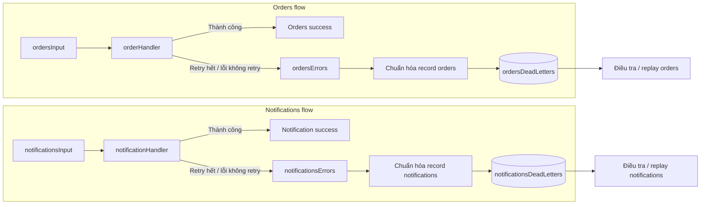

# Đặt dead letter channel theo flow

Trong module **SPRING_INTEGRATION_PATTERN**, chúng ta dùng Spring Integration để triển khai **Enterprise Integration Patterns** (EIP) như Router, Filter, Transformer, Splitter, Aggregator và Gateway qua các message channel. Cách nối các thành phần này giúp hệ thống ít phụ thuộc và dễ mở rộng, nhưng cũng đặt ra một câu hỏi: **khi một message không xử lý được, lỗi phải đi về đâu nếu ứng dụng có nhiều flow độc lập?**

Một **Dead Letter Channel (DLC)** là đích logic tiếp nhận message không thể xử lý tiếp theo chính sách của ứng dụng. Một hệ thống có thể dùng **một kênh chung** hoặc **mỗi flow một kênh riêng**. Chủ đề của bài này là cách **đặt dead letter channel theo flow**: mỗi luồng nghiệp vụ có đường recovery, chính sách retry, dữ liệu lỗi và cách vận hành rõ ràng.

Ví dụ xuyên suốt: ứng dụng có hai flow:

- **Orders flow** xử lý đơn hàng. Lỗi tạm thời được retry tối đa **2 lần gọi handler** trước khi gửi sang `ordersDeadLetters`.
- **Notifications flow** gửi thông báo. Lỗi tạm thời được retry tối đa **3 lần gọi handler** trước khi gửi sang `notificationsDeadLetters`.

Cả hai flow có thể cùng chạy trong một ứng dụng Spring Integration, nhưng message lỗi của đơn hàng không được lẫn vào nơi lưu lỗi thông báo.

## 1. Tại sao cần gắn dead letter với từng flow?

Giả sử chỉ có một kênh `deadLetters` dùng chung cho mọi lỗi. Nếu kênh này nhận một `ErrorMessage` từ `paymentHandler`, người vận hành phải suy ra lỗi thuộc quy trình nào từ headers hoặc nội dung exception. Khi ứng dụng có nhiều nhóm nghiệp vụ, điều này gây ra:

1. **Khó định tuyến và phân quyền:** nhóm vận hành thanh toán không nhất thiết được xem dữ liệu thông báo của người dùng.
2. **Khó phân biệt chính sách:** đơn hàng có thể yêu cầu lưu 30 ngày và replay thủ công; thông báo có thể hết giá trị sau vài giờ.
3. **Khó đo đạc:** không biết flow nào có tỷ lệ lỗi cao nếu thiếu `flowId` và metadata.
4. **Khó xử lý sự cố:** một flow tạo nhiều message lỗi có thể làm cạn dung lượng lưu của flow khác.
5. **Dễ replay sai đích:** payload thông báo có thể bị gửi nhầm sang handler xử lý đơn hàng.

Gắn DLC với flow tạo ra ranh giới quản lý rõ ràng. Tuy nhiên, **“mỗi flow một kênh” không bắt buộc “mỗi flow một database”**. Có thể khai báo nhiều kênh logic và dùng chung một dịch vụ lưu bền vững, miễn là record được gắn `flowId` và chính sách truy cập/retention/replay được thực thi chính xác.

### Cần phân biệt ba lớp

| Lớp | Chức năng | Ví dụ |
| --- | --- | --- |
| Business flow | Xử lý message nghiệp vụ | `ordersFlow`, `notificationsFlow` |
| Recovery/error channel theo flow | Nhận `ErrorMessage` khi một endpoint lỗi và đã chuyển sang recovery | `ordersErrors`, `notificationsErrors` |
| Dead letter channel và kho lưu | Chuẩn hóa, cách ly/lưu message không xử lý được | `ordersDeadLetters`, `notificationsDeadLetters`; bảng hoặc broker DLQ phía sau |

**Không được coi `errorChannel` và dead letter là một.** Error channel vận chuyển lỗi. Dead letter là kết quả quyết định cách ly và lưu lại message để điều tra. Một flow có thể nhận lỗi rồi **cảnh báo/tạm dừng** thay vì đưa tất cả exception vào DLC.

## 2. Mô hình hai dead letter channel độc lập



Hai nhánh có cùng **cấu trúc xử lý lỗi**, nhưng dùng các đối tượng channel riêng. Một vấn đề của notifications không được tự động đổi trạng thái message trong orders.

Trong Spring Integration, **recovery phải được nối vào đúng endpoint**. Chỉ khai báo hai bean `ordersDeadLetters` và `notificationsDeadLetters` không làm exception tự động tìm đến đúng channel. Cần cấu hình đường từ handler thất bại đến error channel, từ error channel đến dead letter, và cơ chế lưu phía sau.

### Cách đặt tên

Một quy ước nhất quán có thể là:

| Flow | Input | Error/recovery | Dead letter |
| --- | --- | --- | --- |
| Orders | `ordersInput` | `ordersErrors` | `ordersDeadLetters` |
| Notifications | `notificationsInput` | `notificationsErrors` | `notificationsDeadLetters` |
| Inventory | `inventoryInput` | `inventoryErrors` | `inventoryDeadLetters` |

Tên nên thể hiện **chủ sở hữu nghiệp vụ** và **vai trò channel**. Với một flow có nhiều endpoint và nhiều chính sách khác nhau, có thể chi tiết hơn: `ordersPaymentErrors`, `ordersInventoryErrors`. Không cần tạo channel mới cho mỗi exception class nếu một recovery flow có thể phân loại lỗi rõ ràng.

## 3. Xác định điểm phát lỗi trước khi chọn DLC

Spring Integration xử lý lỗi khác nhau theo loại endpoint và cách thực thi. Đây là điểm rất dễ cấu hình nhầm.

| Nguồn lỗi | Thông thường xảy ra gì? | Cách đưa tới DLC theo flow |
| --- | --- | --- |
| `DirectChannel` + handler đồng bộ | Exception có thể ném thẳng về caller | Dùng advice/recovery callback, hoặc caller bắt và chuyển lỗi có chủ đích |
| Handler có `RequestHandlerRetryAdvice` | Handler được gọi lại theo `RetryTemplate` | Dùng `ErrorMessageSendingRecoverer` trỏ tới **error channel của flow đó** |
| Poller hoặc adapter bất đồng bộ có error handler | Framework có thể phát `ErrorMessage` tới error channel | Đặt error channel phù hợp và định tuyến tới error flow của flow tương ứng |
| Message có header `errorChannel` | Một số cơ chế phát lỗi sử dụng header này | Thiết lập nội bộ theo flow, kiểm tra ngữ cảnh thực thi; không suy ra mọi exception đồng bộ đều được phát tới đó |
| Broker có cơ chế DLQ | Broker có chính sách reject/redelivery/dead-letter riêng | Cấu hình ở broker/adapter; không tự xuất hiện khi đặt tên bean Spring là “deadLetters” |

Đối với luồng đồng bộ, **chỉ gắn header `errorChannel` không bảo đảm exception sẽ được bắt và gửi sang kênh đó**. Một cách minh bạch là gắn retry/recovery advice ngay vào handler muốn quản lý lỗi.

Đối với message đi qua nhiều bước, xác định rõ **phạm vi advice**: advice của một endpoint chỉ bao quanh chính endpoint đó. Nếu Router, Transformer hoặc handler tiếp theo thất bại ngoài phạm vi advice, lỗi đó có thể đi theo đường khác. Cần kiểm kê các điểm phát lỗi của từng flow, nhất là khi phối hợp Gateway và các thành phần chạy bất đồng bộ.

## 4. Ví dụ Spring Integration: đặt DLC riêng cho Orders và Notifications

Ví dụ dùng **Java 17+, Spring Integration 6.x và Spring Retry**. Để tập trung vào cách nối channel, các dead letter được lưu trong `QueueChannel` **trong bộ nhớ**; mục 7 trình bày cách thay bằng kho bền vững.

Hai handler nhận `Message<String>`. Khi payload bắt đầu bằng `FAIL-`, handler mô phỏng lỗi kết nối tạm thời. Exception được bọc bằng `MessageHandlingException` để giữ message tại endpoint thất bại; policy retry được cấu hình có tìm nguyên nhân lồng nhau.

```java
package demo.integration;

import java.time.Instant;
import java.util.Map;
import java.util.UUID;
import java.util.concurrent.atomic.AtomicInteger;

import org.springframework.beans.factory.annotation.Qualifier;
import org.springframework.context.annotation.Bean;
import org.springframework.context.annotation.Configuration;
import org.springframework.integration.channel.DirectChannel;
import org.springframework.integration.channel.QueueChannel;
import org.springframework.integration.config.EnableIntegration;
import org.springframework.integration.dsl.IntegrationFlow;
import org.springframework.integration.handler.advice.ErrorMessageSendingRecoverer;
import org.springframework.integration.handler.advice.RequestHandlerRetryAdvice;
import org.springframework.messaging.Message;
import org.springframework.messaging.MessageChannel;
import org.springframework.messaging.MessageHandlingException;
import org.springframework.messaging.MessagingException;
import org.springframework.messaging.support.ErrorMessage;
import org.springframework.retry.backoff.FixedBackOffPolicy;
import org.springframework.retry.policy.SimpleRetryPolicy;
import org.springframework.retry.support.RetryTemplate;

@Configuration
@EnableIntegration
public class FlowScopedDeadLetterConfiguration {

    // A. Input channel của từng flow.
    @Bean
    MessageChannel ordersInput() {
        return new DirectChannel();
    }

    @Bean
    MessageChannel notificationsInput() {
        return new DirectChannel();
    }

    // B. Recovery channel riêng: mỗi channel nhận ErrorMessage.
    @Bean
    MessageChannel ordersErrors() {
        return new DirectChannel();
    }

    @Bean
    MessageChannel notificationsErrors() {
        return new DirectChannel();
    }

    // C. Dead letter channel của riêng từng flow.
    // Chỉ dùng demo: QueueChannel mặc định không lưu bền vững.
    @Bean
    QueueChannel ordersDeadLetters() {
        return new QueueChannel(50);
    }

    @Bean
    QueueChannel notificationsDeadLetters() {
        return new QueueChannel(50);
    }

    @Bean
    DemoHandler orderHandler() {
        return new DemoHandler("orders");
    }

    @Bean
    DemoHandler notificationHandler() {
        return new DemoHandler("notifications");
    }

    // D. Hai advice có ngân sách retry và đích recovery khác nhau.
    @Bean
    RequestHandlerRetryAdvice ordersRetryAdvice(
            @Qualifier("ordersErrors") MessageChannel errors) {
        return adviceFor(errors, 2);
    }

    @Bean
    RequestHandlerRetryAdvice notificationsRetryAdvice(
            @Qualifier("notificationsErrors") MessageChannel errors) {
        return adviceFor(errors, 3);
    }

    private static RequestHandlerRetryAdvice adviceFor(
            MessageChannel errorDestination, int maxAttempts) {
        Map<Class<? extends Throwable>, Boolean> retryable = Map.of(
                TemporaryDependencyException.class, true);

        // traverseCauses=true, defaultValue=false:
        // chỉ retry TemporaryDependencyException, kể cả khi bị bọc.
        SimpleRetryPolicy policy =
                new SimpleRetryPolicy(
                        maxAttempts, retryable, true, false);

        FixedBackOffPolicy backoff = new FixedBackOffPolicy();
        backoff.setBackOffPeriod(50); // ms, giảm thời gian trong demo

        RetryTemplate template = new RetryTemplate();
        template.setRetryPolicy(policy);
        template.setBackOffPolicy(backoff);

        RequestHandlerRetryAdvice advice = new RequestHandlerRetryAdvice();
        advice.setRetryTemplate(template);
        advice.setRecoveryCallback(
                new ErrorMessageSendingRecoverer(errorDestination));
        return advice;
    }

    // E. Advice được gắn ngay tại handler của từng business flow.
    @Bean
    IntegrationFlow ordersFlow(
            @Qualifier("orderHandler") DemoHandler handler,
            @Qualifier("ordersRetryAdvice") RequestHandlerRetryAdvice advice) {
        return IntegrationFlow.from("ordersInput")
                .handle(handler, "process", spec -> spec.advice(advice))
                .get();
    }

    @Bean
    IntegrationFlow notificationsFlow(
            @Qualifier("notificationHandler") DemoHandler handler,
            @Qualifier("notificationsRetryAdvice") RequestHandlerRetryAdvice advice) {
        return IntegrationFlow.from("notificationsInput")
                .handle(handler, "process", spec -> spec.advice(advice))
                .get();
    }

    // F. Mỗi recovery flow nhận ErrorMessage của đúng flow,
    // chuẩn hóa với flowId cố định rồi gửi tới DLC tương ứng.
    @Bean
    IntegrationFlow ordersRecoveryFlow() {
        return IntegrationFlow.from("ordersErrors")
                .<ErrorMessage, DeadLetterRecord>transform(
                        error -> toDeadLetter("orders", error))
                .channel("ordersDeadLetters")
                .get();
    }

    @Bean
    IntegrationFlow notificationsRecoveryFlow() {
        return IntegrationFlow.from("notificationsErrors")
                .<ErrorMessage, DeadLetterRecord>transform(
                        error -> toDeadLetter("notifications", error))
                .channel("notificationsDeadLetters")
                .get();
    }

    private static DeadLetterRecord toDeadLetter(
            String flowId, ErrorMessage error) {
        Message<?> failed = error.getOriginalMessage();

        // Nếu originalMessage không có, tìm failedMessage trong cause chain.
        if (failed == null) {
            for (Throwable current = error.getPayload();
                    current != null; current = current.getCause()) {
                if (current instanceof MessagingException me
                        && me.getFailedMessage() != null) {
                    failed = me.getFailedMessage();
                    break;
                }
            }
        }

        Throwable root = error.getPayload();
        while (root.getCause() != null) {
            root = root.getCause();
        }

        Object event = failed == null
                ? null : failed.getHeaders().get("eventId");
        Object correlation = failed == null
                ? null : failed.getHeaders().get("correlationId");

        String reason = root instanceof TemporaryDependencyException
                ? "RETRY_EXHAUSTED" : "UNCLASSIFIED_FAILURE";

        return new DeadLetterRecord(
                UUID.randomUUID().toString(),
                flowId,
                failed == null || failed.getHeaders().getId() == null
                        ? null : failed.getHeaders().getId().toString(),
                event == null ? null : event.toString(),
                correlation == null ? null : correlation.toString(),
                failed != null && failed.getPayload() instanceof String s
                        ? s : null,
                reason,
                root.getClass().getName(),
                Instant.now());
    }

    public static class DemoHandler {
        private final String flowId;
        private final AtomicInteger attempts = new AtomicInteger();

        DemoHandler(String flowId) {
            this.flowId = flowId;
        }

        public void process(Message<String> message) {
            attempts.incrementAndGet();
            if (message.getPayload().startsWith("FAIL-")) {
                throw new MessageHandlingException(
                        message,
                        "Downstream unavailable for " + flowId,
                        new TemporaryDependencyException("Temporary outage"));
            }
            // Nhánh thành công: xử lý nghiệp vụ thực tế tại đây.
        }

        public int attemptCount() {
            return attempts.get();
        }
    }

    public static class TemporaryDependencyException
            extends RuntimeException {
        TemporaryDependencyException(String message) {
            super(message);
        }
    }

    public record DeadLetterRecord(
            String deadLetterId,
            String flowId,
            String failedMessageId,
            String eventId,
            String correlationId,
            String payloadText,
            String reasonCode,
            String exceptionType,
            Instant failedAt) {}
}
```

### Giải thích đường đi của từng flow

**Khi gửi `FAIL-ORDER-1` vào `ordersInput`:**

1. Message tới `orderHandler.process(...)`.
2. Advice `ordersRetryAdvice` chạy với `maxAttempts = 2`; handler được gọi tối đa **2 lần tính cả lần đầu**.
3. `ErrorMessageSendingRecoverer` phát lỗi vào **`ordersErrors`**.
4. `ordersRecoveryFlow` tạo `DeadLetterRecord(flowId="orders", ...)`, chuyển vào **`ordersDeadLetters`**.
5. `notificationsDeadLetters` không nhận bản ghi nào từ lỗi trên.

**Khi gửi `FAIL-NOTIFY-1` vào `notificationsInput`**, các bước tương tự diễn ra trong **nhánh notifications**, nhưng advice cho phép **3 lần gọi handler** và recovery gửi tới `notificationsErrors`, rồi `notificationsDeadLetters`.

Với payload không bắt đầu bằng `FAIL-`, handler hoàn tất bình thường; không sinh dead letter. Số lượt retry trong ví dụ được dùng cho *lỗi tạm thời*, nhờ `SimpleRetryPolicy` chỉ cho phép retry `TemporaryDependencyException`. Exception khác vẫn có thể dẫn đến recovery callback nhưng không nhất thiết là “retry exhausted”; vì vậy mapper dùng `UNCLASSIFIED_FAILURE` cho trường hợp ngoài mẫu.

**Phạm vi đảm bảo của ví dụ:** Đây là demo một handler mỗi flow với lỗi kết nối giả lập. Hai `QueueChannel` có giới hạn dung lượng, lưu trong bộ nhớ và có thể mất dữ liệu khi tiến trình dừng. Trong sản xuất, thêm bộ phân loại exception để không đưa lỗi cấu hình diện rộng vào DLC vô tội vạ, và thay sink bằng kho bền vững theo mục tiêu dữ liệu.

## 5. Vì sao cần `flowId` ngay cả khi đã có kênh riêng?

Tưởng tượng message từ `ordersDeadLetters` sau này được chuyển sang một dịch vụ lưu chung, hoặc người vận hành xuất bản ghi thành JSON để điều tra. Khi tách khỏi tên channel gốc, record sẽ mất ngữ cảnh nếu không giữ `flowId`.

Một dead letter nên có các trường:

| Trường | Ví dụ | Vai trò |
| --- | --- | --- |
| `deadLetterId` | UUID mới | Định danh một lần lưu lỗi |
| `flowId` | `orders` | Xác định flow sở hữu message |
| `failedComponent` | `orderHandler` | Biết endpoint tạo lỗi |
| `failedMessageId` | ID của Spring Message | Truy vết trong luồng |
| `eventId` / idempotency key | `evt-1001` | Phân biệt event nghiệp vụ và chống xử lý trùng |
| `correlationId` | `order-42` | Liên kết Router/Splitter/Aggregator/Gateway |
| `payloadRef` hoặc payload có schema | Tham chiếu JSON gốc | Cho phép sửa/replay đúng dữ liệu |
| `reasonCode` | `RETRY_EXHAUSTED` | Tổng hợp theo nguyên nhân |
| `attemptsMade` | 2 | Số lần thử trong chu kỳ (nếu đã instrument) |
| `deliveryCount` / `replayCount` | Tùy nguồn | Phân biệt broker redelivery và replay |
| `failedAt` / `status` | UTC, `NEW` | Quản lý vòng đời |

Ví dụ dùng `payloadText` và chưa lưu `failedComponent` hay số lượt retry. Đây là quyết định đơn giản hóa cho tài liệu; khi đưa vào production cần schema phù hợp. Không tự suy ra `attemptsMade` từ loại exception: phải ghi từ retry context/listener hoặc cơ chế theo dõi đã thiết kế.

### Original message là message ở đâu?

`ErrorMessage.getOriginalMessage()` và `MessagingException.getFailedMessage()` giúp khôi phục message liên quan đến lỗi, nhưng **không luôn là payload ngay từ inbound**. Nếu flow đã qua Transformer, payload tại handler có thể khác dữ liệu đầu vào. Khi muốn replay từ đầu luồng, nên giữ `eventId`, schema version và tham chiếu nội dung đầu vào tại ingress.

Không nên serialize toàn bộ headers rồi phát lại. Headers như `replyChannel`, `errorChannel` có thể là object nội bộ. Chỉ lưu header được cho phép, và khi replay hãy tạo message mới với routing được cấu hình lại. Không ghi bearer token, cookie, payload nhạy cảm hoặc toàn bộ `Throwable.getMessage()` không kiểm soát vào kho lỗi.

## 6. Đặt error channel theo message trong flow bất đồng bộ

Ngoài recovery callback được gắn tại endpoint, một số cơ chế phát lỗi **bất đồng bộ** hoặc poller do Spring Integration quản lý có thể định tuyến `ErrorMessage` qua header `errorChannel`.

Ví dụ đặt header theo flow từ một nguồn **được ứng dụng kiểm soát**:

```java
import org.springframework.messaging.Message;
import org.springframework.messaging.MessageHeaders;
import org.springframework.messaging.support.MessageBuilder;

Message<String> orderMessage = MessageBuilder.withPayload("ORDER-42")
        .setHeader("eventId", "evt-42")
        .setHeader("correlationId", "order-42")
        .setHeader(MessageHeaders.ERROR_CHANNEL, "ordersErrors")
        .build();
```

Header nhận **tên channel** có thể được error handler của framework phân giải trong các ngữ cảnh phù hợp. Tuy nhiên:

- Header này **không thay thế** `RequestHandlerRetryAdvice` cho handler đồng bộ dùng `DirectChannel`.
- Hành vi thực tế phụ thuộc endpoint, adapter và loại channel; cần kiểm thử bằng lỗi thật tại điểm thực thi.
- Không để client hoặc dữ liệu đầu vào không tin cậy tự quyết định channel lỗi; hãy loại bỏ/ghi đè header đó tại ranh giới ingress.
- Khi phát lỗi từ nhiều endpoint vào cùng channel, bảo đảm subscriber error flow biết message thuộc flow nào và có đủ thông tin nguồn.
- Khi flow gửi request qua Gateway, lỗi có thể cần trả về caller theo hợp đồng request/reply; đưa message vào DLC không có nghĩa request đồng bộ đã thành công.

**Ưu tiên một đường phát lỗi được xác định rõ cho mỗi nhóm endpoint.** Nếu vừa cấu hình recovery callback, vừa sử dụng broker redelivery/DLQ, hãy mô tả từng tầng và tránh tạo nhiều bản ghi dead letter cho cùng một thất bại khi không chủ ý.

## 7. Tách channel logic và kho lưu bền vững

Trong ví dụ ở mục 4, `ordersDeadLetters` và `notificationsDeadLetters` là hai `QueueChannel` trong bộ nhớ. Chúng giúp kiểm thử việc tách tuyến, nhưng **không phải kho lưu bền vững**. Có ba kiểu triển khai phổ biến.

| Thiết kế | Khi phù hợp | Ràng buộc cần nhớ |
| --- | --- | --- |
| Mỗi flow một channel, mỗi flow một DLQ/bảng riêng | Quyền truy cập, SLA, tải và retention khác biệt lớn | Nhiều tài nguyên cần vận hành |
| Mỗi flow một recovery channel, lưu chung bảng có `flowId` | Nhiều flow dùng chung công cụ triage nhưng vẫn cần phân vùng dữ liệu | Index, phân quyền theo flow, tránh noisy neighbor |
| Một recovery channel chung và Router dựa trên metadata tin cậy | Nhiều flow có cấu trúc và chính sách gần giống nhau | Metadata phải luôn có; router fallback rõ ràng; dễ ảnh hưởng chéo |

### Thay queue demo bằng database

Một cách thường gặp là **thay** recovery flow cuối cùng trong ví dụ bằng bước ghi `DeadLetterRecord` xuống database:

```java
// Minh họa THAY THẾ ordersRecoveryFlow() ở mục 4;
// không đăng ký cùng lúc hai flow cạnh tranh trên DirectChannel ordersErrors.
@Bean
IntegrationFlow ordersRecoveryPersistenceFlow(DeadLetterStore store) {
    return IntegrationFlow.from("ordersErrors")
            .<ErrorMessage, DeadLetterRecord>transform(
                    error -> toDeadLetter("orders", error))
            .handle(store, "save")
            .get();
}
```

Trong mảnh cấu hình này, `DeadLetterStore` là **service do ứng dụng tự triển khai**, nhận `DeadLetterRecord` và ghi bền vững bằng JDBC/broker/object storage với quy tắc phù hợp. Đoạn code giả định service và mapper ở mục 4 nằm trong cùng cấu hình hoặc được cấp quyền truy cập. Nó minh họa điểm nối, **không phải API store có sẵn của Spring Integration**.

Với notifications cũng có thể xây flow ghi riêng, hoặc dùng service chung nhận record có `flowId`. Nếu muốn nhiều subscriber nhận cùng một `ErrorMessage`, cần chọn semantics channel phù hợp: `DirectChannel` phân phối cho **một subscriber** trong một lượt gửi, chứ không broadcast tới tất cả subscriber. Trong mô hình mỗi flow một đích, một subscriber xử lý và lưu lỗi là đủ.

### Ghi được vào DLC khi nào mới được coi là thành công?

Một ACK nguồn và một lần ghi dead letter thường liên quan **hai hệ thống khác nhau**. Phải xử lý rõ các trường hợp:

1. **Lưu lỗi thành công, ACK nguồn thất bại:** broker có thể gửi lại message; bản ghi cần có khả năng nhận diện trùng.
2. **ACK nguồn thành công, lưu lỗi thất bại:** nguy cơ mất message; tránh bằng transaction/confirm hoặc mô hình phù hợp.
3. **Kho DLC đầy hoặc không truy cập được:** không được âm thầm nuốt exception và tuyên bố xử lý xong.
4. **Nhiều flow dùng kho chung:** lỗi của một flow không nên gây cạn quota hoặc backlog của flow khác.

Không có cách đặt tên channel nào tự tạo ra **exactly-once** xuyên qua hai hạ tầng. Cân nhắc transaction, transactional outbox/inbox, idempotent consumer và ack/redelivery theo adapter nguồn.

## 8. Kiểm thử các flow không gửi nhầm dead letter

Cần kiểm tra **đường đi của lỗi**, không chỉ kiểm tra message xuất hiện trong một queue nào đó. Với cấu hình ở mục 4, dưới đây là ví dụ JUnit 5 dùng Spring Test và AssertJ.

```java
package demo.integration;

import static org.assertj.core.api.Assertions.assertThat;

import org.junit.jupiter.api.Test;
import org.springframework.beans.factory.annotation.Autowired;
import org.springframework.beans.factory.annotation.Qualifier;
import org.springframework.messaging.Message;
import org.springframework.messaging.MessageChannel;
import org.springframework.messaging.PollableChannel;
import org.springframework.messaging.support.MessageBuilder;
import org.springframework.test.context.junit.jupiter.SpringJUnitConfig;

@SpringJUnitConfig(FlowScopedDeadLetterConfiguration.class)
class FlowScopedDeadLetterConfigurationTest {

    @Autowired
    @Qualifier("ordersInput")
    MessageChannel ordersInput;

    @Autowired
    @Qualifier("notificationsInput")
    MessageChannel notificationsInput;

    @Autowired
    @Qualifier("ordersDeadLetters")
    PollableChannel ordersDeadLetters;

    @Autowired
    @Qualifier("notificationsDeadLetters")
    PollableChannel notificationsDeadLetters;

    @Autowired
    @Qualifier("orderHandler")
    FlowScopedDeadLetterConfiguration.DemoHandler orderHandler;

    @Autowired
    @Qualifier("notificationHandler")
    FlowScopedDeadLetterConfiguration.DemoHandler notificationHandler;

    @Test
    void failedOrdersAndNotificationsAreIsolated() {
        int ordersBefore = orderHandler.attemptCount();
        int notificationsBefore = notificationHandler.attemptCount();

        Message<String> order = MessageBuilder
                .withPayload("FAIL-ORDER-1")
                .setHeader("eventId", "evt-order-1")
                .setHeader("correlationId", "order-1")
                .build();

        assertThat(ordersInput.send(order)).isTrue();

        Message<?> orderDead = ordersDeadLetters.receive(1_000);
        assertThat(orderDead).isNotNull();
        var orderRecord =
                (FlowScopedDeadLetterConfiguration.DeadLetterRecord)
                        orderDead.getPayload();

        assertThat(orderRecord.flowId()).isEqualTo("orders");
        assertThat(orderRecord.eventId()).isEqualTo("evt-order-1");
        assertThat(orderRecord.correlationId()).isEqualTo("order-1");
        assertThat(orderRecord.reasonCode()).isEqualTo("RETRY_EXHAUSTED");
        assertThat(orderHandler.attemptCount() - ordersBefore).isEqualTo(2);

        // Lỗi của orders không đi sang notifications.
        assertThat(notificationsDeadLetters.receive(0)).isNull();

        Message<String> notification = MessageBuilder
                .withPayload("FAIL-NOTIFICATION-1")
                .setHeader("eventId", "evt-notification-1")
                .build();

        assertThat(notificationsInput.send(notification)).isTrue();

        Message<?> notificationDead =
                notificationsDeadLetters.receive(1_000);
        assertThat(notificationDead).isNotNull();
        var notificationRecord =
                (FlowScopedDeadLetterConfiguration.DeadLetterRecord)
                        notificationDead.getPayload();

        assertThat(notificationRecord.flowId())
                .isEqualTo("notifications");
        assertThat(notificationRecord.eventId())
                .isEqualTo("evt-notification-1");
        assertThat(notificationHandler.attemptCount() - notificationsBefore)
                .isEqualTo(3);
        assertThat(ordersDeadLetters.receive(0)).isNull();
        assertThat(notificationsDeadLetters.receive(0)).isNull();
    }

    @Test
    void successfulMessageDoesNotBecomeDeadLetter() {
        int before = orderHandler.attemptCount();

        assertThat(ordersInput.send(
                MessageBuilder.withPayload("ORDER-OK-1").build()))
                .isTrue();

        assertThat(orderHandler.attemptCount() - before).isEqualTo(1);
        assertThat(ordersDeadLetters.receive(0)).isNull();
    }
}
```

**Giới hạn kiểm thử:** Đây là code minh họa để đưa vào project có Spring Integration, Spring Retry, JUnit Jupiter, Spring Test và AssertJ. Bước biên soạn Markdown này không chạy test trong repository. Với test song song hoặc nhiều test cùng dùng queue trong một `ApplicationContext`, cần reset fixture hoặc tạo context độc lập để tránh tác động qua lại.

### Ma trận ca biên cần có

| Ca kiểm thử | Kết quả mong đợi |
| --- | --- |
| Orders handler lỗi hết retry | Chỉ `ordersDeadLetters` có record `flowId=orders` |
| Notifications handler lỗi hết retry | Chỉ `notificationsDeadLetters` có record `flowId=notifications` |
| Một message xử lý thành công | Không xuất hiện ở DLC của bất kỳ flow nào |
| ErrorMessage không có original và failedMessage | Mapper xử lý thiếu message nguồn mà không ném `NullPointerException` |
| Router đẩy message vào nhánh không có handler | Có đường fallback hoặc lỗi rõ ràng theo chính sách |
| Lỗi xảy ra trước endpoint có retry advice | Được xử lý bởi error path thực tế, không giả định advice bao phủ toàn flow |
| Sự cố tại database dead letter | Ghi lỗi thất bại được quan sát; không xác nhận lưu thành công |
| Một flow tăng tải lỗi đột biến | Flow khác không mất dữ liệu do cạn tài nguyên dùng chung |
| Replay record có `flowId=orders` | Chỉ replay về flow orders đã được cho phép |
| Một message liên tục thất bại sau replay | Có giới hạn số lần replay và trạng thái triage/quarantine |

## 9. Vận hành từng dead letter channel

Kênh được tách theo flow sẽ phát huy tác dụng khi đi kèm **trách nhiệm vận hành**. Mỗi flow cần biết ai nhận cảnh báo, bao lâu phải điều tra, khi nào được replay và message được lưu trong bao lâu.

| Chỉ số đề xuất | Gắn nhãn | Ý nghĩa |
| --- | --- | --- |
| `dead_letter_received_total` | `flowId`, `reasonCode` | Tổng message chuyển vào DLC |
| `dead_letter_persist_failed_total` | `flowId` | Lỗi lưu record vào kho |
| `retry_exhausted_total` | `flowId`, `component` | Endpoint hết ngân sách retry |
| `dead_letter_pending` | `flowId` | Số record chưa xử lý |
| `dead_letter_oldest_age_seconds` | `flowId` | Tuổi message lỗi lâu nhất |
| `dead_letter_replay_total` | `flowId`, `result` | Kết quả replay |

Các tên metric này là **gợi ý**, không phải metric mặc định Spring Integration tự sinh. Có thể thu qua Micrometer, observation, error flow, JDBC hoặc broker tùy triển khai. Không đặt `eventId`, `orderId` hoặc payload làm metric label vì cardinality cao và dễ lộ dữ liệu; dùng correlation/trace ID ở log và tracing có kiểm soát.

### Quy trình replay theo flow

1. Truy vấn record theo `flowId`, `reasonCode` và trạng thái `NEW / TRIAGED`.
2. Xác minh nguyên nhân đã được xử lý và payload còn hợp lệ theo schema/version hiện tại.
3. Kiểm tra idempotency bằng `eventId` hoặc khóa nghiệp vụ ổn định, đề phòng tác vụ đã thực hiện trước khi lỗi.
4. Phát lại vào **entry point được chỉ định** cho chính flow đó, với tốc độ giới hạn; không sử dụng channel object hoặc header nội bộ đã serialize từ tiến trình cũ.
5. Ghi `replayCount`, `replayOf`, thời điểm và kết quả; chỉ chuyển trạng thái khi đã có xác nhận phù hợp.
6. Nếu replay tiếp tục thất bại, cách ly/quarantine theo giới hạn; tránh nối `ordersDeadLetters → ordersInput` thành vòng lặp vô hạn.

Một dead letter giữ `flowId` không có nghĩa mọi caller có thể tùy ý phát lại. Các hành động như replay, sửa payload hay xóa record cần quyền rõ ràng và audit trail.

## 10. Sai sót thường gặp khi đặt DLC theo flow

| Sai sót | Tác động | Cách xử lý |
| --- | --- | --- |
| Tạo bean `ordersDeadLetters` nhưng không có recovery flow dẫn đến | Lỗi không đi vào đúng DLC | Nối endpoint → recovery/error channel → DLC rõ ràng |
| Coi global `errorChannel` là nơi mặc định giữ bền vững tất cả lỗi | Có thể chỉ được log hoặc ném về caller | Thiết kế error flow và kho lưu đúng phạm vi |
| Chỉ đặt header `errorChannel` cho `DirectChannel` | Lỗi đồng bộ vẫn có thể ném ra caller | Gắn advice hoặc bắt lỗi có chủ đích |
| Dùng một advice có recovery destination cố định cho nhiều flow | Lỗi các flow bị trộn | Tạo advice riêng hoặc routing dựa trên metadata được kiểm soát |
| Đăng ký nhiều consumer cạnh tranh trên cùng `DirectChannel` | Lỗi được phân phối tới một subscriber, không phải tất cả | Chọn semantics channel đúng yêu cầu; ưu tiên một owner |
| Gán `flowId` theo dữ liệu client cung cấp | Có thể điều hướng sai hoặc lộ dữ liệu | Gắn `flowId` từ cấu hình flow tin cậy |
| Lưu toàn bộ `ErrorMessage`/headers/Throwable | Khó serialize, có nguy cơ lộ dữ liệu | Dùng record có schema, allowlist và dữ liệu lỗi an toàn |
| Dùng `QueueChannel` trong bộ nhớ cho dữ liệu cần bảo toàn | Mất record khi restart/queue đầy | Chọn kho bền vững và kiểm tra lưu thành công |
| Một DLQ/bảng chung không có phân vùng/quota | Flow lỗi nhiều gây ảnh hưởng flow khác | Đặt chỉ số, quota, partition/retention theo flow |
| Replay nhầm entry point hoặc bỏ idempotency | Tạo nghiệp vụ trùng hoặc sai luồng | Cho phép replay theo flow, giữ khóa nghiệp vụ ổn định |

## 11. Câu hỏi tự kiểm tra

1. Vì sao tên bean `ordersDeadLetters` không khiến exception tự đi tới kênh này?
2. `ordersErrors` và `ordersDeadLetters` khác nhau ở trách nhiệm nào?
3. Với `ordersRetryAdvice` tối đa 2 attempts và `notificationsRetryAdvice` tối đa 3 attempts, khi cả hai handler luôn lỗi thì mỗi handler được gọi bao nhiêu lần?
4. Khi nào nên tạo riêng DLC theo flow, và khi nào có thể dùng một kho lưu chung có `flowId`?
5. Nếu một flow có ba handler nhưng advice chỉ gắn vào handler cuối, lỗi ở hai handler đầu đi theo đường nào?
6. Vì sao header `errorChannel` không bảo đảm bắt exception đồng bộ của `DirectChannel`?
7. Tại sao message đã qua Transformer có thể cần tham chiếu payload đầu vào riêng để replay?
8. Nếu kho chung ghi dead letter thành công nhưng broker không nhận ACK, điều gì có thể xảy ra?
9. Những trường nào phải giữ để hỗ trợ kiểm thử Router/Splitter/Aggregator và truy vết correlation?
10. Bạn sẽ kiểm thử điều gì để chứng minh một message lỗi orders **không** bị chuyển vào DLC notifications?

## Tài liệu tham khảo

- [Spring Integration Reference — Error Handling](https://docs.spring.io/spring-integration/reference/error-handling.html): cách phát `ErrorMessage` và lựa chọn error channel.
- [Spring Integration Reference — Provided Advice Classes](https://docs.spring.io/spring-integration/reference/handler-advice/classes.html): `RequestHandlerRetryAdvice`, retry và `ErrorMessageSendingRecoverer`.
- [Spring Integration Reference — Message Channels](https://docs.spring.io/spring-integration/reference/channel.html): `DirectChannel`, `QueueChannel` và các kiểu channel.
- [Spring Framework API — ErrorMessage](https://docs.spring.io/spring-framework/docs/current/javadoc-api/org/springframework/messaging/support/ErrorMessage.html): `originalMessage` và exception payload.
- [Spring Retry API — SimpleRetryPolicy](https://docs.spring.io/spring-retry/docs/current/apidocs/spring.retry/org/springframework/retry/policy/SimpleRetryPolicy.html): số attempts và nhóm exception được retry.

**Ghi nhớ:** Đặt dead letter channel theo flow có nghĩa là **xác định đường xử lý lỗi thuộc quyền sở hữu của từng flow**, từ điểm phát exception, retry/recovery, chuẩn hóa bản ghi tới nơi lưu và quy trình replay. Giữ tên channel, `flowId`, correlation và chính sách rõ ràng; kiểm thử lỗi thuộc flow nào thì chỉ đến đúng dead letter của flow đó, đồng thời bảo đảm nơi lưu đáp ứng yêu cầu tin cậy của nghiệp vụ.
