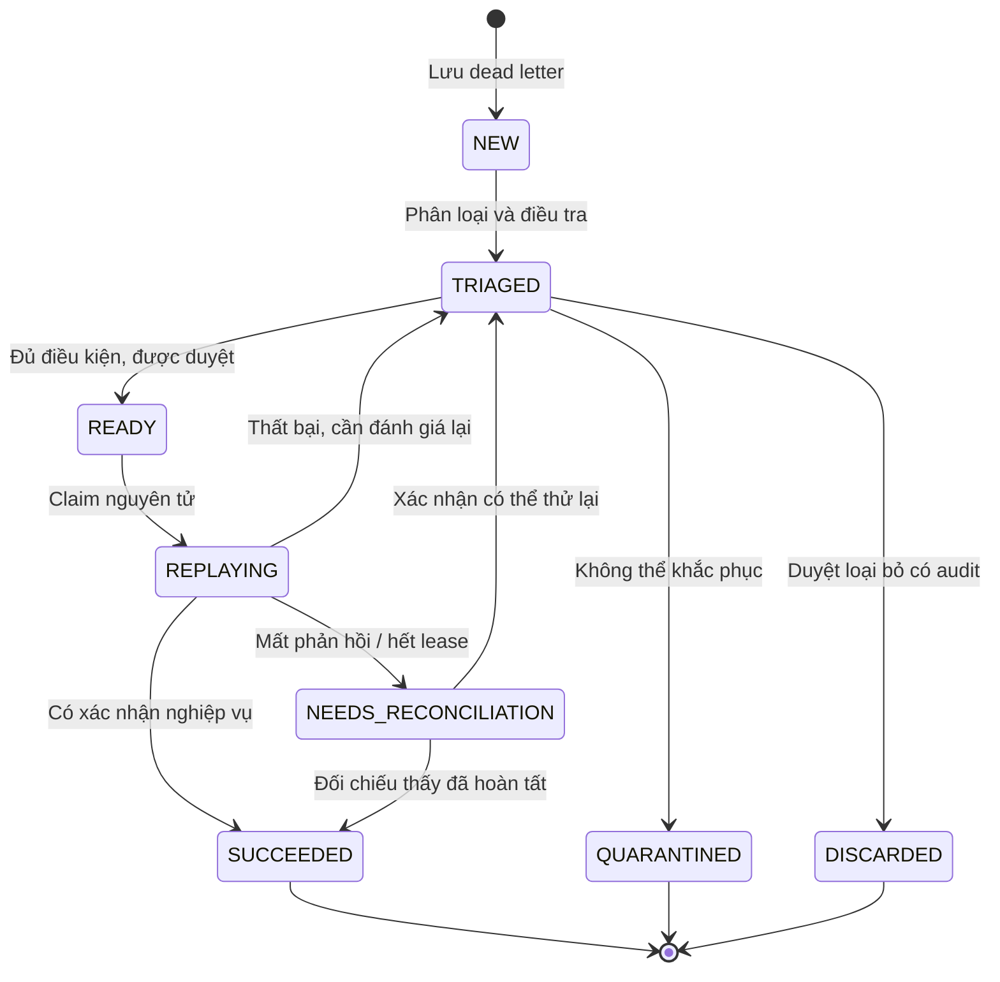
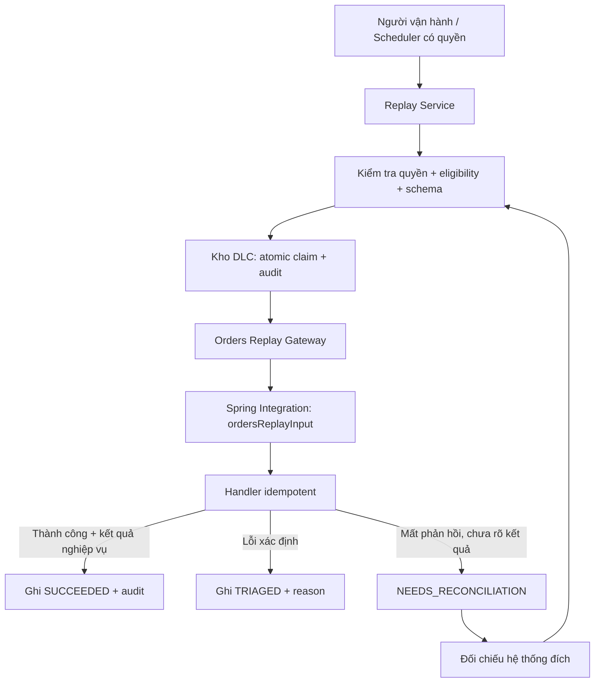

# Xử lý lại dead letter có kiểm soát

Trong module **SPRING_INTEGRATION_PATTERN**, Spring Integration được dùng để triển khai các **Enterprise Integration Patterns** như Router, Filter, Transformer, Splitter, Aggregator và Gateway nhằm xây dựng các luồng thông điệp ít phụ thuộc và dễ mở rộng. Khi một message không thể xử lý, hệ thống có thể thử lại, đưa lỗi qua `errorChannel` rồi lưu vào **Dead Letter Channel (DLC)** hoặc dead-letter queue (DLQ) của broker.

Tuy nhiên, **lưu được dead letter chưa có nghĩa nghiệp vụ đã hoàn tất**. Sau khi nguyên nhân lỗi được sửa, người vận hành có thể muốn xử lý lại message. Nếu phát lại tùy tiện, hệ thống có thể thanh toán hai lần, gửi thông báo trùng, xử lý dữ liệu đã hết hạn hoặc tạo vòng lặp vô hạn. Bài này tập trung vào **xử lý lại dead letter có kiểm soát** (*controlled replay*): xác định khi nào được phát lại, ai được phép thực hiện, cách chống xử lý đồng thời và trùng lặp, theo dõi kết quả và khôi phục sau sự cố.

Mục tiêu sau bài học:

1. Phân biệt **retry trong luồng chính**, **redelivery của broker** và **replay từ DLC**.
2. Xây dựng điều kiện cho phép replay dựa trên trạng thái, dữ liệu, quyền và giới hạn.
3. Thiết kế cơ chế **claim nguyên tử** để tránh hai worker cùng lấy một bản ghi lỗi.
4. Phát lại vào đúng flow Spring Integration với header được kiểm soát và idempotency.
5. Kiểm thử các nhánh thành công, thất bại, timeout, replay trùng và lỗi lưu trạng thái.

## 1. Replay không đơn giản là gửi message trở lại đầu luồng

Giả sử một đơn hàng có sự kiện `OrderCreated(eventId="evt-42")`:

- Handler gửi yêu cầu thanh toán tới hệ thống đối tác.
- Phía đối tác đã thực hiện giao dịch nhưng phản hồi tới ứng dụng bị timeout.
- Retry tại handler thất bại; message được lưu vào DLC với lý do `PAYMENT_TIMEOUT`.
- Sau khi sự cố qua đi, người vận hành định chọn nút “Replay”.

Nếu replay tạo **yêu cầu thanh toán mới** mà không kiểm tra giao dịch cũ, khách hàng có thể bị tính tiền lần hai. Việc có cùng payload không tự bảo đảm kết quả giống lần đầu. Replay là **một lần thực thi nghiệp vụ mới có quan hệ với một lần thất bại trước đó**.

Do đó cần xác định rõ:

| Câu hỏi | Điều kiện tối thiểu trước khi replay |
| --- | --- |
| Có nên xử lý lại? | Nguyên nhân lỗi đã được khắc phục; thông điệp còn giá trị |
| Ai được quyết định? | Người hoặc service có quyền replay cho flow liên quan |
| Dữ liệu nào sẽ được dùng? | Payload đúng phiên bản, nguồn tin cậy và điểm replay phù hợp |
| Đã xử lý thành công trước đây chưa? | Có kiểm tra idempotency/trạng thái nghiệp vụ |
| Có worker khác đang replay không? | Có claim hoặc lease nguyên tử |
| Nếu lại thất bại? | Có giới hạn số lần và tuyến cách ly/cảnh báo |
| Khi nào hoàn tất? | Khi có xác nhận thành công theo hợp đồng nghiệp vụ, được ghi bền vững |

### Ba khái niệm cần tách biệt

| Cơ chế | Lúc xảy ra | Bộ đếm | Đơn vị cần điều khiển |
| --- | --- | --- | --- |
| `RequestHandlerRetryAdvice` / Spring Retry | Handler đang chạy trong một lần nhận message | `attemptsMade` | Số lần gọi handler, backoff và exception |
| Broker redelivery | Consumer rollback, NACK hoặc mất kết nối | `deliveryCount` nếu adapter hỗ trợ | ACK, transaction, delay và chính sách broker |
| Replay từ DLC | Message đã được cách ly, sau đó được duyệt để xử lý lại | `replayCount` | Quyền, tình trạng nghiệp vụ, idempotency và audit |

Không cộng ba số trên thành một trường `retryCount` duy nhất. Replay có thể tạo một lần nhận message mới, bên trong đó lại có retry của handler. Nếu không có giới hạn ở **từng tầng**, số lần gọi hệ thống đích sẽ tăng ngoài dự kiến.

## 2. Vòng đời của một dead letter được replay

Một kho lỗi cần quản lý trạng thái thay vì chỉ có hành động “lấy khỏi queue và gửi lại”.



Ý nghĩa các trạng thái:

| Trạng thái | Ý nghĩa và hành động |
| --- | --- |
| `NEW` | Vừa được ghi vào DLC; cần điều tra lý do |
| `TRIAGED` | Đã phân loại nguyên nhân; chưa được phép tự động replay |
| `READY` | Đã qua kiểm tra và phê duyệt theo quy trình |
| `REPLAYING` | Một worker đã claim và đang xử lý |
| `SUCCEEDED` | Đã có bằng chứng hoàn tất nghiệp vụ |
| `NEEDS_RECONCILIATION` | Chưa biết chắc nghiệp vụ đã hoàn tất, cần đối chiếu |
| `QUARANTINED` | Không được replay cho đến khi có quyết định mới |
| `DISCARDED` | Được kết thúc bằng quyết định loại bỏ có audit |

Các tên trạng thái là **mô hình minh họa do ứng dụng định nghĩa**, không phải enum mặc định của Spring Integration.

**Điểm quan trọng:** không tự đổi `REPLAYING → READY` chỉ vì lease hết hạn. Worker cũ có thể đã thực thi tác dụng phụ rồi mất kết nối trước khi ghi kết quả. Trước khi thử lại, phải **đối chiếu trạng thái nghiệp vụ** và áp dụng idempotency.

## 3. Điều kiện để một dead letter đủ tư cách replay

Tạo một bước kiểm tra (*eligibility gate*) trước khi claim và kiểm tra lại điều kiện nguyên tử ở kho lưu.

### 3.1. Đúng message, đúng flow và đúng người

Chỉ nhận `deadLetterId` từ người gọi để xác định bản ghi. Thông tin `flowId`, `eventId`, loại payload và quyền xử lý phải lấy từ **kho tin cậy**, không từ body của một request tùy ý.

Ví dụ, bản ghi có `flowId = "orders"` chỉ được phát vào entry point replay được cho phép của Orders, không được chọn tên `MessageChannel` dựa trên dữ liệu do client cung cấp. Quyền replay Orders và quyền replay Notifications có thể khác nhau.

Người thực hiện cần có một danh tính/audit context, lý do replay và quyền tương ứng. Với dữ liệu tài chính hoặc tác vụ nhạy cảm, có thể yêu cầu thêm phê duyệt hai bước; đây là chính sách nghiệp vụ cần được ứng dụng thực thi.

### 3.2. Nguyên nhân đã được xử lý

Nếu lỗi do schema sai, sửa dữ liệu ở nguồn hoặc tạo một bản hiệu chỉnh có audit. Nếu do dịch vụ đích timeout, xác minh dịch vụ đã hồi phục. Nếu do token hết hạn, khắc phục cấu hình trước.

Replay ngay khi nguyên nhân chưa thay đổi chỉ đẩy message quay về một vòng lỗi mới.

### 3.3. Message còn giá trị, đúng phiên bản dữ liệu

Một bản ghi cần giữ `schemaVersion`, `contentType`, encoding hoặc tham chiếu đến payload gốc. Khi hệ thống đã triển khai phiên bản mới, cần có bước chuyển đổi schema an toàn hoặc từ chối replay nếu không còn hỗ trợ.

Đồng thời kiểm tra **business deadline**: thông báo OTP hết hiệu lực hoặc giá khuyến mại đã hết hạn có thể không được phép áp dụng lại. TTL của broker không tự thay thế cho quy tắc thời hạn nghiệp vụ.

### 3.4. Chưa hoàn tất tác dụng phụ

Trước khi replay, kiểm tra khóa idempotency ổn định như `eventId`, `paymentRequestId` hoặc `orderId + operationType`.

Nếu tìm thấy một lần thanh toán đã thành công, có thể đánh dấu dead letter được **reconcile** với nghiệp vụ hoàn tất, thay vì gọi thanh toán lần nữa. Việc kiểm tra trước khi gọi vẫn chưa đủ cho cạnh tranh đồng thời; **handler đích** cũng phải triển khai idempotency một cách nguyên tử hoặc dùng API đối tác hỗ trợ idempotency key.

### 3.5. Chưa hết giới hạn replay

Ví dụ chính sách: tối đa **2 lần replay có chủ đích** cho cùng bản ghi. Khi chạm giới hạn, chuyển tới `QUARANTINED` hoặc quy trình đánh giá thủ công. Số lần retry bên trong mỗi replay vẫn được quản lý độc lập.

### Bảng quyết định

| Tình huống | Quyết định |
| --- | --- |
| `READY`, đúng flow, chưa quá hạn, nguyên nhân đã sửa | Có thể claim để replay |
| `REPLAYING` do worker khác claim | Không được bắt đầu lượt mới |
| Hết business deadline | Không replay; điều tra/quarantine hoặc xử lý nghiệp vụ khác |
| `replayCount >= maxReplays` | Chặn replay, cảnh báo hoặc yêu cầu phê duyệt ngoại lệ |
| Payload schema không còn được hỗ trợ | Chuyển đổi có kiểm soát hoặc từ chối |
| Đã hoàn thành tác dụng phụ | Reconcile/đánh dấu thành công, không thực thi lại |
| Không biết lần replay trước đã hoàn thành hay chưa | Chuyển `NEEDS_RECONCILIATION` |
| Kho trạng thái/DLC không ghi được | Dừng thao tác; không coi là replay thành công |

## 4. Kiến trúc replay có kiểm soát với Spring Integration



Hai thành phần cần tách trách nhiệm:

- **Replay Service:** kiểm tra điều kiện, kiểm soát quyền, claim một bản ghi, gọi gateway, ghi trạng thái và audit.
- **Business Handler:** thực thi nghiệp vụ bằng khóa idempotency ổn định và trả kết quả có ý nghĩa. Handler có thể dùng Router, Transformer, Gateway hoặc các nhánh khác, nhưng phải có hợp đồng rõ ràng về lúc nào được xem là hoàn tất.

**Không nối trực tiếp `deadLetters → originalInput` bằng một vòng lặp tự động.** Điểm vào replay nên là entry point được kiểm soát, gắn nguồn tin cậy và các header cho phép. Với request/reply đồng bộ, có thể dùng `@MessagingGateway` để nhận kết quả. Với xử lý bất đồng bộ, cần completion event hoặc trạng thái nghiệp vụ bền vững để xác nhận; việc gọi `send()` trả về `true` không chứng minh nghiệp vụ đã hoàn tất.

## 5. Lưu trạng thái và claim nguyên tử

Trong ví dụ dưới đây, **PostgreSQL** lưu dead letter, trạng thái replay và audit. Đây là một schema tối giản để minh họa cơ chế. Với payload nhạy cảm, nên lưu tham chiếu tới object storage mã hóa và kiểm soát quyền truy cập thay cho lưu JSON thô.

```sql
CREATE TABLE dead_letter_events (
    dead_letter_id   uuid PRIMARY KEY,
    flow_id          varchar(64) NOT NULL,
    event_id         varchar(128) NOT NULL,
    correlation_id   varchar(128),
    payload_json     text NOT NULL,
    schema_version   varchar(32) NOT NULL,
    reason_code      varchar(64) NOT NULL,
    status           varchar(32) NOT NULL DEFAULT 'NEW',
    replay_count     integer NOT NULL DEFAULT 0 CHECK (replay_count >= 0),
    max_replays      integer NOT NULL DEFAULT 2 CHECK (max_replays >= 0),
    business_deadline timestamptz,
    lease_token      uuid,
    lease_until      timestamptz,
    last_error_code  varchar(64),
    created_at       timestamptz NOT NULL DEFAULT now(),
    updated_at       timestamptz NOT NULL DEFAULT now()
);

CREATE INDEX idx_dead_letter_status
    ON dead_letter_events (flow_id, status, created_at);

CREATE TABLE dead_letter_replay_audit (
    replay_attempt_id uuid PRIMARY KEY,
    dead_letter_id    uuid NOT NULL
        REFERENCES dead_letter_events(dead_letter_id),
    actor_id          varchar(128) NOT NULL,
    rationale         text NOT NULL,
    outcome           varchar(32) NOT NULL,
    reason_code       varchar(64),
    started_at        timestamptz NOT NULL DEFAULT now(),
    finished_at       timestamptz
);
```

### Claim bằng câu lệnh có điều kiện

Hai worker có thể đọc cùng một row `READY`. Cách “SELECT trước rồi UPDATE sau” không bảo đảm chỉ một worker nhận được nó. Một lệnh `UPDATE ... WHERE ... RETURNING` của PostgreSQL giúp lấy quyền xử lý **nguyên tử ở mức row**:

```sql
UPDATE dead_letter_events
SET status = 'REPLAYING',
    replay_count = replay_count + 1,
    lease_token = :lease_token,
    lease_until = now() + interval '2 minutes',
    updated_at = now()
WHERE dead_letter_id = :dead_letter_id
  AND flow_id = :expected_flow_id
  AND status = 'READY'
  AND replay_count < max_replays
  AND (business_deadline IS NULL OR business_deadline > now())
RETURNING dead_letter_id, flow_id, event_id, correlation_id,
          payload_json, schema_version, replay_count, lease_token;
```

- **Một row trả về:** worker đã claim được bản ghi.
- **Không có row nào:** bản ghi đã đổi trạng thái, hết quyền replay theo rule SQL, hoặc worker khác claim trước; không được tiếp tục gửi.
- Chỉ một giao dịch ngắn nên giữ lock lúc claim. Ghi audit `STARTED` trong **cùng giao dịch** với claim để tránh đã chiếm quyền nhưng không có dấu vết bắt đầu.
- Các kiểm tra bổ sung như quyền, schema và phê duyệt cần được kiểm tra trước, rồi **ràng buộc lại** những điều kiện quan trọng trong transaction claim. Trong hệ thống có nhiều người sửa record, có thể thêm `version` để optimistic locking.

**Lease không ngăn được worker cũ thực thi nghiệp vụ sau khi lease hết hạn.** Khi gặp `REPLAYING` quá lâu, chuyển sang `NEEDS_RECONCILIATION` để xác định kết quả; chỉ sau đó mới cho phép lượt mới. Nếu có cơ chế tự gia hạn lease, phải gắn token/fencing vào các thao tác ghi và vẫn dựa vào idempotency ở hệ thống nghiệp vụ.

### Chỉ người đang sở hữu lease được cập nhật kết quả

```sql
UPDATE dead_letter_events
SET status = 'SUCCEEDED',
    lease_token = NULL,
    lease_until = NULL,
    updated_at = now()
WHERE dead_letter_id = :dead_letter_id
  AND status = 'REPLAYING'
  AND lease_token = :lease_token;
```

Phải kiểm tra số row được cập nhật bằng **1**. Nếu là 0, có thể quyền sở hữu đã thay đổi hoặc record bị can thiệp; cần cảnh báo và đối chiếu thay vì tự ghi đè trạng thái.

Trong cùng transaction ghi kết quả, cập nhật audit `outcome = 'SUCCEEDED'` và `finished_at`. Khi thất bại đã biết chắc là **chưa có tác dụng phụ**, có thể chuyển `TRIAGED` để đánh giá lại. Khi không biết hệ thống đích đã thực hiện hay chưa (timeout/mất phản hồi), ưu tiên `NEEDS_RECONCILIATION`.

## 6. Ví dụ Spring Integration: replay Gateway trả kết quả nghiệp vụ

Ví dụ dùng **Spring Integration 6.x, Java 17+**. Nó minh họa cách đưa một **ReplayCommand đã được duyệt** qua gateway đến handler idempotent của Orders.

Điểm quan trọng: một lệnh replay phải đi đến **đúng flow** và chỉ mang header/dữ liệu đã được ứng dụng cho phép. Đoạn ví dụ này giả định service nghiệp vụ `OrderService` có thao tác `processOnce` với khóa `eventId` nhằm bảo đảm idempotency ở nơi ghi dữ liệu nghiệp vụ.

```java
package demo.integration.replay;

import java.util.UUID;

import org.springframework.context.annotation.Bean;
import org.springframework.context.annotation.Configuration;
import org.springframework.integration.annotation.Gateway;
import org.springframework.integration.annotation.IntegrationComponentScan;
import org.springframework.integration.annotation.MessagingGateway;
import org.springframework.integration.config.EnableIntegration;
import org.springframework.integration.dsl.IntegrationFlow;

// Command tạo từ record đáng tin cậy sau khi claim thành công.
record ReplayCommand(
        UUID deadLetterId,
        UUID replayAttemptId,
        String eventId,
        String correlationId,
        String payloadJson,
        String schemaVersion) {}

record ReplayOutcome(boolean completed, String businessReference) {}

interface OrderService {
    // processOnce phải bảo đảm idempotency theo eventId ở tầng nghiệp vụ.
    ReplayOutcome processOnce(
            String eventId, String payloadJson, String schemaVersion);
}

final class OrderReplayHandler {
    private final OrderService service;

    OrderReplayHandler(OrderService service) {
        this.service = service;
    }

    public ReplayOutcome replay(ReplayCommand command) {
        return service.processOnce(
                command.eventId(),
                command.payloadJson(),
                command.schemaVersion());
    }
}

@MessagingGateway
interface OrdersReplayGateway {
    @Gateway(requestChannel = "ordersReplayInput")
    ReplayOutcome replay(ReplayCommand command);
}

@Configuration
@EnableIntegration
@IntegrationComponentScan
class OrdersReplayConfiguration {

    @Bean
    OrderReplayHandler orderReplayHandler(OrderService service) {
        return new OrderReplayHandler(service);
    }

    @Bean
    IntegrationFlow ordersReplayFlow(OrderReplayHandler handler) {
        return IntegrationFlow.from("ordersReplayInput")
                .handle(handler, "replay")
                .get();
    }
}
```

Trong flow trên, `OrdersReplayGateway.replay(...)` gọi handler đồng bộ và nhận `ReplayOutcome`. Đây là một **hợp đồng request/reply**: `completed=true` chỉ hợp lệ nếu `OrderService.processOnce` đã xác nhận tác vụ nghiệp vụ theo mức tin cậy yêu cầu. Nếu handler chỉ enqueue việc bất đồng bộ rồi trả lời, không thể coi kết quả đó là “đã hoàn tất”; khi đó hãy dùng `ACCEPTED / PENDING_CONFIRMATION` và chờ một completion event hoặc đối chiếu trạng thái bền vững.

**Lưu ý định tuyến:** nếu hệ thống có nhiều flow, nên dùng registry/router được định nghĩa cố định, ví dụ `orders → ordersReplayGateway` và `notifications → notificationsReplayGateway`. Tuyệt đối không dùng `flowId` từ request bên ngoài như một tên bean/channel tùy ý rồi gửi trực tiếp.

### Tạo message mới và giữ header có chủ đích

Một phương án khác khi muốn gọi `MessageChannel` trực tiếp là tạo message mới từ record đã claim:

```java
Message<String> replayMessage = MessageBuilder
        .withPayload(trustedRecord.payloadJson())
        .setHeader("eventId", trustedRecord.eventId())
        .setHeader("correlationId", trustedRecord.correlationId())
        .setHeader("replayOf", trustedRecord.deadLetterId().toString())
        .setHeader("replayAttemptId", attemptId.toString())
        .build();

// Dùng đúng entry point replay đã được cấu hình cho flow.
ordersReplayInput.send(replayMessage);
```

Mảnh code giả định có `trustedRecord`, `attemptId` và `ordersReplayInput` đã được cấp từ cơ chế replay. Cần import `org.springframework.messaging.Message` và `org.springframework.messaging.support.MessageBuilder`.

**Không copy toàn bộ headers của message lỗi.** Header `replyChannel`, `errorChannel`, thông tin ACK, token, credential hoặc đối tượng channel từ lần xử lý cũ không nên được dùng lại. Việc gọi `send()` trả `true` chỉ cho biết message được channel chấp nhận theo semantics hiện tại; nó **không phải** bằng chứng nghiệp vụ hoàn tất.

## 7. Replay coordinator: kiểm tra, claim, phát lại, ghi kết quả

Cần một dịch vụ điều phối nằm ngoài business flow. Dưới đây là **pseudocode Java có kiểu rõ ràng** cho các bước chính; `ReplayStore`, `AuthorizationService` và `OrdersReplayGateway` là giao diện ứng dụng cần triển khai hoặc cung cấp bean thực tế.

```java
public ReplayOutcome replayOrder(UUID deadLetterId,
                                 String actorId,
                                 String rationale) {
    if (rationale == null || rationale.isBlank()) {
        throw new IllegalArgumentException("Replay rationale is required");
    }

    // Không tin flowId, payload hoặc eventId từ request bên ngoài.
    DeadLetterSnapshot record = store.get(deadLetterId);
    authorization.requireReplayPermission(actorId, record.flowId());

    if (!"orders".equals(record.flowId())) {
        throw new IllegalArgumentException("Record is not an orders event");
    }
    if (!"READY".equals(record.status())
            || record.replayCount() >= record.maxReplays()
            || record.isBusinessExpired()
            || !schemaRegistry.supports(record.schemaVersion())) {
        throw new IllegalStateException("Dead letter is not eligible");
    }

    // Quan trọng: kiểm tra nghiệp vụ đã xử lý chưa. Handler cũng
    // phải idempotent vì có thể xảy ra cạnh tranh sau bước kiểm tra.
    if (orderService.alreadyCompleted(record.eventId())) {
        store.reconcileAsSucceeded(deadLetterId, actorId);
        return new ReplayOutcome(true, "ALREADY_COMPLETED");
    }

    UUID leaseToken = UUID.randomUUID();
    UUID attemptId = UUID.randomUUID();

    // claim và ghi audit STARTED trong một giao dịch ngắn.
    // claim phải tự kiểm tra lại status, deadline và replayCount.
    DeadLetterSnapshot claimed = store.claimReady(
            deadLetterId, "orders", leaseToken, attemptId,
            actorId, rationale);
    if (claimed == null) {
        throw new IllegalStateException("Already claimed or not eligible");
    }

    try {
        ReplayOutcome outcome = ordersReplayGateway.replay(
                new ReplayCommand(
                        claimed.deadLetterId(),
                        attemptId,
                        claimed.eventId(),
                        claimed.correlationId(),
                        claimed.payloadJson(),
                        claimed.schemaVersion()));

        if (!outcome.completed()) {
            // Có thể chỉ mới nhận lệnh nhưng chưa hoàn tất nghiệp vụ.
            store.markNeedsReconciliation(deadLetterId, leaseToken,
                    attemptId, "NO_FINAL_CONFIRMATION");
            return outcome;
        }

        // Mark success và audit trong cùng transaction ngắn.
        store.markSucceeded(deadLetterId, leaseToken, attemptId);
        return outcome;
    } catch (Exception failure) {
        // Nếu không biết downstream đã hoàn thành hay chưa,
        // giữ record để đối chiếu; đừng tự động replay lần nữa.
        store.markNeedsReconciliation(deadLetterId, leaseToken,
                attemptId, "REPLAY_RESULT_UNCERTAIN");
        throw failure;
    }
}
```

Trong ví dụ này, các phương thức của `ReplayStore` có những **hợp đồng bắt buộc**:

- `claimReady(...)` thực hiện cập nhật có điều kiện ở database và audit `STARTED` trong một transaction ngắn.
- `markSucceeded(...)`, `markNeedsReconciliation(...)` kiểm tra `leaseToken`, cập nhật trạng thái và audit cùng transaction; nếu không thể cập nhật phải báo lỗi.
- `reconcileAsSucceeded(...)` chỉ chạy sau khi **đã xác minh** nghiệp vụ hoàn tất bằng nguồn đáng tin cậy; cần ghi người quyết định và bằng chứng.
- Không bọc cả lời gọi mạng của `ordersReplayGateway` trong một transaction JDBC dài; transaction database chỉ nên giữ trong các bước claim và cập nhật kết quả.

Nếu `store.markNeedsReconciliation(...)` cũng thất bại, hệ thống phải phát cảnh báo và giữ bản ghi/trace để phục hồi sau sự cố. Có thể có trường hợp handler đã hoàn tất nhưng đánh dấu `SUCCEEDED` thất bại; lần xử lý sau cần **đối chiếu nghiệp vụ** trước khi thử lại.

### Điều gì xảy ra khi quá thời gian chờ?

Timeout không phải bằng chứng giao dịch thất bại. Nếu gateway gọi một dịch vụ bên ngoài và không nhận được phản hồi, dịch vụ đó có thể đã ghi trạng thái trước khi kết nối bị ngắt. Khi đó:

1. Đánh dấu `NEEDS_RECONCILIATION` hoặc trạng thái tương đương, nếu ghi được.
2. Tra hệ thống đích bằng `eventId`/idempotency key hoặc mã giao dịch.
3. Nếu đã hoàn tất, ghi nhận thành công và audit; **không gọi lại**.
4. Nếu chắc chắn chưa thực hiện và nguyên nhân được giải quyết, đưa về `READY` sau khi kiểm tra chính sách.
5. Nếu chưa thể xác minh, giữ bản ghi để điều tra và báo động.

Không nên để một scheduler tự xử lý tất cả lease hết hạn bằng cách gửi lại ngay; điều này có thể tạo tác dụng phụ trùng.

## 8. Replay khi có Router, Splitter, Aggregator và Gateway

Trong luồng tích hợp thực tế, điểm replay quyết định ngữ nghĩa xử lý:

| Pattern | Nguy cơ khi replay | Cách kiểm soát |
| --- | --- | --- |
| Router | Route/schema đã đổi, message vào nhánh mới sai | Dùng route theo phiên bản hoặc entry point có kiểm tra |
| Transformer | Payload trong DLC đã là dữ liệu sau transform, không phải dữ liệu gốc | Lưu `payloadRef` và `schemaVersion` của ingress hoặc chỉ replay từ đúng bước |
| Splitter | Phát lại cả nhóm có thể xử lý trùng các phần thành công | Định danh từng phần, theo dõi part đã xử lý |
| Aggregator | Replay một phần có thể làm nhóm thiếu/đếm trùng sequence | Lưu `correlationId`, `sequenceNumber`, trạng thái nhóm |
| Gateway | Caller có thể đã timeout dù side effect xong | Dùng idempotency, tra trạng thái trước replay; bảo đảm reply contract |
| Filter | Message bị loại theo quy tắc không phải lỗi | Không tự tạo dead letter để replay |
| Retry / error channel | Replay có thể lại đi vào retry và DLC | Giới hạn cả retry lẫn replay; giữ dấu `replayOf` |

Nếu một record đã thất bại ở giữa flow, không nhất thiết phát lại **từ đầu**. Chọn điểm replay theo ý nghĩa nghiệp vụ: phát lại nguồn chuẩn hóa, phát lại một phần sau khi xác minh, hoặc thực hiện một tác vụ bù trừ. Mỗi lựa chọn cần hợp đồng dữ liệu và idempotency riêng.

## 9. Kiểm thử replay có kiểm soát

Kiểm thử cần xác nhận **kết quả nghiệp vụ và sự nhất quán trạng thái**, thay vì chỉ kiểm tra message đã gửi tới channel.

### Ma trận kiểm thử

| Trường hợp | Kết quả mong đợi |
| --- | --- |
| Bản ghi `READY` hợp lệ, business handler thành công | Claim một lần, `replayCount` tăng 1, trạng thái `SUCCEEDED`, có audit |
| Bản ghi `NEW` hoặc `TRIAGED` chưa được duyệt | Bị từ chối, không gửi message |
| Không có quyền replay flow | Bị từ chối và ghi audit bảo mật phù hợp |
| `replayCount = maxReplays` | Không cho claim, chuyển triage/quarantine theo chính sách |
| Quá business deadline | Không replay |
| Payload version không còn được hỗ trợ | Từ chối hoặc yêu cầu chuyển đổi có audit |
| Hai worker claim cùng record | Chỉ một worker nhận row từ `UPDATE ... RETURNING` |
| Lần xử lý cũ đã thành công, trạng thái DLC chưa cập nhật | Reconcile thành công mà không gọi business handler lại |
| Gateway timeout không rõ kết quả | `NEEDS_RECONCILIATION`; không auto replay |
| Lỗi trước khi claim | Không tăng `replayCount` |
| Lỗi sau claim nhưng trước khi ghi kết quả | Có audit/lease và cơ chế điều tra trạng thái không rõ |
| Cập nhật kết quả bị từ chối do `leaseToken` sai | Không ghi đè worker khác |
| Replay lại gây lỗi và tới DLC lần nữa | Giữ `replayOf`, chặn vòng vô hạn và bảo toàn dấu vết |
| Hệ thống dùng xử lý bất đồng bộ | Trạng thái chưa `SUCCEEDED` cho tới khi có completion xác thực |

### Ví dụ kiểm thử quy tắc eligibility thuần Java

Để kiểm tra logic trước bước claim, có thể tách một policy độc lập. Ví dụ sau dùng Java 17 và JUnit Jupiter:

```java
package demo.integration.replay;

import java.time.Instant;

record ReplayCandidate(
        String flowId,
        String status,
        int replayCount,
        int maxReplays,
        Instant businessDeadline,
        String schemaVersion) {}

final class ReplayPolicy {
    private ReplayPolicy() {}

    static void requireEligible(
            ReplayCandidate c, String expectedFlow, Instant now) {
        if (!expectedFlow.equals(c.flowId())) {
            throw new IllegalStateException("Wrong flow");
        }
        if (!"READY".equals(c.status())) {
            throw new IllegalStateException("Not approved");
        }
        if (c.replayCount() >= c.maxReplays()) {
            throw new IllegalStateException("Replay limit reached");
        }
        if (c.businessDeadline() != null
                && !c.businessDeadline().isAfter(now)) {
            throw new IllegalStateException("Business deadline expired");
        }
        if (!"v1".equals(c.schemaVersion())) {
            throw new IllegalStateException("Unsupported schema");
        }
    }
}
```

```java
package demo.integration.replay;

import static org.junit.jupiter.api.Assertions.assertDoesNotThrow;
import static org.junit.jupiter.api.Assertions.assertThrows;

import java.time.Instant;
import org.junit.jupiter.api.Test;

class ReplayPolicyTest {
    private static final Instant NOW =
            Instant.parse("2026-11-21T08:00:00Z");

    @Test
    void readyRecordCanBeReplayed() {
        var record = new ReplayCandidate(
                "orders", "READY", 0, 2, NOW.plusSeconds(3600), "v1");

        assertDoesNotThrow(() ->
                ReplayPolicy.requireEligible(record, "orders", NOW));
    }

    @Test
    void expiredRecordCannotBeReplayed() {
        var record = new ReplayCandidate(
                "orders", "READY", 0, 2, NOW, "v1");

        assertThrows(IllegalStateException.class, () ->
                ReplayPolicy.requireEligible(record, "orders", NOW));
    }

    @Test
    void replayLimitAndWrongFlowAreRejected() {
        var limit = new ReplayCandidate(
                "orders", "READY", 2, 2, null, "v1");
        var otherFlow = new ReplayCandidate(
                "notifications", "READY", 0, 2, null, "v1");

        assertThrows(IllegalStateException.class, () ->
                ReplayPolicy.requireEligible(limit, "orders", NOW));
        assertThrows(IllegalStateException.class, () ->
                ReplayPolicy.requireEligible(otherFlow, "orders", NOW));
    }

    @Test
    void triagedRecordNeedsApprovalFirst() {
        var record = new ReplayCandidate(
                "orders", "TRIAGED", 0, 2, null, "v1");

        assertThrows(IllegalStateException.class, () ->
                ReplayPolicy.requireEligible(record, "orders", NOW));
    }
}
```

Đây là **mã minh họa**, chưa được chạy trong repository ở bước biên soạn này. Unit test policy chỉ chứng minh quy tắc đầu vào; nó **không** chứng minh claim nguyên tử hoặc xử lý idempotent. Các yêu cầu đó cần integration test với database thật và test end-to-end với source adapter/handler, bao gồm hai worker song song, sự cố mạng và restart giữa các bước.

## 10. Quan sát, kiểm toán và giới hạn vận hành

Replay có kiểm soát cần để lại dấu vết cho từng lượt:

- **Danh tính thao tác:** người/service, quyền và lý do duyệt.
- **Liên kết:** `deadLetterId`, `replayAttemptId`, `eventId`, `correlationId`, `replayOf`.
- **Trạng thái:** thời gian claim, lease token (ẩn khỏi log công khai), kết quả, thời gian cập nhật.
- **Nguồn dữ liệu:** schema version, payload reference/checksum, thay đổi được phê duyệt nếu có.
- **Kết quả:** xác nhận nghiệp vụ, reference của hệ thống đích, mã lỗi an toàn, người đối chiếu.

Không ghi payload nhạy cảm, access token, exception message không kiểm soát hay raw headers vào audit/metrics. Giữ thông tin chi tiết trong kho có kiểm soát quyền truy cập, thời gian lưu và mã hóa thích hợp.

Một số metric gợi ý (ứng dụng phải tự cấu hình/thu thập):

| Metric | Ý nghĩa |
| --- | --- |
| `dead_letter_ready` theo `flowId` | Lượng message đủ điều kiện đang chờ |
| `replay_started_total` | Số lượt replay được claim |
| `replay_succeeded_total` | Lượt có xác nhận hoàn tất |
| `replay_reconciliation_required_total` | Lượt chưa biết chắc kết quả |
| `replay_claim_conflict_total` | Hai hoặc nhiều worker tranh cùng record |
| `replay_limit_reached_total` | Lượt bị chặn do hết ngân sách |
| `dead_letter_oldest_age_seconds` | Tuổi message lỗi cũ nhất |
| `dead_letter_state_update_failed_total` | Lỗi ghi kết quả hoặc audit |

Không đưa `eventId`, `deadLetterId` hoặc `orderId` vào nhãn metric do cardinality cao. Dùng trace và log có quyền truy cập để tìm một trường hợp cụ thể. Cần có cảnh báo nếu bản ghi `REPLAYING` quá lâu, `NEEDS_RECONCILIATION` tăng hoặc không ghi được audit.

### Quy trình vận hành mẫu

1. Lọc dead letter theo flow và nguyên nhân, xác định phạm vi sự cố.
2. Kiểm tra nghiệp vụ đã hoàn tất hay chưa và nguyên nhân lỗi đã được sửa.
3. Đối chiếu schema/version và business deadline; chuẩn bị dữ liệu hiệu chỉnh có audit khi cần.
4. Xin phê duyệt theo quyền, xác định số lượng replay và tốc độ tối đa.
5. Claim từng bản ghi, phát qua entry point replay đúng flow.
6. Theo dõi kết quả, không đánh dấu thành công nếu chỉ mới nhận lệnh.
7. Đối chiếu các lượt timeout/mất phản hồi; cập nhật kết quả, giới hạn replay tiếp theo.
8. Tổng hợp audit, tỷ lệ thành công và các dead letter cần xử lý thủ công.

## 11. Những sai sót thường gặp

| Sai sót | Hậu quả | Cách khắc phục |
| --- | --- | --- |
| Đọc queue rồi gửi lại ngay | Có thể mất record và mất khả năng theo dõi | Lưu trạng thái/claim/audit bền vững |
| Hai worker cùng đọc bản ghi `READY` | Replay trùng | Dùng claim nguyên tử trong database |
| Tự replay khi lease vừa hết | Worker cũ có thể đã xử lý thành công | Đối chiếu nghiệp vụ trước khi cho lượt mới |
| Coi `send() == true` là nghiệp vụ hoàn tất | Báo thành công sai | Yêu cầu kết quả nghiệp vụ hoặc completion event |
| Copy toàn bộ headers từ dead letter | Dùng nhầm `replyChannel`/`errorChannel`, lộ dữ liệu | Chỉ tái tạo allowlist header |
| Đưa `flowId` do client gửi trực tiếp thành channel name | Replay sai đích | Router/registry cấu hình cố định dựa trên metadata tin cậy |
| Không có idempotency ở handler | Thanh toán/gửi email hai lần | Khóa nghiệp vụ ổn định và xử lý nguyên tử |
| Chỉ kiểm tra retry trong handler | Replay + broker redelivery có thể lặp vô hạn | Theo dõi giới hạn ở từng tầng |
| Đánh dấu `SUCCEEDED` trước khi commit tác dụng phụ | Trạng thái sai, khó khôi phục | Chỉ đánh dấu theo xác nhận tin cậy |
| Không xử lý lỗi ghi trạng thái sau khi nghiệp vụ thành công | Không biết có nên replay nữa không | Audit, reconcile và idempotent handler |
| Replay dữ liệu hết hạn hoặc sai version | Vi phạm nghiệp vụ hoặc sai dữ liệu | Kiểm tra deadline và schema trước claim |
| Không phân quyền, không audit | Khó truy trách nhiệm và hạn chế thao tác | Quyền theo flow, lý do, bằng chứng và nhật ký |

## 12. Câu hỏi tự kiểm tra

1. Vì sao replay từ DLC khác với `RequestHandlerRetryAdvice` trong một lần nhận message?
2. Nếu timeout xảy ra sau khi đối tác đã trừ tiền, bạn cần kiểm tra gì trước khi replay?
3. Vì sao `replayCount` phải tách khỏi `attemptsMade` và broker `deliveryCount`?
4. Tại sao `SELECT status='READY'` rồi mới `UPDATE` không đủ để chống hai worker cùng replay?
5. Khi một lease hết hạn nhưng kết quả nghiệp vụ chưa rõ, nên chuyển sang trạng thái gì và làm gì?
6. Vì sao bản ghi `SUCCEEDED` phải dựa trên xác nhận nghiệp vụ thay vì chỉ nhận được `send() = true`?
7. Khi replay sau Transformer, làm sao biết nên phát lại dữ liệu từ ingress hay tại một endpoint trung gian?
8. Làm thế nào giữ `correlationId` và `eventId` mà không tái sử dụng header channel nội bộ?
9. Những trường hợp nào buộc phải đưa dead letter vào `QUARANTINED` thay vì tiếp tục replay?
10. Nếu business handler hoàn tất nhưng cập nhật trạng thái dead letter bị lỗi, đâu là cách khôi phục an toàn?

## Tài liệu tham khảo

- [Spring Integration Reference — Error Handling](https://docs.spring.io/spring-integration/reference/error-handling.html): phát `ErrorMessage` và xây dựng error flow.
- [Spring Integration Reference — Messaging Gateways](https://docs.spring.io/spring-integration/reference/gateway.html): mô hình request/reply qua Gateway.
- [Spring Integration Reference — Message Channels](https://docs.spring.io/spring-integration/reference/channel.html): semantics của `DirectChannel` và các channel khác.
- [Spring Integration Reference — Provided Advice Classes](https://docs.spring.io/spring-integration/reference/handler-advice/classes.html): retry advice và recovery.
- [PostgreSQL Documentation — UPDATE](https://www.postgresql.org/docs/current/sql-update.html): câu lệnh `UPDATE ... RETURNING` để claim có điều kiện.

**Ghi nhớ:** Xử lý lại dead letter có kiểm soát là **một quy trình nghiệp vụ có trạng thái**, gồm điều tra, cho phép replay, claim nguyên tử, định tuyến đúng flow, thực thi idempotent, xác nhận kết quả và audit. Không được tự động phát lại chỉ vì một message đang nằm trong DLC, và không được đánh dấu thành công khi chưa biết chắc tác vụ đã hoàn tất.
