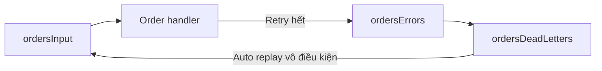
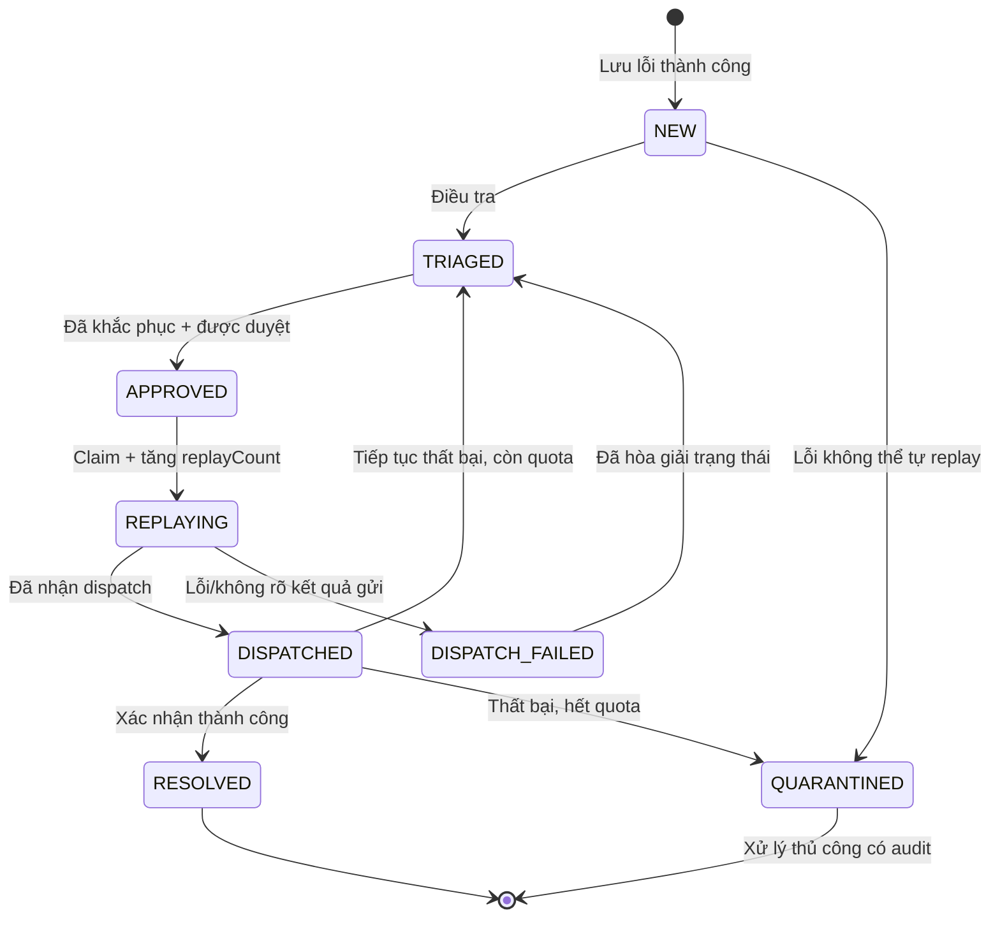

# Ngăn dead letter quay vòng vô hạn

Trong module **SPRING_INTEGRATION_PATTERN**, Spring Integration giúp triển khai **Enterprise Integration Patterns** như Router, Filter, Transformer, Splitter, Aggregator, Gateway, retry, error channel và correlation. Những luồng message ít phụ thuộc này có thể xử lý lỗi bằng cách đưa message thất bại vào **Dead Letter Channel (DLC)**. Tuy nhiên, nếu DLC tự động đẩy message về luồng ban đầu, hoặc nếu lỗi trong chính error flow lại được gửi về cùng đường xử lý lỗi, một message có thể **quay vòng vô hạn**.

Bài này giải thích các loại vòng lặp, cách đặt giới hạn retry/redelivery/replay, thiết kế nhánh dead letter là điểm dừng có kiểm soát, cách lưu trạng thái bền vững, cùng ví dụ Spring Integration và tình huống kiểm thử. Mục tiêu không chỉ là không làm treo consumer: hệ thống còn phải **giữ được dữ liệu lỗi, tránh tác dụng phụ trùng và cho phép điều tra, phát lại có kiểm soát**.

## 1. Vòng lặp dead letter hình thành như thế nào?

Giả sử hệ thống xử lý đơn hàng nhận `OrderCreated`. Dịch vụ thanh toán đang lỗi nên message được retry rồi gửi vào dead letter. Nếu một thành phần lắng nghe DLC và chuyển nó ngay lại `ordersInput`, cùng message tiếp tục thất bại, tiếp tục tới DLC, rồi lại được phát lại không có điểm dừng.



Đường quay vòng trên có thể làm tăng số lần gọi API, lấp đầy log, ngốn CPU và kích hoạt nghiệp vụ hai lần nếu một lần gọi thực tế đã thành công nhưng response bị mất.

### Bốn vòng lặp thường bị nhầm với nhau

| Vòng lặp | Nguồn gây lặp | Nguy cơ | Cơ chế kiểm soát |
| --- | --- | --- | --- |
| **Handler retry** | `RequestHandlerRetryAdvice` hoặc HTTP client gọi lại handler | Thử lại lỗi không thể phục hồi, tăng tải | Retry policy theo loại lỗi, `maxAttempts`, backoff |
| **Broker redelivery** | Broker/consumer nhận lại do rollback, NACK, chưa ACK hoặc restart | Cùng message được chuyển tới handler qua nhiều chu kỳ | Redelivery limit, chính sách ACK/NACK, broker DLQ theo adapter |
| **Dead-letter replay** | Một job hoặc người vận hành phát lại message đã cách ly | Replay lại cùng lỗi vô hạn | Phê duyệt, giới hạn replay bền vững, quarantine, idempotency |
| **Error-flow recursion** | Handler ghi DLC thất bại; error handler lại gửi lỗi vào chính nó | Ngập error channel, khó truy vết lỗi gốc | Fallback độc lập, báo động, chặn xử lý đệ quy |

Cả bốn có thể xuất hiện cùng lúc. Ví dụ, handler thử 3 lần trong một lần nhận, broker redeliver 4 lần, rồi một job phát lại từ DLC 5 vòng. Nếu không quản lý tổng ngân sách, tác động lên dịch vụ đích vượt xa con số “retry 3 lần” mà nhóm phát triển tưởng đã giới hạn.

**Không dùng một trường `retryCount` cho cả bốn tầng.** Hãy phân biệt rõ `handlerAttempts`, `deliveryCount`, `replayCount` và lỗi khi lưu DLC.

## 2. Những nguyên tắc để DLC thực sự là điểm dừng

Một thiết kế không quay vòng phải đáp ứng các bất biến (*invariants*):

1. **Nhánh dead letter không tự gọi lại input.** Mặc định, một dead letter được lưu với trạng thái chờ điều tra; không có flow định tuyến ngược trực tiếp từ DLC tới nguồn.
2. **Retry trong handler có giới hạn.** Lỗi tạm thời được retry có backoff; lỗi dữ liệu vĩnh viễn đi thẳng tới error flow theo chính sách.
3. **Broker redelivery có giới hạn riêng.** Khi tích hợp RabbitMQ, JMS hoặc Kafka, phải kiểm tra cơ chế cụ thể của adapter/consumer, không dựa vào giới hạn retry trong Spring Integration để suy ra giới hạn broker.
4. **Replay cần điều kiện phê duyệt và quota.** Chỉ phát lại khi nguyên nhân đã được sửa, còn hạn nghiệp vụ, người thao tác có quyền và `replayCount` chưa chạm ngưỡng.
5. **Trạng thái và bộ đếm được lưu bền vững.** Header hoặc biến trong bộ nhớ có thể mất khi restart; chúng không đủ để bảo vệ replay xuyên nhiều tiến trình.
6. **Replay phải idempotent.** Message bị gửi lại không được thực hiện tác dụng phụ nghiệp vụ đã thành công trước đó.
7. **Khi ghi DLC lỗi, cần một đường xử lý sự cố độc lập.** Không gửi vô hạn lỗi ghi vào chính DLC đang hỏng; cần cảnh báo và cơ chế khôi phục/redelivery theo nguồn.

Trong hệ thống thật, không phải lỗi nào cũng dẫn tới DLC. Ví dụ sai cấu hình chung làm mọi request thất bại có thể cần **tạm dừng consumer và báo động**, thay vì chất đầy dead letter.

## 3. Tách retry, redelivery và replay thành ba ngân sách

Xét một ví dụ với giả định nghiệp vụ:

- Mỗi lần nhận message tại handler được phép **tối đa 2 lần gọi**, gồm lần đầu và một lần retry.
- Broker được cấu hình hoặc consumer được kiểm soát theo chính sách giao nhận riêng.
- Mỗi bản ghi dead letter chỉ được **phát lại tối đa 2 lần** sau khi được xét duyệt, và phải lưu bộ đếm tại database.
- Khi replay thứ hai vẫn thất bại, bản ghi liên quan được đưa vào `QUARANTINED` để xử lý thủ công.

Bảng phân biệt:

| Bộ đếm | Phạm vi | Cần tồn tại sau restart? | Ai chịu trách nhiệm? |
| --- | --- | --- | --- |
| `handlerAttempts` | Một chu kỳ advice của một endpoint | Thường không, nhưng cần telemetry | Spring Retry + instrumentation |
| `deliveryCount` | Số lần broker giao message | Phụ thuộc broker/adapter | Broker, consumer, cấu hình redelivery |
| `replayCount` | Số vòng phát lại từ DLC | **Có** | Repository/quy trình replay |
| `persistFailureCount` | Lỗi lưu/commit dead letter | Nên có metric/audit | Store và vận hành |

`SimpleRetryPolicy(2)` nghĩa là handler được gọi tối đa **2 lần**, không phải lần đầu cộng 2 lần retry. Khi broker giao lại, retry advice có thể bắt đầu một chu kỳ mới. Khi phát lại từ DLC, message mới cũng có thể bắt đầu chu kỳ retry mới: cần giới hạn số vòng replay bằng chính sách độc lập.

### Không dùng header làm nguồn chân lý duy nhất

Một message có header `replayCount = 1` là hữu ích để liên kết lần chạy mới với bản ghi cũ. Nhưng nếu consumer restart, message được copy hoặc client tự gắn header, giá trị đó có thể sai. **Repository bền vững** phải xác định vòng replay đã được phê duyệt và bộ đếm hiện tại. Khi tạo replay message, ứng dụng lấy bộ đếm từ repository rồi gắn lại header nội bộ; tại ranh giới nhận dữ liệu không tin cậy, phải ghi đè hoặc loại bỏ header điều khiển do client gửi.

## 4. Thiết kế trạng thái dead letter và quarantine

Một hàng đợi chỉ có hai trạng thái “có message” và “không có message” là chưa đủ cho replay an toàn. Nên có vòng đời của **bản ghi dead letter**:

| Trạng thái | Ý nghĩa | Hành động tiếp theo |
| --- | --- | --- |
| `NEW` | Message vừa thất bại và đã được lưu | Điều tra nguyên nhân |
| `TRIAGED` | Đã phân loại, biết cách khắc phục | Sửa dữ liệu hoặc hệ thống |
| `APPROVED` | Được cho phép replay theo kiểm tra điều kiện | Claim atomically rồi phát lại |
| `REPLAYING` | Một worker đã giữ quyền xử lý một lần replay | Theo dõi dispatch và kết quả |
| `DISPATCHED` | Message replay đã được gửi/nhận tại entry point | Chờ kết quả nghiệp vụ cuối cùng |
| `RESOLVED` | Có bằng chứng xử lý thành công hoặc bù trừ hợp lệ | Kết thúc vòng đời |
| `QUARANTINED` | Đã hết giới hạn hoặc cần xử lý thủ công | Không tự động replay |
| `DISPATCH_FAILED` | Chưa chắc replay đã vào luồng đích | Điều tra và hòa giải trước khi thử lại |

`DISPATCHED` **không có nghĩa** nghiệp vụ đã thành công. Đặc biệt với luồng bất đồng bộ, một hàm `send()` trả về thành công chỉ có thể chứng minh message đã được chấp nhận ở điểm gửi, tùy loại channel và adapter.



Điểm quan trọng là **mọi đường tự động phải kết thúc sau số bước hữu hạn**. Từ `QUARANTINED` không có mũi tên tự động tới `APPROVED` hoặc `REPLAYING`. Nếu nghiệp vụ cho phép một ngoại lệ do người vận hành phê duyệt, phải ghi audit và chính sách ngoại lệ riêng.

## 5. Ví dụ Spring Integration: retry có giới hạn, dead letter là terminal sink

Ví dụ sử dụng **Java 17+, Spring Integration 6.x, Spring Retry**. Một luồng `ordersInput` gọi `OrderHandler`; nếu dịch vụ đích lỗi, `RequestHandlerRetryAdvice` thử tối đa 2 lần. Sau retry, `ErrorMessageSendingRecoverer` đưa `ErrorMessage` vào `ordersErrors`. Error flow chuyển thành bản ghi rồi **lưu vào store**, không có cạnh tự động quay lại `ordersInput`.

Kho `DemoDeadLetterStore` dưới đây giữ dữ liệu **trong bộ nhớ chỉ để quan sát và kiểm thử**. Mục 6 trình bày mô hình persistence cần dùng trong hệ thống sản xuất.

```java
package demo.integration;

import java.time.Instant;
import java.util.List;
import java.util.Map;
import java.util.UUID;
import java.util.concurrent.CopyOnWriteArrayList;
import java.util.concurrent.atomic.AtomicInteger;

import org.springframework.beans.factory.annotation.Qualifier;
import org.springframework.context.annotation.Bean;
import org.springframework.context.annotation.Configuration;
import org.springframework.integration.channel.DirectChannel;
import org.springframework.integration.config.EnableIntegration;
import org.springframework.integration.dsl.IntegrationFlow;
import org.springframework.integration.handler.advice.ErrorMessageSendingRecoverer;
import org.springframework.integration.handler.advice.RequestHandlerRetryAdvice;
import org.springframework.messaging.Message;
import org.springframework.messaging.MessageChannel;
import org.springframework.messaging.MessageHandlingException;
import org.springframework.messaging.MessagingException;
import org.springframework.messaging.support.ErrorMessage;
import org.springframework.retry.backoff.FixedBackOffPolicy;
import org.springframework.retry.policy.SimpleRetryPolicy;
import org.springframework.retry.support.RetryTemplate;

@Configuration
@EnableIntegration
public class LoopSafeDeadLetterConfiguration {

    // Chỉ thành phần replay được kiểm soát mới được tạo header này.
    public static final String REPLAY_COUNT = "internalReplayCount";
    public static final String REPLAY_OF = "replayOf";
    public static final int MAX_REPLAYS = 2;

    @Bean
    MessageChannel ordersInput() {
        return new DirectChannel();
    }

    @Bean
    MessageChannel ordersErrors() {
        return new DirectChannel();
    }

    @Bean
    DemoDeadLetterStore deadLetterStore() {
        return new DemoDeadLetterStore();
    }

    @Bean
    OrderHandler orderHandler() {
        return new OrderHandler();
    }

    @Bean
    RequestHandlerRetryAdvice ordersRetry(
            @Qualifier("ordersErrors") MessageChannel errors) {
        var retryable = Map.<Class<? extends Throwable>, Boolean>of(
                TemporaryOrderException.class, true);

        // 2 lần gọi handler tổng cộng; traverse cause chain.
        var retryPolicy = new SimpleRetryPolicy(
                2, retryable, true, false);

        var backoff = new FixedBackOffPolicy();
        backoff.setBackOffPeriod(100);

        var template = new RetryTemplate();
        template.setRetryPolicy(retryPolicy);
        template.setBackOffPolicy(backoff);

        var advice = new RequestHandlerRetryAdvice();
        advice.setRetryTemplate(template);
        advice.setRecoveryCallback(
                new ErrorMessageSendingRecoverer(errors));
        return advice;
    }

    @Bean
    IntegrationFlow ordersFlow(
            OrderHandler handler, RequestHandlerRetryAdvice ordersRetry) {
        return IntegrationFlow.from("ordersInput")
                .handle(handler, "process",
                        spec -> spec.advice(ordersRetry))
                .get();
    }

    @Bean
    IntegrationFlow ordersRecoveryFlow(DemoDeadLetterStore store) {
        return IntegrationFlow.from("ordersErrors")
                .<ErrorMessage, DeadLetterRecord>transform(
                        LoopSafeDeadLetterConfiguration::toDeadLetter)
                .handle(store, "save") // Điểm cuối của error flow
                .get();
    }

    private static DeadLetterRecord toDeadLetter(ErrorMessage error) {
        Throwable failure = error.getPayload();
        Message<?> original = error.getOriginalMessage();

        // Một số nguồn lỗi chỉ giữ failedMessage trong exception.
        if (original == null) {
            for (Throwable current = failure;
                    current != null; current = current.getCause()) {
                if (current instanceof MessagingException me
                        && me.getFailedMessage() != null) {
                    original = me.getFailedMessage();
                    break;
                }
            }
        }

        Throwable cause = failure;
        while (cause.getCause() != null) {
            cause = cause.getCause();
        }

        Object countHeader = original == null ? null
                : original.getHeaders().get(REPLAY_COUNT);
        int replayCount = countHeader instanceof Integer n && n >= 0
                ? n : 0;

        boolean replayable = original != null
                && original.getPayload() instanceof String
                && cause instanceof TemporaryOrderException
                && replayCount < MAX_REPLAYS;

        String status = replayable ? "NEW" : "QUARANTINED";
        String reasonCode = cause instanceof TemporaryOrderException
                ? "RETRY_EXHAUSTED" : "UNCLASSIFIED_FAILURE";

        Object eventId = original == null ? null
                : original.getHeaders().get("eventId");
        Object correlationId = original == null ? null
                : original.getHeaders().get("correlationId");
        Object replayOf = original == null ? null
                : original.getHeaders().get(REPLAY_OF);

        return new DeadLetterRecord(
                UUID.randomUUID().toString(),
                eventId == null ? null : eventId.toString(),
                correlationId == null ? null : correlationId.toString(),
                original != null && original.getPayload() instanceof String s
                        ? s : null,
                replayCount,
                replayOf == null ? null : replayOf.toString(),
                reasonCode,
                status,
                Instant.now());
    }

    public static class OrderHandler {
        private final AtomicInteger attempts = new AtomicInteger();

        public void process(Message<String> message) {
            attempts.incrementAndGet();
            if (message.getPayload().startsWith("FAIL-")) {
                throw new MessageHandlingException(
                        message, "Temporary downstream error",
                        new TemporaryOrderException("Service unavailable"));
            }
            // Ở production: thực thi thao tác idempotent.
        }

        public int attempts() {
            return attempts.get();
        }
    }

    public static class TemporaryOrderException
            extends RuntimeException {
        public TemporaryOrderException(String message) {
            super(message);
        }
    }

    public static class DemoDeadLetterStore {
        private final List<DeadLetterRecord> records =
                new CopyOnWriteArrayList<>();

        public void save(DeadLetterRecord record) {
            records.add(record);
        }

        public List<DeadLetterRecord> snapshot() {
            return List.copyOf(records);
        }
    }

    public record DeadLetterRecord(
            String deadLetterId,
            String eventId,
            String correlationId,
            String originalPayload,
            int replayCount,
            String replayOf,
            String reasonCode,
            String status,
            Instant failedAt) {}
}
```

### Đọc cách flow tránh quay vòng

- Error flow kết thúc bằng `.handle(store, "save")`, không có `.channel("ordersInput")`.
- Retry advice giới hạn **2 attempts cho một lần nhận**, kể cả lần đầu; sau đó gọi recoverer.
- Mapper ghi `replayCount` và `replayOf` để phân biệt lỗi ban đầu với lỗi khi replay.
- Nếu message có `replayCount >= MAX_REPLAYS`, record mới được đánh dấu `QUARANTINED`. Không có worker tự động phát lại record này.
- Nếu không tìm thấy message gốc hoặc nguyên nhân không thuộc lỗi tạm thời đã nhận diện, record cũng ở trạng thái `QUARANTINED` thay vì tự replay.
- `DemoDeadLetterStore` là nơi lưu cuối để thử nghiệm; nó **không lưu bền vững** và không tạo cơ chế phê duyệt.

**Giới hạn quan trọng:** Bộ đếm lấy từ header ở ví dụ chỉ để minh họa đường truyền metadata. Trong production, **không tin header từ người gửi ngoài**; phải lấy số lần replay được phê duyệt từ kho bền vững. Nếu source message không phải `String`, cần serializer có schema và cách giữ payload gốc; không dùng `String.valueOf(byte[])`.

Ngoài ra, một `DirectChannel` xử lý đồng bộ thường có thể ném exception về caller nếu chưa cấu hình advice/error handling. Với recovery callback ở đây, lỗi được chuyển có chủ đích tới `ordersErrors`. Tên `errorChannel` hay `ordersDeadLetters` không khiến mọi exception tự động đi đến đó.

## 6. Chặn replay vô hạn bằng bộ đếm bền vững và claim nguyên tử

Để ngăn nhiều tiến trình hoặc nhiều người vận hành replay cùng bản ghi, bộ đếm phải nằm tại database/kho trạng thái và được cập nhật **nguyên tử** trước khi dispatch. Chỉ kiểm tra `if (replayCount < 2)` trong Java rồi tăng bộ đếm sau khi gửi là không đủ: hai worker có thể cùng đọc giá trị `1` và cùng phát lại.

Một schema tối thiểu với PostgreSQL:

```sql
CREATE TABLE dead_letters (
    dead_letter_id UUID PRIMARY KEY,
    flow_id VARCHAR(80) NOT NULL,
    event_id VARCHAR(128),
    correlation_id VARCHAR(128),
    payload_text TEXT,
    schema_version VARCHAR(32),
    reason_code VARCHAR(80) NOT NULL,
    replay_of UUID,
    replay_count INTEGER NOT NULL DEFAULT 0
        CHECK (replay_count >= 0),
    status VARCHAR(24) NOT NULL DEFAULT 'NEW',
    approved_by VARCHAR(128),
    claimed_by VARCHAR(128),
    claimed_at TIMESTAMPTZ,
    failed_at TIMESTAMPTZ NOT NULL,
    updated_at TIMESTAMPTZ NOT NULL DEFAULT NOW()
);

CREATE INDEX idx_dead_letters_flow_status
    ON dead_letters (flow_id, status, failed_at);

CREATE INDEX idx_dead_letters_event_id
    ON dead_letters (event_id);
```

**Phê duyệt replay** được thực hiện bằng một nghiệp vụ riêng: xác minh lỗi đã được khắc phục, schema còn hợp lệ, message có idempotency key và người thao tác có quyền. Sau khi trạng thái là `APPROVED`, worker mới được claim:

```sql
-- Một lệnh atomic: chỉ một worker đổi được APPROVED -> REPLAYING.
-- :dead_letter_id, :max_replays, :worker_id là tham số bind.
UPDATE dead_letters
SET status = 'REPLAYING',
    replay_count = replay_count + 1,
    claimed_by = :worker_id,
    claimed_at = NOW(),
    updated_at = NOW()
WHERE dead_letter_id = :dead_letter_id
  AND status = 'APPROVED'
  AND replay_count < :max_replays
RETURNING dead_letter_id, flow_id, event_id, correlation_id,
          payload_text, replay_count;
```

Nếu lệnh không trả về hàng nào, **không dispatch**: record có thể đã được worker khác claim, chưa được duyệt hoặc đã chạm giới hạn. Với `replay_count = 1` và `max_replays = 2`, lần claim thứ hai trả về `replay_count = 2`. Nếu nó lại thất bại, error flow sẽ ghi nhận trạng thái `QUARANTINED` như ví dụ mục 5.

**Không chỉ giới hạn bằng số lần:** có thể thêm deadline nghiệp vụ, số lần xử lý ở toàn bộ hệ thống, trạng thái circuit breaker, lịch mở cửa của dịch vụ đích và quyền replay. Nếu message được phát lại nhưng kết quả chưa rõ, không được tự hạ `replay_count` để thử tiếp cho tới khi điều tra.

### Vì sao cần claim và audit?

Một job có thể crash sau khi cập nhật `REPLAYING` nhưng trước khi gửi, hoặc crash sau khi đã gửi mà trước khi đánh dấu `DISPATCHED`. Không thể biết chắc việc gửi đã xảy ra nếu thiếu receipt/trace. Cần:

- Giữ `claimed_at`, `claimed_by`, một `dispatchId` và lịch sử trạng thái để điều tra.
- Có cơ chế lease/reconciliation cho record ở `REPLAYING` quá lâu; **không tự phát lại ngay chỉ vì hết lease**.
- Định nghĩa tính idempotent cho cả handler xử lý nghiệp vụ và thao tác ghi kết quả replay.
- Nếu có thể, dùng transactional outbox để ghi lệnh replay và thay đổi trạng thái trong cùng transaction; publisher riêng sẽ phát lệnh ra broker một cách có thể thử lại.
- Phân biệt “đã dispatch” với “đã xử lý nghiệp vụ thành công” trong UI và metrics.

## 7. Replay thủ công: chỉ nhận record đã được phê duyệt

Đoạn Java sau minh họa **thành phần điều phối được gọi qua thao tác quản trị có kiểm soát**, không phải consumer tự động đọc `deadLetters` rồi gửi ngược về input. `ReplayRepository.claimApproved(...)` là giao diện ứng dụng cần triển khai bằng truy vấn nguyên tử ở mục 6.

```java
package demo.integration;

import java.util.Optional;
import java.util.UUID;

import org.springframework.messaging.Message;
import org.springframework.messaging.MessageChannel;
import org.springframework.messaging.support.MessageBuilder;

public final class ApprovedReplayDispatcher {

    private static final int MAX_REPLAYS = 2;
    private final ReplayRepository repository;
    private final MessageChannel ordersInput;

    public ApprovedReplayDispatcher(
            ReplayRepository repository, MessageChannel ordersInput) {
        this.repository = repository;
        this.ordersInput = ordersInput;
    }

    public DispatchResult dispatch(UUID deadLetterId, String operatorId) {
        // Atomic claim; không tự gửi nếu chưa APPROVED/hết quota.
        Optional<ReplayClaim> claimed = repository.claimApproved(
                deadLetterId, MAX_REPLAYS, operatorId);

        if (claimed.isEmpty()) {
            return DispatchResult.REJECTED;
        }

        ReplayClaim record = claimed.get();

        // Payload minh họa là String; môi trường thật cần schema/version.
        Message<String> replay = MessageBuilder
                .withPayload(record.payloadText())
                .setHeader("eventId", record.eventId())
                .setHeader("correlationId", record.correlationId())
                .setHeader(
                        LoopSafeDeadLetterConfiguration.REPLAY_COUNT,
                        record.replayCount())
                .setHeader(
                        LoopSafeDeadLetterConfiguration.REPLAY_OF,
                        record.deadLetterId().toString())
                .build();

        try {
            if (!ordersInput.send(replay)) {
                repository.markDispatchUncertain(
                        deadLetterId, "CHANNEL_REJECTED");
                return DispatchResult.UNCERTAIN;
            }
            repository.markDispatched(deadLetterId);
            // DISPATCHED là đã chấp nhận gửi; chưa phải RESOLVED.
            return DispatchResult.DISPATCHED;
        } catch (RuntimeException failure) {
            // Đường thực tế phải ghi audit/trace an toàn và hòa giải trạng thái.
            repository.markDispatchUncertain(
                    deadLetterId, "DISPATCH_EXCEPTION");
            return DispatchResult.UNCERTAIN;
        }
    }

    public enum DispatchResult {
        REJECTED, DISPATCHED, UNCERTAIN
    }

    public record ReplayClaim(
            UUID deadLetterId,
            String eventId,
            String correlationId,
            String payloadText,
            int replayCount) {}

    public interface ReplayRepository {
        Optional<ReplayClaim> claimApproved(
                UUID id, int maxReplays, String operatorId);

        void markDispatched(UUID id);

        void markDispatchUncertain(UUID id, String reasonCode);
    }
}
```

Đoạn này giả định caller đã **xác thực/phân quyền** `operatorId`, repository dùng transaction để claim và schema payload được kiểm tra trước khi gửi. Đây là **mảnh thiết kế**, chưa có triển khai repository hoặc giao diện quản trị. Trong ứng dụng thật, cần kiểm tra payload không null và `flowId` thuộc tập entry point được phép; tránh để record `notifications` bị gửi vào `ordersInput`.

Lưu ý về lỗi khi dispatch: `ordersInput.send(...)` có thể trả về thành công dù handler thất bại và recovery flow đã lưu **một dead letter mới**. Điều này không xác nhận business success. Nếu `markDispatched(...)` hoặc `markDispatchUncertain(...)` cũng thất bại, không nên mất thông tin điều tra; cần reconciliation dựa trên `dispatchId`, `eventId` và dấu vết nguồn.

### Liên kết dead letter mới với lần replay trước

Khi replay thất bại, hệ thống nên tạo record mới với:

- `deadLetterId` mới cho lần lỗi mới.
- `replayOf` trỏ về bản ghi đã được phê duyệt phát lại.
- `replayCount` đã tăng từ kho bền vững.
- `eventId`/idempotency key **giữ ổn định** để tránh tác vụ trùng.
- `reasonCode` và `failedAt` phản ánh lần thất bại mới.

Sau đó cập nhật bản ghi gốc theo kết quả thực tế: cần triage lại, đã giải quyết, hay đã hết quota và cách ly. **Không đánh dấu `RESOLVED` chỉ vì có bản ghi dead letter mới hoặc vì send trả về true.**

## 8. Không để error handler tạo vòng lặp lỗi mới

Một vòng lặp nguy hiểm khác xảy ra **ngay trong error flow**. Ví dụ:

1. Handler nghiệp vụ thất bại → gửi `ErrorMessage` vào `ordersErrors`.
2. Flow nhận lỗi cố ghi database DLC.
3. Database đang lỗi → handler ghi ném exception.
4. Cấu hình lại đẩy exception đó về chính `ordersErrors`.
5. Lỗi tiếp tục lặp, che mất lỗi đầu tiên.

Cần tách **lỗi nghiệp vụ** với **lỗi lưu dead letter**. Khi lưu DLC thất bại, không được nuốt exception và ACK nguồn như thể đã thành công. Hãy chọn một cơ chế fallback theo hợp đồng nguồn:

| Loại nguồn | Phương án điều tra/khôi phục cần thiết |
| --- | --- |
| Inbound HTTP đồng bộ | Trả lỗi có thể truy vết; caller quyết định gửi lại theo idempotency |
| JMS/RabbitMQ có transaction/redelivery | Rollback/NACK theo cấu hình, có giới hạn redelivery và DLQ tại broker khi phù hợp |
| Kafka | Dùng error handler/recoverer của adapter và chính sách offset/DLT rõ ràng; không giả định một error channel sẽ tự commit hoặc publish DLT |
| Poller nội bộ | Dừng/giảm tốc và báo động; bảo đảm dữ liệu nguồn chưa bị đánh dấu hoàn tất |
| Tác vụ batch | Ghi trạng thái lỗi và checkpoint đủ để chạy lại phần chưa hoàn tất |

Nếu cần **secondary failure channel**, nó phải dẫn đến cách báo động/kho độc lập có khả năng tiếp nhận lỗi lưu; không tự nối quay về chính error flow. Cấu hình fallback cũng cần giới hạn và kiểm thử khi cả primary lẫn fallback không khả dụng.

Cũng phải phân biệt `QueueChannel` trong bộ nhớ với broker DLQ: một channel trong Spring Integration không tự bảo đảm persistence. Nếu nguồn đã ACK mà dead letter chỉ nằm trong bộ nhớ, message có thể mất sau khi restart.

## 9. Idempotency ngăn vòng lặp gây tác dụng phụ trùng

Giới hạn replay giúp giảm số lần lặp; **idempotency** bảo vệ nghiệp vụ khi một message vẫn bị giao lại, kể cả do sự cố mạng hoặc broker.

Ví dụ thanh toán: request tới cổng thanh toán đã được chấp nhận nhưng response bị timeout. Retry hoặc replay có thể gửi cùng một yêu cầu nữa. Handler nên dùng khóa idempotency nghiệp vụ như `paymentRequestId` hoặc `orderId + operationType`. Trước khi thực hiện tác dụng phụ, kiểm tra trạng thái đã xử lý hoặc gửi lại cùng khóa tới API có hỗ trợ idempotency.

| Khóa | Dùng cho | Giới hạn |
| --- | --- | --- |
| `MessageHeaders.ID` | Truy vết một Spring Message cụ thể | Message mới khi replay có thể mang ID mới |
| `eventId` | Nhận diện sự kiện nghiệp vụ xuyên retry/redelivery/replay | Phải bảo đảm nguồn cấp ổn định |
| `deadLetterId` | Nhận diện một bản ghi lỗi | Không phù hợp làm khóa chống xử lý nghiệp vụ trùng |
| `replayOf` | Nối record mới với lần cách ly trước | Dùng cho audit, không thay idempotency |
| `correlationId` | Liên kết các nhánh Router/Splitter/Aggregator | Có thể đại diện cả một nhóm, không nhất thiết duy nhất cho thao tác |

Với **Splitter/Aggregator**, một bản ghi lỗi có thể là một fragment thuộc nhóm. Nếu replay từng fragment tùy tiện, Aggregator có thể nhận trùng hoặc gặp nhóm đã hết hạn. Cần giữ `correlationId`, `sequenceNumber`, `sequenceSize` nếu có, cùng trạng thái nhóm, và quy định phát lại ở cấp fragment hay cả nhóm. Với **Gateway**, nếu request ban đầu đã timeout, việc replay bất đồng bộ cần hợp đồng phản hồi rõ ràng cho caller.

## 10. Kiểm thử chứng minh message có điểm dừng

Kiểm thử phải xác nhận **message không tự chạy lại vô hạn**, không chỉ thấy một lần thất bại. Với cấu hình ở mục 5, JUnit 5 + Spring Test + AssertJ có thể kiểm tra hai trường hợp quan trọng:

```java
package demo.integration;

import static org.assertj.core.api.Assertions.assertThat;

import org.junit.jupiter.api.Test;
import org.springframework.beans.factory.annotation.Autowired;
import org.springframework.beans.factory.annotation.Qualifier;
import org.springframework.messaging.MessageChannel;
import org.springframework.messaging.support.MessageBuilder;
import org.springframework.test.context.junit.jupiter.SpringJUnitConfig;

@SpringJUnitConfig(LoopSafeDeadLetterConfiguration.class)
class LoopSafeDeadLetterConfigurationTest {

    @Autowired
    @Qualifier("ordersInput")
    MessageChannel input;

    @Autowired
    LoopSafeDeadLetterConfiguration.OrderHandler handler;

    @Autowired
    LoopSafeDeadLetterConfiguration.DemoDeadLetterStore store;

    @Test
    void retryStopsAndRecordStaysInTerminalStore() {
        int before = handler.attempts();
        int storedBefore = store.snapshot().size();

        boolean accepted = input.send(
                MessageBuilder.withPayload("FAIL-42")
                        .setHeader("eventId", "evt-42")
                        .setHeader("correlationId", "order-42")
                        .build());

        assertThat(accepted).isTrue();
        assertThat(handler.attempts() - before).isEqualTo(2);
        assertThat(store.snapshot()).hasSize(storedBefore + 1);

        var record = store.snapshot().get(storedBefore);
        assertThat(record.eventId()).isEqualTo("evt-42");
        assertThat(record.replayCount()).isZero();
        assertThat(record.status()).isEqualTo("NEW");
        // Không có flow trong cấu hình tự gửi record về input.
    }

    @Test
    void lastApprovedReplayFailureIsQuarantined() {
        int before = handler.attempts();
        int storedBefore = store.snapshot().size();

        // Test tiêm header nội bộ để mô phỏng replay cuối;
        // production phải lấy giá trị từ repository đã claim.
        input.send(MessageBuilder.withPayload("FAIL-43")
                .setHeader("eventId", "evt-43")
                .setHeader(
                        LoopSafeDeadLetterConfiguration.REPLAY_COUNT, 2)
                .setHeader(
                        LoopSafeDeadLetterConfiguration.REPLAY_OF, "older-record")
                .build());

        assertThat(handler.attempts() - before).isEqualTo(2);
        assertThat(store.snapshot()).hasSize(storedBefore + 1);

        var record = store.snapshot().get(storedBefore);
        assertThat(record.replayCount()).isEqualTo(2);
        assertThat(record.replayOf()).isEqualTo("older-record");
        assertThat(record.status()).isEqualTo("QUARANTINED");
    }
}
```

**Giới hạn test:** Các đoạn code minh họa theo API, chưa được chạy trong repository ở bước soạn tài liệu. Test chứng minh handler dừng sau số lượt cấu hình và bản ghi mới có trạng thái quarantine; muốn chứng minh hệ thống không lặp sau nhiều lần restart, phải có integration test với database và broker thật.

### Ma trận kiểm thử đề xuất

| Tình huống | Kỳ vọng |
| --- | --- |
| Lỗi tạm thời trong lần xử lý đầu, handler tiếp tục lỗi | Đúng số `maxAttempts`, ghi dead letter một lần cho chu kỳ |
| Lỗi dữ liệu vĩnh viễn | Không retry thêm nếu policy không cho phép |
| Message được broker redeliver | Không vượt chính sách redelivery; dedupe/idempotency đúng |
| Dead letter vừa tạo | Trạng thái `NEW`, **không tự phát lại** |
| Hai worker cùng claim một record `APPROVED` | Tối đa một worker claim thành công |
| ReplayCount đã bằng giới hạn | Không dispatch, record bị quarantine/điều tra |
| Crash sau claim trước dispatch | Có thể hòa giải bằng log/dispatch ID; không tự phát lại mù |
| Crash sau dispatch trước khi đánh dấu trạng thái | Không tạo tác dụng phụ trùng nhờ idempotency |
| Handler replay lại lỗi | Record mới liên kết `replayOf` và giữ bộ đếm đã tăng |
| Database DLC từ chối ghi | Có alert và đường rollback/redelivery hoặc cơ chế khôi phục |
| Error handler cũng ném exception | Không có vòng đệ quy về cùng error channel |
| Splitter/Aggregator có fragment lỗi | Giữ correlation/sequence; không phát lại sai phạm vi |
| Dịch vụ đích hồi phục | Replay được duyệt và có kết quả cuối cùng được xác minh |

Nếu chạy test song song hoặc tái sử dụng một `ApplicationContext`, kho demo có thể chứa record từ test trước; test trên dùng số phần tử trước/sau thay vì giả định queue ban đầu trống. Với kho thật, nên tạo fixture riêng và test transaction.

## 11. Giám sát và vận hành vòng lặp

Một hệ thống có circuit breaker hoặc giới hạn replay vẫn cần quan sát để phát hiện **các vòng lặp không mong muốn**. Có thể theo dõi:

| Metric gợi ý | Giải thích |
| --- | --- |
| `handler_attempts_total` theo flow/component | Số lần handler chạy, nhận ra retry storm |
| `broker_redelivery_total` | Message được giao lại từ nguồn |
| `dead_letter_created_total` theo reasonCode | Tỷ lệ cách ly message |
| `dead_letter_quarantined_total` | Số message chạm điều kiện dừng |
| `replay_claim_rejected_total` | Claim không thành công do trạng thái, tranh chấp hoặc hết quota |
| `replay_dispatched_total` | Số lượt được nhận dispatch, chưa đồng nghĩa thành công |
| `replay_resolved_total` | Số lượt có kết quả xử lý cuối cùng đã xác minh |
| `dead_letter_persist_failed_total` | Lỗi lưu dữ liệu lỗi cần cảnh báo ngay |

Đây là **tên metric minh họa**, không phải metric Spring Integration tự phát sinh sẵn. Dùng nhãn có cardinality thấp như `flowId`, `component` và `reasonCode`; không đưa `eventId`/payload/exception message vào metric label. Dùng trace ID và correlation trong log có chính sách bảo mật để điều tra từng message.

Một tín hiệu đáng chú ý: số dead letter mới tăng nhanh, đồng thời `replay_dispatched_total` tăng nhưng `replay_resolved_total` đứng yên. Khi đó cần tạm dừng replay, xác định nguyên nhân còn tồn tại và đối chiếu trạng thái thực tế của các yêu cầu đã gửi.

## 12. Sai sót thường gặp

| Sai sót | Hậu quả | Cách tránh |
| --- | --- | --- |
| Nối DLC trực tiếp về `ordersInput` | Message lỗi chạy vòng vô hạn | Dùng terminal store, chỉ replay bằng đường được duyệt |
| Chỉ đặt giới hạn `SimpleRetryPolicy` | Broker hoặc replay vẫn có thể lặp | Tách ngân sách theo từng tầng |
| Lưu `replayCount` chỉ trong header | Restart hoặc copy message làm mất bộ đếm | Dùng trạng thái bền vững và claim nguyên tử |
| Kiểm tra rồi tăng `replayCount` sau dispatch | Hai worker phát lại cùng một record | Tăng atomically trước khi dispatch |
| Tự cho rằng `send() = true` nghĩa là nghiệp vụ thành công | Đánh dấu `RESOLVED` quá sớm | Theo dõi kết quả xử lý cuối cùng |
| Dùng `deadLetterId` làm idempotency key | Mỗi replay có ID lỗi mới, tác vụ vẫn có thể trùng | Dùng khóa nghiệp vụ ổn định |
| Error flow tự gửi lỗi về chính error channel | Đệ quy lỗi, cạn tài nguyên | Fallback độc lập và cảnh báo |
| Coi QueueChannel trong bộ nhớ là kho durable | Mất message sau restart | Database/broker có giao dịch và confirm phù hợp |
| Replay không giữ correlation và schema | Sai nhánh hoặc không giải mã được payload | Lưu metadata chuẩn, phiên bản, entry point |
| Replay vô hạn vì “dịch vụ đã hồi phục” | Có thể gây lỗi mới hoặc tác dụng phụ trùng | Kiểm tra idempotency, quota, phê duyệt và giám sát |

## 13. Câu hỏi tự kiểm tra

1. Vì sao `RequestHandlerRetryAdvice` có `maxAttempts=2` vẫn chưa đủ để chứng minh message không lặp vô hạn?
2. Broker redelivery khác replay từ DLC ở điểm nào? Vì sao cần hai bộ đếm riêng?
3. Điều gì xảy ra nếu một job luôn chuyển message từ `ordersDeadLetters` về `ordersInput` mà không có giới hạn?
4. Tại sao `replayCount` trong header không thể là nguồn chân lý duy nhất?
5. Hai worker cùng thấy `replayCount=1` và cùng muốn phát lại lần thứ hai. SQL claim nguyên tử giải quyết việc này thế nào?
6. Khi đã `DISPATCHED` nhưng handler lại đưa message vào DLC, trạng thái nào mới phản ánh kết quả thật?
7. Vì sao một timeout thanh toán cần idempotency ngay cả khi replay được giới hạn đúng hai lần?
8. Nếu bản ghi `REPLAYING` bị kẹt do tiến trình crash, có nên tự gửi lại ngay không? Cần kiểm tra dấu vết nào?
9. Khi kho dead letter không ghi được và error handler cũng lỗi, nên thiết kế đường xử lý sự cố như thế nào?
10. Trong flow có Splitter/Aggregator, vì sao replay fragment cần giữ `correlationId` và sequence?
11. Các ca kiểm thử nào chứng minh trạng thái `QUARANTINED` là điểm dừng có kiểm soát?
12. Số `replay_dispatched_total` tăng nhanh nhưng không có `replay_resolved_total` gợi ý vấn đề gì?

## Tài liệu tham khảo

- [Spring Integration Reference — Error Handling](https://docs.spring.io/spring-integration/reference/error-handling.html): `ErrorMessage`, error channel và các kiểu thực thi lỗi.
- [Spring Integration Reference — Provided Advice Classes](https://docs.spring.io/spring-integration/reference/handler-advice/classes.html): `RequestHandlerRetryAdvice`, recovery callback và advice cho handler.
- [Spring Integration Reference — Message Channels](https://docs.spring.io/spring-integration/reference/channel.html): `DirectChannel`, `QueueChannel` và ngữ nghĩa chuyển message.
- [Spring Retry API — SimpleRetryPolicy](https://docs.spring.io/spring-retry/docs/current/apidocs/spring.retry/org/springframework/retry/policy/SimpleRetryPolicy.html): phân loại exception, `maxAttempts` và khả năng duyệt cause.
- [Spring Retry API — RetryTemplate](https://docs.spring.io/spring-retry/docs/current/apidocs/spring.retry/org/springframework/retry/support/RetryTemplate.html): chu kỳ thử lại và recovery.

**Ghi nhớ:** Ngăn dead letter quay vòng vô hạn đòi hỏi **điểm dừng rõ ràng trong error flow**, **giới hạn độc lập cho retry, broker redelivery và replay**, **bộ đếm/trạng thái bền vững**, **claim nguyên tử**, **idempotency** và **quarantine khi hết quota**. Dead letter chỉ nên quay trở lại xử lý qua một thao tác replay có kiểm soát, có người hoặc chính sách phê duyệt và có bằng chứng kết quả cuối cùng.
