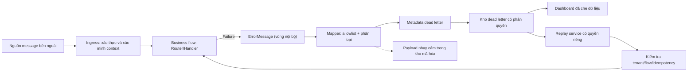

# Quyền truy cập và dữ liệu nhạy cảm

Trong module **SPRING_INTEGRATION_PATTERN**, Spring Integration giúp triển khai các **Enterprise Integration Patterns** (EIP) như Router, Filter, Transformer, Splitter, Aggregator và Gateway thành những luồng message ít phụ thuộc, dễ mở rộng. Các nhánh retry, error channel và Dead Letter Channel (DLC) giúp giữ message thất bại để điều tra, kiểm thử và phát lại. Tuy nhiên, **message lỗi thường chứa nhiều dữ liệu nhạy cảm hơn message thành công mà người vận hành cần xem**: payload nghiệp vụ, headers, token, địa chỉ người nhận, thông tin thanh toán, tham số truy vấn hoặc nội dung exception.

Bài **“Quyền truy cập và dữ liệu nhạy cảm”** giải thích cách thiết kế dead letter an toàn từ lúc lỗi phát sinh cho đến khi dữ liệu được xóa. Trọng tâm là **giảm dữ liệu lưu, phân quyền theo vai trò và phạm vi, bảo vệ payload/exception, audit mọi thao tác nhạy cảm và kiểm soát replay**.

> **Nguyên tắc:** Một dead letter là bản ghi để *chẩn đoán và khôi phục*, không phải bản sao mặc định của toàn bộ `Message` hay `Throwable`. Chỉ lưu dữ liệu cần cho mục đích đã xác định, và chỉ cho phép chủ thể phù hợp truy cập đúng bản ghi, đúng thao tác.

## 1. Vì sao dead letter là điểm có rủi ro bảo mật cao?

Giả sử một flow nhận sự kiện `PaymentRequested`, chuyển dữ liệu qua Transformer rồi gọi cổng thanh toán. Sau nhiều lần timeout, handler phát `ErrorMessage` vào error channel. Nếu lưu nguyên `ErrorMessage.toString()`, bản ghi hoặc log có thể chứa:

- Payload: mã khách hàng, địa chỉ email, thông tin hóa đơn, thông tin thanh toán hoặc dữ liệu hồ sơ.
- Headers: `Authorization`, cookie, API key, trace metadata và thông tin định tuyến nội bộ.
- Exception message: URL có query string, tên bảng/cột, tham số truy vấn, phản hồi từ hệ thống bên ngoài hoặc thông tin xác thực.
- Stack trace: class, tên method và đường dẫn file, giúp điều tra nhưng cũng tiết lộ chi tiết nội bộ.
- Correlation/context: mã đơn hoặc mã người dùng; một số định danh có thể là dữ liệu cá nhân tùy hệ thống.

Dead letter đôi khi được giữ lâu hơn dữ liệu xử lý tức thời và có thể được đọc bởi dashboard, đội hỗ trợ, tác vụ replay, công cụ tìm kiếm hoặc hệ thống log. Mỗi nơi nhận bản sao là một điểm cần bảo vệ.

### Ranh giới tin cậy



Đường từ hệ thống ngoài vào `MessageHeaders` **không tự trở thành dữ liệu đáng tin**. Header `tenantId`, `flowId`, `errorChannel` hay `replayApproved` do client gửi có thể bị giả mạo. Thông tin quyền truy cập phải được gắn/xác minh tại ingress hoặc tra từ nguồn nội bộ tin cậy.

## 2. Phân loại dữ liệu trước khi lưu

Một chính sách lưu nên trả lời: **trường nào cần cho replay, trường nào chỉ cần để điều tra và trường nào tuyệt đối không nên lưu vào DLC?**

| Loại dữ liệu | Ví dụ | Hướng xử lý khuyến nghị |
| --- | --- | --- |
| Định danh kỹ thuật | `deadLetterId`, `flowId`, `reasonCode`, thời điểm lỗi | Lưu trong record để tìm kiếm và vận hành |
| Định danh nghiệp vụ | `eventId`, `correlationId`, `orderId` | Chỉ lưu khi thật sự cần; dùng định danh dạng opaque nếu có thể |
| Payload phục vụ replay | JSON đơn hàng, dữ liệu khách hàng | Ưu tiên mã hóa ở kho riêng, DLC giữ tham chiếu opaque và schema version |
| Dữ liệu cá nhân | Email, số điện thoại, địa chỉ, hồ sơ | Tránh đưa vào metadata tìm kiếm và logs; hạn chế quyền đọc payload |
| Thông tin thanh toán | Số thẻ, dữ liệu xác thực thanh toán | Không sao chép tùy tiện vào DLC; tuân thủ chính sách bảo vệ dữ liệu áp dụng |
| Secrets/credentials | Bearer token, cookie, API key, private key | Không lưu trong dead letter; không đưa vào log, dashboard, metric |
| Exception | Tên class, message, stack trace, cause chain | Lưu mã lỗi và mô tả an toàn; trace chi tiết ở kho riêng có kiểm soát |
| Header nội bộ | `replyChannel`, `errorChannel`, channel object | Không serialize nguyên object hoặc khôi phục trực tiếp khi replay |
| Thông tin broker | Topic, partition, offset, delivery tag | Chỉ lưu phần cần audit; không coi đó là quyền ACK/replay |
| Payload mã hóa | Ciphertext kèm metadata khóa | Bảo vệ cả khóa, quyền giải mã, log và backup; không lưu khóa cạnh dữ liệu |

**Tối thiểu hóa dữ liệu** không đồng nghĩa bỏ đi dữ liệu cần thiết cho khôi phục. Nếu nghiệp vụ bắt buộc replay từ payload ban đầu, hãy lưu payload đó dưới dạng được bảo vệ, có tham chiếu và phiên bản. Điều cần tránh là sao chép cùng payload dưới dạng rõ ở năm nơi khác nhau: bảng DLC, log, metrics, tracing và thông báo sự cố.

### Trước và sau khi chuẩn hóa

Bản ghi nguy hiểm:

```json
{
  "payload": {
    "email": "person@example.invalid",
    "paymentToken": "sensitive-value"
  },
  "headers": {
    "Authorization": "Bearer sensitive-token",
    "errorChannel": "internal-channel-object"
  },
  "exceptionMessage": "Request failed with token sensitive-token"
}
```

Bản ghi metadata an toàn hơn:

```json
{
  "deadLetterId": "8d7241d0-6512-4dcc-a4f3-c6f2f1527014",
  "flowId": "orders",
  "tenantId": "tenant-verified-42",
  "eventId": "evt-1024",
  "correlationId": "corr-1024",
  "payloadRef": "object-opaque-8741",
  "schemaVersion": "2",
  "reasonCode": "DOWNSTREAM_TIMEOUT",
  "status": "NEW",
  "failedAt": "2026-11-21T08:00:00Z"
}
```

Các giá trị trên là **minh họa**. Tham chiếu `payloadRef` phải trỏ đến kho riêng yêu cầu xác thực/kiểm tra quyền để đọc; **không dùng URL ký sẵn còn hiệu lực hoặc bearer token làm tham chiếu lưu dài hạn**. Dù đã không có payload rõ, metadata như `tenantId` hay `eventId` vẫn phải chịu kiểm soát truy cập và retention.

## 3. ErrorMessage và ngoại lệ: lấy đúng thông tin, tránh log toàn bộ

Trong Spring Integration, khi lỗi được phát qua error channel, hệ thống thường sử dụng `org.springframework.messaging.support.ErrorMessage`. **Payload của `ErrorMessage` là một `Throwable`**, còn message liên quan tới lỗi có thể nằm ở:

- `ErrorMessage.getOriginalMessage()`;
- `MessagingException.getFailedMessage()` trong chuỗi nguyên nhân ngoại lệ.

Không bảo đảm cả hai đều có giá trị. Cũng không bảo đảm `failedMessage` là message nguyên thủy lúc vào hệ thống: nó có thể là message đã qua Transformer trước khi handler thất bại.

Điều này ảnh hưởng tới bảo mật theo hai chiều. Một mặt, trích xuất message giúp giữ `eventId`, correlation và dữ liệu cần replay. Mặt khác, nếu gọi `error.getPayload().toString()` hoặc serialize nguyên `originalMessage.getHeaders()`, nhiều thông tin ngoài dự kiến sẽ đi vào DLC.

| Cách làm | Vấn đề | Cách làm an toàn hơn |
| --- | --- | --- |
| `logger.error("{}", error)` ở mọi nơi | Có thể log stack trace và dữ liệu lỗi không được che | Log `reasonCode`, `flowId`, `deadLetterId`, trace ID |
| `String.valueOf(original.getPayload())` | Có thể lộ dữ liệu hoặc không lưu đúng byte gốc | Serializer có schema; lưu mã hóa hoặc payload reference |
| `headers.toString()` | Lộ token, channel object, dữ liệu từ client | Allowlist từng header được phép |
| `Throwable.getMessage()` vào cột tìm kiếm | Có thể chứa thông tin nhạy cảm từ dependency | Mã lỗi ổn định và tóm tắt an toàn |
| Serialize toàn bộ Throwable | Rủi ro phụ thuộc version, kích thước và lộ thông tin | Lưu loại lỗi/trace reference được kiểm soát |
| Xây nhánh replay từ header `errorChannel` cũ | Có thể định tuyến sai sau khi restart hoặc nâng cấp | Tạo message mới, định tuyến theo cấu hình tin cậy |

Ví dụ `Gateway` đồng bộ có thể ném exception về caller; `DirectChannel` không tự động phát mọi lỗi vào global `errorChannel`. Với poller hoặc xử lý bất đồng bộ có error handler, framework có thể phát `ErrorMessage` theo cấu hình. Nếu dùng `RequestHandlerRetryAdvice` và `ErrorMessageSendingRecoverer`, recovery callback có thể chủ động gửi lỗi cuối chu kỳ vào channel chỉ định. Trong mọi trường hợp, **việc có ErrorMessage không thay thế bước lọc và phân quyền dữ liệu khi lưu**.

## 4. Phân quyền theo vai trò, hành động và phạm vi dữ liệu

Chỉ phân quyền ở trang dashboard là chưa đủ: người dùng hoặc service vẫn có thể gọi API, truy vấn database hoặc kích hoạt replay qua job. Kiểm tra quyền phải diễn ra **ở tầng dịch vụ và tầng dữ liệu**, trên mỗi request và mỗi record.

Một mô hình có thể phối hợp:

- **RBAC** (*Role-Based Access Control*): vai trò nào được xem danh sách, đọc payload, duyệt replay, thực thi replay, xóa/đặt retention.
- **ABAC** (*Attribute-Based Access Control*): chỉ cho phép trong `tenantId`, `flowId`, môi trường, nhóm nghiệp vụ và trạng thái cho phép.
- **Least privilege**: service tự động chỉ có quyền thực sự cần, ví dụ ghi DLC; không mặc nhiên có quyền giải mã và phát lại.
- **Separation of duties**: với nghiệp vụ rủi ro cao, người duyệt và người thực thi replay có thể là hai người hoặc hai vai trò khác nhau.

### Ma trận quyền minh họa

| Vai trò | Xem metadata đã che | Đọc payload gốc | Duyệt replay | Thực thi replay | Quản lý khóa/xóa |
| --- | --- | --- | --- | --- | --- |
| Người vận hành flow | Có, với flow phụ trách | Chỉ khi được cấp quyền đặc biệt | Theo chính sách nghiệp vụ | Theo vai trò | Không |
| Người phân tích sự cố | Có theo phân quyền | Quyền tạm thời, có lý do và audit | Thường không | Thường không | Không |
| Replay service | Chỉ metadata cần chạy | Đọc payload theo tham chiếu và phạm vi đã duyệt | Không tự duyệt | Có, với record được duyệt | Không |
| Auditor | Đọc metadata và audit theo phạm vi | Thường chỉ dữ liệu đã che | Không | Không | Không |
| Security/data steward | Xem bằng chứng theo phân quyền | Qua quy trình cấp quyền riêng | Theo quy trình | Không mặc định | Có quyền quản trị phù hợp |
| Service ghi lỗi | Ghi record mới | Không cần đọc hàng loạt | Không | Không | Không |

Bảng chỉ là thiết kế gợi ý; quyền cuối cùng phụ thuộc yêu cầu nghiệp vụ và hệ thống xác thực của tổ chức. Việc **phê duyệt** và **thực thi** replay là hai hành động khác nhau; quyền xem DLC không nên ngầm cấp quyền sửa payload hoặc replay.

### Kiểm tra phạm vi tenant và flow

Một API đọc dead letter theo ID dễ mắc lỗi **IDOR** (*insecure direct object reference*) nếu chỉ:

```sql
SELECT * FROM dead_letters WHERE dead_letter_id = ?;
```

Dù ID khó đoán, người gọi có thể lấy nhầm record thuộc tenant/flow khác nếu biết hoặc đoán được ID. Truy vấn phải được giới hạn bằng thông tin **đã xác thực và được cấp quyền**, ví dụ sau khi dịch vụ đã kiểm tra người gọi có quyền trên flow:

```sql
SELECT dead_letter_id, flow_id, tenant_id, event_id,
       correlation_id, reason_code, status, failed_at
FROM dead_letters
WHERE dead_letter_id = ?
  AND tenant_id = ?
  AND flow_id = ?;
```

Hai tham số tenant và flow phải đến từ ngữ cảnh xác thực/ủy quyền đã kiểm tra, **không đơn thuần là query parameter hoặc header do client gửi**. Truy vấn dùng tham số bind để tránh SQL injection. Có thể thêm row-level security, phân vùng dữ liệu hoặc tài khoản DB giới hạn quyền như lớp bảo vệ thứ hai.

## 5. Ví dụ Java: mapper chỉ giữ metadata cho phép

Ví dụ này dùng **Java 17+ và Spring Messaging/Spring Integration 6.x**. Chúng ta thiết kế `SafeDeadLetterMapper` nhận một `ErrorMessage` và một `TrustedContext` đã được xác minh tại ingress hoặc từ kho trạng thái nội bộ.

`TrustedContext` phải được tạo bởi code tin cậy: `tenantId` từ danh tính nguồn đã xác thực, `flowId` từ cấu hình luồng, còn `payloadRef` do kho payload bảo vệ cấp. Trong ví dụ, mapper **không copy payload, header Authorization, exception message hay stack trace** vào dead letter.

```java
package demo.integration;

import java.net.SocketTimeoutException;
import java.time.Instant;
import java.util.Objects;
import java.util.UUID;
import java.util.concurrent.TimeoutException;

import org.springframework.messaging.Message;
import org.springframework.messaging.MessagingException;
import org.springframework.messaging.support.ErrorMessage;

public final class SafeDeadLetterMapper {

    // Chỉ tầng ingress/context service tin cậy mới được tạo record này.
    public record TrustedContext(
            String tenantId, String flowId, String payloadRef) {
        public TrustedContext {
            Objects.requireNonNull(tenantId, "tenantId");
            Objects.requireNonNull(flowId, "flowId");
            // payloadRef có thể null nếu chưa lưu được payload;
            // khi đó phải phân loại khả năng replay ở service riêng.
        }
    }

    public record SafeDeadLetterRecord(
            String deadLetterId,
            String tenantId,
            String flowId,
            String payloadRef,
            String originalMessageId,
            String eventId,
            String correlationId,
            String reasonCode,
            Instant failedAt) {}

    public SafeDeadLetterRecord map(
            ErrorMessage error, TrustedContext context) {
        Objects.requireNonNull(error, "error");
        Objects.requireNonNull(context, "context");

        Message<?> source = findSource(error);
        Throwable root = rootCause(error.getPayload());

        // Không dùng source.getPayload(), headers.toString(),
        // Throwable.getMessage() hoặc stack trace làm giá trị record.
        String reasonCode = source == null
                ? "SOURCE_CONTEXT_MISSING"
                : classify(root);

        return new SafeDeadLetterRecord(
                UUID.randomUUID().toString(),
                context.tenantId(),
                context.flowId(),
                context.payloadRef(),
                source == null || source.getHeaders().getId() == null
                        ? null : source.getHeaders().getId().toString(),
                safeOpaqueHeader(source, "eventId"),
                safeOpaqueHeader(source, "correlationId"),
                reasonCode,
                Instant.now());
    }

    private static Message<?> findSource(ErrorMessage error) {
        if (error.getOriginalMessage() != null) {
            return error.getOriginalMessage();
        }
        for (Throwable current = error.getPayload();
                current != null; current = current.getCause()) {
            if (current instanceof MessagingException messaging
                    && messaging.getFailedMessage() != null) {
                return messaging.getFailedMessage();
            }
        }
        return null;
    }

    private static Throwable rootCause(Throwable throwable) {
        Throwable current = throwable;
        while (current.getCause() != null) {
            current = current.getCause();
        }
        return current;
    }

    private static String classify(Throwable throwable) {
        if (throwable instanceof SocketTimeoutException
                || throwable instanceof TimeoutException) {
            return "DOWNSTREAM_TIMEOUT";
        }
        if (throwable instanceof IllegalArgumentException) {
            // Chỉ là ví dụ: production cần mã lỗi nghiệp vụ ổn định.
            return "VALIDATION_ERROR";
        }
        return "UNCLASSIFIED_FAILURE";
    }

    private static String safeOpaqueHeader(
            Message<?> source, String name) {
        if (source == null) {
            return null;
        }
        Object value = source.getHeaders().get(name);

        // Chỉ nhận chuỗi định danh opaque, giới hạn chiều dài/ký tự.
        // Việc phù hợp regex KHÔNG chứng minh nguồn header đáng tin.
        if (value instanceof String s
                && s.matches("[A-Za-z0-9][A-Za-z0-9._:-]{0,127}")) {
            return s;
        }
        return null;
    }
}
```

Lựa chọn quan trọng ở đây là **allowlist theo trường**. Header `eventId`/`correlationId` chỉ được giữ dưới dạng opaque; nếu trong hệ thống thực tế hai header này có thể chứa email, số điện thoại hoặc dữ liệu do client tự đặt, cần ánh xạ sang định danh nội bộ hoặc bỏ khỏi metadata. Regex chỉ kiểm tra hình thức; **không phải bộ phân loại dữ liệu cá nhân**.

Để replay, lưu payload ở kho riêng bằng serializer phù hợp với kiểu dữ liệu và `schemaVersion`. Nếu payload lưu dưới dạng `byte[]` hoặc DTO, cần bảo toàn byte/schema; `String.valueOf(payload)` không đảm bảo phục hồi dữ liệu chính xác. Nếu `payloadRef` bị thiếu hoặc đối tượng đã hết retention, record chỉ còn đủ thông tin để điều tra, không thể tự động replay.

### Không để mapper lấy tenant từ message không tin cậy

Giả sử message có header `tenantId = "tenant-B"`, nhưng nguồn đã xác thực thuộc `tenant-A`. Mapper trên **không đọc** header `tenantId`; nó dùng `TrustedContext.tenantId()`. Tầng ingress phải xác minh tenant thật, truyền thông tin bằng cơ chế có kiểm soát và chặn ghi đè từ bên ngoài. Trong luồng bất đồng bộ, `SecurityContext` gắn với một thread có thể không tồn tại sau khi chuyển channel hoặc restart; phải sử dụng context đã xác minh và được lưu/chuyển an toàn, không giả định `ThreadLocal` luôn đi theo message.

### Tích hợp mapper vào recovery flow

Mảnh cấu hình sau minh họa đúng vị trí cần lọc thông tin:

```java
package demo.integration;

import org.springframework.context.annotation.Bean;
import org.springframework.context.annotation.Configuration;
import org.springframework.integration.channel.DirectChannel;
import org.springframework.integration.config.EnableIntegration;
import org.springframework.integration.dsl.IntegrationFlow;
import org.springframework.messaging.MessageChannel;
import org.springframework.messaging.support.ErrorMessage;

@Configuration
@EnableIntegration
public class SecureDeadLetterFlowConfiguration {

    @Bean
    MessageChannel ordersRecoveryErrors() {
        return new DirectChannel();
    }

    @Bean
    IntegrationFlow secureDeadLetterFlow(
            SafeDeadLetterMapper mapper,
            TrustedContextResolver resolver,
            SecureDeadLetterStore store) {
        return IntegrationFlow.from("ordersRecoveryErrors")
                .<ErrorMessage,
                  SafeDeadLetterMapper.SafeDeadLetterRecord>transform(
                    error -> mapper.map(error, resolver.resolve(error)))
                .handle(store, "save")
                .get();
    }

    public interface TrustedContextResolver {
        SafeDeadLetterMapper.TrustedContext resolve(ErrorMessage error);
    }

    public interface SecureDeadLetterStore {
        void save(SafeDeadLetterMapper.SafeDeadLetterRecord record);
    }
}
```

`TrustedContextResolver` và `SecureDeadLetterStore` là **giao diện do ứng dụng triển khai**, không phải các bean có sẵn của Spring Integration. Resolver phải tra context từ nguồn đáng tin, còn store phải ghi metadata theo quyền và transaction phù hợp. Đoạn cấu hình cũng cần khai báo bean cho mapper, resolver, store và gắn nguồn lỗi vào `ordersRecoveryErrors` (ví dụ recovery callback của `RequestHandlerRetryAdvice`). Nó minh họa vị trí bảo vệ dữ liệu, chưa phải ứng dụng hoàn chỉnh.

**Chú ý về exception trong error flow:** nếu resolver hoặc store lỗi, đừng đưa toàn bộ `ErrorMessage` vào log hay gọi lại cùng error flow vô hạn. Cần cảnh báo an toàn, cơ chế rollback/redelivery hoặc fallback độc lập theo loại nguồn, và không xác nhận rằng message đã lưu thành công khi giao dịch thất bại.

## 6. Kiểm soát quyền ở service trước khi đọc hoặc replay

Để minh họa sự kết hợp vai trò và phạm vi, lớp sau dùng quyền ở mức hành động và đối chiếu tenant/flow. `Actor` phải được tạo từ danh tính đã xác thực, không lấy trực tiếp từ JSON/body/header do client gửi.

```java
package demo.integration;

import java.util.Objects;
import java.util.Set;

public final class DeadLetterAccessGuard {
    private DeadLetterAccessGuard() {}

    public enum Permission {
        READ_SUMMARY,
        READ_SENSITIVE_PAYLOAD,
        APPROVE_REPLAY,
        EXECUTE_REPLAY,
        DELETE_RECORD
    }

    public record Actor(
            String tenantId,
            Set<String> allowedFlows,
            Set<Permission> permissions) {}

    public record RecordScope(
            String tenantId,
            String flowId) {}

    public static void require(
            Actor actor, RecordScope record, Permission action) {
        Objects.requireNonNull(actor);
        Objects.requireNonNull(record);
        Objects.requireNonNull(action);

        boolean allowed =
                Objects.equals(actor.tenantId(), record.tenantId())
                && actor.allowedFlows() != null
                && actor.allowedFlows().contains(record.flowId())
                && actor.permissions() != null
                && actor.permissions().contains(action);

        if (!allowed) {
            // Lỗi trả cho client không tiết lộ tenant/flow có tồn tại.
            throw new SecurityException("Access denied");
        }
    }
}
```

Ở API đọc danh sách, kiểm tra `READ_SUMMARY` trước rồi **chỉ trả những trường đã cho phép**. Nếu cần xem payload được mã hóa, phải kiểm tra `READ_SENSITIVE_PAYLOAD` ở endpoint giải mã và ở kho payload. Nếu người dùng được xem metadata của tenant A, điều đó không cấp quyền đọc payload tenant B chỉ vì họ có `payloadRef`.

Đoạn guard là ví dụ đơn giản; hệ thống thực tế phải tích hợp cơ chế xác thực/ủy quyền chuẩn, audit, token scope, kiểm tra quyền tại mỗi entry point, và có thể thêm row-level security hoặc phân vùng dữ liệu ở database để phòng trường hợp một API bỏ sót guard.

## 7. Lưu trữ bền vững, mã hóa và quản lý khóa

Mã hóa là một lớp bảo vệ, **không thay thế phân quyền hoặc tối thiểu hóa dữ liệu**. Tối thiểu cần xét:

1. **Khi truyền:** sử dụng TLS phù hợp giữa application, broker, database, object storage và các dịch vụ xử lý lỗi.
2. **Khi lưu:** bật mã hóa tại nơi chứa dữ liệu (database volume, object storage, backup). Với dữ liệu nhạy cảm cao, cân nhắc mã hóa ở tầng ứng dụng theo khóa quản lý tập trung.
3. **Quản lý khóa:** dùng KMS hoặc cơ chế tương đương, phân quyền giải mã độc lập với quyền truy vấn metadata; không ghi khóa vào mã nguồn, YAML bài học, headers hay DLC.
4. **Phân tách tenant/flow:** chọn phạm vi khóa, quyền truy cập và retention phù hợp. Người có quyền đọc metadata không mặc nhiên có quyền gọi giải mã.
5. **Backup/replica:** dữ liệu dead letter trong bản sao lưu vẫn nhạy cảm; áp dụng bảo vệ và chu kỳ xóa phù hợp.
6. **Lỗi lưu:** khi kho không ghi được, phải chuyển thất bại cho cơ chế khôi phục/ACK của nguồn; không âm thầm coi `send()` tới một `QueueChannel` trong bộ nhớ là đã lưu bền vững.

### Mẫu bảng metadata

Ví dụ PostgreSQL; payload gốc nằm trong object storage có quyền truy cập riêng.

```sql
CREATE TABLE dead_letters (
    dead_letter_id UUID PRIMARY KEY,
    tenant_id VARCHAR(128) NOT NULL,
    flow_id VARCHAR(80) NOT NULL,
    original_message_id VARCHAR(80),
    event_id VARCHAR(128),
    correlation_id VARCHAR(128),
    payload_ref VARCHAR(256),
    schema_version VARCHAR(32),
    reason_code VARCHAR(80) NOT NULL,
    status VARCHAR(24) NOT NULL DEFAULT 'NEW',
    replay_count INTEGER NOT NULL DEFAULT 0,
    failed_at TIMESTAMPTZ NOT NULL,
    retention_until TIMESTAMPTZ NOT NULL
);

CREATE INDEX idx_dead_letters_scope
    ON dead_letters (tenant_id, flow_id, status, failed_at);

CREATE INDEX idx_dead_letters_retention
    ON dead_letters (retention_until);
```

`payload_ref` phải là một định danh opaque không thể tự dùng để vượt kiểm tra quyền. Store cần ghi metadata và payload/reference với mức độ bảo đảm thích hợp; nếu việc lưu ở nhiều hệ thống không cùng transaction, cần thiết kế xử lý lỗi giữa các bước, ví dụ outbox hoặc cơ chế reconciliation.

### Thời hạn lưu và quyền xóa

Dead letter không nên trở thành kho dữ liệu vô thời hạn. Cần chính sách riêng cho:

- **Retention theo loại dữ liệu và flow:** sự kiện tạm thời, đơn hàng, thông báo, dữ liệu nhạy cảm có thể có yêu cầu khác nhau.
- **Xóa/bảo toàn:** xử lý yêu cầu xóa hợp lệ, legal hold hoặc yêu cầu giữ bằng chứng khi áp dụng; không tự xóa tùy tiện khi đang điều tra.
- **Xóa bản sao:** payload object, metadata, chỉ mục tìm kiếm, log liên quan và backup theo quy trình retention.
- **Kết thúc replay:** khi status là `RESOLVED`, chỉ giữ những trường còn cần cho audit; xóa payload gốc khi hết mục đích/thời hạn.
- **Khóa mã hóa:** xoay khóa và thu hồi quyền truy cập theo quy trình; không giả định chỉ đổi khóa là xóa toàn bộ bản sao dữ liệu.

Các quy tắc trên phụ thuộc chính sách bảo vệ dữ liệu và yêu cầu pháp lý/kinh doanh áp dụng; nên được thể hiện bằng cấu hình và kiểm thử cụ thể cho từng flow.

## 8. Replay là thao tác đặc quyền, không chỉ là đọc dữ liệu

Dữ liệu ở DLC có thể đại diện cho yêu cầu thanh toán, tạo tài khoản hoặc gửi email. Replay có khả năng **gây tác dụng phụ mới**, nên cần quyền cao hơn việc xem metadata.

Một quy trình replay an toàn:

1. **Xác thực người hoặc service thực thi**, kiểm tra quyền `APPROVE_REPLAY`/`EXECUTE_REPLAY` trên đúng tenant và flow.
2. **Xác minh trạng thái record** (ví dụ `APPROVED`), deadline nghiệp vụ, số lần replay và lý do lỗi đã được xử lý.
3. **Claim nguyên tử** với giới hạn replay để ngăn hai worker cùng phát lại một bản ghi.
4. **Lấy payload từ kho bảo vệ**, kiểm tra quyền giải mã, checksum, schema version và nguồn dữ liệu.
5. **Tạo message mới** với các header nghiệp vụ được phép; loại `Authorization`, `replyChannel`, `errorChannel`, credential hoặc routing header cũ.
6. **Kiểm tra idempotency** theo khóa nghiệp vụ như `eventId` hoặc `orderId + operationType` để tránh tác dụng phụ trùng lặp.
7. **Gửi vào entry point tin cậy** của flow, ghi audit và theo dõi kết quả nghiệp vụ; `send() = true` chưa chứng minh xử lý thành công.
8. **Chỉ cập nhật trạng thái cuối cùng** khi có xác nhận thích hợp. Nếu kết quả không rõ, điều tra trước khi phát lại tiếp.

### Mẫu claim có kiểm tra phạm vi

Trong một dịch vụ replay đã xác thực và kiểm tra quyền, có thể dùng truy vấn nguyên tử:

```sql
UPDATE dead_letters
SET status = 'REPLAYING',
    replay_count = replay_count + 1
WHERE dead_letter_id = :id
  AND tenant_id = :authenticated_tenant
  AND flow_id = :authorized_flow
  AND status = 'APPROVED'
  AND replay_count < :max_replays
RETURNING dead_letter_id, payload_ref, schema_version, replay_count;
```

Các tham số tenant, flow, giới hạn và quyền thực thi phải do service tin cậy xác định. Nếu truy vấn không trả hàng, **không dispatch**. Khi có nhiều hệ thống liên quan, cần xử lý trường hợp cập nhật thành công nhưng publish thất bại hoặc publish thành công nhưng ứng dụng crash; có thể dùng outbox và reconciliation để tránh gửi trùng ngoài ý muốn.

**Không lưu lại bearer token ban đầu để replay.** Nếu cần gọi dịch vụ đích, replay service phải lấy credential hiện hành theo cơ chế cấp quyền riêng; token cũ có thể đã hết hạn hoặc bị thu hồi.

## 9. Audit mà không nhân bản dữ liệu nhạy cảm

Việc xem payload, export, duyệt replay, thực thi replay, sửa payload và xóa record cần để lại audit trail. Nhưng audit trail cũng có thể trở thành nơi lộ thông tin nếu ghi nguyên nội dung.

Một event audit hợp lý có thể chứa:

| Trường | Ví dụ | Mục đích |
| --- | --- | --- |
| `actorId` hoặc service principal | `svc-replay-orders` | Ai thực hiện |
| `action` | `READ_METADATA`, `VIEW_PAYLOAD`, `APPROVE_REPLAY`, `EXECUTE_REPLAY` | Đã làm gì |
| `deadLetterId` | Định danh record | Đối tượng được tác động |
| `tenantId/flowId` | Phạm vi được kiểm tra | Phát hiện truy cập chéo |
| `decision` | `ALLOW` / `DENY` | Theo dõi kết quả ủy quyền |
| `reason/approvalId` | Mã yêu cầu đã duyệt | Giải thích thao tác nhạy cảm |
| `timestamp/traceId` | Thời điểm, dấu vết | Điều tra và đối chiếu |

Audit **không** nên chứa payload đã giải mã, Authorization header, session cookie hoặc chuỗi exception nguyên vẹn. Với nghiệp vụ quan trọng, log audit cần kiểm soát quyền chỉnh sửa/xóa và có chính sách giữ phù hợp.

### Metric và cảnh báo

Theo dõi những tín hiệu như:

- `dead_letter_created_total{flow,reason}`: lượng lỗi theo flow và mã nguyên nhân.
- `dead_letter_payload_access_total{flow,action,result}`: số lần đọc payload và kết quả cho phép/từ chối.
- `dead_letter_replay_total{flow,result}`: số lần replay và kết quả.
- `dead_letter_security_denied_total{action}`: truy cập bị từ chối.
- `dead_letter_store_failed_total{flow}`: lỗi lưu cần xử lý khẩn.
- Tuổi record chưa xử lý, số record quá retention, số hành động “break-glass”.

Các tên metric chỉ là **gợi ý**, không phải metric do Spring Integration tự tạo. Tránh đặt `eventId`, địa chỉ email, token hoặc payload làm label; dùng trace ID trong log bảo vệ nếu cần tìm record cụ thể.

## 10. Kiểm thử rò rỉ dữ liệu và phân quyền

Kiểm thử cần chứng minh **điều gì không bị lộ** và **ai không được phép làm gì**, ngoài việc handler gửi đúng channel.

### Unit test cho mapper an toàn

Ví dụ JUnit 5 và AssertJ, sử dụng mapper tại mục 5:

```java
package demo.integration;

import static org.assertj.core.api.Assertions.assertThat;

import org.junit.jupiter.api.Test;
import org.springframework.messaging.MessagingException;
import org.springframework.messaging.support.ErrorMessage;
import org.springframework.messaging.support.MessageBuilder;

class SafeDeadLetterMapperTest {

    private final SafeDeadLetterMapper mapper = new SafeDeadLetterMapper();

    private final SafeDeadLetterMapper.TrustedContext trusted =
            new SafeDeadLetterMapper.TrustedContext(
                    "tenant-verified-A", "orders", "opaque-object-42");

    @Test
    void excludesSensitivePayloadHeadersAndExceptionMessage() {
        var original = MessageBuilder
                .withPayload("{\"paymentToken\":\"SECRET-PAYLOAD\"}")
                .setHeader("Authorization", "Bearer SECRET-HEADER")
                .setHeader("tenantId", "tenant-attacker-supplied")
                .setHeader("eventId", "evt-42")
                .setHeader("correlationId", "order-42")
                .build();

        var error = new ErrorMessage(
                new IllegalStateException("token=SECRET-EXCEPTION"),
                original);

        var record = mapper.map(error, trusted);

        assertThat(record.tenantId()).isEqualTo("tenant-verified-A");
        assertThat(record.flowId()).isEqualTo("orders");
        assertThat(record.payloadRef()).isEqualTo("opaque-object-42");
        assertThat(record.eventId()).isEqualTo("evt-42");
        assertThat(record.correlationId()).isEqualTo("order-42");

        // toString() là một phép kiểm đơn giản về record;
        // production còn cần thử JSON serializer, JDBC, logs và tracing.
        assertThat(record.toString()).doesNotContain(
                "SECRET-PAYLOAD",
                "SECRET-HEADER",
                "SECRET-EXCEPTION",
                "tenant-attacker-supplied");
    }

    @Test
    void recoversSafeMetadataFromMessagingException() {
        var failed = MessageBuilder.withPayload("private payload")
                .setHeader("eventId", "evt-43")
                .build();

        var error = new ErrorMessage(
                new MessagingException(failed, "credential=SECRET"));

        var record = mapper.map(error, trusted);

        assertThat(record.eventId()).isEqualTo("evt-43");
        assertThat(record.toString()).doesNotContain(
                "private payload", "credential=SECRET");
    }

    @Test
    void missingOriginalMessageStillProducesSafeMetadata() {
        var error = new ErrorMessage(
                new IllegalStateException("Bearer SECRET-TOKEN"));

        var record = mapper.map(error, trusted);

        assertThat(record.originalMessageId()).isNull();
        assertThat(record.reasonCode())
                .isEqualTo("SOURCE_CONTEXT_MISSING");
        assertThat(record.toString()).doesNotContain("SECRET-TOKEN");
    }
}
```

### Unit test cho quyền truy cập

```java
package demo.integration;

import static org.assertj.core.api.Assertions.assertThatThrownBy;
import static demo.integration.DeadLetterAccessGuard.*;

import java.util.Set;

import org.junit.jupiter.api.Test;

class DeadLetterAccessGuardTest {

    @Test
    void cannotReadAcrossTenants() {
        Actor actor = new Actor(
                "tenant-A", Set.of("orders"), Set.of(Permission.READ_SUMMARY));

        assertThatThrownBy(() -> require(
                actor,
                new RecordScope("tenant-B", "orders"),
                Permission.READ_SUMMARY))
                .isInstanceOf(SecurityException.class);
    }

    @Test
    void metadataAccessDoesNotGrantReplayOrRawPayloadRead() {
        Actor actor = new Actor(
                "tenant-A", Set.of("orders"), Set.of(Permission.READ_SUMMARY));

        RecordScope record = new RecordScope("tenant-A", "orders");

        assertThatThrownBy(() -> require(
                actor, record, Permission.EXECUTE_REPLAY))
                .isInstanceOf(SecurityException.class);

        assertThatThrownBy(() -> require(
                actor, record, Permission.READ_SENSITIVE_PAYLOAD))
                .isInstanceOf(SecurityException.class);
    }

    @Test
    void cannotReadAnotherFlowInSameTenant() {
        Actor actor = new Actor(
                "tenant-A", Set.of("orders"), Set.of(Permission.READ_SUMMARY));

        assertThatThrownBy(() -> require(
                actor,
                new RecordScope("tenant-A", "notifications"),
                Permission.READ_SUMMARY))
                .isInstanceOf(SecurityException.class);
    }
}
```

Đây là **ví dụ mã và test minh họa**, chưa chạy trong repository ở bước soạn Markdown. Khi tích hợp thực tế, cần kiểm thử với Spring Security (hoặc giải pháp auth được chọn), database, object storage, key management và API.

### Ma trận kiểm thử tích hợp nên có

| Tình huống | Kỳ vọng |
| --- | --- |
| ErrorMessage chứa token trong payload, header và exception | Token không xuất hiện trong metadata, response API, log hay metric |
| Người dùng xem metadata của flow được phép | Chỉ thấy các trường đã che |
| Người dùng chỉ có quyền xem metadata gọi API đọc payload | Bị từ chối, có audit, không có nội dung nhạy cảm trong lỗi trả về |
| Người dùng tenant A gọi record tenant B dù biết ID | Bị từ chối hoặc trả kết quả không tiết lộ sự tồn tại |
| Replay service chưa có `APPROVED` hoặc đã hết quota | Không dispatch, có audit quyết định |
| Hai worker claim cùng record | Tối đa một worker claim thành công |
| `ErrorMessage` không chứa original/failed message | Lưu được metadata an toàn hoặc báo lỗi theo policy, không NPE |
| Resolver không xác minh được tenant/flow | Từ chối ghi sai phạm vi; alert an toàn |
| Kho payload mã hóa/KMS không khả dụng | Không tự giải mã bypass quyền; có cơ chế khôi phục phù hợp |
| Kho DLC lưu thất bại | Không ACK sai khi yêu cầu bảo toàn message |
| Retention tới hạn | Xóa dữ liệu và bản sao theo policy, audit sự kiện |
| Export hoặc break-glass | Yêu cầu quyền mạnh hơn, có lý do và audit |

## 11. Các sai sót phổ biến

| Sai sót | Hậu quả | Cách khắc phục |
| --- | --- | --- |
| Serialize toàn bộ `ErrorMessage` hoặc Throwable | Lộ payload/header/stack trace | Map sang schema tối thiểu và mã lỗi an toàn |
| Cho người trực vận hành xem payload mặc định | Mở rộng phạm vi truy cập dữ liệu cá nhân | Mặc định chỉ metadata; cấp quyền đọc có giới hạn |
| Dùng `tenantId` từ header bên ngoài để phân quyền | Đọc hoặc replay nhầm tenant | Lấy từ nguồn đã xác thực và kiểm chứng |
| Phân quyền chỉ ở giao diện web | API, job hoặc SQL có thể bỏ qua kiểm tra | Enforce tại service và kho dữ liệu |
| Xem `payloadRef` là một URL chia sẻ được | Ai có URL có thể truy cập nội dung | Opaque reference, auth khi lấy payload, không lưu signed URL dài hạn |
| Tin rằng mã hóa thay thế kiểm tra quyền | Chủ thể có quyền giải mã rộng vẫn đọc được dữ liệu | Tách quyền truy vấn và giải mã, quản lý KMS |
| Sao chép mọi header qua replay | Có thể dùng lại token cũ, route sai hoặc lộ dữ liệu | Tạo message mới với allowlist header |
| Ghi nguyên exception message vào metric label | Cardinality lớn, lộ thông tin | Dùng reasonCode ổn định |
| Không phân biệt quyền duyệt và thực thi replay | Dễ phát lại sự kiện nguy hiểm | Quyền riêng, audit, giới hạn và idempotency |
| Không có retention cho DLQ và backup | Lưu dữ liệu nhạy cảm quá lâu | TTL/retention và quy trình xóa đúng phạm vi |
| Nuốt lỗi khi không ghi được DLC | Mất message nhưng báo thành công | Propagate failure/rollback và cảnh báo độc lập |

## 12. Câu hỏi tự kiểm tra

1. Vì sao Dead Letter Channel có thể chứa dữ liệu nhạy cảm hơn dashboard nghiệp vụ bình thường?
2. `ErrorMessage.getPayload()` chứa gì? Làm thế nào tìm message gây lỗi mà không serialize toàn bộ Throwable?
3. Nếu một message đến từ tenant A nhưng header `tenantId` nói tenant B, hệ thống nên tin giá trị nào? Vì sao?
4. Tại sao `String.valueOf(payload)` không đủ để lưu và replay mọi kiểu payload?
5. Vì sao một `payloadRef` nên là định danh opaque được kiểm tra quyền, thay vì URL ký sẵn có hiệu lực lâu?
6. Khác biệt giữa quyền `READ_SUMMARY`, `READ_SENSITIVE_PAYLOAD`, `APPROVE_REPLAY` và `EXECUTE_REPLAY` là gì?
7. Khi request chỉ chứa `deadLetterId`, service phải kiểm tra những phạm vi nào để tránh IDOR?
8. Vì sao mã hóa ở database chưa đủ nếu API cho phép giải mã không kiểm soát?
9. Người vận hành có nên thấy nguyên `exception.getMessage()` và toàn bộ stack trace trong dashboard không? Thay thế bằng thông tin nào?
10. Vì sao phải xóa cả bản sao payload, chỉ mục và backup theo chính sách retention?
11. Replay một message đã timeout sau thao tác thanh toán cần kiểm tra gì để tránh tác dụng phụ trùng?
12. Những test nào chứng minh token trong payload, header và exception không rò ra record, API và logs?

## Tài liệu tham khảo

- [Spring Integration Reference — Error Handling](https://docs.spring.io/spring-integration/reference/error-handling.html): `ErrorMessage`, error channel và cơ chế phát lỗi.
- [Spring Integration Reference — Provided Advice Classes](https://docs.spring.io/spring-integration/reference/handler-advice/classes.html): `RequestHandlerRetryAdvice` và `ErrorMessageSendingRecoverer`.
- [Spring Framework API — ErrorMessage](https://docs.spring.io/spring-framework/docs/current/javadoc-api/org/springframework/messaging/support/ErrorMessage.html): API lấy original message.
- [Spring Framework API — MessagingException](https://docs.spring.io/spring-framework/docs/current/javadoc-api/org/springframework/messaging/MessagingException.html): API lấy failed message.
- [OWASP Cheat Sheet Series — Logging](https://cheatsheetseries.owasp.org/cheatsheets/Logging_Cheat_Sheet.html): những dữ liệu nên loại khỏi log và kiểm soát truy cập.
- [OWASP Cheat Sheet Series — Authorization](https://cheatsheetseries.owasp.org/cheatsheets/Authorization_Cheat_Sheet.html): nguyên tắc kiểm tra quyền theo đối tượng và thao tác.

**Ghi nhớ:** Một Dead Letter Channel an toàn cần **lọc dữ liệu trước khi lưu**, **quản lý payload nhạy cảm riêng**, **xác minh tenant và flow từ nguồn tin cậy**, **phân quyền từng hành động**, **audit mọi lần xem/duyệt/replay**, và **quản lý mã hóa, khóa, retention, xóa dữ liệu**. Retry và dead letter giúp khôi phục khi nghiệp vụ lỗi; chúng không được trở thành đường tắt để đọc dữ liệu cá nhân hoặc thực thi lại yêu cầu ngoài phạm vi được cấp quyền.
