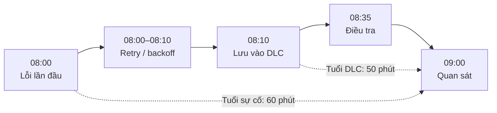
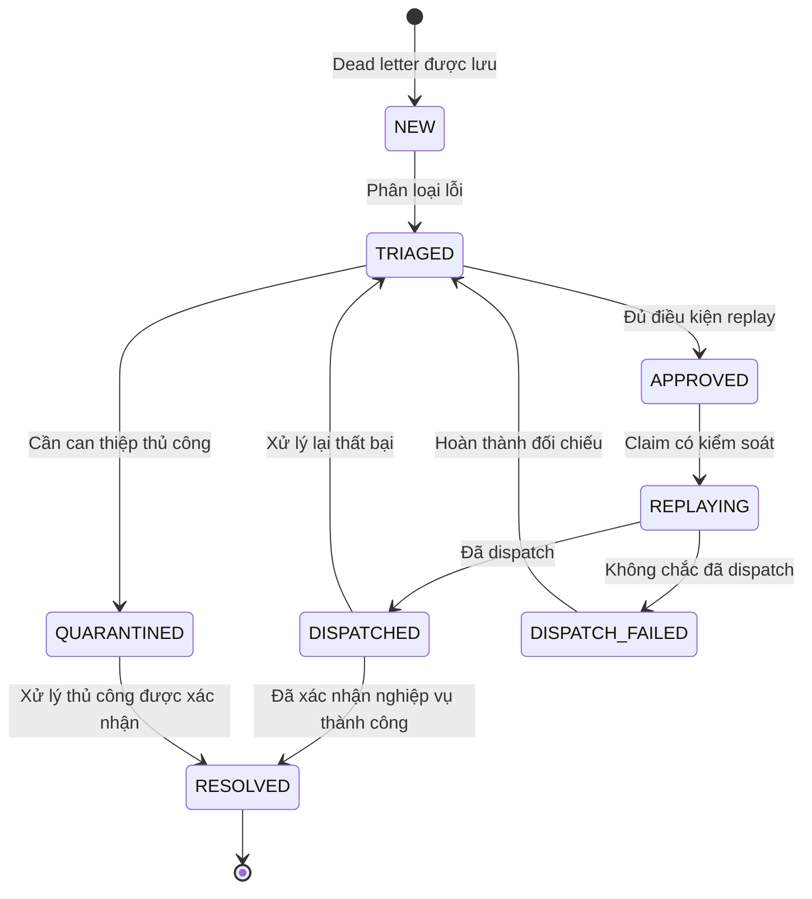
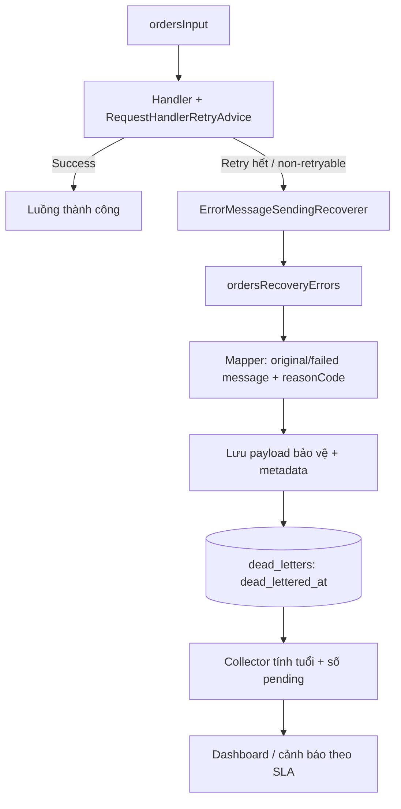

# Theo dõi tuổi message trong dead letter

Trong module **SPRING_INTEGRATION_PATTERN**, chúng ta xây dựng luồng thông điệp ít phụ thuộc bằng Spring Integration và các **Enterprise Integration Patterns**: Router, Filter, Transformer, Splitter, Aggregator, Gateway, retry, error channel và correlation. Khi message không còn xử lý được sau các bước đã thiết kế, nó có thể được chuyển vào **Dead Letter Channel (DLC)** để giữ lại, điều tra và phát lại có kiểm soát.

Nhưng việc **đã lưu message lỗi** không đồng nghĩa sự cố đã được xử lý. Nếu một bản ghi nằm trong dead letter quá lâu, yêu cầu nghiệp vụ có thể hết hạn, khách hàng chờ kết quả hoặc một lỗi âm thầm tích lũy thành backlog. Vì vậy, cần theo dõi **tuổi message trong dead letter** (*dead-letter age*), kết hợp số lượng message đang chờ và trạng thái xử lý.

Bài này tập trung vào cách định nghĩa mốc thời gian, tính tuổi, đo backlog theo flow, cấu hình cảnh báo, hiển thị số liệu qua SQL/Micrometer, kiểm thử ở các ranh giới thời gian và xử lý những tình huống như retry, replay, dữ liệu nhạy cảm hoặc đồng hồ hệ thống sai lệch.

## 1. “Tuổi message” tính từ lúc nào?

Một message có thể trải qua nhiều thời điểm:

| Mốc | Ví dụ tên trường | Ý nghĩa |
| --- | --- | --- |
| Nguồn sinh sự kiện | `eventOccurredAt` | Thời điểm sự kiện nghiệp vụ xảy ra |
| Inbound adapter nhận message | `receivedAt` | Thời điểm hệ thống nhận vào |
| Handler thất bại lần đầu | `firstFailedAt` | Thời điểm phát hiện lỗi đầu tiên |
| Kết thúc retry và quyết định cách ly | `failureDecidedAt` | Thời điểm chính sách quyết định không tiếp tục xử lý |
| **Lưu vào kho dead letter** | **`deadLetteredAt`** | Mốc bắt đầu tuổi **ở DLC** |
| Người vận hành xem/duyệt | `triagedAt` / `approvedAt` | Mốc xử lý của con người |
| Replay được thực thi | `replayedAt` | Thời điểm phát lại, chưa chứng minh đã thành công |
| Kết thúc xử lý | `resolvedAt` | Mốc xác nhận kết quả cuối cùng |
| Thời hạn phải xử lý | `dueAt` | Deadline theo chính sách nghiệp vụ/SLA |

**Quy ước nên dùng:** tuổi trong DLC = **thời điểm quan sát hiện tại − `deadLetteredAt`** của bản ghi còn mở. Đó là độ dài thời gian bản ghi đã chờ trong kho dead letter.

Hai chỉ số khác cũng quan trọng nhưng **không cùng ý nghĩa**:

- **Tuổi từ khi sự cố bắt đầu** = hiện tại − `firstFailedAt`. Chỉ số này đo tổng thời gian chịu ảnh hưởng, bao gồm retry và chờ trước khi lưu DLC.
- **Độ trễ đi vào dead letter** = `deadLetteredAt − firstFailedAt`. Chỉ số này cho biết retry, backoff hoặc xử lý lỗi đã kéo dài bao lâu trước khi message được cách ly.

Ví dụ, một message lỗi lần đầu lúc 08:00, thử lại 10 phút rồi được lưu DLC lúc 08:10. Đến 09:00, **tuổi trong DLC là 50 phút** nhưng tổng thời gian từ lỗi đầu tiên là **60 phút**. Nếu dashboard trộn hai định nghĩa, cảnh báo SLA sẽ thiếu nhất quán.

### Minh họa trục thời gian



Trong một số dự án, có thể dùng `enqueuedAt` thay cho `deadLetteredAt`; điều cần thiết là **định nghĩa thống nhất**. Không lấy `MessageHeaders.TIMESTAMP` hoặc thời điểm nguồn sinh sự kiện để thay cho thời điểm lưu DLC, trừ khi hợp đồng dữ liệu đã quy định rõ. Timestamp của message có thể được tạo lại sau Transformer hoặc replay.

## 2. Theo dõi tuổi của message nào?

Để tính “oldest pending message”, phải xác định **trạng thái nào còn là việc phải giải quyết**.

Một vòng đời minh họa:



Ví dụ này coi các trạng thái `NEW`, `TRIAGED`, `APPROVED`, `REPLAYING`, `DISPATCHED`, `DISPATCH_FAILED` và `QUARANTINED` là **chưa giải quyết**. Chỉ `RESOLVED` hoặc `DISCARDED` đã có quyết định kết thúc hợp lệ mới không còn thuộc backlog chờ xử lý.

| Trạng thái | Có nằm trong backlog chưa giải quyết? | Có cần cảnh báo tuổi? |
| --- | --- | --- |
| `NEW` | Có | Có, chờ được phân loại |
| `TRIAGED` | Có | Có, chờ sửa nguyên nhân |
| `APPROVED` | Có | Có, chờ replay |
| `REPLAYING` | Có | Có, nhưng cần thêm thời gian claim/dispatch |
| `DISPATCHED` | Có nếu chưa có xác nhận kết quả cuối | Có, dựa trên SLA xử lý |
| `DISPATCH_FAILED` | Có | Có, cần đối chiếu kết quả gửi |
| `QUARANTINED` | Có | Có, nhưng nên có dashboard và SLA can thiệp riêng |
| `RESOLVED` | Không | Theo dõi thời gian đã hoàn tất ở báo cáo lịch sử |
| `DISCARDED` (đã duyệt) | Không | Audit quyết định loại bỏ, không tính backlog mở |

**Trạng thái do nghiệp vụ quyết định.** Một message đã dispatch vào channel khác vẫn có thể thất bại về sau; không đánh dấu `RESOLVED` chỉ vì `send()` trả về `true`.

Nếu `QUARANTINED` bao gồm các bản ghi cần xem xét rất lâu, nó có thể chiếm vị trí cũ nhất và che khuất việc mới ở `NEW`. Nên có **hai góc nhìn**: tuổi của **toàn bộ backlog chưa giải quyết** và tuổi của từng nhóm trạng thái (chờ phân loại, chờ replay, quarantine).

## 3. Những chỉ số cần theo dõi cùng nhau

Một mình “tuổi lớn nhất” chưa đủ mô tả tình hình. Với mỗi `flowId` hoặc nhóm có trách nhiệm vận hành, nên đo:

| Chỉ số | Định nghĩa | Câu hỏi trả lời |
| --- | --- | --- |
| `dead_letter_pending` | Số bản ghi chưa được giải quyết | Có bao nhiêu message cần xử lý? |
| **`dead_letter_oldest_age_seconds`** | Tuổi hiện tại của bản ghi mở có `deadLetteredAt` cũ nhất | Message nào bị chờ lâu nhất? |
| `dead_letter_age_p50_seconds` | Trung vị tuổi của backlog mở | Message điển hình đang chờ bao lâu? |
| `dead_letter_age_p95_seconds` | Phân vị 95% tuổi của backlog | Một phần đáng kể backlog có đang già đi? |
| `dead_letter_overdue_total` | Số bản ghi mở vượt ngưỡng của flow | Có bao nhiêu trường hợp vi phạm hạn? |
| `dead_letter_created_total` | Số message mới đi vào DLC theo thời gian | Lưu lượng lỗi có đang tăng? |
| `dead_letter_resolved_total` | Số message được giải quyết theo thời gian | Khả năng xử lý backlog ra sao? |
| `dead_letter_persist_failed_total` | Số lần lưu DLC thất bại | Có nguy cơ mất message lỗi không? |
| `dead_letter_monitor_healthy` | Bộ thu thập số liệu gần nhất có thành công không | Có nên tin số liệu hiển thị? |

Các tên metric là **đề xuất thiết kế**, không phải metric mặc định của Spring Integration.

### Vì sao cần ghép tuổi với số lượng?

Xét hai flow:

- Flow A có **1** message 90 phút tuổi: có thể là một trường hợp đặc biệt chưa giải quyết.
- Flow B có **20.000** message tuổi tối đa 12 phút, tăng nhanh qua từng phút: có thể là lỗi diện rộng hoặc pipeline chậm nghiêm trọng.

Nếu chỉ cảnh báo tuổi vượt 60 phút, flow B sẽ chưa bị chú ý dù backlog đang tăng rất nhanh. Do đó, cần theo dõi **tuổi cũ nhất, tổng số lượng, tốc độ phát sinh, tốc độ giải quyết và trạng thái hiện tại**.

Khi backlog bằng **0**, thường hiển thị `pending=0` và `oldestAge=0` hoặc “không áp dụng”, nhưng phải phân biệt với **không có dữ liệu vì truy vấn thất bại**. Dashboard không nên biến một query lỗi thành một trạng thái “mọi thứ đang tốt”.

## 4. Thiết kế timestamp và schema lưu dead letter

Có thể lưu thông tin lỗi bền vững vào PostgreSQL. Schema minh họa dưới đây phục vụ theo dõi tuổi, phân loại theo flow/trạng thái và truy vết correlation.

```sql
CREATE TABLE dead_letters (
    dead_letter_id UUID PRIMARY KEY,
    flow_id VARCHAR(80) NOT NULL,
    event_id VARCHAR(128),
    correlation_id VARCHAR(128),
    payload_ref VARCHAR(256),
    reason_code VARCHAR(80) NOT NULL,
    status VARCHAR(24) NOT NULL DEFAULT 'NEW',
    first_failed_at TIMESTAMPTZ,
    dead_lettered_at TIMESTAMPTZ NOT NULL DEFAULT CURRENT_TIMESTAMP,
    triaged_at TIMESTAMPTZ,
    replayed_at TIMESTAMPTZ,
    resolved_at TIMESTAMPTZ,
    replay_count INTEGER NOT NULL DEFAULT 0
        CHECK (replay_count >= 0),
    retention_until TIMESTAMPTZ,
    CHECK (
        first_failed_at IS NULL
        OR first_failed_at <= dead_lettered_at
    )
);

-- Tăng tốc truy vấn tuổi của các bản ghi chưa giải quyết.
CREATE INDEX idx_dead_letter_open_flow_time
ON dead_letters (flow_id, dead_lettered_at)
WHERE status IN (
    'NEW', 'TRIAGED', 'APPROVED', 'REPLAYING',
    'DISPATCHED', 'DISPATCH_FAILED', 'QUARANTINED'
);

CREATE INDEX idx_dead_letter_pending_status_time
ON dead_letters (flow_id, status, dead_lettered_at);
```

Dùng `TIMESTAMPTZ` để lưu thời điểm thực; hiển thị theo múi giờ người xem khi cần. Với Java, `Instant` là kiểu phù hợp để biểu diễn mốc thời gian. Lưu offset/múi giờ để phục vụ giao diện nếu nghiệp vụ yêu cầu, nhưng phép tính tuổi nên dùng các instant tuyệt đối.

Ở đây `dead_lettered_at` được đặt mặc định bằng đồng hồ của **database** khi INSERT. Nếu ứng dụng tự ghi timestamp từ đồng hồ riêng, phải theo dõi chênh lệch đồng hồ giữa các node. `CURRENT_TIMESTAMP` trong PostgreSQL thể hiện thời điểm bắt đầu transaction; vì vậy, nếu transaction giữ mở rất lâu, timestamp có thể sớm hơn thời điểm commit. Với yêu cầu chính xác hơn ở lúc ghi, có thể chọn `clock_timestamp()` hoặc ghi thời điểm commit bằng cơ chế riêng, đồng thời thống nhất định nghĩa.

**Giới hạn quan trọng:** Ràng buộc `first_failed_at <= dead_lettered_at` chỉ phù hợp khi hai trường có cùng nguồn thời gian đáng tin. Nếu `firstFailedAt` đến từ hệ thống khác và đồng hồ bị lệch, cần xác minh dữ liệu trước khi lưu, hoặc chọn mô hình ít ràng buộc hơn để tránh từ chối ghi dead letter. Không để một kiểm tra timestamp không quan trọng làm mất thông điệp lỗi.

### Replay có làm tuổi message về 0?

**Không nên tự động đặt lại tuổi của bản ghi gốc.** Khi replay, bản ghi dead letter ban đầu vẫn giữ `deadLetteredAt` để đo thời gian tồn đọng và audit. Nếu replay thất bại, ứng dụng có thể:

- Tạo một dead letter **mới**, với `deadLetteredAt` riêng và `replayOf` trỏ về record trước.
- Hoặc cập nhật trạng thái/lịch sử trên cùng record theo mô hình đã chọn, nhưng **giữ mốc vào DLC đầu tiên** và lưu `lastFailedAt` riêng.

Nếu tạo record mới cho mỗi lần thất bại, dashboard nên có thêm chỉ số **tuổi sự cố gốc** dựa trên `firstFailedAt`/`rootDeadLetteredAt` để tránh một vấn đề tồn tại nhiều ngày luôn trông như mới chỉ vài phút sau mỗi lần replay.

## 5. Truy vấn SQL tính tuổi và backlog theo flow

Với schema ở trên, SQL có thể tính tuổi trực tiếp tại database để dùng cùng một nguồn thời gian.

### 5.1. Message cũ nhất và số lượng đang chờ

```sql
SELECT
    flow_id,
    COUNT(*) AS pending_count,
    MIN(dead_lettered_at) AS oldest_dead_lettered_at,
    GREATEST(
        0,
        FLOOR(EXTRACT(
            EPOCH FROM (CURRENT_TIMESTAMP - MIN(dead_lettered_at))
        ))
    )::BIGINT AS oldest_age_seconds
FROM dead_letters
WHERE status IN (
    'NEW', 'TRIAGED', 'APPROVED', 'REPLAYING',
    'DISPATCHED', 'DISPATCH_FAILED', 'QUARANTINED'
)
GROUP BY flow_id
ORDER BY oldest_age_seconds DESC;
```

**Cách đọc:** `MIN(dead_lettered_at)` tìm thời điểm sớm nhất trong nhóm còn mở. Hiệu giữa thời điểm truy vấn và thời điểm đó là **tuổi lớn nhất của backlog hiện tại**. `GREATEST(0, …)` chặn giá trị âm khi timestamp sai lệch hoặc ở tương lai; tuy nhiên, hệ thống vẫn nên có cảnh báo riêng cho dữ liệu thời gian bất thường.

Khi một flow **không có bản ghi nào đang chờ**, nó không xuất hiện trong kết quả `GROUP BY`. Dashboard phải kết hợp danh sách flow đã biết để hiển thị số lượng 0, thay vì coi việc thiếu một dòng là lỗi. Ngược lại, nếu truy vấn database thất bại, **không** được trả về 0 mà không có cảnh báo về tính mới của dữ liệu.

### 5.2. Tuổi theo trạng thái và số bản ghi vượt SLA

Giả sử muốn xem số message đang mở quá 15 phút và quá 60 phút. Các ngưỡng ở đây là ví dụ, chưa phải SLA chung cho mọi flow.

```sql
SELECT
    flow_id,
    status,
    COUNT(*) AS pending_count,
    MIN(dead_lettered_at) AS oldest_at,
    COUNT(*) FILTER (
        WHERE dead_lettered_at <= CURRENT_TIMESTAMP
              - INTERVAL '15 minutes'
    ) AS older_than_15m,
    COUNT(*) FILTER (
        WHERE dead_lettered_at <= CURRENT_TIMESTAMP
              - INTERVAL '60 minutes'
    ) AS older_than_60m
FROM dead_letters
WHERE status IN (
    'NEW', 'TRIAGED', 'APPROVED', 'REPLAYING',
    'DISPATCHED', 'DISPATCH_FAILED', 'QUARANTINED'
)
GROUP BY flow_id, status
ORDER BY flow_id, status;
```

Tách `QUARANTINED` giúp phân biệt tồn đọng do cần xử lý thủ công với tồn đọng mới phát sinh. Khi số message ở `REPLAYING` tăng mà tuổi claim kéo dài, cần kiểm tra `claimedAt` và tình trạng worker, thay vì chỉ xem mốc vào DLC.

### 5.3. Phân vị tuổi p50/p95

Phân vị hữu ích khi một message rất cũ khiến giá trị max lớn, còn hàng nghìn message khác vẫn đang được xử lý đúng hạn.

```sql
SELECT
    flow_id,
    percentile_cont(0.50) WITHIN GROUP (
        ORDER BY EXTRACT(
            EPOCH FROM (CURRENT_TIMESTAMP - dead_lettered_at)
        )
    ) AS age_p50_seconds,
    percentile_cont(0.95) WITHIN GROUP (
        ORDER BY EXTRACT(
            EPOCH FROM (CURRENT_TIMESTAMP - dead_lettered_at)
        )
    ) AS age_p95_seconds
FROM dead_letters
WHERE status IN (
    'NEW', 'TRIAGED', 'APPROVED', 'REPLAYING',
    'DISPATCHED', 'DISPATCH_FAILED', 'QUARANTINED'
)
GROUP BY flow_id;
```

Truy vấn phân vị trên tập dữ liệu rất lớn có thể tốn tài nguyên. Có thể chạy định kỳ với tần suất phù hợp, phân vùng theo thời gian hoặc duy trì bảng tổng hợp. Không cần chạy truy vấn toàn bảng mỗi khi một client mở dashboard.

### 5.4. Truy vấn danh sách cần ưu tiên xử lý

```sql
SELECT dead_letter_id, flow_id, event_id, correlation_id,
       reason_code, status, dead_lettered_at,
       CURRENT_TIMESTAMP - dead_lettered_at AS waiting_duration
FROM dead_letters
WHERE flow_id = :authorized_flow
  AND status IN ('NEW', 'TRIAGED', 'APPROVED', 'QUARANTINED')
ORDER BY dead_lettered_at ASC
LIMIT 100;
```

`:authorized_flow` phải được xác minh từ quyền người gọi; nếu hệ thống nhiều tenant, cần bổ sung giới hạn `tenant_id` và kiểm tra quyền tại service/database. Không đưa payload, token hoặc exception message thô vào màn hình thống kê tuổi.

## 6. Nối thời điểm dead letter với Spring Integration error flow

Với Spring Integration, không nên suy ra thời điểm lưu DLC từ thời điểm `ErrorMessage` được tạo. Error handling có thể diễn ra muộn do retry, backoff hoặc chuyển giữa các channel. Nếu mục tiêu là **tuổi trong kho**, hãy ghi `dead_lettered_at` khi record được đưa vào **kho bền vững**.

Một flow điển hình:



Mảnh cấu hình minh họa dùng **Spring Integration 6.x**:

```java
package demo.integration;

import org.springframework.context.annotation.Bean;
import org.springframework.context.annotation.Configuration;
import org.springframework.integration.channel.DirectChannel;
import org.springframework.integration.config.EnableIntegration;
import org.springframework.integration.dsl.IntegrationFlow;
import org.springframework.messaging.MessageChannel;
import org.springframework.messaging.support.ErrorMessage;

@Configuration
@EnableIntegration
public class DeadLetterAgeFlowConfiguration {

    @Bean
    MessageChannel ordersRecoveryErrors() {
        return new DirectChannel();
    }

    @Bean
    IntegrationFlow ordersErrorFlow(DeadLetterArchive archive) {
        return IntegrationFlow.from("ordersRecoveryErrors")
                .<ErrorMessage>handle((error, headers) -> {
                    archive.persist("orders", error);
                    return null;
                })
                .get();
    }

    // Do ứng dụng cung cấp: triển khai lưu payload bảo vệ,
    // record và dead_lettered_at bằng một thiết kế bền vững.
    public interface DeadLetterArchive {
        void persist(String flowId, ErrorMessage error);
    }
}
```

Đoạn code cần một triển khai bean `DeadLetterArchive` và một endpoint đầu vào gửi error tới `ordersRecoveryErrors`, chẳng hạn thông qua `RequestHandlerRetryAdvice` với `ErrorMessageSendingRecoverer`. Channel riêng chỉ là **đường vận chuyển ErrorMessage**; database mới là nơi bảo toàn dữ liệu.

Khi triển khai `persist(...)`, cần:

1. Khôi phục message có liên quan từ `ErrorMessage.getOriginalMessage()` hoặc `MessagingException.getFailedMessage()`; chấp nhận trường hợp không tìm thấy message.
2. Lưu metadata cần thiết: `flowId`, `eventId`, `correlationId`, `reasonCode`, `status = NEW`.
3. Lưu payload theo serializer/schema phù hợp và kiểm soát dữ liệu nhạy cảm; metadata chỉ giữ `payloadRef` nếu cần.
4. Xác định `firstFailedAt` từ nguồn đáng tin nếu có; **không bịa thời điểm lỗi đầu tiên** khi chỉ biết lúc recovery.
5. Cho database sinh `dead_lettered_at` khi INSERT, bảo đảm thao tác ghi được xử lý/commit theo hợp đồng ACK nguồn.
6. Nếu lưu thất bại, không nuốt exception rồi xác nhận message nguồn đã xử lý thành công.

Không nên lưu payload lỗi chỉ trong `QueueChannel` mặc định và coi nó là bền vững; dữ liệu có thể mất khi tiến trình restart. Nếu dùng broker DLQ của RabbitMQ/Kafka/JMS, thời điểm đưa vào DLQ và cách lấy metadata sẽ phụ thuộc adapter/broker; cần đo mốc thực tế của chính cơ chế đó.

## 7. Ví dụ Java: tính tuổi an toàn, có thể kiểm thử bằng Clock

Tách phép tính thời gian khỏi code truy vấn giúp kiểm tra rõ những trường hợp như message ở tương lai do đồng hồ lệch và ngưỡng SLA trùng đúng thời điểm.

```java
package demo.integration;

import java.time.Clock;
import java.time.Duration;
import java.time.Instant;
import java.util.Objects;

public final class DeadLetterAge {
    private DeadLetterAge() {}

    // Chỉ dùng cho record CÒN MỞ. Không dùng để đo
    // tổng thời gian tồn tại của record đã RESOLVED.
    public static Duration since(Clock clock, Instant deadLetteredAt) {
        Objects.requireNonNull(clock, "clock");
        Objects.requireNonNull(deadLetteredAt, "deadLetteredAt");

        Duration elapsed =
                Duration.between(deadLetteredAt, clock.instant());

        // Chặn âm để dashboard không hiển thị tuổi âm.
        // Cần metric riêng phát hiện clock skew / timestamp sai.
        return elapsed.isNegative() ? Duration.ZERO : elapsed;
    }

    public static boolean overdue(
            Clock clock, Instant deadLetteredAt, Duration threshold) {
        Objects.requireNonNull(threshold, "threshold");
        if (threshold.isNegative() || threshold.isZero()) {
            throw new IllegalArgumentException(
                    "SLA threshold must be positive");
        }
        return since(clock, deadLetteredAt).compareTo(threshold) >= 0;
    }
}
```

Ví dụ lúc hiện tại là 10:00 UTC, message được lưu lúc 09:10 UTC thì `since(...)` trả về 50 phút. Với SLA 30 phút, `overdue(...)` trả về `true`. Một message được lưu lúc 10:05 UTC sẽ có tuổi hiển thị 0, nhưng cũng phải được đánh dấu là **timestamp tương lai bất thường** để tìm nguyên nhân.

Mốc thời gian nên lấy từ cùng nguồn đáng tin. Nếu database là nguồn thời gian cho `dead_lettered_at`, SQL tính tuổi bằng `CURRENT_TIMESTAMP` của database là lựa chọn tốt cho dashboard/alert yêu cầu tính nhất quán cao. Java `Clock` thuận tiện cho logic ứng dụng và unit test; cần theo dõi đồng bộ đồng hồ giữa database và node JVM.

## 8. Xuất metric bằng Micrometer theo danh sách flow cố định

Spring Integration có thể tích hợp Micrometer/Actuator để quan sát luồng xử lý. Ví dụ dưới đây tạo ba gauge cho mỗi flow **đã biết trước**:

- Số message chưa được giải quyết.
- Tuổi lớn nhất trong backlog.
- Trạng thái thành công của lần truy vấn metric gần nhất.

Ví dụ dùng `JdbcTemplate`, `MeterRegistry` và `@Scheduled`. Các dependency tương ứng thường là Spring JDBC, Micrometer và Spring Context/Scheduling; với Spring Boot có thể dùng các starter thích hợp của dự án.

```java
package demo.integration;

import java.sql.Timestamp;
import java.time.Clock;
import java.time.Duration;
import java.time.Instant;
import java.util.LinkedHashMap;
import java.util.List;
import java.util.Map;
import java.util.concurrent.atomic.AtomicInteger;
import java.util.concurrent.atomic.AtomicReference;

import io.micrometer.core.instrument.Gauge;
import io.micrometer.core.instrument.MeterRegistry;
import org.springframework.dao.DataAccessException;
import org.springframework.jdbc.core.JdbcTemplate;
import org.springframework.scheduling.annotation.Scheduled;

public final class DeadLetterAgeMonitor {

    private record Snapshot(
            long pendingCount, Instant oldest, Instant sampledAt) {}

    private static final class FlowState {
        final AtomicReference<Snapshot> snapshot =
                new AtomicReference<>(new Snapshot(0, null, null));
        final AtomicInteger healthy = new AtomicInteger(0);
    }

    private final JdbcTemplate jdbc;
    private final Clock clock;
    private final Map<String, FlowState> flowStates = new LinkedHashMap<>();

    public DeadLetterAgeMonitor(
            JdbcTemplate jdbc, MeterRegistry registry, Clock clock,
            List<String> knownFlows) {
        this.jdbc = jdbc;
        this.clock = clock;

        // Danh sách flow được quản lý tập trung để không tạo
        // vô hạn metric label từ dữ liệu message đầu vào.
        for (String flow : knownFlows) {
            FlowState state = new FlowState();
            flowStates.put(flow, state);

            Gauge.builder("dead.letter.pending", state,
                    s -> s.snapshot.get().pendingCount())
                .tag("flow", flow)
                .register(registry);

            Gauge.builder("dead.letter.oldest.age", state, s -> {
                Snapshot snapshot = s.snapshot.get();
                if (snapshot.pendingCount() == 0 || snapshot.oldest() == null) {
                    return 0.0;
                }
                return (double) Math.max(0L,
                        Duration.between(
                                snapshot.oldest(), clock.instant())
                            .getSeconds());
            })
                .baseUnit("seconds")
                .tag("flow", flow)
                .register(registry);

            Gauge.builder("dead.letter.monitor.healthy", state,
                    s -> s.healthy.get())
                .tag("flow", flow)
                .register(registry);

            Gauge.builder("dead.letter.monitor.last.success", state, s -> {
                Instant at = s.snapshot.get().sampledAt();
                return at == null ? 0.0 : (double) at.getEpochSecond();
            })
                .baseUnit("seconds")
                .tag("flow", flow)
                .register(registry);
        }
    }

    @Scheduled(fixedDelay = 30_000)
    public void refresh() {
        for (Map.Entry<String, FlowState> item : flowStates.entrySet()) {
            String flowId = item.getKey();
            FlowState state = item.getValue();

            try {
                Snapshot latest = jdbc.queryForObject("""
                    SELECT COUNT(*) AS pending_count,
                           MIN(dead_lettered_at) AS oldest_at
                    FROM dead_letters
                    WHERE flow_id = ?
                      AND status IN (
                        'NEW', 'TRIAGED', 'APPROVED', 'REPLAYING',
                        'DISPATCHED', 'DISPATCH_FAILED', 'QUARANTINED'
                      )
                    """,
                    (rs, rowNum) -> {
                        Timestamp ts = rs.getTimestamp("oldest_at");
                        return new Snapshot(
                                rs.getLong("pending_count"),
                                ts == null ? null : ts.toInstant(),
                                clock.instant());
                    },
                    flowId);

                if (latest == null) {
                    state.healthy.set(0);
                    continue;
                }
                state.snapshot.set(latest);
                state.healthy.set(1);
            } catch (DataAccessException ex) {
                // Giữ snapshot cuối; healthy=0 báo dữ liệu đã cũ.
                // Log/cảnh báo riêng với mã lỗi an toàn khi triển khai.
                state.healthy.set(0);
            }
        }
    }
}
```

Kích hoạt scheduler và đăng ký monitor:

```java
package demo.integration;

import java.time.Clock;
import java.util.List;

import io.micrometer.core.instrument.MeterRegistry;
import org.springframework.context.annotation.Bean;
import org.springframework.context.annotation.Configuration;
import org.springframework.jdbc.core.JdbcTemplate;
import org.springframework.scheduling.annotation.EnableScheduling;

@Configuration
@EnableScheduling
public class DeadLetterAgeMonitoringConfiguration {
    @Bean
    Clock deadLetterClock() {
        return Clock.systemUTC();
    }

    @Bean
    DeadLetterAgeMonitor deadLetterAgeMonitor(
            JdbcTemplate jdbc, MeterRegistry registry, Clock deadLetterClock) {
        return new DeadLetterAgeMonitor(
                jdbc, registry, deadLetterClock,
                List.of("orders", "notifications"));
    }
}
```

Điểm cần hiểu:

- `@Scheduled(fixedDelay = 30_000)` cập nhật snapshot sau mỗi lần chạy, **không gọi database trực tiếp trên từng lần scrape metric**.
- Gauge tuổi dùng `Clock` để tăng theo thời gian giữa hai lần refresh; kết quả có thể hơi lệch nếu record được giải quyết trước lần refresh tiếp theo.
- Nếu truy vấn thất bại, `healthy = 0` và snapshot giữ giá trị cũ. Dashboard phải cảnh báo **metric stale** thay vì hiểu số cũ là trạng thái hiện tại.
- Khi backlog rỗng, `pending = 0`, `oldestAge = 0` trong ví dụ. Tên metric và tên series cuối cùng tùy registry/exporter; với Prometheus thường được chuẩn hóa về dạng dấu gạch dưới.
- `flow` là danh sách được cấu hình, không lấy tùy tiện từ client. Không gắn `eventId`, `orderId` hoặc payload làm nhãn metric.

**Lưu ý về tính chính xác:** ví dụ dùng đồng hồ ứng dụng để tăng tuổi từ timestamp lấy trong database; lệch đồng hồ giữa JVM và database có thể làm tuổi sai. Với quyết định SLA có hậu quả nghiệp vụ quan trọng, nên tính từ một nguồn đồng hồ nhất quán (ví dụ SQL ở mục 5) và dùng metric kiểm tra clock skew. Đồng thời có thể bổ sung timeout/alert khi monitor không refresh trong khoảng thời gian cho phép.

## 9. Cảnh báo theo SLA/SLO và mức ưu tiên

SLA không nên được suy ra chỉ từ thời gian lưu. Cần phân biệt:

- **SLA xử lý lỗi:** khoảng thời gian tối đa được chấp nhận để điều tra/khôi phục message.
- **SLO vận hành:** mục tiêu chất lượng nội bộ, ví dụ phần lớn dead letter được xử lý trong một khoảng thời gian.
- **Business deadline:** mốc mà sau đó thao tác nghiệp vụ có thể không còn hợp lệ, ngay cả khi SLA hỗ trợ chưa hết.

Ví dụ ngưỡng **minh họa**, phải điều chỉnh theo từng flow:

| Flow | Warning | Critical | Hành động chính |
| --- | --- | --- | --- |
| `orders` | Oldest pending ≥ 15 phút | ≥ 60 phút | Điều tra luồng thanh toán/đơn hàng, ưu tiên khắc phục tác động |
| `notifications` | ≥ 30 phút | ≥ 120 phút | Xác minh deadline gửi thông báo và backlog |
| `inventory` | ≥ 10 phút | ≥ 30 phút | Kiểm tra đồng bộ tồn kho và hành vi đặt hàng |
| Quarantine | Theo SLA xử lý thủ công | Vi phạm hạn xử lý riêng | Escalate tới người chịu trách nhiệm |

Alert nên yêu cầu **backlog có bản ghi** và **monitor còn khỏe**. Nếu `dead_letter_monitor_healthy = 0` hoặc lần refresh đã quá cũ, tạo **cảnh báo thiếu dữ liệu** riêng. Đừng để việc thu thập metric lỗi che mất tình trạng tồn đọng thực tế.

Ví dụ logic cảnh báo dạng pseudocode:

```text
IF monitor_healthy == false OR snapshot_is_stale:
    ALERT "Không thu thập được tuổi dead letter"
ELSE IF pending_count > 0 AND oldest_age_seconds >= critical_seconds:
    ALERT "Dead letter quá hạn mức nghiêm trọng"
ELSE IF pending_count > 0 AND oldest_age_seconds >= warning_seconds:
    WARN "Dead letter sắp/quá hạn"
ELSE:
    OK
```

Cũng cần ngưỡng theo **tốc độ tăng backlog** và **tỷ lệ message vừa chuyển sang DLC**. Một flow phát sinh 10.000 lỗi trong 2 phút cần được phát hiện sớm ngay cả khi message cũ nhất mới 2 phút tuổi.

### Không đánh đồng tuổi tồn đọng với tuổi nghiệp vụ

Một bản ghi cũ 90 phút có thể vẫn hợp lệ để phát lại sau khi xác minh; một message cập nhật giá chỉ cũ 5 phút có thể đã quá deadline. Do đó, lịch replay cần xem cả `deadLetteredAt` lẫn `businessDeadline`, schema, idempotency và nguyên nhân lỗi. **Không tự phát lại hoặc tự xóa chỉ dựa trên age metric.**

## 10. Replay, retention và tuổi lịch sử

Theo dõi tuổi có ý nghĩa trong toàn bộ vòng đời:

1. **Khi mới lưu:** ghi mốc `deadLetteredAt` đáng tin, gắn flow và reason code.
2. **Khi triage:** ghi `triagedAt` và người chịu trách nhiệm; đo thời gian từ dead letter tới lúc phân loại.
3. **Khi được duyệt replay:** kiểm tra deadline và giới hạn replay; không làm mới `deadLetteredAt` để “xóa nợ tuổi”.
4. **Khi dispatch:** ghi `replayedAt`; `DISPATCHED` chưa phải thành công.
5. **Khi xác nhận thành công:** ghi `resolvedAt`; thời gian hoàn tất = `resolvedAt − deadLetteredAt`. Nếu thất bại tiếp, ghi liên kết với lịch sử gốc.
6. **Khi retention đến hạn:** áp dụng quy tắc xóa/ẩn dữ liệu theo chính sách; bảo đảm backlog quá hạn được xử lý đúng, tránh xóa nhầm record chưa có kết quả.

Một số hệ thống cần tách hai chỉ số:

- **Tuổi của backlog hiện tại:** `now − deadLetteredAt` trên record chưa giải quyết.
- **Thời gian xử lý thực tế:** `resolvedAt − deadLetteredAt` trên record đã hoàn tất, dùng để đánh giá SLO lịch sử.

Nếu chỉ lưu số ngày từ lần cuối sửa record, hành động triage hoặc thay trạng thái có thể làm một message tồn đọng lâu trông như mới. **Không dùng `updatedAt` thay cho `deadLetteredAt` khi tính tuổi dead letter.**

### Retention không phải cơ chế chữa backlog

TTL/retention có thể xóa một bản ghi rất cũ khỏi kho, làm giảm `oldestAge` và `pendingCount`, nhưng không đồng nghĩa sự cố đã được khắc phục. Trước khi xóa hoặc chuyển archive, cần xác định quyền xóa, trạng thái nghiệp vụ, yêu cầu lưu bằng chứng và tác động replay. Nếu cần giữ audit sau khi xóa payload nhạy cảm, có thể lưu metadata tối thiểu theo chính sách riêng.

## 11. Kiểm thử phép tính tuổi, ranh giới và khả năng quan sát

Bài này ưu tiên kiểm thử quy tắc thời gian với đồng hồ cố định. Ví dụ dùng **JUnit 5, AssertJ và Java 17+**:

```java
package demo.integration;

import static org.assertj.core.api.Assertions.assertThat;
import static org.assertj.core.api.Assertions.assertThatThrownBy;

import java.time.Clock;
import java.time.Duration;
import java.time.Instant;
import java.time.ZoneOffset;

import org.junit.jupiter.api.Test;

class DeadLetterAgeTest {
    private final Clock clock = Clock.fixed(
            Instant.parse("2026-11-21T10:00:00Z"),
            ZoneOffset.UTC);

    @Test
    void calculatesAgeFromTimeEnteredDeadLetter() {
        Instant deadLetteredAt = Instant.parse("2026-11-21T09:10:00Z");

        assertThat(DeadLetterAge.since(clock, deadLetteredAt))
                .isEqualTo(Duration.ofMinutes(50));
    }

    @Test
    void considersExactThresholdOverdue() {
        Instant deadLetteredAt = Instant.parse("2026-11-21T09:30:00Z");

        assertThat(DeadLetterAge.overdue(
                clock, deadLetteredAt, Duration.ofMinutes(30)))
                .isTrue();

        assertThat(DeadLetterAge.overdue(
                clock, deadLetteredAt, Duration.ofMinutes(60)))
                .isFalse();
    }

    @Test
    void clampsFutureTimestampToZeroButRequiresMonitoringClockSkew() {
        Instant future = Instant.parse("2026-11-21T10:05:00Z");

        assertThat(DeadLetterAge.since(clock, future))
                .isEqualTo(Duration.ZERO);
    }

    @Test
    void refusesZeroOrNegativeThreshold() {
        Instant timestamp = clock.instant();

        assertThatThrownBy(() -> DeadLetterAge.overdue(
                clock, timestamp, Duration.ZERO))
                .isInstanceOf(IllegalArgumentException.class);
    }
}
```

Những test này xác minh phép tính, chưa thay thế kiểm thử tích hợp cho repository, scheduling, export metric, dashboard và alert. Ở bước soạn Markdown, **chưa thực thi test trong repository**.

### Ma trận kiểm thử tích hợp cần bổ sung

| Trường hợp | Điều phải xác minh |
| --- | --- |
| DLC trống | Pending = 0; oldest = 0 hoặc N/A; collector vẫn báo khỏe |
| 3 message cùng flow có tuổi 5, 10 và 60 phút | Oldest = 60 phút, pending = 3 |
| Message cũ nhất chuyển sang `RESOLVED` | Oldest chuyển sang message mở tiếp theo |
| Message ở `QUARANTINED` | Vẫn nằm trong backlog cần xử lý; có nhóm cảnh báo riêng |
| Message ở `DISPATCHED` chưa có kết quả | Không tự biến thành resolved |
| Thời điểm vào DLC ở tương lai | Không tạo tuổi âm; có alert dữ liệu thời gian lỗi |
| Một worker restart giữa retry | `deadLetteredAt` của record đã lưu vẫn giữ nguyên |
| Replay một record cũ rồi lại thất bại | Liên kết record mới với lịch sử; không che tuổi sự cố gốc |
| Truy vấn database bị lỗi | Metric health = 0; không báo “backlog đã hết” |
| Dashboard gặp flow không có kết quả SQL | Hiển thị 0 cho flow có trong cấu hình |
| Flow có hàng triệu record | Query/index/polling không gây quá tải database |
| Clock database và node JVM lệch | Có đo và cảnh báo lệch đồng hồ |
| Người dùng không có quyền trên flow/tenant | Không được xem danh sách message quá hạn thuộc phạm vi khác |
| Payload chứa thông tin nhạy cảm | Không xuất hiện trong metric label, alert hoặc dashboard summary |
| Kho DLC không ghi được | Có alert lỗi lưu, không ACK nguồn sai nếu cần giữ message |

## 12. Vấn đề thường gặp khi theo dõi tuổi message

| Sai sót | Hậu quả | Cách khắc phục |
| --- | --- | --- |
| Tính từ `eventOccurredAt` nhưng gọi là “tuổi DLC” | SLA dễ bị báo sai | Dùng `deadLetteredAt` cho tuổi DLC, đo tuổi sự cố riêng |
| Dùng `updatedAt` khi triage/replay | Tuổi quay về 0 giả tạo | Giữ mốc lúc lưu DLC bất biến |
| Chỉ đo số lượng dead letter | Không thấy message cũ tồn đọng | Đo pending + oldest + phân vị tuổi |
| Chỉ đo oldest age | Không thấy backlog tăng nhanh | Đo tốc độ tạo/giải quyết và tổng pending |
| Không lọc trạng thái đã giải quyết | Oldest age tăng mãi dù mọi lỗi đã được xử lý | Định nghĩa tập trạng thái còn mở |
| Loại `QUARANTINED` khỏi mọi báo cáo | Bỏ sót việc cần can thiệp thủ công | Có tổng backlog và nhóm quarantine riêng |
| Truy vấn lỗi nhưng hiển thị pending = 0 | Báo động giả bình thường | Metric health/freshness, alert thiếu dữ liệu |
| Dùng giờ địa phương dưới dạng chuỗi | Sai lệch khi đổi timezone/format | Lưu instant/TIMESTAMPTZ và hiển thị riêng |
| Không kiểm tra clock skew | Có tuổi âm hoặc ngưỡng sai | Đồng bộ đồng hồ, kiểm tra timestamp tương lai |
| Truy vấn toàn bảng trên mỗi scrape | Gây tải database | Index, polling/bảng tổng hợp, tần suất hợp lý |
| Dùng `eventId` làm metric label | Cardinality lớn, lộ dữ liệu | Chỉ nhãn flow/trạng thái/reason code được kiểm soát |
| Tự xóa record quá SLA | Mất bằng chứng và khả năng replay | Tách cảnh báo SLA khỏi retention policy |

## 13. Câu hỏi tự kiểm tra

1. `deadLetteredAt`, `firstFailedAt` và `eventOccurredAt` khác nhau như thế nào? Khi nào sử dụng mỗi mốc?
2. Message bị lỗi 08:00, retry đến 08:10 rồi vào DLC. Đến 09:00, tuổi trong DLC và tuổi sự cố lần lượt là bao nhiêu?
3. Nếu record ở `DISPATCHED` nhưng chưa có xác nhận nghiệp vụ, có nên loại khỏi backlog không?
4. Vì sao nên đo cả `dead_letter_pending` lẫn `dead_letter_oldest_age_seconds`?
5. Khi một flow không có record mở, câu SQL `GROUP BY flow_id` trả về gì và dashboard nên làm gì?
6. Vì sao lỗi thu thập metric không được biến thành giá trị 0 của backlog?
7. Điều gì xảy ra nếu lấy `MessageHeaders.TIMESTAMP` sau một Transformer để tính tuổi vào DLC?
8. Khi replay một message rồi thất bại lần nữa, làm sao giữ được tuổi sự cố gốc?
9. `CURRENT_TIMESTAMP` và `TIMESTAMPTZ` giúp gì khi tính tuổi trong PostgreSQL?
10. Khi oldest age của quarantine cao trong nhiều ngày, nên bổ sung cách hiển thị nào?
11. Nếu hệ thống đã giải quyết message cũ nhất, `oldestAge` thay đổi thế nào?
12. Vì sao metric tuổi không đủ để quyết định cho phép replay sự kiện thanh toán hoặc cập nhật giá?
13. Các ranh giới test nào cần dùng `Clock.fixed(...)`?
14. Làm thế nào tránh để alert tiết lộ payload, exception message hoặc thông tin khách hàng?

## Tài liệu tham khảo

- [Spring Integration Reference — Error Handling](https://docs.spring.io/spring-integration/reference/error-handling.html): `ErrorMessage`, error channel và luồng xử lý lỗi.
- [Spring Integration Reference — Provided Advice Classes](https://docs.spring.io/spring-integration/reference/handler-advice/classes.html): retry advice, recovery callback và `ErrorMessageSendingRecoverer`.
- [Spring Integration Reference — Message Channels](https://docs.spring.io/spring-integration/reference/channel.html): semantics các channel và nơi nhận message.
- [Micrometer Documentation — Gauges](https://docs.micrometer.io/micrometer/reference/concepts/gauges.html): các gauge và cách đăng ký/quan sát.
- [Spring Framework Reference — Task Execution and Scheduling](https://docs.spring.io/spring-framework/reference/integration/scheduling.html): `@Scheduled` và kích hoạt scheduling.
- [PostgreSQL Documentation — Date/Time Functions and Operators](https://www.postgresql.org/docs/current/functions-datetime.html): `CURRENT_TIMESTAMP`, `EXTRACT(EPOCH …)` và phép tính khoảng thời gian.

**Ghi nhớ:** Tuổi message trong dead letter nên được đo từ **thời điểm message thật sự được lưu vào DLC**, chỉ tính trên các bản ghi **chưa có kết quả cuối cùng**, và luôn đi cùng **backlog count, trạng thái, độ mới của metric và ngưỡng xử lý theo flow**. Dùng một nguồn thời gian nhất quán, giữ timestamp qua replay, kiểm thử ranh giới SLA và phát cảnh báo khi message cũ hoặc khi chính hệ thống quan sát không hoạt động.
