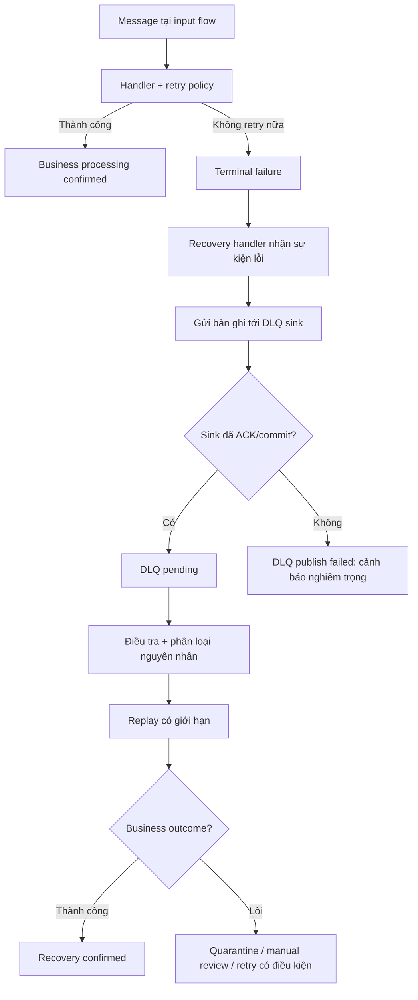
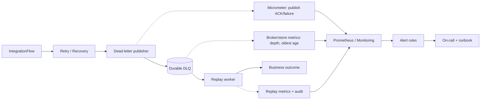

# Kết hợp dead letter với cảnh báo trong Spring Integration

## 1. Vì sao có DLQ vẫn chưa đủ để vận hành an toàn?

Trong hệ thống tích hợp thông điệp, khi một handler xử lý lỗi nhiều lần, chúng ta thường đưa message vào **dead-letter queue (DLQ)** để không làm nghẽn luồng chính. Cách này giữ lại bằng chứng lỗi và tạo cơ hội sửa hoặc replay sau. Tuy nhiên, **có DLQ không đồng nghĩa đã có cơ chế phát hiện sự cố**.

Ví dụ một flow đơn hàng đi qua `Gateway → Filter → Router → Service Activator → outbound adapter`. Dịch vụ kho bị lỗi từ 09:00; retry hết giới hạn rồi chuyển message sang DLQ. Consumer của luồng chính vẫn hoạt động, nhưng tới 10:00 mới có người nhận ra hàng nghìn yêu cầu đã bị cách ly. Nếu **việc ghi DLQ cũng bị lỗi**, các message còn có thể không được lưu an toàn.

Bài **“Kết hợp dead letter với cảnh báo”** thuộc chương **Dead letter** của module `SPRING_INTEGRATION_PATTERN`. Mục tiêu của module là triển khai Enterprise Integration Patterns với Spring Integration theo hướng ít phụ thuộc, dễ mở rộng, kiểm thử được và theo dõi được các nhánh Router, Filter, Transformer, Splitter, Aggregator, Gateway, retry, error channel và correlation.

Sau bài học, bạn có thể:

1. Phân biệt **lỗi ở handler**, **terminal failure**, **đã yêu cầu gửi DLQ**, **đã lưu DLQ**, **DLQ backlog** và **recovery thực sự thành công**.
2. Chọn metric, log, trace và audit event phù hợp để đưa DLQ vào hệ thống alerting.
3. Gắn Micrometer vào đúng ranh giới gửi/lưu dead letter, không tăng counter thành công khi mới enqueue hoặc gọi recovery callback.
4. Viết PromQL/Prometheus alert rules cho DLQ arrival rate, lỗi lưu DLQ, backlog age và tỷ lệ replay thất bại.
5. Thiết kế runbook xử lý cảnh báo: phân loại, giảm tác động, điều tra, sửa nguyên nhân, replay có giới hạn và xác nhận kết quả.
6. Kiểm thử các đường thành công, hết retry, không thể ghi DLQ, message bị giao lại và lặp tác dụng phụ.

## 2. Một message lỗi có thể đi qua sáu mốc khác nhau



| Mốc | Định nghĩa | Không được suy ra |
| --- | --- | --- |
| **Attempt failed** | Một lần gọi handler ném exception | Nghiệp vụ đã thất bại cuối cùng |
| **Terminal failure** | Một lượt xử lý kết thúc sau retry policy hoặc bị phân loại không retryable | Dead letter đã được lưu |
| **Recovery event observed** | Error flow nhận được `ErrorMessage` hoặc callback recovery được gọi | Broker/store đã ACK |
| **DLQ publish acknowledged** | Hệ thống DLQ xác nhận đã ghi theo hợp đồng lưu trữ | Consumer replay đã xử lý thành công |
| **DLQ pending** | Bản ghi còn đang chờ trong DLQ theo dữ liệu nguồn | Có thể tính đúng từ số lần gọi callback |
| **Recovery confirmed** | Xử lý lại/đối soát đạt mốc thành công nghiệp vụ đã định nghĩa | Chỉ cần gửi lại qua một channel là đủ |

**Thông điệp chính:** một dashboard có thể hiển thị `retry_exhausted=100`, `dlq_published=90` và `dlq_pending=90`. Chênh lệch 10 có thể là lỗi publisher, sai mốc đo hoặc dữ liệu đến muộn. Nó **không tự động chứng minh** đã mất 10 message, nhưng chắc chắn cần điều tra, đặc biệt nếu thông điệp phải được lưu bền vững.

### Error channel không mặc nhiên là DLQ

Trong Spring Integration, `errorChannel` là một `MessageChannel` dùng để nhận `ErrorMessage` theo đường xử lý lỗi đã cấu hình. Với một handler đồng bộ, exception có thể đi ngược về caller; với poller, executor hoặc adapter bất đồng bộ, lỗi có thể được publish tới error channel tương ứng. **Không phải mọi exception tự động được gửi tới global `errorChannel`.**

Một `QueueChannel` trong RAM để nhận `ErrorMessage` chỉ tạo hàng đợi **nội bộ tiến trình**, có thể mất khi restart. Muốn gọi đúng là DLQ phục vụ phục hồi, cần bộ lưu bền vững như broker, database hoặc object storage có hợp đồng giữ dữ liệu, thời hạn retention, quyền truy cập, khả năng replay và quy tắc ACK.

## 3. Kiến trúc quan sát và cảnh báo cho DLQ

Thiết kế nên tách phần **xử lý lỗi**, **lưu dead letter**, **thu thập telemetry** và **cảnh báo**:



Các nguyên tắc:

- **Nguồn sự thật cho `DLQ pending`** là broker/store, không phải biến đếm được cộng/trừ thủ công ở một JVM.
- **Nguồn sự thật cho `published`** phải có sự kiện ACK/commit từ sink theo contract.
- **Nguồn sự thật cho `recovered`** là business outcome hoặc commit downstream, không phải lệnh `channel.send()`.
- Các metric có thể mất series khi service chết. Vì vậy cần theo dõi cả **lỗi scrape, missing metrics, broker health** và ứng dụng không gửi message.
- Log và audit chứa business correlation phục vụ truy vết; metric tags chỉ dùng tập nhãn hữu hạn.

### Sự khác biệt giữa DLQ và Filter discard

`Filter` có thể loại message hợp lệ theo quy tắc nghiệp vụ, chẳng hạn sự kiện không thuộc phạm vi đồng bộ. Đây là `REJECTED` hoặc `DISCARDED`, không mặc nhiên là lỗi hệ thống. Ngược lại, DLQ thường giữ message không thể xử lý theo chính sách retry/recovery. Nếu tổ chức chọn lưu cả validation rejects vào một kho lỗi chung, phải phân loại rõ `reasonCode` và cách phục hồi; không cộng mọi discard thành “lỗi sản xuất”.

## 4. Các metric tối thiểu và cách hiểu

| Metric ứng dụng đề xuất | Loại | Mốc đo thực tế | Dùng để cảnh báo |
| --- | --- | --- | --- |
| `app.eip.retry.terminal.failures` | Counter | Đã xác định không tiếp tục xử lý trong chu kỳ hiện tại | Phát hiện lỗi nghiệp vụ/kỹ thuật không phục hồi ngay |
| `app.eip.dlq.publish.requested` | Counter | Publisher bắt đầu cố lưu dead letter | Theo dõi áp lực lên DLQ |
| `app.eip.dlq.publish.acked` | Counter | Broker/store xác nhận theo contract | DLQ inflow đã được chấp nhận |
| `app.eip.dlq.publish.failed` | Counter | Thao tác publish/lưu thất bại | **Cảnh báo ưu tiên cao** |
| `app.eip.dlq.publish.duration` | Timer | Bắt đầu publish → ACK/error | Phát hiện sink chậm |
| `app.eip.dlq.pending` | Gauge | Số bản ghi đang chờ theo broker/store | Backlog vượt khả năng xử lý |
| `app.eip.dlq.oldest.pending.age` | Gauge, giây | Tuổi bản ghi pending cũ nhất tính bằng timestamp đáng tin cậy | Tránh message bị bỏ quên |
| `app.eip.dlq.replay.started` | Counter | Worker bắt đầu một lượt replay | Khả năng xử lý backlog |
| `app.eip.dlq.replay.outcomes` | Counter | `success`, `error` hoặc `skipped` sau mỗi lượt | Đo chất lượng replay |
| `app.eip.dlq.recovery.confirmed` | Counter | Đã chứng minh nghiệp vụ thành công | Theo dõi tiến độ phục hồi |
| `app.eip.dlq.quarantined` | Counter | Message bị cách ly vì lỗi vĩnh viễn/không rõ | Phát hiện poison message |

**Đây là quy ước metric ví dụ của ứng dụng**, không phải khẳng định Spring Integration tự sinh tất cả các tên trên. Micrometer có telemetry chung của handler/channel; broker client có metric riêng; nếu đã có meter tương đương, cần xác nhận semantics và tránh đo trùng.

### Đơn vị và các nguồn đo

Counter là số sự kiện tích lũy, nên dùng `rate()`/`increase()` ở Prometheus; sau restart nó có thể về 0. Gauge biểu thị **trạng thái hiện tại**, có thể tăng hoặc giảm. Timer phù hợp với độ trễ; nó không đo tuổi bản ghi vẫn còn nằm chờ. Khi dùng histogram, hãy đánh giá chi phí series theo nhãn.

Không dùng phép tính ngây thơ:

```text
dlq_pending = total_published - total_replayed_success
```

Vì có thể có replay failed, in-flight, TTL/retention, manual deletion, quarantine, redelivery, nhiều consumer/partition và khởi động lại metrics. Nếu muốn đối soát, cần dữ liệu store và mô hình trạng thái thực tế, không chỉ hai counter từ một instance.

### Tag cần kiểm soát

| Tag | Ví dụ | Có phù hợp? |
| --- | --- | --- |
| `flow` | `orders`, `payments` | Có, định danh ổn định |
| `stage` | `reserveStock`, `publishOrder` | Có, tập endpoint cố định |
| `destination` | `ordersDlq`, `manualReview` | Có, logical name |
| `reason` | `timeout`, `validation`, `dependency`, `other` | Có nếu chuẩn hóa bằng allowlist |
| `outcome` | `success`, `error`, `skipped` | Có, danh sách cố định |
| `messageId`, `orderId`, `traceId`, `correlationId` | Giá trị riêng từng message | **Không** |
| `payload`, `exception.getMessage()`, URL có token | Dữ liệu tự do hoặc nhạy cảm | **Không** |

Một bộ đếm theo `reason=timeout` là có ích; gắn exception message chứa UUID hoặc tên người dùng sẽ gây **high cardinality** và có thể lộ thông tin.

## 5. Ví dụ Spring Integration: từ retry hết lần đến publisher được giám sát

Ví dụ dùng Java 17, Spring Integration 6.x, Spring Retry 2.x và Micrometer. `RequestHandlerRetryAdvice` thử lại một handler; khi hết retry, `ErrorMessageSendingRecoverer` gửi `ErrorMessage` tới `terminalErrorEvents`. Một handler khác chuyển lỗi thành record và lưu bằng giao diện `DeadLetterStore`.

**Phạm vi minh họa:** `DeadLetterStore` là interface có hợp đồng *trả về sau khi ghi đã được xác nhận*. Bài không tự khẳng định một implementation trong RAM là DLQ bền vững. Trong production, thay bằng adapter JDBC/broker phù hợp và ghi ACK theo chính hợp đồng của adapter.

### 5.1. Dead-letter record và publisher

```java
import java.time.Clock;
import java.time.Instant;
import java.util.Objects;

import io.micrometer.core.instrument.Counter;
import io.micrometer.core.instrument.MeterRegistry;
import io.micrometer.core.instrument.Timer;
import org.springframework.messaging.Message;
import org.springframework.messaging.MessageHandler;
import org.springframework.messaging.MessagingException;
import org.springframework.messaging.support.ErrorMessage;

// Đây là metadata đã lọc; payload dùng để replay phải được giữ
// bằng tham chiếu có phân quyền hoặc định dạng an toàn riêng.
record DeadLetterRecord(
        String sourceEventId,
        String processingCycleId,
        String stage,
        String reasonCode,
        Instant occurredAt) {

    String stableFailureKey() {
        // Cùng chu kỳ lỗi được gửi lại không tạo record logic thứ hai.
        return sourceEventId + ":" + processingCycleId + ":" + stage;
    }
}

interface DeadLetterStore {
    // Hợp đồng: return chỉ khi đã nhận ACK/commit lưu bền vững.
    // Cần bảo đảm idempotent theo stableFailureKey().
    void persist(DeadLetterRecord record);
}

final class MonitoredDeadLetterPublisher implements MessageHandler {
    private final DeadLetterStore store;
    private final Clock clock;
    private final MeterRegistry meterRegistry;
    private final Counter requested;
    private final Counter acknowledged;
    private final Counter failed;
    private final Timer duration;

    MonitoredDeadLetterPublisher(
            DeadLetterStore store, MeterRegistry meters, Clock clock) {
        this.store = store;
        this.clock = clock;
        this.meterRegistry = meters;
        requested = meters.counter("app.eip.dlq.publish.requested",
                "flow", "orders", "destination", "ordersDlq");
        acknowledged = meters.counter("app.eip.dlq.publish.acked",
                "flow", "orders", "destination", "ordersDlq");
        failed = meters.counter("app.eip.dlq.publish.failed",
                "flow", "orders", "destination", "ordersDlq");
        duration = Timer.builder("app.eip.dlq.publish.duration")
                .description("Thời gian từ khi publish tới ACK/error")
                .tags("flow", "orders", "destination", "ordersDlq")
                .register(meters);
    }

    @Override
    public void handleMessage(Message<?> event) {
        requested.increment();
        Timer.Sample sample = Timer.start(meterRegistry);
        try {
            if (!(event instanceof ErrorMessage error)) {
                throw new IllegalArgumentException(
                        "Dead-letter publisher cần ErrorMessage");
            }

            Throwable failure = error.getPayload();
            Message<?> source = error.getOriginalMessage();
            if (source == null
                    && failure instanceof MessagingException messagingError) {
                source = messagingError.getFailedMessage();
            }
            if (source == null) {
                throw new IllegalArgumentException(
                        "Không xác định được original message");
            }

            String sourceEventId =
                    source.getHeaders().get("sourceEventId", String.class);
            String processingCycleId =
                    source.getHeaders().get("processingCycleId", String.class);
            if (sourceEventId == null || processingCycleId == null) {
                throw new IllegalArgumentException(
                        "Thiếu khóa dedup/correlation của dead letter");
            }

            // Chuẩn hóa reason vào nhóm hữu hạn, không lưu raw exception text.
            String reason = "handler_error";
            DeadLetterRecord record = new DeadLetterRecord(
                    sourceEventId, processingCycleId,
                    "reserveStock", reason, clock.instant());

            // Nếu persist ném lỗi hoặc chưa được ACK, không tăng acknowledged.
            store.persist(record);
            acknowledged.increment();
        } catch (RuntimeException exception) {
            failed.increment();
            throw exception;
        } finally {
            sample.stop(duration);
        }
    }
}
```

**Các giới hạn cần hiểu:**

- `acknowledged` chỉ hợp lệ nếu `store.persist()` thật sự tuân thủ hợp đồng đã nêu. Với broker bất đồng bộ, lời gọi gửi thường trả về trước ACK; phải cập nhật counter ở callback/future **sau ACK**.
- Cùng một bản ghi được gửi lại có thể tạo hai lần `publish requested`; `stableFailureKey()` cho phép sink dedup. Trong thực tế, cần khóa duy nhất/transaction ở kho lưu; đừng dùng biến RAM để bảo đảm sau restart.
- Nếu `store.persist()` đã commit nhưng ACK về publisher bị mất, caller có thể ném lỗi và `failed` tăng dù dữ liệu đã được lưu. Lúc đó phải đối soát bằng stable key thay vì kết luận mất record.
- `reasonCode=handler_error` trong ví dụ là nhóm tổng quát. Production cần classifier được kiểm thử cho timeout, validation, dependency, lỗi serialization… nhưng nhãn phải có giới hạn.
- `processingCycleId` nên được tạo **một lần khi bắt đầu một chu kỳ xử lý** và giữ ổn định qua retry trong cùng chu kỳ. Replay được chủ đích mở chu kỳ mới phải ghi lineage về `sourceEventId` và failure cũ.
- Record minh họa chỉ có metadata nên chưa đủ replay payload. Muốn replay, cần thêm `securedPayloadReference` hoặc payload đã chuẩn hóa và bảo vệ phù hợp, cùng schema version.

### 5.2. Tạo flow và gắn RetryAdvice

```java
import java.time.Clock;

import io.micrometer.core.instrument.MeterRegistry;
import org.springframework.beans.factory.annotation.Qualifier;
import org.springframework.context.annotation.Bean;
import org.springframework.context.annotation.Configuration;
import org.springframework.integration.annotation.EnableIntegration;
import org.springframework.integration.channel.DirectChannel;
import org.springframework.integration.dsl.IntegrationFlow;
import org.springframework.integration.handler.advice.ErrorMessageSendingRecoverer;
import org.springframework.integration.handler.advice.RequestHandlerRetryAdvice;
import org.springframework.messaging.MessageChannel;
import org.springframework.messaging.MessageHandler;
import org.springframework.retry.backoff.FixedBackOffPolicy;
import org.springframework.retry.policy.SimpleRetryPolicy;
import org.springframework.retry.support.RetryTemplate;

@Configuration
@EnableIntegration
class DeadLetterAlertingConfiguration {

    @Bean("ordersInput")
    MessageChannel ordersInput() {
        return new DirectChannel();
    }

    @Bean("terminalErrorEvents")
    MessageChannel terminalErrorEvents() {
        // Đây là error channel đồng bộ, không phải DLQ bền vững.
        return new DirectChannel();
    }

    @Bean
    RequestHandlerRetryAdvice orderRetryAdvice(
            @Qualifier("terminalErrorEvents") MessageChannel errors) {
        RetryTemplate retry = new RetryTemplate();
        retry.setRetryPolicy(new SimpleRetryPolicy(3));
        FixedBackOffPolicy backoff = new FixedBackOffPolicy();
        backoff.setBackOffPeriod(20L); // Demo; production cần SLO và jitter.
        retry.setBackOffPolicy(backoff);

        RequestHandlerRetryAdvice advice = new RequestHandlerRetryAdvice();
        advice.setRetryTemplate(retry);
        advice.setRecoveryCallback(new ErrorMessageSendingRecoverer(errors));
        return advice;
    }

    @Bean
    MonitoredDeadLetterPublisher monitoredDeadLetterPublisher(
            DeadLetterStore store, MeterRegistry registry) {
        return new MonitoredDeadLetterPublisher(
                store, registry, Clock.systemUTC());
    }

    @Bean
    IntegrationFlow processOrders(RequestHandlerRetryAdvice orderRetryAdvice) {
        MessageHandler handler = message -> {
            if (message.getPayload().toString().startsWith("FAIL:")) {
                throw new IllegalStateException("Lỗi giả lập ở dependency");
            }
            // Ở production: xử lý thành công phải có mốc ACK/commit riêng.
        };
        return IntegrationFlow.from("ordersInput")
                .handle(handler, endpoint -> endpoint.advice(orderRetryAdvice))
                .get();
    }

    @Bean
    IntegrationFlow persistTerminalFailures(
            MonitoredDeadLetterPublisher publisher) {
        return IntegrationFlow.from("terminalErrorEvents")
                .handle((MessageHandler) publisher)
                .get();
    }
}
```

Với payload bắt đầu bằng `FAIL:`, handler ném lỗi, advice thử lại tối đa ba lần tổng cộng, rồi recoverer publish `ErrorMessage` sang channel xử lý terminal. Publisher nhận error và gọi store. Khi lưu thành công, metric `publish.acked` tăng; khi lưu thất bại, metric `publish.failed` tăng và exception được truyền tiếp cho cơ chế xử lý hiện có.

**Lưu ý:** `SimpleRetryPolicy(3)` trong ví dụ cho phép retry lỗi tổng quát; production phải phân loại lỗi retryable/non-retryable, giới hạn tổng thời gian và xử lý ngoại lệ bị wrap. Với đường lỗi đồng bộ, nếu publisher thất bại có thể đẩy exception về caller; không mặc định caller sẽ giữ và gửi lại message. Cần thiết kế rollback/outbox/fallback storage/alert sao cho mất DLQ sink không gây mất message im lặng.

### 5.3. Các dependency

```groovy
dependencies {
    implementation("org.springframework.boot:spring-boot-starter-integration")
    implementation("org.springframework.boot:spring-boot-starter-actuator")
    implementation("org.springframework.retry:spring-retry")

    // Chỉ khi xuất metrics sang Prometheus.
    runtimeOnly("io.micrometer:micrometer-registry-prometheus")

    testImplementation("org.springframework.boot:spring-boot-starter-test")
    testImplementation("org.springframework.integration:spring-integration-test")
}
```

Trong ứng dụng Spring Boot, `MeterRegistry` thường được auto-configure khi dependency tương thích hiện diện. Nếu chạy chỉ với cấu hình Spring thuần, cung cấp `SimpleMeterRegistry` trong test hoặc registry phù hợp trong ứng dụng.

## 6. Thu thập backlog và tuổi message cũ nhất

Metrics ở publisher chỉ cho biết các lần **thử ghi và kết quả ACK quan sát được**. Chúng không cho biết có bao nhiêu record còn trong kho.

| Nguồn DLQ | Depth/backlog nên lấy ở đâu? | Oldest age |
| --- | --- | --- |
| RabbitMQ/AMQP | Queue ready/unacked và metric của broker/consumer | Timestamp đáng tin cậy hoặc metric tuổi của broker/plugin |
| Kafka | Consumer group lag theo partition; không tự đồng nghĩa số DLQ record pending đã phân loại | Dựa trên offset/time của event pending và nguồn metadata phù hợp |
| JDBC DLQ table | `COUNT` record trạng thái `PENDING` trong DB | `now - MIN(created_at)` của record PENDING |
| S3/object store | Bản ghi đã phân vùng/index theo trạng thái xử lý | Metadata/index theo bản ghi đang pending |
| `QueueChannel` trong RAM | `getQueueSize()` tại instance đó | Cần timestamp enqueue riêng; không bền qua restart |

Đối với broker hoặc store dùng chung nhiều instance, nên sử dụng **nguồn số liệu tập trung**. Không cộng depth của nhiều pod nếu các pod chỉ đang đọc cùng một queue backend, vì sẽ đếm trùng. Nếu một consumer đã lấy message nhưng chưa ACK, chỉ số ready có thể giảm trong khi lượng công việc chưa hoàn tất chưa giảm; cân nhắc cả unacked/in-flight.

### Công thức cho kho JDBC

Giả sử DLQ table có `status` và `created_at` rõ ràng:

```sql
SELECT COUNT(*) AS pending_count,
       EXTRACT(EPOCH FROM (CURRENT_TIMESTAMP - MIN(created_at)))
         AS oldest_pending_age_seconds
FROM dead_letter_record
WHERE status = 'PENDING';
```

Khi queue không có record pending, `MIN(created_at)` trả `NULL`; exporter cần diễn giải giá trị vắng mặt rõ ràng (ví dụ gauge age = 0 cùng pending = 0), không biến nó thành số âm hoặc timestamp vô hạn. Với bảng lớn, dùng index thích hợp, caching/sampling và cadence đo hợp lý; không chạy query full scan mỗi vài giây nếu gây tải cho DB.

**Không dùng** thời gian xảy ra lỗi gốc để thay cho thời gian record vào DLQ trừ khi dashboard ghi rõ ý nghĩa. Một message có thể retry rất lâu trước khi dead letter được lưu; hai loại tuổi trả lời hai câu hỏi khác nhau.

## 7. Đặt cảnh báo: lỗi ghi DLQ, inflow, backlog và oldest age

Cần ít nhất **bốn nhóm cảnh báo** vì mỗi nhóm phát hiện một kiểu sự cố:

| Tín hiệu | Điều kiện minh họa | Mức độ gợi ý | Hành động đầu tiên |
| --- | --- | --- | --- |
| **DLQ publish failed** | Có lỗi lưu bản ghi cần bền vững | Critical khi nguy cơ mất message; phụ thuộc SLA | Kiểm tra broker/store, fallback, transaction và retry của publisher |
| **DLQ inflow tăng** | Tốc độ dead letter tăng kéo dài hoặc ratio tăng so baseline | Warning/Critical theo tác động | Kiểm tra loại lỗi, release mới, dependency và traffic |
| **DLQ pending quá lớn** | Depth vượt capacity xử lý hoặc tăng liên tục | Warning | Kiểm tra replay worker và nguyên nhân gốc |
| **Oldest pending age vượt SLO** | Có record không được xử lý trong thời hạn cam kết | Warning/Critical | Tìm record cũ nhất, tình trạng quarantine và owner |
| Replay error rate cao | Nhiều message replay thất bại | Warning/Critical | Tạm dừng replay batch, sửa nguyên nhân trước khi tiếp tục |
| Telemetry vắng mặt | Không scrape được exporter hoặc metric biến mất | Monitoring alert | Kiểm tra hệ thống đo trước khi suy diễn backlog bằng 0 |

**Ngưỡng phải dựa trên SLO, năng lực xử lý và lịch vận hành của từng flow.** Một hệ thống đẩy validation errors vào DLQ có thể có inflow đều đặn mà không phải sự cố; một flow thanh toán yêu cầu zero-loss có thể phải cảnh báo ngay khi DLQ publisher thất bại một lần.

### 7.1. PromQL đo DLQ inflow

Với Micrometer Prometheus registry, Counter `app.eip.dlq.publish.acked` thường có tên xuất `app_eip_dlq_publish_acked_total`. Kiểm tra tên thật ở `/actuator/prometheus` trước khi tạo rule:

```promql
sum by (flow, destination) (
  rate(app_eip_dlq_publish_acked_total[5m])
)
```

Đếm số message đã được DLQ ACK trong 15 phút:

```promql
sum(increase(app_eip_dlq_publish_acked_total{
  flow="orders",destination="ordersDlq"
}[15m]))
```

Đối với một tỷ lệ terminal failure, mẫu số phải có mốc và đơn vị nhất quán. Nếu chỉ dùng số `handler attempts` ở mẫu số, retry có thể làm tỷ lệ thấp giả. Hãy dùng logical operations đã vào flow hoặc số xử lý ở mốc nghiệp vụ phù hợp, đồng thời hiển thị volume tuyệt đối.

### 7.2. Alert rules Prometheus tham khảo

Ví dụ cấu hình dưới đây **chỉ minh họa**, giả định có các gauge được exporter lấy từ DLQ backend. Các ngưỡng phải đổi theo SLO; không triển khai nguyên xi:

```yaml
groups:
  - name: spring-integration-dead-letter
    rules:
      - alert: OrdersDLQPublishFailed
        expr: |
          sum(increase(app_eip_dlq_publish_failed_total{
            flow="orders",destination="ordersDlq"
          }[5m])) > 0
        for: 1m
        labels:
          severity: critical
          team: integration
        annotations:
          summary: "Không lưu được dead letter của orders"
          description: "Kiểm tra sink, ACK và fallback; có nguy cơ mất dấu vết lỗi."

      - alert: OrdersDLQBacklogHigh
        expr: |
          sum(app_eip_dlq_pending{
            flow="orders",destination="ordersDlq"
          }) > 200
        for: 10m
        labels:
          severity: warning
          team: integration
        annotations:
          summary: "DLQ orders tồn đọng vượt ngưỡng"

      - alert: OrdersDLQOldestPendingTooOld
        expr: |
          max(app_eip_dlq_oldest_pending_age_seconds{
            flow="orders",destination="ordersDlq"
          }) > 900
        for: 5m
        labels:
          severity: warning
          team: integration
        annotations:
          summary: "Dead letter cũ nhất đã chờ hơn 15 phút"

      - alert: OrdersDLQInflowSpike
        expr: |
          sum(rate(app_eip_dlq_publish_acked_total{
            flow="orders",destination="ordersDlq"
          }[5m])) > 0.1
        for: 10m
        labels:
          severity: warning
          team: integration
        annotations:
          summary: "DLQ orders nhận hơn 6 bản ghi mỗi phút kéo dài"
```

Giải thích: `for: 10m` yêu cầu điều kiện tiếp tục đúng trong khoảng thời gian đó; nó không tự giảm ảnh hưởng của missing metrics. Khi metric vắng mặt, biểu thức thường không có series để cảnh báo, vì vậy cần alert riêng cho **mất telemetry**.

Ví dụ cảnh báo scrape:

```promql
up{job="orders-integration"} == 0
```

Nếu hệ thống chỉ phát metric `pending` khi queue không rỗng, không dùng `absent()` làm cảnh báo mất telemetry mà chưa biết hợp đồng exporter. Cần kiểm tra `up`, heartbeat hoặc metric tồn tại liên tục được định nghĩa cho backend.

### 7.3. Tỷ lệ replay thất bại

Nếu `app.eip.dlq.replay.outcomes` được ghi đúng một lần trên **mỗi lần replay có kết quả**:

```promql
sum(rate(app_eip_dlq_replay_outcomes_total{
  flow="orders",outcome="error"
}[10m]))
/
clamp_min(
  sum(rate(app_eip_dlq_replay_outcomes_total{
    flow="orders",outcome=~"success|error"
  }[10m])),
  0.000001
)
```

Đi kèm điều kiện số mẫu đủ lớn, ví dụ ít nhất 20 lượt replay trong cửa sổ, trước khi nâng severity. `skipped` nên được hiển thị riêng nếu duplicate/idempotency đã xử lý trước đó; việc `skipped` có tính thành công hay không phải do hợp đồng nghiệp vụ định nghĩa.

### 7.4. SLO và ưu tiên cảnh báo

Không phải mọi sự kiện vào DLQ đều cần gọi người trực. Cách thiết kế thường hiệu quả:

- **P0/P1:** không thể lưu DLQ bền vững cho một flow không được phép mất dữ liệu; có bằng chứng duplicate tác dụng phụ; tồn backlog vượt SLO nghiêm trọng.
- **P2:** DLQ inflow tăng bất thường, oldest age gần vượt giới hạn, replay throughput không theo kịp.
- **Thông báo dạng ticket/daily digest:** message validation lỗi đã phân loại và có thể xử lý theo lịch, không gây gián đoạn vận hành.

Lưu ý ngưỡng là **ví dụ**, không thể quyết định severity nếu không biết hợp đồng độ tin cậy của hệ thống.

## 8. Runbook khi cảnh báo kích hoạt

Một cảnh báo hữu ích cần chỉ ra **người chịu trách nhiệm, tín hiệu, dashboard, cách giảm thiểu và điều kiện xác nhận phục hồi**.

### Bước 1 — Phân biệt loại cảnh báo

| Alert | Câu hỏi đầu tiên |
| --- | --- |
| Publish failed | Message terminal đã được rollback/lưu dự phòng chưa? Sink có ACK không? |
| Inflow tăng | Lỗi tập trung ở một handler, route, phiên bản build hay dependency nào? |
| Pending tăng | DLQ consumer có đang chạy? Có ai xử lý/đối soát record không? |
| Oldest age cao | Record nào bị giữ lâu, do poison message, chính sách approval hay thiếu capacity? |
| Replay error cao | Lỗi gốc đã được sửa chưa? Có replay storm/quá tải dependency không? |

### Bước 2 — Đánh giá phạm vi ảnh hưởng

Kiểm tra tổng số record, tuổi cũ nhất, luồng và stage lỗi, thời gian bắt đầu tăng, những bản phát hành gần nhất. Đối chiếu metric **retry attempts**, **terminal errors**, **DLQ ACK**, **broker health**, **downstream latency** và SLO.

Với một message cụ thể, dùng `sourceEventId`, `flowExecutionId`, original message ID hoặc business correlation để tra audit/log/trace. **Không đưa các ID này vào Prometheus label hoặc log công khai.**

### Bước 3 — Ngăn sự cố lan rộng

Các biện pháp tùy tình huống:

1. Hạ tốc producer hoặc mở circuit breaker khi dependency đang lỗi, tránh đẩy thêm message thất bại liên tục.
2. Dừng replay batch nếu replay đang làm tăng lỗi hoặc gây tác dụng phụ lặp.
3. Khi DLQ sink mất kết nối, dùng transaction rollback, outbox, fallback lưu bền vững hoặc tạm ngừng tiếp nhận theo thiết kế; **không ACK/drop message** chỉ để tiếp tục throughput.
4. Nếu vừa rollout một cấu hình Router/Transformer sai, cân nhắc rollback **sau khi** đánh giá tương thích schema và message còn trong queue.

### Bước 4 — Xử lý nguyên nhân gốc

Phân nhóm error:

- **Transient:** timeout, 503, broker/connectivity; chỉ replay sau khi dependency ổn định.
- **Permanent:** schema/validation không hợp lệ; sửa dữ liệu hoặc chuyển manual review, không retry vô hạn.
- **Unknown result:** API ngoài có thể đã commit nhưng mất ACK; **reconcile trước replay**, tránh double charge/trừ kho hai lần.
- **Poison message:** message gây exception lặp vì dữ liệu/logic; cô lập, xác định owner, không chạy vòng lặp DLQ mới.

### Bước 5 — Replay an toàn

- Chọn nhóm nhỏ, giữ lineage của original source event và failure record.
- Giữ idempotency key nghiệp vụ qua retry/replay; nếu replay sau deploy khác, ghi original/replay rule version.
- Đặt rate limit, concurrency tối đa, backoff, retry budget và stop condition.
- Đo `replay.started` và `replay.outcomes` ở đúng mốc; chỉ tăng `recovery.confirmed` khi business commit/ACK được chứng minh.
- Không xóa DLQ record trước khi có kết quả hoặc chính sách manual resolution rõ ràng.

### Bước 6 — Xác nhận và hậu kiểm

Kiểm tra inflow đã giảm, backlog và oldest age đang phục hồi, replay success tăng, không còn publish errors và không còn side effect trùng. Ghi incident timeline, lỗi gốc, rule/flow version, số operation bị ảnh hưởng và các biện pháp ngăn tái phát. Nếu đã có mất dữ liệu, phải đối soát với nguồn đầu vào thay vì chỉ nhìn gauge bằng 0.

## 9. Audit, correlation và bảo mật thông tin DLQ

Để tìm nguyên nhân chính xác, một dead-letter record nên có những trường **do ứng dụng định nghĩa**:

```json
{
  "eventType": "DEAD_LETTER_CONFIRMED",
  "deadLetterRecordId": "dlq-7092",
  "sourceEventId": "src-event-8841",
  "flowExecutionId": "flow-7294",
  "flowName": "orders",
  "stage": "reserveStock",
  "flowDefinitionVersion": "orders-flow/3.2.0",
  "routingPolicyVersion": "routing-orders/r17",
  "errorCode": "dependency_timeout",
  "attemptCount": 3,
  "recordedAt": "2026-11-21T09:20:00Z",
  "payloadReference": "secured-object-ref-91"
}
```

Đây là **mẫu JSON** chứ không phải một record Spring Integration tự xuất. `payloadReference` phải tuân thủ quyền truy cập, retention, encryption và chính sách xóa dữ liệu. Chỉ giữ những header cần thiết; tránh lưu token, mật khẩu, raw request body nhạy cảm hoặc stack trace chứa PII. Nên có audit event riêng cho `DLQ_PUBLISH_FAILED`, `REPLAY_REQUESTED`, `REPLAY_STARTED`, `REPLAY_FAILED` và `RECOVERY_CONFIRMED` khi nghiệp vụ cần truy vết.

**Message ID không phải khóa idempotency mặc định.** Một message có thể đổi ID khi được transform/replay. Muốn ngăn áp dụng side effect trùng, dùng một business operation key ổn định và kiểm soát ở nơi side effect commit. Correlation/tracing hỗ trợ điều tra, không tự giải quyết exactly-once effects.

### Version giúp giảm thời gian điều tra

Nếu DLQ inflow tăng ngay sau rollout, lưu `flowDefinitionVersion`, `routingPolicyVersion` hoặc `deploymentRevision` theo **thời điểm message thật sự chạy** sẽ giúp so sánh nhánh Router/Filter nào thay đổi. Không ghi lại version hiện tại như thể nó là version đã xử lý bản ghi lỗi trước đây. Khi replay dưới version mới, giữ cả original version và replay version.

## 10. Kiểm thử đường cảnh báo và thất bại khi ghi DLQ

### 10.1. Integration test với store trong RAM dành riêng cho test

Để chứng minh cách gắn metric, test có thể dùng fake `DeadLetterStore`. Đây là **test double**, không phải DLQ bền vững:

```java
import java.util.concurrent.ConcurrentHashMap;
import java.util.concurrent.ConcurrentMap;

import io.micrometer.core.instrument.MeterRegistry;
import io.micrometer.core.instrument.simple.SimpleMeterRegistry;
import org.springframework.context.annotation.Bean;
import org.springframework.context.annotation.Configuration;

final class InMemoryDeadLetterStore implements DeadLetterStore {
    private final ConcurrentMap<String, DeadLetterRecord> entries =
            new ConcurrentHashMap<>();

    @Override
    public void persist(DeadLetterRecord record) {
        entries.putIfAbsent(record.stableFailureKey(), record);
    }

    int size() {
        return entries.size();
    }
}

@Configuration
class DeadLetterTestBeans {
    @Bean
    InMemoryDeadLetterStore testDeadLetterStore() {
        return new InMemoryDeadLetterStore();
    }

    @Bean
    MeterRegistry testRegistry() {
        return new SimpleMeterRegistry();
    }
}
```

Test chạy một message gây lỗi sau ba attempts và xác nhận publisher được gọi:

```java
import static org.assertj.core.api.Assertions.assertThat;

import org.junit.jupiter.api.Test;
import org.springframework.beans.factory.annotation.Autowired;
import org.springframework.beans.factory.annotation.Qualifier;
import org.springframework.messaging.MessageChannel;
import org.springframework.messaging.support.MessageBuilder;
import org.springframework.test.context.junit.jupiter.SpringJUnitConfig;
import io.micrometer.core.instrument.MeterRegistry;

@SpringJUnitConfig(classes = {
        DeadLetterAlertingConfiguration.class,
        DeadLetterTestBeans.class
})
class DeadLetterAlertingTest {

    @Autowired
    @Qualifier("ordersInput")
    MessageChannel input;

    @Autowired
    InMemoryDeadLetterStore store;

    @Autowired
    MeterRegistry meters;

    @Test
    void publishesOneTerminalFailureAfterRetryExhaustion() {
        input.send(MessageBuilder.withPayload("FAIL:order-42")
                .setHeader("sourceEventId", "event-42")
                .setHeader("processingCycleId", "cycle-1")
                .build());

        assertThat(store.size()).isEqualTo(1);
        assertThat(meters.get("app.eip.dlq.publish.requested")
                .tags("flow", "orders", "destination", "ordersDlq")
                .counter().count()).isEqualTo(1.0);
        assertThat(meters.get("app.eip.dlq.publish.acked")
                .tags("flow", "orders", "destination", "ordersDlq")
                .counter().count()).isEqualTo(1.0);
        assertThat(meters.get("app.eip.dlq.publish.failed")
                .tags("flow", "orders", "destination", "ordersDlq")
                .counter().count()).isZero();
    }
}
```

Test này kiểm tra đường recovery/metrics trong một context demo; **không** chứng minh đã gửi broker hay nhận ACK bền vững. Cần integration test riêng với broker/database thật, transaction/ACK và cơ chế replay. Nếu lỗi trước khi recoverer tạo được `ErrorMessage` hoặc không giữ được original message, test phải phát hiện rõ sự thất bại và không ghi thành công giả.

### 10.2. Ma trận kiểm thử

| Tình huống | Kỳ vọng |
| --- | --- |
| Handler thành công lần đầu | Không có terminal event, DLQ không tăng |
| Handler lỗi transient rồi thành công trong retry | Attempt errors tăng, **không** tăng DLQ ACK |
| Hết retry/không retryable | Có terminal event; publisher được gọi theo policy |
| DLQ store đã commit và trả ACK | `publish.acked +1`; backlog tăng theo nguồn thật |
| DLQ store ném lỗi trước commit | `publish.failed +1`, `acked` không tăng; có fallback/rollback |
| Store commit nhưng ACK bị mất | Có thể đo `failed` nhưng record vẫn tồn; đối soát theo stable key |
| Dead-letter record được publish lặp | Store dedup theo stable failure key; không tạo duplicate logic |
| DLQ consumer dừng | Pending/oldest age tăng dù publisher vẫn ACK |
| DLQ rỗng | Pending = 0, oldest age được diễn giải đúng, không tạo alert giả |
| Scrape/exporter dừng | Alert mất telemetry hoạt động độc lập với DLQ depth |
| Replay thành công sau sửa lỗi | `recovery.confirmed` tăng ở mốc business commit |
| Replay bị lỗi tiếp | Không tạo vòng lặp vô hạn; quarantine/redrive limit hoạt động |
| Replay sau timeout ở API đã commit | Idempotency/reconcile ngăn side effect lặp |
| Filter discard có chủ đích | Không vô tình bị tính thành terminal failure |
| Splitter/Aggregator | Phân biệt message fragment và business operation; correlation ổn định |
| Nhiều pod xử lý DLQ chung | Backlog không bị cộng lặp theo instance |
| Payload/header có PII | Không lộ trong metric tag, audit có kiểm soát quyền |

### 10.3. Kiểm thử alert rules và runbook

Đừng chỉ test code publisher. Cần test dữ liệu time-series có tính đến restart/reset Counter, missing metrics, độ trễ scrape và cửa sổ `for` của alert. Với Prometheus, có thể dùng công cụ `promtool test rules` và các mẫu series giả lập; phần này thực hiện ở bước kiểm thử/QA của dự án.

Các bài diễn tập quan trọng: giả lập broker DLQ mất kết nối; tắt consumer; đưa một poison message; tăng tốc replay làm downstream lỗi; tắt telemetry exporter. Mỗi bài diễn tập phải chứng minh cảnh báo đến đúng owner, có dashboard, và có cách dừng/tái khởi động an toàn.

## 11. Các sai lầm thường gặp khi gắn DLQ với alerting

1. **Cảnh báo chỉ từ số exception.** Một nghiệp vụ có thể lỗi hai attempts rồi thành công, không nên đếm như hai dead letters.
2. **Coi gửi sang `errorChannel` là lưu DLQ thành công.** Channel có thể chỉ nằm trong RAM và chưa có persistence/ACK.
3. **Tăng `dlq.acked` trước khi có ACK từ sink.** Nếu mất kết nối, dashboard báo sai rằng message đã an toàn.
4. **Chỉ xem DLQ inflow, bỏ qua oldest age.** Consumer chết có thể không tạo DLQ mới, nhưng bản ghi cũ vẫn tồn.
5. **Chỉ xem queue depth.** Depth thấp không có nghĩa DLQ không có lỗi nếu telemetry thiếu hoặc bản ghi bị mất do restart.
6. **Dùng một biến JVM để tính backlog toàn cụm.** Multi-instance và broker dùng chung khiến số liệu bị thiếu hoặc đếm trùng.
7. **Alert một DLQ event đơn lẻ cho mọi flow.** Có thể tạo alert fatigue; cần ngưỡng và severity theo SLO.
8. **Không cảnh báo DLQ publisher bị lỗi.** Đây là đường lỗi thứ cấp và có thể gây mất bằng chứng phục hồi.
9. **Replay theo kiểu “send thành công = recovered”.** Message có thể tiếp tục lỗi hoặc bị duplicate downstream.
10. **Replay vô hạn.** Poison message tạo vòng DLQ/retry, làm tăng tải và chi phí.
11. **Không có idempotency.** Lỗi lost ACK có thể khiến replay trừ tiền hoặc giữ kho hai lần.
12. **Gắn ID/payload vào metric label.** Gây high cardinality và rủi ro rò rỉ thông tin.
13. **Không có runbook hoặc owner.** Alert liên tục nhưng không ai biết xử lý, lâu dần bị tắt hoặc bỏ qua.
14. **Không kiểm tra cảnh báo khi metrics biến mất.** Một hệ thống bị tắt có thể trông như “không có lỗi”.

## 12. Checklist đưa DLQ alerting lên production

- [ ] Phân biệt terminal failure, recovery event, publish requested, DLQ ACK, pending và recovery confirmed.
- [ ] DLQ sink có hợp đồng lưu bền vững, idempotent storage key, retention và khả năng replay.
- [ ] Có metric publish requested/acked/failed và duration tại đúng mốc.
- [ ] Depth và oldest age lấy từ broker/store thực, không suy bằng biến đếm JVM.
- [ ] Có cảnh báo publish failure, inflow spike, backlog, oldest age, replay failure và telemetry missing.
- [ ] Ngưỡng/thời gian `for` được điều chỉnh theo SLO, volume và khả năng phục hồi thực tế.
- [ ] Alert có owner, severity, dashboard link và runbook hành động.
- [ ] Error taxonomy có tập mã giới hạn, không log/label dữ liệu nhạy cảm.
- [ ] Có correlation, flow/route version, original event ID và attempt lineage trong audit có kiểm soát.
- [ ] Replay có rate limit, stop condition, idempotency, giới hạn redrive và manual quarantine.
- [ ] Test cảnh báo khi broker/store lỗi, consumer dừng, ACK mất, metric mất và duplicate.
- [ ] Thực hiện diễn tập incident và đối soát lại DLQ/backlog, không xem depth = 0 là bằng chứng duy nhất.

## 13. Tài liệu tham khảo

- [Spring Integration — Error Handling](https://docs.spring.io/spring-integration/reference/error-handling.html)
- [Spring Integration — Handler Advice / Retry](https://docs.spring.io/spring-integration/reference/handler-advice/classes.html)
- [Spring Integration — Message Channels](https://docs.spring.io/spring-integration/reference/channel.html)
- [Spring Integration — Metrics and Management](https://docs.spring.io/spring-integration/reference/metrics.html)
- [Spring Retry Reference](https://docs.spring.io/spring-retry/reference/)
- [Micrometer Reference — Counters](https://docs.micrometer.io/micrometer/reference/concepts/counters.html)
- [Micrometer Reference — Gauges](https://docs.micrometer.io/micrometer/reference/concepts/gauges.html)
- [Prometheus — Alerting Rules](https://prometheus.io/docs/prometheus/latest/configuration/alerting_rules/)
- [Prometheus — PromQL Functions](https://prometheus.io/docs/prometheus/latest/querying/functions/)

**Ghi nhớ:** DLQ chỉ hữu ích khi message lỗi **thật sự được lưu**, backlog **được quan sát**, cảnh báo **đến đúng người** và recovery **được xác nhận bằng kết quả nghiệp vụ**. Hãy đo rõ terminal failure, DLQ ACK, publish failure, pending/oldest age và replay outcome; ghép các tín hiệu đó với runbook, audit và idempotency để phát hiện sự cố kịp thời mà không biến DLQ thành nơi lưu lỗi bị bỏ quên.
