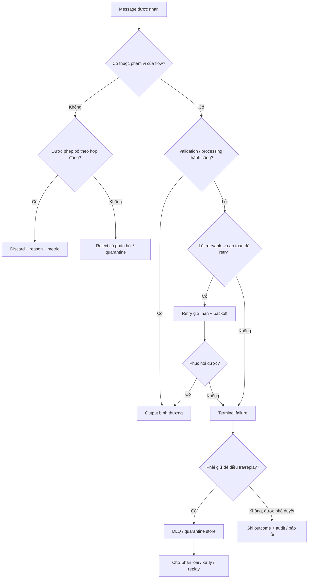

# Phân biệt dead letter với discard trong Spring Integration

## 1. Cùng là “không đi tiếp” nhưng ý nghĩa hoàn toàn khác nhau

Trong một luồng tích hợp, việc một message không xuất hiện ở output có thể do nhiều nguyên nhân:

- `Filter` chủ động loại một sự kiện không thuộc phạm vi cần đồng bộ.
- `Router` không chọn được nhánh, chọn nhánh dự phòng hoặc gửi thông điệp vào `nullChannel`.
- `Aggregator` vẫn đang chờ đủ các fragment; thông điệp **chưa** được phát kết quả, chứ chưa hẳn bị loại.
- Một handler gặp lỗi, retry hết giới hạn, rồi thông điệp được chuyển sang **dead-letter queue (DLQ)** để điều tra và phục hồi.
- Broker từ chối hoặc dead-letter một message do chính sách retry, TTL hay giới hạn hàng đợi.

Nếu gom mọi tình huống vào một chỉ số “dropped messages”, chúng ta sẽ không phân biệt được hành vi **đúng thiết kế** với sự cố cần hành động. Đây là nguồn gốc của nhiều nhầm lẫn về độ tin cậy, SLA và cảnh báo.

Bài **“Phân biệt dead letter với discard”** thuộc chương **Dead letter** của module `SPRING_INTEGRATION_PATTERN`. Trong mục tiêu học cách triển khai Enterprise Integration Patterns (EIP) bằng Spring Integration để tạo flow ít phụ thuộc, dễ mở rộng, bài tập trung vào ranh giới giữa **quyết định loại bỏ theo quy tắc** và **cách ly message xử lý không thành công**. Các ví dụ liên kết với Router, Filter, Transformer, Splitter, Aggregator, Gateway, retry, error channel và correlation, đồng thời đưa ra phép kiểm thử theo từng nhánh.

Sau bài học, bạn có thể:

1. Giải thích khác biệt giữa `discard`, `dead letter`, `error channel`, `nullChannel` và `quarantine`.
2. Xác định khi nào message được loại có chủ đích, khi nào phải được giữ lại để đối soát/replay.
3. Cấu hình `Filter.discardChannel`, router/default route và retry/recovery mà không nhầm số message đã dispatch với số message đã xử lý thành công.
4. Tách metric accepted/rejected/failed/DLQ acknowledged, giữ correlation và lý do xử lý.
5. Viết Java DSL và integration test kiểm tra từng outcome trên các channel khác nhau.
6. Thiết kế hành vi vận hành đúng khi poison message, mất ACK, replay hoặc một nhánh discard bị lỗi.

## 2. Định nghĩa rõ ba khái niệm cốt lõi

### 2.1. Discard: thông điệp được loại theo một chính sách

**Discard** là một quyết định không tiếp tục xử lý message trên nhánh thông thường. Ví dụ:

- Bỏ sự kiện `HEARTBEAT` vì flow chỉ đồng bộ `ORDER_CREATED`.
- Loại một dòng dữ liệu trùng theo chính sách `Idempotent Receiver`.
- Không gửi thông điệp ra ngoài khi Filter xác định nó không đạt tiêu chí nghiệp vụ.
- Chuyển message sang kênh `businessDiscards` để thống kê lý do loại hoặc lưu audit tối thiểu.

Discard **không mặc nhiên là lỗi**. Điều quan trọng là chính sách phải xác định message được phép bỏ đi, có cần ghi dấu vết hay không, và có cần báo cho producer biết kết quả từ chối hay không.

### 2.2. Dead letter: cách ly message không thể xử lý theo chính sách hiện hành

**Dead letter** là một message không thể hoàn tất qua đường xử lý bình thường và được chuyển sang một nơi riêng để điều tra, sửa, xử lý thủ công hoặc replay. Ví dụ:

- Adapter gọi API kho hàng liên tục timeout; retry hết giới hạn.
- Message có schema không tương thích, nhưng nghiệp vụ không cho phép bỏ mất; phải cách ly để chuyển đổi dữ liệu.
- Consumer từ chối message độc hại (poison message) và broker chuyển nó tới DLQ/DLT theo cấu hình.

DLQ có thể là queue broker, topic DLT, database table hay storage chuyên dụng. **Một channel trong RAM không tự trở thành dead-letter storage bền vững**. Khả năng khôi phục phụ thuộc vào chính sách ghi, ACK, transaction, retention, idempotency, phân quyền và replay của đích lưu.

### 2.3. Error channel: một đường truyền sự kiện lỗi

Trong Spring Integration, `errorChannel` là `MessageChannel` dành cho `ErrorMessage` được phát khi cơ chế xử lý lỗi tương ứng hoạt động. Nó có thể được cấu hình với subscriber/handler riêng. `ErrorMessage` chứa exception và có thể mang thông tin message liên quan, nhưng:

- Không phải mọi exception đều tự động đến `errorChannel`: exception đồng bộ có thể truyền ngược lên caller; các poller/adapter bất đồng bộ có cơ chế publish lỗi riêng.
- Việc gửi `ErrorMessage` thành công đến channel chỉ xác nhận **dispatch theo hợp đồng channel**, chưa chứng minh đã lưu dead letter vào broker/database.
- Một error flow có thể xử lý, cảnh báo, đền bù hoặc bỏ qua lỗi theo chủ đích mà **không** tạo DLQ record.

### So sánh nhanh

| Tiêu chí | Discard | Dead letter | Error channel |
| --- | --- | --- | --- |
| Quyết định chính | Không cần tiếp tục message trên một nhánh | Không thể xử lý bình thường; cần cách ly/phục hồi | Chuyển thông tin lỗi tới bộ xử lý |
| Có nhất thiết là lỗi? | **Không** | Thường là thất bại chưa xử lý hoặc dữ liệu cần can thiệp | Có sự kiện lỗi, nhưng xử lý tiếp ra sao tùy flow |
| Có giữ payload? | Tùy chính sách; có thể chỉ đếm | Thường cần đủ dữ liệu hoặc tham chiếu để điều tra/replay | `ErrorMessage` có exception, payload gốc tùy hoàn cảnh |
| Có replay? | Không phải mục tiêu mặc định | Thường cần replay/repair/manual review | Không tự có replay |
| Bền vững? | Không mặc định | Chỉ khi store/broker được cấu hình bền vững | Không mặc định |
| Metric chính | Rejected decision / discard observed | Terminal failure / DLQ ACK / backlog | Error event / handler outcome |
| Mốc hoàn tất | Quyết định loại và hành động discard theo hợp đồng | Bản ghi lỗi được lưu, sau đó recovery riêng | Error handler được gọi, có thể còn lỗi tiếp |

## 3. Cây quyết định: loại bỏ, trả lỗi hay dead-letter?



**Ví dụ cụ thể:**

| Message/tình huống | Chính sách phù hợp | Lý do |
| --- | --- | --- |
| `HEARTBEAT` đến flow chỉ nhận đơn hàng | Filter discard | Không thuộc domain của consumer, bỏ có chủ đích |
| Đơn hàng đã xử lý và có idempotency key giống hệt | Bỏ duplicate hoặc trả kết quả đã lưu | Không làm side effect lại; vẫn có audit/counter |
| Payload thiếu trường bắt buộc của một giao dịch quan trọng | Quarantine/DLQ hoặc reject có phản hồi rõ | Không được im lặng mất nghiệp vụ |
| API kho hàng trả 503 tạm thời | Retry có backoff và giới hạn | Lỗi có thể phục hồi, nếu side effect retry an toàn |
| API kho hàng liên tục thất bại sau retry | DLQ hoặc bền vững hóa trạng thái chờ recovery | Cần phát hiện, điều tra và replay |
| Message đã xử lý nhưng broker giao lại sau mất ACK | Idempotent receiver / inbox | Là duplicate delivery, không tự là dead letter |
| Group Aggregator chưa đủ fragment | Pending group, timeout/expiry riêng | Chưa có output không đồng nghĩa discard hay DLQ |
| Consumer chủ động `nack(requeue=false)` và broker có DLX | Broker-level dead-letter | Do chính sách broker, không do Filter trực tiếp |

Với yêu cầu bắt buộc không mất dữ liệu, kể cả validation reject có thể cần lưu ở **quarantine** và cho phép sửa. Ranh giới phân loại phụ thuộc **hợp đồng nghiệp vụ**, không chỉ tên exception hoặc tên channel.

## 4. Discard trong Spring Integration Filter

### 4.1. Filter không cấu hình discard channel

Một `MessageFilter` quyết định message có đi tiếp hay không bằng selector/predicate. Trong Java DSL:

```java
IntegrationFlow flow = IntegrationFlow.from("ordersInput")
        .filter(String.class, payload -> payload.startsWith("ORDER:"))
        .channel("ordersAccepted")
        .get();
```

Nếu predicate trả `true`, message đi tới `ordersAccepted`. Nếu trả `false` và không yêu cầu ném exception, message có thể bị bỏ khỏi flow **một cách chủ đích**. Không có bản ghi dead letter nào tự xuất hiện. Nếu cần biết số rejected, đo ở predicate/Filter hoặc chuyển message sang một discard channel có consumer.

Không dùng `inputChannel.send(message) == true` làm bằng chứng message **đã vượt qua Filter**: với một `DirectChannel`, `send()` có thể thành công vì message đã dispatch tới Filter, dù Filter quyết định drop.

### 4.2. Filter với discard channel

```java
IntegrationFlow flow = IntegrationFlow.from("ordersInput")
        .filter(String.class,
                payload -> payload.startsWith("ORDER:"),
                endpoint -> endpoint.discardChannel("businessDiscards"))
        .channel("ordersAccepted")
        .get();
```

Ở cấu hình này, message không đạt predicate được gửi tới `businessDiscards`. Kênh discard có thể nối tới một handler chỉ ghi counter, audit, gửi phản hồi reject hoặc lưu những bản ghi cần phân tích. **Nó chưa là DLQ** chỉ vì có chữ “discard” trong tên.

Nếu `businessDiscards` là `QueueChannel`, message đang chờ consumer; nếu nó là `DirectChannel`, việc gửi tới subscriber thường đồng bộ. Cả hai không tự bảo đảm dữ liệu đã commit vào một store bền vững.

### 4.3. Filter ném exception khi rejected

Khi nghiệp vụ muốn việc từ chối **là một lỗi phải được caller hoặc error handling nhận biết**, có thể cấu hình:

```java
IntegrationFlow flow = IntegrationFlow.from("ordersInput")
        .filter(String.class,
                payload -> payload.startsWith("ORDER:"),
                endpoint -> endpoint.throwExceptionOnRejection(true))
        .channel("ordersAccepted")
        .get();
```

Đây là **một phương án thay thế** cho cấu hình discard channel ở trên. Với `throwExceptionOnRejection(true)`, Filter có thể ném `MessageRejectedException` khi predicate trả `false`. Hành vi exception được phát tiếp thế nào phụ thuộc channel/endpoint, poller và error handling. Exception **không tự động** biến rejected message thành DLQ record.

**Đừng bật “throw exception” chỉ để có metric:** nếu đó là loại bỏ nghiệp vụ bình thường, việc tạo lỗi có thể làm tăng retry, khiến message bị xử lý lại vô ích hoặc làm ô nhiễm chỉ số sự cố. Hãy định nghĩa outcome phù hợp trước.

## 5. Router, nullChannel và những trường hợp dễ nhầm là dead letter

### 5.1. Router không chọn được nhánh

Router chuyển message tới một hoặc nhiều channel tùy routing key. Khi không có nhánh phù hợp, hành vi phụ thuộc vào mapping, `defaultOutputChannel`, `resolutionRequired` và các tùy chọn liên quan. Không thể kết luận “không có route tức là DLQ”.

Ví dụ gửi các loại event không hỗ trợ sang một default channel dành cho quyết định nghiệp vụ:

```java
IntegrationFlow flow = IntegrationFlow.from("eventsInput")
        .route(String.class,
                payload -> payload.startsWith("ORDER:")
                        ? "orders" : "unsupported",
                spec -> spec
                        .channelMapping("orders", "ordersChannel")
                        .channelMapping("unsupported", "unsupportedEvents"))
        .get();
```

`unsupportedEvents` là **quyết định routing**, chưa phải DLQ. Nếu loại event không hỗ trợ được phép bỏ, handler của nhánh này có thể đếm, lưu reason rồi kết thúc. Nếu event vi phạm hợp đồng và phải sửa, ứng dụng có thể đưa vào quarantine store. Cần đánh dấu rõ lý do để alert không gộp với timeout downstream.

### 5.2. nullChannel

`nullChannel` trong Spring Integration là channel tiêu thụ message khi ứng dụng **cố tình không muốn xử lý tiếp**. Nó giống một output sink cho việc bỏ qua có chủ đích hơn là nơi lưu DLQ.

```java
IntegrationFlow flow = IntegrationFlow.from("auditSideInput")
        .filter(String.class,
                payload -> payload.startsWith("AUDIT:"))
        .channel("nullChannel")
        .get();
```

Ví dụ trên gửi message lọt qua Filter vào `nullChannel` để không có xử lý tiếp; cần ghi metric/log **trước** khi kết thúc nếu muốn biết số message đã bị tiêu thụ. **Không** kỳ vọng replay hoặc đọc lại message từ `nullChannel`.

### 5.3. Aggregator chưa release không phải discard

Một Aggregator có thể giữ fragment trong `MessageGroupStore` tới khi đủ điều kiện. Số message đầu vào lớn hơn output chưa chắc phản ánh discard. Khi timeout/expiry xảy ra, một nhóm có thể bị discard hoặc phát kết quả partial theo release policy; riêng quyết định này cần metric `groupExpired`/`partialReleased` và quy tắc xử lý late arrivals.

### 5.4. Publish–Subscribe và một nhánh bỏ message

Trong `PublishSubscribeChannel`, một message có thể được gửi cho nhiều subscriber. Nếu subscriber A intentionally discards nhưng subscriber B xử lý thành công, **không thể gọi toàn bộ operation là dead letter**. Cần phân biệt outcome theo subscriber/branch, correlation và yêu cầu nghiệp vụ của từng nhánh.

## 6. Dead letter sau retry và error handling

Ví dụ lỗi kỹ thuật:

```text
ordersInput
  -> validateAndRoute
  -> reserveStockHandler
        -> attempt 1: timeout
        -> attempt 2: timeout
        -> attempt 3: timeout
  -> terminal error event
  -> DLQ publisher
  -> durable storage ACK
  -> pending investigation / replay
```

Điểm cần phân biệt:

1. `RequestHandlerRetryAdvice` thử lại handler theo retry policy đã cấu hình; retry cần an toàn với side effect, giới hạn attempts/backoff và phân loại lỗi.
2. Khi hết retry, `RecoveryCallback` có thể phát `ErrorMessage` tới một channel qua `ErrorMessageSendingRecoverer`.
3. **Recovery callback invoked** chỉ là một mốc xử lý lỗi. Để gọi là “DLQ persisted”, publisher phải nhận được ACK/commit từ broker/store theo hợp đồng.
4. Nếu lưu DLQ thất bại, cần rollback, outbox, fallback storage hoặc báo lỗi rõ ràng; không âm thầm bỏ message như một discard nghiệp vụ.
5. Khi replay, gửi lại message chưa chứng minh nghiệp vụ đã phục hồi. Cần đếm `recoveryConfirmed` sau mốc xử lý thành công được định nghĩa.

### Discard và dead letter có thể dùng chung công nghệ lưu trữ

Một broker có thể có hai queue:

```text
business-discard-audit  ->  thống kê sự kiện bị loại có chủ đích
orders-dead-letter      ->  lưu giao dịch không xử lý được và chờ recovery
```

Mỗi queue có thể cùng dùng RabbitMQ hay Kafka, nhưng **ngữ nghĩa vận hành khác nhau**. Queue nghiệp vụ discard có thể xóa theo retention phân tích; DLQ có thể cần đảm bảo replay, phê duyệt xử lý, idempotency, đối soát và retention phù hợp chính sách dữ liệu.

## 7. Ví dụ Java DSL hoàn chỉnh: ba outcome trên ba channel

Ví dụ dùng Java 17, Spring Integration 6.x, Spring Retry 2.x và Micrometer. Ta xử lý ba payload:

- `HEARTBEAT`: không thuộc phạm vi → **business discard**.
- `ORDER:OK-42`: hợp lệ, handler chạy xong → **processed**.
- `ORDER:FAIL-43`: hợp lệ nhưng handler luôn ném exception → retry hết giới hạn → **terminal error event**.

Ví dụ chỉ dùng `QueueChannel` để kiểm thử đường đi; **chưa có DLQ storage bền vững**. Điều này cố ý để làm rõ sự khác nhau giữa nhận ErrorMessage và lưu dead letter.

### 7.1. Bộ đếm quyết định Filter và số lần gọi handler

```java
import io.micrometer.core.instrument.MeterRegistry;

final class FlowDecisionMetrics {
    private final MeterRegistry meters;

    FlowDecisionMetrics(MeterRegistry meters) {
        this.meters = meters;
    }

    boolean accepts(String payload) {
        String outcome;
        try {
            boolean accepted = payload.startsWith("ORDER:");
            outcome = accepted ? "accepted" : "rejected";
            meters.counter("app.eip.filter.decisions",
                    "flow", "orders",
                    "stage", "acceptOrderEvents",
                    "outcome", outcome).increment();
            return accepted;
        } catch (RuntimeException error) {
            meters.counter("app.eip.filter.decisions",
                    "flow", "orders",
                    "stage", "acceptOrderEvents",
                    "outcome", "error").increment();
            throw error;
        }
    }

    String process(String order) {
        meters.counter("app.eip.handler.attempts",
                "flow", "orders", "stage", "reserveStock").increment();
        if (order.startsWith("ORDER:FAIL")) {
            throw new IllegalStateException("Dependency tạm thời không hoạt động");
        }
        return "PROCESSED:" + order;
    }
}
```

Trong ví dụ, `filter.decisions` đếm **lần Filter đánh giá**, không phải số nghiệp vụ duy nhất. `handler.attempts` đếm tất cả lần gọi handler, bao gồm retry. Nó không tự cho biết side effect đã commit. Với nghiệp vụ thật, không retry một tác dụng phụ không idempotent mà không có bảo vệ.

### 7.2. Cấu hình flow và recovery channel

```java
import io.micrometer.core.instrument.MeterRegistry;
import org.springframework.beans.factory.annotation.Qualifier;
import org.springframework.beans.factory.annotation.Bean;
import org.springframework.beans.factory.annotation.Configuration;
import org.springframework.integration.annotation.EnableIntegration;
import org.springframework.integration.channel.DirectChannel;
import org.springframework.integration.channel.QueueChannel;
import org.springframework.integration.dsl.IntegrationFlow;
import org.springframework.integration.handler.advice.ErrorMessageSendingRecoverer;
import org.springframework.integration.handler.advice.RequestHandlerRetryAdvice;
import org.springframework.messaging.MessageChannel;
import org.springframework.messaging.PollableChannel;
import org.springframework.retry.backoff.FixedBackOffPolicy;
import org.springframework.retry.policy.SimpleRetryPolicy;
import org.springframework.retry.support.RetryTemplate;

@Configuration
@EnableIntegration
class DiscardVersusDeadLetterConfiguration {

    @Bean
    FlowDecisionMetrics flowDecisionMetrics(MeterRegistry registry) {
        return new FlowDecisionMetrics(registry);
    }

    @Bean("ordersInput")
    MessageChannel ordersInput() {
        return new DirectChannel();
    }

    @Bean("acceptedInput")
    MessageChannel acceptedInput() {
        return new DirectChannel();
    }

    @Bean("businessDiscards")
    PollableChannel businessDiscards() {
        return new QueueChannel();
    }

    @Bean("processedOrders")
    PollableChannel processedOrders() {
        return new QueueChannel();
    }

    @Bean("terminalErrorEvents")
    PollableChannel terminalErrorEvents() {
        // Chỉ dùng để kiểm thử ErrorMessage, KHÔNG phải DLQ bền vững.
        return new QueueChannel();
    }

    @Bean
    RequestHandlerRetryAdvice demoRetryAdvice(
            @Qualifier("terminalErrorEvents")
            PollableChannel terminalErrorEvents) {
        RetryTemplate template = new RetryTemplate();
        template.setRetryPolicy(new SimpleRetryPolicy(3));
        FixedBackOffPolicy backoff = new FixedBackOffPolicy();
        backoff.setBackOffPeriod(0L); // Demo; production cần backoff phù hợp.
        template.setBackOffPolicy(backoff);

        RequestHandlerRetryAdvice advice = new RequestHandlerRetryAdvice();
        advice.setRetryTemplate(template);
        advice.setRecoveryCallback(
                new ErrorMessageSendingRecoverer(terminalErrorEvents));
        return advice;
    }

    @Bean
    IntegrationFlow filterOrderEvents(FlowDecisionMetrics metrics) {
        return IntegrationFlow.from("ordersInput")
                .filter(String.class, metrics::accepts,
                        endpoint -> endpoint.discardChannel("businessDiscards"))
                .channel("acceptedInput")
                .get();
    }

    @Bean
    IntegrationFlow processAcceptedOrders(
            FlowDecisionMetrics metrics,
            RequestHandlerRetryAdvice demoRetryAdvice) {
        return IntegrationFlow.from("acceptedInput")
                .handle(String.class,
                        (payload, headers) -> metrics.process(payload),
                        endpoint -> endpoint.advice(demoRetryAdvice))
                .channel("processedOrders")
                .get();
    }
}
```

Vì ứng dụng có nhiều `PollableChannel`, ví dụ sử dụng `@Qualifier("terminalErrorEvents")` để chọn chính xác recovery channel. Đừng đặt một `DirectChannel` input có nhiều competing subscriber vô tình; trong ví dụ, mỗi channel input có đúng một flow tiêu thụ.

`SimpleRetryPolicy(3)` có nghĩa **tối đa ba lần gọi handler**, gồm lần đầu, không phải ba lần retry cộng lần đầu. Với luồng xử lý side effect thực tế, phải phân loại lỗi retryable và bảo vệ bằng idempotency/transaction; ví dụ cố tình tạo exception trước khi có side effect.

### 7.3. Ba message, ba outcome

```text
Input: HEARTBEAT
  -> Filter false
  -> businessDiscards queue
  -> KHÔNG có terminal ErrorMessage

Input: ORDER:OK-42
  -> Filter true
  -> handler success
  -> processedOrders queue

Input: ORDER:FAIL-43
  -> Filter true
  -> handler throws 3 lần theo RetryAdvice
  -> terminalErrorEvents nhận ErrorMessage
  -> KHÔNG tự có DLQ broker/database
```

Kỳ vọng về số lần đánh giá trong ví dụ:

| Metric | Giá trị |
| --- | ---: |
| `filter.decisions{outcome=rejected}` | 1 |
| `filter.decisions{outcome=accepted}` | 2 |
| `handler.attempts` | 4 (1 lần thành công, 3 lần thất bại) |
| Message trong `businessDiscards` | 1 |
| Message trong `processedOrders` | 1 |
| `ErrorMessage` trong `terminalErrorEvents` | 1 |
| Dead-letter record đã ACK ở durable store | **Chưa có** trong ví dụ |

Nếu recoverer xử lý thất bại bằng cách gửi `ErrorMessage` rồi trả về bình thường, `ordersInput.send(...)` vẫn có thể trả `true`. Đó là bằng chứng message đã được flow chấp nhận/dispatch, **không phải** bằng chứng cả đơn hàng được xử lý thành công.

### Dependency minh họa

```groovy
dependencies {
    implementation("org.springframework.boot:spring-boot-starter-integration")
    implementation("org.springframework.boot:spring-boot-starter-actuator")
    implementation("org.springframework.retry:spring-retry")

    testImplementation("org.springframework.boot:spring-boot-starter-test")
    testImplementation("org.springframework.integration:spring-integration-test")
}
```

Trong test Spring thuần, cung cấp `SimpleMeterRegistry` bằng một bean riêng. Spring Boot Actuator có thể cấu hình `MeterRegistry` khi dependencies và cấu hình phù hợp hiện diện.

## 8. Từ terminal error channel tới một DLQ thật sự

Muốn thay `terminalErrorEvents` trong RAM bằng đường xử lý lỗi có khả năng replay, nên tách thêm một consumer/handler ghi sang **durable store**:

```text
RequestHandlerRetryAdvice
      |
      v
ErrorMessageSendingRecoverer
      |
      v
terminalErrorEvents
      |
      v
deadLetterPublisher
      |
      v
JDBC/Kafka/RabbitMQ/S3 store (ACK/commit)
      |
      v
DLQ pending -> triage -> replay -> business confirmed
```

Một record nghiệp vụ có thể gồm:

```json
{
  "eventType": "DEAD_LETTER_RECORDED",
  "sourceEventId": "order-event-43",
  "processingCycleId": "cycle-1",
  "flow": "orders",
  "stage": "reserveStock",
  "reasonCode": "dependency_unavailable",
  "attemptCount": 3,
  "flowVersion": "orders-flow/3.2.0",
  "recordedAt": "2026-11-21T10:00:00Z",
  "payloadReference": "secure-object-ref-43"
}
```

Đây là **schema ứng dụng minh họa**, không phải format DLQ tự có của Spring Integration. Khi lưu, cần giữ đủ metadata để đối soát và replay nhưng không phát tán payload, access token hay PII dưới dạng metric tag. `payloadReference` phải được kiểm soát quyền truy cập và retention; nếu lưu bản sao payload, cần mã hóa và tuân thủ chính sách dữ liệu.

### Phân biệt các mốc trên đường DLQ

| Sự kiện | Khi nào tăng counter? |
| --- | --- |
| `terminal_failure_total` | Khi chu kỳ xử lý kết thúc thất bại theo retry/rejection policy |
| `dead_letter_publish_requested_total` | Khi bắt đầu gửi bản ghi lỗi sang sink |
| `dead_letter_publish_acked_total` | Sau **ACK/commit đáng tin cậy** từ broker/database |
| `dead_letter_publish_failed_total` | Lưu lỗi hoặc không nhận được ACK theo contract |
| `dead_letter_pending` | Gauge đọc trực tiếp trạng thái broker/store |
| `dead_letter_replay_started_total` | Bắt đầu một lượt replay, chưa phải thành công |
| `recovery_confirmed_total` | Business operation thật sự hoàn tất/được đối soát sau replay |

Nếu storage commit nhưng ACK thất lạc, publisher có thể thấy lỗi dù record đã tồn tại. Do đó cần **stable failure key + idempotent storage** để ghi lại không tạo record logic trùng và có thể đối soát trạng thái khi retry.

## 9. Metric, log và cảnh báo phải tách hai loại

### 9.1. Bộ metric gợi ý

| Metric | Loại | Đơn vị cần nhớ |
| --- | --- | --- |
| `app.eip.filter.decisions{outcome=accepted|rejected|error}` | Counter | Lần đánh giá predicate |
| `app.eip.discard.observed` | Counter | Message được consumer nhánh discard quan sát |
| `app.eip.discard.audit.persisted` | Counter | Discard audit được ghi bền vững, nếu có |
| `app.eip.handler.attempts` | Counter | Lần gọi handler, gồm retry |
| `app.eip.retry.terminal.failures` | Counter | Chu kỳ xử lý thất bại cuối cùng |
| `app.eip.dlq.publish.acked` | Counter | Sink nhận/commit dead letter |
| `app.eip.dlq.publish.failed` | Counter | Lỗi lưu dead letter |
| `app.eip.dlq.pending` | Gauge | Backlog từ broker/store |
| `app.eip.dlq.oldest.age` | Gauge | Tuổi record pending lâu nhất |
| `app.eip.recovery.confirmed` | Counter | Lượt phục hồi được xác nhận theo nghiệp vụ |

Các tên trên là **đề xuất thiết kế metric ứng dụng**, không phải tên meter tất yếu có sẵn của Spring Integration. Nếu broker/client/framework đã cung cấp meter tương đương, kiểm tra ý nghĩa và tránh đếm trùng.

### 9.2. Tag có giới hạn

Có thể dùng `flow`, `stage`, `outcome`, `reasonCode`, `route` từ các tập giá trị nhỏ và được kiểm soát. **Không** đưa `messageId`, `orderId`, `correlationId`, `traceId`, exception message hoặc payload vào metric labels vì chúng làm nổ cardinality và có thể tiết lộ dữ liệu.

Với discard, có thể có reason như `not_subscribed`, `duplicate` hoặc `unsupported_event_type`. Với DLQ, có thể có `timeout`, `dependency_error`, `invalid_schema` hoặc `retry_exhausted`. Hãy giữ danh mục reason hữu hạn và nhất quán; không coi tất cả `validation rejected` đều là lỗi kỹ thuật.

### 9.3. PromQL minh họa

Nếu dùng Micrometer Prometheus registry, Counter `app.eip.filter.decisions` thường xuất dưới tên `app_eip_filter_decisions_total`. Luôn kiểm tra tên metric thực tế trong exporter trước khi dùng query.

Tỷ lệ reject trên các lần Filter đánh giá hợp lệ:

```promql
sum(rate(app_eip_filter_decisions_total{
  flow="orders",outcome="rejected"
}[5m]))
/
clamp_min(
  sum(rate(app_eip_filter_decisions_total{
    flow="orders",outcome=~"accepted|rejected"
  }[5m])),
  0.000001
)
```

Tốc độ các bản ghi được DLQ ACK:

```promql
sum(rate(app_eip_dlq_publish_acked_total{
  flow="orders"
}[5m]))
```

Alert cần ưu tiên khi **không thể ghi DLQ**, DLQ backlog/oldest age vượt SLO hoặc replay thất bại liên tục. Tỷ lệ Filter reject tăng có thể là tín hiệu data quality, không tự là một incident hạ tầng. Một hệ thống bỏ qua nhiều heartbeat theo thiết kế không nên bị gọi báo động liên tục.

## 10. Kiểm thử ba nhánh với JUnit

Đoạn test sau dùng cấu hình mục 7 và `SimpleMeterRegistry`. Nó xác nhận đúng đường đi của message và sự phân biệt giữa discard với terminal error.

```java
import static org.assertj.core.api.Assertions.assertThat;

import io.micrometer.core.instrument.MeterRegistry;
import io.micrometer.core.instrument.simple.SimpleMeterRegistry;
import org.junit.jupiter.api.Test;
import org.springframework.beans.factory.annotation.Autowired;
import org.springframework.beans.factory.annotation.Qualifier;
import org.springframework.context.annotation.Bean;
import org.springframework.context.annotation.Configuration;
import org.springframework.messaging.Message;
import org.springframework.messaging.MessageChannel;
import org.springframework.messaging.PollableChannel;
import org.springframework.messaging.support.ErrorMessage;
import org.springframework.messaging.support.MessageBuilder;
import org.springframework.test.annotation.DirtiesContext;
import org.springframework.test.context.junit.jupiter.SpringJUnitConfig;

@SpringJUnitConfig(classes = {
        DiscardVersusDeadLetterConfiguration.class,
        DiscardVersusDeadLetterTest.TestRegistry.class
})
@DirtiesContext(classMode = DirtiesContext.ClassMode.AFTER_EACH_TEST_METHOD)
class DiscardVersusDeadLetterTest {

    @Configuration
    static class TestRegistry {
        @Bean
        MeterRegistry registry() {
            return new SimpleMeterRegistry();
        }
    }

    @Autowired
    @Qualifier("ordersInput")
    MessageChannel input;

    @Autowired
    @Qualifier("businessDiscards")
    PollableChannel discards;

    @Autowired
    @Qualifier("processedOrders")
    PollableChannel processed;

    @Autowired
    @Qualifier("terminalErrorEvents")
    PollableChannel errors;

    @Autowired
    MeterRegistry meters;

    @Test
    void businessDiscardIsNotDeadLetter() {
        assertThat(input.send(MessageBuilder.withPayload("HEARTBEAT")
                .build())).isTrue();

        Message<?> discarded = discards.receive(1_000);
        assertThat(discarded).isNotNull();
        assertThat(discarded.getPayload()).isEqualTo("HEARTBEAT");
        assertThat(processed.receive(0)).isNull();
        assertThat(errors.receive(0)).isNull();

        assertThat(decisions("rejected")).isEqualTo(1.0);
    }

    @Test
    void successfulOrderGoesToProcessedChannel() {
        assertThat(input.send(MessageBuilder.withPayload("ORDER:OK-42")
                .build())).isTrue();
        Message<?> result = processed.receive(1_000);
        assertThat(result).isNotNull();
        assertThat(result.getPayload()).isEqualTo(
                "PROCESSED:ORDER:OK-42");
        assertThat(discards.receive(0)).isNull();
        assertThat(errors.receive(0)).isNull();
    }

    @Test
    void exhaustedRetryProducesErrorMessageNotBusinessDiscard() {
        assertThat(input.send(MessageBuilder.withPayload("ORDER:FAIL-43")
                .build())).isTrue();

        Message<?> terminal = errors.receive(1_000);
        assertThat(terminal).isInstanceOf(ErrorMessage.class);
        assertThat(discards.receive(0)).isNull();
        assertThat(processed.receive(0)).isNull();
        assertThat(meters.get("app.eip.handler.attempts")
                .tags("flow", "orders", "stage", "reserveStock")
                .counter().count()).isEqualTo(3.0);
    }

    private double decisions(String outcome) {
        return meters.get("app.eip.filter.decisions")
                .tags("flow", "orders",
                      "stage", "acceptOrderEvents",
                      "outcome", outcome)
                .counter().count();
    }
}
```

Vì Spring Test có thể cache context, ví dụ sử dụng `@DirtiesContext` để tách trạng thái queue và registry giữa các test. Với dự án lớn, có thể thay bằng cách reset test fixture có kiểm soát để tránh khởi tạo context nhiều lần. Mẫu test trên minh họa từng nhánh, **chưa khẳng định một DLQ bền vững đã nhận record**. Test end-to-end cần broker/database thật và phép đối chiếu ACK/commit.

### Ma trận kiểm thử bổ sung

| Tình huống | Kỳ vọng |
| --- | --- |
| Filter chấp nhận | Có output đúng nhánh, rejected không tăng |
| Filter từ chối bình thường | Có discard event hoặc drop đúng cấu hình; không tạo terminal DLQ |
| Filter dùng `throwExceptionOnRejection` | Exception được xử lý theo chính sách, không tự gộp thành discard audit |
| Filter predicate ném exception | Ghi error outcome, **không** gọi là rejected quyết định hợp lệ |
| Discard channel không có subscriber/đầy | Có lỗi hoặc hành vi gửi phù hợp loại channel; không báo audit persisted giả |
| Router không có mapping | Default/error outcome theo cấu hình, không giả định tự DLQ |
| `nullChannel` | Có chủ đích tiêu thụ message, không thể replay |
| Handler lỗi lần đầu, retry sau thành công | Không dead letter; attempt count phản ánh retries |
| Handler retry hết giới hạn | Có terminal error; chỉ ghi DLQ ACK sau sink ACK |
| DLQ publisher bị lỗi | Có cảnh báo/rollback/fallback, không silently discard |
| Broker ACK nhưng replay chưa chạy | Pending vẫn còn, recovery confirmed chưa tăng |
| Replay cùng message hai lần | Idempotency ngăn side effect bị thực hiện lại |
| Aggregator chưa đủ group | Group pending, không tính là discard |
| Splitter có 10 fragment, 2 bị Filter loại | Đếm 2 fragment reject, không tự thành 2 đơn hàng lỗi |
| Concurrent consumers xử lý cùng business event | Dedup/idempotency không dựa vào RAM |
| Metrics collector mất kết nối | Không coi vắng metric là zero failures |

## 11. Retry, replay và correlation không biến discard thành DLQ

### Retry của một hành vi discard

Nếu Filter trả `false` vì message không thuộc scope, **không có lỗi nào cần retry**. Đẩy những message này qua retry advice là lãng phí và có thể tạo vòng lặp. Nếu Filter thất bại khi đánh giá do lỗi dependency, đó là **evaluation error**, không phải một kết quả `rejected` hợp lệ.

### Retry của side effect

Nếu handler đã commit side effect nhưng mất ACK, retry có thể nhân đôi tác dụng phụ. DLQ giúp cách ly message sau lỗi, nhưng **không giải quyết idempotency**. Khi replay phải giữ business operation key để đích có thể trả kết quả đã thực hiện thay vì xử lý lặp.

### Correlation qua fan-out/fan-in

Sau Splitter, một đơn hàng có thể tạo nhiều fragment. Filter loại hai fragment chưa chắc có nghĩa hai **đơn hàng** bị discard. Aggregator giữ message trong group chưa release không phải dead letter. Để biết outcome của cả operation, cần correlation ID, group release/timeout status và mốc business completion.

### Replay có thể đổi chính sách

Một message dead-letter dưới flow version `3.1` có thể được replay theo flow version `3.2` sau khi sửa lỗi. Audit nên giữ cả original version và replay version, route cũ và route mới. Nếu message đã bị discard hợp lệ theo rule cũ và nay muốn xử lý lại, đó là **reprocessing có chủ đích từ nguồn lưu/audit**, không phải “replay DLQ” trừ khi message thực sự được lưu trong DLQ.

## 12. Runbook khi thấy nhiều message “không đi tiếp”

Khi dashboard báo đầu vào nhiều hơn đầu ra:

1. **Xác định đơn vị đo:** ingress đang đếm operation hay fragment? Output là message xử lý xong hay chỉ enqueue?
2. **Kiểm tra Filter:** bao nhiêu accepted/rejected/error? Có discardChannel? Chính sách loại có đúng không?
3. **Kiểm tra Router:** nhánh được chọn, default output và mapping có thay đổi theo flow/rule version không?
4. **Kiểm tra queue và Aggregator:** có message đang chờ hoặc group chưa release không? Có timeout/expiry?
5. **Kiểm tra retry:** bao nhiêu attempts, bao nhiêu terminal failure? Có side effect đã commit trước timeout không?
6. **Kiểm tra error channel:** có `ErrorMessage`, handler lỗi có subscriber và phân loại đúng không?
7. **Kiểm tra DLQ thực:** có ACK, backlog, oldest pending age, publisher failure, retention và replay job không?
8. **Đối soát correlation:** dùng source event/business ID trong audit/log/trace, không đưa ID động vào metric tag.
9. **Chọn hành động:** discard hợp lệ → không replay; validation phải sửa → quarantine/repair; transient fail → replay có giới hạn; unknown outcome → reconcile trước retry.
10. **Xác nhận sau khắc phục:** số operation hoàn tất theo business contract, không chỉ queue depth về 0.

Phân tích theo thứ tự này sẽ giúp tránh một lỗi phổ biến: nhìn thấy input/output count không bằng nhau rồi cho rằng “DLQ đã ăn mất message”, trong khi phần lớn message chỉ bị Filter bỏ đúng quy tắc hoặc vẫn còn chờ Aggregator.

## 13. Các sai lầm thường gặp

1. **Coi mọi Filter rejection là dead letter.** Rejected có thể là hành vi nghiệp vụ bình thường.
2. **Coi discardChannel là DLQ bền vững.** Channel có thể chỉ nằm trong bộ nhớ hoặc có handler không lưu gì.
3. **Coi errorChannel đồng nghĩa DLQ.** Error channel truyền sự kiện lỗi, không tự có retention/replay.
4. **Coi `send() == true` là message đã được xử lý thành công.** Nó chỉ phản ánh hợp đồng dispatch ở thời điểm gọi.
5. **Gửi thẳng lỗi nghiêm trọng tới `nullChannel` để flow không fail.** Dễ mất dữ liệu và không thể đối soát.
6. **Retry một rejected message không thuộc scope.** Tạo tải vô ích và sai lệch metric.
7. **Ném exception cho mọi loại bỏ nghiệp vụ.** Làm error rate tăng giả và có thể kích hoạt retry/DLQ sai.
8. **Chuyển tới DLQ rồi mặc định đã lưu an toàn.** Phải chờ ACK/commit theo hợp đồng và xử lý lỗi publisher.
9. **Lưu record lỗi nhưng thiếu nguồn để replay.** Không có payload/reference/schema/correlation phù hợp khiến DLQ vô dụng.
10. **Gộp handler attempts với logical failed operations.** Retry có thể tạo nhiều exceptions trên một nghiệp vụ cuối cùng thành công.
11. **Không phân biệt fragment và group.** Splitter/Aggregator thay đổi số lượng và mốc hoàn tất.
12. **Không có idempotency khi replay.** DLQ replay có thể tạo duplicate charge/shipment hoặc ghi DB lặp.
13. **Dùng message ID/trace ID làm Prometheus label.** Dẫn đến cardinality cao và lộ thông tin.
14. **Chỉ cảnh báo DLQ arrival, không cảnh báo DLQ publisher failure hoặc oldest age.** Có thể không biết message lỗi không được lưu hoặc bị bỏ quên.

## 14. Checklist triển khai production

- [ ] Quy định rõ loại message **được phép discard**, loại **cần reject có phản hồi**, loại **phải quarantine/DLQ**.
- [ ] Filter có counter accepted/rejected/error tại đúng vị trí; không dùng input minus output làm rejected tuyệt đối.
- [ ] Discard channel, default route, `nullChannel` có mô tả rõ outcome và audit policy.
- [ ] Error handling phân biệt exception đồng bộ/bất đồng bộ và subscriber `errorChannel` thực tế.
- [ ] Retry có giới hạn và phân loại transient/permanent, an toàn với side effect.
- [ ] Dead-letter store có ACK/commit, retention, phân quyền, replay và idempotency key.
- [ ] Metric phân biệt discard observed, terminal failure, DLQ publish acked/failed, pending và recovery confirmed.
- [ ] Alert có owner/runbook cho DLQ publisher lỗi, backlog, oldest age và replay failure.
- [ ] Giữ business correlation trong log/trace/audit, không dùng ID động làm metric tags.
- [ ] Với Splitter/Aggregator, đối soát theo fragment/group/operation đúng đơn vị.
- [ ] Test cả Filter drop, discard handler error, retry exhausted, DLQ failure, late/replay và unknown outcome.
- [ ] Không khẳng định “DLQ đã xử lý” chỉ vì `ErrorMessage` đã xuất hiện ở một channel.

## 15. Tài liệu tham khảo

- [Spring Integration Reference — Filtering Messages](https://docs.spring.io/spring-integration/reference/filter.html)
- [Spring Integration Reference — Routers](https://docs.spring.io/spring-integration/reference/router.html)
- [Spring Integration Reference — Error Handling](https://docs.spring.io/spring-integration/reference/error-handling.html)
- [Spring Integration Reference — Message Channels](https://docs.spring.io/spring-integration/reference/channel.html)
- [Spring Integration Reference — Handler Advice và Retry](https://docs.spring.io/spring-integration/reference/handler-advice/classes.html)
- [Spring Integration Reference — Aggregator](https://docs.spring.io/spring-integration/reference/aggregator.html)
- [Spring Integration Reference — Metrics and Management](https://docs.spring.io/spring-integration/reference/metrics.html)
- [Enterprise Integration Patterns — Dead Letter Channel](https://www.enterpriseintegrationpatterns.com/patterns/messaging/DeadLetterChannel.html)
- [Enterprise Integration Patterns — Message Filter](https://www.enterpriseintegrationpatterns.com/patterns/messaging/Filter.html)

**Ghi nhớ:** **discard** là quyết định không tiếp tục một message theo quy tắc đã định; **dead letter** là cơ chế cách ly message cần xử lý lỗi, đối soát hoặc replay; **error channel** chỉ là đường truyền sự kiện lỗi. Tách rõ ba khái niệm, ghi metric tại đúng mốc và kiểm thử cả đường ACK/commit sẽ giúp hệ thống Spring Integration vừa loại bỏ dữ liệu đúng mục đích, vừa không bỏ quên các giao dịch thực sự thất bại.
