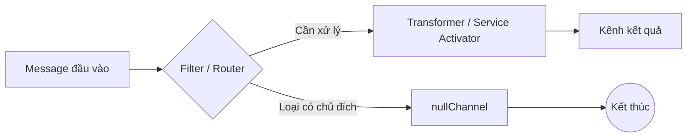

# Null Channel: loại bỏ message có chủ đích trong Spring Integration

## 1. Mục tiêu bài học

Trong các luồng tích hợp doanh nghiệp, không phải message nào đi vào hệ thống cũng cần tạo ra tác vụ xử lý hoặc phản hồi. Có những message hợp lệ về mặt kỹ thuật nhưng không có giá trị nghiệp vụ: bản ghi trùng đã được xử lý, sự kiện chỉ dùng để kiểm tra kết nối, hoặc dữ liệu bị loại theo một quy tắc rõ ràng. **Null Channel** là điểm kết thúc dành cho những trường hợp muốn **chủ động bỏ một message** khỏi luồng xử lý.

Bài học nằm trong học phần `SPRING_INTEGRATION_PATTERN`, sử dụng Enterprise Integration Patterns với Spring Integration để xây dựng các luồng ít phụ thuộc, dễ mở rộng và có thể kiểm thử, theo dõi từng nhánh.

Sau bài học, bạn có thể:

- Giải thích Null Channel và phân biệt việc bỏ qua message có chủ đích với lỗi xử lý.
- Dùng `nullChannel` có sẵn trong Spring Integration để kết thúc một nhánh của **Router** hoặc nhận message bị **Filter** loại.
- Viết và kiểm thử luồng Java DSL có đầu ra quan sát được đối với message được giữ lại.
- Đánh giá ảnh hưởng của việc loại message đến **Gateway**, cơ chế **retry/error channel** và **Splitter/Aggregator** có tương quan message.
- Thiết kế khả năng quan sát để biết số message bị loại mà không biến Null Channel thành nơi lưu trữ dữ liệu.

## 2. Null Channel là gì?

Spring Integration cung cấp một `MessageChannel` đặc biệt mang tên bean **`nullChannel`**. Khi một message được gửi đến kênh này, kênh tiếp nhận và **loại bỏ message**, không chuyển tiếp cho một consumer nghiệp vụ nào. Đây là cách triển khai *Null Channel* của Enterprise Integration Patterns (EIP), tương tự ý tưởng “black hole” cho message.

Null Channel hữu ích khi một luồng đã quyết định rằng message **không cần xử lý thêm**. Quyết định đó nên nằm ở một thành phần có trách nhiệm rõ ràng, thường là `Filter` hoặc `Router`; Null Channel chỉ là nơi kết thúc kết quả của quyết định.



Các đặc điểm cần nhớ:

| Thuộc tính | Ý nghĩa |
| --- | --- |
| Tên kênh | `nullChannel` là tên chuẩn do hạ tầng Spring Integration cung cấp khi đã bật cấu hình tích hợp. |
| Hành vi | Message được gửi tới kênh sẽ bị bỏ, không có message đầu ra từ kênh này. |
| Phạm vi | Dùng làm điểm kết thúc của nhánh luồng hoặc kênh nhận message bị loại. |
| Giá trị trả về của `send` | Việc gửi thành công chỉ cho biết kênh chấp nhận thao tác gửi; **không** có nghĩa là nghiệp vụ đã xử lý message. |
| Lưu trữ | Không phải hàng đợi, kho lưu trữ, dead-letter queue hay kênh để đọc lại message. |

**Lưu ý:** Null Channel không có nghĩa là payload bằng `null`. Message trong Spring Messaging cần payload hợp lệ; gửi một message thật tới `nullChannel` khác với việc cho một handler trả về `null` (cách xử lý đầu ra của handler phụ thuộc loại endpoint).

## 3. Khi nào nên và không nên sử dụng?

Hãy dùng Null Channel khi **quy tắc loại bỏ đã được thống nhất** và việc không có bước xử lý tiếp theo là kết quả mong muốn. Ví dụ:

- Một ứng dụng nhận sự kiện `PING` từ đối tác và chủ động bỏ sau khi đã xác nhận kết nối ở lớp thích hợp.
- Một `Router` tách sự kiện theo loại, đưa sự kiện không thuộc phạm vi xử lý vào `nullChannel`.
- Một `Filter` nhận message rỗng hoặc không đạt điều kiện, chuyển các message bị loại tới `nullChannel` để biểu đạt rõ chủ đích thiết kế.

Không nên đưa vào Null Channel một message chưa xác định được lý do thất bại, message cần điều tra, hoặc message có nghĩa vụ xử lý lại. Các trường hợp đó thường cần `errorChannel`, retry, dead-letter queue, hoặc một kênh lưu trữ/quarantine có khả năng truy vết.

| Tình huống | Lựa chọn phù hợp | Lý do |
| --- | --- | --- |
| Thông báo “heartbeat” không có hành động nghiệp vụ | Router → `nullChannel` | Chủ đích bỏ qua đã rõ ràng. |
| Dữ liệu không đạt một điều kiện lọc nhưng được phép bỏ | Filter → `nullChannel` | Làm rõ đích đến của nhánh bị loại. |
| Kết nối tới hệ thống ngoài tạm thời lỗi | Retry và/hoặc `errorChannel` | Cần xử lý lỗi, không được âm thầm đánh mất công việc. |
| Message sai schema cần điều tra | Kênh lỗi/quarantine | Cần giữ dữ liệu và nguyên nhân để khắc phục. |
| Bản ghi phải lưu vết theo quy định | Ghi audit trước khi kết thúc | Null Channel tự nó không giữ bản ghi. |

## 4. Ví dụ thực hành: Filter bỏ message trống

Giả sử một ứng dụng tiếp nhận chuỗi văn bản. Chuỗi có nội dung sẽ đi tới `acceptedChannel`; chuỗi chỉ chứa khoảng trắng được bỏ theo quy tắc nghiệp vụ. Ta tạo một `DirectChannel` để nhận dữ liệu và một `QueueChannel` để có thể kiểm tra message được giữ lại.

Với Spring Boot, có thể dùng dependency `spring-boot-starter-integration` (và `spring-boot-starter-test` cho phần kiểm thử); nếu cấu hình Spring Framework trực tiếp, cần các thư viện Spring Integration tương ứng và bật `@EnableIntegration`. Ví dụ sau tập trung vào Java DSL của Spring Integration:

```java
import org.springframework.context.annotation.Bean;
import org.springframework.context.annotation.Configuration;
import org.springframework.integration.channel.DirectChannel;
import org.springframework.integration.channel.QueueChannel;
import org.springframework.integration.config.EnableIntegration;
import org.springframework.integration.dsl.IntegrationFlow;
import org.springframework.messaging.MessageChannel;
import org.springframework.messaging.PollableChannel;

@Configuration
@EnableIntegration
public class IntakeFlowConfig {

    @Bean
    public MessageChannel intakeInput() {
        return new DirectChannel();
    }

    @Bean
    public PollableChannel acceptedChannel() {
        return new QueueChannel();
    }

    @Bean
    public IntegrationFlow intakeFlow() {
        return IntegrationFlow.from("intakeInput")
            .filter(String.class,
                text -> !text.isBlank(),
                filter -> filter.discardChannel("nullChannel"))
            .channel("acceptedChannel")
            .get();
    }
}
```

Luồng hoạt động theo từng bước:

1. Gửi `"Don hang 123"` tới `intakeInput`. Bộ lọc trả `true`, message tới `acceptedChannel` và có thể được consumer tiếp nhận.
2. Gửi `"   "` tới `intakeInput`. Bộ lọc trả `false`, message được chuyển tới `nullChannel` và kết thúc.
3. Không có bước xử lý nào sau `nullChannel`. Ở nhánh bị loại, hệ thống cũng không tạo phản hồi nghiệp vụ từ message này.

Tùy chính sách, một `Filter` có thể bỏ message bị từ chối mà không khai báo `discardChannel`. Cấu hình `discardChannel("nullChannel")` ở đây có ích vì người đọc mã thấy **đích loại bỏ được chỉ định rõ**. Nếu cần phát hiện từ chối như một lỗi, hãy xem khả năng cấu hình `throwExceptionOnRejection` của Filter thay vì mặc định chọn bỏ message.

### Kiểm thử hành vi

Với JUnit 5, Spring Test và AssertJ, ta kiểm thử cả hai nhánh. `QueueChannel` giúp xác nhận nhánh hợp lệ có đầu ra và nhánh bị loại không có đầu ra.

```java
import org.junit.jupiter.api.Test;
import org.springframework.beans.factory.annotation.Autowired;
import org.springframework.beans.factory.annotation.Qualifier;
import org.springframework.messaging.Message;
import org.springframework.messaging.MessageChannel;
import org.springframework.messaging.PollableChannel;
import org.springframework.messaging.support.MessageBuilder;
import org.springframework.test.context.junit.jupiter.SpringJUnitConfig;

import static org.assertj.core.api.Assertions.assertThat;

@SpringJUnitConfig(IntakeFlowConfig.class)
class IntakeFlowTest {

    @Autowired
    @Qualifier("intakeInput")
    MessageChannel input;

    @Autowired
    @Qualifier("acceptedChannel")
    PollableChannel accepted;

    @Test
    void acceptsMessageWithContent() {
        boolean sent = input.send(
            MessageBuilder.withPayload("Don hang 123").build());

        Message<?> result = accepted.receive(1_000);
        assertThat(sent).isTrue();
        assertThat(result).isNotNull();
        assertThat(result.getPayload()).isEqualTo("Don hang 123");
    }

    @Test
    void discardsWhitespaceOnlyMessage() {
        boolean sent = input.send(
            MessageBuilder.withPayload("   ").build());

        assertThat(sent).isTrue();
        assertThat(accepted.receive(100)).isNull();
    }
}
```

Ở test thứ hai, `send(...)` vẫn có thể trả `true`: message được nhận vào luồng và bị loại **theo đúng quy tắc**. Chỉ dựa vào giá trị `send(...)` sẽ không xác định được message có tới hệ thống đích hay không. Trong môi trường có nhiều message đồng thời, hãy kiểm tra số lượng đầu ra, correlation ID hoặc metric theo từng nhánh thay vì chỉ chờ một message bất kỳ.

## 5. Đặt Null Channel sau Router

Nếu việc loại phụ thuộc vào **loại message** thay vì điều kiện đúng/sai, Router thường dễ đọc hơn. Ví dụ: một hệ thống nhận hai loại sự kiện `IGNORE` và `PROCESS`.

```java
@Bean
public IntegrationFlow routeEvents() {
    return IntegrationFlow.from("eventInput")
        .route(String.class,
            event -> event.startsWith("IGNORE:") ? "DROP" : "KEEP",
            router -> router
                .channelMapping("DROP", "nullChannel")
                .channelMapping("KEEP", "workChannel"))
        .get();
}
```

Ví dụ Router giả định `eventInput` và `workChannel` đã được khai báo trong cấu hình ứng dụng. Message bắt đầu bằng `IGNORE:` đi tới `nullChannel`; message còn lại tới `workChannel` để tiếp tục xử lý. Trong dự án thực tế, khóa định tuyến nên dựa trên loại sự kiện hoặc trường được định nghĩa trong contract, tránh coi một chuỗi bất kỳ là nhãn nghiệp vụ đáng tin cậy.

Không nên định tuyến mọi giá trị không nhận diện được vào `nullChannel` chỉ để tránh lỗi “không tìm thấy route”. Nếu loại sự kiện mới có thể mang dữ liệu quan trọng, hãy bố trí kênh theo dõi hoặc cơ chế từ chối rõ ràng.

## 6. Tương tác với các EIP khác

### Gateway và luồng yêu cầu/phản hồi

Một **Gateway** có thể gửi message rồi chờ phản hồi. Nếu request đi tới `nullChannel`, nhánh đó **không tạo reply**. Gateway đang chờ phản hồi có thể hết thời gian chờ hoặc nhận kết quả khác nhau tùy chữ ký phương thức và cấu hình timeout. Vì vậy:

- Chỉ dùng Null Channel cho request mà contract cho phép **không có kết quả**.
- Nếu client bắt buộc nhận ACK hoặc mã trạng thái “đã bỏ qua”, hãy tạo **phản hồi tường minh** trước khi kết thúc request, thay vì trông chờ Null Channel sinh reply.
- Kiểm thử timeout và hành vi caller đối với cả nhánh được xử lý và nhánh bị loại.

### Retry và error channel

`nullChannel` không biểu diễn lỗi. Việc gửi thành công tới đó không tự kích hoạt retry, cũng không tạo `ErrorMessage` trên `errorChannel`. Nếu quá trình gọi API hoặc ghi database gặp exception, để cơ chế retry/error handling xử lý theo chính sách. Chỉ chuyển message sang Null Channel **sau khi** có quyết định nghiệp vụ rằng message có thể bỏ vĩnh viễn.

### Splitter, Aggregator và correlation

Với luồng `Splitter → Filter/Router → Aggregator`, việc loại một message con có thể khiến Aggregator chờ mãi một nhóm chưa đủ thành viên, đặc biệt khi `sequenceSize` mô tả toàn bộ số phần ban đầu. Trước khi bỏ một message con, cần xác định rõ:

- Aggregator dựa vào `correlationId`, `sequenceNumber`, `sequenceSize` hay một release strategy tùy chỉnh?
- Nhóm có cơ chế timeout, hết hạn hay xử lý thiếu thành viên không?
- Có nên lọc **trước Splitter**, điều chỉnh quy tắc tổng hợp hoặc phát một kết quả “đã bỏ qua” thay vì mất hẳn một phần?

Null Channel chỉ xử lý message của nhánh hiện tại; nó **không tự cập nhật** trạng thái nhóm tương quan ở Aggregator.

## 7. Khả năng quan sát và an toàn vận hành

Một message đã gửi vào Null Channel không thể được lấy lại từ kênh. Với luồng sản xuất, nên ghi nhận đủ thông tin **trước thời điểm loại bỏ**, tùy mức độ nhạy cảm của dữ liệu và yêu cầu vận hành:

| Cần quan sát | Cách triển khai gợi ý |
| --- | --- |
| Số message bị loại | Counter theo `reason`, `flow` và loại sự kiện; tránh nhãn có độ phân biệt quá lớn như ID từng message. |
| Tại sao bị loại | Log có cấu trúc hoặc audit event tại Filter/Router, với lý do được chuẩn hóa. |
| Luồng nào đang loại nhiều bất thường | Dashboard hoặc cảnh báo theo tỷ lệ bị loại so với số message nhận. |
| Cần điều tra hoặc xử lý lại | Lưu message vào kênh/quy trình quarantine trước khi kết thúc, theo yêu cầu dữ liệu. |

Ví dụ hợp đồng log phù hợp có thể gồm `flow=order-intake`, `reason=blank-content`, `traceId=<mã tương quan>`, `decision=discard`. Không log toàn bộ payload nếu có dữ liệu cá nhân, bí mật hoặc thông tin thanh toán. Việc bật log của framework, nếu có, **không thay thế** kiểm toán nghiệp vụ.

Một checklist ngắn trước khi đưa nhánh loại bỏ vào production:

1. Quy tắc loại message có thể diễn giải thành điều kiện rõ ràng và có người chịu trách nhiệm.
2. Nhánh loại không làm Gateway chờ reply ngoài mong đợi hoặc Aggregator treo nhóm.
3. Các lỗi tạm thời vẫn đi qua retry/error channel phù hợp.
4. Có kiểm thử cho message được giữ, message bị loại và tình huống biên.
5. Có metric hoặc audit đủ để phát hiện việc loại bỏ bất thường.

## 8. Bài tập tự thực hành

**Bối cảnh:** Hệ thống nhận sự kiện vận chuyển gồm `SHIPMENT_CREATED`, `SHIPMENT_UPDATED`, `PING` và `UNKNOWN`. Hãy thiết kế một luồng Spring Integration có hành vi như sau:

1. Đưa `SHIPMENT_CREATED` và `SHIPMENT_UPDATED` tới kênh xử lý vận chuyển.
2. Chuyển `PING` vào `nullChannel`, đồng thời tăng bộ đếm `reason=heartbeat`.
3. Đưa `UNKNOWN` tới kênh quarantine để có thể điều tra; không tự động bỏ.
4. Viết ít nhất ba kiểm thử xác nhận từng nhánh và một kiểm thử bảo đảm `PING` không xuất hiện ở đầu ra nghiệp vụ.

**Gợi ý:** Dùng `Router` theo header `eventType`, chỉ khai báo mapping tới `nullChannel` cho giá trị `PING`. Hãy cân nhắc vị trí ghi metric sao cho chỉ đếm message đã thực sự đi vào nhánh loại bỏ.

## 9. Ghi nhớ

**Null Channel là một điểm kết thúc có chủ đích.** Nó giúp hệ thống xây dựng luồng message ít phụ thuộc, rõ nhánh xử lý và dễ mở rộng bằng Filter hoặc Router. Hãy dùng nó khi việc bỏ message là kết quả hợp lệ đã được thiết kế; đồng thời kiểm tra tác động đến Gateway, retry, error channel và correlation trước khi đưa vào vận hành.
