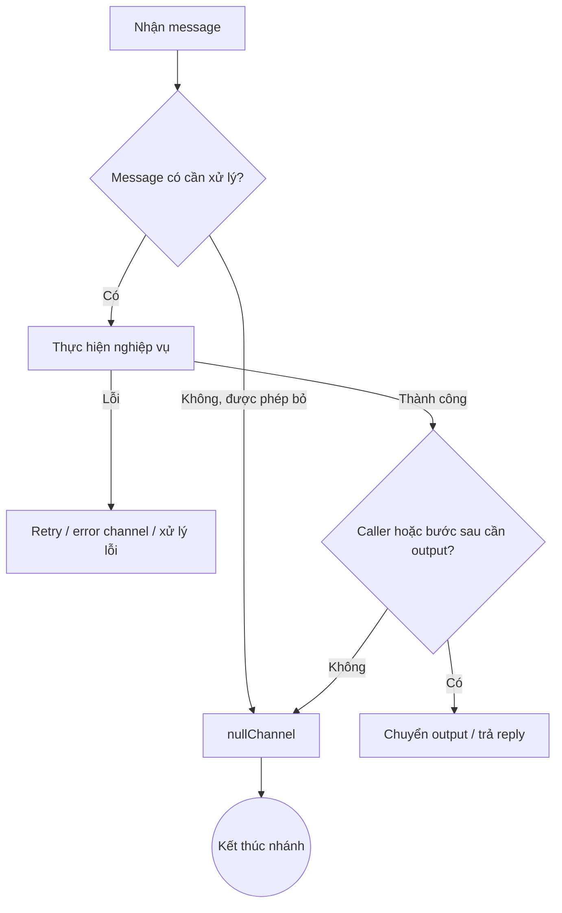
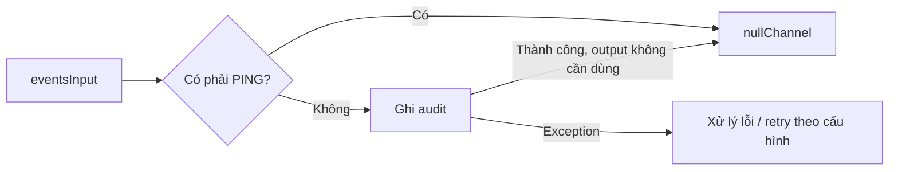

# Khi discard output là hành vi hợp lệ trong Spring Integration

## 1. Mục tiêu và bối cảnh

Trong học phần `SPRING_INTEGRATION_PATTERN`, chúng ta triển khai **Enterprise Integration Patterns** bằng Spring Integration để xây dựng các luồng thông điệp ít phụ thuộc, dễ mở rộng và có thể kiểm thử, theo dõi. Một quyết định quan trọng khi thiết kế luồng là: **đầu ra nào cần được chuyển tiếp, và đầu ra nào được phép kết thúc tại đây?**

Không phải message nào cũng cần người nhận tiếp theo. Ví dụ, hệ thống nhận heartbeat chỉ nhằm xác nhận kết nối; hoặc một consumer đã ghi sự kiện vào kho audit thành công và không còn bên nào cần kết quả trả về. Khi quy tắc nghiệp vụ cho phép, việc **discard output** (bỏ đầu ra) là kết quả hợp lệ của luồng, không phải một lỗi cần khôi phục.

Sau bài học, bạn sẽ:

- Xác định điều kiện để loại bỏ message hoặc output một cách có chủ đích.
- Phân biệt **bỏ message trước xử lý** với **bỏ kết quả sau khi xử lý thành công**.
- Cấu hình `nullChannel` trong Spring Integration Java DSL và kiểm thử nhánh không phát reply.
- Tránh làm mất lỗi, mất nghĩa vụ phản hồi, hoặc phá vỡ tương quan của Splitter/Aggregator.
- Đặt metric và audit đúng nơi để biết **vì sao** message được bỏ.

## 2. Discard output nghĩa là gì?

Trong Spring Integration, `nullChannel` là một channel đặc biệt có tên chuẩn. Message được gửi tới đây sẽ được chấp nhận và **không được phát tiếp cho consumer nghiệp vụ**. Null Channel không phải queue, kho lưu trữ hay nơi lấy lại message đã bỏ.

Từ *discard* thường được dùng trong hai ngữ cảnh gần nhau nhưng khác điểm ra quyết định:

| Ngữ cảnh | Khi nào bỏ? | Ví dụ |
| --- | --- | --- |
| **Discard message** | Trước khi thực hiện nhánh nghiệp vụ, sau khi Filter/Router quyết định message không cần xử lý. | Heartbeat `PING` được Filter chuyển thẳng vào `nullChannel`. |
| **Discard output** | Sau khi một bước đã hoàn thành công việc và tạo đầu ra mà không consumer nào còn cần. | Service Activator đã lưu audit; message kết quả được gửi vào `nullChannel`. |

Điểm chung là **chủ động kết thúc một nhánh**. Điểm khác biệt là trường hợp thứ hai chỉ hợp lệ nếu nghĩa vụ nghiệp vụ của bước trước đó đã được hoàn tất và không còn cần kết quả cho caller hoặc các thành phần tiếp theo.

> Không nên hiểu “gửi thành công tới `nullChannel`” là “nghiệp vụ đã thành công”. Kênh chỉ chấp nhận và bỏ message. Trạng thái nghiệp vụ phải được xác lập ở đúng nơi thực hiện công việc.

### Sơ đồ quyết định



Hai nhánh tới `nullChannel` đều phải xuất phát từ **một quyết định hợp lệ**; nhánh lỗi đi theo chính sách xử lý lỗi riêng.

## 3. Tiêu chí để discard được coi là hợp lệ

Một quyết định discard nên vượt qua đủ các câu hỏi sau:

1. **Có quy tắc nghiệp vụ rõ ràng không?** Ví dụ: chỉ loại `PING`, sự kiện đã xử lý theo idempotency key, hoặc thông báo được đánh dấu `AUDIT_ONLY`.
2. **Có còn nghĩa vụ phải hoàn thành không?** Nếu cần lưu dữ liệu, cập nhật trạng thái hoặc gửi sự kiện khác, bước đó phải hoàn tất trước khi bỏ output.
3. **Có ai đang đợi reply không?** Gateway yêu cầu/phản hồi, API đồng bộ, hoặc thành phần downstream có thể phụ thuộc vào kết quả.
4. **Có cần lưu vết hoặc khôi phục không?** Nếu message thuộc luồng phải điều tra, đối soát hoặc xử lý lại thì không được loại vĩnh viễn mà không lưu vết.
5. **Discard có làm thiếu một phần tương quan không?** Ví dụ, Aggregator đang đợi đủ các message con mà Splitter đã phát ra.
6. **Có thể quan sát quyết định không?** Metric hoặc audit phải cho biết số lượng và lý do loại; `nullChannel` tự nó không lưu các thông tin đó.

| Tình huống | Có thể discard? | Điều kiện |
| --- | --- | --- |
| Heartbeat đã được nhận diện và không cần xử lý thêm | Có | Không có nghĩa vụ tạo reply nghiệp vụ. |
| Một sự kiện đã được ghi audit thành công; output chỉ là giá trị trung gian | Có | Giao diện của luồng là một chiều và không có consumer đang chờ. |
| Sự kiện trùng đã được xác nhận bằng idempotency key | Có thể | Chính sách cho phép bỏ bản trùng, có lưu vết quyết định; nếu caller cần ACK thì phải đáp ứng contract. |
| Gọi HTTP tới đối tác bị timeout | Không | Đây là lỗi/điều kiện chưa xác định, cần retry hoặc xử lý lỗi. |
| Sự kiện thuộc phiên bản schema không nhận diện | Thường không | Cần từ chối, quarantine hoặc giám sát để tránh mất dữ liệu mới. |
| Một phần trong nhóm đang chờ Aggregator | Phải đánh giá kỹ | Cần release strategy/timeout thích hợp hoặc đổi cách lọc. |

## 4. Ví dụ: bỏ heartbeat và bỏ output sau khi lưu audit

Giả sử luồng nhận sự kiện giao nhận. `PING` chỉ kiểm tra kết nối nên được bỏ ngay. Các sự kiện còn lại phải được ghi audit; sau khi ghi thành công, output của Service Activator cũng không còn consumer nào cần nhận.



### Cấu hình Java DSL

Ví dụ dùng Java 17 và Spring Integration Java DSL. Khi dùng Spring Boot, có thể thêm `spring-boot-starter-integration`; phần kiểm thử sử dụng JUnit 5, Spring Test và AssertJ. `AuditStore` dưới đây chỉ là bộ nhớ minh họa: khi triển khai thực tế, thay bằng repository hoặc adapter có chính sách transaction phù hợp.

```java
import java.util.List;
import java.util.concurrent.CopyOnWriteArrayList;

import org.springframework.context.annotation.Bean;
import org.springframework.context.annotation.Configuration;
import org.springframework.integration.channel.DirectChannel;
import org.springframework.integration.config.EnableIntegration;
import org.springframework.integration.dsl.IntegrationFlow;
import org.springframework.messaging.MessageChannel;

@Configuration
@EnableIntegration
public class AuditOnlyFlowConfig {

    public record IntegrationEvent(String eventId, String type) {}

    public static class AuditStore {
        private final List<IntegrationEvent> events =
            new CopyOnWriteArrayList<>();

        public void save(IntegrationEvent event) {
            events.add(event);
        }

        public List<IntegrationEvent> snapshot() {
            return List.copyOf(events);
        }

        public void clear() {
            events.clear();
        }
    }

    @Bean
    public AuditStore auditStore() {
        return new AuditStore();
    }

    @Bean
    public MessageChannel eventsInput() {
        return new DirectChannel();
    }

    @Bean
    public IntegrationFlow auditOnlyFlow(AuditStore store) {
        return IntegrationFlow.from("eventsInput")
            .filter(IntegrationEvent.class,
                event -> !"PING".equals(event.type()),
                filter -> filter.discardChannel("nullChannel"))
            .handle(IntegrationEvent.class, (event, headers) -> {
                store.save(event);
                return event; // Output nội bộ không còn ai cần nhận
            })
            .channel("nullChannel")
            .get();
    }
}
```

**Vì sao ví dụ hợp lệ?**

- Filter chuyển `PING` vào `nullChannel` vì đã xác định heartbeat nằm ngoài nghiệp vụ cần lưu audit.
- Với sự kiện thông thường, `store.save(event)` diễn ra **trước** khi output tới `nullChannel`. Sự kiện đầu ra được bỏ vì không có bước xử lý tiếp theo.
- Nếu `store.save(event)` ném exception, handler không trả về output và việc đi tới `nullChannel` không xảy ra. Exception phải được xử lý bởi cơ chế lỗi/retry đã cấu hình hoặc truyền về caller nếu dùng kênh đồng bộ.
- Vì `eventsInput` là `DirectChannel`, việc gửi message và gọi handler diễn ra trên cùng luồng gọi trong ví dụ. Với channel bất đồng bộ, `send(...)` thành công có thể chỉ xác nhận đã đưa message vào hệ thống, chưa chứng minh bước lưu audit hoàn tất.

Trường hợp Service Activator thực sự không cần tạo output, có thể thiết kế handler một chiều trả `void` và kết thúc flow tại handler. Khi đó **không cần** đặt thêm `nullChannel`. Đặt `.channel("nullChannel")` như trên có ích khi handler đã phát một kết quả trung gian nhưng contract cho phép bỏ kết quả đó một cách tường minh. Đừng cố trả `null` từ transformer/handler chỉ để mô phỏng channel này; quy tắc phát reply và yêu cầu reply tùy thuộc endpoint, nên cần thể hiện ý định trong thiết kế flow.

## 5. Kiểm thử: thành công nghiệp vụ và không có reply

Khi kiểm thử discard output, chỉ kiểm tra `input.send(...) == true` là chưa đủ. Cần xác nhận **side effect đã hoàn thành** và **không có reply** nếu hợp đồng của luồng là một chiều. Ví dụ dưới đây sử dụng `QueueChannel` làm reply channel quan sát trong test:

```java
import org.junit.jupiter.api.BeforeEach;
import org.junit.jupiter.api.Test;
import org.springframework.beans.factory.annotation.Autowired;
import org.springframework.beans.factory.annotation.Qualifier;
import org.springframework.integration.channel.QueueChannel;
import org.springframework.messaging.MessageChannel;
import org.springframework.messaging.support.MessageBuilder;
import org.springframework.test.context.junit.jupiter.SpringJUnitConfig;

import static org.assertj.core.api.Assertions.assertThat;

@SpringJUnitConfig(AuditOnlyFlowConfig.class)
class AuditOnlyFlowTest {

    @Autowired
    @Qualifier("eventsInput")
    MessageChannel input;

    @Autowired
    AuditOnlyFlowConfig.AuditStore store;

    @BeforeEach
    void resetAudit() {
        store.clear();
    }

    @Test
    void pingIsDiscardedBeforeAudit() {
        var event = new AuditOnlyFlowConfig.IntegrationEvent("h-1", "PING");

        assertThat(input.send(MessageBuilder.withPayload(event).build()))
            .isTrue();
        assertThat(store.snapshot()).isEmpty();
    }

    @Test
    void businessEventIsAuditedButDoesNotProduceReply() {
        var event = new AuditOnlyFlowConfig.IntegrationEvent(
            "evt-42", "DELIVERED");
        var replyChannel = new QueueChannel();

        assertThat(input.send(MessageBuilder.withPayload(event)
            .setReplyChannel(replyChannel)
            .build())).isTrue();

        assertThat(store.snapshot()).containsExactly(event);
        assertThat(replyChannel.receive(100)).isNull();
    }
}
```

Giới hạn của ví dụ: bài kiểm thử dùng `DirectChannel` và kho nhớ đơn giản nên xác nhận hành vi đồng bộ. Với cơ sở dữ liệu, broker, hoặc executor bất đồng bộ, cần kiểm thử thời điểm commit, retry, và cơ chế xác nhận nhận message theo đúng adapter. Nên bổ sung test lỗi ghi audit để bảo đảm exception **không bị diễn giải là một lần discard thành công**.

## 6. Phân biệt discard hợp lệ với việc nuốt lỗi

`nullChannel` không thay thế `errorChannel`. Một lỗi kỹ thuật cần được phân loại và xử lý theo chính sách: retry có giới hạn, lỗi được chuyển tới error flow, ghi dữ liệu để xử lý lại, hoặc báo thất bại cho phía gọi.

Ví dụ đối chiếu:

```text
ĐÚNG:   event.type == PING  → bỏ theo chính sách → nullChannel
ĐÚNG:   ghi audit thành công → không cần output → nullChannel
SAI:    ghi audit thất bại   → catch Exception → nullChannel
SAI:    payload không hiểu   → mặc định gửi hết vào nullChannel
```

Nếu bắt `Exception` rồi gửi message sang Null Channel để tránh báo lỗi, hệ thống có thể thông báo thành công trong khi nghiệp vụ chưa hoàn thành. Khi thiết kế một nhánh *best effort* thật sự được phép thất bại, hãy ghi rõ chính sách chịu mất mát, metric và cách vận hành; đó là quyết định về độ tin cậy của nghiệp vụ, không phải thuộc tính do Null Channel tự cung cấp.

### Retry và error channel

- Với endpoint đồng bộ, exception có thể truyền ngược về người gửi; interceptor/advice hoặc retry được cấu hình sẽ quyết định thử lại.
- Với endpoint bất đồng bộ, lỗi có thể xuất hiện ở luồng error handling tương ứng. Cần xác minh `errorChannel` thực tế và cơ chế gửi `ErrorMessage` của adapter/channel đang dùng.
- Sau khi quá số lần thử, message cần lưu để đối soát hoặc chuyển sang dead-letter/quarantine nếu chính sách yêu cầu. Đừng tự động chuyển mọi thất bại vào Null Channel.

## 7. Ảnh hưởng tới Gateway, correlation và các pattern khác

### Gateway yêu cầu/phản hồi

Một Gateway có thể chờ reply từ luồng. Nếu request bị Filter hoặc một output bị chuyển tới `nullChannel`, **Null Channel không tạo response**. Caller đang chờ có thể hết thời gian chờ, nhận `null` hoặc gặp hành vi khác tùy chữ ký gateway và cấu hình `replyTimeout`/`requiresReply`.

Chỉ thiết kế discard cho giao tiếp một chiều hoặc giao tiếp mà contract cho phép không có reply. Nếu API bắt buộc có ACK hay kết quả “đã bỏ qua”, hãy tạo phản hồi tường minh, ví dụ `IGNORED`, trước khi kết thúc luồng tương ứng. Không sử dụng `nullChannel` như một cơ chế ACK mặc định.

### Splitter và Aggregator

Nếu Splitter phát ra `N` message con nhưng một nhánh đưa một số message vào `nullChannel`, Aggregator có thể không bao giờ thấy đủ `N` message. Điều này đặc biệt nguy hiểm khi release strategy dựa vào `sequenceSize` và `sequenceNumber` ban đầu.

Giải pháp phụ thuộc hợp đồng nghiệp vụ: lọc trước khi Splitter, tái thiết kế điều kiện phát hành nhóm, dùng thời hạn nhóm, hoặc phát một kết quả “đã bỏ qua” có tương quan nếu Aggregator thực sự cần biết số phần đã xử lý. `nullChannel` không cập nhật correlation group thay cho ứng dụng.

### Transformer, Router và Filter

- **Filter:** biểu đạt một điều kiện loại có thể kiểm thử; `discardChannel("nullChannel")` nói rõ đích của message bị từ chối.
- **Router:** đưa một loại message được cho phép bỏ vào `nullChannel`; loại không nhận diện cần nhánh riêng thay vì bỏ mặc định.
- **Transformer/Service Activator:** khi tạo output mà downstream không cần dùng, định tuyến output tới `nullChannel` nếu hợp đồng cho phép; tránh dùng kết quả `null` như dấu hiệu mơ hồ của thành công.

## 8. Observability: biết rõ điều gì đã bị bỏ

Một luồng được phép discard vẫn cần theo dõi. Nên ghi thông tin **tại điểm quyết định hoặc ngay trước khi kết thúc**:

| Chỉ số hoặc log | Cách dùng |
| --- | --- |
| `messages_discarded_total{flow,reason}` | Đếm message bỏ có chủ đích, ví dụ `reason=heartbeat` hoặc `reason=duplicate`. |
| `audit_completed_total{flow}` | Đếm side effect hoàn tất thành công, độc lập với số message đã vào `nullChannel`. |
| `audit_failed_total{flow}` | Phát hiện thất bại cần retry/điều tra; không gộp vào số discard. |
| `traceId`, `eventId`, `decision` | Truy vết từ message đầu vào đến quyết định xử lý; tránh log payload nhạy cảm. |

Nhãn metric nên có tập giá trị nhỏ (loại sự kiện, flow, lý do chuẩn hóa). Không đặt mỗi `eventId` làm nhãn metric vì có thể gây bùng nổ số chuỗi thời gian. Nếu cần audit đầy đủ cho từng sự kiện, hãy dùng kho log hoặc lưu trữ thích hợp; Null Channel không cung cấp khả năng tra cứu lại.

**Lưu ý về transaction:** Nếu bạn cần đảm bảo “đã ghi dữ liệu thì mới được công nhận hoàn thành”, hãy căn cứ vào transaction/commit hoặc xác nhận của hệ thống đích. Tăng counter trước khi ghi thành công có thể tạo số liệu sai. Message được gửi tới `nullChannel` không tự bảo đảm commit hay exactly-once delivery.

## 9. Bài tập thiết kế

**Bối cảnh:** Một ứng dụng nhận bốn loại event: `PING`, `AUDIT_ONLY`, `ORDER_CREATED` và `UNKNOWN`.

1. `PING`: bỏ ngay qua `nullChannel`, tăng bộ đếm `reason=heartbeat`.
2. `AUDIT_ONLY`: ghi audit; sau khi ghi thành công, bỏ output vì không còn consumer, đồng thời ghi metric thành công.
3. `ORDER_CREATED`: chuyển sang xử lý đơn hàng, phát kết quả theo contract của downstream.
4. `UNKNOWN`: gửi vào quarantine để điều tra thay vì bỏ âm thầm.
5. Viết kiểm thử cho bốn nhánh, cộng thêm một test giả lập lỗi ghi audit để chứng minh không xảy ra “thành công giả”.

**Câu hỏi mở:** Nếu `ORDER_CREATED` đến từ request/reply Gateway, bạn sẽ làm gì để caller nhận được phản hồi hợp lệ khi sự kiện đó đã từng được xử lý (duplicate)? Vì sao không nên mặc định gửi nó sang `nullChannel`?

## 10. Ghi nhớ

Discard output là hành vi hợp lệ **khi công việc cần thiết đã hoàn thành, kết quả không còn người nhận bắt buộc và quyết định có thể quan sát, kiểm thử được**. Dùng `nullChannel` để thể hiện điểm kết thúc rõ ràng của một nhánh Spring Integration; giữ retry, error handling, Gateway reply và correlation đúng với hợp đồng nghiệp vụ của toàn luồng.
