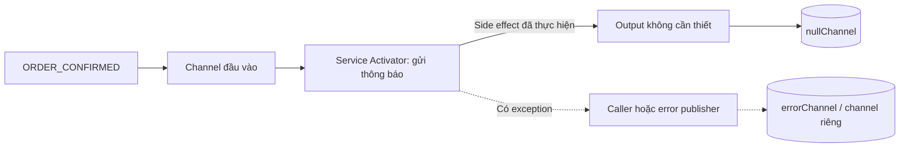
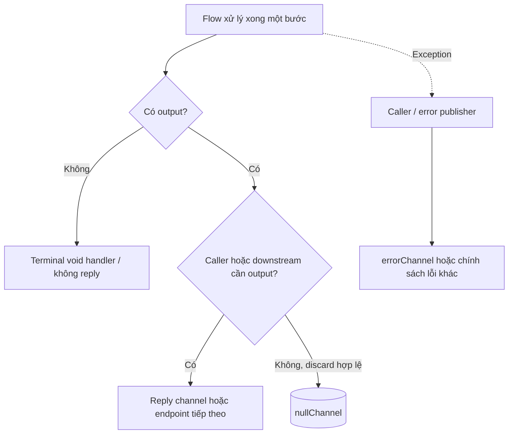
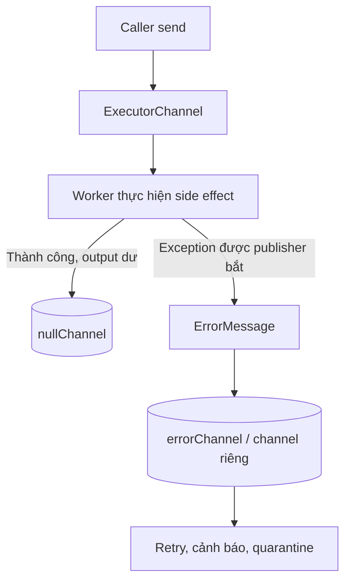

# Dùng Null Channel cho one-way flow trong Spring Integration

## 1. Bối cảnh và mục tiêu

Trong module `SPRING_INTEGRATION_PATTERN`, chúng ta áp dụng **Enterprise Integration Patterns** (EIP) với Spring Integration để tạo các luồng thông điệp ít phụ thuộc, dễ mở rộng, có kiểm thử và quan sát được. Nhiều luồng sử dụng Router, Filter, Transformer, Splitter, Aggregator, Gateway, retry và Error Channel, nhưng không phải luồng nào cũng cần tạo **message kết quả**.

Ví dụ, dịch vụ nhận sự kiện `ORDER_CONFIRMED` để gửi thông báo hoặc ghi một bản ghi thống kê. Người gửi chỉ muốn **bàn giao công việc**; không yêu cầu hệ thống trả lại một message nghiệp vụ. Đây là một dạng **one-way flow** (*luồng một chiều*). Nếu endpoint trung gian vẫn tạo ra reply nhưng không có người nhận, chúng ta có thể **chủ động định tuyến kết quả tới `nullChannel`**.

Trong Spring Integration, `nullChannel` là channel đích đặc biệt dùng để **tiêu thụ và loại bỏ message có chủ đích**. Nó tương tự “bit bucket”: dữ liệu được gửi vào đó sẽ không được chuyển tiếp sang một handler nghiệp vụ khác.

Sau bài này, bạn có thể:

- Giải thích one-way flow và phân biệt nó với request-reply qua Gateway.
- Nêu rõ `nullChannel` làm gì và những gì nó **không bảo đảm**.
- Chọn giữa handler kết thúc không có output và định tuyến một reply tới `nullChannel`.
- Viết một `IntegrationFlow` Java DSL có side effect hợp lệ, sau đó bỏ reply một cách tường minh.
- Viết JUnit test kiểm tra side effect xảy ra nhưng không có reply nghiệp vụ.
- Phân biệt discard hợp lệ với lỗi cần gửi tới `errorChannel`, retry hoặc quarantine.
- Vận dụng ý tưởng này khi có Router, Filter, Splitter/Aggregator và luồng bất đồng bộ.

## 2. One-way flow nghĩa là gì?

Một **one-way flow** là luồng mà phía gọi **không yêu cầu một business reply** từ bên nhận. Nó thường gặp trong các trường hợp:

| Tình huống | Một chiều nghĩa là gì? | Điều vẫn cần bảo đảm |
| --- | --- | --- |
| Phát sự kiện để cập nhật thống kê | Không cần gửi lại số đếm vừa cập nhật. | Việc cập nhật phải có cơ chế kiểm tra hoặc báo lỗi phù hợp. |
| Gửi email/thông báo từ sự kiện | Caller không chờ kết quả `Message<?>` của bước gửi. | Trạng thái gửi, retry/rate limit và xử lý lỗi cần được thiết kế. |
| Ghi audit độc lập | Không cần trả đối tượng audit cho nguồn phát. | Audit có thể cần lưu bền vững và xác nhận riêng. |
| Nhận heartbeat | Có thể bỏ qua kết quả xử lý đã được xác nhận là không cần thiết. | Không được vô tình làm mất heartbeat bắt buộc phải giám sát. |

**One-way không đồng nghĩa với bất đồng bộ.** Một flow trên `DirectChannel` có thể chạy đồng bộ và không tạo reply. Ngược lại, một flow chạy trên `ExecutorChannel` có thể vẫn phải phát một event hoàn tất hoặc trạng thái công việc về sau.

**One-way cũng không có nghĩa “không cần xử lý lỗi”.** Nếu side effect thất bại, một lời gọi đồng bộ có thể ném exception; một poller hoặc adapter bất đồng bộ có thể cần error publisher gửi `ErrorMessage` tới Error Channel.

### Sơ đồ minh họa



Nhánh **thành công** có thể bỏ output; nhánh **lỗi** vẫn cần một chính sách riêng. Không dùng cùng một tuyến để “nuốt” cả kết quả lẫn exception.

## 3. nullChannel làm gì?

Khi hạ tầng Spring Integration được bật, ứng dụng thường có sẵn bean channel tên `nullChannel`. Đây là một endpoint đích đặc biệt: message gửi tới đó được **chấp nhận và bỏ qua**, thay vì chuyển tiếp vào downstream business handler.

```text
Message có giá trị đầu ra
         |
         v
  channel("nullChannel")
         |
         v
   kết thúc luồng
```

| Thuộc tính | Hành vi cần hiểu |
| --- | --- |
| Tên quy ước | `nullChannel`, khác với giá trị Java `null`. |
| Gửi message tới channel | Message được nhận để **discard** theo thiết kế; không có business consumer tiếp theo. |
| Thông điệp phản hồi | `nullChannel` không tạo reply cho caller. |
| Gửi thành công | Kết quả `send()` có thể là `true` vì channel nhận message để bỏ; không có nghĩa nghiệp vụ upstream đã thành công. |
| Retry | Không tự phát lại message đã bỏ. |
| Error handling | Không thay thế `errorChannel` hoặc việc ném exception. |
| Lưu trữ | Không phải queue bền vững, kho audit hay dead-letter store. |

Tên `nullChannel` đôi khi khiến người mới học nhầm với “trả về `null`” hoặc “gửi một payload bằng `null`”. Trong Spring Messaging, một `Message` thông thường yêu cầu payload hợp lệ; **bỏ output** và **tạo payload `null`** là hai khái niệm khác nhau.

### nullChannel khác errorChannel và dead-letter thế nào?

| Cơ chế | Mục đích | Khi nào dùng? |
| --- | --- | --- |
| `nullChannel` | Bỏ message **có chủ đích**. | Output không cần nữa, discard được nghiệp vụ chấp nhận. |
| `errorChannel` | Chuyển `ErrorMessage` khi error publisher phát lỗi. | Cần quan sát, phân loại hoặc phục hồi thất bại. |
| Dead-letter/quarantine | Lưu message thất bại để điều tra và có thể phát lại. | Payload sai, retry vượt giới hạn, cần can thiệp. |
| Reply channel | Gửi kết quả về requester. | Request-reply, Gateway đang chờ giá trị trả về. |

Nếu business rule yêu cầu không được mất một event, **không** gửi event đó đến `nullChannel` chỉ để luồng kết thúc “êm”.

## 4. Khi nào thật sự cần nullChannel?

Có hai cách hợp lệ để kết thúc one-way flow:

**Cách A — Handler không tạo output.** Một Service Activator có phương thức `void` (hoặc handler một chiều) hoàn thành side effect và không phát reply. Khi không có output cần dọn, thường **không cần** thêm `nullChannel`.

```java
@ServiceActivator(inputChannel = "notificationInput")
public void sendNotification(String orderId) {
    notificationService.sendForOrder(orderId);
    // Không trả về business message nào.
}
```

Ở đây `notificationService` là thành phần nghiệp vụ do ứng dụng định nghĩa. Ví dụ chỉ minh họa kiểu hợp đồng một chiều; nếu method ném exception, ứng dụng vẫn phải xử lý lỗi theo ranh giới thực thi.

**Cách B — Endpoint có output nhưng output không cần dùng.** Một Transformer, Service Activator hoặc Gateway adapter có thể sinh ra reply như `"ACK"`, kết quả trung gian hoặc trạng thái thực thi. Khi contract nghiệp vụ xác nhận reply này **không cần dùng**, đặt output channel là `nullChannel` giúp thể hiện điểm kết thúc rõ ràng.

```java
return IntegrationFlow.from("notificationInput")
    .handle(String.class, (payload, headers) -> {
        notificationService.sendForOrder(payload);
        return "NOTIFICATION_ACCEPTED"; // Reply nội bộ không cần gửi đi.
    })
    .channel("nullChannel")
    .get();
```

Đoạn trên minh họa phần DSL nằm trong cấu hình Spring; `notificationService` phải được ứng dụng cung cấp. `.channel("nullChannel")` chỉ định **đích của reply** do handler tạo, không phải đích cho exception.

### Cây quyết định



Không nên ép tất cả các one-way flow chạy qua `nullChannel` cho đồng nhất. Nếu endpoint đã là handler terminal không output, thêm bước loại bỏ là thừa.

## 5. Ví dụ Java DSL: gửi thông báo rồi chủ động bỏ reply

Ta xây một luồng nhận `ORDER_CONFIRMED` và ghi dấu việc đã yêu cầu gửi thông báo. Handler trả về một chuỗi xác nhận nội bộ để minh họa trường hợp **có output**, sau đó định tuyến nó tới `nullChannel` vì caller không yêu cầu reply.

Ví dụ dùng Java 17, Spring Integration Java DSL và `@EnableIntegration`. Với Spring Boot có thể dùng `spring-boot-starter-integration`, và `spring-boot-starter-test` cho JUnit 5/Spring Test/AssertJ.

```java
import java.util.List;
import java.util.concurrent.ConcurrentLinkedQueue;

import org.springframework.context.annotation.Bean;
import org.springframework.context.annotation.Configuration;
import org.springframework.integration.channel.DirectChannel;
import org.springframework.integration.config.EnableIntegration;
import org.springframework.integration.dsl.IntegrationFlow;
import org.springframework.messaging.MessageChannel;

@Configuration
@EnableIntegration
public class OneWayNullChannelConfig {

    public static class NotificationRecorder {
        private final ConcurrentLinkedQueue<String> delivered =
            new ConcurrentLinkedQueue<>();

        public void deliver(String orderId) {
            // Giả lập lỗi kỹ thuật để chứng minh nullChannel không nuốt lỗi.
            if ("FAIL".equals(orderId)) {
                throw new IllegalStateException("Notification provider failed");
            }
            delivered.add(orderId);
        }

        public List<String> snapshot() {
            return List.copyOf(delivered);
        }

        public void clear() {
            delivered.clear();
        }
    }

    @Bean
    public NotificationRecorder notificationRecorder() {
        return new NotificationRecorder();
    }

    @Bean
    public MessageChannel notificationInput() {
        return new DirectChannel();
    }

    @Bean
    public IntegrationFlow notificationOneWayFlow(
            NotificationRecorder recorder) {

        return IntegrationFlow.from("notificationInput")
            .handle(String.class, (orderId, headers) -> {
                recorder.deliver(orderId);
                // Một handler request-reply tạo output trung gian.
                return "NOTIFICATION_SENT_FOR_" + orderId;
            })
            // Reply đã có nhưng không được contract nghiệp vụ sử dụng.
            .channel("nullChannel")
            .get();
    }
}
```

### Lần theo từng bước

1. Caller gửi message chứa `orderId` tới `notificationInput`.
2. `DirectChannel` chuyển message đồng bộ tới handler.
3. `recorder.deliver(orderId)` mô phỏng side effect gửi thông báo.
4. Handler tạo chuỗi `NOTIFICATION_SENT_FOR_<orderId>` như một reply nội bộ.
5. Output được đưa tới `nullChannel` và kết thúc. Không có business reply gửi về người gọi.

Chỉ vì handler trả về chuỗi xác nhận không có nghĩa bên gửi phải nhận chuỗi đó. Contract của ví dụ là **gửi sự kiện một chiều**; reply trung gian được bỏ một cách có chủ đích.

**Một lưu ý về độ tin cậy:** Trong ví dụ, `NotificationRecorder` lưu vào bộ nhớ để dễ kiểm thử, không phải hệ thống gửi email thật. Với provider thực, phản hồi “đã nhận yêu cầu” chưa chắc là “email đã được giao”; nếu hệ thống cần delivery status, hãy lưu/truyền trạng thái qua một cơ chế phù hợp thay vì bỏ mọi tín hiệu kết quả.

## 6. Kiểm thử one-way flow: side effect có, reply không

Kiểm thử cần kiểm tra hai thứ **độc lập**:

1. Công việc được thực hiện theo contract: recorder đã nhận `orderId`.
2. Không có business reply gửi về một reply channel của caller.

Một `QueueChannel` dùng làm reply channel thử nghiệm giúp xác nhận nó không nhận message sau khi output được định tuyến tới `nullChannel`.

```java
import org.junit.jupiter.api.BeforeEach;
import org.junit.jupiter.api.Test;
import org.springframework.beans.factory.annotation.Autowired;
import org.springframework.beans.factory.annotation.Qualifier;
import org.springframework.integration.channel.QueueChannel;
import org.springframework.messaging.MessageChannel;
import org.springframework.messaging.support.MessageBuilder;
import org.springframework.test.context.junit.jupiter.SpringJUnitConfig;

import static org.assertj.core.api.Assertions.assertThat;
import static org.assertj.core.api.Assertions.assertThatThrownBy;

@SpringJUnitConfig(OneWayNullChannelConfig.class)
class OneWayNullChannelConfigTest {

    @Autowired
    @Qualifier("notificationInput")
    MessageChannel notificationInput;

    @Autowired
    OneWayNullChannelConfig.NotificationRecorder recorder;

    @BeforeEach
    void reset() {
        recorder.clear();
    }

    @Test
    void handlesOneWayEventAndDiscardsReply() {
        QueueChannel replies = new QueueChannel();

        boolean accepted = notificationInput.send(
            MessageBuilder.withPayload("order-42")
                .setHeader("eventId", "evt-42")
                .setReplyChannel(replies)
                .build());

        assertThat(accepted).isTrue();
        assertThat(recorder.snapshot()).containsExactly("order-42");
        assertThat(replies.receive(0)).isNull();
    }

    @Test
    void nullChannelDoesNotHideFailureInSynchronousHandler() {
        assertThatThrownBy(() -> notificationInput.send(
            MessageBuilder.withPayload("FAIL").build()))
            .satisfies(failure ->
                assertThat(rootCause(failure))
                    .isInstanceOf(IllegalStateException.class)
                    .hasMessage("Notification provider failed"));

        assertThat(recorder.snapshot()).isEmpty();
    }

    private static Throwable rootCause(Throwable failure) {
        Throwable current = failure;
        int depth = 0;
        while (current.getCause() != null && depth++ < 32) {
            current = current.getCause();
        }
        return current;
    }
}
```

Test thứ nhất chứng minh **side effect và output là hai mối quan tâm khác nhau**: công việc được ghi nhận, reply không được chuyển về `replies`. Test thứ hai làm handler ném exception trước khi trả reply: `nullChannel` **không thể** che exception của một handler chạy đồng bộ phía trước nó.

Các test này chỉ xác minh Java DSL trong ngữ cảnh đồng bộ với `DirectChannel`. Không suy ra rằng việc gửi tới `nullChannel` tạo ACK bền vững, xử lý lại khi ứng dụng crash hoặc giao email thành công từ một nhà cung cấp thực tế.

## 7. Null Channel và Gateway: đặc biệt chú ý reply contract

Gateway thường được dùng khi caller muốn request-reply. Nếu caller gọi một phương thức cần nhận kết quả nhưng flow lại gửi toàn bộ output đến `nullChannel`, Gateway có thể **không nhận được reply** và chờ đến timeout (tùy contract và cấu hình).

```text
Gateway gọi và chờ reply --> flow xử lý --> nullChannel
          |
          +--> Không có business reply để trả về
```

Đây có thể là **sai thiết kế** nếu API kỳ vọng `PaymentResult`, trạng thái xác nhận giao dịch hoặc dữ liệu bổ sung.

Nếu nhiệm vụ thực sự là one-way, hãy biểu đạt ngay trong contract, chẳng hạn:

```java
@MessagingGateway
public interface NotificationGateway {
    @Gateway(requestChannel = "notificationInput")
    void notifyOrder(String orderId);
}
```

Ví dụ minh họa một Gateway có phương thức `void`, không yêu cầu business reply. `@MessagingGateway` và `@Gateway` thuộc `org.springframework.integration.annotation`, và interface phải được đăng ký qua cấu hình gateway scan hoặc bean phù hợp. `void` chỉ mô tả contract không trả giá trị, **không** có nghĩa công việc bất đồng bộ chắc chắn đã thành công.

**Tách hai loại tín hiệu:**

- **Request acceptance:** channel/adapter đã chấp nhận message.
- **Business completion:** tác vụ đã hoàn thành đúng, có thể cần transaction, event hoàn tất hoặc lưu trạng thái.

Khi sử dụng Gateway một chiều với executor hoặc broker, caller có thể nhận được tín hiệu tiếp nhận trước khi tác vụ kết thúc. Đừng diễn giải tín hiệu đó thành xác nhận thanh toán, gửi email hay cập nhật kho đã thành công.

## 8. Null Channel trong Router, Filter và luồng tích hợp khác

### 8.1. Router: nhánh discard hợp lệ

Một Router có thể định tuyến một loại sự kiện được phép bỏ qua đến `nullChannel`. Ví dụ heartbeat nội bộ không cần xử lý thêm:

```text
Inbound events --> Router
                    |--> ORDER_CONFIRMED --> notificationFlow
                    |--> HEARTBEAT_ALLOWED --> nullChannel
                    |--> UNKNOWN --> quarantine hoặc error flow
```

Tuyến discard phải được định nghĩa bằng **chính sách nghiệp vụ cụ thể**, không dùng `nullChannel` làm nơi nhận mặc định cho mọi message không biết xử lý. Nếu Router không tìm được đích cho một message quan trọng, cần fail-fast, quarantine hoặc cơ chế điều tra phù hợp.

### 8.2. Filter: output được loại bỏ có chủ đích

Filter có thể từ chối message vì điều kiện lọc. Nếu việc từ chối là hợp lệ, message có thể được bỏ mà không tạo lỗi. Khi cần phân biệt lý do discard và đếm số lượng, bạn có thể cấu hình discard channel hoặc ghi metric trước khi chuyển sang `nullChannel`, tùy cách tổ chức flow.

Không nên coi mọi Filter reject là lỗi; cũng không nên coi mọi message bị Filter bỏ là an toàn nếu business rule yêu cầu cảnh báo khi dữ liệu sai.

### 8.3. Transformer và Service Activator

Nếu một Transformer tạo ra payload biến đổi nhưng không còn consumer, gửi output tới `nullChannel` sẽ tiêu hủy dữ liệu đã biến đổi. Trước khi làm vậy, cần chắc chắn kết quả thật sự không còn ý nghĩa nghiệp vụ.

Với một Service Activator terminal có `void` output, **không cần** `nullChannel` chỉ để chứng minh one-way. Dùng `nullChannel` chủ yếu khi có output phát sinh cần discard tường minh.

### 8.4. Splitter và Aggregator

Nếu một Splitter tạo ra các message con mà bạn loại bỏ một phần bằng `nullChannel`, Aggregator downstream có thể **không nhận đủ phần tử** để đạt release strategy. Ví dụ split một đơn hàng thành 5 mục, bỏ mục thứ 3 nhưng `sequenceSize` vẫn bằng 5; nhóm có thể chờ tới timeout.

Nếu loại bỏ phần tử là chính sách hợp lệ, hãy thiết kế lại điều kiện release, điều chỉnh logic tương quan hoặc phát một kết quả trạng thái phù hợp. **`nullChannel` không tự cập nhật trạng thái nhóm** và cũng không thông báo Aggregator rằng đã bỏ một phần tử.

## 9. Ranh giới bất đồng bộ và lỗi trong one-way flow

Trong `DirectChannel` đồng bộ, exception từ handler có thể truyền về `send(...)` như test ở trên. Nhưng nếu flow chuyển sang `ExecutorChannel`, QueueChannel/poller hoặc adapter có worker riêng, lời gọi gửi có thể kết thúc trước khi side effect xảy ra.



`nullChannel` xử lý **output hợp lệ cần loại bỏ**, không thay thế đường lỗi. Một handler ném exception trên worker có thể cần error publisher để tạo `ErrorMessage` và gửi vào `errorChannel` hoặc channel lỗi riêng. Không mặc định mọi exception của worker tự đến global `errorChannel`; điều này phụ thuộc endpoint/adapter và cấu hình.

Khi adapter dùng broker, hãy kiểm tra **ack/nack, transaction và redelivery**. Nếu message đã được ACK trước khi side effect thật sự hoàn thành, việc bỏ output qua `nullChannel` không giúp khôi phục message khi xử lý thất bại.

### Retry không đồng nghĩa với gửi lại từ nullChannel

`nullChannel` không lưu bản sao để replay. Nếu cần retry, phải quyết định retry **trước điểm discard** hoặc dùng một nguồn phát lại có độ tin cậy phù hợp. Với các thao tác có side effect (thanh toán, gửi thông báo, ghi dữ liệu), cần idempotency key hoặc cơ chế chống trùng.

## 10. Quan sát one-way flow: đo cả success, discard và failure

Việc bỏ reply có chủ đích không nên khiến luồng trở thành “hộp đen”. Nên đo riêng **đầu vào**, **hoàn thành side effect**, **output đã discard** và **lỗi**:

| Metric / log | Mục đích |
| --- | --- |
| `oneway_messages_received_total{flow}` | Số yêu cầu nhận vào luồng một chiều. |
| `oneway_side_effect_success_total{flow}` | Số thao tác nghiệp vụ hoàn thành thành công. |
| `oneway_outputs_discarded_total{flow,reason}` | Số output được loại bỏ theo chủ đích. |
| `oneway_failures_total{flow,type}` | Số lỗi nghiệp vụ/kỹ thuật. |
| `oneway_recovery_total{flow,result}` | Kết quả retry hoặc lưu quarantine. |
| `eventId`, `correlationId` trong log | Truy vết yêu cầu và xử lý không đồng bộ nếu có. |

Không suy ra “side effect thành công” từ số lượng message đã vào `nullChannel` nếu pipeline có cơ chế phát lỗi hoặc xác nhận riêng. Khi cần báo cáo số lượng discarded, hãy đo tại **điểm quyết định discard**; không nên giả định có thể gắn subscriber nghiệp vụ vào `nullChannel` để kiểm toán mọi message.

Không dùng `eventId` làm metric label vì có thể tạo lượng chuỗi thời gian quá lớn. Tránh ghi toàn bộ payload, token, thông tin thanh toán hay dữ liệu cá nhân vào log. Nếu cần lưu vết từng công việc, dùng audit store hoặc log truy vết được quản lý phù hợp.

## 11. Các sai lầm thường gặp

| Sai lầm | Hậu quả | Cách phòng tránh |
| --- | --- | --- |
| Gửi mọi output đến `nullChannel` vì không biết ai nhận | Có thể mất kết quả nghiệp vụ quan trọng. | Định nghĩa rõ contract của từng output trước khi discard. |
| Dùng `nullChannel` như nơi tiếp nhận `ErrorMessage` | Che khuất lỗi, không có retry/quarantine. | Dùng `errorChannel` và error flow có owner rõ ràng. |
| Coi `send() == true` là thành công của tác vụ async | Báo thành công giả khi worker chưa xử lý. | Tách accepted, completed, failed và retry. |
| Gateway kỳ vọng reply nhưng output bị discard | Caller có thể chờ timeout. | Dùng Gateway `void` cho contract one-way hoặc tạo reply thực. |
| Bỏ một phần output của Splitter mà không xét Aggregator | Nhóm tương quan có thể chờ thiếu phần. | Thiết kế release strategy/timeout và chính sách phần tử bị bỏ. |
| Muốn replay message đã gửi vào `nullChannel` | Không có dữ liệu bền vững để replay. | Lưu công việc ở broker/database/quarantine trước khi discard nếu cần. |
| Handler `void` đã terminal vẫn thêm kênh discard | Tăng độ phức tạp không cần thiết. | Kết thúc flow bằng handler không output. |

## 12. Bài tập thực hành

**Tình huống:** Hệ thống xử lý sự kiện `ORDER_PAID` để gửi thông báo, cập nhật thống kê và ghi audit. Không bên nào yêu cầu business reply cho người phát sự kiện.

1. Chọn trường hợp nào nên kết thúc với handler `void`, trường hợp nào handler tạo reply trung gian rồi gửi tới `nullChannel`. Giải thích vì sao.
2. Viết một `IntegrationFlow` dùng `.channel("nullChannel")` sau handler trả về `String`. Kiểm thử side effect có xảy ra nhưng `QueueChannel` dùng làm reply không nhận kết quả.
3. Làm handler ném `IllegalStateException`; chứng minh `nullChannel` không biến lỗi đó thành kết quả thành công ở `DirectChannel`.
4. Chuyển một nhánh sang executor, so sánh thời điểm `send()` trả về và thời điểm side effect hoàn tất. Thiết kế error publisher và retry có giới hạn.
5. Tạo Router với các loại `ORDER_PAID`, `HEARTBEAT_ALLOWED`, `UNKNOWN`; chỉ route `HEARTBEAT_ALLOWED` sang `nullChannel` khi business rule cho phép.
6. Tách một đơn hàng thành nhiều item bằng Splitter, discard một item hợp lệ, rồi thiết kế cách Aggregator không chờ vô hạn.
7. Đề xuất metric và audit giúp phân biệt “đã nhận yêu cầu”, “đã xử lý thành công” và “đã bỏ output”.

**Câu hỏi tự kiểm tra:** `nullChannel` có phải là giá trị `null` trong Java không? Nếu một reply đã vào `nullChannel` thì Gateway đang chờ reply sẽ nhận gì? Tại sao one-way flow không nhất thiết là asynchronous flow? Vì sao phải giữ Error Channel và retry riêng với điểm discard?

## 13. Ghi nhớ

**Dùng `nullChannel` cho one-way flow khi bạn chủ động muốn bỏ một output hợp lệ và không có ai cần business reply.** Nếu handler terminal vốn không tạo output, không bắt buộc phải dùng `nullChannel`. Đây là điểm kết thúc thông điệp, không phải error handler, retry scheduler hay kho lưu bền vững. Khi triển khai các EIP bằng Spring Integration, hãy giữ riêng contract one-way, đường lỗi, correlation, khả năng kiểm thử side effect và cơ chế quan sát để sự đơn giản của luồng một chiều không biến thành mất dữ liệu âm thầm.
