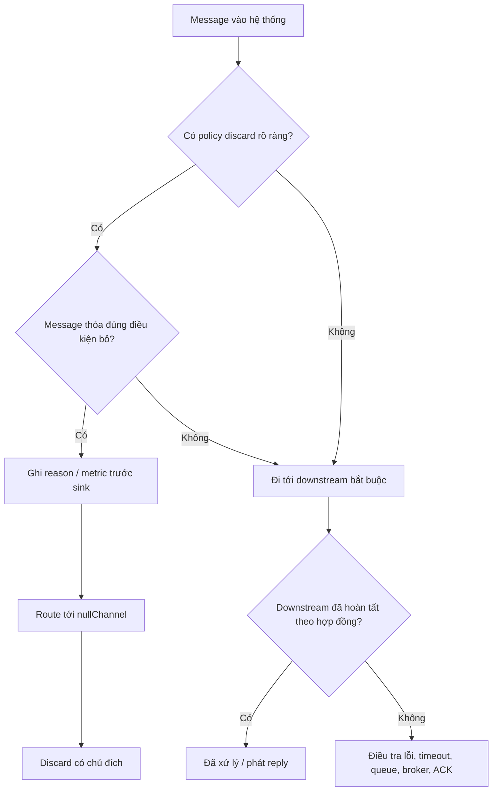
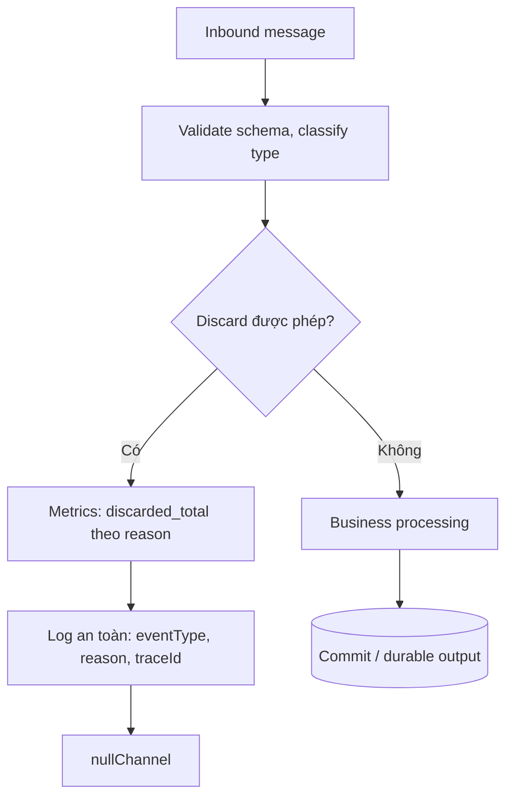
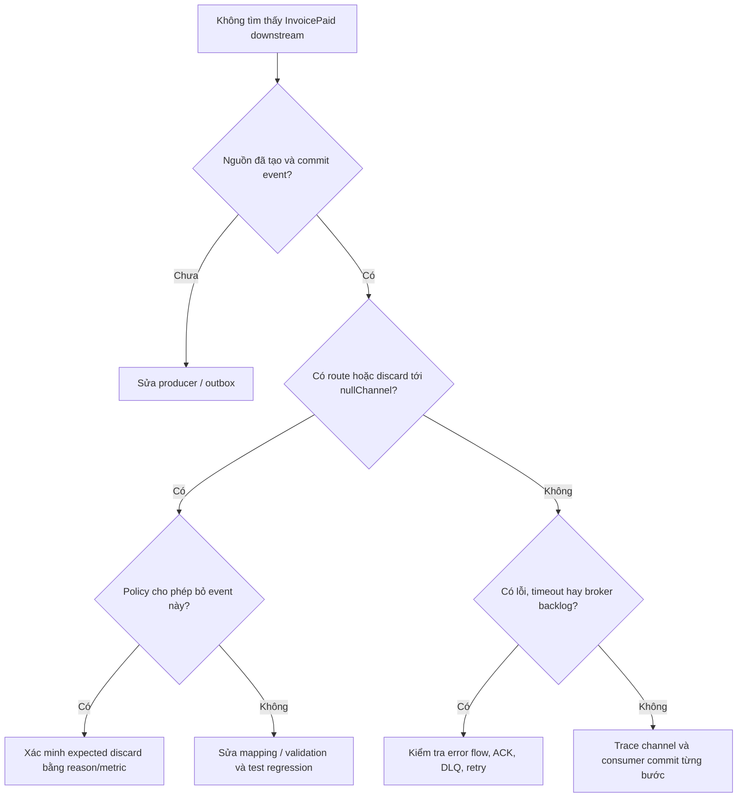

# Phân biệt null channel với mất message

## 1. Bài toán: một message không đi tiếp là lỗi hay chủ đích?

Trong module **SPRING_INTEGRATION_PATTERN**, chúng ta thực hành các *Enterprise Integration Patterns* bằng Spring Integration để xây dựng luồng thông điệp ít phụ thuộc, dễ mở rộng và quan sát được. Router, Filter, Transformer, Splitter, Aggregator, Gateway, retry, error channel và correlation được kết hợp để giải quyết nhiều loại xử lý khác nhau. Một thành phần rất nhỏ nhưng dễ bị hiểu nhầm là **`nullChannel`**.

Giả sử hệ thống nhận hai loại message:

- `HeartbeatReceived` được phát mỗi giây, chỉ dùng kiểm tra kết nối. Sau khi đã cập nhật trạng thái kết nối cần thiết, ứng dụng **không muốn xử lý tiếp** payload heartbeat.
- `PaymentSettled` xác nhận đã thanh toán. Message này phải được ghi nhận, cập nhật sổ cái và phát sự kiện tiếp theo. Nếu bị bỏ, hệ thống có thể mất dữ liệu nghiệp vụ.

Cả hai trường hợp đều có thể cho thấy **không có message ở bước downstream**, nhưng bản chất khác nhau hoàn toàn: trường hợp đầu là **discard có chủ đích**, trường hợp thứ hai có thể là **mất message ngoài ý muốn**.

> **Nguyên tắc:** `nullChannel` là một **đích tiêu thụ và bỏ message được chỉ định rõ**. Nó không phải là nơi “tự tìm lại” message lỗi, không giữ backlog, và không bảo đảm nghiệp vụ đã xử lý thành công. Muốn phân biệt bỏ có chủ đích với thất lạc, cần biết **hợp đồng message, quyết định route và dấu vết tại từng ranh giới**.

### Mục tiêu học tập

Sau bài này, bạn có thể:

1. Giải thích chính xác cách `NullChannel` xử lý `send()`, `receive()` và log.
2. Phân biệt “được chuyển tới `nullChannel`” với “không có subscriber”, “Filter từ chối”, “Gateway thiếu reply”, “broker giao nhận lỗi” và “exception bị nuốt”.
3. Chỉ định đích discard an toàn trong Filter, Router hoặc cuối integration flow.
4. Nhận diện những nơi **không** nên dùng `nullChannel`: thanh toán, audit bắt buộc, retry/DLQ và lỗi cần điều tra.
5. Viết kiểm thử và thiết kế log/metrics để chứng minh một message được bỏ theo chính sách thay vì biến mất không rõ lý do.

## 2. `NullChannel` là gì về mặt kỹ thuật?

Spring Integration cung cấp một channel đặc biệt tên **`nullChannel`** (bean được framework đăng ký mặc định trong application context được cấu hình Integration). Kiểu triển khai là `org.springframework.integration.channel.NullChannel`, hoạt động tương tự `/dev/null` trên hệ điều hành:

- Nhận message được gửi đến nó và **bỏ message**.
- `send(Message<?>)` trả về `true`; đó là xác nhận theo **hợp đồng channel**, không phải xác nhận xử lý nghiệp vụ.
- Nó cũng triển khai `PollableChannel`, nhưng `receive()` hoặc `receive(timeout)` trả về `null`: không có message nào để lấy lại.
- Thông thường chỉ log message ở mức **DEBUG**. Không có nghĩa bản ghi audit bắt buộc đã được lưu.
- Nó không phải một queue, broker topic, Dead Letter Queue hay `MessageStore`.

Javadoc mô tả hành vi cơ bản này như một “sink” nhận mọi message rồi bỏ. Không có consumer nào phải đăng ký với `nullChannel` để việc gửi được chấp nhận.

### 2.1. Thí nghiệm đơn giản: `send=true`, `receive=null`

```java
import org.springframework.integration.channel.NullChannel;
import org.springframework.integration.support.MessageBuilder;
import org.springframework.messaging.Message;

NullChannel sink = new NullChannel();
Message<String> message = MessageBuilder.withPayload("HEARTBEAT").build();

boolean acceptedByChannel = sink.send(message);
Message<?> readable = sink.receive(0);

System.out.println(acceptedByChannel); // true
System.out.println(readable);          // null
```

Đoạn mã không cần Spring context để minh họa bản chất của lớp. Trong một integration flow thực tế, hãy dùng **bean đặc biệt `nullChannel` có sẵn**, không tự khai báo thêm một bean cũng tên đó.

Nếu thay `HEARTBEAT` thành `PAYMENT_SETTLED`, kết quả `send=true` và `receive=null` vẫn như nhau. Vì thế **không được lấy giá trị trả về của `send()` làm bằng chứng hoàn tất thanh toán, ghi audit hay phát sự kiện**.

### 2.2. Khác với Java `null` hoặc message không có payload

Ba khái niệm có tên gần giống nhưng không cùng ý nghĩa:

| Khái niệm | Diễn giải |
| --- | --- |
| `nullChannel` | Một **channel cụ thể** tiêu thụ rồi bỏ message được gửi tới. |
| Java `null` từ service method | Một handler có thể **không tạo reply**; không có một message mới nào được phát từ kết quả `null`. |
| `receive() == null` của `PollableChannel` | Không có message trả về; với `NullChannel` đó là hành vi cố ý, còn ở `QueueChannel` có thể chỉ là queue đang rỗng hoặc hết hạn đợi. |

Không thể dùng một đối tượng `Message` có payload `null` theo hợp đồng message thông thường của Spring Messaging rồi coi như “gửi vào null channel”. Với một số giao thức như Kafka, có *tombstone*/giá trị null mang ý nghĩa riêng; chúng **không đồng nghĩa** Spring Integration `NullChannel`.

### 2.3. Ghi chú đặc biệt về reactive payload

Ở các phiên bản Spring Integration có hỗ trợ Reactive Streams, nếu payload gửi tới `nullChannel` là một `org.reactivestreams.Publisher`, channel **có thể subscribe ngay** để khởi động luồng reactive rồi bỏ dữ liệu phát ra; lỗi `onError` từ publisher được log mức WARN. Vì vậy đừng suy rằng gửi một `Mono` hoặc `Flux` tới đây hoàn toàn không có tương tác nào: việc subscribe có thể kích hoạt logic của publisher, kể cả side effect nếu pipeline chứa chúng.

## 3. Bản đồ: những hiện tượng “không thấy message” khác nhau

| Hiện tượng | Message đi đâu? | Có chủ đích? | Cách xác minh |
| --- | --- | --- | --- |
| Router/Filter chuyển tới `nullChannel` | Đến sink và bị bỏ | Có, nếu policy được định nghĩa rõ | Kiểm tra cấu hình route/discard, test và bộ đếm trước sink. |
| Filter trả `false`, không có discard channel | Bị Filter loại theo cấu hình | Có thể, nhưng dễ thiếu dấu vết | Kiểm tra predicate, mức log, error/discard policy. |
| Router không tìm được channel | Thường lỗi resolution/delivery theo cấu hình | Thường không | Kiểm tra exception, `resolutionRequired`, mapping và default route. |
| `DirectChannel` không có subscriber | Có thể ném lỗi dispatch/delivery | Không | Kiểm tra lifecycle, subscriber, log lỗi của sender. |
| `QueueChannel.receive(timeout)` trả `null` | Chưa lấy được message trong thời hạn | Chưa đủ cơ sở | Kiểm tra queue depth, poller, thời gian và transaction. |
| Gateway không nhận reply | Request không có phản hồi phù hợp trước deadline | Thường không, trừ one-way contract | Kiểm tra `replyChannel`, Filter, `replyTimeout`, xử lý lỗi. |
| Broker mất kết nối/consumer ACK quá sớm | Message có thể chưa tới hoặc không còn khả năng redelivery | Không | Đối chiếu publisher confirm, offset/ACK, DB commit, DLQ. |
| Process crash khi chỉ lưu message trong RAM | Trạng thái chưa bền vững có thể mất | Không | Fault-injection restart, store/backlog/recovery test. |
| ErrorMessage được route tới `nullChannel` | Lỗi bị bỏ, có thể không được điều tra | Chỉ khi có quyết định rõ ràng | Kiểm tra `errorChannel`/error flow và hợp đồng giám sát. |

Điểm quan trọng là **một triệu chứng không chứng minh một nguyên nhân**. Việc không tìm thấy message ở output không đủ để kết luận nó đã tới `nullChannel`; phải truy lại chuỗi message channel, endpoint và nguồn vào.

## 4. Sơ đồ quyết định: drop hợp lệ hay mất ngoài ý muốn?



Ví dụ cùng là không còn output:

```text
HEARTBEAT(eventId=hb-42)
  -> Filter: not business event
  -> discarded_reason=EXPECTED_HEARTBEAT
  -> nullChannel
  -> Không có output: ĐÚNG hợp đồng

PAYMENT_SETTLED(eventId=pay-42)
  -> Router: defaultOutputChannel=nullChannel  // cấu hình sai yêu cầu
  -> Không có ledger update: LỖI nghiệp vụ dù send() có thể true
```

**Ý định chỉ có thể xác nhận từ hợp đồng đã định nghĩa**, không thể suy ra từ đường đi kỹ thuật. Nếu một message nghiệp vụ quan trọng rơi vào sink do key sai, code vẫn chạy “đúng cấu hình” nhưng hệ thống vận hành sai.

## 5. Trường hợp hợp lý: bỏ telemetry hoặc heartbeat không cần downstream

Một ứng dụng có thể cho phép bỏ các heartbeat sau khi đã ghi trạng thái kết nối ở nơi thích hợp. Ví dụ sau dùng Filter annotation để chỉ chuyển **business event** sang kênh xử lý; heartbeat bị reject được đưa tới `nullChannel` một cách minh thị.

### 5.1. Cấu hình channel và Filter

```java
import org.springframework.context.annotation.Bean;
import org.springframework.context.annotation.Configuration;
import org.springframework.integration.channel.DirectChannel;
import org.springframework.integration.channel.QueueChannel;
import org.springframework.integration.config.EnableIntegration;
import org.springframework.messaging.MessageChannel;

@Configuration
@EnableIntegration
public class TelemetryFlowConfig {

    @Bean
    public MessageChannel telemetryInput() {
        return new DirectChannel();
    }

    @Bean
    public QueueChannel actionableTelemetry() {
        return new QueueChannel();
    }
}
```

```java
import org.springframework.integration.annotation.Filter;
import org.springframework.messaging.Message;
import org.springframework.stereotype.Component;

@Component
public class TelemetrySelection {

    @Filter(
        inputChannel = "telemetryInput",
        outputChannel = "actionableTelemetry",
        discardChannel = "nullChannel")
    public boolean keepBusinessEvent(Message<?> message) {
        return !"HEARTBEAT".equals(message.getHeaders().get("eventType"));
    }
}
```

Ví dụ dùng `DirectChannel` đầu vào và `QueueChannel` đầu ra để quan sát trong test. Khi nhận header `eventType=HEARTBEAT`, Filter trả `false` và chuyển message đến `nullChannel`; các event khác đi tới `actionableTelemetry`. **Giả định quan trọng:** message đã được kiểm tra hợp lệ ở biên vào; một event thiếu `eventType` không nên tự động được xem là business event như predicate đơn giản này trong production. Hãy bổ sung validation nếu schema yêu cầu.

Trong môi trường thật, `actionableTelemetry` phải có consumer/poller, chính sách dung lượng và cách dọn queue phù hợp. `QueueChannel` mặc định trong ví dụ không tự bảo đảm persistence xuyên restart.

### 5.2. Đừng dùng NullChannel thay cho việc ghi nhận quyết định

Ở ví dụ trên, `nullChannel` chỉ debug-log message nếu cấu hình logging cho phép. Nếu cần biết có bao nhiêu heartbeat đã bị loại, hãy **đo trước khi đưa vào sink**. Có thể dùng:

- Đếm số message bị phân loại là `HEARTBEAT` ở bước Filter hoặc discard flow.
- Ghi log có cấu trúc với `eventType` và một `reasonCode` không chứa dữ liệu nhạy cảm.
- Dùng một `discardChannel` riêng có Service Activator ghi metrics rồi kết thúc flow, hoặc forward tới `nullChannel` sau khi ghi nhận.

Không nên bắt `nullChannel` chịu trách nhiệm audit vì nó không có store hoặc replay. Nếu metrics bị mất cũng không được phép, metrics ấy phải có pipeline bền vững độc lập.

## 6. Trường hợp nguy hiểm: Router dùng NullChannel làm nhánh mặc định

Router có thể được cấu hình `defaultOutputChannel="nullChannel"` để **bỏ** message khi không xác định được đường đi. Với log/telemetry best effort, đó có thể là policy chấp nhận được. Với thanh toán, đặt hàng, hoàn tiền hoặc audit bắt buộc, đây thường là anti-pattern.

```java
// PHẢN VÍ DỤ: transaction quan trọng bị bỏ nếu provider lạ.
return IntegrationFlow.from("incomingPayments")
        .route("headers['paymentProvider']", route -> route
                .channelMapping("CARD", "cardRequests")
                .channelMapping("BANK", "bankRequests")
                .defaultOutputChannel("nullChannel"))
        .get();
```

Nếu một message đến với header `paymentProvider=EWALLET` sau khi tích hợp thêm đối tác mới, Router có thể gửi nó vào sink theo cấu hình mặc định. Không có một lỗi business nào buộc hệ thống phải xử lý hoặc cảnh báo.

### 6.1. Thiết kế sửa: route không hỗ trợ phải quan sát được

```java
// Gửi key không có mapping vào nhánh xử lý lỗi có chủ đích.
return IntegrationFlow.from("incomingPayments")
        .route("headers['paymentProvider']", route -> route
                .channelMapping("CARD", "cardRequests")
                .channelMapping("BANK", "bankRequests")
                .defaultOutputChannel("unsupportedPaymentRequests"))
        .get();
```

`unsupportedPaymentRequests` cần có subscriber thực sự: ví dụ Service Activator đánh dấu `UNSUPPORTED_PROVIDER`, ghi reason code, phát lỗi có hợp đồng hoặc chuyển sang kiểm tra thủ công. Nếu chỉ tạo một channel nhưng không có consumer, lỗi giao nhận vẫn xảy ra.

**Điểm cần lưu ý về cấu hình Router:** `defaultOutputChannel` chỉ là một phần. `resolutionRequired`, `channelKeyFallback`, channel mapping và `ignoreSendFailures` ảnh hưởng cách Router xử lý channel không tồn tại hoặc send thất bại. Từ Spring Integration 6.0, cấu hình default output channel cũng điều chỉnh hành vi `channelKeyFallback` mặc định. Không nên nghĩ “mọi trường hợp route lỗi đều rơi vào default channel”; hãy test từng kiểu key sai và channel sai theo phiên bản thư viện được dùng.

## 7. Filter từ chối: discard, báo lỗi hay chuyển sang nhánh nghiệp vụ?

Filter không nhất thiết gửi message tới `nullChannel` khi predicate trả `false`. Hành vi phụ thuộc cấu hình:

| Cấu hình Filter | Khi predicate trả `false` | Tình huống nên dùng |
| --- | --- | --- |
| Không `discardChannel`, không throw | Message bị bỏ; từ Spring Integration 6.1 có log WARN về việc bỏ trong trường hợp mặc định | Chỉ khi policy bỏ đã rõ và chấp nhận cách log mặc định. |
| `discardChannel="nullChannel"` | Message bị bỏ có chủ đích, không còn cảnh báo mặc định từ Filter về việc drop | Telemetry không cần giữ, có quan sát ở nơi khác nếu cần. |
| `discardChannel="rejectedMessages"` | Message chuyển sang consumer khác | Có yêu cầu báo từ chối, lưu lý do hoặc điều tra. |
| `throwExceptionOnRejection=true` | Ném `MessageRejectedException`; nếu có discard channel thì message vẫn có thể được gửi tới đó rồi exception được ném | Dữ liệu sai cần fail fast và xử lý lỗi rõ ràng. |

Ví dụ với một lệnh thanh toán phải xác thực, không nên âm thầm bỏ lệnh bị từ chối:

```java
import org.springframework.integration.annotation.Filter;
import org.springframework.messaging.Message;
import org.springframework.stereotype.Component;

@Component
public class PaymentInputValidation {

    @Filter(
        inputChannel = "paymentInput",
        outputChannel = "validatedPaymentCommands",
        throwExceptionOnRejection = "true")
    public boolean hasRequiredCommandId(Message<?> message) {
        Object commandId = message.getHeaders().get("commandId");
        return commandId instanceof String id && !id.isBlank();
    }
}
```

Ở đây các channel `paymentInput` và `validatedPaymentCommands` phải được khai báo và nối đúng consumer. Khi thiếu `commandId`, exception là dấu hiệu lỗi đầu vào; error flow hoặc caller phải có chính sách trả phản hồi. Đừng biến một lệnh tài chính không hợp lệ thành “đã nhận và bỏ qua”.

**Phân biệt validation với chính sách nghiệp vụ:** một khách hàng bị từ chối cấp tín dụng có thể là **kết quả nghiệp vụ hợp lệ**, không nhất thiết là exception kỹ thuật. Khi đó nên sinh `Rejected(reasonCode)`, cập nhật trạng thái và chuyển tới nhánh phản hồi; không dùng `nullChannel` để “giấu” quyết định từ chối.

## 8. Gateway: one-way có chủ đích khác với mất reply

`Gateway` chuyển đổi lời gọi Java thành request/reply trong hệ thống message. Cần phân biệt **phương thức không mong reply** với **phương thức bắt buộc có reply nhưng bị mất**.

### 8.1. Phương thức `void`: kết quả downstream có thể được bỏ chủ đích

Từ Spring Integration 5.4, khi gateway method trả `void`, framework có thể đặt header `replyChannel` trỏ tới bean `nullChannel` nếu không có một reply channel được cung cấp tường minh. Điều này hợp với hợp đồng **one-way**: caller không mong nhận payload trả về.

```java
import org.springframework.integration.annotation.Gateway;
import org.springframework.integration.annotation.MessagingGateway;

@MessagingGateway
public interface OneWayCommandGateway {

    @Gateway(requestChannel = "oneWayCommandInput")
    void submitHeartbeat(String heartbeat);
}
```

Tuy nhiên **`void` không đồng nghĩa gửi bất đồng bộ hoặc durable delivery**. Nếu flow dùng `DirectChannel` thì handler vẫn có thể xử lý đồng bộ trong lời gọi; exception cũng có thể lan đến caller. Không dùng phương thức `void` làm bằng chứng command đã được lưu vào broker hoặc database.

### 8.2. Phương thức cần reply: Filter drop sẽ khiến caller chờ

Giả sử gateway:

```java
@MessagingGateway
public interface PaymentQueryGateway {

    @Gateway(requestChannel = "paymentQueries",
             replyTimeout = 3_000L)
    PaymentStatus query(PaymentQuery request);
}
```

`PaymentQuery` và `PaymentStatus` là kiểu nghiệp vụ cần được định nghĩa trong dự án. Nếu downstream Filter bỏ request hoặc một Service Activator trả Java `null`, không có reply nào quay về gateway. Gateway có thể hết `replyTimeout` rồi trả `null`, hoặc ném `MessageTimeoutException` nếu được cấu hình `errorOnTimeout` tương ứng. Nếu handler đồng bộ **đang block ở cùng thread**, riêng `replyTimeout` chưa chắc giới hạn toàn bộ thời gian thực thi handler; cần timeout tại adapter/client và thiết kế bất đồng bộ khi phù hợp.

Đặc biệt, đừng sửa “mất reply” bằng cách chuyển output về `nullChannel`: điều đó cố tình **loại reply** chứ không giải quyết thiếu kết quả. Nếu nghiệp vụ yêu cầu phản hồi, hãy gửi kết quả `NOT_FOUND`, `REJECTED`, lỗi có cấu trúc hoặc xử lý qua error channel theo hợp đồng.

### 8.3. Khi nào đưa một reply không cần thiết vào sink?

Một flow có kết quả kỹ thuật nhưng caller không cần payload đó có thể kết thúc bằng `nullChannel`. Ví dụ, sau khi đã ghi nhận telemetry, một Transformer có thể sinh giá trị trung gian vô dụng. Đưa kết quả ấy vào sink để tránh lỗi resolution của reply channel là hợp lý **nếu upstream không chờ reply**. Không nên dùng sink để “khắc phục” Gateway có return type bắt buộc.

## 9. NullChannel không phải errorChannel, DLQ hay MessageStore

| Thành phần | Vai trò | Có giữ lại để xử lý sau? |
| --- | --- | --- |
| `nullChannel` | Kết thúc và bỏ message được gửi vào | **Không** |
| `errorChannel` | Nhận `ErrorMessage` để một error flow xử lý | **Không bảo đảm** lưu bền vững chỉ nhờ tên channel; tùy topology. |
| `discardChannel` | Đích do Filter/Aggregator hoặc thành phần khác chọn khi bỏ message | **Tùy channel đích**: có thể là `nullChannel`, queue, service hoặc adapter. |
| `QueueChannel` | Lưu tạm message chờ poller/consumer | Có thể nằm trong RAM; chỉ bền vững nếu có cấu hình store phù hợp. |
| Broker durable queue/topic | Lưu message theo hợp đồng broker | Có khả năng giao lại trong phạm vi cấu hình durability/retention/ACK. |
| Dead Letter Queue | Giữ message lỗi sau policy retry | Cần consumer, retention và quy trình replay/điều tra. |
| `JdbcChannelMessageStore` | Lưu message cho các channel hỗ trợ | Không tự tạo fan-out và không thay transaction/outbox. |

Thường không nên đặt `errorChannel="nullChannel"` chỉ để “khỏi thấy exception”. Việc đó khiến lỗi kỹ thuật quan trọng có thể biến mất khỏi hệ thống quan sát. Nếu một loại lỗi thực sự được phép bỏ, hãy áp dụng **chính sách có điều kiện**, đo số lỗi theo loại rồi kết thúc; không loại bỏ mọi lỗi trên cùng kênh theo cách không phân biệt.

### 9.1. Async error handling không bảo đảm gửi lại

Với `DirectChannel` đồng bộ, exception thường lan về sender. Khi flow đi qua `ExecutorChannel`, poller, inbound adapter hoặc broker listener, lỗi có thể xuất hiện ở thread khác và đi vào `errorChannel`/error flow tương ứng. Dù đã nhận `ErrorMessage`, message nghiệp vụ gốc chưa tự có khả năng redelivery. Cần xác định ACK/offset của nguồn, transaction, retry/DLQ và xử lý idempotent.

### 9.2. “Không thấy log” không chứng minh NullChannel không nhận

`NullChannel` debug-log; nếu logging ở INFO/WARN, bạn sẽ không thấy dòng DEBUG. Ngược lại, bật DEBUG cho toàn bộ ứng dụng có thể làm lộ payload hoặc quá nhiều dữ liệu. Hãy dùng metric/log có cấu trúc **trước khi gửi vào sink**, có reason code rõ, thay vì chỉ bật DEBUG dài hạn.

## 10. Java DSL: kết thúc flow sau khi log có chủ đích

Operator `log()` của Java DSL sử dụng cơ chế `WireTap`; bản thân nó không nhất thiết là terminal consumer. Từ Spring Integration 6.0, tài liệu khuyến nghị dùng `nullChannel()` sau `log()` cuối flow khi không cần trả reply.

```java
import org.springframework.context.annotation.Bean;
import org.springframework.context.annotation.Configuration;
import org.springframework.integration.config.EnableIntegration;
import org.springframework.integration.dsl.IntegrationFlow;
import org.springframework.integration.handler.LoggingHandler;

@Configuration
@EnableIntegration
public class TerminalDebugFlowConfig {

    @Bean
    public IntegrationFlow debugOnlyFlow() {
        return IntegrationFlow.from("debugOnlyInput")
                .log(LoggingHandler.Level.INFO,
                     "app.telemetry.terminal",
                     message -> message.getHeaders().getId())
                .nullChannel();
    }
}
```

Ví dụ này là một **flow quan sát rồi kết thúc**; nó không tạo một kết quả nghiệp vụ. `debugOnlyInput` là điểm vào được flow đăng ký; một producer có thể gửi message tới đó. Nếu log là chứng cứ audit bắt buộc, đừng dùng một logger + null channel làm cơ chế lưu vĩnh viễn. Chuyển sang audit sink có persistence và chính sách giao nhận riêng.

### Một phản ví dụ cần tránh

```java
// DANGEROUS nếu businessEvent phải tạo kết quả cho downstream.
return IntegrationFlow.from("paymentConfirmed")
        .log(LoggingHandler.Level.INFO, "payments")
        .nullChannel();
```

Mặc dù log hiện “đã thấy payment”, không có một handler nào cập nhật ledger hoặc phát lệnh kế tiếp. Nếu upstream mong reply, flow còn có nguy cơ tạo timeout. Đây là **message bị loại do cấu hình**, nhưng là **mất xử lý nghiệp vụ** vì routing sai yêu cầu.

## 11. Đo lường discard: đếm trước sink và ghi rõ nguyên nhân

Thay vì sử dụng `nullChannel` không có dấu vết, hãy phân loại và đo lường trước điểm kết thúc:



Các trường log/metric được khuyến nghị:

| Trường | Ý nghĩa | Ghi chú |
| --- | --- | --- |
| `eventType` | Loại message bị bỏ | Tập giá trị được giới hạn. |
| `discardReason` | Ví dụ `EXPECTED_HEARTBEAT`, `DUPLICATE_NOOP` | Không được dùng `UNKNOWN` để che lỗi hàng loạt. |
| `component` | Endpoint quyết định bỏ | Giúp tìm đúng Router/Filter cấu hình. |
| `flow` | Luồng tích hợp | Giúp theo dõi theo service. |
| `traceId` / `correlationId` | Truy vết một lần xử lý | Đưa vào log có kiểm soát, không làm nhãn metric cardinality cao. |
| `eventId` | Dedupe/audit nếu cần | Không dùng làm nhãn metrics; dữ liệu nhạy cảm phải che. |

Ví dụ log do ứng dụng chủ động phát:

```text
event=message_classified flow=telemetry type=HEARTBEAT decision=DISCARD reason=EXPECTED_HEARTBEAT
event=message_discarded  flow=telemetry type=HEARTBEAT channel=nullChannel
event=message_routed     flow=payments  type=PAYMENT_SETTLED target=ledgerInput
event=message_committed  flow=payments  type=PAYMENT_SETTLED result=LEDGER_UPDATED
```

Đây **không phải định dạng log mặc định** của Spring Integration. Với sự kiện bắt buộc, log “đã routed” không thay cho xác nhận “đã commit”. Phân biệt **mốc đã nhận**, **đã route**, **đã xử lý** và **đã xác nhận bền vững**.

### 11.1. Không đếm gửi vào sink là delivery thành công

Nếu dashboard có metric `messages_sent_total` và tăng mỗi khi `send()` trả `true`, message đưa vào `nullChannel` cũng làm metric tăng. Vì vậy metric ấy nên đặt tên theo **kết quả gửi tại channel**, không dùng như chỉ số nghiệp vụ `payments_completed_total`. Chỉ tăng chỉ số nghiệp vụ khi hoàn tất transition và commit theo hợp đồng.

## 12. Kiểm thử phân biệt discard với lỗi giao nhận

Mục tiêu test là chứng minh ba điều độc lập: **policy chọn bỏ đúng message**, **message cần xử lý đi tới downstream**, và **sự kiện cần phản hồi không bị sink nuốt**.

### 12.1. Test hành vi lớp NullChannel

```java
import static org.junit.jupiter.api.Assertions.*;
import org.junit.jupiter.api.Test;
import org.springframework.integration.channel.NullChannel;
import org.springframework.integration.support.MessageBuilder;

class NullChannelContractTest {

    @Test
    void sendTrueDoesNotMeanMessageCanBeReadBack() {
        NullChannel channel = new NullChannel();

        assertTrue(channel.send(
                MessageBuilder.withPayload("EVENT").build()));
        assertNull(channel.receive(0));
    }
}
```

Test này xác minh **hợp đồng sink**, không phải một quy trình nghiệp vụ đã thành công.

### 12.2. Integration test: chỉ heartbeat bị bỏ

```java
import static org.junit.jupiter.api.Assertions.*;
import org.junit.jupiter.api.Test;
import org.springframework.beans.factory.annotation.Autowired;
import org.springframework.beans.factory.annotation.Qualifier;
import org.springframework.integration.channel.QueueChannel;
import org.springframework.integration.support.MessageBuilder;
import org.springframework.messaging.Message;
import org.springframework.messaging.MessageChannel;
import org.springframework.test.context.junit.jupiter.SpringJUnitConfig;

@SpringJUnitConfig(classes = {
        TelemetryFlowConfig.class,
        TelemetrySelection.class
})
class TelemetryDiscardTest {

    @Autowired
    @Qualifier("telemetryInput")
    MessageChannel input;

    @Autowired
    @Qualifier("actionableTelemetry")
    QueueChannel processed;

    private Message<String> message(String type) {
        return MessageBuilder.withPayload("sample")
                .setHeader("eventType", type)
                .build();
    }

    @Test
    void heartbeatIsDeliberatelyDiscarded() {
        assertTrue(input.send(message("HEARTBEAT")));
        assertNull(processed.receive(0)); // Đúng theo policy, không phải broker loss.
    }

    @Test
    void businessEventIsNotSilentlyLost() {
        assertTrue(input.send(message("ALERT")));
        Message<?> delivered = processed.receive(1_000);
        assertNotNull(delivered);
        assertEquals("ALERT", delivered.getHeaders().get("eventType"));
    }
}
```

Test sử dụng các bean `TelemetryFlowConfig` và `TelemetrySelection` ở mục 5; cần Spring Integration, Spring Test và JUnit 5. Việc `processed.receive(0) == null` ở ca heartbeat **chỉ đúng khi biết chắc cấu hình Filter và policy đang được kiểm tra**; riêng điều kiện “queue rỗng” sẽ không chứng minh heartbeat đã đi tới `nullChannel`. Để kiểm tra chính xác **đường discard**, có thể thay đích bằng một `QueueChannel` kiểm thử hoặc thêm bộ đếm/trace tại nơi quyết định discard; đừng tự suy diễn đích sink từ sự vắng mặt downstream.

### 12.3. Bộ test tối thiểu nên có

| Test | Input | Kết quả cần xác minh |
| --- | --- | --- |
| Explicit sink | Gửi trực tiếp vào `NullChannel` | `send()` trả `true`, `receive()` trả `null`. |
| Heartbeat hợp lệ để bỏ | `eventType=HEARTBEAT` | Không tới business output; discard reason được ghi nhận theo thiết kế. |
| Business event cần xử lý | `eventType=ALERT` | Có output/commit, không rơi vào sink. |
| Thiếu eventType | Header không tồn tại | Validation hoặc error path theo hợp đồng, không tự rơi sai nhánh. |
| Router key không hỗ trợ | `paymentProvider=EWALLET` | Nhánh `unsupportedPaymentRequests` nhận message và phản hồi rõ. |
| Payment command thiếu ID | Không có `commandId` | Filter ném lỗi/đi error flow; không đánh dấu thành công giả. |
| Gateway yêu cầu reply | Request hợp lệ nhưng downstream không trả | Timeout/lỗi có kiểm soát; không coi sink là reply hợp lệ. |
| Gateway one-way | Phương thức trả `void`, downstream phát reply | Reply không cần thiết có thể được bỏ theo hợp đồng. |
| Async handler lỗi | Adapter ném exception trên worker | `errorChannel`/error flow ghi nhận; không bị mất trong log DEBUG. |
| Restart khi chưa commit | Message chưa bền vững | Hệ thống khôi phục hoặc cảnh báo được đúng theo delivery contract. |

Với những tình huống có broker, phải kiểm tra **publisher confirm, consumer acknowledgement, transaction và khả năng redelivery**, không chỉ unit test Spring channel. Trường hợp cần bảo đảm không mất message phải có thử nghiệm crash/restart với broker và storage phù hợp.

## 13. Quy trình chẩn đoán khi “message biến mất”

Giả sử một consumer báo không nhận được `InvoicePaid`. Điều tra nên theo thứ tự:

1. **Xác định ID và hợp đồng**: `eventId`, `commandId`, `correlationId`, event bắt buộc hay best effort, có cho phép discard không?
2. **Đọc đầu vào flow**: adapter có thực sự nhận message, parse được payload và headers không? Còn publisher confirm/ACK của nguồn?
3. **Xem từng endpoint**: Filter trả `false`? Router chọn key gì? Có `defaultOutputChannel=nullChannel` hay `discardChannel=nullChannel` không?
4. **Phân biệt send với handle**: channel `send=true` chỉ có nghĩa gì ở loại channel đó? Consumer downstream đã xử lý và commit chưa?
5. **Kiểm tra thread/lỗi**: `DirectChannel` đồng bộ hay `ExecutorChannel`/poller bất đồng bộ? Lỗi nằm trong stack của sender hay `errorChannel`?
6. **Kiểm tra deadline**: Gateway, handler, transport và callback có các timeout khác nhau? Reply có đến sau khi Gateway đã trả về không?
7. **Kiểm tra store/broker**: queue còn message, offset/ACK có tiến quá sớm, TTL/retention/DLQ có loại message không?
8. **Khôi phục và ngăn tái diễn**: sửa mapping/predicate, thêm test regression, metric discard reason, outbox/inbox nếu nghiệp vụ cần bền vững.



**Không chỉnh mặc định mọi Router về `nullChannel` để “ngừng báo lỗi”**. Điều đó biến lỗi cấu hình thành dữ liệu bị mất âm thầm và có thể làm quá trình điều tra khó hơn.

## 14. Phối hợp với các EIP khác mà không che mất dữ liệu

| EIP hoặc cơ chế | Nguy cơ nếu dùng `nullChannel` không đúng | Thiết kế thay thế |
| --- | --- | --- |
| Router | Mapping mới không được cập nhật, message rơi vào default sink | Nhánh unsupported rõ ràng và theo dõi routing key. |
| Filter | Từ chối nghiệp vụ bị biến thành discard im lặng | `rejectedMessages` + reason code hoặc exception tùy hợp đồng. |
| Transformer | Trả `null` hoặc không tạo reply, caller nhầm với sink | Validate output và `requiresReply` khi bắt buộc có kết quả. |
| Splitter | Một phần message bị bỏ, Aggregator chờ đủ sequence mãi | Quy ước SKIPPED, sửa release strategy hoặc xử lý expiry. |
| Aggregator | Nhóm chưa đủ/correlation sai, output không xuất hiện | Trace `correlationId`, release policy và group timeout. |
| Gateway | Reply bị bỏ hoặc không phát | Cấu hình reply timeout và error handling; reply bắt buộc phải có hợp đồng. |
| Retry | Lỗi bị nuốt trước khi retry phát huy tác dụng | Chỉ retry lỗi kỹ thuật được chọn; có idempotency. |
| Error channel | Lỗi quan trọng bị chuyển vào sink | Error flow phân loại, audit/retry/DLQ và alert. |
| Durable messaging | Đích lưu tạm chỉ trong RAM, crash làm mất message | Broker durable/outbox/inbox và ACK sau commit. |

Trường hợp có **NullChannel đúng đắn** thường nằm ở rìa flow hoặc nhánh loại bỏ có hợp đồng rõ: dữ liệu tạm không cần nữa, reply của one-way gateway, hoặc các sự kiện không quan trọng được cố ý lọc. Nó không nên thay thế state transition, event nghiệp vụ, giám sát lỗi hay một hàng đợi cần replay.

## 15. Bài thực hành: thiết kế một chính sách discard có thể kiểm chứng

Cho hệ thống phát sinh ba loại event: `Heartbeat`, `InventorySyncRequested` và `PaymentSettled`. Một đội ngũ đang cấu hình Router với default route là `nullChannel`, rồi báo không tìm thấy một số lệnh đồng bộ kho và thanh toán.

Hãy thực hiện:

1. Phân loại sự kiện nào cho phép bỏ, sự kiện nào bắt buộc phải được xử lý và lưu dấu. Ghi rõ “bỏ trước/sau bước nào” với Heartbeat.
2. Tạo Filter chỉ loại `Heartbeat`; các event thiếu loại hoặc loại không hỗ trợ phải được đưa vào validation/error flow thay vì mặc nhiên chấp nhận.
3. Bổ sung `discardReason=EXPECTED_HEARTBEAT` và metric số heartbeat bỏ tại trước `nullChannel`.
4. Sửa Router để map hai event nghiệp vụ tới adapter/handler tương ứng; thêm nhánh `unsupportedEvents` và một consumer ghi lỗi có cấu trúc.
5. Viết unit test chứng minh `NullChannel.send()` trả `true` dù `receive()` luôn `null`.
6. Viết integration test xác minh `Heartbeat` không tới business output nhưng `PaymentSettled` được ghi nhận qua đúng handler.
7. Cấu hình Gateway trả trạng thái xử lý cho lệnh đồng bộ kho; cố tình làm Filter trả `false` rồi đo timeout, giải thích vì sao route tới sink không phải giải pháp.
8. Mô phỏng adapter lỗi bất đồng bộ; kiểm tra error flow và quyết định retry/DLQ có policy rõ.
9. Mô phỏng crash giữa DB commit và phát `PaymentSettled`; đề xuất transactional outbox và idempotent consumer để tránh mất event.
10. Tạo dashboard tách `discarded_total{reason="EXPECTED_HEARTBEAT"}` khỏi số giao dịch đã commit và cảnh báo nếu `PaymentSettled` từng đi vào sink.

**Câu hỏi tự đánh giá**

- Vì sao `send() == true` trên `NullChannel` không chứng minh delivery thành công?
- Khác nhau giữa `nullChannel` và `QueueChannel.receive() == null` là gì?
- Tại sao Filter loại một message theo policy khác với mất message do consumer crash?
- Khi nào `@Gateway` trả `void` phù hợp với reply đi tới `nullChannel`?
- Nếu Router có `defaultOutputChannel=nullChannel`, vì sao phải kiểm tra thêm `resolutionRequired` và key mapping?
- Vì sao chuyển lỗi sang `errorChannel` chưa tự làm message bền vững?
- Khi nào cần một discard flow có audit và DLQ thay vì đưa thẳng vào `nullChannel`?
- Nếu một message bị bỏ có chủ đích nhưng bị bỏ **sai loại nghiệp vụ**, đó có còn là hành vi đúng không?

## 16. Tài liệu tham khảo

- [Spring Integration Reference — Special Channels](https://docs.spring.io/spring-integration/reference/6.4/channel/special-channels.html): `nullChannel`, `errorChannel`, DEBUG log và hành vi reactive.
- [Spring Integration Javadoc — NullChannel](https://docs.spring.io/spring-integration/docs/6.5.0/api/org/springframework/integration/channel/NullChannel.html): hợp đồng `send()`/`receive()` và kiểu triển khai.
- [Spring Integration Reference — Filter](https://docs.spring.io/spring-integration/reference/filter.html): `discardChannel`, `throwExceptionOnRejection` và log WARN khi Filter bỏ message không có discard channel (từ 6.1).
- [Spring Integration Reference — Common Router Parameters](https://docs.spring.io/spring-integration/reference/router/common-parameters.html): `defaultOutputChannel`, `channelKeyFallback`, `resolutionRequired` và `ignoreSendFailures`.
- [Spring Integration Reference — Messaging Gateways](https://docs.spring.io/spring-integration/reference/gateway.html): one-way gateway, `replyChannel`, `replyTimeout` và không có reply.
- [Spring Integration Reference — Java DSL log() Operator](https://docs.spring.io/spring-integration/reference/dsl/java-log.html): sử dụng `log()` và `nullChannel()` ở cuối flow.
- [Spring Integration Reference — Error Handling](https://docs.spring.io/spring-integration/reference/error-handling.html): lỗi đồng bộ/bất đồng bộ, global error channel và error flow.

> **Ghi nhớ:** **Gửi vào `nullChannel` là discard được cấu hình, không phải sự bảo đảm message đã được xử lý thành công.** “Không thấy message” có thể do Filter, Router, Gateway, callback, broker, timeout hoặc crash. Muốn tránh nhầm lẫn, hãy phân loại message theo hợp đồng, đưa sự kiện quan trọng vào đường có error/retry/persistence phù hợp, và ghi reason/metric **trước** mọi điểm discard có chủ đích.
