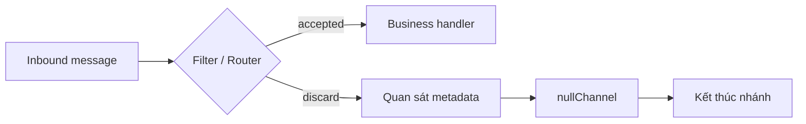
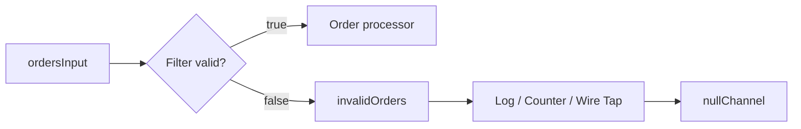
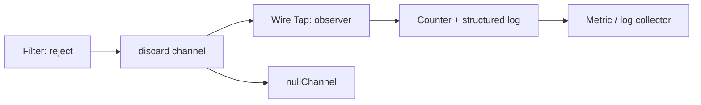
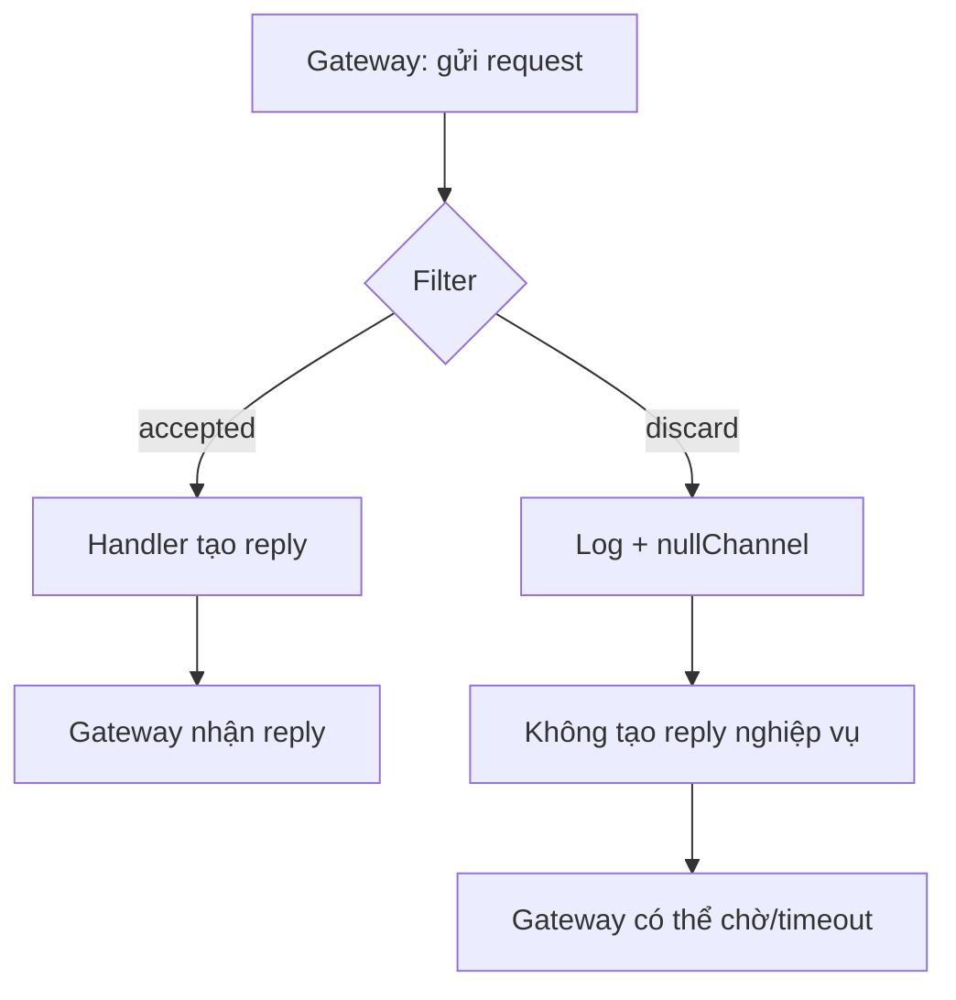

# Quan sát message trước khi discard

Trong một luồng tích hợp, không phải mọi message đều cần đi đến bước nghiệp vụ cuối cùng. Một Filter có thể loại dữ liệu không hợp lệ, Router có thể xác định message không cần xử lý tiếp, hoặc một nhánh chỉ tồn tại để “tiêu thụ” phản hồi không sử dụng. Spring Integration có **`nullChannel`** làm điểm nhận message và bỏ qua chúng một cách có chủ đích. Tuy nhiên, nếu bỏ message mà không ghi nhận **lý do** và **số lượng**, người vận hành khó phân biệt một quyết định đúng thiết kế với lỗi làm mất dữ liệu.

Bài thuộc chương **Null channel** của module **SPRING_INTEGRATION_PATTERN**. Module hướng tới triển khai Enterprise Integration Patterns bằng Spring Integration để xây dựng các luồng thông điệp ít phụ thuộc, dễ mở rộng; thực hành Router, Filter, Transformer, Splitter, Aggregator, Gateway, retry, error channel và correlation, đồng thời kiểm thử và theo dõi các nhánh. Ở đây, mục tiêu là **quan sát message trước khi discard** mà không biến log thành đường truyền nghiệp vụ hoặc làm sai ý nghĩa của discard.

Sau bài học, bạn có thể:

- Phân biệt discard có chủ ý, message bị Filter loại, lỗi xử lý và message bị mất ngoài ý muốn.
- Đặt `LoggingHandler`, operator `.log(...)` hoặc Wire Tap **trước** `nullChannel` để ghi metadata an toàn.
- Đếm quyết định loại message bằng Micrometer Counter mà không phụ thuộc số dòng log.
- Duy trì request correlation, group/sequence và mã lý do khi message đi đến nhánh discard.
- Hiểu tác động đến request/reply Gateway, retry, error channel, dữ liệu nhạy cảm và hệ thống nhiều instance.
- Thiết kế kiểm thử để bảo đảm nhánh discard kết thúc đúng nhưng không che giấu lỗi hoặc làm mất message quan trọng.

## 1. Null channel là điểm kết thúc, không phải kho lưu trữ

`nullChannel` là một channel đặc biệt trong Spring Integration được dùng như một “black hole”: **message gửi đến đó không được chuyển tiếp để xử lý nghiệp vụ**. Nó hữu ích khi việc bỏ một message là chủ đích, ví dụ message không cần phản hồi, kết quả trung gian không còn cần thiết hoặc một loại sự kiện đã được phân loại là bỏ qua hợp lệ.



Một số điều **không được suy diễn** từ việc dùng `nullChannel`:

| Ngộ nhận | Thực tế |
| --- | --- |
| “Đã gửi đến nullChannel là đã lưu lại để replay” | `nullChannel` không phải queue, database hay dead-letter store |
| “Null channel sẽ gửi cảnh báo cho mọi message bị loại” | Cần thiết kế log, metric và cảnh báo riêng |
| “Discard tương đương xử lý thành công nghiệp vụ” | Chỉ có nghĩa kết thúc một nhánh theo chính sách hiện tại |
| “Message không còn trong flow tức là payload ban đầu hợp lệ” | Có thể Filter loại vì không hợp lệ hoặc Router bỏ vì không liên quan |
| “nullChannel có thể thay errorChannel” | Error handling và discard có mục đích khác nhau |
| “Chỉ cần đặt logger sau nullChannel” | Không có bước downstream sau điểm kết thúc để quan sát message đó |
| “Discard đồng nghĩa hủy giao dịch đầu vào” | Ack, commit, retry và phản hồi phụ thuộc inbound adapter/gateway và transaction |

Hãy dùng `nullChannel` khi việc không xử lý tiếp là **một quyết định nghiệp vụ/kỹ thuật đã được định nghĩa rõ**. Nếu một đơn hàng thanh toán hoặc sự kiện tài chính bị bỏ do exception, thường cần error/recovery hoặc DLQ, không nên đẩy thẳng vào `nullChannel` để “hết lỗi”.

## 2. Những tình huống nên quan sát trước khi discard

| Tình huống | Có thể discard không? | Nên quan sát gì? |
| --- | --- | --- |
| Filter loại một thông điệp không thuộc phạm vi xử lý | Có, nếu contract cho phép bỏ qua | `event=filtered_out`, `reasonCode`, nguồn |
| Event trùng đã được dedup theo nghiệp vụ | Có nếu xác định chắc đã xử lý | `event=duplicate_ignored`, ID đã kiểm soát |
| Heartbeat/notification không cần downstream | Có nếu chỉ là tín hiệu phụ | Số lượng, loại thông báo |
| Router chuyển một loại message vào nhánh “ignored” | Có nếu đó là nhánh được thiết kế | `route=ignored` và mã lý do |
| Một kết quả xử lý không cần reply | Có khi giao thức và caller không chờ response | Mốc “result intentionally ignored” nếu cần |
| Retry hết số lần, message vẫn cần xử lý | Thường **không** | Cần error channel, recovery, DLQ hoặc cơ chế bền vững |
| Message có payload không parse được và có giá trị nghiệp vụ | Không nên âm thầm bỏ | Lưu/định tuyến lỗi theo chính sách dữ liệu |
| Message con của Splitter đang chờ Aggregator | Rất thận trọng | Kiểm tra ảnh hưởng đến correlation, release và timeout |

Trong production, cùng một số liệu “100 message bị discard” có thể là điều bình thường (100 heartbeat bị bỏ), hoặc sự cố nghiêm trọng (100 yêu cầu thanh toán mất). **Mã lý do và loại flow** quan trọng không kém Counter.

### Phân biệt Filter discard với nullChannel

Một `Filter` có thể loại message bằng cách không chuyển tiếp nếu predicate trả `false`. Bạn có thể cấu hình `discardChannel` để định tuyến message bị loại sang một nhánh khác. **Không phải cứ Filter trả false thì tự động có một log hay một message đi tới nullChannel**; đường đi phụ thuộc cấu hình Filter.

Dùng `discardChannel` để kiểm soát đường đi khi message bị loại, sau đó chủ động quan sát trước khi gửi nó vào `nullChannel`:



Cách thiết kế này không yêu cầu business handler đọc log để biết message đã bị loại; nhánh discard vẫn là message flow rõ ràng.

## 3. Chọn điểm quan sát đúng trong flow

Một logger có thể được đặt trước Filter, trên nhánh discard hoặc sau Transformer. Mỗi vị trí có **ngữ nghĩa khác nhau**.

| Điểm quan sát | Biết chắc điều gì? | Không thể kết luận điều gì? |
| --- | --- | --- |
| Trước Filter | Message đã tới đầu vào | Không biết sẽ bị Filter loại hay chấp nhận |
| Sau Filter ở nhánh hợp lệ | Message đã vượt predicate | Không đếm các message bị loại |
| Trên `discardChannel` của Filter | Message được chọn vào nhánh discard | Chưa chắc việc ghi log/metric hoặc sink cuối hoàn thành |
| Trước `nullChannel` | Message sắp đi đến điểm kết thúc | Không chứng minh database/queue/transaction đã commit |
| Sau `nullChannel` | Không có luồng downstream để quan sát theo cách thông thường | Không dùng vị trí này để kỳ vọng nhận lại message |

Bởi vậy nên dùng event **`discard_selected`** cho điểm được chọn vào nhánh discard, và chỉ dùng **`discard_completed`** nếu ứng dụng thực sự có nơi xác nhận đúng semantics đó. Trong phần lớn trường hợp, một Counter “số quyết định discard” là rõ ràng hơn một Counter “số message đã mất”.

### Ưu tiên mã lý do ổn định

Không nên xây dashboard bằng cách parse câu `"Order missing details, skip!"`. Dùng mã cố định:

```text
INVALID_INPUT
NOT_RELEVANT
DUPLICATE_IGNORED
UNSUPPORTED_EVENT
EXPIRED_BY_POLICY
```

Các mã này nên được xác định từ điều kiện kiểm tra thực, không suy đoán từ payload trong logger. Một nhánh Filter với một predicate xác định chỉ nên dùng mã phù hợp với lý do chính của predicate đó.

## 4. Ghi log an toàn trước nullChannel bằng Java DSL

Đoạn Java 17+ dưới đây là ví dụ đơn giản nhất: message được chuyển đến một channel discard chủ ý, ghi một dòng metadata đã chọn, rồi đến `nullChannel`.

```java
import org.springframework.context.annotation.Bean;
import org.springframework.context.annotation.Configuration;
import org.springframework.integration.channel.DirectChannel;
import org.springframework.integration.dsl.IntegrationFlow;
import org.springframework.integration.handler.LoggingHandler;
import org.springframework.messaging.MessageChannel;

@Configuration
class SimpleDiscardFlowConfig {

    @Bean
    MessageChannel ignoredEvents() {
        return new DirectChannel();
    }

    @Bean
    IntegrationFlow ignoredEventFlow() {
        return IntegrationFlow.from("ignoredEvents")
                .log(LoggingHandler.Level.INFO,
                        "app.integration.discard",
                        message -> "event=discard_selected"
                                + " reasonCode=NOT_RELEVANT"
                                + " messageId=" + message.getHeaders().getId())
                .channel("nullChannel")
                .get();
    }
}
```

Giải thích:

1. Một message vào `ignoredEvents` được coi là message **đã được chính sách upstream chọn để bỏ**. Ví dụ chưa minh họa quyết định đó được đưa ra thế nào.
2. `.log(...)` tạo điểm logging trong IntegrationFlow; category `app.integration.discard` giúp cấu hình log level riêng.
3. Biểu thức log chỉ lấy message ID và mã lý do do ứng dụng xác định, không in `message.toString()` hoặc payload.
4. `.channel("nullChannel")` kết thúc đường message nghiệp vụ; không tự lưu trữ, gửi DLQ hoặc làm lại.
5. Dòng `INFO` trên là **mốc quan sát**. Khi logger level tắt, nghiệp vụ discard vẫn diễn ra. Ngay cả khi logger nhận message, backend có thể lấy mẫu hoặc drop bản ghi.

**Giới hạn:** mẫu `key=value` là text dễ đọc, chưa chắc có các field JSON độc lập. Nếu muốn structured logging thực sự, dùng SLF4J fluent `addKeyValue(...)` với backend/JSON encoder được cấu hình phù hợp.

Đừng viết:

```java
// Không có lợi cho bảo mật, chi phí và quan sát:
.log(LoggingHandler.Level.INFO, "app.discard", m -> m.toString())
.channel("nullChannel")
```

Vì `Message.toString()` có thể chứa payload và metadata không thích hợp để lưu trong hệ thống log.

## 5. Filter và discard flow có chủ đích

Ví dụ sau kết hợp Filter, một nhánh discard có quan sát, và handler nghiệp vụ. Đây là luồng **một chiều** minh họa; không cần caller chờ reply.

```java
import java.util.concurrent.atomic.AtomicInteger;

import org.springframework.context.annotation.Bean;
import org.springframework.context.annotation.Configuration;
import org.springframework.integration.channel.DirectChannel;
import org.springframework.integration.dsl.IntegrationFlow;
import org.springframework.integration.handler.LoggingHandler;
import org.springframework.messaging.MessageChannel;
import org.springframework.stereotype.Service;

record OrderCommand(String orderId, int itemCount) { }

@Service
class OrderHandler {

    public void process(OrderCommand order) {
        // Xử lý nghiệp vụ thật ở đây.
    }
}

@Configuration
class FilterAndDiscardConfig {

    @Bean
    MessageChannel ordersInput() {
        return new DirectChannel();
    }

    @Bean
    MessageChannel invalidOrders() {
        return new DirectChannel();
    }

    @Bean
    IntegrationFlow ordersFlow(OrderHandler orderHandler) {
        return IntegrationFlow.from("ordersInput")
                .filter(OrderCommand.class, order -> order.itemCount() > 0,
                        spec -> spec.discardChannel("invalidOrders"))
                .handle(orderHandler, "process")
                .get();
    }

    @Bean
    IntegrationFlow invalidOrderDiscardFlow() {
        return IntegrationFlow.from("invalidOrders")
                .log(LoggingHandler.Level.INFO,
                        "app.integration.discard",
                        m -> "event=discard_selected"
                                + " reasonCode=EMPTY_ORDER"
                                + " messageId=" + m.getHeaders().getId())
                .channel("nullChannel")
                .get();
    }
}
```

**Luồng hoạt động:**

- Với `itemCount > 0`, Filter cho message đến `OrderHandler`.
- Với `itemCount <= 0`, Filter chuyển message sang `invalidOrders` và nhánh này log rồi kết thúc tại `nullChannel`.
- `nullChannel` không quyết định valid/invalid: điều kiện này thuộc Filter.
- Handler xử lý đơn hợp lệ không phụ thuộc vào việc log `discard_selected` có được ghi hay không.

Đoạn code dùng một predicate đơn giản và giả định một đơn có 0 item được phép bỏ qua. Trong sản phẩm thật, một yêu cầu đơn hàng không hợp lệ có thể phải nhận **validation error** thay vì bị discard. Nếu là request/reply từ Gateway hoặc HTTP, phải xác định hợp đồng phản hồi riêng (xem mục 8).

### Vì sao cần có lý do thay vì chỉ biết “đã discard”?

Một số message không liên quan nên được bỏ qua; một số khác lỗi dữ liệu và cần báo lại nguồn. Ghi cùng một event `discarded` cho mọi trường hợp khiến dashboard không phân biệt được thay đổi traffic bình thường với lỗi dữ liệu đầu vào.

Có thể phân nhánh `invalidOrders`, `duplicateEvents`, `unsupportedEvents` bằng Router/Filter và gắn mã lý do riêng. Nếu mỗi nhánh có một lý do cố định, logger không cần đọc payload để suy ra reasonCode.

## 6. Đếm quyết định discard bằng Counter, log để điều tra

Đếm bằng số dòng log không đáng tin: INFO có thể tắt, log được lấy mẫu, async appender drop, một message bị log nhiều lần hoặc collector chậm. Để biết **bao nhiêu message được chọn vào nhánh discard**, dùng Counter tại điểm đã chọn.

Một kiến trúc phù hợp:



Với các điều kiện xác định trong mẫu, dùng Micrometer:

```java
import io.micrometer.core.instrument.Counter;
import io.micrometer.core.instrument.MeterRegistry;

Counter selectedForDiscard = Counter
        .builder("integration.discard.selected")
        .description("Messages selected for intentional discard")
        .tag("flow", "orders")
        .tag("reason", "empty_order")
        .register(meterRegistry);

// Tại điểm quan sát quyết định đã chọn:
selectedForDiscard.increment();
```

Ví dụ trên giả định đã có biến `meterRegistry` thuộc loại `MeterRegistry`. Tên `integration.discard.selected` là **tên metric do ứng dụng định nghĩa**, không phải metric mặc định của Spring Integration. Khi xuất sang Prometheus, registry có thể đổi thành tên phù hợp cú pháp backend.

Nếu cần Counter cho nhiều lý do, chỉ dùng tag `reason` có tập giá trị hữu hạn; không dùng email, payload hoặc request ID làm metric labels.

### Định nghĩa rõ “selected” khác “completed”

Counter đặt trong một Wire Tap trước `nullChannel` đo việc **observer đã xử lý sự kiện được chọn bỏ**, không phải một biên nhận bền vững chứng minh message đã bị xóa. Nếu gửi tới nullChannel hoặc observer thất bại, cách cộng Counter và đường exception phụ thuộc topology. Với nhu cầu cam kết chính xác, thiết kế điểm đo/hợp đồng ack rõ ràng, chứ không suy từ log.

Một message có thể đi qua Filter nhiều lần do retry/redelivery; Counter “selected” có thể tăng nhiều lần cho cùng nghiệp vụ. Nếu yêu cầu đếm **message duy nhất**, cần một identity/dedup store và quy tắc cửa sổ cụ thể. Không thể giải quyết điều này chỉ bằng cách đặt `messageId` làm tag metric.

## 7. Wire Tap: quan sát mà không biến logger thành business handler

`Wire Tap` sao/chuyển message sang một nhánh phụ, thường dùng để ghi log hoặc lấy số liệu. Nhánh nghiệp vụ tiếp tục đến sink; nhánh quan sát có thể dùng SLF4J, Micrometer hoặc tracing.

Ví dụ này sử dụng SLF4J 2.x fluent API để ghi key-value. Nó **không** dùng nội dung message làm câu lệnh cho downstream.

```java
import io.micrometer.core.instrument.Counter;
import io.micrometer.core.instrument.MeterRegistry;

import org.slf4j.Logger;
import org.slf4j.LoggerFactory;
import org.springframework.context.annotation.Bean;
import org.springframework.context.annotation.Configuration;
import org.springframework.integration.channel.DirectChannel;
import org.springframework.integration.dsl.IntegrationFlow;
import org.springframework.messaging.Message;
import org.springframework.messaging.MessageChannel;

@Configuration
class ObservedDiscardFlowConfig {

    private static final Logger LOG =
            LoggerFactory.getLogger("app.integration.discard");

    @Bean
    MessageChannel discardInput() {
        return new DirectChannel();
    }

    @Bean
    MessageChannel discardObservation() {
        return new DirectChannel();
    }

    @Bean
    IntegrationFlow discardSinkFlow() {
        return IntegrationFlow.from("discardInput")
                .wireTap("discardObservation")
                .channel("nullChannel")
                .get();
    }

    @Bean
    IntegrationFlow discardObserverFlow(MeterRegistry registry) {
        Counter count = Counter.builder("integration.discard.selected")
                .tag("flow", "orders")
                .tag("reason", "not_relevant")
                .register(registry);

        return IntegrationFlow.from("discardObservation")
                .handle(message -> {
                    count.increment();

                    LOG.atInfo()
                            .addKeyValue("event", "integration.discard_selected")
                            .addKeyValue("reasonCode", "NOT_RELEVANT")
                            .addKeyValue("messageId",
                                    message.getHeaders().getId())
                            .addKeyValue("requestCorrelationId",
                                    safeRequestId(message))
                            .log("message intentionally discarded");
                })
                .get();
    }

    private static String safeRequestId(Message<?> message) {
        Object value = message.getHeaders().get("requestCorrelationId");
        if (value instanceof String id
                && id.matches("[A-Za-z0-9_-]{1,64}")) {
            return id;
        }
        return "missing";
    }
}
```

**Điều kiện để ví dụ có ý nghĩa:**

1. `discardInput` chỉ nhận message đã có **quyết định discard hợp lệ** từ upstream. Nếu nguồn gửi trực tiếp mọi message vào đây, code sẽ discard tất cả.
2. `.wireTap("discardObservation")` chuyển message sang nhánh observer; `.channel("nullChannel")` tiếp tục đưa message gốc đến nơi kết thúc.
3. `Counter` ở observer đo sự kiện quan sát được chọn để bỏ. Nếu mục tiêu cần đo quyết định ngay tại Filter, đặt Counter tại Filter hoặc nhánh tiếp nhận đầu tiên thay vì chỉ dựa vào observer.
4. `DirectChannel` làm nhánh observer chạy đồng bộ trong mô hình này; nếu observer ném exception hoặc chậm, nó có thể ảnh hưởng đường gửi chính. Code production phải kiểm soát lỗi và độ trễ ở observer.
5. `addKeyValue(...)` tạo các trường có cấu trúc ở API SLF4J 2.x; muốn JSON field độc lập cần encoder/backend hỗ trợ và được kiểm thử.
6. `safeRequestId` chỉ kiểm tra một header nhất định; tốt hơn nên cấp ID ở ingress và truyền nó xuyên flow.
7. Không có Counter hay log nào tự làm message được xử lý nghiệp vụ hoặc trở thành bản sao lưu có thể replay.

**Lưu ý:** Wire Tap không mặc định đồng nghĩa quan sát “không thể gây lỗi”. Nếu cần tách độ trễ, có thể dùng channel bất đồng bộ hoặc queue có giới hạn; đổi lại, phải chọn chính sách đầy queue, drop, shutdown và monitor số event quan sát bị mất. Không nên coi đó là nguồn audit bền vững.

## 8. Gateway request/reply và rủi ro chờ phản hồi

Dễ mắc lỗi khi đưa một message từ **request/reply Gateway** vào `nullChannel` và cho rằng Gateway sẽ tự hiểu “xử lý xong, trả thành công”.



`nullChannel` không tự tạo business reply tương ứng với request. Nếu Gateway đang đợi phản hồi và không có nhánh nào gửi reply, caller có thể timeout hoặc nhận kết quả phụ thuộc cấu hình Gateway (ví dụ timeout được xử lý theo contract). Vì thế:

- Với request validation, nên trả một **kết quả từ chối có cấu trúc** cho caller.
- Với request xử lý không đồng bộ, có thể trả acknowledgment sớm khi thật sự đã nhận việc theo hợp đồng.
- Nếu kết quả không cần trả lời, dùng giao thức **one-way** phù hợp ngay từ đầu.
- Không chuyển message sang `nullChannel` chỉ để “tắt” timeout mà không xem lại nghĩa nghiệp vụ.

Ví dụ với HTTP, một yêu cầu không hợp lệ có thể cần mã 400 hoặc 422; một yêu cầu vượt quota có thể cần 429. **Không** mặc định các mã này được Spring Integration sinh tự động vì Filter gửi message tới `nullChannel`. Adapter/controller và lỗi/reply mapping phải được thiết kế.

### Reply channel và error channel không giống nullChannel

`replyChannel` của message liên quan đến nơi gửi phản hồi; `errorChannel` liên quan tuyến xử lý lỗi khi thành phần phát hành error message; `nullChannel` chỉ là nơi tiêu thụ message mà không chuyển tiếp. Đặt `nullChannel` vào đúng ngữ cảnh từng loại channel mới tránh việc discard ngoài ý muốn.

## 9. Correlation, Splitter và Aggregator trước khi discard

Trong luồng một yêu cầu được Splitter tách thành nhiều phần, message con có thể mang header `correlationId`, `sequenceNumber`, `sequenceSize`. Những metadata này hữu ích để điều tra message nào bị bỏ. Tuy vậy, việc discard một phần tử có thể khiến Aggregator **không bao giờ đạt điều kiện release** nếu điều kiện đang đòi đủ mọi phần.

Ví dụ:

```text
requestCorrelationId=req_42
Split: 3 message con
  #1 -> processed
  #2 -> Filter reject -> nullChannel
  #3 -> processed
Aggregator yêu cầu sequenceSize=3
=> Có nguy cơ chờ mãi hoặc timeout vì thiếu #2
```

Đừng chỉ xem một log `discard_selected` rồi cho rằng đó là tình huống hợp lệ. Phải xác định:

- Có được phép bỏ một phần tử mà vẫn hoàn thành nhóm không?
- Release strategy có cần đủ `sequenceSize` thành viên không?
- Có cần tạo kết quả thay thế hoặc điều chỉnh chính sách gom nhóm không?
- Có thời gian chờ/timeout và kênh xử lý nhóm không đầy đủ không?
- Một request có thể có **nhiều** nhóm correlation khác nhau qua nhiều tầng Splitter không?

Một log an toàn trên nhánh discard của message con có thể có:

```json
{
  "event": "integration.discard_selected",
  "flow": "orderFulfillment",
  "stage": "itemFilter",
  "requestCorrelationId": "req_42",
  "messageId": "0f54b60a-7f0f-4b2d-9a12-c96e8d739612",
  "groupRef": "group_8",
  "sequenceNumber": 2,
  "sequenceSize": 3,
  "reasonCode": "INVALID_ITEM"
}
```

Đây là **schema ví dụ**, không phải dữ liệu Spring Integration tự log. Không suy `groupRef` trực tiếp từ `correlationId.toString()` nếu đó là object hoặc có dữ liệu không được phép. Thay bằng định danh đã kiểm tra theo chính sách.

### Request ID khác group correlation ID

`requestCorrelationId` là mã do ứng dụng cấp để tra toàn bộ yêu cầu; `MessageHeaders.ID` là ID của message cụ thể; header `correlationId` của Splitter/Aggregator dùng để gom nhóm và có thể khác request ID. Với lỗi hoặc discard tại message con, nên giữ các ID này đúng mục đích thay vì viết lại thành một trường chung.

## 10. Discard, retry, error channel và DLQ là các nhánh khác nhau

| Hành vi | Mục đích | Chọn khi nào? |
| --- | --- | --- |
| `nullChannel` | Kết thúc một message/nhánh **có chủ đích** | Message thực sự không cần xử lý tiếp |
| `discardChannel` | Nơi nhận message mà Filter loại | Khi cần một đường xử lý rejection rõ ràng |
| Retry advice | Thử lại thao tác có thể phục hồi | Lỗi tạm thời, có giới hạn attempt/backoff |
| `errorChannel` | Đường xử lý `ErrorMessage` khi thành phần phát lỗi | Chẩn đoán và recovery theo cấu hình |
| Dead-letter queue/store | Giữ message cần điều tra hoặc replay | Khi message quan trọng thất bại cuối |
| Quarantine channel | Cô lập message đáng ngờ/chưa parse được | Khi phải giữ bằng chứng hoặc chờ xem xét |
| Audit store | Lưu dấu vết có yêu cầu bền vững | Khi chính sách nghiệp vụ/pháp lý đòi hỏi |

Một lỗi phổ biến là xử lý exception bằng cách đưa message gốc vào `nullChannel` để luồng không báo lỗi nữa. Điều này chỉ **che khuất sự cố** nếu nghiệp vụ còn yêu cầu xử lý message. Hãy phân biệt loại bỏ hợp lệ với terminal failure.

Ví dụ: Filter loại thông báo `heartbeat` không thuộc phạm vi hệ thống có thể dùng `nullChannel`. Nhưng khi outbound Gateway gọi dịch vụ thanh toán thất bại sau retry, cần xác định rollback, error response, DLQ, bù trừ hay cơ chế phục hồi khác; không âm thầm discard.

**Không giả định** lỗi đồng bộ trên `DirectChannel` tự đi qua error channel; tuyến lỗi phụ thuộc endpoint, advice, poller và cấu hình error publishing. `nullChannel` không biến exception thành `ErrorMessage` hoặc tự đảm bảo đúng semantics retry.

## 11. Bảo vệ dữ liệu trước khi log message bỏ đi

Message bị loại không đồng nghĩa an toàn để log: dữ liệu không hợp lệ có thể chứa nguyên input từ người dùng, token, thông tin thanh toán hoặc payload lớn. Thậm chí lý do discard có thể bắt nguồn từ nội dung không đáng tin.

**Nên ghi theo allowlist**:

- `event` và `reasonCode` là các giá trị enum do ứng dụng quyết định.
- `flow`, `stage`, `route` thuộc danh mục đã kiểm soát.
- `requestCorrelationId` đã kiểm tra định dạng, độ dài và nguồn.
- `messageId` hoặc sequence metadata cần thiết, không suy từ raw payload.
- `payloadType` hoặc kích thước payload đã được đo phù hợp nếu hữu ích.
- `errorCode` đã phân loại, không phải nguyên văn `Throwable.getMessage()`.

**Tránh ghi**:

```java
// Nguy cơ lộ payload và headers:
logger.info("Discarded {}", message);

// Nguy cơ in secret trong exception message / stack trace:
logger.error("Failed to discard", exception);

// Nguy cơ phát dữ liệu tùy ý từ nguồn ngoài:
logger.info("Discard reason {}", message.getPayload().toString());
```

Ngay cả khi dùng JSON encoder, việc serialize toàn bộ payload hoặc `MessageHeaders` vẫn có thể lộ thông tin. Chọn trường an toàn tại nơi tạo log; collector-side redaction chỉ là lớp bảo vệ bổ sung.

Nếu phải điều tra một message không thể parse, có thể lưu bản ghi bền vững vào quarantine/DLQ theo chính sách bảo mật thay vì in toàn bộ vào log. **`nullChannel` không giúp phục hồi một payload đã bỏ.**

## 12. Giới hạn chi phí quan sát trong production

Nếu Filter discard hàng nghìn message/s, ghi một bản INFO cho **mọi** message bị loại có thể gây ra bottleneck mới. Cần kết hợp:

| Tín hiệu | Mục đích | Chính sách gợi ý |
| --- | --- | --- |
| Counter theo `reasonCode` | Thống kê số decision discard | Ghi thường trực, ít nhãn |
| Counter theo `flow`/`stage` | Biết nhánh nào đột nhiên discard nhiều | Nhãn enum, không dùng message ID |
| Structured log an toàn | Điều tra trường hợp cụ thể | INFO cho sự kiện quan trọng, DEBUG/sampling cho volume lớn |
| Trace/span attributes | Xem message đi qua stage nào | Phụ thuộc instrumentation và trace sampling |
| Gauge queue/backlog | Phát hiện nhánh discard/quarantine bị tắc | Theo dõi sát nếu có buffer |
| Error channel metrics | Phân biệt discard với lỗi xử lý | Đếm terminal failure riêng |

**Sampling log không được làm sampling message nghiệp vụ.** Khi cần giảm log, lấy mẫu ở observer hoặc logger chứ không Filter mất 95% message trước business handler chỉ để giảm ingest.

Với `Wire Tap` đồng bộ, observer vẫn có chi phí CPU/I/O và có thể ảnh hưởng độ trễ. Nếu chuyển sang executor hoặc queue, phải xác định chính sách khi buffer đầy: block, drop event quan sát, hoặc xử lý lỗi; đồng thời theo dõi số event log bị mất. Counter đặt trong observer bất đồng bộ cũng có thể bỏ sót sự kiện nếu observer không chạy.

Đừng dùng số dòng log làm tổng số discard tuyệt đối; một message có thể được log nhiều lần do retry, hoặc không được log do level/sampling/appender.

## 13. Kiểm thử nhánh discard bằng message thật

Thay vì chỉ test hàm `FilterPredicate`, hãy gửi message qua `MessageChannel` và xác minh **cả nhánh được chấp nhận lẫn nhánh discard**. Dùng message giả có dữ liệu canary để phát hiện rò rỉ.

Ví dụ gửi message vào `ordersInput` khi đã cấu hình `FilterAndDiscardConfig`:

```java
import org.springframework.messaging.support.MessageBuilder;

// order hợp lệ: phải đến OrderHandler.
ordersInput.send(MessageBuilder
        .withPayload(new OrderCommand("ORD-42", 3))
        .setHeader("requestCorrelationId", "req_42")
        .build());

// order không hợp lệ: phải đi vào invalidOrders rồi nullChannel.
ordersInput.send(MessageBuilder
        .withPayload(new OrderCommand("ORD-43", 0))
        .setHeader("requestCorrelationId", "req_43")
        .build());
```

Đây là ví dụ gọi trong môi trường test có biến `ordersInput` được inject; để xác minh đầu ra, bạn có thể dùng một fake handler đếm số lần `process` được gọi và test appender capture log category `app.integration.discard`.

| Tình huống | Kết quả cần xác minh |
| --- | --- |
| Filter accept | Handler chạy; không có event discard cho message đó |
| Filter reject | Handler không chạy; nhánh discard nhận message |
| Log bật INFO | Có event `discard_selected` đúng mã lý do và message ID |
| Log tắt INFO | Business flow vẫn discard theo chính sách, không phụ thuộc log |
| Payload chứa token giả | Không xuất token trong log, kể cả khi DEBUG bật |
| Observer ném lỗi | Hiểu tác động tới flow đồng bộ; tránh để logger thay đổi business outcome |
| Observer dùng executor/queue | Có kế hoạch khi queue đầy; đo observer loss |
| Gateway đang chờ reply | Có response/error/timeout **đúng contract**, không treo vô hạn |
| Message con #2 bị discard | Aggregator xử lý thiếu phần theo release/timeout policy |
| Retry/redelivery cùng message | Counter được diễn giải theo số quyết định, không phải unique ID |
| Message thật sự cần replay | Không đưa vào nullChannel; dùng DLQ/quarantine |
| Hai instance cùng Filter | Có thể tổng hợp Counter theo flow/reason và phân biệt ID |
| Error channel phát ErrorMessage | Không nuốt lỗi thật thành discard im lặng |

### JUnit 5: kiểm tra hàm dựng log an toàn

Tách việc chọn trường log vào một utility để unit test. Ví dụ sau minh họa `SafeDiscardView` trả string chỉ chứa metadata được phép:

```java
import org.springframework.messaging.Message;

final class SafeDiscardView {

    static String format(Message<?> message, String reasonCode) {
        Object raw = message.getHeaders().get("requestCorrelationId");
        String requestId = raw instanceof String id
                && id.matches("[A-Za-z0-9_-]{1,64}")
                ? id : "missing";

        return "event=discard_selected"
                + " reasonCode=" + reasonCode
                + " requestCorrelationId=" + requestId
                + " messageId=" + message.getHeaders().getId();
    }
}
```

```java
import static org.junit.jupiter.api.Assertions.assertFalse;
import static org.junit.jupiter.api.Assertions.assertTrue;

import org.junit.jupiter.api.Test;
import org.springframework.messaging.support.MessageBuilder;

class SafeDiscardViewTest {

    @Test
    void doesNotLeakSensitivePayload() {
        String secret = "FAKE_TOKEN_DO_NOT_LOG_123";

        var message = MessageBuilder
                .withPayload("raw-input secret=" + secret)
                .setHeader("requestCorrelationId", "req_42")
                .build();

        String log = SafeDiscardView.format(message, "NOT_RELEVANT");

        assertTrue(log.contains("reasonCode=NOT_RELEVANT"));
        assertTrue(log.contains("requestCorrelationId=req_42"));
        assertFalse(log.contains(secret));
        assertFalse(log.contains("raw-input"));
    }

    @Test
    void RejectsUntrustedCorrelationHeader() {
        var message = MessageBuilder.withPayload("ignored")
                .setHeader("requestCorrelationId", "bad\nFORGED-ERROR")
                .build();

        String log = SafeDiscardView.format(message, "NOT_RELEVANT");

        assertTrue(log.contains("requestCorrelationId=missing"));
        assertFalse(log.contains("FORGED-ERROR"));
    }
}
```

Hàm này cố ý không tự kiểm tra `reasonCode` vì ví dụ giả định giá trị là hằng/enum nội bộ. Nếu mã lý do đến từ input, cần ràng buộc vào allowlist trước khi gọi. Unit test trên **không** thay thế integration test của Filter, Wire Tap và `nullChannel`.

### Tiêu chí đánh giá thêm

- Sau khi discard, message không kích hoạt Service Activator downstream.
- Khi bật/tắt log level, kết quả nghiệp vụ không thay đổi.
- Counter tương ứng với **sự kiện thực được instrument** và không bị hiểu nhầm là số message duy nhất.
- Không có exception hoặc timeout không được giải thích ở đường đồng bộ.
- Các event bị loại do policy và các error terminal được giám sát riêng.
- Không chứa secret hoặc payload thô trong output collector.

## 14. Phân tích sự cố: discard tăng đột biến

Giả sử dashboard cho thấy metric `integration.discard.selected{reason="empty_order"}` tăng gấp 10 lần sau một lần deploy. Cách xử lý:

1. Kiểm tra số message đến Gateway/inbound có thay đổi hay không.
2. Kiểm tra tỷ lệ `selected/received` theo cửa sổ và đối chiếu với thông lượng nghiệp vụ.
3. Xác nhận Counter đo ở đâu: Filter decision, discard channel hay Wire Tap; có retry/redelivery làm tăng nhiều lần không?
4. Tra structured log theo `event=integration.discard_selected`, `reasonCode` và một `requestCorrelationId` đại diện.
5. Dùng trace nếu có để xác định Transformer/Filter có thay đổi payload hoặc định dạng schema không.
6. Kiểm tra Filter predicate sau deploy, schema nguồn, contract nghiệp vụ và danh sách route.
7. Nếu đây là lỗi dữ liệu quan trọng, **không tiếp tục silently discard**; cần phản hồi nguồn/quarantine/rollback theo chính sách.
8. Sau khi xử lý, xác minh tỷ lệ discard và error trở lại mức kỳ vọng. Đối chiếu số item Group/Aggregator nếu có.

**Một tỷ lệ discard cao không luôn là lỗi.** Có thể upstream đã gửi thêm loại thông điệp không liên quan và hệ thống đang lọc đúng. Ngược lại, tỷ lệ thấp không chứng minh không có mất dữ liệu nếu một lỗi nằm ở adapter trước Filter. Phải liên hệ với số received, success, error, queue lag và bối cảnh nghiệp vụ.

## 15. Bài thực hành: quan sát một nhánh bỏ qua có chủ đích

**Bối cảnh:** Gateway nhận message `OrderEvent`. Router chuyển `OrderCreated` và `OrderPaid` sang các handler nghiệp vụ; các thông báo `DiagnosticHeartbeat` không cần xử lý tiếp. Một Filter loại message không có đủ thông tin để tiếp tục, nhưng những message quan trọng bị lỗi không được âm thầm bỏ.

Yêu cầu:

1. Định nghĩa rõ các trường hợp **được phép discard** và những lỗi phải đi qua recovery hoặc DLQ. Viết bảng `reasonCode` và hành động tương ứng.
2. Tạo channel `ignoredEvents`, nhánh ghi metadata an toàn trước `nullChannel`; dùng `.log(...)` hoặc `Wire Tap`.
3. Dùng Filter có `discardChannel` cho tình huống loại message hợp lệ. Ghi Counter cho quyết định reject và không trộn vào terminal failure.
4. Duy trì `requestCorrelationId` qua Router/Transformer; nếu có Splitter, ghi group/sequence an toàn khi phần tử bị bỏ.
5. Thêm một Gateway request/reply thử nghiệm; kiểm tra khi nhánh discard được chọn, caller nhận kết quả đã định nghĩa chứ không bị chờ ngoài ý muốn.
6. Gây lỗi thật trong Service Activator. Kiểm tra error channel/retry hoạt động theo cấu hình; không dùng `nullChannel` để nuốt exception.
7. Chạy với logger INFO bật/tắt, rồi với Wire Tap đồng bộ và bất đồng bộ; đo overhead và việc mất event quan sát khi queue đầy.
8. Gửi payload chứa canary `FAKE_TOKEN_DO_NOT_LOG_123`, xác minh log/trace/metric không chứa token.
9. Giả lập tăng heartbeat 10 lần; xem Counter discard tăng như mong đợi nhưng số lỗi nghiệp vụ không tăng.
10. So sánh tổng received, processed, selected-for-discard, rejected và failed theo **cùng đơn vị đếm**, ghi rõ các trường hợp retry/redelivery có thể làm số đếm không cộng đơn giản.

**Điều kiện đạt:** người vận hành biết message nào **được chọn bỏ**, vì sao và ở stage nào, mà không phải ghi nguyên payload; business handler không nhận message đã được discard; caller được phản hồi đúng hợp đồng; message quan trọng khi thất bại có đường xử lý lỗi bền vững; có thể điều tra thay đổi tỷ lệ discard bằng log, metric và trace.

### Câu hỏi tự kiểm tra

1. Vì sao `nullChannel` không thể được xem là một dead-letter queue?
2. Đặt logger sau `nullChannel` có giúp quan sát message vừa discard không? Vì sao?
3. `Filter.discardChannel` khác gì so với `nullChannel`?
4. Vì sao `event=discard_selected` rõ nghĩa hơn `event=processing_succeeded` ở nhánh bỏ qua?
5. Counter đặt trong Wire Tap đo được gì và không chứng minh điều gì?
6. Tại sao Gateway request/reply có thể timeout nếu một nhánh gửi message vào `nullChannel`?
7. Vì sao discard một message con có thể làm Aggregator không release nhóm?
8. Trong trường hợp nào bỏ một heartbeat là hợp lệ nhưng bỏ một lệnh thanh toán là nguy hiểm?
9. Khi log INFO tắt hoặc collector drop log, metric nào vẫn nên phản ánh số lượng discard?
10. Vì sao một message bị redeliver có thể làm Counter tăng nhiều lần?
11. Có nên dùng exception text hoặc payload làm `reasonCode`/metric label không?
12. Làm sao bảo đảm nhánh quan sát không vô tình làm business flow lỗi hoặc chậm?

## 16. Tài liệu tham khảo

- [Spring Integration Reference — Null Channel](https://docs.spring.io/spring-integration/reference/channel/null-channel.html): vai trò đặc biệt của `nullChannel`.
- [Spring Integration Reference — Message Filter](https://docs.spring.io/spring-integration/reference/filter.html): Filter, discard channel và hành vi loại message.
- [Spring Integration Reference — Java DSL Logging](https://docs.spring.io/spring-integration/reference/dsl/java-log.html): toán tử `.log(...)` trong IntegrationFlow.
- [Spring Integration Reference — Logging Channel Adapter](https://docs.spring.io/spring-integration/reference/logging-adapter.html): `LoggingHandler` và chiến lược chọn log.
- [Spring Integration Reference — Wire Tap](https://docs.spring.io/spring-integration/reference/channel/wire-tap.html): nhánh quan sát message.
- [Spring Integration Reference — Error Handling](https://docs.spring.io/spring-integration/reference/error-handling.html): `ErrorMessage`, error channel, lỗi đồng bộ/bất đồng bộ.
- [Spring Integration Reference — Gateway](https://docs.spring.io/spring-integration/reference/gateway.html): request/reply và timeout.
- [Spring Integration Reference — Splitter](https://docs.spring.io/spring-integration/reference/splitter.html) và [Aggregator](https://docs.spring.io/spring-integration/reference/aggregator.html): correlation, sequence và release strategy.
- [Micrometer — Counters](https://docs.micrometer.io/micrometer/reference/concepts/counters.html): ý nghĩa Counter và cách dùng trong observability.
- [OWASP Logging Cheat Sheet](https://cheatsheetseries.owasp.org/cheatsheets/Logging_Cheat_Sheet.html): không phát payload nhạy cảm và tránh log injection.

**Ghi nhớ:** `nullChannel` là **điểm kết thúc có chủ đích**. Muốn biết message nào được chọn để bỏ, hãy quan sát **trước khi gửi vào nullChannel**, dùng reasonCode rõ nghĩa, metadata được phép và Counter tại điểm định nghĩa chính xác. Đừng dựa vào log như bằng chứng giao nhận bền vững; đừng để một lựa chọn discard che giấu exception, làm Gateway mất reply hoặc khiến Aggregator chờ không đủ message.
