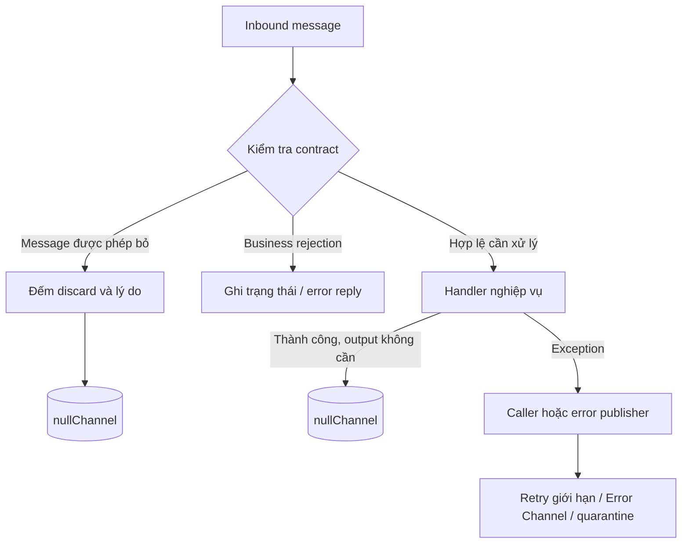
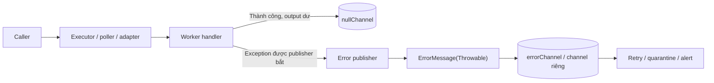

# Không dùng Null Channel để che lỗi trong Spring Integration

## 1. Bối cảnh và mục tiêu

Trong module `SPRING_INTEGRATION_PATTERN`, chúng ta thực hành **Enterprise Integration Patterns** với Spring Integration để thiết kế các luồng message ít phụ thuộc, dễ mở rộng, có thể kiểm thử và theo dõi. Một flow dùng Router, Filter, Transformer, Splitter, Aggregator hoặc Gateway thường có những nhánh kết thúc khác nhau. Không phải mọi message đều cần tiếp tục được xử lý: một heartbeat hợp lệ hoặc reply trung gian không có người dùng có thể được bỏ qua một cách chủ đích.

Spring Integration cung cấp channel tên **`nullChannel`** để tiếp nhận rồi **loại bỏ message**. Cơ chế này có ích khi điểm bỏ được xác định rõ bởi contract nghiệp vụ. Ngược lại, nếu ứng dụng chuyển message lỗi, dữ liệu vi phạm quy tắc hoặc sự kiện thất bại đến `nullChannel` chỉ để luồng không báo lỗi, đó là cách **che giấu thất bại** (*swallowing failures*). Hậu quả có thể là mất dữ liệu, caller nhận trạng thái sai, retry không diễn ra và không còn đủ thông tin để điều tra.

Sau bài học, bạn có thể:

- Giải thích khác biệt giữa **discard hợp lệ**, **từ chối nghiệp vụ** và **exception kỹ thuật**.
- Phân biệt `nullChannel`, `errorChannel`, reply channel và dead-letter/quarantine.
- Nhận biết những cấu hình che lỗi, đặc biệt khi kết hợp Router, Filter, Service Activator và Gateway.
- Viết Java DSL chỉ chuyển **output hợp lệ không cần sử dụng** tới `nullChannel`.
- Kiểm thử rằng dữ liệu không hợp lệ và lỗi backend vẫn gây exception trong flow đồng bộ.
- Xác định đường phát `ErrorMessage` cho endpoint bất đồng bộ mà không giả định mọi exception tự tới global channel.
- Thiết kế logging, metric, retry, correlation, trạng thái lỗi và nơi lưu dữ liệu để phục hồi.

## 2. Null Channel là điểm loại bỏ, không phải cơ chế phục hồi

Một message gửi tới `nullChannel` được tiếp nhận để **kết thúc đường đi của message đó**. Không có downstream business handler lấy message ra khỏi channel, không có queue lưu lại cho lần thử sau, và `nullChannel` không tự tạo một kết quả nghiệp vụ.

| Thành phần | Mục đích | Có tự retry/lưu bền vững không? |
| --- | --- | --- |
| `nullChannel` | Bỏ message khi đây là kết quả được chấp nhận. | Không. |
| `errorChannel` | Nhận `ErrorMessage` do một error publisher thực sự phát. | Không tự retry hoặc lưu bền vững. |
| Reply channel | Chuyển reply về requester/Gateway. | Phụ thuộc loại channel và contract, không mặc định. |
| Dead-letter/quarantine | Giữ message thất bại để điều tra hoặc phát lại có kiểm soát. | Chỉ khi được triển khai bằng kho/adapter thích hợp. |
| Retry advice | Thử lại thao tác theo chính sách. | Có giới hạn theo cấu hình; không thay thế lưu trạng thái. |

`nullChannel` **không giống Java `null`**. Một handler có thể không tạo output; lúc đó không nhất thiết cần đặt `nullChannel`. Nếu handler có tạo output nhưng contract xác nhận output không cần dùng, việc gửi output đến `nullChannel` mới là lựa chọn phù hợp.

### Một tình huống gây mất dữ liệu

```text
Inbound ORDER_PAID
   |
   +--> kiểm tra dữ liệu --> thiếu paymentId
                                  |
                                  v
                             nullChannel
                                  |
                                  v
                        Không còn ai biết đơn lỗi
```

Ở đây message bị lỗi dữ liệu quan trọng. Chuyển thẳng nó tới `nullChannel` sẽ che dấu contract bị vi phạm. Hướng đúng có thể là **ném exception**, trả phản hồi lỗi, ghi trạng thái `INVALID` hoặc đưa vào quarantine có thông tin điều tra, tùy ranh giới xử lý và yêu cầu nghiệp vụ.

## 3. Ba loại kết quả phải phân biệt

Một flow production nên phân biệt tối thiểu ba loại quyết định:

| Kết quả | Ví dụ | Cách ứng xử phù hợp |
| --- | --- | --- |
| **Bỏ hợp lệ** | Heartbeat được phép bỏ, sự kiện trùng đã xác nhận xử lý, reply nội bộ không cần dùng. | Có thể ghi metric rồi route tới `nullChannel`. |
| **Từ chối nghiệp vụ** | Đơn hàng hết hạn, số lượng vượt giới hạn, dữ liệu thiếu trường bắt buộc. | Trả outcome từ chối, đánh dấu trạng thái hoặc quarantine; không âm thầm discard. |
| **Thất bại kỹ thuật** | Backend timeout, database unavailable, lỗi mapping ngoài dự kiến. | Throw/retry có giới hạn, phát `ErrorMessage` qua publisher được cấu hình, hoặc ghi failure bền vững. |

Một **business rejection** không bắt buộc là Java exception. Ví dụ `OUT_OF_STOCK` có thể là một kết quả hợp lệ của nghiệp vụ: caller nhận `ReservationRejected` thay vì luồng bị lỗi kỹ thuật. Nhưng **kết quả từ chối quan trọng cũng không được bỏ mà không có nơi chịu trách nhiệm**.

Quyết định nằm ở **contract đầu vào và đầu ra**, không nằm ở việc bạn muốn pipeline chạy mà không xuất hiện stack trace.

### Sơ đồ định tuyến an toàn



Hai mũi tên tới `nullChannel` đều có **lý do bỏ rõ ràng**: bỏ một event đã được phép bỏ hoặc bỏ **output sau khi công việc thành công**. Exception và rejection quan trọng có đường đi riêng.

## 4. Những cách vô tình che lỗi

### 4.1. Đưa mọi nhánh Router chưa biết tới nullChannel

```text
Router(type)
  ORDER_CREATED  --> orderFlow
  HEARTBEAT      --> nullChannel
  UNKNOWN        --> nullChannel  // Nguy hiểm nếu UNKNOWN là vi phạm contract
```

Với `UNKNOWN`, cần phân biệt trường hợp một loại sự kiện được phép bỏ với trường hợp producer vừa đưa vào một loại message mới mà consumer chưa hỗ trợ. Khi chưa có quy định cho `UNKNOWN`, cách an toàn hơn là **fail-fast hoặc chuyển quarantine để triage**. Nếu mặc định discard, hệ thống có thể mất hàng loạt giao dịch sau một thay đổi schema.

### 4.2. Filter loại cả message không hợp lệ mà không lưu dấu

Một `Filter` có thể loại message không thỏa điều kiện. Điều đó phù hợp khi filter chỉ loại heartbeat hoặc dữ liệu trùng đã kiểm chứng. Nhưng nếu filter âm thầm bỏ message thiếu `orderId`, downstream sẽ không biết có input hỏng.

Để phân biệt chính sách, dùng discard channel/flow có khả năng ghi nhận **lý do reject**, hoặc tách bước validation có kết quả từ chối rõ ràng. `discardChannel` và `nullChannel` không phải cùng một khái niệm: discard channel là **đích cấu hình khi Filter từ chối**; chỉ khi bạn gắn nó vào `nullChannel` thì message mới bị bỏ hẳn.

### 4.3. Catch exception rồi trả về kết quả giả

```java
// Anti-pattern: trả ACK thành công dù nghiệp vụ thực tế thất bại.
try {
    paymentClient.capture(paymentId);
    return "PAYMENT_OK";
} catch (RuntimeException failure) {
    log.warn("Payment failed", failure);
    return "PAYMENT_OK"; // Che lỗi; downstream có thể cập nhật sai.
}
```

Gửi chuỗi `PAYMENT_OK` vừa tạo tới `nullChannel` cũng **không làm thiết kế an toàn hơn**: lỗi đã bị nuốt từ trước đó. Nếu caller không yêu cầu reply, hãy ghi trạng thái thất bại hoặc để error publisher phù hợp xử lý exception; đừng biến failure thành success.

### 4.4. Chuyển ErrorMessage tới nullChannel để “dọn log”

```text
Handler exception
    --> ErrorMessage
         --> nullChannel
              --> Không retry, không alert, không quarantine
```

Đây là một lựa chọn rất rủi ro nếu lỗi liên quan đến công việc cần xử lý. Global `errorChannel` có thể có logging subscriber, nhưng việc log đã được phát không phải bằng chứng phục hồi. Chủ động đưa `ErrorMessage` tới `nullChannel` còn có thể làm biến mất cả tín hiệu lỗi.

Nếu một lỗi **đã được xử lý đầy đủ** bằng một workflow khác, có thể kết thúc đường lỗi sau khi đã xác nhận trạng thái cần thiết. Tuy nhiên, không nên dùng một `nullChannel` làm chính sách mặc định cho mọi exception.

## 5. Ví dụ Java DSL: chỉ bỏ heartbeat hợp lệ và output thành công

Ta tạo một flow nhận sự kiện `Event(id, kind, simulateRemoteFailure)`. Một Router kiểm tra `kind`:

- `HEARTBEAT`: được nghiệp vụ cho phép bỏ, ghi nhận lý do rồi chuyển **output xác nhận nội bộ** đến `nullChannel`.
- Các loại còn lại: đi qua handler xử lý đơn hàng; `ORDER` hợp lệ được xử lý và reply nội bộ được bỏ.
- `kind` không được hỗ trợ: handler **ném `InvalidEventException`**, không đưa message chưa hiểu vào `nullChannel`.
- Backend gặp lỗi: handler **ném `RemoteUnavailableException`** để caller đồng bộ nhận lỗi hoặc error publisher ở ranh giới phù hợp xử lý.

Ví dụ dùng Java 17 và Spring Integration Java DSL. Với Spring Boot có thể dùng `spring-boot-starter-integration`; kiểm thử dùng JUnit 5, Spring Test và AssertJ (ví dụ qua `spring-boot-starter-test`).

```java
import java.util.List;
import java.util.concurrent.ConcurrentLinkedQueue;

import org.springframework.context.annotation.Bean;
import org.springframework.context.annotation.Configuration;
import org.springframework.integration.channel.DirectChannel;
import org.springframework.integration.config.EnableIntegration;
import org.springframework.integration.dsl.IntegrationFlow;
import org.springframework.messaging.MessageChannel;

@Configuration
@EnableIntegration
public class SafeNullChannelConfig {

    public record Event(
        String id, String kind, boolean simulateRemoteFailure) {}

    public static class InvalidEventException extends RuntimeException {
        public InvalidEventException(String message) {
            super(message);
        }
    }

    public static class RemoteUnavailableException extends RuntimeException {
        public RemoteUnavailableException(String message) {
            super(message);
        }
    }

    public static class Probe {
        private final ConcurrentLinkedQueue<String> discarded =
            new ConcurrentLinkedQueue<>();
        private final ConcurrentLinkedQueue<String> processed =
            new ConcurrentLinkedQueue<>();

        public void recordDiscard(String id) {
            discarded.add(id);
        }

        public void recordSuccess(String id) {
            processed.add(id);
        }

        public List<String> discardedIds() {
            return List.copyOf(discarded);
        }

        public List<String> processedIds() {
            return List.copyOf(processed);
        }

        public void clear() {
            discarded.clear();
            processed.clear();
        }
    }

    @Bean
    public Probe safeNullProbe() {
        return new Probe();
    }

    @Bean
    public MessageChannel eventsInput() {
        return new DirectChannel();
    }

    @Bean
    public MessageChannel heartbeatDiscardChannel() {
        return new DirectChannel();
    }

    @Bean
    public MessageChannel businessWorkChannel() {
        return new DirectChannel();
    }

    @Bean
    public IntegrationFlow classifyEvents() {
        return IntegrationFlow.from("eventsInput")
            .route(Event.class,
                event -> "HEARTBEAT".equals(event.kind())
                    ? "DROP" : "PROCESS",
                router -> router
                    .channelMapping("DROP", "heartbeatDiscardChannel")
                    .channelMapping("PROCESS", "businessWorkChannel"))
            .get();
    }

    @Bean
    public IntegrationFlow discardAllowedHeartbeats(Probe probe) {
        return IntegrationFlow.from("heartbeatDiscardChannel")
            .handle(Event.class, (event, headers) -> {
                if (event.id() == null || event.id().isBlank()) {
                    throw new InvalidEventException("Heartbeat id is required");
                }
                probe.recordDiscard(event.id());
                return "HEARTBEAT_IGNORED"; // Output nội bộ.
            })
            .channel("nullChannel")
            .get();
    }

    @Bean
    public IntegrationFlow processBusinessEvents(Probe probe) {
        return IntegrationFlow.from("businessWorkChannel")
            .handle(Event.class, (event, headers) -> {
                if (!"ORDER".equals(event.kind())) {
                    throw new InvalidEventException(
                        "Unsupported event kind: " + event.kind());
                }
                if (event.simulateRemoteFailure()) {
                    throw new RemoteUnavailableException(
                        "Order backend temporarily unavailable");
                }

                probe.recordSuccess(event.id());
                return "ORDER_PROCESSED"; // Không có caller cần reply.
            })
            .channel("nullChannel")
            .get();
    }
}
```

### Đọc flow theo từng nhánh

1. `classifyEvents` chỉ đưa **`HEARTBEAT`** sang `heartbeatDiscardChannel`; các loại khác đều được yêu cầu xử lý hoặc kiểm tra.
2. `discardAllowedHeartbeats` xác minh heartbeat có ID hợp lệ, ghi một observation rồi tạo reply nội bộ; chỉ sau đó mới bỏ reply tại `nullChannel`.
3. `processBusinessEvents` kiểm tra contract **trước** khi thực hiện side effect và trước điểm discard.
4. `ORDER` hợp lệ được ghi nhận là thành công; chuỗi `ORDER_PROCESSED` đi tới `nullChannel` vì flow là one-way.
5. `INVALID` và lỗi backend ném exception trong handler. Vì ví dụ sử dụng `DirectChannel` đồng bộ, exception có thể lan ngược tới lời gọi `eventsInput.send(...)`; không có output thành công được tạo ra để bỏ.

**Điểm quan trọng:** Ví dụ sử dụng `nullChannel` trên cả nhánh heartbeat và nhánh thành công, **nhưng không bao giờ dùng nó để xử lý exception**. Việc caller có nhận exception hay không phụ thuộc ranh giới thực thi; ví dụ cố ý chọn đồng bộ để kiểm thử rõ ràng.

## 6. Kiểm thử: discard hợp lệ khác thất bại

Các bài test dùng `QueueChannel` làm reply channel thử nghiệm để xác nhận không có reply nghiệp vụ. Chúng đồng thời kiểm tra lỗi validation và lỗi backend **không** bị nuốt.

```java
import org.junit.jupiter.api.BeforeEach;
import org.junit.jupiter.api.Test;
import org.springframework.beans.factory.annotation.Autowired;
import org.springframework.beans.factory.annotation.Qualifier;
import org.springframework.integration.channel.QueueChannel;
import org.springframework.messaging.MessageChannel;
import org.springframework.messaging.support.MessageBuilder;
import org.springframework.test.context.junit.jupiter.SpringJUnitConfig;

import static org.assertj.core.api.Assertions.assertThat;
import static org.assertj.core.api.Assertions.assertThatThrownBy;

@SpringJUnitConfig(SafeNullChannelConfig.class)
class SafeNullChannelConfigTest {

    @Autowired
    @Qualifier("eventsInput")
    MessageChannel eventsInput;

    @Autowired
    SafeNullChannelConfig.Probe probe;

    @BeforeEach
    void reset() {
        probe.clear();
    }

    @Test
    void validHeartbeatIsDiscardedWithoutBusinessReply() {
        QueueChannel replies = new QueueChannel();
        var heartbeat =
            new SafeNullChannelConfig.Event("hb-101", "HEARTBEAT", false);

        assertThat(eventsInput.send(
            MessageBuilder.withPayload(heartbeat)
                .setReplyChannel(replies)
                .build())).isTrue();

        assertThat(probe.discardedIds()).containsExactly("hb-101");
        assertThat(probe.processedIds()).isEmpty();
        assertThat(replies.receive(0)).isNull();
    }

    @Test
    void malformedHeartbeatIsRejectedInsteadOfDiscarded() {
        var heartbeat =
            new SafeNullChannelConfig.Event("", "HEARTBEAT", false);

        assertThatThrownBy(() -> eventsInput.send(
            MessageBuilder.withPayload(heartbeat).build()))
            .satisfies(thrown -> assertThat(
                hasCause(thrown, SafeNullChannelConfig.InvalidEventException.class))
                .isTrue());

        assertThat(probe.discardedIds()).isEmpty();
    }

    @Test
    void successfulOrderDiscardsOnlyUnneededOutput() {
        QueueChannel replies = new QueueChannel();
        var order =
            new SafeNullChannelConfig.Event("order-102", "ORDER", false);

        assertThat(eventsInput.send(
            MessageBuilder.withPayload(order)
                .setReplyChannel(replies)
                .build())).isTrue();

        assertThat(probe.processedIds()).containsExactly("order-102");
        assertThat(probe.discardedIds()).isEmpty();
        assertThat(replies.receive(0)).isNull();
    }

    @Test
    void unsupportedEventDoesNotSilentlyDisappear() {
        var invalid =
            new SafeNullChannelConfig.Event("evt-103", "UNKNOWN", false);

        assertThatThrownBy(() -> eventsInput.send(
            MessageBuilder.withPayload(invalid).build()))
            .satisfies(thrown -> assertThat(
                hasCause(thrown, SafeNullChannelConfig.InvalidEventException.class))
                .isTrue());

        assertThat(probe.discardedIds()).isEmpty();
        assertThat(probe.processedIds()).isEmpty();
    }

    @Test
    void backendFailureIsNotConvertedToSuccess() {
        var event =
            new SafeNullChannelConfig.Event("order-104", "ORDER", true);

        assertThatThrownBy(() -> eventsInput.send(
            MessageBuilder.withPayload(event).build()))
            .satisfies(thrown -> assertThat(
                hasCause(thrown,
                    SafeNullChannelConfig.RemoteUnavailableException.class))
                .isTrue());

        assertThat(probe.processedIds()).isEmpty();
        assertThat(probe.discardedIds()).isEmpty();
    }

    private static boolean hasCause(
            Throwable failure, Class<? extends Throwable> type) {
        Throwable current = failure;
        int hops = 0;
        while (current != null && hops++ < 32) {
            if (type.isInstance(current)) {
                return true;
            }
            current = current.getCause();
        }
        return false;
    }
}
```

Các test trên kiểm tra **đường dữ liệu và hành vi exception của flow đồng bộ**. Chúng không chứng minh email đã được gửi, giao dịch database đã commit hay một broker đã ACK đúng thời điểm; các contract này cần test với integration thật.

Lưu ý JUnit phải dùng **đúng cơ chế assertion của exception được Spring Integration bọc**: khi handler ném lỗi, framework có thể bao `InvalidEventException` hoặc `RemoteUnavailableException` trong `MessagingException`. Vì vậy test tìm loại exception trong chuỗi cause thay vì chỉ kiểm tra lớp ngoài cùng.

## 7. Ranh giới bất đồng bộ: không báo thành công giả

Ví dụ trên dùng `DirectChannel`, nên exception có thể truyền tới caller. Trong một luồng thực tế, input có thể đi qua `ExecutorChannel`, `QueueChannel` với poller hoặc inbound adapter có listener riêng. Khi đó `send(...) == true` có thể chỉ nói rằng channel đã **tiếp nhận message**, không nói rằng worker đã xử lý thành công.



**Không tự giả định** mọi exception ở worker sẽ đến global `errorChannel`. Đường phát lỗi phụ thuộc vào poller, adapter, channel hoặc error handler cụ thể. Header `errorChannel` chỉ được dùng khi thành phần phát lỗi thực sự hỗ trợ và đọc nó; header không tự bắt exception Java.

Để tránh che lỗi trong flow bất đồng bộ:

1. Đăng ký **error publisher** tại đúng ranh giới xử lý (poller/adapter/executor) theo contract của nó.
2. Đưa `ErrorMessage` vào một error flow có trách nhiệm; không trỏ kênh lỗi mặc định vào `nullChannel`.
3. Ghi trạng thái cuối `SUCCEEDED`, `FAILED` hoặc `PENDING_REVIEW` theo **kết quả thực tế**, không theo kết quả của `send()`.
4. Giới hạn retry, sử dụng backoff/idempotency và chuyển quarantine khi cần.
5. Kiểm thử gây exception thực sự trong worker, xác minh message lỗi đã được quan sát và không có outcome thành công giả.

Nếu handler tự catch rồi publish lỗi thủ công, cần tránh đồng thời ném lại cùng exception cho một auto-publisher khác mà không có cơ chế deduplication. Nếu không, một failure có thể được đếm hoặc retry hai lần.

## 8. Error flow sau khi thất bại: đừng lấy nullChannel làm điểm kết thúc mặc định

Một error flow nên có **chính sách rõ ràng** thay vì chỉ “giảm log”:

| Lỗi / trạng thái | Hành động phù hợp | Điều cần kiểm tra |
| --- | --- | --- |
| Payload sai schema | Từ chối và lưu thông tin triage phù hợp. | Có định danh nguồn, lý do, phiên bản schema. |
| Backend 503 hoặc connection reset | Retry có giới hạn, backoff, timeout. | Có idempotency và budget chung. |
| Timeout thanh toán không rõ trạng thái | Đối soát giao dịch trước khi retry. | Không tạo charge trùng. |
| Retry hết số lần | Ghi `FAILED` hoặc đưa vào quarantine/DLQ. | Đã lưu bền vững, không nuốt kết quả thất bại. |
| Lỗi bên trong error handler | Chính sách lỗi thứ cấp, alert, điểm dừng. | Không phát lỗi vòng lặp vô hạn. |

Nếu một error flow **đã lưu thất bại bền vững và bàn giao trách nhiệm thành công**, nó có thể kết thúc mà không ném tiếp exception. Đây là điều khác với việc **vứt ErrorMessage đi trước khi xác nhận xử lý**. Tiêu chí là **trách nhiệm phục hồi đã được thực hiện theo contract**, không phải đã có log hoặc lời gọi `send()` trả `true`.

### ErrorMessage và ngữ cảnh lỗi

Một `ErrorMessage` mang payload `Throwable`. `ErrorMessage.getOriginalMessage()` có thể chứa message do publisher cung cấp. Với `MessagingException`, `getFailedMessage()` có thể cho biết message tại bước thất bại. Hai giá trị có thể thiếu hoặc khác nhau sau Transformer/Splitter.

Khi ghi quarantine hoặc cảnh báo, nên giữ `eventId`, `correlationId`, tên endpoint, loại lỗi, số lần retry và trạng thái cuối nếu có. **Không** coi header của chính `ErrorMessage` là bản sao đầy đủ của headers nghiệp vụ. Tránh log toàn bộ payload nhạy cảm, token hoặc thông tin thanh toán.

## 9. Gateway, Filter, Router và Splitter/Aggregator

### Gateway và hợp đồng trả lời

Một `Gateway` trả giá trị kỳ vọng cần có reply hoặc exception theo contract. Nếu flow gửi output tới `nullChannel`, Gateway có thể không có reply và chờ timeout. Không dùng `nullChannel` để né việc trả `PaymentDeclined`, `ValidationError` hoặc một business outcome quan trọng.

Với `Gateway` trả `void` hoặc mô hình fire-and-forget, không yêu cầu reply nghiệp vụ nhưng vẫn phải có chiến lược xử lý lỗi và xác nhận kết quả thực sự khi contract đòi hỏi. **One-way không đồng nghĩa lỗi được phép biến mất.**

### Filter và Router

Nếu Filter loại một message trùng sau khi đã kiểm tra idempotency, discard có thể hợp lệ. Nếu Filter loại message sai schema, nên tạo outcome lỗi hoặc route tới nơi điều tra. Tương tự, Router chỉ nên gửi loại message chưa hỗ trợ đến `nullChannel` nếu business contract **nói rõ được phép bỏ**; không biến `defaultOutputChannel="nullChannel"` thành cách che mọi nhánh không nhận diện.

### Splitter, Aggregator và correlation

Giả sử Splitter tách đơn hàng thành 5 phần. Nếu phần thứ ba gặp lỗi mà bị chuyển tới `nullChannel`, Aggregator có thể chỉ nhận 4 phần và chờ tới timeout vì nhóm không đạt điều kiện release. `nullChannel` **không tự thông báo lỗi** hay cập nhật group state.

Thiết kế đúng cần phân biệt phần tử được **loại bỏ hợp lệ** với phần tử **thất bại**. Với phần tử lỗi, có thể retry riêng, kết thúc nhóm ở trạng thái thất bại, dùng timeout/partial result có điều kiện hoặc bù trừ. Giữ `correlationId`, `sequenceNumber`, `sequenceSize` khi thích hợp để error flow xác định đúng nhóm.

## 10. Quan sát: discard, reject và failure phải có metric riêng

Nếu metric chỉ ghi `messages_sent_to_nullChannel_total`, bạn không biết luồng loại message hợp lệ hay vô tình bỏ dữ liệu quan trọng. Cần theo dõi **quyết định** và **outcome**:

| Metric/log | Ý nghĩa |
| --- | --- |
| `messages_received_total{flow}` | Số message đầu vào. |
| `messages_discarded_intentionally_total{flow,reason}` | Số message được bỏ theo contract. |
| `messages_business_rejected_total{flow,reason}` | Số outcome từ chối nghiệp vụ. |
| `message_processing_failed_total{flow,error_type}` | Số thất bại kỹ thuật thực tế. |
| `error_messages_published_total{flow,channel}` | Số ErrorMessage được phát tới error flow. |
| `message_recovery_total{flow,result}` | Kết quả retry/quarantine/khôi phục. |
| `message_completion_total{flow,status}` | Số công việc hoàn thành và trạng thái cuối. |

Các metric là ví dụ về **tên đo lường do ứng dụng định nghĩa**, không tự xuất hiện chỉ vì tạo `nullChannel`. Hãy đo discard ở **điểm quyết định** trước khi message bị bỏ; không dựa vào việc đăng ký một subscriber nghiệp vụ trên `nullChannel` để làm audit.

Giữ `reason` và `error_type` trong tập giá trị được chuẩn hóa. Không dùng từng `eventId`, `orderId` hoặc `correlationId` làm metric label có cardinality cao; các ID nên dùng trong structured log/tracing với chính sách bảo vệ dữ liệu.

### Một quy tắc cảnh báo hữu ích

Nếu số `messages_discarded_intentionally_total` tăng bất thường ngay sau khi triển khai phiên bản mới, hãy kiểm tra thay đổi Router/Filter và input schema. Tỷ lệ discard tăng có thể là một biểu hiện **rơi dữ liệu do rule sai**, kể cả khi không có Java exception nào xuất hiện.

Đồng thời, nếu số `message_processing_failed_total` tăng nhưng `error_messages_published_total` luôn bằng 0 trong một flow async vốn phải có publisher, cần kiểm tra ranh giới bắt lỗi và channel đích.

## 11. Checklist chống che lỗi trước khi triển khai

| Câu hỏi | Điều kiện để chấp nhận |
| --- | --- |
| Vì sao message được gửi tới `nullChannel`? | Có rule nghiệp vụ định nghĩa rõ đây là discard hợp lệ hoặc output không cần dùng. |
| Nếu dữ liệu sai schema thì sao? | Có đường reject/error/quarantine; không dùng mặc định silent discard. |
| Handler có `catch` không? | Không trả success giả; lỗi có thể truyền tới caller/publisher hoặc được lưu trạng thái. |
| Có phân biệt `send()` thành công và công việc hoàn tất? | Có, đặc biệt qua executor/queue/broker. |
| Error publisher được cấu hình ở đúng endpoint chưa? | Có integration test thực sự gây exception và quan sát ErrorMessage. |
| Sau khi retry hết giới hạn, message đi đâu? | Có failure outcome hoặc kho bền vững, không biến mất. |
| Gateway có chờ business reply không? | Nếu có, không gửi reply cần thiết vào `nullChannel`. |
| Aggregator có phụ thuộc các phần đã discard không? | Có release/timeout/failure strategy rõ ràng. |
| Có thể truy vết quyết định discard không? | Có metric/log với lý do được chuẩn hóa và không lộ payload nhạy cảm. |

## 12. Bài tập thực hành

**Bối cảnh:** Một ứng dụng xử lý `ORDER_CREATED`, `ORDER_PAID`, `HEARTBEAT` và loại sự kiện mới `ORDER_REFUNDED`. Phiên bản consumer hiện tại chưa hỗ trợ `ORDER_REFUNDED`. Một nhánh được xử lý đồng bộ, nhánh gửi thông báo chạy trên executor.

1. Viết Router chỉ cho phép `HEARTBEAT` đi vào `nullChannel`; khi nhận `ORDER_REFUNDED`, đề xuất cách trả lỗi hoặc quarantine thay vì âm thầm bỏ.
2. Chạy cấu hình `SafeNullChannelConfig`: kiểm tra heartbeat được bỏ và output nội bộ của đơn hàng thành công không được gửi về reply channel.
3. Kiểm thử `InvalidEventException` và `RemoteUnavailableException` từ `DirectChannel`: xác nhận caller nhìn thấy nguyên nhân lỗi trong cause chain.
4. Tạo một `Filter` loại sự kiện đã xử lý trùng theo khóa idempotency; bổ sung metric và giải thích vì sao đây là discard hợp lệ.
5. Chuyển business handler sang `ExecutorChannel`; thiết kế error publisher phù hợp và test lỗi backend được phát vào kênh lỗi riêng.
6. Giả lập một item của Splitter lỗi giữa chừng. Giải thích vì sao route item đó tới `nullChannel` có thể làm Aggregator chờ vô hạn; đề xuất timeout hoặc failure strategy.
7. Viết cảnh báo cho tình huống discard tăng bất thường sau khi triển khai thay đổi schema.
8. Thiết kế flow khi retry vượt giới hạn: lưu message lỗi vào quarantine và ghi trạng thái `FAILED` theo contract; không đánh dấu success chỉ vì quá trình ghi log hoàn tất.

**Câu hỏi tự kiểm tra:** Có phải bất kỳ message không cần reply đều có thể đưa vào `nullChannel`? Nếu handler ném exception trước bước `.channel("nullChannel")`, điều gì xảy ra ở flow đồng bộ? Vì sao `errorChannel` không tự retry? Làm sao chứng minh message được bỏ vì policy hợp lệ thay vì lỗi cấu hình?

## 13. Ghi nhớ

**`nullChannel` là công cụ kết thúc đường đi của message có chủ đích, không phải công cụ che exception.** Chỉ discard khi contract xác nhận message hoặc output không còn cần xử lý. Đối với dữ liệu không hợp lệ, business rejection hoặc lỗi kỹ thuật, hãy có đường báo lỗi, trạng thái cuối, retry có giới hạn hoặc quarantine tùy yêu cầu. Trong Spring Integration, việc tách bạch các kết quả này giúp Router, Filter, Gateway, Splitter/Aggregator và Error Channel hoạt động minh bạch, có thể kiểm thử và không làm mất dữ liệu âm thầm.
