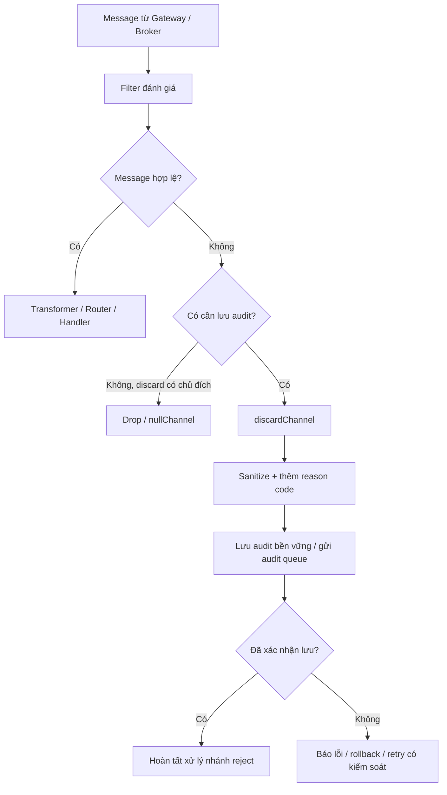
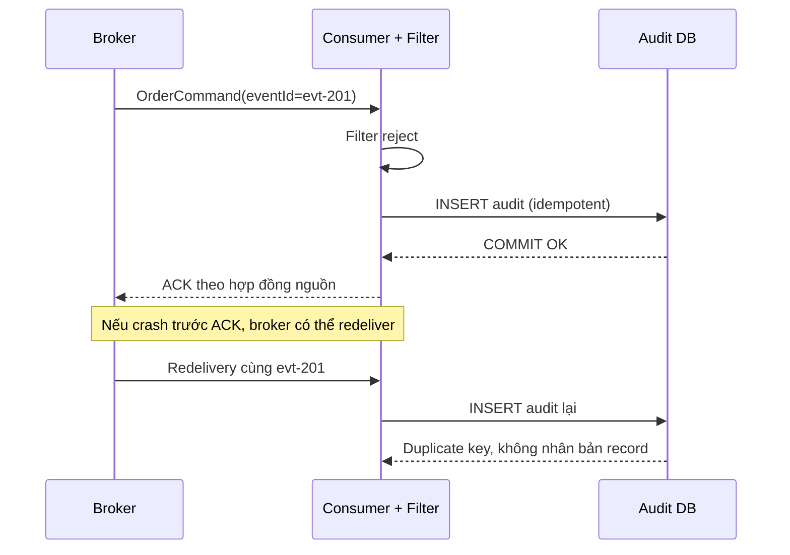

# Chọn discard channel khi cần audit trong Spring Integration

## 1. Bài toán: message bị loại có cần để lại dấu vết?

Trong hệ thống nhận lệnh đặt hàng, một message có thể đi qua **Filter** để kiểm tra số lượng, **Transformer** để chuẩn hóa dữ liệu và **Router** để chuyển sang nhánh xử lý phù hợp. Lệnh có `quantity = -3` không được phép trừ tồn kho. Nếu Filter chỉ loại message mà không ghi lại gì, người vận hành sẽ khó giải thích vì sao một đơn hàng không xuất hiện trong hệ thống. Nhưng nếu lưu **mọi** message bị loại, kể cả heartbeat hoặc sự kiện không cần thiết, kho audit có thể bị quá tải và chứa dữ liệu không cần thu thập.

Đó là lý do cần quyết định giữa:

- **Cố ý bỏ qua** bằng cách không chuyển tiếp message hoặc gửi tới `nullChannel`.
- **Chuyển message bị từ chối sang discard channel** để ghi audit, thống kê hoặc xử lý sau.
- **Ném lỗi** để caller hoặc inbound adapter quyết định rollback, reject hay redelivery.

Bài **“Chọn discard channel khi cần audit”** thuộc chương **Null channel** của module `SPRING_INTEGRATION_PATTERN`. Module hướng dẫn triển khai Enterprise Integration Patterns bằng Spring Integration để xây dựng luồng thông điệp ít phụ thuộc, dễ mở rộng; kết hợp Router, Filter, Transformer, Splitter, Aggregator, Gateway, retry, error channel và correlation, đồng thời kiểm thử, giám sát các nhánh.

Sau khi học, bạn có thể:

1. Phân biệt `nullChannel`, `discardChannel` của Filter, error channel và broker dead-letter queue.
2. Chọn hành vi phù hợp với từng loại message bị loại, đặc biệt khi cần audit.
3. Xây dựng Java DSL với nhánh chấp nhận và nhánh audit rõ ràng.
4. Bảo toàn `eventId`/`correlationId` và lý do từ chối mà không lưu dữ liệu nhạy cảm quá mức.
5. Kiểm tra tính bền vững, transaction, acknowledgment, redelivery và deduplication.
6. Viết JUnit 5 kiểm chứng message bị loại không tới handler chính nhưng vẫn có hồ sơ audit.

## 2. `nullChannel` và discard channel không có cùng mục đích

Spring Integration cung cấp một channel đặc biệt tên `nullChannel`, triển khai ý tưởng **Null Channel**: message gửi tới đó được tiếp nhận để bỏ qua, không có subscriber nghiệp vụ xử lý tiếp. Nó hữu ích khi thông điệp **đã được xử lý xong** hoặc **không cần hành động tiếp theo**.

Trong khi đó, `discardChannel` là **thuộc tính cấu hình của Message Filter**: khi selector trả về `false`, Filter có thể gửi message gốc đến một channel do ứng dụng chọn. Channel đó có thể là `DirectChannel` tới audit recorder, hàng đợi cho một worker riêng hoặc chính `nullChannel` nếu thật sự muốn bỏ qua.

| Tiêu chí | `nullChannel` | Filter có `discardChannel` audit |
| --- | --- | --- |
| Mục đích chính | Chấp nhận rồi bỏ qua message | Chuyển message bị từ chối sang nhánh khác |
| Có xử lý nghiệp vụ tiếp? | Không | Có, tùy subscriber của discard channel |
| Có mặc nhiên lưu lịch sử? | **Không** | **Không**; phải có recorder/persistence cụ thể |
| Có nêu lý do message bị loại? | Không | Có thể tự tính/đính kèm, không tự sinh lý do chi tiết |
| Có báo lỗi khi xử lý không thành công? | Không phải công cụ xử lý lỗi | Tùy loại channel, subscriber và exception |
| Có thể phù hợp audit? | Không, nếu là nơi giữ bằng chứng duy nhất | Có, nếu nhánh audit được thiết kế bền vững |
| Có tương đương broker DLQ? | Không | Không |

**Điểm dễ nhầm:** Khi Filter không được cấu hình `discardChannel`, message không thỏa điều kiện sẽ không đi tiếp. Về mặt kết quả, điều này giống “drop”, nhưng không cần giả định Filter **đã gửi message tới bean `nullChannel`**. Nếu muốn một đường đi rõ ràng cho message không dùng nữa, có thể chọn `nullChannel` làm đích một cách tường minh.

## 3. Flow tổng quan: chọn bỏ qua hay ghi audit



Sơ đồ trên biểu diễn **quyết định thiết kế**. Một Filter thường có một tiêu chí và một discard channel; nếu cần hai kết cục “drop” và “audit” theo **nhiều lý do từ chối**, hãy tách các Filter/Router, thêm nhánh phân loại trước khi discard hoặc dùng một audit handler quyết định hành động. Không mặc định API Filter tự lựa chọn nhiều discard channels theo từng reason.

### Ma trận quyết định

| Trường hợp | Nên ưu tiên | Vì sao |
| --- | --- | --- |
| Heartbeat hoặc sự kiện không quan tâm, đã được cho phép bỏ qua | `nullChannel`/drop có chủ đích | Không cần lưu dấu từng message |
| Validation sai và phải giải thích với người dùng | `discardChannel` + audit/rejection result | Có bằng chứng, mã lỗi, correlation |
| Event từ tenant không được phép, cần truy vết bảo mật | Nhánh audit có kiểm soát truy cập | Phục vụ điều tra nhưng tránh lưu secrets/payload thô |
| Message đã xử lý trùng, cần báo số liệu | Dedup + metric; audit theo chính sách | Không cần nhân bản mọi payload |
| Poison message liên tục làm consumer rollback | Reject channel/DLQ hoặc quarantine bền vững | Tránh redelivery nóng vô hạn |
| Filter từ chối do bảo trì tạm thời | Có thể phải dùng defer/queue thay vì discard | Đây không phải validation cuối cùng; cần phát lại |
| Lỗi handler gọi dependency sau Filter | Error/recovery channel, không phải discard channel của Filter | Nguyên nhân không phải predicate từ chối |

Một quy tắc tốt: **nếu người vận hành phải trả lời “message này đi đâu và tại sao?”, không được dùng `nullChannel` làm nơi lưu chứng cứ duy nhất.**

## 4. Những gì Filter thật sự cung cấp

`MessageFilter` dùng một `MessageSelector` hoặc predicate để quyết định accept/reject. Message được accept đi tiếp theo flow; message bị reject có thể gửi qua discard channel nếu được cấu hình.

Ví dụ đơn giản:

```java
record OrderCommand(
        String tenantId, String eventId,
        String orderId, int quantity) {}

boolean isValid(OrderCommand order) {
    return order.orderId() != null
            && !order.orderId().isBlank()
            && order.quantity() > 0;
}
```

Nếu chỉ dùng:

```java
.filter(OrderCommand.class, this::isValid)
```

message không thỏa điều kiện **không được chuyển tới handler tiếp theo**; chưa có cơ chế audit bền vững. Muốn lưu lý do từ chối, cần nhánh riêng:

```java
.filter(OrderCommand.class, this::isValid,
        spec -> spec.discardChannel("orderDiscardAudit"))
```

**Filter gửi message bị loại, không tự tạo một `ErrorMessage` chứa stack trace hay bảng lỗi validation.** Muốn có `reasonCode` như `INVALID_QUANTITY`, một bước audit phải tự phân loại, hoặc có bước enrichment/validation trước đó gắn metadata cần thiết.

### `throwExceptionOnRejection` thay đổi hợp đồng

Nếu cấu hình `throwExceptionOnRejection(true)`, Filter có thể ném `MessageRejectedException` khi message không được chấp nhận. Khi có cả discard channel và tùy chọn ném lỗi, nhánh discard và exception đều có thể xảy ra; hệ thống có nguy cơ ghi audit xong nhưng vẫn rollback/redeliver cùng message. Hãy kiểm thử thứ tự và cách nguồn xử lý lỗi, đừng coi nó là “ghi audit rồi ack” tự động.

## 5. Ví dụ Spring Integration Java DSL: Filter và audit flow tách biệt

Giả sử các event đặt hàng phải có `eventId` ổn định; luồng Filter quyết định message có hợp lệ không, handler nghiệp vụ chỉ nhận message hợp lệ, còn audit sink nhận message bị loại.

```java
import org.springframework.context.annotation.Bean;
import org.springframework.context.annotation.Configuration;
import org.springframework.integration.channel.DirectChannel;
import org.springframework.integration.dsl.IntegrationFlow;
import org.springframework.messaging.Message;
import org.springframework.messaging.MessageChannel;

record OrderCommand(String tenantId, String eventId,
                    String orderId, int quantity) {}

interface OrderProcessor {
    void process(OrderCommand order);
}

interface DiscardAuditSink {
    void record(Message<OrderCommand> rejectedMessage);
}

class OrderValidationRules {
    boolean valid(OrderCommand order) {
        return order.orderId() != null
                && !order.orderId().isBlank()
                && order.quantity() > 0;
    }

    String reason(OrderCommand order) {
        if (order.orderId() == null || order.orderId().isBlank()) {
            return "INVALID_ORDER_ID";
        }
        if (order.quantity() <= 0) {
            return "INVALID_QUANTITY";
        }
        return "UNSPECIFIED_REJECTION";
    }
}

@Configuration
class OrderDiscardConfiguration {

    @Bean
    MessageChannel orderInput() {
        return new DirectChannel();
    }

    @Bean
    MessageChannel orderDiscardAudit() {
        return new DirectChannel();
    }

    @Bean
    OrderValidationRules orderValidationRules() {
        return new OrderValidationRules();
    }

    @Bean
    IntegrationFlow validateOrders(OrderValidationRules rules,
                                    OrderProcessor processor) {
        return IntegrationFlow.from("orderInput")
                .filter(OrderCommand.class, rules::valid,
                        spec -> spec.discardChannel("orderDiscardAudit"))
                .handle(processor, "process")
                .get();
    }

    @Bean
    IntegrationFlow recordRejectedOrders(DiscardAuditSink sink) {
        return IntegrationFlow.from("orderDiscardAudit")
                .handle(sink, "record")
                .get();
    }
}
```

Trong ứng dụng thật phải cung cấp bean triển khai `OrderProcessor` và `DiscardAuditSink`. Việc dùng `DirectChannel` cho cả hai nhánh làm xử lý **đồng bộ**: một exception từ audit subscriber có thể quay về thread gửi message; điều đó giúp nguồn quyết định rollback nếu hợp đồng yêu cầu. Nhưng một exception được truyền ngược **không tự chứng minh** database/broker transaction đã rollback; còn phụ thuộc inbound adapter và transaction manager.

### Dòng chảy của ba message

| Input | `rules.valid` | Hành động | Số lần gọi `OrderProcessor` |
| --- | --- | --- | ---: |
| `orderId=O-10, quantity=2` | `true` | Chuyển tới `processor.process` | 1 |
| `orderId="", quantity=2` | `false` | Gửi sang `orderDiscardAudit` | 0 |
| `orderId=O-12, quantity=-1` | `false` | Gửi sang `orderDiscardAudit` | 0 |

Đối với các message được reject, audit flow có thể dùng `OrderValidationRules.reason(...)` để lấy mã lỗi. Đừng dùng một exception message tự do làm mã nghiệp vụ vì dễ thay đổi và khó tổng hợp số liệu.

## 6. Thiết kế bản ghi audit có thể điều tra

Một bản ghi audit cần trả lời được **message nào, bị từ chối ở đâu, bởi quy tắc nào, lúc nào, và cuối cùng đã lưu hay chưa**. Tập trường đề xuất:

| Trường | Vai trò |
| --- | --- |
| `tenantId` | Phân tách phạm vi dữ liệu và quyền truy cập |
| `eventId` | Nhận diện sự kiện ổn định qua retry/redelivery |
| `correlationId` | Nối từ Gateway, Router, Splitter/Aggregator tới audit |
| `endpointId` | Xác định Filter/rule đã loại message |
| `reasonCode` | Mã có cấu trúc: `INVALID_QUANTITY`, `MISSING_ORDER_ID`... |
| `rejectedAt` | Thời gian ghi nhận tại server |
| `schemaVersion` hoặc fingerprint nếu cần | Hỗ trợ thay đổi schema và phát hiện key reuse |
| `source`/`deliveryId` nếu có | Đối soát với broker, topic, partition, offset |
| `status` | `RECORDED`, `PENDING_REVIEW`, `RESOLVED` theo quy trình |

**Không mặc định `MessageHeaders.ID` là event ID bền vững.** Message có thể được tạo lại khi broker giao lại hoặc Transformer dựng message mới. Dùng `eventId` của producer hoặc identity được ổn định theo hợp đồng adapter.

### Audit event nên có kiểu dữ liệu riêng

Message bị reject có thể chứa payload nhạy cảm hoặc kích thước lớn. Thay vì lưu nguyên bản, nên chuyển sang DTO audit tối thiểu:

```java
record DiscardAuditEvent(
        String tenantId,
        String eventId,
        String correlationId,
        String endpointId,
        String reasonCode) {}
```

Lưu dấu thời gian tại nơi persistence nhận được event; có thể thêm fingerprint không đảo ngược nếu chính sách dữ liệu cho phép. Không ghi token, thông tin thanh toán, địa chỉ cá nhân đầy đủ hoặc secret vào audit/log chỉ vì có sẵn trong payload.

### Lý do từ chối không nên gắn bằng một phép đoán không nhất quán

Nếu Filter dùng một quy tắc và audit recorder tính lại bằng một phiên bản quy tắc khác, `reasonCode` có thể không khớp. Có hai cách:

1. **Dùng chung một service validation bất biến** cho Filter và audit recorder, lưu cả `ruleVersion` nếu cần.
2. **Đánh giá/đính kèm ValidationResult một lần** ở một bước trước Filter (Transformer/Header Enricher), rồi Filter dựa trên kết quả ấy. Audit flow đọc cùng kết quả từ header hoặc payload được chuẩn hóa.

Nếu chọn cách thứ hai, phân biệt header kỹ thuật với dữ liệu do client cung cấp: không tin một header `validationPassed=true` do nguồn không đáng tin cậy tự gửi. ValidationResult phải được tính trong miền tin cậy của ứng dụng.

## 7. Ví dụ audit bền vững với database

`DirectChannel` chỉ đảm bảo thực thi subscriber đồng bộ, **không tự lưu** message. Để audit tồn tại sau restart, có thể lưu một bản ghi trong database.

Lược đồ PostgreSQL minh họa:

```sql
CREATE TABLE rejected_order_audit (
    tenant_id     VARCHAR(100) NOT NULL,
    event_id      VARCHAR(150) NOT NULL,
    endpoint_id   VARCHAR(100) NOT NULL,
    reason_code   VARCHAR(100) NOT NULL,
    correlation_id VARCHAR(150),
    rejected_at   TIMESTAMPTZ NOT NULL DEFAULT CURRENT_TIMESTAMP,
    PRIMARY KEY (tenant_id, event_id, endpoint_id)
);
```

Khóa chính trên `tenantId + eventId + endpointId` giúp **idempotent audit** khi message bị broker redeliver sau khi bản ghi đã commit. Nếu một event có thể bị từ chối hợp lệ nhiều lần theo các phiên bản khác nhau, cần mở rộng identity hoặc mô hình lịch sử; không tùy tiện ghi đè mọi lần reject để che mất dấu vết.

Một recorder Spring JDBC minh họa:

```java
import org.springframework.jdbc.core.JdbcTemplate;
import org.springframework.messaging.Message;
import org.springframework.stereotype.Service;
import org.springframework.transaction.annotation.Transactional;

@Service
class JdbcDiscardAuditSink implements DiscardAuditSink {

    private final JdbcTemplate jdbc;
    private final OrderValidationRules rules;

    JdbcDiscardAuditSink(JdbcTemplate jdbc, OrderValidationRules rules) {
        this.jdbc = jdbc;
        this.rules = rules;
    }

    @Override
    @Transactional
    public void record(Message<OrderCommand> message) {
        OrderCommand order = message.getPayload();
        Object correlationHeader = message.getHeaders().get("correlationId");
        String correlationId = correlationHeader == null
                ? null : correlationHeader.toString();

        jdbc.update("""
                INSERT INTO rejected_order_audit
                    (tenant_id, event_id, endpoint_id,
                     reason_code, correlation_id)
                VALUES (?, ?, ?, ?, ?)
                ON CONFLICT DO NOTHING
                """,
                order.tenantId(),
                order.eventId(),
                "order-validation",
                rules.reason(order),
                correlationId);
    }
}
```

**Điều kiện để ví dụ này có ý nghĩa:** `tenantId`/`eventId` phải có giá trị hợp lệ và ổn định dù payload nghiệp vụ bị reject; transaction manager phải được cấu hình đúng cho `JdbcTemplate`; phương thức chạy qua Spring bean/proxy để `@Transactional` phát huy hiệu lực. Nếu ngay cả event ID hoặc tenant ID không thể đọc, phải có **quy trình quarantine riêng** dùng identity nguồn đáng tin cậy (ví dụ topic/partition/offset hoặc broker message ID khi phù hợp), không được cố ghi các trường `NOT NULL` rồi nuốt lỗi.

Ví dụ dùng `ON CONFLICT DO NOTHING` cho duplicate delivery nhưng **chưa xử lý** trường hợp cùng key mang payload khác. Production có thể lưu fingerprint và từ chối sự kiện xung đột thay vì coi cả hai là cùng một rejection.

## 8. Audit, transaction, acknowledgement và cửa sổ lỗi

Một quyết định Filter từ chối message **không mặc định là lỗi**. Nếu discard flow trả bình thường, inbound consumer có thể xem lần xử lý là hoàn tất và **ack/commit** theo cấu hình. Đó có thể là thiết kế đúng nếu audit đã được lưu bền vững; nguy hiểm nếu audit chỉ mới nằm trong buffer.

### Nhánh đồng bộ có audit recorder



DB commit trước ack vẫn có cửa sổ redelivery; audit idempotent giúp tránh ghi trùng. Nếu **ack broker trước khi audit commit**, crash có thể làm mất thông tin rejection. Vì vậy phải chọn ranh giới phù hợp và kiểm thử trên adapter thật.

### Khi audit recorder thất bại

| Tình huống | Nếu không xử lý rõ | Hướng giải quyết |
| --- | --- | --- |
| JDBC audit DB không sẵn sàng | Record không tồn tại nhưng message có thể bị ack | Để lỗi thoát về consumer hoặc gửi vào hàng đợi bền vững |
| `DirectChannel` không có subscriber | Gửi discard có thể ném lỗi | Kiểm tra flow/subscriber khi khởi động và trong test |
| `ExecutorChannel` hoặc queue bất đồng bộ | Sender hoàn tất trước khi audit thật sự ghi | Định nghĩa mức bảo đảm enqueue, persistence và ack riêng |
| DB audit nằm trong TX chung đã rollback-only | `INSERT` có thể thực hiện rồi rollback | Tách transaction phù hợp hoặc dùng outbox/quarantine |
| Broker redelivery cùng event | Có thể lưu nhiều record và gây cảnh báo trùng | Unique constraint, dedup và lịch sử có chủ đích |

**Không có bảo đảm atomic commit đa tài nguyên** chỉ vì dùng `@Transactional` trên audit recorder. Việc nhận broker message, ghi audit DB và ack broker thuộc những tài nguyên/giao dịch nào còn phụ thuộc JMS/JTA/XA, transaction synchronization, inbound adapter và propagation.

### Khi nào có thể dùng asynchronous audit?

Audit bất đồng bộ giúp giảm latency cho nhánh chính, nhưng phải phân biệt:

- `QueueChannel` chỉ ở trong memory: không phải hàng đợi bền vững.
- Broker queue persistent có publish confirm/transaction phù hợp: có thể làm điểm bàn giao đáng tin cậy hơn, nhưng vẫn cần retry, dedup và consumer audit.
- Transactional outbox: ghi ý định phát audit trong cùng transaction với dữ liệu nghiệp vụ/processing marker, publisher phát sau commit. Nó có thể **gửi lặp** sau crash; audit consumer vẫn phải idempotent.

Nếu yêu cầu compliance đòi mỗi rejection có bằng chứng bền vững trước khi ack, không chọn kiểu fire-and-forget chỉ vì nhanh.

## 9. `nullChannel` nên dùng khi nào?

`nullChannel` phù hợp cho **explicit termination** — điểm kết thúc có chủ ý của một nhánh mà không cần dữ liệu tiếp tục hay audit chi tiết.

Ví dụ:

```java
import org.springframework.context.annotation.Bean;
import org.springframework.integration.dsl.IntegrationFlow;

@Bean
IntegrationFlow ignoredHeartbeatFlow() {
    return IntegrationFlow.from("ignoredHeartbeatInput")
            .channel("nullChannel")
            .get();
}
```

Ứng dụng cần khai báo `ignoredHeartbeatInput`; `nullChannel` là channel đặc biệt có sẵn trong Spring Integration. Đối với heartbeat, chỉ dùng cách này khi đã xác định việc bỏ qua được cho phép và không có yêu cầu lưu chứng cứ cho từng bản tin.

Một ví dụ khác là một nhánh Router dành cho message không cần xử lý. Tuy nhiên, đừng gán **default output channel** của một Router vào `nullChannel` nếu message không định tuyến được thực chất là lỗi cấu hình cần phát hiện. Cần phân biệt “cố ý không cần” và “không biết phải xử lý thế nào”.

### Phân biệt drop có chủ đích với failure

- **Message không liên quan đến ứng dụng**: drop có thể hợp lý, kèm metric tổng.
- **Message dữ liệu lỗi nhưng phải phản hồi client**: discard/audit/validation result hợp lý hơn.
- **Message hợp lệ nhưng downstream lỗi**: nên dùng error/retry/recovery flow; không được drop vào `nullChannel` để che exception.
- **Message chờ Aggregator**: drop một part có thể khiến nhóm không bao giờ đủ; cần timeout/failure hoặc partial-result policy.

## 10. `discardChannel`, `errorChannel`, DLQ và Wire Tap

Những khái niệm này thường bị gọi chung là “kênh lỗi” nhưng semantics khác nhau:

| Cơ chế | Dữ liệu thường nhận | Nguồn phát sinh | Mục đích |
| --- | --- | --- | --- |
| Filter `discardChannel` | **Message gốc bị selector loại** | Message Filter | Xử lý rejection, audit, kiểm toán |
| `errorChannel` / recovery channel | `ErrorMessage` chứa `Throwable` | Error handler, exception flow, recoverer | Phân tích/thông báo sự cố xử lý |
| Broker DLQ/DLT | Message gốc hoặc bản sao có metadata lỗi theo broker/adapter | Reject, delivery limit, dead-letter publisher | Lưu message xử lý không thành công để điều tra/replay |
| `WireTap` | Bản sao message đi qua một channel | Channel interceptor/tap | Quan sát luồng, telemetry hoặc audit bổ sung |
| `nullChannel` | Message định tuyến tới đó | Flow/Router/Service Activator | Kết thúc có chủ ý, không xử lý tiếp |

**Wire Tap không thay Filter discard audit.** Tap trên input nhìn thấy cả message hợp lệ và invalid, không tự biết selector đã reject. Muốn ghi audit chỉ các message bị loại, nên đặt tap tại chính discard channel hoặc xử lý trực tiếp ở audit flow.

Nếu tap gửi bất đồng bộ, không mặc định audit đã bền vững khi nhánh chính hoàn tất. Một log statement hoặc metric từ Wire Tap không đủ để đáp ứng yêu cầu lưu chứng cứ nghiệp vụ.

### `throwExceptionOnRejection` có thể làm xuất hiện cả discard và error

Với Filter có `discardChannel` và `throwExceptionOnRejection(true)`, message có thể được gửi đến audit flow **rồi sau đó** exception từ chối được truyền ra ngoài. Nếu inbound adapter rollback và redeliver, một lần từ chối khác có thể lại ghi audit. Điều này đòi hỏi kiểm thử duplicate, transaction và thứ tự callback, không chỉ assert số message ở một queue.

## 11. Bảo vệ dữ liệu và chi phí lưu audit

Lưu audit không có nghĩa lưu nguyên payload mãi mãi. Mục tiêu là đủ dữ liệu để truy vết, không tạo một kho dữ liệu nhạy cảm thứ hai:

1. **Data minimization:** Chỉ lưu ID, loại sự kiện, mã lý do, endpoint và correlation cần thiết.
2. **Access control:** Phân quyền ai được xem rejection record; không để log chứa thông tin xác thực.
3. **Retention:** Đặt thời hạn theo yêu cầu vận hành/compliance, tránh giữ vô hạn.
4. **Integrity:** Có unique key, status, timestamp và dấu vết thay đổi khi audit record được xử lý tiếp.
5. **Availability:** Audit DB/queue có giám sát backlog, alert lỗi ghi và chính sách retry.
6. **Sampling:** Có thể lấy mẫu telemetry cho message không quan trọng; **không sampling** các loại sự kiện mà hợp đồng yêu cầu phải ghi đủ.
7. **Right-to-delete/quy định dữ liệu:** Thiết kế cách giảm thiểu thông tin định danh và xử lý các nghĩa vụ xóa/lưu theo quy định áp dụng.

Không cần bảo vệ một message “invalid” ít hơn message “valid”; dữ liệu bị loại vẫn có thể chứa PII, token hoặc nội dung chưa được làm sạch.

## 12. JUnit 5: chứng minh discard được audit và không xử lý nghiệp vụ

Đây là một flow test độc lập với broker, dùng `DirectChannel` và recorder trong bộ nhớ để quan sát hành vi của Filter. Test minh họa:

- Message hợp lệ chỉ đến business handler.
- Message invalid không được business handler xử lý nhưng đi vào audit sink.
- `correlationId` từ message được giữ khi gửi tới discard channel.
- Nếu audit sink ném lỗi trên nhánh đồng bộ, sender có thể quan sát exception thay vì tưởng audit đã thành công.

```java
import java.util.ArrayList;
import java.util.List;
import java.util.concurrent.atomic.AtomicInteger;

import org.junit.jupiter.api.BeforeEach;
import org.junit.jupiter.api.Test;
import org.springframework.beans.factory.annotation.Autowired;
import org.springframework.beans.factory.annotation.Qualifier;
import org.springframework.context.annotation.Bean;
import org.springframework.context.annotation.Configuration;
import org.springframework.integration.channel.DirectChannel;
import org.springframework.integration.dsl.IntegrationFlow;
import org.springframework.messaging.Message;
import org.springframework.messaging.MessageChannel;
import org.springframework.messaging.support.MessageBuilder;
import org.springframework.test.context.junit.jupiter.SpringJUnitConfig;

import static org.junit.jupiter.api.Assertions.*;

@SpringJUnitConfig(classes = DiscardAuditFlowTest.Config.class)
class DiscardAuditFlowTest {

    @Autowired
    @Qualifier("inputOrders")
    MessageChannel input;

    @Autowired
    FakeProcessor processor;

    @Autowired
    FakeAuditSink audit;

    @BeforeEach
    void reset() {
        processor.calls.set(0);
        audit.received.clear();
        audit.fail = false;
    }

    @Test
    void invalidMessageIsAuditedButNotProcessed() {
        OrderCommand invalid =
                new OrderCommand("tenant-a", "evt-101", "", -1);

        input.send(MessageBuilder.withPayload(invalid)
                .setHeader("correlationId", "checkout-55")
                .build());

        assertEquals(0, processor.calls.get());
        assertEquals(1, audit.received.size());
        Message<OrderCommand> rejected = audit.received.get(0);
        assertEquals("evt-101", rejected.getPayload().eventId());
        assertEquals("checkout-55",
                rejected.getHeaders().get("correlationId"));
    }

    @Test
    void validMessageIsProcessedWithoutDiscard() {
        OrderCommand valid =
                new OrderCommand("tenant-a", "evt-102", "O-102", 3);

        input.send(MessageBuilder.withPayload(valid).build());

        assertEquals(1, processor.calls.get());
        assertTrue(audit.received.isEmpty());
    }

    @Test
    void auditFailurePropagatesInSynchronousFlow() {
        audit.fail = true;
        OrderCommand invalid =
                new OrderCommand("tenant-a", "evt-103", "", 2);

        assertThrows(RuntimeException.class, () ->
                input.send(MessageBuilder.withPayload(invalid).build()));

        assertEquals(0, processor.calls.get());
    }

    record OrderCommand(String tenantId, String eventId,
                        String orderId, int quantity) {}

    static class FakeProcessor {
        final AtomicInteger calls = new AtomicInteger();

        public void process(OrderCommand command) {
            calls.incrementAndGet();
        }
    }

    static class FakeAuditSink {
        final List<Message<OrderCommand>> received = new ArrayList<>();
        volatile boolean fail;

        public void record(Message<OrderCommand> message) {
            if (fail) {
                throw new IllegalStateException("audit store unavailable");
            }
            received.add(message);
        }
    }

    @Configuration
    static class Config {
        @Bean
        MessageChannel inputOrders() {
            return new DirectChannel();
        }

        @Bean
        MessageChannel rejectedOrders() {
            return new DirectChannel();
        }

        @Bean
        FakeProcessor fakeProcessor() {
            return new FakeProcessor();
        }

        @Bean
        FakeAuditSink fakeAuditSink() {
            return new FakeAuditSink();
        }

        @Bean
        IntegrationFlow mainFlow(FakeProcessor processor) {
            return IntegrationFlow.from("inputOrders")
                    .filter(OrderCommand.class,
                            cmd -> cmd.orderId() != null
                                    && !cmd.orderId().isBlank()
                                    && cmd.quantity() > 0,
                            spec -> spec.discardChannel("rejectedOrders"))
                    .handle(processor, "process")
                    .get();
        }

        @Bean
        IntegrationFlow auditFlow(FakeAuditSink audit) {
            return IntegrationFlow.from("rejectedOrders")
                    .handle(audit, "record")
                    .get();
        }
    }
}
```

Trong ví dụ này, Spring Test và JUnit Jupiter được khai báo ở dependency test; Filter, handler và channel là bean của Spring Integration. Vì flow chạy đồng bộ trên `DirectChannel`, các assertion được kiểm tra ngay sau khi `send(...)` trả về. `FakeAuditSink` dùng `ArrayList` chỉ vì test đơn thread; khi test concurrency, thay bằng cấu trúc thread-safe hoặc kiểm tra dữ liệu ở DB.

**Giới hạn của ba test:** Chúng chứng minh routing của message **trong Spring context**, không chứng minh audit DB bền vững, broker ack, redelivery hay atomicity giữa DB và broker. Cần integration test riêng cho các bảo đảm đó.

## 13. Integration test: không mất audit và không ghi trùng

Để kiểm chứng hợp đồng audit thật, chạy database và message broker trong môi trường test phù hợp (ví dụ Testcontainers), triển khai recorder JDBC/broker thật và quan sát transaction/ack.

| Kịch bản | Kết quả cần khẳng định |
| --- | --- |
| Message hợp lệ | Business handler được gọi, audit reject không xuất hiện |
| Message invalid, audit DB ghi thành công | Một audit row đúng `eventId`/reason, business handler không chạy |
| Audit DB lỗi trước commit | Failure không bị xác nhận như đã lưu, nguồn xử lý exception theo hợp đồng |
| Crash sau audit DB commit, trước broker ack | Redelivery có thể xảy ra, unique key tránh ghi trùng |
| Hai consumer cùng reject một event | Chỉ một audit row nếu yêu cầu dedup, không có race “SELECT rồi INSERT” |
| Cùng `eventId` nhưng payload khác | Báo conflict theo fingerprint/rule thay vì lặng lẽ bỏ |
| `throwExceptionOnRejection(true)` cùng discard | Thứ tự audit, rollback và redelivery đúng như thiết kế |
| `ExecutorChannel` hoặc queue audit bất đồng bộ | Sender ack theo mức bảo đảm đã chọn; không khẳng định DB commit khi chỉ enqueue |
| `eventId`/tenant ID mất hoặc không hợp lệ | Chuyển sang quarantine có identity nguồn đáng tin cậy |
| Splitter có một part invalid | Audit giữ `partId`/`correlationId`; Aggregator không chờ vô hạn |
| Dữ liệu nhạy cảm trong payload | Audit chỉ lưu các trường được phép, log không làm lộ payload thô |

Đặc biệt, kiểm thử crash window phải kiểm tra **trạng thái đã commit** bằng transaction/connection độc lập sau khi handler kết thúc; đừng kết luận chỉ từ log “audit saved”.

### Bài toán message hợp lệ nhưng Filter vẫn phải ghi nhận quyết định

Discard channel chỉ nhìn thấy **message bị từ chối**. Nếu cần audit **mọi quyết định chấp nhận và từ chối**, phải có cơ chế bổ sung ở cả nhánh accepted (audit event hoặc bước ghi quyết định chung), không thể mong chỉ một discard channel ghi nhận toàn bộ.

## 14. Retry, Circuit Breaker và Gateway ảnh hưởng quyết định discard

### Retry

Lỗi audit DB tạm thời có thể được retry với backoff giới hạn. Nhưng nếu retry ở ngoài **cả Filter**, mỗi lần thử có thể chạy lại selector và ghi lại audit. Sử dụng unique key và transaction phù hợp; không retry mọi lỗi validation vĩnh viễn.

### Circuit Breaker

Nếu audit service ở xa và lỗi liên tục, Circuit Breaker có thể mở để tránh làm cạn thread. Nhưng **breaker OPEN không phải lý do hợp lệ để làm mất một audit bắt buộc**. Khi audit không thể ghi, cần trì hoãn/đưa vào nơi lưu bền vững/rollback theo hợp đồng; chỉ chấp nhận bỏ qua nếu chính sách dữ liệu cho phép.

### Gateway

Gateway đồng bộ thường cần reply. Một Filter drop message mà không có error/reply strategy có thể khiến caller chỉ thấy timeout, dù thực tế message đã bị loại vì validation. Thiết kế nhánh rejection trả về `INVALID_REQUEST` kèm mã lý do, hoặc ném một exception được Gateway chuyển thành kết quả có nghĩa. Nếu chỉ ghi audit rồi trả bình thường, phải xác nhận hợp đồng reply có phù hợp.

### Splitter/Aggregator

Discard một part có thể khiến Aggregator không bao giờ có đủ sequence. Cần quy tắc timeout/partial result, thông báo part invalid hoặc cập nhật trạng thái nhóm. Đừng chỉ gửi part vào `nullChannel` rồi mong Aggregator tự biết nó đã được loại.

## 15. Observability: audit và discard cần đo riêng

Các metric gợi ý (không mặc định framework xuất sẵn):

- `filter_rejections_total` theo endpoint và nhóm reason.
- `intentional_discards_total` cho những loại message được phép bỏ qua mà không cần hồ sơ riêng.
- `audit_record_success_total` / `audit_record_failure_total`.
- `audit_pending_backlog` và tuổi bản ghi chờ, khi dùng queue/outbox.
- `audit_duplicate_detected_total`, `audit_conflict_total`.
- `broker_redelivery_total` và số message bị reject đến DLQ.
- `audit_processing_latency` và độ trễ từ reject đến lưu bền vững.

Metric labels nên là `endpoint`, `reasonCode` chuẩn hóa, `outcome` và `tenantTier` nếu phù hợp. Không đưa `eventId`, `orderId`, correlation ID hoặc payload vào labels có cardinality cao; các ID thuộc log/traces có phân quyền.

Ví dụ structured log:

```text
event=evt-501 stage=order-filter result=REJECTED reason=INVALID_QUANTITY
event=evt-501 stage=discard-audit result=RECORDED audit_key=tenant-a/evt-501
event=evt-502 stage=order-filter result=ACCEPTED
event=evt-503 stage=heartbeat-filter result=INTENTIONALLY_IGNORED
```

Không log `result=RECORDED` chỉ vì đã gọi một hàm gửi bất đồng bộ; kết quả này phải khớp mức xác nhận lưu mà ứng dụng thật sự đạt được.

## 16. Những lỗi thường gặp

| Sai lầm | Hậu quả | Cách sửa |
| --- | --- | --- |
| Dùng `nullChannel` cho rejection bắt buộc audit | Mất dấu vết sự kiện | Discard flow + recorder bền vững |
| Cho rằng `discardChannel` tự lưu message | Audit biến mất sau restart | Triển khai DB hoặc queue persistent |
| Coi discard message là `ErrorMessage` | Ép kiểu sai, không có exception như mong đợi | Đọc message gốc; tạo reasonCode có cấu trúc |
| Chỉ dùng `MessageHeaders.ID` để dedup | Redelivery có thể sinh ID mới | Dùng event ID/identity nguồn ổn định |
| Dùng `SELECT` trước `INSERT` mà không unique key | Concurrent consumers ghi audit trùng | Unique constraint + thao tác nguyên tử |
| Ghi audit bất đồng bộ rồi ack ngay, không có nơi lưu bền | Crash làm mất audit | Xác định durable handoff trước ack |
| Ghi audit trong transaction rollback-only | Dấu đã ghi biến mất khi rollback | Transaction/persistence độc lập phù hợp |
| Đặt `throwExceptionOnRejection` nhưng không xét redelivery | Một invalid message bị audit nhiều lần | Dedup, phân loại lỗi vĩnh viễn, delivery limit |
| Tính lại reason bằng quy tắc khác Filter | Audit nói sai nguyên nhân | Chia sẻ ValidationResult/rule version |
| Lưu toàn bộ payload trong log/audit | Lộ dữ liệu nhạy cảm, quá tải storage | Data minimization và retention |
| Dùng Wire Tap trước Filter để audit rejected | Ghi cả message hợp lệ | Tap discard channel hoặc audit outcome rõ |
| Drop part của Splitter vào `nullChannel` | Aggregator chờ thiếu part mãi | Timeout/failure/partial result policy |

## 17. Bài thực hành

Thiết kế một flow `OrderCreated → Filter → Transformer → Router`. Filter nhận khi `quantity > 0` và `orderId` không rỗng. Với message hợp lệ, Router chọn nhánh inventory; với message invalid, đặt `discardChannel("orderDiscardAudit")` đến một JDBC audit recorder. Định nghĩa `reasonCode`, `eventId`, `correlationId` và unique constraint trên bảng audit.

Thực hiện tối thiểu các tình huống:

1. Gửi một lệnh hợp lệ và một lệnh invalid; xác minh chỉ lệnh hợp lệ tới business handler.
2. Gửi lệnh invalid có header correlation ID; xác minh audit record chứa đúng định danh và reason.
3. Tắt audit DB trong test; bảo đảm không ack giả như đã lưu audit, kiểm tra rollback/error path.
4. Cho broker redeliver cùng event sau khi DB audit commit nhưng trước ack; xác minh chỉ một audit row.
5. Bật `throwExceptionOnRejection` trong flow riêng; kiểm tra ảnh hưởng tới discard và redelivery.
6. Tạo một luồng heartbeat được phép bỏ qua bằng `nullChannel`; xác minh không tạo audit ngoài chính sách nhưng vẫn có metric tổng.
7. Thử với Splitter/Aggregator có part bị Filter loại; thiết kế trạng thái nhóm có timeout/failure signal.
8. Kiểm tra payload chứa trường nhạy cảm; bảo đảm audit giữ thông tin tối thiểu, không lộ dữ liệu thô.

**Tiêu chí hoàn thành:** Mọi message cần audit có hồ sơ bền vững và truy vết được; message được phép bỏ qua không làm tăng lưu trữ vô ích; không nhầm discard với error/DLQ; rollback và redelivery không tạo audit trùng hoặc mất rejection; các nhánh Router, Gateway, Splitter/Aggregator có trạng thái cuối rõ ràng.

## Tài liệu tham khảo

- [Spring Integration — Message Filter](https://docs.spring.io/spring-integration/reference/filter.html): selector, `discardChannel` và `throwExceptionOnRejection`.
- [Spring Integration — Channels](https://docs.spring.io/spring-integration/reference/channel.html): các loại channel, `DirectChannel` và `nullChannel`.
- [Spring Integration — Error Handling](https://docs.spring.io/spring-integration/reference/error-handling.html): `ErrorMessage` và `errorChannel`.
- [Spring Integration — Advising Filters](https://docs.spring.io/spring-integration/reference/handler-advice/advising-filters.html): tương tác discard với advice chain.
- [Spring Integration — Transactions](https://docs.spring.io/spring-integration/reference/transactions.html): transaction boundary và synchronization.
- [Spring Integration — Testing](https://docs.spring.io/spring-integration/reference/testing.html): kiểm thử message flow và endpoint.
