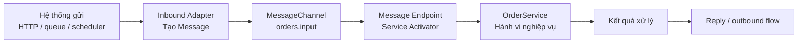
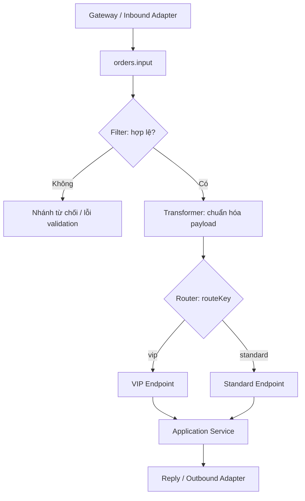

# Message Endpoint chuyển message thành hành vi ứng dụng

## 1. Endpoint là điểm gặp nhau giữa hệ thống thông điệp và ứng dụng

Trong mô hình tích hợp dựa trên thông điệp, một **Message** chứa payload và headers; một **MessageChannel** vận chuyển message giữa các thành phần. Tuy nhiên, channel tự nó không quyết định một đơn hàng phải được xác nhận, một hóa đơn phải được tạo hay một dữ liệu phải được chuyển đổi. **Message Endpoint** là thành phần nhận hoặc phát message tại ranh giới của một bước xử lý, nối cơ chế trao đổi thông điệp với **hành vi ứng dụng** cần thực hiện.

Ví dụ hệ thống bán hàng nhận sự kiện `OrderCreated`: message được gửi vào `orders.input`, endpoint nhận message, đọc payload và metadata cần thiết, gọi `OrderApplicationService.accept(...)`, rồi tạo phản hồi hoặc sự kiện tiếp theo. Endpoint giúp phần nghiệp vụ không cần tự quản lý việc subscribe channel, polling queue hay xây dựng reply message.

Trong chương **Endpoint** của module **SPRING_INTEGRATION_PATTERN**, ta học cách triển khai các *Enterprise Integration Patterns* với Spring Integration để tạo luồng thông điệp ít phụ thuộc, dễ mở rộng: Router, Filter, Transformer, Splitter, Aggregator, Gateway, retry, error channel và correlation, đồng thời kiểm thử và theo dõi các nhánh xử lý. Hiểu Endpoint là nền tảng để ghép những mẫu đó thành một flow vận hành được.



Sơ đồ phân biệt ba vai trò:

| Khái niệm | Trách nhiệm | Ví dụ |
| --- | --- | --- |
| **Message** | Mang dữ liệu và ngữ cảnh | `Message<OrderCreated>` kèm `tenantId` |
| **MessageChannel** | Kết nối các bước gửi và nhận | `orders.input`, `orders.validated` |
| **Message Endpoint** | Tiếp nhận/phát message để kích hoạt một bước xử lý | Service Activator gọi `OrderService` |
| **Application Service** | Thực hiện quy tắc nghiệp vụ | Xác nhận đơn hàng, lưu dữ liệu, tính chiết khấu |

**Không đồng nhất endpoint với HTTP endpoint:** HTTP controller là một cách ứng dụng nhận request. Trong Spring Integration, khái niệm Message Endpoint rộng hơn, bao gồm handler tiêu thụ message trên channel, adapter nói chuyện với broker/file/API, hoặc Gateway chuyển lời gọi phương thức thành message.

## 2. Từ Message đến lời gọi nghiệp vụ

Một Message Endpoint thường đi qua các bước khái niệm:

1. **Nhận** một message qua channel hoặc cơ chế nguồn phù hợp.
2. **Đọc/ánh xạ** payload và headers thành tham số handler hoặc dịch vụ nghiệp vụ.
3. **Thực thi** hành vi: lưu dữ liệu, tính toán, gọi dịch vụ hoặc điều phối một mẫu EIP.
4. **Xử lý kết quả**: phát reply, gửi message tiếp theo, kết thúc luồng một chiều hoặc chuyển lỗi qua cơ chế đã cấu hình.

Giả sử có payload:

```java
record OrderCreated(String orderId, long totalVnd) {}
record OrderReceipt(String orderId, String status) {}
```

Thông điệp đầu vào chứa:

```text
payload = OrderCreated("ORD-001", 650_000)
headers = {
    "tenantId": "store-hcm",
    "eventId": "evt-order-001",
    "traceId": "trace-4a"
}
```

Endpoint có thể chuyển payload thành đối số `OrderCreated` và lấy `tenantId` từ header; application service nhận những tham số đã có nghĩa và trả `OrderReceipt("ORD-001", "ACCEPTED")`. Nếu endpoint được dùng trong flow request-reply, kết quả đó có thể trở thành payload của reply message.

Điểm mấu chốt là **ranh giới trách nhiệm**. Handler làm công việc kết nối message với nghiệp vụ; đối tượng nghiệp vụ không nên buộc phải biết tên channel, `replyChannel`, `errorChannel` hay lịch poll nếu không có yêu cầu cụ thể.

### 2.1. Endpoint xử lý toàn bộ message hay chỉ payload?

Spring Integration hỗ trợ nhiều cách định nghĩa handler:

- Nhận trực tiếp `Message<OrderCreated>` khi cần đọc headers, payload hoặc thông tin kỹ thuật chung.
- Nhận `OrderCreated` với các tham số được ánh xạ từ headers thông qua annotation.
- Trong Java DSL, dùng handler có chữ ký `(payload, headers) -> result`.

Ví dụ với `@ServiceActivator`:

```java
import org.springframework.integration.annotation.ServiceActivator;
import org.springframework.messaging.handler.annotation.Header;
import org.springframework.messaging.handler.annotation.Payload;
import org.springframework.stereotype.Component;

@Component
class OrderMessageEndpoint {
    private final OrderApplicationService applicationService;

    OrderMessageEndpoint(OrderApplicationService applicationService) {
        this.applicationService = applicationService;
    }

    @ServiceActivator(inputChannel = "orders.input")
    public OrderReceipt accept(
            @Payload OrderCreated command,
            @Header("tenantId") String tenantId) {
        return applicationService.accept(command, tenantId);
    }
}

interface OrderApplicationService {
    OrderReceipt accept(OrderCreated order, String tenantId);
}
```

`@ServiceActivator` khiến Spring Integration đăng ký endpoint lắng nghe `orders.input`; framework ánh xạ message vào tham số phương thức. Khi phương thức trả kết quả, reply được xử lý theo cấu hình flow, output channel và/hoặc thông tin reply channel của message. Nếu handler không cần phát reply, có thể thiết kế phương thức `void` hoặc một handler trả `null` theo contract tương ứng.

Nếu `tenantId` bắt buộc mà message không có header này, cần xử lý như lỗi đầu vào và xác định đường trả lỗi; không coi header tùy biến là luôn tồn tại.

## 3. Các loại Endpoint thường gặp

“Endpoint” mô tả **vai trò kết nối** với hệ thống thông điệp. Các mẫu sau phục vụ những nhiệm vụ khác nhau:

| Loại | Mục đích | Hướng dữ liệu | Ví dụ |
| --- | --- | --- | --- |
| **Service Activator** | Kết nối message tới phương thức xử lý của ứng dụng | Channel → nghiệp vụ → reply (nếu có) | Gọi `OrderService.accept` |
| **Inbound Channel Adapter** | Thu nhận dữ liệu/sự kiện bên ngoài thành message | Nguồn ngoài → channel | Poll thư mục, nhận dữ liệu từ nguồn theo lịch |
| **Outbound Channel Adapter** | Xuất message ra đích ngoài, thường không đợi reply của flow | Channel → hệ thống ngoài | Ghi file, gửi sự kiện ra đích |
| **Messaging Gateway** | Đưa lời gọi ứng dụng qua ranh giới messaging; có thể request-reply | Lời gọi phương thức ↔ channel | `orderGateway.submit(order)` |
| **Message Handler / EIP endpoint** | Thực hiện hành vi của Filter, Router, Transformer, Splitter, Aggregator... | Channel → xử lý → channel | Filter kiểm tra đơn; Router chọn nhánh |

Một số adapter/gateway có cả chiều inbound và outbound tùy giao thức. Điểm phân biệt thực tế là **ai chủ động gọi**, **message vào/ra đâu** và **có cần trả kết quả cho bên gọi hay không**.

### 3.1. Service Activator — từ message đến phương thức ứng dụng

Service Activator là ví dụ điển hình nhất của Message Endpoint. Nó đưa payload hoặc toàn message đến một phương thức, nhận kết quả (nếu có) rồi tiếp tục flow.

Ứng dụng thường áp dụng mẫu này cho những bước như tạo hóa đơn, ghi database, tính điểm, kiểm tra khách hàng hoặc gọi service nội bộ. Service Activator không tự động cung cấp transaction, retry, chống trùng lặp hay tính bền vững; đó là các mối quan tâm cần cấu hình trong hạ tầng và logic nghiệp vụ.

### 3.2. Channel Adapter — ranh giới với nguồn/đích dữ liệu

**Inbound Channel Adapter** biến dữ liệu từ bên ngoài thành message phù hợp rồi gửi vào channel; **Outbound Channel Adapter** làm chiều ngược lại. Ví dụ:

```text
[Đọc file CSV] -> [Inbound Adapter] -> orders.raw
orders.raw -> [Transformer] -> orders.validated
orders.validated -> [Outbound Adapter] -> [Gửi broker]
```

Adapter cần quản lý đặc thù giao thức (serialization, kết nối, ACK, polling, chuyển đổi định dạng...). Giữ logic nghiệp vụ bên trong application service giúp thay adapter mà không phải viết lại quy tắc xử lý đơn hàng.

### 3.3. Messaging Gateway — giao diện phương thức thay cho Channel API

Gateway che giấu chi tiết dựng message, gửi channel và nhận reply phía sau một interface:

```java
import org.springframework.integration.annotation.Gateway;
import org.springframework.integration.annotation.MessagingGateway;
import org.springframework.messaging.handler.annotation.Header;
import org.springframework.messaging.handler.annotation.Payload;

@MessagingGateway
interface OrderGateway {
    @Gateway(requestChannel = "orders.input")
    OrderReceipt submit(
            @Payload OrderCreated command,
            @Header("tenantId") String tenantId);
}
```

Với cấu hình phát hiện gateway phù hợp (chẳng hạn `@IntegrationComponentScan`), ứng dụng gọi `orderGateway.submit(...)` như một phương thức Java. Framework tạo request message, đưa vào flow, theo dõi reply và trả về `OrderReceipt`. **Gateway trả kết quả chỉ khi có reply phù hợp**; nếu flow không gửi reply, cần xác định rõ timeout hoặc chọn contract một chiều (`void`).

## 4. Endpoint được kích hoạt như thế nào?

Một endpoint tiêu thụ message có thể nhận dữ liệu **khi message đến** hoặc **khi poller lấy được message**. Cơ chế tiêu thụ ảnh hưởng đến độ trễ, thread thực thi, áp lực tải và giao dịch.

### 4.1. Event-driven consumer

Endpoint được gắn với một `SubscribableChannel` như `DirectChannel`; khi producer gửi message, channel phân phối tới subscriber theo semantics của nó. Với `DirectChannel`, handler thường chạy đồng bộ trên thread gửi, vì vậy exception và transaction hiện hữu có thể lan truyền trong cùng ngữ cảnh gọi.

```text
producer.send(message)
    -> DirectChannel
        -> Event-driven Endpoint
            -> handler xử lý
    <- send hoàn tất hoặc phát sinh lỗi
```

Với channel dựa trên executor, handler có thể chạy ở thread khác. “Event-driven” không đồng nghĩa “luôn đồng bộ”, và channel không mặc nhiên lưu message bền vững.

### 4.2. Polling consumer

Với `PollableChannel` như `QueueChannel`, endpoint không subscribe để nhận ngay; nó cần **poller** định kỳ lấy message. Poller cho phép giới hạn chu kỳ và số message mỗi lượt, hoặc phối hợp advice/transaction tùy hạ tầng.

```text
producer -> QueueChannel --(poll every 1 second)--> Polling Endpoint -> handler
```

Ví dụ cấu hình Java DSL cho một consumer dạng polling (độc lập với các ví dụ khác):

```java
import org.springframework.context.annotation.Bean;
import org.springframework.context.annotation.Configuration;
import org.springframework.integration.channel.QueueChannel;
import org.springframework.integration.config.EnableIntegration;
import org.springframework.integration.dsl.IntegrationFlow;
import org.springframework.integration.dsl.Pollers;
import org.springframework.messaging.PollableChannel;

@Configuration
@EnableIntegration
class BatchEndpointConfig {
    @Bean("batch.orders")
    PollableChannel batchOrders() {
        return new QueueChannel();
    }

    @Bean
    IntegrationFlow batchOrdersFlow(BatchOrderService service) {
        return IntegrationFlow.from("batch.orders",
                spec -> spec.poller(
                    Pollers.fixedDelay(1_000).maxMessagesPerPoll(10)))
                .handle(OrderCreated.class, (order, headers) -> {
                    service.process(order);
                    return null; // Kết thúc xử lý một chiều.
                })
                .get();
    }
}

interface BatchOrderService {
    void process(OrderCreated order);
}
```

Đoạn mã tạo `QueueChannel` trong bộ nhớ, **không bảo đảm còn dữ liệu sau khi ứng dụng dừng**. Trong triển khai thực tế, nếu cần khả năng khôi phục phải lựa chọn nguồn lưu bền vững (broker, message store...) và cấu hình acknowledgement, retry hoặc transaction phù hợp.

| Thuộc tính | Event-driven qua `DirectChannel` | Polling qua `QueueChannel` |
| --- | --- | --- |
| Kích hoạt xử lý | Khi message được gửi | Khi poller nhận được message |
| Thời điểm/độ trễ | Thường gần thời điểm gửi | Phụ thuộc chu kỳ và backlog |
| Thread | Thường thread người gửi | Thread do scheduler/poller sử dụng |
| Điều tiết tải | Phụ thuộc channel và consumer | Điều chỉnh poll interval, số message/lượt |
| Bảo đảm độ bền | Không tự có | Queue trong RAM cũng không tự có |
| Transaction | Có thể tham gia transaction hiện hữu | Có thể thêm transaction advice cho poller nếu nguồn hỗ trợ |

**Lưu ý:** message-driven adapter của broker có thể gọi endpoint theo sự kiện nhưng chạy trên thread consumer riêng. Đừng suy luận đồng bộ/bất đồng bộ chỉ từ tên “inbound adapter”; cần xác định nguồn và channel thực tế.

## 5. Tạo flow hoàn chỉnh bằng Java DSL

Ta xây dựng flow minh họa theo nguyên tắc: **Gateway nhận lệnh từ mã ứng dụng → channel → Filter → Service Activator → reply**. Ứng dụng nghiệp vụ nằm sau interface, nhờ vậy dễ mock khi kiểm thử và thay implementation khi cần.

Giả sử có hai record:

```java
record OrderCreated(String orderId, long totalVnd) {}
record OrderReceipt(String orderId, String status) {}
```

Service nghiệp vụ:

```java
interface OrderApplicationService {
    OrderReceipt accept(OrderCreated command, String tenantId);
}
```

Cấu hình flow:

```java
import org.springframework.context.annotation.Bean;
import org.springframework.context.annotation.Configuration;
import org.springframework.integration.annotation.IntegrationComponentScan;
import org.springframework.integration.channel.DirectChannel;
import org.springframework.integration.config.EnableIntegration;
import org.springframework.integration.dsl.IntegrationFlow;
import org.springframework.messaging.MessageChannel;

@Configuration
@EnableIntegration
@IntegrationComponentScan
class OrderIntegrationConfig {

    @Bean("orders.input")
    MessageChannel ordersInput() {
        return new DirectChannel();
    }

    @Bean
    IntegrationFlow orderFlow(OrderApplicationService service) {
        return IntegrationFlow.from("orders.input")
                .filter(OrderCreated.class,
                        order -> order.totalVnd() > 0,
                        spec -> spec.throwExceptionOnRejection(true))
                .handle(OrderCreated.class, (order, headers) -> {
                    String tenantId = (String) headers.get("tenantId");
                    if (tenantId == null || tenantId.isBlank()) {
                        throw new IllegalArgumentException(
                                "tenantId is required");
                    }
                    return service.accept(order, tenantId);
                })
                .get();
    }
}
```

Kết hợp với `OrderGateway` ở phần trước, lệnh gọi:

```java
OrderReceipt receipt = gateway.submit(
        new OrderCreated("ORD-001", 650_000L), "store-hcm");
```

được chuyển thành message có payload `OrderCreated` và header `tenantId`. Filter xác nhận số tiền dương. Service Activator (handler của `.handle(...)`) đọc payload/headers và gọi `OrderApplicationService.accept`. Giá trị trả về được chuyển thành reply, và Gateway trả `OrderReceipt` cho caller.

**Nếu muốn dùng `@ServiceActivator` ở mục 2.1 thay cho `.handle(...)`, hãy lựa chọn một cách đăng ký cho cùng hành vi.** Đăng ký cả hai consumer trên cùng `DirectChannel` có thể khiến message được phân phối tới một trong hai subscriber theo chiến lược channel, dẫn đến kết quả khó dự đoán.

### 5.1. Vai trò của Filter, Router và Transformer trong flow

Endpoint không chỉ dành cho việc gọi một application service. Các pattern EIP cũng được thực hiện bằng các thành phần tiêu thụ message và tạo message mới hoặc điều phối message:



Filter có thể **discard** message theo chính sách hoặc ném exception khi từ chối, tùy cấu hình. Router chọn recipient dựa trên payload hoặc header; Transformer tạo payload/kiểu mới; Service Activator gọi nghiệp vụ. Thông điệp thường được giữ độc lập giữa các bước, nhưng chính xác các header nào được chuyển tiếp là điều cần kiểm thử ở mỗi ranh giới.

## 6. Endpoint và các kiểu trao đổi one-way / request-reply

Hai kiểu kết quả thường gặp:

| Kiểu | Ví dụ | Contract quan trọng |
| --- | --- | --- |
| **One-way / fire-and-forget** | Nhận sự kiện rồi ghi log hoặc gửi thêm message | Có cần ACK hay không, lưu thất bại ở đâu |
| **Request-reply** | Gateway gọi tính phí và đợi số tiền đã tính | Reply phải về đúng nơi, timeout và exception thế nào |

Trong một flow request-reply, thông điệp có thể mang `replyChannel` để chỉ đích phản hồi. Với gateway đồng bộ, channel trả lời có thể được framework bố trí tạm thời. Nếu một handler trả `null` hoặc route đưa message vào nhánh không trả kết quả, gateway đang chờ có thể timeout. Với one-way, `void` hoặc handler không tạo reply là hợp lý, nhưng cần **định nghĩa khi nào producer coi công việc đã thành công**.

Ví dụ “đã gọi được `send(...)`” không nhất thiết đồng nghĩa “hóa đơn đã lưu” nếu channel/consumer xử lý bất đồng bộ. Tương tự, HTTP 202 Accepted chỉ phản ánh việc nhận yêu cầu theo contract API chứ không khẳng định nghiệp vụ phía sau đã hoàn tất.

### 6.1. Correlation trong các flow nhiều nhánh

Khi Splitter chia một đơn hàng thành nhiều phần để xử lý, mỗi phần phải có ngữ cảnh giúp Aggregator biết chúng thuộc cùng một nhóm. `correlationId`, `sequenceNumber` và `sequenceSize` thường xuất hiện trong luồng split/aggregate; endpoint gom nhóm phải có chiến lược correlation và release phù hợp.

Một application service nên nhận ID nghiệp vụ phù hợp, còn endpoint chịu trách nhiệm giải quyết metadata điều phối ở ranh giới messaging. Khi phát lại message, `MessageHeaders.ID` có thể đổi; khóa chống xử lý trùng cần dựa trên ID nghiệp vụ/event ID ổn định.

## 7. Lỗi, retry và transaction tại Endpoint

Endpoint là nơi lỗi nghiệp vụ hoặc lỗi hạ tầng thường phát sinh: không tìm thấy đơn hàng, timeout database, API thanh toán trả 503, payload không hợp lệ. **Tùy kiểu channel và endpoint**, lỗi có thể được ném ngược về caller hoặc phát hành như `ErrorMessage` tới error channel.

| Tình huống | Hành vi cần xem xét |
| --- | --- |
| Handler trên `DirectChannel` ném exception | Thường truyền lỗi về thread gửi, Gateway có thể thấy exception |
| Handler chạy trên executor hoặc poller | Exception phát sinh ở thread xử lý; cấu hình error handler/error channel riêng |
| Lỗi validation | Từ chối ngay và giải thích được, tránh retry vô ích |
| Timeout tạm thời | Retry có giới hạn, backoff, phân loại exception |
| Retry hết lượt | Recovery có lưu message thất bại bền vững, alert và cơ chế replay |
| Gọi API ngoài thành công rồi lỗi ghi DB | Không mặc định transaction DB rollback được hiệu ứng ngoài |

Trong Spring Integration có thể áp dụng **advice** cho endpoint để bổ sung retry, transaction hoặc logging. Chẳng hạn, `RequestHandlerRetryAdvice` kết hợp Spring Retry giúp gọi lại handler trong các lỗi được chỉ định; poller có thể tích hợp transaction advice nếu nguồn/tài nguyên hỗ trợ. Song cần tách:

1. **Retry:** gọi lại một thao tác có thể phục hồi.
2. **Transaction:** bảo vệ tính nhất quán bên trong tài nguyên tham gia giao dịch.
3. **Idempotency:** ngăn thực thi nghiệp vụ trùng khi message được giao lại hoặc retry.
4. **Recovery:** giữ đủ dữ liệu để điều tra, phát lại hoặc bù trừ.

Giả sử endpoint gửi lệnh thu tiền tới hệ thống ngoài, hệ thống ngoài đã thu tiền nhưng phản hồi bị timeout. Retry mù có thể thu tiền lần hai. Cần `paymentId` hoặc idempotency key do hệ thống thanh toán hỗ trợ, cùng quy trình tra trạng thái trước khi phát lại.

Đừng nhầm “lỗi gửi tới error channel” với “message đã được lưu an toàn”. Một `DirectChannel` hoặc `PublishSubscribeChannel` trong RAM không tự tạo dead-letter storage; cần thiết kế tầng lưu trữ, broker hoặc xử lý đích.

## 8. Thiết kế Endpoint ít phụ thuộc và dễ mở rộng

Một Endpoint nên có nhiệm vụ rõ ràng: **nhận đúng loại message, ánh xạ dữ liệu, kích hoạt một hành vi, công bố kết quả hoặc lỗi có thể quan sát**. Chia trách nhiệm giúp thay đổi hạ tầng mà ít ảnh hưởng nghiệp vụ.

### 8.1. Đặt hợp đồng ở ranh giới

Với mỗi endpoint, cần xác định:

- **Input contract:** payload kiểu gì, header nào bắt buộc, validation nào áp dụng?
- **Output contract:** reply payload kiểu gì, một chiều hay request-reply, có phát event tiếp theo?
- **Error contract:** lỗi nào trả về caller, lỗi nào retry, lỗi nào vào recovery?
- **Concurrency và ordering:** nhiều consumer cùng nhận? có cần thứ tự theo khóa nghiệp vụ?
- **Idempotency:** dựa trên `eventId`, `orderId` hay ID nào?
- **Timeout / SLA:** bao lâu trước khi gateway hoặc producer coi là chưa có kết quả?

### 8.2. Tránh trộn logic giao thức vào nghiệp vụ

Mẫu thiết kế dễ bảo trì:

```text
HTTP / Broker / File
   -> Adapter (đọc và ánh xạ)
   -> Channel
   -> Endpoint (validation, routing, gọi service)
   -> Application Service (quy tắc nghiệp vụ)
   -> Repository / external client
```

Nếu business service chỉ xử lý đối tượng Java như `OrderCreated`, nó có thể được gọi từ endpoint HTTP, batch hoặc messaging mà không biết channel nào được dùng. Ngược lại, nếu service gọi trực tiếp `MessageChannel.send()` ở nhiều nơi, nghiệp vụ sẽ phụ thuộc mạnh vào hình thức điều phối thông điệp; nên cân nhắc tách việc phát sự kiện qua một port/interface để dễ kiểm thử.

### 8.3. Không suy đoán delivery semantics từ Endpoint

Event-driven endpoint + `DirectChannel` thường thuận tiện cho flow đồng bộ, nhưng không tạo tính bền vững khi process crash. Polling endpoint + `QueueChannel` có thể đệm tải nhưng queue trong bộ nhớ cũng có thể mất dữ liệu. Độ tin cậy là kết quả kết hợp **adapter nguồn, persistence, ACK/NACK, retry, idempotency và transaction**, không phải thuộc tính tự có của annotation `@ServiceActivator`.

## 9. Kiểm thử Endpoint: hành vi, headers, lỗi và luồng rẽ nhánh

Kiểm thử hữu ích cần chứng minh message đã kích hoạt **đúng hành vi ứng dụng**, bên cạnh việc kiểm tra thông điệp có được gửi đến channel.

| Kịch bản | Cách kiểm tra | Kết quả mong đợi |
| --- | --- | --- |
| Message hợp lệ với `tenantId` | Gọi Gateway và mock `OrderApplicationService` | Service nhận đúng `OrderCreated` và `tenantId`; caller nhận receipt |
| Payload có `totalVnd <= 0` | Gọi flow với dữ liệu không hợp lệ | Filter từ chối; service không được gọi |
| Thiếu header bắt buộc | Gửi message không có `tenantId` | Lỗi rõ ràng hoặc nhánh từ chối theo chính sách |
| Handler ném exception trong flow đồng bộ | Cho service giả lập lỗi | Gateway nhận lỗi theo contract; không có reply thành công |
| Poller chưa đến lượt | Gửi nhiều message vào `QueueChannel` | Handler xử lý theo chu kỳ, có thể còn backlog |
| Dùng Router nhiều nhánh | Gắn `routeKey` cho từng message | Chỉ consumer phù hợp xử lý message |
| Splitter + Aggregator | Gửi nhiều phần cùng correlation ID | Kết quả được gom theo đúng nhóm và release strategy |
| Retry hoặc phát lại message | Gửi lại cùng `eventId` | Không làm thay đổi nghiệp vụ lần hai nếu flow cam kết idempotency |
| Message vượt qua adapter bên ngoài | Kiểm tra sau serialize/deserialize | Payload và headers cam kết còn nguyên về mặt ngữ nghĩa |

Ví dụ **unit test** cho phương thức adapter của `OrderMessageEndpoint` ở mục 2.1 (JUnit 5 + Mockito):

```java
import static org.junit.jupiter.api.Assertions.assertEquals;
import static org.mockito.Mockito.*;

import org.junit.jupiter.api.Test;

class OrderEndpointContractTest {
    @Test
    void endpointMapsPayloadAndHeaderToBusinessService() {
        OrderApplicationService service =
                mock(OrderApplicationService.class);
        OrderCreated command = new OrderCreated("ORD-001", 650_000L);
        OrderReceipt receipt = new OrderReceipt("ORD-001", "ACCEPTED");

        when(service.accept(command, "store-hcm")).thenReturn(receipt);

        OrderMessageEndpoint endpoint = new OrderMessageEndpoint(service);
        OrderReceipt actual = endpoint.accept(command, "store-hcm");

        assertEquals(receipt, actual);
        verify(service, times(1)).accept(command, "store-hcm");
    }
}
```

Unit test này kiểm tra phương thức endpoint gọi nghiệp vụ với đúng tham số và trả đúng kết quả; **nó chưa kiểm chứng cơ chế ánh xạ Message/headers của Spring**. Để kiểm thử luồng đầy đủ, cần khởi tạo Spring Test context chứa `OrderIntegrationConfig`, Gateway và bean service giả lập, rồi gọi `gateway.submit(command, "store-hcm")`. Khi đó mới kiểm chứng được channel, Filter, việc ánh xạ header và reply.

Đối với polling consumer và broker, kiểm thử tích hợp cần kiểm soát timeout/chu kỳ polling và kiểm tra cả dữ liệu sau khi consumer xử lý. Với retry, sử dụng stub phát sinh lỗi có kiểm soát để xác minh số lần gọi và đường recovery.

### 9.1. Quan sát endpoint khi vận hành

Nên theo dõi ít nhất: số message vào/ra, thành công/thất bại, thời gian handler xử lý, số retry, độ dài queue, tuổi message tồn đọng và số message đang bị cách ly. Kèm `traceId`, `correlationId`, `eventId` để lần theo một yêu cầu khi đi qua nhiều endpoint. Tránh ghi payload nhạy cảm hoặc token vào log.

Đối với Router, theo dõi lưu lượng theo nhánh; đối với Filter, phân biệt message được loại theo chính sách với lỗi xử lý; đối với Aggregator, theo dõi các nhóm chưa đủ phần tử hoặc đã quá thời gian chờ.

## 10. Bài tập thực hành và checklist

**Bài tập:** Tạo flow tiếp nhận `OrderCreated` trong Spring Integration:

1. Xây `OrderGateway.submit(order, tenantId)` đưa request vào `orders.input`.
2. Filter kiểm tra `totalVnd > 0`; xác định kết quả cần trả về khi message bị từ chối.
3. Service Activator gọi `OrderApplicationService.accept(...)` và trả `OrderReceipt`.
4. Thêm `routeKey` để phân luồng đơn thường và đơn ưu tiên, kiểm tra đúng service được gọi.
5. Tạo một consumer poll `QueueChannel` độc lập; so sánh thread, thời gian xử lý và khả năng mất dữ liệu khi tiến trình dừng.
6. Giả lập service ném exception; xác định Gateway nhận gì, khi nào cần error channel và nơi lưu lỗi bền vững.
7. Gửi hai message có cùng `eventId`; đề xuất phương án ngăn ghi dữ liệu trùng.

Trước khi đưa endpoint thật vào môi trường vận hành, hãy trả lời: **Endpoint nhận dữ liệu qua channel nào? Nó kích hoạt hành vi ứng dụng nào? Input/output contract là gì? Nó xử lý đồng bộ hay polling? Ai chịu trách nhiệm cho retry, transaction, ACK, idempotency và quan sát lỗi?**

Một **Message Endpoint** tốt tạo ra ranh giới rõ ràng giữa *cơ chế luân chuyển message* và *hành vi ứng dụng*. Khi xác định đúng payload, headers, channel, kiểu tiêu thụ và contract kết quả, Spring Integration có thể kết nối các mẫu EIP thành flow linh hoạt mà vẫn dễ kiểm thử, mở rộng và xử lý sự cố.
