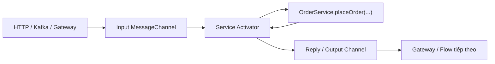
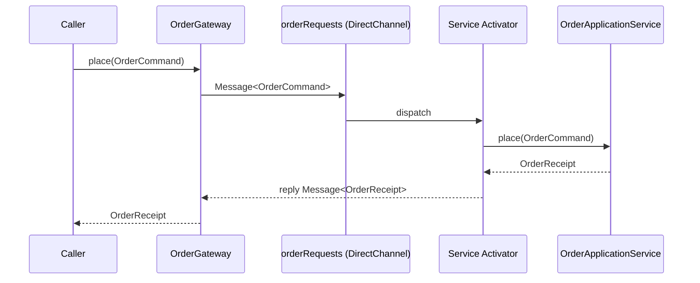
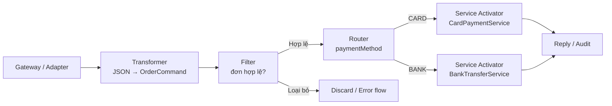
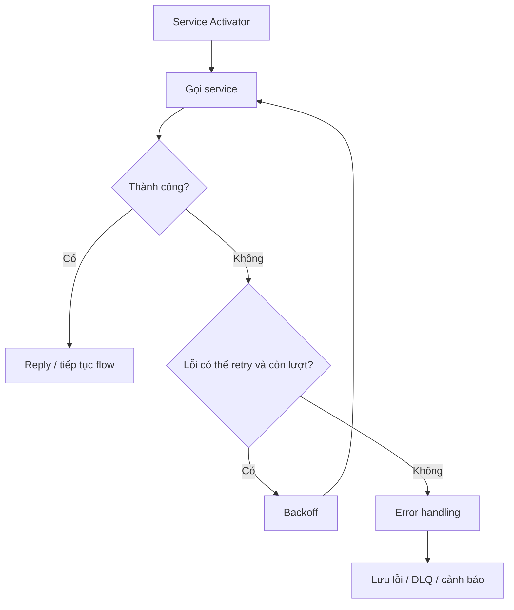
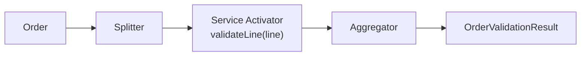

# Service Activator gọi service method trong Spring Integration

> **Chương:** Endpoint  
> **Bài học:** Service Activator gọi service method  
> **Phạm vi:** Enterprise Integration Patterns với Spring Integration, hướng tới các luồng thông điệp ít phụ thuộc, dễ mở rộng, có thể kết hợp Router, Filter, Transformer, Splitter, Aggregator, Gateway, retry, error channel và correlation.

## 1. Bài toán: đưa một lời gọi nghiệp vụ vào luồng thông điệp

Giả sử hệ thống nhận thông điệp đặt hàng từ HTTP API, RabbitMQ hoặc một ứng dụng khác. Sau khi kiểm tra dữ liệu, luồng cần gọi phương thức xử lý đơn hàng của một Java service. Nếu mỗi adapter đầu vào tự gọi thẳng service và tự xử lý kết quả, logic kết nối sẽ bị lặp lại ở nhiều nơi.

**Service Activator** là một mẫu *Message Endpoint* trong Enterprise Integration Patterns (EIP). Nó nối hạ tầng thông điệp với một phương thức xử lý nghiệp vụ: nhận `Message` từ channel, gọi service method tương ứng và, nếu có kết quả, biến kết quả đó thành thông điệp trả lời hoặc chuyển tiếp.



Ý nghĩa kiến trúc: service method có thể làm việc với đối tượng Java như `OrderCommand` và `OrderReceipt`, còn Spring Integration đảm nhận phần nhận message, ánh xạ tham số, gọi method và định tuyến kết quả. Điều này giúp phần nghiệp vụ giảm phụ thuộc vào transport.

**Mục tiêu học tập:** sau bài này, bạn có thể tạo Service Activator bằng Java DSL hoặc annotation, hiểu cách payload/header đi vào service method, phân biệt xử lý một chiều với request-reply, cấu hình lỗi/retry phù hợp và kiểm thử toàn bộ hành vi qua channel.

## 2. Service Activator nằm ở đâu trong mô hình Spring Integration?

Ba thành phần cần phân biệt:

| Thành phần | Vai trò | Ví dụ |
| --- | --- | --- |
| **Message** | Chứa payload và headers | `Message<OrderCommand>` |
| **Message Channel** | Truyền message giữa các endpoint | `DirectChannel`, `ExecutorChannel`, `QueueChannel` |
| **Message Endpoint** | Nhận message và thực hiện một hành vi | Service Activator, Transformer, Filter, Router |

Service Activator là **consumer endpoint**: nó tiêu thụ message từ input channel và điều khiển quá trình gọi logic Java. Nó không đồng nghĩa với service bean. Service bean chỉ cung cấp phương thức cần gọi; endpoint là thành phần tích hợp nối bean đó vào message flow.

Ví dụ:

```text
Message<OrderCommand>
  payload = OrderCommand("ORD-2048", 1250000)
  headers = {traceId: "trace-123", sourceSystem: "checkout"}

            |
            v

Service Activator
  invokes OrderApplicationService.place(OrderCommand)

            |
            v

OrderReceipt("ORD-2048", "ACCEPTED")
            |
            v
Message<OrderReceipt> / reply
```

Trong một flow thông thường, Spring Integration dùng framework xử lý message và ánh xạ tham số để gọi phương thức tương ứng. Bạn không cần viết thủ công `payload = message.getPayload()` ở mọi endpoint.

### Service Activator có giống Transformer không?

Cả hai đều có thể trả về một đối tượng mới, nhưng mục đích thiết kế khác nhau:

- **Transformer:** chuyển đổi biểu diễn dữ liệu, chẳng hạn JSON → DTO hoặc `OrderCommand` → `PaymentRequest`.
- **Service Activator:** kích hoạt một hành vi nghiệp vụ hoặc tích hợp hệ thống, chẳng hạn lưu đơn hàng, kiểm tra hạn mức, gọi API thanh toán.
- **Filter:** quyết định cho phép message đi tiếp hay loại bỏ.
- **Router:** quyết định message đi vào nhánh/channel nào.
- **Gateway:** đưa một lời gọi API hoặc method vào message flow, có thể đợi reply.

Nếu một service chỉ có nhiệm vụ đổi định dạng payload, dùng Transformer thường truyền đạt ý đồ rõ hơn. Nếu nhiệm vụ là thực hiện một use case nghiệp vụ, Service Activator là lựa chọn tự nhiên.

## 3. Hai cách khai báo Service Activator

Spring Integration hỗ trợ hai phong cách phổ biến:

1. **Java DSL:** khai báo flow bằng `IntegrationFlow` rồi dùng `.handle(...)` để gọi service method.
2. **Annotation:** đánh dấu method bằng `@ServiceActivator` và chỉ định `inputChannel` (cùng `outputChannel` khi phù hợp).

Cả hai đều sử dụng cùng mô hình message endpoint. Hãy chọn một cách nhất quán trong từng flow; nếu cùng một channel được nhiều consumer đăng ký, kết quả có thể phụ thuộc vào cơ chế phân phối message và không phải tất cả handler đều nhận một bản sao.

Trong các ví dụ bên dưới, Java 17 record được dùng để thể hiện dữ liệu. Bạn có thể thay bằng POJO trong dự án sử dụng phiên bản Java khác.

## 4. Ví dụ hoàn chỉnh bằng Java DSL: nhận lệnh và trả kết quả

Ta xây dựng luồng đồng bộ:



Ví dụ đặt các kiểu dữ liệu và cấu hình trong package `example.integration`.

### 4.1. Dữ liệu nghiệp vụ

```java
package example.integration;

import java.math.BigDecimal;

public record OrderCommand(String orderId, BigDecimal amount) {}

public record OrderReceipt(String orderId, String status) {}
```

Trong dự án Java thông thường, mỗi `public record` được đặt trong tệp `.java` cùng tên.

### 4.2. Service thuần Java

```java
package example.integration;

import java.math.BigDecimal;

public class OrderApplicationService {

    public OrderReceipt place(OrderCommand command) {
        if (command.orderId() == null
                || command.orderId().isBlank()
                || command.amount() == null
                || command.amount().compareTo(BigDecimal.ZERO) <= 0) {
            throw new IllegalArgumentException(
                "Order ID và số tiền phải hợp lệ");
        }

        // Trong ứng dụng thật: kiểm tra tồn kho, lưu đơn hàng,
        // hoặc gọi một hệ thống nghiệp vụ có timeout/idempotency.
        return new OrderReceipt(command.orderId(), "ACCEPTED");
    }
}
```

Service này không phải biết `MessageChannel`, `IntegrationFlow` hoặc cách hệ thống nhận sự kiện. Nó chỉ thực thi quy tắc nghiệp vụ nhận `OrderCommand` và trả `OrderReceipt`.

### 4.3. Cấu hình flow và Service Activator

```java
package example.integration;

import org.springframework.context.annotation.Bean;
import org.springframework.context.annotation.Configuration;
import org.springframework.integration.annotation.IntegrationComponentScan;
import org.springframework.integration.channel.DirectChannel;
import org.springframework.integration.config.EnableIntegration;
import org.springframework.integration.dsl.IntegrationFlow;
import org.springframework.messaging.MessageChannel;

@Configuration
@EnableIntegration
@IntegrationComponentScan
public class OrderIntegrationConfiguration {

    @Bean
    public MessageChannel orderRequests() {
        return new DirectChannel();
    }

    @Bean
    public OrderApplicationService orderApplicationService() {
        return new OrderApplicationService();
    }

    @Bean
    public IntegrationFlow orderFlow(
            OrderApplicationService orderApplicationService) {

        return IntegrationFlow.from("orderRequests")
            .handle(orderApplicationService, "place")
            .get();
    }
}
```

Phần quan trọng là:

```java
.handle(orderApplicationService, "place")
```

Nó tạo một endpoint gọi phương thức `place(...)` trên bean `orderApplicationService` khi message đến. Vì method trả `OrderReceipt`, framework có thể tạo reply để gửi tới kênh trả lời thích hợp.

Trong ví dụ, flow kết thúc tại Service Activator; khi Gateway gửi request có header `replyChannel`, reply có thể quay lại Gateway mà không cần khai báo một output channel riêng trong flow. Đây là mẫu request-reply đồng bộ phổ biến.

### 4.4. Định nghĩa Messaging Gateway

```java
package example.integration;

import org.springframework.integration.annotation.MessagingGateway;

@MessagingGateway(defaultRequestChannel = "orderRequests")
public interface OrderGateway {
    OrderReceipt place(OrderCommand command);
}
```

`@IntegrationComponentScan` cho phép phát hiện gateway interface trong phạm vi package được quét. Trong ứng dụng Spring Boot, thông thường cấu hình Spring và phạm vi component scan đã được thiết lập; vẫn cần đảm bảo gateway nằm trong package được quét.

Phía gọi chỉ làm việc với interface:

```java
OrderReceipt receipt = orderGateway.place(
    new OrderCommand("ORD-2048", new BigDecimal("1250000"))
);

// receipt.orderId() = "ORD-2048"
// receipt.status()  = "ACCEPTED"
```

Trong đoạn gọi, `orderGateway` là bean được Spring inject và `BigDecimal` được import từ `java.math.BigDecimal`.

### 4.5. Vì sao Gateway nhận được kết quả?

Gateway gửi một message chứa payload là `OrderCommand` và thông tin trả lời trong header nội bộ của Spring Integration. Endpoint gọi `place`, nhận `OrderReceipt` và phát reply thích hợp; Gateway chờ reply và chuyển thành giá trị trả về của method `place(...)`.

Do dùng `DirectChannel`, chuỗi gọi thường chạy ngay trên thread gửi. Nếu service ném exception, lời gọi đồng bộ có thể nhận lỗi theo cơ chế của flow. Nếu service quá chậm, caller sẽ bị chặn chờ hoàn tất hoặc hết thời hạn timeout đã cấu hình.

**Điểm quan trọng:** Service Activator không tự biến một lời gọi thành bất đồng bộ. Đặc tính đồng bộ hay bất đồng bộ phụ thuộc vào channel, executor, Gateway và các endpoint trong luồng.

## 5. Khai báo bằng annotation @ServiceActivator

Nếu muốn đặt cấu hình ngay trên method, có thể dùng `@ServiceActivator`.

### Ví dụ một chiều

```java
package example.integration;

import org.springframework.integration.annotation.ServiceActivator;
import org.springframework.stereotype.Component;

@Component
public class AuditService {

    @ServiceActivator(inputChannel = "auditInput")
    public void recordAudit(String event) {
        System.out.println("Audit: " + event);
    }
}
```

Khi có message trên channel `auditInput`, endpoint gọi `recordAudit` với payload kiểu `String`. Vì method trả `void`, nó thực hiện xử lý một chiều và không tự sinh reply nghiệp vụ.

Ứng dụng phải khai báo hoặc cung cấp channel `auditInput` và bật hạ tầng Spring Integration phù hợp. Đoạn này là **một flow minh họa riêng**, không đặt song song vào channel `orderRequests` của ví dụ Java DSL ở mục 4.

### Ví dụ request-reply qua annotation

```java
package example.integration;

import org.springframework.integration.annotation.ServiceActivator;
import org.springframework.stereotype.Component;

@Component
public class OrderEndpoint {

    private final OrderApplicationService service;

    public OrderEndpoint(OrderApplicationService service) {
        this.service = service;
    }

    @ServiceActivator(inputChannel = "orderRequests")
    public OrderReceipt place(OrderCommand command) {
        return service.place(command);
    }
}
```

Đây là **phương án thay thế** `.handle(orderApplicationService, "place")` của ví dụ DSL. Nếu dùng annotation này, hãy bỏ consumer `.handle(...)` trên cùng channel khỏi cấu hình mẫu để chỉ có một endpoint xử lý request.

Một phương án khác là dùng `outputChannel` khi cần chuyển reply đến một channel cụ thể, chẳng hạn `@ServiceActivator(inputChannel = "in", outputChannel = "out")`. Khi Gateway cần reply qua đường riêng, phải thiết kế tương quan request-reply nhất quán; không tùy tiện chuyển kết quả đến channel khác rồi vẫn kỳ vọng Gateway tự nhận được.

### Chọn DSL hay annotation?

| Java DSL | Annotation |
| --- | --- |
| Dễ nhìn toàn bộ luồng trên một cấu hình | Endpoint nằm gần method xử lý |
| Thuận tiện biểu diễn thứ tự Filter → Router → Service Activator | Ít mã cấu hình cho endpoint đơn giản |
| Có thể gắn advice, channel và endpoint options trong flow | Dễ kết hợp với các bean service đã có |
| Hợp với flow nhiều nhánh và nhiều thành phần | Hợp với cấu trúc endpoint chia theo chức năng |

Không có quy tắc bắt buộc mọi endpoint phải cùng một kiểu khai báo, nhưng cần tránh cấu hình trùng consumer trên cùng `DirectChannel` khi bạn chỉ mong một handler nhận thông điệp.

## 6. Service method có thể nhận những tham số nào?

Một lợi ích lớn của Service Activator là service method không bắt buộc phải nhận `Message<?>`. Framework có thể chuyển payload và một số metadata cần thiết thành tham số.

### 6.1. Nhận payload trực tiếp

```java
public OrderReceipt place(OrderCommand command) {
    return new OrderReceipt(command.orderId(), "ACCEPTED");
}
```

Đây là dạng dễ đọc, dễ kiểm thử và ít phụ thuộc hạ tầng nhất. Nên ưu tiên khi nghiệp vụ chỉ cần payload.

### 6.2. Nhận payload và header

```java
import org.springframework.messaging.handler.annotation.Header;
import org.springframework.messaging.handler.annotation.Payload;

public OrderReceipt place(
        @Payload OrderCommand command,
        @Header(name = "sourceSystem", required = false) String source) {

    String origin = source == null ? "unknown" : source;
    // Dùng origin cho audit hoặc quyết định nghiệp vụ nếu đã tin cậy.
    return new OrderReceipt(command.orderId(), "ACCEPTED");
}
```

`@Payload` chỉ rõ tham số lấy từ payload. `@Header` lấy một header theo tên; `required = false` cho phép header vắng mặt. Khi dữ liệu header không đáng tin cậy, phải kiểm tra tại ranh giới an ninh trước khi dùng cho phân quyền hoặc tenant routing.

### 6.3. Nhận toàn bộ Message

```java
import org.springframework.messaging.Message;

public OrderReceipt place(Message<OrderCommand> message) {
    OrderCommand command = message.getPayload();
    String traceId = message.getHeaders()
        .get("traceId", String.class);

    return new OrderReceipt(command.orderId(), "ACCEPTED");
}
```

Cách này hữu ích khi cần nhiều headers và metadata kỹ thuật, nhưng khiến method phụ thuộc Spring Messaging. Có thể giữ adapter endpoint nhận `Message` rồi chuyển payload/metadata đã chuẩn hóa sang service nghiệp vụ thuần Java.

### 6.4. Trả về Message có header tùy chỉnh

```java
import org.springframework.messaging.Message;
import org.springframework.messaging.support.MessageBuilder;

public Message<OrderReceipt> place(Message<OrderCommand> request) {
    OrderReceipt receipt = new OrderReceipt(
        request.getPayload().orderId(), "ACCEPTED");

    return MessageBuilder.withPayload(receipt)
        .copyHeaders(request.getHeaders())
        .setHeader("processingStage", "order-accepted")
        .build();
}
```

Khi trả về một `Message<?>` đã xây dựng, developer có thể chủ động thêm các headers ở output. Cần thận trọng với việc sao chép toàn bộ headers: `replyChannel`, `errorChannel`, headers bảo mật hoặc transport-specific có vòng đời riêng; không nên đưa tất cả ra broker hay hệ thống bên ngoài. Trong nhiều trường hợp, để framework tạo reply từ payload rồi cấu hình Header Enricher và header mapper tại ranh giới phù hợp sẽ dễ kiểm soát hơn.

### 6.5. Quy tắc chọn method

Tránh nhiều overload cùng tên và cùng tập tham số gần giống nhau khiến method resolution khó đoán. Với DSL `.handle(service, "place")`, nên dùng tên method rõ ràng và một chữ ký phù hợp với message dự kiến.

Nếu payload đến từ JSON hoặc message broker, đảm bảo nó đã được chuyển thành kiểu `OrderCommand` trước khi gọi method; Spring không thể tự suy diễn một ánh xạ payload bất kỳ nếu thiếu converter/transformer thích hợp.

## 7. Kết quả trả về: reply, một chiều và không có reply

Service Activator có thể trả các kiểu kết quả khác nhau:

| Giá trị method trả về | Hành vi thường gặp | Lưu ý |
| --- | --- | --- |
| `OrderReceipt` | Tạo reply có payload là receipt | Cần reply path nếu caller chờ kết quả |
| `Message<OrderReceipt>` | Phát message do method xây dựng | Kiểm soát headers và reply destination |
| `void` | Không tạo reply từ giá trị method | Phù hợp tác vụ một chiều |
| `null` | Không có reply từ invocation | Gateway request-reply có thể chờ đến timeout; phụ thuộc cấu hình requires-reply |

Ví dụ với method trả `void`:

```java
public void sendEmail(EmailCommand command) {
    emailClient.send(command);
}
```

Một endpoint xử lý email một chiều có thể dùng dạng này. Nếu phía gọi là Gateway khai báo `EmailReceipt sendEmail(...)` và mong nhận kết quả, method `void` hoặc trả `null` sẽ phá vỡ hợp đồng request-reply.

Nguyên tắc: **định nghĩa rõ flow là one-way, request-reply hay event-driven**, rồi thiết kế signature Gateway, output channel, reply timeout và error handling tương ứng.

### Kết quả service không tự động là “hoàn tất nghiệp vụ”

Nếu Service Activator trả `OrderReceipt("ACCEPTED")` trước khi bước xử lý bất đồng bộ thực hiện thanh toán, `ACCEPTED` chỉ nên có nghĩa “đã nhận để xử lý” theo hợp đồng hệ thống. Không dùng kết quả đó để khẳng định đã thanh toán thành công trừ khi có bằng chứng từ xử lý thực.

## 8. Kết hợp Service Activator với Filter, Transformer và Router

Một flow triển khai nhiều EIP có thể đặt Service Activator sau các bước chuẩn hóa và chọn nhánh.



Ví dụ DSL đơn giản: một Filter chọn đơn có số tiền dương trước khi gọi service.

```java
@Bean
public IntegrationFlow validatedOrderFlow(
        OrderApplicationService service) {

    return IntegrationFlow.from("validatedOrderInput")
        .filter(OrderCommand.class,
            command -> command.amount() != null
                && command.amount().signum() > 0)
        .handle(service, "place")
        .get();
}
```

Đây là flow **độc lập** với `orderRequests` ở mục 4 và yêu cầu khai báo channel `validatedOrderInput` phù hợp. Với Filter, nếu không cấu hình nhánh discard hoặc exception, message không đạt điều kiện có thể bị loại khỏi flow và Gateway chờ reply sẽ không nhận được kết quả như mong đợi. Thiết kế hành vi từ chối là một phần của API contract.

Trong flow thực tế:

- **Transformer** đổi payload sang DTO mà service method chấp nhận.
- **Filter** kiểm tra điều kiện nhận message; không thay thế toàn bộ validation nghiệp vụ sâu.
- **Router** đưa message đến một trong nhiều service chuyên trách.
- **Service Activator** thực thi thao tác nghiệp vụ trên nhánh đã chọn.
- **Header Enricher** gắn source, tenant hoặc correlation metadata để theo dõi và định tuyến.

## 9. Service Activator chạy trên thread nào?

Service Activator thường chạy trên thread do **channel phân phối message** quyết định.

| Input channel | Thread thực hiện service method | Hệ quả |
| --- | --- | --- |
| `DirectChannel` | Thường cùng thread gửi | Exception có thể trả về sender; transaction theo thread có thể được chia sẻ |
| `ExecutorChannel` | Thường worker thread từ `TaskExecutor` | Sender có thể tiếp tục sớm; cần xử lý lỗi bất đồng bộ |
| `QueueChannel` | Thread của poller/người nhận | Độ trễ phụ thuộc lịch poll và hàng đợi |
| Broker adapter | Thread do listener container/adapter quản lý | Acknowledgement, retry và delivery tuân theo transport |

Ví dụ:

```java
return IntegrationFlow.from("ordersInput")
    .channel("ordersAsync")      // Bean ExecutorChannel
    .handle(orderService, "place")
    .get();
```

Trong ví dụ trên, `ordersAsync` phải là một `ExecutorChannel` đã được khai báo và sử dụng executor phù hợp. Việc chuyển sang worker thread có thể làm mất sự truyền tự động của transaction, MDC, security context hoặc những giá trị trong `ThreadLocal` của thread gửi.

**Lưu ý cho Gateway:** nếu method Gateway cần reply, nó vẫn phải đợi reply hoặc timeout dù có ExecutorChannel giữa flow. Chuyển thread không tự thay đổi hợp đồng đồng bộ của method Gateway.

### Một Service Activator có thể nhận nhiều message đồng thời

Nếu đầu vào dùng nhiều worker, nhiều lời gọi tới cùng một singleton service bean có thể xảy ra song song. Không lưu trạng thái xử lý riêng của từng message trong instance field dùng chung nếu không có cơ chế đồng bộ rõ ràng. Ưu tiên bean không trạng thái và chỉ dùng biến cục bộ trong method.

## 10. Exception, retry và error channel

Service Activator là nơi lỗi nghiệp vụ hoặc lỗi tích hợp có thể phát sinh:

- Payload sai kiểu hoặc thiếu dữ liệu bắt buộc.
- Service ném exception do quy tắc nghiệp vụ, ví dụ hết hạn mức.
- Database/API bên ngoài timeout, trả lỗi hoặc tạm thời không khả dụng.
- Reply không được chuyển tới nơi mong đợi do cấu hình channel/Gateway.

Cần phân biệt lỗi **do dữ liệu** với lỗi **tạm thời có thể thử lại**. Ví dụ: sai `orderId` nên phản hồi lỗi nghiệp vụ; timeout khi gọi payment provider có thể thử lại với idempotency key và giới hạn số lần.

### Lỗi đồng bộ

```text
Gateway → DirectChannel → Service Activator
                              |
                              +--> throws exception
                                     |
                                     v
                                 caller nhận lỗi
                                 (theo cấu hình flow)
```

Ở mô hình đồng bộ cơ bản, exception từ handler thường được propagate về sender dưới dạng exception của message flow. Phía API có thể chuyển nó sang HTTP status hoặc response nghiệp vụ phù hợp.

### Lỗi bất đồng bộ

```text
Gateway/Producer → ExecutorChannel → worker → Service Activator
                       |
                 send được chấp nhận
                                         |
                                         +--> handler lỗi sau đó
                                               |
                                               v
                                          error flow / logging
```

Lúc worker gặp lỗi, sender có thể đã trả về. Cấu hình error handler, error channel hoặc cơ chế thu lỗi tại điểm bất đồng bộ là điều bắt buộc nếu cần giám sát và phục hồi. Header `errorChannel` và channel `errorChannel` mặc định có thể tham gia xử lý tùy cách endpoint/dispatcher được thiết lập; không giả định mọi exception trong mọi flow sẽ tự đến cùng một channel.

### Retry đúng chỗ

Với lỗi tạm thời, có thể gắn **retry advice** cho endpoint theo cấu hình Spring Integration tương ứng, kèm số lần thử, backoff và recovery. Tư duy chung:



Không retry vô hạn lỗi validation. Khi retry thao tác thanh toán, gửi email hoặc ghi dữ liệu, cần khóa idempotency hoặc cơ chế chống tác dụng phụ trùng lặp. Nếu mỗi retry lại tạo một giao dịch mới, Service Activator có thể gây lỗi nghiệp vụ nghiêm trọng dù message delivery nhìn có vẻ thành công.

## 11. Transaction, tính nhất quán và idempotency

Ở flow `DirectChannel` đồng bộ, Service Activator có thể chạy trên cùng thread với caller. Nếu Spring transaction được mở tại tầng phù hợp, lời gọi service có thể tham gia transaction theo cấu hình propagation của service.

Ví dụ:

```java
import org.springframework.transaction.annotation.Transactional;

public class OrderApplicationService {

    @Transactional
    public OrderReceipt place(OrderCommand command) {
        // Lưu Order trong database có transaction manager phù hợp.
        // Repository và các dependency cần được inject/cấu hình thật.
        return new OrderReceipt(command.orderId(), "ACCEPTED");
    }
}
```

`@Transactional` chỉ có hiệu lực khi method được gọi qua bean proxy hoặc cơ chế quản lý transaction thích hợp và có transaction manager; đoạn trên minh họa vị trí áp dụng, không phải cấu hình transaction đầy đủ.

Khi một `ExecutorChannel` đổi sang thread khác, transaction theo thread gửi không tự đi theo message. Nếu phát message trước khi transaction ghi đơn hàng commit, worker có thể đọc dữ liệu chưa tồn tại hoặc chưa visible.

Đối với công việc cần **không mất và không xử lý trùng**, cân nhắc:

1. Ghi trạng thái yêu cầu và sự kiện trong cùng transaction bằng **transactional outbox**.
2. Một publisher độc lập chuyển sự kiện đã commit tới broker bền vững.
3. Consumer thực thi Service Activator với idempotency key dựa trên định danh nghiệp vụ đã xác minh.
4. Chỉ xác nhận message ở transport khi đã xử lý theo hợp đồng acknowledgement phù hợp.

Service Activator tự nó không bảo đảm exactly-once delivery. Tính đúng đắn phụ thuộc lưu trữ, transaction, retry, transport và cách business operation xử lý trùng.

## 12. Correlation, Splitter và Aggregator

Một use case có thể cần chia đơn hàng thành nhiều dòng sản phẩm, gọi service xác nhận từng dòng rồi tổng hợp kết quả:



Splitter thường bổ sung các headers phục vụ correlation và sequence. Khi Service Activator xử lý message con, không nên ghi đè tùy tiện `correlationId`, `sequenceNumber` hoặc `sequenceSize` do framework dùng để gom nhóm.

Nếu handler trả payload mới, metadata cần cho Aggregator phải tiếp tục được bảo toàn phù hợp với việc tạo reply trong flow. Nếu handler tự dựng một `Message<?>` mới mà không mang các headers cần thiết, Aggregator có thể không nhóm được hoặc không biết lúc nào nhóm hoàn tất.

Trường hợp service call chạy qua `ExecutorChannel`, các message con có thể hoàn tất không đúng thứ tự đầu vào. Aggregator phải có correlation strategy, release strategy và chính sách timeout/expire phù hợp. Tránh suy ra “đủ kết quả” chỉ từ số lần method được gọi thành công.

**Mẹo thiết kế:** nếu cần khóa theo nghiệp vụ, dùng header riêng như `businessKey` hoặc `orderId` để audit/đối soát, và giữ metadata correlation kỹ thuật đúng vai trò của nó.

## 13. Kiểm thử Service Activator bằng JUnit 5

Một bài kiểm thử tốt cần đi qua channel hoặc Gateway thật để xác minh endpoint được nối vào flow. Chỉ gọi trực tiếp `service.place(...)` là unit test service nghiệp vụ, chưa chứng minh cấu hình Service Activator hoạt động.

Đoạn dưới đây sử dụng `OrderIntegrationConfiguration`, `OrderGateway` và các record ở mục 4.

```java
package example.integration;

import static org.junit.jupiter.api.Assertions.*;

import java.math.BigDecimal;

import org.junit.jupiter.api.Test;
import org.springframework.beans.factory.annotation.Autowired;
import org.springframework.test.context.junit.jupiter.SpringJUnitConfig;

@SpringJUnitConfig(OrderIntegrationConfiguration.class)
class OrderIntegrationTest {

    @Autowired
    private OrderGateway gateway;

    @Test
    void gatewayReceivesReplyFromServiceActivator() {
        OrderReceipt result = gateway.place(
            new OrderCommand("ORD-2048",
                new BigDecimal("1250000")));

        assertNotNull(result);
        assertEquals("ORD-2048", result.orderId());
        assertEquals("ACCEPTED", result.status());
    }

    @Test
    void invalidOrderReturnsAnError() {
        assertThrows(RuntimeException.class, () ->
            gateway.place(
                new OrderCommand("ORD-BAD", BigDecimal.ZERO)));
    }
}
```

**Giải thích phạm vi kiểm thử:**

- Test thứ nhất xác nhận đường `Gateway → channel → Service Activator → reply` có kết quả mong đợi.
- Test thứ hai xác nhận dữ liệu sai dẫn tới lỗi ở request-reply đồng bộ; kiểu exception cụ thể có thể bị framework bọc lại nên cần dựa trên hợp đồng lỗi thực tế của ứng dụng.
- Cả hai test đang dùng service giả lập, không gọi cơ sở dữ liệu hoặc payment provider. Khi thêm dependency ngoài, hãy thêm integration test và kiểm soát timeout.

### Kiểm thử riêng cho lỗi bất đồng bộ

Nếu service endpoint chạy trên `ExecutorChannel`, test không nên giả định handler đã xong ngay khi `send` trả về. Dùng `CountDownLatch`, Awaitility hoặc một cơ chế chờ có timeout để kiểm tra trạng thái cuối cùng; xác minh error channel/retry khi service ném exception.

Không dùng `Thread.sleep(...)` cố định để chứng minh thứ tự hoặc thời gian thực thi. Đo thời gian không đảm bảo tính đúng đắn nếu CI chậm hoặc bị gián đoạn.

### Những ca kiểm thử nên có ở dự án thật

| Trường hợp | Điều cần kiểm tra |
| --- | --- |
| Payload hợp lệ | Service method được gọi đúng một lần theo luồng dự kiến |
| Payload sai schema/kiểu | Phản hồi lỗi hoặc chuyển nhánh có kiểm soát |
| Header bắt buộc thiếu | Không mặc định tin metadata giả mạo |
| Service trả `null` | Gateway/reply handler tuân theo hợp đồng đã xác định |
| Service ném exception | Error path, retry và nội dung phản hồi rõ ràng |
| Hệ thống ngoài timeout | Có timeout, giới hạn retry và idempotency |
| Nhiều thông điệp đồng thời | Bean service xử lý an toàn, không lẫn trạng thái |
| Message chia nhóm | Headers correlation phù hợp đến Aggregator |

## 14. Những lỗi thiết kế thường gặp

### 14.1. Nhầm Spring @Service với Service Activator

`@Service` chỉ đánh dấu một bean nghiệp vụ trong Spring. Nó không tự đăng ký method làm consumer của message channel. Phải có `@ServiceActivator` hoặc một flow `.handle(...)` (hay cơ chế khai báo endpoint tương đương) nối method với channel.

### 14.2. Khai báo trùng consumer trên cùng DirectChannel

Nếu vừa gắn `@ServiceActivator(inputChannel = "orderRequests")`, vừa đăng ký `.handle(...)` từ cùng channel, hai endpoint có thể cùng đăng ký làm subscriber. `DirectChannel` là channel unicast, nên bạn không nên giả định cả hai handler đều nhận một bản sao message. Muốn multicast, dùng một `PublishSubscribeChannel` và thiết kế rõ trách nhiệm từng nhánh.

### 14.3. Service trả void nhưng Gateway chờ kết quả

Một method `void` thường không tạo reply nghiệp vụ. Gateway request-reply sẽ không nhận đối tượng trả về như mong đợi và có thể hết timeout. Nếu chỉ cần gửi lệnh, thiết kế gateway one-way; nếu cần kết quả, trả object hoặc message rõ ràng.

### 14.4. Gộp toàn bộ xử lý và routing vào service method

Nếu service method vừa tự parse JSON, tự quyết định route, tự retry, tự xử lý transport, nó sẽ phụ thuộc nhiều tầng. Dùng Transformer cho chuyển đổi, Filter/Router cho điều hướng, Service Activator cho use case nghiệp vụ và advice/error flow cho cơ chế xử lý lỗi có thể tái sử dụng.

### 14.5. Dùng headers làm dữ liệu phân quyền chưa xác thực

Các headers như `tenantId`, `sourceSystem`, `userId` có thể do client tự gửi. Header Enricher và Service Activator không tự xác thực chúng. Chỉ đưa ngữ cảnh đáng tin cậy vào quyết định bảo mật sau khi đã xác thực; tránh ghi token và dữ liệu cá nhân vào log.

### 14.6. Retry tác vụ có tác dụng phụ mà không chống trùng

Một phương thức `chargeCard(...)` có thể đã thu tiền thành công nhưng reply bị timeout. Retry mù sẽ tạo thêm giao dịch. Dùng idempotency key và thiết kế kiểm tra trạng thái từ provider trước khi thử lại khi cần.

## 15. Bài thực hành: xử lý lệnh thanh toán qua Service Activator

**Bối cảnh:** Một ứng dụng nhận `PaymentCommand`, kiểm tra số tiền, chọn phương thức thanh toán và gọi một service xử lý.

**Yêu cầu:**

1. Tạo `PaymentCommand(id, amount, method)` và `PaymentResult(id, status)`.
2. Tạo `PaymentService.execute(PaymentCommand)` không phụ thuộc Spring Integration.
3. Tạo `paymentRequests` là `DirectChannel` và `PaymentGateway.execute(...)` nhận kết quả.
4. Dùng `.handle(paymentService, "execute")` hoặc `@ServiceActivator` để kết nối method; chọn **một** cách cho cùng endpoint.
5. Thêm Filter kiểm tra số tiền dương và xử lý rõ nhánh bị loại; thêm Router khi mở rộng nhiều phương thức thanh toán.
6. Bổ sung `businessKey` hoặc `traceId` đáng tin cậy bằng Header Enricher để theo dõi.
7. Viết test thành công, validation lỗi, exception service và case Gateway không nhận reply.
8. Giải thích điều gì thay đổi khi đầu vào chuyển từ `DirectChannel` sang `ExecutorChannel`.
9. Phân tích chính sách retry, idempotency, transaction và cơ chế lưu bền vững nếu yêu cầu không mất lệnh.

### Gợi ý cấu trúc

```text
PaymentGateway
     |
paymentRequests
     |
Header Enricher
     |
Filter (validation)
     |
Router (paymentMethod)
     |                 |
     v                 v
CardServiceActivator   BankTransferServiceActivator
     |                 |
     +------ reply ----+
            |
       PaymentResult
```

Đừng bắt đầu từ việc tạo nhiều service. Hãy chứng minh một luồng request-reply hoạt động và có test, rồi thêm từng pattern một để thấy rõ thay đổi về payload, channel, reply và lỗi.

### Câu hỏi tự đánh giá

**Câu 1.** Nếu method `@Service` đã có trong Spring context, Spring Integration có tự gửi message vào method đó không?

*Không. Phải gắn nó với input channel bằng Service Activator hoặc endpoint phù hợp.*

**Câu 2.** Vì sao `OrderApplicationService.place(OrderCommand)` không cần nhận `Message<OrderCommand>`?

*Vì framework có thể ánh xạ payload sang tham số method; service chỉ cần dữ liệu nghiệp vụ.*

**Câu 3.** Khi Service Activator chạy sau `ExecutorChannel`, exception còn tự quay về caller đang gọi `send` không?

*Không thể dựa vào điều đó. Lỗi phát sinh ở worker cần error flow, logging và cơ chế phản hồi phù hợp; caller có thể đã tiếp tục.*

**Câu 4.** Service Activator trả `null` có phù hợp Gateway request-reply luôn cần response không?

*Thông thường không. Khi không có reply, caller có thể chờ đến timeout hoặc bị báo lỗi theo cấu hình requires-reply.*

**Câu 5.** Với Splitter → Service Activator → Aggregator, cần giữ thông tin gì?

*Phải bảo toàn correlation/sequence metadata mà Aggregator cần để ghép đúng nhóm, đồng thời thiết kế timeout và xử lý phần tử lỗi.*

## 16. Nguyên tắc áp dụng trong dự án thật

Một Service Activator nên có **trách nhiệm rõ, hợp đồng vào/ra ổn định và đường lỗi có thể kiểm soát**. Tách logic nghiệp vụ vào service method; dùng Channel, Gateway và các EIP khác để định nghĩa cách dữ liệu đi qua hệ thống.

Khi triển khai:

- Xác định payload đầu vào, metadata cần thiết và kiểu reply trước khi tạo endpoint.
- Dùng DSL `.handle(service, "method")` hoặc `@ServiceActivator` để nối method với channel một cách tường minh.
- Giữ service ít phụ thuộc transport; xử lý chuyển đổi dữ liệu bằng Transformer hoặc converter ở ranh giới.
- Chọn đúng channel đồng bộ/bất đồng bộ theo yêu cầu latency, transaction và ordering.
- Định nghĩa retry, error channel, timeout và idempotency khi service gọi hệ thống ngoài.
- Kiểm thử toàn bộ đường message từ Gateway/channel đến service method và reply; kiểm tra cả các nhánh lỗi.
- Theo dõi trace/correlation an toàn và các chỉ số thời gian xử lý, lỗi, retry trong môi trường vận hành.

**Ghi nhớ:** Service Activator là điểm nối giữa *message-driven flow* và *business method*. Phần tích hợp chịu trách nhiệm đưa message tới đúng method và định tuyến kết quả; service nghiệp vụ chịu trách nhiệm thực thi hành vi của ứng dụng. Kết hợp hai phần đúng cách giúp hệ thống mở rộng thêm Router, Filter, Transformer, Splitter, Aggregator và Gateway mà vẫn giữ ranh giới trách nhiệm rõ ràng.
