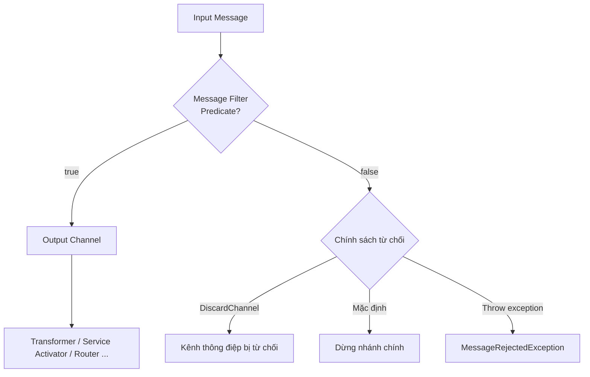
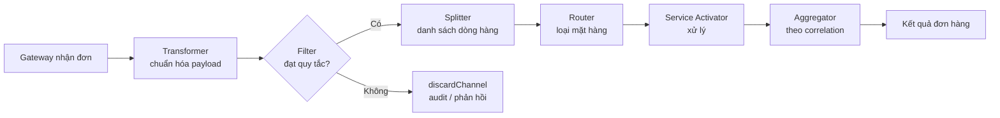

# Message Filter quyết định Message được đi tiếp trong Spring Integration

Trong hệ thống trao đổi thông điệp, không phải dữ liệu nào đi vào pipeline cũng được phép đến bước xử lý tiếp theo. Một đơn hàng có thể chưa hợp lệ, một sự kiện có thể đã hết hạn, hoặc một bản tin có thể không thuộc phạm vi mà dịch vụ đang đảm nhiệm. **Message Filter** là một *message endpoint* triển khai mẫu **Message Filter** trong bộ **Enterprise Integration Patterns (EIP)**: đánh giá một điều kiện và quyết định **cho Message đi tiếp hay loại Message khỏi luồng chính**.

Với module `SPRING_INTEGRATION_PATTERN`, mục tiêu là xây dựng các integration flow bằng Spring Integration có mức phụ thuộc thấp và dễ mở rộng, sử dụng Router, Filter, Transformer, Splitter, Aggregator, Gateway, retry, error channel và correlation. Hiểu đúng Filter đặc biệt quan trọng vì một quyết định “không cho đi tiếp” có thể ảnh hưởng đến phản hồi của Gateway, số phần tử Aggregator đang đợi và khả năng theo dõi một nhánh xử lý.

## 1. Message Filter là gì?

Trong Spring Integration, Message gồm **payload** (dữ liệu nghiệp vụ) và **headers** (metadata như `id`, `timestamp`, `correlationId`, `sequenceNumber`). Một Message Filter nhận Message từ input channel và kiểm tra một **predicate**, tức hàm trả về `true` hoặc `false`:

- **`true` — accepted:** Message được gửi tới output channel và tiếp tục pipeline.
- **`false` — rejected:** Message không đi tới output channel. Tùy cấu hình, nó được bỏ qua, chuyển tới `discardChannel` hoặc gây ngoại lệ từ chối.
- **Predicate ném ngoại lệ:** Đây là **lỗi khi đánh giá**, khác với một kết quả `false` hợp lệ. Ngoại lệ cần theo cơ chế xử lý lỗi của endpoint/flow.



Filter **không phải một bộ chuyển đổi payload**: khi một Message được chấp nhận, endpoint thông thường chuyển tiếp chính Message đó mà không yêu cầu thay đổi nội dung. Muốn chuẩn hóa hoặc làm giàu dữ liệu, nên dùng `Transformer` hoặc một bước riêng trước/sau Filter.

Một ví dụ nghiệp vụ:

> Hệ thống chỉ cho phép Message có mã đơn hàng bắt đầu bằng `ORD-` đi vào bước ghi nhận. Các mã khác được chuyển sang kênh `rejectedOrders` để ghi nhận lý do và hỗ trợ vận hành.

## 2. Filter khác Router, Transformer và Validator thế nào?

Các endpoint có thể đứng cạnh nhau trong cùng một flow nhưng thực hiện các quyết định khác nhau:

| Thành phần | Câu hỏi chính | Hành vi điển hình |
| --- | --- | --- |
| **Filter** | Message có được đi tiếp không? | Chấp nhận hoặc từ chối |
| **Router** | Message phải đi đến nhánh nào? | Chọn một hay nhiều channel đích |
| **Transformer** | Payload/Message cần biến đổi như thế nào? | Tạo biểu diễn hoặc Message đầu ra phù hợp |
| **Service Activator** | Thực hiện nghiệp vụ nào trên Message? | Gọi hàm xử lý và có thể sinh kết quả |
| **Splitter** | Tách Message thành bao nhiêu phần? | Tạo các Message con |
| **Aggregator** | Những Message nào thuộc cùng nhóm và đã đủ để ghép? | Gom các Message liên quan thành kết quả |

Nếu cần **bỏ Message không đủ điều kiện**, Filter phản ánh đúng ý định. Nếu cần **đưa mỗi loại Message đến một quy trình khác nhau** mà loại nào cũng phải được xử lý, Router phù hợp hơn. Nếu mục tiêu là **báo lỗi cho đầu vào không hợp lệ**, có thể dùng validation/exception thay cho việc âm thầm bỏ Message.

Ví dụ một yêu cầu API thiếu trường bắt buộc là lỗi cần trả về người gọi; còn một bản tin công bố giá của thị trường mà dịch vụ không theo dõi có thể được Filter loại bỏ bình thường. Quyết định này là **quy tắc nghiệp vụ**, không đơn thuần là lựa chọn annotation.

## 3. Các cách cấu hình Filter trong Spring Integration

Spring Integration cung cấp nhiều cơ chế thể hiện cùng một ý tưởng:

1. **`@Filter`** trên phương thức Java: cách viết ngắn gọn khi predicate thuộc một bean.
2. **Java DSL** (`IntegrationFlow`): diễn đạt Filter trực tiếp trong chuỗi các endpoint.
3. **`MessageSelector` / `MessageFilter`**: dùng khi cần thao tác ở mức Message và cấu hình endpoint bằng các thành phần cơ sở.

Một selector đơn giản nên **dễ hiểu, ổn định và ít tác dụng phụ**. Nếu nó phải gọi database hoặc dịch vụ bên ngoài, cần xác định rõ timeout, retry và việc một lỗi kỹ thuật có thể khiến quyết định lọc không thực hiện được.

### 3.1. Cấu hình với `@Filter`

Ví dụ dưới đây là một cấu hình Spring Integration tối giản. `orderInput` nhận Message từ producer. Những Message có payload là mã bắt đầu bằng `ORD-` đi đến `acceptedOrders`, còn các Message khác đi đến `rejectedOrders`.

```java
import org.springframework.context.annotation.Bean;
import org.springframework.context.annotation.Configuration;
import org.springframework.integration.annotation.Filter;
import org.springframework.integration.channel.DirectChannel;
import org.springframework.integration.channel.QueueChannel;
import org.springframework.integration.config.EnableIntegration;
import org.springframework.messaging.MessageChannel;
import org.springframework.messaging.PollableChannel;

@Configuration
@EnableIntegration
public class OrderFilterConfiguration {

    @Bean
    public MessageChannel orderInput() {
        return new DirectChannel();
    }

    @Bean
    public PollableChannel acceptedOrders() {
        return new QueueChannel(20);
    }

    @Bean
    public PollableChannel rejectedOrders() {
        return new QueueChannel(20);
    }

    @Filter(
            inputChannel = "orderInput",
            outputChannel = "acceptedOrders",
            discardChannel = "rejectedOrders")
    public boolean isAccepted(String orderCode) {
        return orderCode.startsWith("ORD-");
    }
}
```

Các điểm cần chú ý:

- `@EnableIntegration` kích hoạt hạ tầng Spring Integration cho ứng dụng Spring.
- `@Filter` gắn phương thức trả về `boolean` vào endpoint. Khi Message có payload kiểu `String`, framework chuyển payload vào tham số `orderCode`.
- `DirectChannel` chuyển Message tới Filter khi producer gửi. Ở ví dụ đồng bộ này, Filter kiểm tra ngay trong luồng gửi.
- Hai `QueueChannel` là nơi giữ kết quả để các consumer có thể lấy bằng `receive()`. Chúng **không tự có poller**; trong ví dụ thử nghiệm ta sẽ lấy Message trực tiếp.
- Capacity `20` chỉ giới hạn số Message chờ trong mỗi queue; không có ý nghĩa là chỉ xử lý 20 đơn hàng trong suốt vòng đời ứng dụng.

Nếu muốn xử lý các mã bị từ chối, ứng dụng có thể gắn polling consumer vào `rejectedOrders` để ghi audit, tạo thống kê hoặc trả trạng thái phù hợp. Không đưa dữ liệu không hợp lệ thẳng vào consumer nghiệp vụ chỉ vì đã có discard channel.

### 3.2. Cùng quy tắc bằng Java DSL

Với Java DSL, có thể biểu diễn logic bằng một flow:

```java
import org.springframework.context.annotation.Bean;
import org.springframework.context.annotation.Configuration;
import org.springframework.integration.dsl.IntegrationFlow;

@Configuration
public class OrderFilterFlow {

    @Bean
    public IntegrationFlow filterFlow() {
        return IntegrationFlow.from("orderInput")
                .filter(String.class,
                        code -> code.startsWith("ORD-"),
                        spec -> spec.discardChannel("rejectedOrders"))
                .channel("acceptedOrders")
                .get();
    }
}
```

Đoạn này là **cách cấu hình thay thế** cho phương thức `@Filter` ở mục 3.1; không đăng ký cả hai vào cùng `orderInput` trong cùng ví dụ nếu không chủ ý thiết kế nhiều consumer. Khi sử dụng DSL, cần có các channel tên `orderInput`, `acceptedOrders` và `rejectedOrders` tương ứng.

DSL thuận tiện khi cần đặt Filter nối tiếp Router, Transformer, Splitter hoặc Aggregator trong cùng một `IntegrationFlow`. Annotation thuận tiện khi quy tắc lọc được diễn đạt bằng một phương thức dễ kiểm thử riêng.

## 4. Quy trình gửi và quan sát kết quả

Cấu hình `OrderFilterConfiguration` cho phép chạy một phép kiểm tra nhỏ bằng `AnnotationConfigApplicationContext`:

```java
import org.springframework.context.annotation.AnnotationConfigApplicationContext;
import org.springframework.messaging.Message;
import org.springframework.messaging.MessageChannel;
import org.springframework.messaging.PollableChannel;
import org.springframework.messaging.support.MessageBuilder;

public class FilterDemo {

    public static void main(String[] args) {
        try (var context = new AnnotationConfigApplicationContext(
                OrderFilterConfiguration.class)) {

            MessageChannel input =
                    context.getBean("orderInput", MessageChannel.class);
            PollableChannel accepted =
                    context.getBean("acceptedOrders", PollableChannel.class);
            PollableChannel rejected =
                    context.getBean("rejectedOrders", PollableChannel.class);

            Message<String> good = MessageBuilder
                    .withPayload("ORD-1001")
                    .setHeader("businessOrderId", "ORD-1001")
                    .build();
            Message<String> bad = MessageBuilder
                    .withPayload("UNKNOWN-1")
                    .setHeader("businessOrderId", "UNKNOWN-1")
                    .build();

            input.send(good);
            input.send(bad);

            Message<?> acceptedMessage = accepted.receive(0);
            Message<?> rejectedMessage = rejected.receive(0);

            System.out.println(acceptedMessage.getPayload()); // ORD-1001
            System.out.println(rejectedMessage.getPayload()); // UNKNOWN-1
        }
    }
}
```

Khi Filter nằm sau `DirectChannel` và các queue vẫn còn chỗ trống, ví dụ xử lý ngay hai lượt gửi. Thao tác `receive(0)` lấy Message tức thời hoặc trả `null` nếu kênh rỗng. Trong ứng dụng thực, luôn kiểm tra `null` trước khi đọc payload; ví dụ này giả định hai lượt gửi thành công và đã được các endpoint xử lý.

**Quan trọng:** `input.send(bad)` có thể hoàn tất thành công vì Message đã được Filter tiếp nhận và chuyển sang `discardChannel`. Điều đó **không có nghĩa** đơn hàng bị từ chối đã đi vào nhánh `acceptedOrders`, và cũng không có nghĩa nghiệp vụ đã được thực thi thành công. Ý nghĩa của kết quả `send()` phụ thuộc loại channel và luồng xử lý.

## 5. Message được chấp nhận, bị loại bỏ và lỗi đánh giá

Có ba tình huống riêng biệt:

| Tình huống | Đường đi | Ý nghĩa |
| --- | --- | --- |
| Predicate trả `true` | `input → filter → output` | Quy tắc cho phép đi tiếp |
| Predicate trả `false` và có `discardChannel` | `input → filter → discard` | Quy tắc chủ động từ chối Message |
| Predicate trả `false` và không có `discardChannel` | Không gửi ra output | Message bị loại khỏi luồng chính |
| Predicate ném exception | Theo cơ chế lỗi của endpoint/flow | Không đánh đồng lỗi hệ thống với từ chối hợp lệ |

Thông thường, một Filter không gắn `discardChannel` sẽ **im lặng dừng Message** khi kết quả selector là `false`. Đây có thể là chủ đích đối với dữ liệu không liên quan, nhưng dễ gây khó khăn khi cần giải thích vì sao đơn hàng không được xử lý.

### 5.1. `discardChannel` có vai trò gì?

`discardChannel` nhận **Message bị từ chối** để một nhánh riêng quyết định xử lý. Các trường hợp sử dụng phổ biến:

- Ghi audit hoặc số liệu `rejected_message_total` theo lý do.
- Đưa Message vào quy trình kiểm tra thủ công.
- Tạo phản hồi nghiệp vụ phù hợp đối với yêu cầu không hợp lệ.
- Ghi nhận mẫu dữ liệu bị loại để điều chỉnh chính sách lọc.

Việc có `discardChannel` không mặc định tạo **dead-letter queue** có lưu trữ bền vững, không bảo đảm một người nào đó sẽ đọc kênh và cũng không tự suy ra nguyên nhân bị từ chối. Nếu cần lý do, phải thiết kế metadata hoặc dữ liệu audit rõ ràng.

### 5.2. Khi nào nên ném ngoại lệ?

Spring Integration hỗ trợ cấu hình **`throwExceptionOnRejection`** cho Filter trong những tình huống kết quả `false` cần được coi là lỗi thay vì loại bỏ bình thường. Khi bật cơ chế này, việc từ chối có thể dẫn tới `MessageRejectedException`. Hãy chọn cách xử lý đó theo hợp đồng của luồng, đặc biệt khi Gateway chờ phản hồi.

Ví dụ: “khách hàng chưa đủ điều kiện” có thể là một **kết quả nghiệp vụ bình thường** và nên có phản hồi có cấu trúc; “không truy vấn được chính sách do hệ thống xác thực lỗi” là một **lỗi kỹ thuật** cần đi theo cơ chế retry/error flow. Không dùng một nhánh discard để che giấu lỗi bất ngờ.

### 5.3. `errorChannel` khác `discardChannel`

- **`discardChannel`:** được dùng khi Filter *chủ động đánh giá Message không đạt điều kiện*.
- **`errorChannel`:** là kênh xử lý lỗi cho các endpoint/flow đã cấu hình error handling tương ứng, chẳng hạn lỗi khi handler/poller chạy.

Trong luồng đồng bộ qua `DirectChannel`, ngoại lệ có thể lan về phía gọi `send()` hoặc Gateway. Trong luồng polling/bất đồng bộ, cơ chế `ErrorMessage` và error channel phụ thuộc cấu hình poller, executor và gateway. **Không được giả định cứ ném exception thì Message sẽ tự động đến một error channel cụ thể**.

## 6. Thiết kế predicate đúng và dễ bảo trì

Một predicate Filter tốt nên trả lời đúng **một câu hỏi quyết định**. Ví dụ với đơn hàng: “Mã đơn đã ở định dạng hợp lệ chưa?”, “Giá trị đơn có lớn hơn 0 không?” hoặc “Nguồn sự kiện này có nằm trong danh sách được phép không?”.

### 6.1. Kiểm tra payload

```java
public boolean hasOrderPrefix(String orderCode) {
    return orderCode != null && orderCode.startsWith("ORD-");
}
```

Đây là quy tắc rõ ràng, kiểm thử được và không có tác dụng phụ. Với ứng dụng thực tế, phép kiểm tra định dạng có thể cần chặt chẽ hơn: độ dài tối đa, ký tự cho phép, trạng thái đơn và quyền của nguồn gửi.

### 6.2. Kiểm tra metadata

Đôi khi điều kiện dựa trên headers chứ không dựa vào payload:

```java
import org.springframework.messaging.Message;

public boolean isApprovedSource(Message<?> message) {
    String source = message.getHeaders()
            .get("sourceSystem", String.class);
    return "trusted-partner".equals(source);
}
```

Để dùng predicate kiểu này như Filter, cấu hình endpoint chấp nhận tham số `Message<?>` hoặc selector phù hợp. Header `sourceSystem` là **header do ứng dụng định nghĩa**, không phải chứng cứ xác thực. Nếu nguồn không đáng tin có thể tự ghi header, phải xác minh danh tính ở biên hệ thống rồi mới chuyển kết quả vào metadata.

### 6.3. Các nguyên tắc khi đưa quy tắc vào Filter

| Nguyên tắc | Lý do |
| --- | --- |
| Không ghi database hay gọi API chỉ để “tiện tay” trong predicate | Giữ quyết định lọc ổn định, dễ thử lại và quan sát |
| Predicate có cùng đầu vào nên cho cùng kết quả, khi có thể | Giảm kết quả khác nhau giữa các lượt retry |
| Tách điều kiện phức tạp thành các hàm có tên rõ ràng | Dễ giải thích Message bị loại vì sao |
| Phân biệt từ chối nghiệp vụ với lỗi đánh giá | Quy định chính xác discard, retry, error handling |
| Xử lý thiếu header và sai kiểu payload có chủ đích | Tránh lỗi runtime bất ngờ làm dừng flow |
| Không log payload nhạy cảm khi từ chối | Giảm rò rỉ dữ liệu trong quá trình vận hành |

Khi điều kiện quá phức tạp hoặc có tác dụng phụ bắt buộc, nên cân nhắc một bước xử lý nghiệp vụ riêng trả về kết quả rõ ràng, rồi dùng Filter để quyết định tuyến tiếp theo.

## 7. Filter phối hợp với các Enterprise Integration Patterns

Một integration flow có thể có nhiều điểm quyết định. Ví dụ:



Trong ví dụ này, Filter đặt **trước Splitter** để loại cả đơn hàng không hợp lệ trước khi tạo các Message con. Điều này giảm số nhánh phải xử lý và tránh trường hợp một Message con bị loại sau khi Aggregator đã kỳ vọng đủ số phần tử.

### 7.1. Filter đặt trước hay sau Router?

Nếu tất cả nhánh dùng chung một quy tắc, đặt Filter trước Router thường dễ bảo trì và giảm xử lý dư. Nếu mỗi nhánh có chính sách riêng, có thể lọc sau Router. Tuy nhiên, khi lọc sau Router cần đo lường riêng số Message được chấp nhận và bị từ chối ở từng nhánh.

### 7.2. Filter trước hay sau Splitter?

Giả sử Splitter tách một Message thành ba Message con:

```text
Message gốc: order = ORD-1001
              |
           Splitter
              |
       +------+------+ 
       |      |      |
      M1     M2     M3
   corr=X corr=X corr=X
   seq=1  seq=2  seq=3
       |      |      |
     pass   reject  pass
       |      |      |
       +------+------+
              |
           Aggregator
```

Nếu một Filter nằm **sau Splitter** loại bỏ `M2`, trong khi Aggregator vẫn chờ nhóm có `sequenceSize = 3`, nó có thể chờ mãi nếu không có chiến lược giải phóng/hết hạn phù hợp.

Những cách xử lý tùy yêu cầu:

1. **Lọc trước khi split** nếu tiêu chí áp dụng cho toàn bộ yêu cầu.
2. **Chỉ split các phần tử cần xử lý** nếu có thể loại danh sách con từ bước chuẩn bị.
3. **Cấu hình release strategy/timeout và xử lý partial group** khi Filter ở sau Splitter là cần thiết.
4. **Ghi nhận discard** để có thể giải thích vì sao kết quả gộp thiếu thành phần.

Correlation metadata như `correlationId`, `sequenceNumber`, `sequenceSize` thuộc phạm vi xử lý nhóm; Filter không tự điều chỉnh `sequenceSize` khi loại bỏ một Message con.

### 7.3. Retry phải áp dụng đúng loại lỗi

`false` từ predicate là **quyết định lọc**: retry cùng dữ liệu thường không giúp thay đổi kết quả. Ngược lại, một lời gọi dịch vụ phụ thuộc bị timeout khi đánh giá có thể cần retry có giới hạn và backoff.

Hãy định nghĩa rõ:

- Lỗi nào có thể thử lại, lỗi nào cần xử lý thủ công.
- Khi nào phản hồi cho producer/Gateway rằng Message đã bị từ chối.
- Cách tránh thực hiện lại tác dụng nghiệp vụ nếu flow được retry.
- Khóa idempotency dùng để chống xử lý trùng, chẳng hạn `eventId` ổn định do ứng dụng cấp.

## 8. Filter với Gateway, channel bất đồng bộ và yêu cầu phản hồi

Một API thường gọi **messaging gateway** và chờ kết quả. Nếu Filter loại Message rồi không có ai gửi reply, lời gọi Gateway có thể hết thời gian chờ. Vì vậy, đừng để “drop im lặng” là hành vi mặc định cho một yêu cầu mà người dùng cần biết thành công hay thất bại.

Ba hướng thiết kế phổ biến:

| Loại flow | Thiết kế phản hồi gợi ý |
| --- | --- |
| Fire-and-forget, dữ liệu không liên quan có thể bỏ | Filter từ chối, đo số lượng và ghi audit phù hợp |
| Request-reply đồng bộ | Có nhánh tạo phản hồi từ chối có cấu trúc, hoặc exception được ánh xạ thành phản hồi |
| Event-driven bất đồng bộ | Phát sự kiện trạng thái/đưa Message tới nhánh theo dõi; producer nhận xác nhận tiếp nhận theo hợp đồng |

Nếu gắn `QueueChannel` hoặc `ExecutorChannel` vào luồng, xử lý có thể diễn ra ở thời điểm khác với lúc producer gửi. Lúc đó:

- Một kết quả `send()` thành công chỉ cho thấy Message được kênh tiếp nhận ở tầng tương ứng.
- Filter có thể thực thi trong consumer/poller, không phải ở luồng của producer.
- Lỗi Filter không nhất thiết trả trực tiếp về người gửi ban đầu.
- `replyChannel`, `errorChannel`, timeout và correlation của Gateway cần được thiết kế phù hợp.

Với những nhánh cần đảm bảo audit hoặc không mất Message khi tiến trình dừng, phải xem xét lưu trữ/transport bền vững. Một `discardChannel` trỏ đến `QueueChannel` trong bộ nhớ **không tự trở thành kho lỗi đáng tin cậy**.

## 9. Quan sát Message bị từ chối

Một Filter chỉ có ý nghĩa vận hành nếu có thể trả lời: **bao nhiêu Message bị loại, ở bước nào, vì quy tắc nào và tác động gì đến kết quả?**

Nên thu thập:

| Tín hiệu | Ví dụ | Mục đích |
| --- | --- | --- |
| Số Message được đánh giá | `filter.evaluated` | Biết tải đi qua endpoint |
| Số Message được chấp nhận | `filter.accepted` | Tính tỷ lệ qua Filter |
| Số Message bị từ chối | `filter.rejected` | Phát hiện thay đổi dữ liệu/luật |
| Số lỗi đánh giá | `filter.errors` | Phân biệt sự cố kỹ thuật với reject hợp lệ |
| Độ trễ predicate | `filter.duration` | Phát hiện selector chậm hoặc phụ thuộc nghẽn |
| Backlog của discard channel | `discard.queue.depth` | Không để nhánh theo dõi bị đầy, mất dữ liệu |

Các tên metric ở bảng là **gợi ý đặt tên**, không phải cam kết rằng Spring Integration tự phát hành mọi metric đó. Với Micrometer, Actuator hoặc hệ thống tracing, có thể bổ sung điểm đo tại endpoint, selector và discard consumer để lấy các giá trị đúng.

Log theo cấu trúc có thể mang:

```json
{
  "stage": "order-filter",
  "decision": "REJECTED",
  "rule": "ORDER_CODE_PREFIX",
  "businessOrderId": "UNKNOWN-1",
  "messageId": "<message-uuid>",
  "correlationId": "<group-key-if-present>",
  "reason": "order code does not start with ORD-"
}
```

Đừng tự gán `correlationId` giả cho một Message vốn không có header đó; hãy để vắng mặt hoặc biểu diễn là `null`. Chỉ log các khóa cần cho chẩn đoán, tránh ghi token xác thực, thông tin cá nhân hay toàn bộ payload.

## 10. Kiểm thử hành vi lọc với Spring Integration

Một phép kiểm thử có giá trị cần xác minh cả hai nhánh, metadata và điều kiện biên. Ví dụ JUnit 5 bên dưới khởi tạo cấu hình ở mục 3.1 và dùng `QueueChannel` làm điểm quan sát:

```java
import static org.junit.jupiter.api.Assertions.*;

import org.junit.jupiter.api.Test;
import org.springframework.context.annotation.AnnotationConfigApplicationContext;
import org.springframework.messaging.Message;
import org.springframework.messaging.MessageChannel;
import org.springframework.messaging.PollableChannel;
import org.springframework.messaging.support.MessageBuilder;

class OrderFilterIntegrationTest {

    @Test
    void shouldForwardOnlyAcceptedMessageAndDiscardRejectedMessage() {
        try (var context = new AnnotationConfigApplicationContext(
                OrderFilterConfiguration.class)) {
            MessageChannel input =
                    context.getBean("orderInput", MessageChannel.class);
            PollableChannel accepted =
                    context.getBean("acceptedOrders", PollableChannel.class);
            PollableChannel rejected =
                    context.getBean("rejectedOrders", PollableChannel.class);

            Message<String> valid = MessageBuilder.withPayload("ORD-42")
                    .setHeader("businessOrderId", "ORD-42")
                    .build();
            Message<String> invalid = MessageBuilder.withPayload("BAD-42")
                    .setHeader("businessOrderId", "BAD-42")
                    .build();

            assertTrue(input.send(valid));
            assertTrue(input.send(invalid));

            Message<?> passed = accepted.receive(0);
            Message<?> discarded = rejected.receive(0);

            assertNotNull(passed);
            assertNotNull(discarded);
            assertEquals("ORD-42", passed.getPayload());
            assertEquals("BAD-42", discarded.getPayload());
            assertEquals(valid.getHeaders().getId(), passed.getHeaders().getId());
            assertEquals("ORD-42", passed.getHeaders().get("businessOrderId"));
            assertNull(accepted.receive(0));
            assertNull(rejected.receive(0));
        }
    }
}
```

Ở cấu hình này, Filter chuyển tiếp Message được chấp nhận và Message bị từ chối sang các channel tương ứng. Phép kiểm tra ID cho thấy Message đi qua Filter ở ví dụ vẫn giữ metadata ban đầu; không suy rộng rằng mọi Transformer/adapter trong mọi hệ thống luôn giữ nguyên ID.

### Các tình huống nên kiểm thử thêm

1. **Điều kiện biên:** chuỗi rỗng, sai tiền tố, khác chữ hoa/thường, mã có khoảng trắng hoặc quá dài.
2. **Thiếu/không tin cậy metadata:** header không có, sai kiểu hoặc nguồn gửi tự khai báo thuộc nhóm được phép.
3. **Predicate ném exception:** xác minh lỗi đi theo chính sách exception/error channel và không bị ghi nhầm thành reject hợp lệ.
4. **Gateway chờ kết quả:** Message bị từ chối phải dẫn đến phản hồi hoặc lỗi phù hợp, tránh treo đến timeout không rõ nguyên nhân.
5. **Filter sau Splitter:** một Message con bị loại; kiểm tra Aggregator xử lý nhóm thiếu đúng chiến lược.
6. **Cấu hình discard channel:** không có consumer, queue đầy hoặc lỗi khi ghi audit; quan sát phản ứng upstream.
7. **Retry/idempotency:** cùng `eventId` xuất hiện lại; không phát sinh tác dụng nghiệp vụ lặp.

Với endpoint polling hoặc bất đồng bộ, dùng thời gian chờ hữu hạn và điều kiện kiểm tra rõ ràng thay vì `Thread.sleep()` cố định. Luôn đánh giá **hành vi của toàn flow** tại nhánh chấp nhận và nhánh từ chối.

## 11. Những lỗi thiết kế phổ biến

| Hiện tượng | Nguyên nhân thường gặp | Cách kiểm tra và khắc phục |
| --- | --- | --- |
| Message “biến mất” không có log | Predicate trả `false`, không có `discardChannel` | Kiểm tra rule, thêm số liệu reject và tuyến audit khi cần |
| Gateway timeout khi dữ liệu bị loại | Filter loại Message nhưng không có reply | Thiết kế nhánh phản hồi từ chối hoặc ánh xạ lỗi |
| Lỗi dịch vụ ngoài bị coi là reject | Predicate bắt exception rồi trả `false` | Phân biệt lỗi kỹ thuật và quyết định nghiệp vụ |
| Aggregator chờ thiếu Message | Filter loại phần tử sau Splitter | Lọc trước khi split hoặc cấu hình release/expiry strategy |
| Nhánh lỗi trở nên quá tải | `discardChannel` có dung lượng giới hạn nhưng không có consumer | Gắn consumer, giám sát capacity và xử lý backpressure |
| Filter phụ thuộc vào header giả | Tin tưởng header do client tự cấp | Xác minh nguồn ở biên và cấp metadata đáng tin |
| Test chỉ kiểm tra nhánh `true` | Bỏ qua phản hồi reject và metadata | Kiểm tra cả accepted/discard/error với input đại diện |
| Retry mãi không làm Message đi tiếp | Predicate luôn trả `false` với dữ liệu không đổi | Chỉ retry lỗi tạm thời; giữ reject là kết quả có chủ đích |

## 12. Quy tắc áp dụng khi xây dựng integration flow

1. Viết rõ **predicate** và ý nghĩa của `true`/`false` trước khi chọn cách cấu hình.
2. Chọn **chính sách từ chối** phù hợp: bỏ qua, chuyển discard channel hoặc phát lỗi/phản hồi.
3. Phân biệt **từ chối hợp lệ** với **ngoại lệ kỹ thuật** để thiết kế retry và error channel đúng.
4. Nếu flow có Gateway, xác định **đường trả lời** cho cả Message được chấp nhận lẫn Message bị từ chối.
5. Nếu flow có Splitter/Aggregator, kiểm tra tác động của Filter đến **correlation và số phần tử cần gom**.
6. Ghi nhận **số Message được lọc, lý do, thời gian xử lý và khóa nghiệp vụ** với mức dữ liệu an toàn.
7. Dùng test tích hợp để xác minh **đường đi của Message** qua các kênh, kể cả trường hợp lỗi và tải cao.

Message Filter là một endpoint nhỏ nhưng có quyền quyết định toàn bộ hành trình tiếp theo của Message. Khi predicate, discard policy và error handling được thiết kế rõ ràng, Spring Integration có thể ngăn dữ liệu không phù hợp đi sâu vào hệ thống mà vẫn giữ được khả năng theo dõi, kiểm thử và mở rộng các nhánh xử lý.
