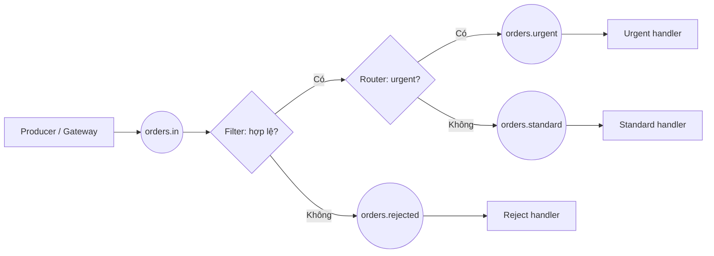
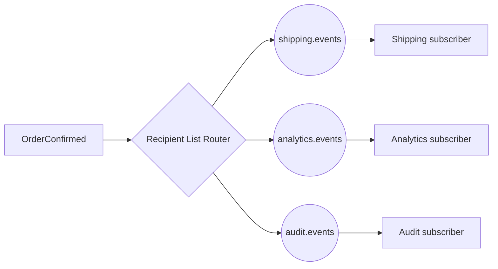
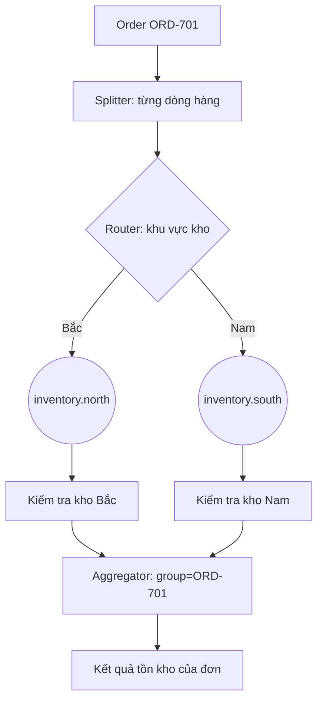

# Router chọn channel đích

> **Chương:** Endpoint  
> **Module:** `SPRING_INTEGRATION_PATTERN` — triển khai Enterprise Integration Patterns với Spring Integration để tạo các luồng thông điệp ít phụ thuộc, dễ mở rộng; thực hành Gateway, Filter, Transformer, Router, Splitter, Aggregator, retry, error channel, correlation, kiểm thử và theo dõi từng nhánh. Bài này tập trung vào **Router endpoint**: cách quyết định message tiếp tục đi qua channel nào.

## 1. Mục tiêu học tập

Sau bài học, bạn có thể:

1. Giải thích **Message Router** và **Content-Based Router** giải quyết vấn đề gì trong một integration flow.
2. Phân biệt việc **chọn channel đích** với **lọc message, biến đổi payload** và **phát message tới nhiều subscriber**.
3. Thiết lập điều kiện định tuyến dựa trên **payload, headers, kiểu dữ liệu hoặc biểu thức**; hiểu **channel mapping**, nhánh mặc định và trường hợp không tìm được đích.
4. Xây dựng ví dụ định tuyến với **Spring Integration Java DSL** và mô tả hành vi khi gửi message tới từng nhánh.
5. Thiết kế chính sách lỗi, retry, correlation và cách kiểm thử để biết message thực sự đi tới nhánh nào.

## 2. Vấn đề: một đầu vào, nhiều hướng xử lý

Giả sử dịch vụ nhận đơn hàng từ website. Đơn có cờ ưu tiên phải được chuyển sang bộ phận xử lý nhanh; đơn thông thường sang bộ phận xử lý tiêu chuẩn; đơn sai dữ liệu phải đi luồng từ chối. Nếu viết mọi điều kiện trong một hàm nhận đơn, hàm này sẽ phụ thuộc trực tiếp vào từng dịch vụ đích:

```java
// Cách ghép chặt để thấy vấn đề, KHÔNG phải mẫu triển khai khuyến nghị.
void receive(Order order) {
    if (!isValid(order)) {
        rejectionService.reject(order);
    } else if (order.urgent()) {
        urgentService.process(order);
    } else {
        standardService.process(order);
    }
}
```

Thêm một nhánh mới (đơn quốc tế, đơn có nguy cơ gian lận, đơn khách doanh nghiệp) sẽ đòi sửa hàm trung tâm, khiến **quy tắc lựa chọn đích** và **chi tiết xử lý của từng đích** bị trộn lẫn.

Trong Enterprise Integration Patterns (EIP), **Message Router** là một endpoint nhận message, đánh giá quy tắc định tuyến rồi **gửi message sang channel đích phù hợp**. Bên gửi không cần gọi trực tiếp mọi dịch vụ downstream; các endpoint phía sau chỉ cần đăng ký vào channel mà chúng phục vụ.



Router quyết định **đường đi của message**, không tự động quyết định thời điểm xử lý, độ bền của message hay kết quả nghiệp vụ của hệ thống nhận. Các thuộc tính đó còn phụ thuộc loại channel, handler, broker và cấu hình vận hành.

## 3. Router là một endpoint, channel là đích

Trong Spring Integration, một message thông thường có **payload** và **headers**. Router có thể đọc các thông tin này để chọn tên channel hoặc một `MessageChannel` tương ứng. Ví dụ:

```text
Message:
  payload: Order(id="ORD-701", urgent=true, total=1250000)
  headers:
    sourceSystem: "web-store"
    correlationId: "ORD-701"

Routing decision:
  urgent=true  --> orders.urgent
  urgent=false --> orders.standard
```

Một channel được đặt tên không nhất thiết là một queue trên broker. `DirectChannel` thường gọi consumer đồng bộ; `ExecutorChannel` chuyển dispatch sang executor; `QueueChannel` đệm message cho consumer/poller nhận. **Định tuyến và lựa chọn mô hình thực thi là hai quyết định khác nhau.**

### 3.1. Router khác Filter, Transformer và Gateway

| Thành phần | Câu hỏi chính | Ví dụ |
| --- | --- | --- |
| **Gateway** | Ứng dụng đi vào/ra messaging flow như thế nào? | `orderGateway.submit(order)` |
| **Filter** | Message có được tiếp tục hay bị loại? | Từ chối đơn có tổng tiền không dương |
| **Transformer** | Payload/header cần đổi thành biểu diễn gì? | `ExternalOrder` → `Order` nội bộ |
| **Router** | Message tiếp tục trên channel nào? | Đơn ưu tiên → `orders.urgent` |
| **Service Activator** | Logic nghiệp vụ nào được gọi từ message? | Gọi xử lý giữ hàng |
| **Splitter** | Một message cần tách thành các phần nào? | Tách đơn thành từng dòng sản phẩm |
| **Aggregator** | Các phần liên quan được gom ra sao? | Gom kết quả kiểm tra kho theo `orderId` |

**Filter không phải Router “có một nhánh”.** Filter diễn đạt một quy tắc chấp nhận/loại bỏ; Router diễn đạt quyết định chọn đường đi. Một Router có thể định tuyến message tới channel lỗi nghiệp vụ, nhưng điều đó không khiến nó thay thế toàn bộ chức năng của Filter hoặc cơ chế xử lý exception.

### 3.2. Content-Based Router

**Content-Based Router** (CBR) là mẫu EIP chọn đích theo **nội dung message**, thường là payload hoặc header phản ánh nội dung nghiệp vụ. Quyết định có thể dựa trên một trường (`priority`), tổ hợp trường (`country`, `amount`, `customerType`) hoặc biểu thức.

Ví dụ quy tắc rõ ràng:

| Điều kiện | Routing key | Channel đích |
| --- | --- | --- |
| `urgent == true` | `PRIORITY` | `orders.urgent` |
| `urgent == false` | `STANDARD` | `orders.standard` |
| Không xác định được loại đơn theo hợp đồng | `UNKNOWN` | `orders.unmatched` hoặc báo lỗi có kiểm soát |

**Routing key** như `PRIORITY` là kết quả phân loại; **channel name** như `orders.urgent` là tên đích thực tế. Tách hai khái niệm qua **channel mapping** giúp sửa tên channel mà không phải thay đổi toàn bộ logic phân loại.

## 4. Các cách chọn channel trong Spring Integration

Spring Integration cung cấp nhiều cơ chế routing; không cần tự viết một `if/else` lớn ở mọi handler.

| Kiểu router / cách chọn | Dựa vào | Tình huống phù hợp | Điều phải kiểm soát |
| --- | --- | --- | --- |
| **Payload / Content-Based Router** | Field hoặc logic trên payload | Đơn khẩn, đơn quốc tế, phân loại giao dịch | Rule có rõ ràng, đầy đủ và nhất quán không? |
| **Header Value Router** | Giá trị header | Header `tenant`, `region`, `messageKind` | Header có đáng tin cậy, đã được xác thực/chuẩn hóa? |
| **Payload Type Router** | Class của payload | `CreateOrder` và `CancelOrder` vào flow khác | Contract theo type, proxy/subclass và bản cập nhật schema |
| **Expression Router** | Biểu thức như SpEL | Quy tắc ngắn dựa trên payload/header | Dễ đọc, dễ kiểm thử, không lấy biểu thức tùy ý từ nguồn thiếu tin cậy |
| **Recipient List Router** | Danh sách kênh nhận, có thể có điều kiện | Thông báo cho billing và audit | Một message có thể đi **nhiều** đích; xử lý lỗi từng đích |
| **Custom Router** | Hàm/class nghiệp vụ | Quy tắc phức tạp cần tên và test riêng | Tránh side effect và blocking I/O trong hàm chọn nhánh |

### 4.1. Định tuyến theo payload

Ví dụ hàm thuần Java diễn tả quyết định:

```java
String routeKey(Order order) {
    return order.urgent() ? "PRIORITY" : "STANDARD";
}
```

Nếu chỉ phụ thuộc dữ liệu đầu vào, hàm này dễ kiểm thử, dễ quan sát và có thể tái sử dụng trong Java DSL. Đừng đặt lời gọi API hay thao tác ghi database vào một hàm **chỉ có trách nhiệm xác định đích**.

### 4.2. Định tuyến theo header

Ví dụ header `region=VN` hoặc `region=SG` có thể xác định channel theo vùng. Cách này hữu ích nếu một lớp inbound adapter đã kiểm tra và gắn nhãn vùng từ nguồn tin cậy. Nếu lấy thẳng header do client cung cấp mà không xác thực, client có thể tự chọn luồng không được phép.

Mô tả logic:

```text
headers['region'] == 'VN'  --> orders.region.vn
headers['region'] == 'SG'  --> orders.region.sg
other / missing            --> orders.region.unknown
```

Spring Integration DSL có thể khai báo router từ biểu thức như `headers['region']` và ánh xạ kết quả sang channel. **Biểu thức trả routing key**, không phải mặc nhiên luôn là một channel tồn tại; cấu hình mapping/default cần nhất quán với giá trị thực tế.

### 4.3. Định tuyến theo loại payload

Khi các message đã được typed rõ ràng, ví dụ `CreateOrderCommand` và `CancelOrderCommand`, có thể dùng loại payload để chọn endpoint. Lợi thế là ít chuỗi `type` thủ công; bất lợi là loại Java dùng để route có thể làm các thành phần trong cùng process phụ thuộc vào model class chung. Qua broker hoặc JSON, payload thường phải được deserialize/validate thành loại đáng tin cậy trước khi type routing có ý nghĩa.

## 5. Ví dụ Spring Integration Java DSL: chọn nhánh ưu tiên

Ví dụ sau dùng **Java 17+** (để dùng `record`), Spring Framework và Spring Integration Java DSL. Giả sử ứng dụng đã cấu hình các dependency Spring Integration thích hợp. Các sink chỉ ghi console để quan sát, không giả lập một hệ thống kho hoặc giao hàng thật.

### 5.1. Khai báo payload và messaging gateway

```java
import java.math.BigDecimal;

import org.springframework.integration.annotation.Gateway;
import org.springframework.integration.annotation.MessagingGateway;

record Order(String id, BigDecimal total, boolean urgent) {}

@MessagingGateway
interface OrderGateway {
    @Gateway(requestChannel = "orders.in")
    void submit(Order order);
}
```

Gateway cung cấp interface cho code nghiệp vụ: bên phát đơn gọi `submit` mà không cần trực tiếp tìm bean `MessageChannel`. Ví dụ minh họa **luồng một chiều** (`void`); việc gọi thành công không đồng nghĩa ERP/kho đã xử lý đơn ở hệ thống xa.

### 5.2. Filter đầu vào, Router và các channel đích

```java
import org.springframework.context.annotation.Bean;
import org.springframework.context.annotation.Configuration;
import org.springframework.integration.annotation.IntegrationComponentScan;
import org.springframework.integration.config.EnableIntegration;
import org.springframework.integration.dsl.IntegrationFlow;

@Configuration
@EnableIntegration
@IntegrationComponentScan
class OrderRoutingConfiguration {

    @Bean
    IntegrationFlow orderIngressFlow() {
        return IntegrationFlow.from("orders.in")
            // Điều kiện nghiệp vụ thuộc Filter, không phải Router.
            .filter(Order.class,
                order -> order.id() != null
                    && !order.id().isBlank()
                    && order.total() != null
                    && order.total().signum() > 0,
                spec -> spec.discardChannel("orders.rejected"))

            // Router trả về routing key; channelMapping ánh xạ key -> channel.
            .route(Order.class,
                order -> order.urgent() ? "PRIORITY" : "STANDARD",
                spec -> spec
                    .channelMapping("PRIORITY", "orders.urgent")
                    .channelMapping("STANDARD", "orders.standard")
                    .defaultOutputChannel("orders.unmatched"))
            .get();
    }

    @Bean
    IntegrationFlow urgentOrdersFlow() {
        return IntegrationFlow.from("orders.urgent")
            .handle(msg -> System.out.println(
                "URGENT: " + msg.getPayload()))
            .get();
    }

    @Bean
    IntegrationFlow standardOrdersFlow() {
        return IntegrationFlow.from("orders.standard")
            .handle(msg -> System.out.println(
                "STANDARD: " + msg.getPayload()))
            .get();
    }

    @Bean
    IntegrationFlow rejectedOrdersFlow() {
        return IntegrationFlow.from("orders.rejected")
            .handle(msg -> System.out.println(
                "REJECTED: " + msg.getPayload()))
            .get();
    }

    @Bean
    IntegrationFlow unmatchedOrdersFlow() {
        return IntegrationFlow.from("orders.unmatched")
            .handle(msg -> System.out.println(
                "UNMATCHED ROUTE: " + msg.getPayload()))
            .get();
    }
}
```

Giải thích các điểm cần quan tâm:

1. **`orders.in`** là channel đầu vào của flow. Gateway gửi `Order` vào đó.
2. **Filter** chặn đơn có `id` trống hoặc `total` không hợp lệ; `discardChannel` đưa message không đạt điều kiện sang `orders.rejected` để có kết quả rõ ràng.
3. **Router** không xử lý đơn; nó trả về `PRIORITY` hoặc `STANDARD` theo payload.
4. **`channelMapping`** dịch routing key thành tên channel; hai flow độc lập nhận message từ hai channel đó.
5. **`defaultOutputChannel`** là lối ra khi **không giải được tuyến theo quy tắc và cấu hình router**; trong ví dụ hàm phân loại có hai kết quả cố định được mapping nên nhánh này thường không xảy ra, nhưng hữu ích khi mở rộng logic.
6. Handler console là ví dụ kết thúc một nhánh; trong thực tế có thể thay bằng Service Activator hoặc outbound Gateway/Adapter đến một hệ thống khác.

Ví dụ gọi gateway từ bean đã inject `OrderGateway`:

```java
orderGateway.submit(new Order(
    "ORD-701", new BigDecimal("1250000"), true));

orderGateway.submit(new Order(
    "ORD-702", new BigDecimal("300000"), false));

orderGateway.submit(new Order(
    "ORD-703", BigDecimal.ZERO, true));
```

Kết quả minh họa, lược bớt chi tiết `record.toString()`:

```text
URGENT: Order[id=ORD-701, total=1250000, urgent=true]
STANDARD: Order[id=ORD-702, total=300000, urgent=false]
REJECTED: Order[id=ORD-703, total=0, urgent=true]
```

Không có dòng `UNMATCHED ROUTE` vì các message vượt Filter đều có một trong hai key đã được mapping.

### 5.3. Khi nào nên dùng `@Router` thay vì DSL?

Khi muốn quy tắc chọn channel được đóng gói trong một method chuyên trách, Spring Integration hỗ trợ endpoint với annotation `@Router` trên bean được quản lý. Một ví dụ ý tưởng:

```java
import org.springframework.integration.annotation.Router;
import org.springframework.stereotype.Component;

@Component
class OrderRouteDecider {
    @Router(inputChannel = "orders.toRoute")
    public String chooseChannel(Order order) {
        return order.urgent() ? "orders.urgent" : "orders.standard";
    }
}
```

Ví dụ `@Router` là **cách khai báo thay thế** cho endpoint Router, **không được ghép thêm lên cùng `orders.in` của flow DSL ở trên** nếu không chủ đích thiết kế lại topology. Nó giả định `orders.toRoute` là channel có producer gửi tới và hai channel đích đã tồn tại. Tránh vô tình có hai router hoặc nhiều endpoint cạnh tranh tiêu thụ cùng một point-to-point channel.

## 6. Channel mapping, fallback và lỗi không có đích

Một lỗi thiết kế phổ biến là chỉ xây dựng điều kiện cho hai trường hợp quen thuộc, bỏ qua dữ liệu mới, giá trị thiếu hoặc cấu hình đích không khớp.

### 6.1. Phân biệt ba tình huống

| Tình huống | Ví dụ | Hướng xử lý |
| --- | --- | --- |
| **Có routing key hợp lệ và channel đích nhận được message** | `PRIORITY` → `orders.urgent` | Tiếp tục flow; quan sát kết quả downstream riêng |
| **Không có tuyến phù hợp** | `EXPRESS` chưa khai báo mapping | Định nghĩa default channel, xử lý như dữ liệu chưa hỗ trợ hoặc báo lỗi có cấu trúc |
| **Có tuyến nhưng đích gửi/xử lý lỗi** | `orders.urgent` không có subscriber hoặc handler ném exception | Lỗi delivery/handler theo loại channel; dùng error handling/retry phù hợp, không coi là “không có routing key” |

**`defaultOutputChannel` không phải một cơ chế tự động failover nếu handler đích gặp lỗi.** Nếu Router đã chọn `orders.urgent` nhưng handler lỗi, việc gửi lại sang `orders.standard` có thể làm đơn được xử lý hai lần hoặc trái SLA. Mọi fallback khi gặp lỗi runtime phải được thiết kế tường minh theo hợp đồng nghiệp vụ.

### 6.2. Giá trị header/routing key không đáng tin cậy

Không nên để client đặt header `channelName=internal.admin` rồi dùng trực tiếp tên đó để định tuyến đến mọi bean channel có trong application context. Nên:

- **Validate** giá trị payload/header tại ingress.
- **Map** từ tập key có giới hạn (`PRIORITY`, `STANDARD`, `REVIEW`) sang các channel được phép.
- **Từ chối hoặc cách ly** giá trị không nằm trong allowlist, đồng thời ghi metric/lý do phù hợp.
- **Không log** dữ liệu nhạy cảm nguyên văn để giải thích một routing decision.

### 6.3. Rule precedence và nhánh ưu tiên

Nếu đơn đồng thời `urgent=true` và `riskScore` cao, nhánh nào phải chạy trước? Không nên dựa vào thứ tự `if` ngẫu nhiên nếu có rủi ro nghiệp vụ. Có thể thiết kế thứ tự:

```text
if invalid        -> orders.rejected
else if highRisk  -> orders.manualReview
else if urgent    -> orders.urgent
else              -> orders.standard
```

Phân biệt **quy tắc ưu tiên phân loại** với **độ ưu tiên vận hành**: chọn channel tên `orders.urgent` không có nghĩa nó được scheduler, executor hay broker ưu tiên xử lý nếu hạ tầng không có chính sách tương ứng.

## 7. Một đích, nhiều đích và publish–subscribe

Content-Based Router thường chọn **một đích phù hợp** theo quy tắc. Nhưng một message cũng có thể cần đến nhiều nơi: ví dụ đơn đã xác nhận phải gửi cho vận chuyển *và* analytics. Đây là bài toán **Recipient List Router** hoặc mô hình **Publish-Subscribe** tùy ý định.



| Lựa chọn | Tư duy phân phối | Nên dùng khi |
| --- | --- | --- |
| **Content-Based Router** | Chọn đích theo nội dung, thường một nhánh | Đơn ưu tiên **hoặc** đơn thường |
| **Recipient List Router** | Xác định danh sách đích cho từng message, có thể có điều kiện | Chỉ những bên phù hợp với từng loại sự kiện mới nhận |
| **Publish-Subscribe Channel** | Một message được phát đến các subscriber đã đăng ký | Cùng một sự kiện được nhiều bộ phận quan tâm |

Không tự suy ra việc Router phân phối cho nhiều channel sẽ thực thi *song song* hoặc *độc lập lỗi*. Tính đồng bộ, thứ tự xử lý, thông điệp được nhân bản, cách xử lý từng subscriber lỗi và backpressure đều tùy cấu hình channel/dispatcher. Nếu muốn mỗi bên có thể tiếp tục xử lý khi bên khác lỗi, phải tạo ranh giới vận hành/độ tin cậy thích hợp.

**Chú ý:** `DirectChannel` có nhiều subscriber thông thường dùng cơ chế điều phối point-to-point giữa các subscriber, **không** tự động broadcast tới mọi subscriber. Muốn fan-out cần lựa chọn kênh và EIP phù hợp.

## 8. Router phối hợp với Splitter, Aggregator và correlation

Một đơn `ORD-701` có ba dòng hàng. Splitter tạo ba message con; Router có thể chuyển từng dòng đến kho vùng Bắc/Nam dựa vào SKU hoặc vùng fulfillment. Aggregator chờ các kết quả cần thiết rồi phát thông điệp tổng hợp.



Ở đây cần thiết kế:

1. **Correlation key:** cả ba message con (và kết quả) phải được liên kết vào cùng `orderId`/correlation group. `messageId` của từng phần riêng **không** phải khóa nhóm.
2. **Sequence/release:** biết nhóm đã nhận đủ ba dòng bằng sequence metadata hoặc một điều kiện release do nghiệp vụ quy định.
3. **Late/duplicate messages:** phần bị retry hoặc về trễ có thể khiến nhóm nhận lặp; cần idempotency và chính sách timeout/expiry phù hợp.
4. **Header propagation:** khi chuyển qua adapter/broker, phải kiểm tra correlation/sequence headers có được ánh xạ và giữ lại không.
5. **Routing decision trace:** lưu nhãn nhánh và khóa nghiệp vụ để giải thích vì sao dòng hàng đi kho Bắc thay vì Nam; không gắn mọi `orderId` vào metric tag cardinality cao.

Router chỉ chọn **chặng kế tiếp**; nó không tự động bảo đảm Aggregator nhận đủ các phản hồi hay tự xử lý missing group.

## 9. Đồng bộ, bất đồng bộ và ý nghĩa của “route thành công”

Khi router chọn `orders.urgent`, vẫn còn câu hỏi channel hoạt động ra sao:

| Kiểu channel đích | Hành vi thường gặp | Điều không được kết luận chỉ từ việc route/send |
| --- | --- | --- |
| `DirectChannel` | Dispatch tới handler ngay trên thread gửi | Thành công ở handler nội bộ không chứng minh hệ thống ngoài đã commit |
| `ExecutorChannel` | Chuyển tác vụ sang executor | Đã lên lịch không có nghĩa handler đã chạy xong |
| `QueueChannel` | Đưa message vào queue cho consumer/poller | Đã enqueue không chứng minh đã dequeue hoặc xử lý |
| Adapter qua broker ngoài | Đưa message qua giao thức broker | Xác nhận publish không luôn là xác nhận business processing |

**Message-based không mặc định là asynchronous.** Một Router có thể gọi tiếp handler đồng bộ trên `DirectChannel`. Nếu channel đích dùng executor, callback lỗi và phản hồi thời gian thực lại khác; đừng viết test giả định mọi nhánh hoàn tất ngay sau lệnh gửi.

## 10. Lỗi, retry và error channel trên từng nhánh

Cần phân biệt ba nguồn lỗi chính:

| Loại lỗi | Dấu hiệu | Cách phản ứng |
| --- | --- | --- |
| **Không phân loại được** | Routing key thiếu/không khớp mapping | Default/error route rõ ràng, có thể từ chối nghiệp vụ |
| **Không giao được đến đích** | Channel không tồn tại, không có subscriber, không nhận gửi | Cấu hình resolution/dispatch đúng; ghi nhận lỗi kỹ thuật |
| **Đích xử lý thất bại** | Handler timeout, exception, API ngoài lỗi | Retry hữu hạn tại bước phù hợp, xử lý lỗi/compensation, idempotency |

Ở nhánh đồng bộ, lỗi của downstream có thể truyền ngược lên lời gọi `send()`/Gateway. Ở ranh giới executor/poller, framework có thể phát `ErrorMessage` theo `errorChannel` và cấu hình phù hợp. **Không mặc định mọi exception đều đi đến cùng một error channel** hoặc được Router chuyển về default channel.

Retry tại handler hoặc outbound gateway phải quan tâm **tác dụng phụ trùng**. Ví dụ timeout khi tạo vận đơn không chứng minh phía vận chuyển chưa tạo; trước khi gửi lại `CreateShipment`, nên sử dụng khóa idempotency, tra cứu trạng thái hoặc quy trình bù trừ. Tránh tự gọi lại chính Router trong vòng retry không giới hạn.

Một flow có hai nhánh có thể áp dụng chính sách khác nhau: đơn thường retry 3 lần rồi cảnh báo, đơn ưu tiên retry hữu hạn và chuyển sang đội xử lý thủ công. Những con số này **chỉ là ví dụ chính sách**, phải được chọn theo SLA và hợp đồng đích; không phải mặc định của Spring Integration.

## 11. Quan sát và kiểm thử đường định tuyến

### 11.1. Những tín hiệu nên đo

| Điểm đo | Thông tin phù hợp | Câu hỏi trả lời |
| --- | --- | --- |
| Gateway / ingress | Loại payload, nguồn, timestamp, business key | Có nhận đơn chưa? |
| Filter | Số accepted/rejected, lý do | Đơn bị loại vì sao? |
| **Router** | Routing key, tên channel đích, số lượng mỗi nhánh | Đơn được phân loại sang đâu? |
| Channel đích | Số gửi/nhận, lỗi dispatch, queue depth | Message có đến được channel không? |
| Downstream handler | Kết quả nghiệp vụ, thời gian xử lý, retry | Đích xử lý thành công chưa? |
| Error flow | Exception type, số attempts, correlation | Lỗi được xử lý hay bị bỏ sót? |

Có thể gắn **ChannelInterceptor**, **Wire Tap**, logs, metrics và tracing ở điểm phù hợp, nhưng đừng để instrumentation thay đổi payload hoặc chặn hot path của Router. Khi quan sát, **không log toàn bộ thông tin nhạy cảm** (token, địa chỉ khách hàng, thẻ thanh toán). `orderId` có thể hữu ích trong log/tracing, nhưng không nên dùng làm tag metric vì số giá trị có thể rất lớn.

### 11.2. Ma trận kiểm thử tối thiểu

| Đầu vào / tình huống | Kỳ vọng |
| --- | --- |
| Đơn hợp lệ `urgent=true` | Chỉ `orders.urgent` nhận một message; `orders.standard` không nhận |
| Đơn hợp lệ `urgent=false` | Chỉ `orders.standard` nhận; `orders.urgent` không nhận |
| `total <= 0`, `id` rỗng | Đi `orders.rejected`; Router không dispatch vào hai nhánh xử lý |
| Routing key mới chưa mapping | Đi `orders.unmatched` **nếu** chính sách fallback được cấu hình phù hợp |
| Channel đích không tồn tại hoặc không có consumer | Phát hiện lỗi cấu hình/dispatch; không coi là đơn đã được xử lý |
| Handler nhánh ưu tiên ném exception | Lỗi được quan sát đúng semantics đồng bộ/bất đồng bộ và xử lý theo chính sách |
| Gửi lại cùng một command | Không thực hiện trùng tác vụ nghiệp vụ nếu đã thiết kế idempotency |
| Splitter phát nhiều phần đi các nhánh khác nhau | Giữ correlation và release đúng nhóm của Aggregator |

**Cách tổ chức integration test:** chạy Spring context chứa `OrderGateway` và flow; gắn test handler hoặc dùng channel kiểm thử để ghi lại các message của từng đích; gửi đơn qua gateway; assert cả **payload, headers, số lượng message và sự vắng mặt ở các nhánh không được chọn**. Nếu dùng channel bất đồng bộ, chờ theo điều kiện có timeout thay vì dựa vào `Thread.sleep()` tùy ý. Bài này chỉ trình bày cấu trúc kiểm thử; việc tích hợp vào dự án thật cần tương thích phiên bản Spring và cấu hình test hiện có.

### 11.3. Quy tắc phân loại nên được kiểm thử độc lập

Có thể rút riêng hàm logic đơn giản để kiểm tra mà không cần khởi động Spring context:

```java
// Đây là pure function phục vụ kiểm thử quy tắc, không tự gửi message.
static String classify(Order order) {
    if (order == null || order.id() == null || order.id().isBlank()) {
        return "REJECT";
    }
    if (order.total() == null || order.total().signum() <= 0) {
        return "REJECT";
    }
    return order.urgent() ? "PRIORITY" : "STANDARD";
}
```

Hàm thuần cho biết quy tắc phân loại là đúng, nhưng **không thay thế integration test**, vì nó không xác minh tên channel, mapping, subscriptions, error flow hay tính đồng bộ/bất đồng bộ thực tế.

## 12. Checklist khi thiết kế Router production

- [ ] Có contract rõ ràng cho payload/header dùng để quyết định nhánh.
- [ ] Quy tắc route **đủ trường hợp, không mâu thuẫn**, có nhánh default hoặc lỗi được kiểm soát.
- [ ] Routing key được ánh xạ sang danh sách channel cho phép; không lấy tên đích tùy ý từ dữ liệu thiếu tin cậy.
- [ ] Mỗi channel đích tồn tại, có consumer, và mô hình dispatch phù hợp yêu cầu.
- [ ] Phân biệt **Content-Based Router**, **Recipient List Router** và Publish-Subscribe theo số lượng đích cần nhận.
- [ ] Filter/Transformer/Router giữ trách nhiệm riêng, không giấu side effect trong hàm phân loại.
- [ ] Tính đến idempotency khi retry, error channel và xử lý lỗi tại mỗi nhánh.
- [ ] Giữ correlation/sequence khi có Splitter/Aggregator và ranh giới broker.
- [ ] Có metrics/log/tracing cho từng nhánh và test cả trường hợp không có message tại nhánh khác.
- [ ] Xác định rõ mốc “đã route”, “đã nhận tại channel”, “đã xử lý ở đích” trước khi công bố thành công.

## 13. Bài tập vận dụng

Một nền tảng thương mại điện tử xử lý đơn hàng theo chính sách:

- Đơn thiếu `orderId` hoặc có tổng tiền không dương → luồng từ chối.
- Đơn có điểm rủi ro cao → nhân viên kiểm duyệt trước.
- Đơn hợp lệ có `urgent=true` → bộ phận ưu tiên.
- Các đơn còn lại → bộ phận thông thường.
- Sau khi đơn hoàn tất, phát một event tới analytics và notification.

Hãy tự trả lời:

1. Nhánh **rủi ro cao** phải được xét trước hay sau **ưu tiên**? Quy tắc sẽ khác thế nào nếu cả hai điều kiện cùng đúng?
2. Filter, Router, handler và event publication nên nằm ở đâu? Kênh nào cần default route?
3. Thông báo cho analytics và notification nên dùng Content-Based Router một đích hay Recipient List/Publish-Subscribe nhiều đích?
4. Nếu nhánh ưu tiên dùng `ExecutorChannel`, lệnh gửi thành công có xác nhận đơn hoàn tất không?
5. Viết những test nào để chứng minh **không gửi một đơn sang hai nhánh loại trừ nhau**, nhưng vẫn phát event tới đúng những subscriber cần nhận sau khi hoàn tất?

**Gợi ý sơ đồ:** `Gateway → Filter → Transformer (nếu cần) → Router [manualReview | urgent | standard] → xử lý đích → event phát sau thành công → Publish-Subscribe`. Correlation ID đi cùng luồng; retry/idempotency và đường lỗi ở mỗi nhánh phải được thiết kế riêng. Nếu điều kiện rủi ro cao là rào cản bắt buộc, hãy cho nó **ưu tiên trước nhánh urgent** theo chính sách nghiệp vụ, thay vì chỉ dựa vào thứ tự code ngẫu nhiên.

## 14. Tổng kết

**Router là endpoint chọn channel tiếp theo của message theo một quyết định có thể kiểm thử.** Trong Spring Integration, bạn có thể viết rule theo payload, header, loại payload, biểu thức hoặc một hàm nghiệp vụ; dùng channel mapping để tách **kết quả phân loại** khỏi **địa chỉ kênh đích**. Nhánh mặc định giúp xử lý trường hợp không có tuyến phù hợp, nhưng không thay thế việc xử lý lỗi xảy ra sau khi đã chọn đích.

Muốn flow EIP ít phụ thuộc, dễ mở rộng và dễ quan sát, hãy giữ Router tập trung vào **chọn đường đi**, dùng Filter cho quyết định tiếp nhận, Transformer cho chuẩn hóa, Splitter/Aggregator khi chia/gom dữ liệu, và thiết kế riêng **retry, error channel, correlation, idempotency, logging/metrics/tracing** cho các nhánh. Cuối cùng, kiểm thử không chỉ việc “nhánh đúng được gọi” mà cả việc “nhánh sai không được gọi” và “đích thực sự xử lý thành công theo hợp đồng”.

**Tài liệu tham khảo:** Gregor Hohpe & Bobby Woolf, *Enterprise Integration Patterns* (Content-Based Router, Message Router, Recipient List); tài liệu Spring Integration về Routers, Message Channels, Java DSL, Gateways và Error Handling.
