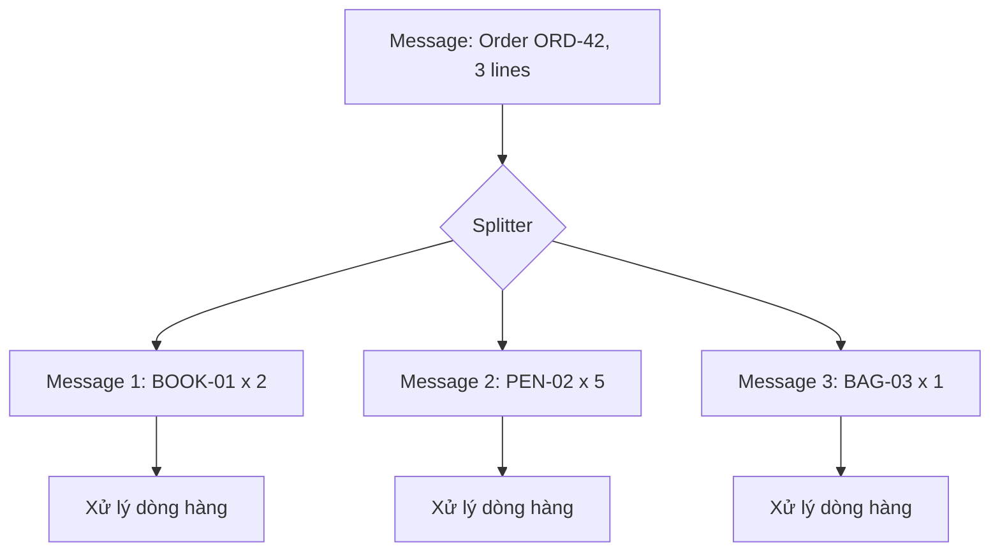
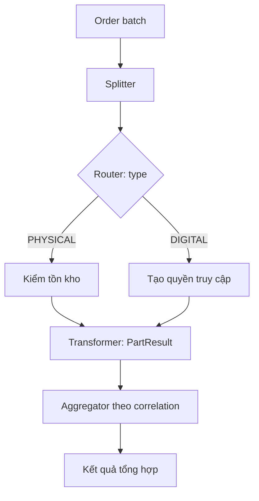
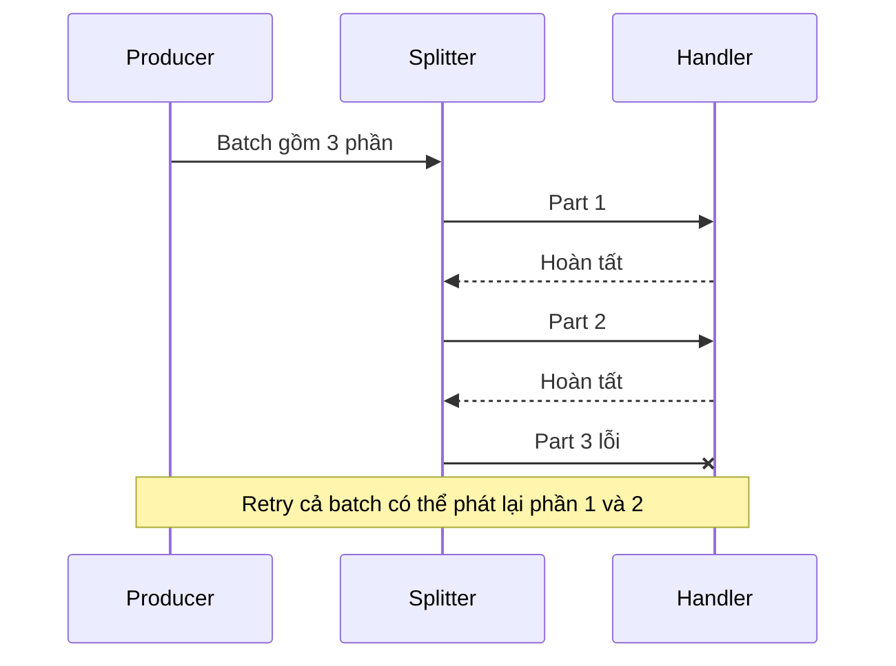

# Splitter tạo nhiều message từ một message trong Spring Integration

## Mục tiêu bài học

Trong một luồng tích hợp, dữ liệu thường đến dưới dạng **một message chứa nhiều phần tử**: đơn hàng chứa nhiều dòng hàng, tệp chứa nhiều bản ghi, yêu cầu đồng bộ chứa nhiều mã khách hàng. Nếu từng phần tử cần được kiểm tra, định tuyến, biến đổi hoặc xử lý độc lập, **Splitter** giúp chuyển một message đầu vào thành nhiều message đầu ra.

Đây là bài thuộc chương **Endpoint** của module **SPRING_INTEGRATION_PATTERN**. Mục tiêu của module là thực hành Enterprise Integration Patterns (EIP) bằng Spring Integration để xây luồng thông điệp ít phụ thuộc, dễ mở rộng; phối hợp Router, Filter, Transformer, Splitter, Aggregator, Gateway, retry, error channel và correlation, đồng thời kiểm thử và quan sát các nhánh xử lý.

Sau khi học, bạn có thể:

1. Phân biệt Splitter với Transformer, Router, Filter và Aggregator.
2. Giải thích quá trình **một message → nhiều message**, cách truyền payload và header.
3. Sử dụng Splitter bằng Spring Integration Java DSL và triển khai logic chia tùy chỉnh.
4. Hiểu các header `correlationId`, `sequenceNumber`, `sequenceSize`, cơ chế `applySequence` và điều kiện để gom message trở lại.
5. Kiểm thử số lượng message, nội dung từng phần, header, dữ liệu rỗng và trường hợp lỗi.
6. Nhận biết các rủi ro khi chia một tập dữ liệu lớn: backpressure, xử lý bất đồng bộ, retry trùng lặp, timeout và nhóm Aggregator không hoàn tất.

## 1. Splitter là gì?

**Splitter** là một **message endpoint** hiện thực mẫu **Splitter** trong Enterprise Integration Patterns. Nó nhận **một** message và phân rã nội dung thành **nhiều** message riêng biệt để downstream có thể xử lý từng phần.

Ví dụ đầu vào:

```json
{
  "orderId": "ORD-42",
  "lines": [
    {"sku": "BOOK-01", "quantity": 2},
    {"sku": "PEN-02", "quantity": 5},
    {"sku": "BAG-03", "quantity": 1}
  ]
}
```

Luồng có thể biến một message chứa cả đơn hàng thành ba message, mỗi message mang một dòng hàng:



Về mặt khái niệm:

```text
Trước Splitter:
  Message<List<OrderLine>>
    payload = [lineA, lineB, lineC]
    headers = {traceId, tenantId, ...}

Sau Splitter:
  Message<OrderLine>(lineA, headers + sequence)
  Message<OrderLine>(lineB, headers + sequence)
  Message<OrderLine>(lineC, headers + sequence)
```

**Điểm cốt lõi:** mỗi message con là một message độc lập để đi vào channel và endpoint tiếp theo. Splitter **không tự gọi xử lý nghiệp vụ** cho từng phần tử; nó phát các message để các handler phía sau thực hiện công việc.

### Splitter khác các endpoint liên quan thế nào?

| Pattern | Tác động chính | Ví dụ |
| --- | --- | --- |
| **Transformer** | Thay đổi hình dạng/kiểu dữ liệu của một message; thường có một kết quả logic | Chuẩn hóa `OrderRequest` thành `Order` |
| **Splitter** | Tạo nhiều message từ một message | Tách `List<OrderLine>` thành các `OrderLine` |
| **Filter** | Cho đi tiếp hoặc loại message theo điều kiện | Bỏ dòng hàng có số lượng không hợp lệ |
| **Router** | Chọn một hoặc nhiều nhánh đích | Chuyển theo `region` hoặc `orderType` |
| **Aggregator** | Gom các message có quan hệ thành một kết quả | Tổng hợp các kết quả kiểm kho của một đơn |

Splitter thường đi cùng Transformer để biến đổi mỗi phần, Router để chọn nhánh xử lý, và Aggregator khi cần đợi đủ các phần trước khi trả kết quả tổng hợp.

## 2. Cấu trúc của một message sau khi Splitter xử lý

Một `Message<T>` trong Spring Messaging gồm `payload` và `headers`. Khi Splitter tạo message con, payload thường trở thành một phần tử từ kết quả split, còn header được dùng để giữ ngữ cảnh và quản lý chuỗi.

Các header có vai trò khác nhau:

| Header | Mục đích | Phạm vi sử dụng |
| --- | --- | --- |
| `traceId` | Liên kết log và quan sát một hành trình nghiệp vụ | Do ứng dụng quyết định và truyền qua các endpoint cần thiết |
| `tenantId` | Xác định ngữ cảnh tenant đã được xác thực | Không để consumer tự suy từ payload nếu hợp đồng yêu cầu header |
| `correlationId` | Chỉ ra các message liên quan để có thể gom theo nhóm | Quan trọng với Aggregator và correlation strategy |
| `sequenceNumber` | Số thứ tự của message con trong một lần tách | Thường bắt đầu từ 1 |
| `sequenceSize` | Số phần tử kỳ vọng của chuỗi khi biết tổng kích thước | Giúp release strategy biết lúc nào đủ các phần |
| `id`, `timestamp` | Metadata riêng của từng message | Không dùng thay cho định danh yêu cầu xuyên suốt |

Khi **apply sequence** được bật, Splitter thiết lập metadata chuỗi để downstream nhận biết các phần thuộc cùng một đợt chia. Với tập có kích thước biết trước, ví dụ danh sách ba phần tử, ta thường có:

```text
Message 1:
  payload = lineA
  correlationId = C42
  sequenceNumber = 1
  sequenceSize = 3

Message 2:
  payload = lineB
  correlationId = C42
  sequenceNumber = 2
  sequenceSize = 3

Message 3:
  payload = lineC
  correlationId = C42
  sequenceNumber = 3
  sequenceSize = 3
```

`C42` ở trên chỉ là giá trị minh họa. Với cấu hình mặc định, metadata correlation thường được liên kết với message gốc; nếu ứng dụng đã đặt header hoặc tùy biến chiến lược, phải kiểm tra giá trị thực tế. **Không tự giả định `correlationId` luôn bằng mã đơn hàng**. Nếu cần khóa nghiệp vụ ổn định như `orderId` hoặc `batchId`, hãy đặt nó thành header riêng, rồi cấu hình correlation strategy của Aggregator phù hợp.

### Sequence metadata không phải thứ tự hoàn thành

`sequenceNumber` ghi nhận vị trí trong kết quả Splitter, **không bảo đảm** các message con sẽ được xử lý xong theo thứ tự đó. Khi downstream dùng `ExecutorChannel`, nhiều consumer, broker hoặc retry, thứ tự hoàn thành có thể thay đổi.

```text
Tạo:      part 1  →  part 2  →  part 3
Hoàn tất: part 3  →  part 1  →  part 2
```

Nếu ứng dụng cần khôi phục đúng thứ tự ban đầu, Aggregator hoặc một bước xử lý khác phải dựa trên sequence hoặc khóa sắp xếp rõ ràng.

## 3. Ví dụ cơ bản bằng Java DSL: chia một danh sách thành các message

Giả sử đầu vào là `List<OrderLine>` của một đơn hàng. Ta dùng `IntegrationFlow.split()` để chia danh sách, sau đó đưa message con vào một `QueueChannel` để dễ kiểm chứng.

```java
import org.springframework.context.annotation.Bean;
import org.springframework.context.annotation.Configuration;
import org.springframework.integration.channel.DirectChannel;
import org.springframework.integration.channel.QueueChannel;
import org.springframework.integration.config.EnableIntegration;
import org.springframework.integration.dsl.IntegrationFlow;
import org.springframework.messaging.MessageChannel;
import org.springframework.messaging.PollableChannel;

@Configuration
@EnableIntegration
public class OrderSplitterConfig {

    public record OrderLine(String sku, int quantity) {}

    @Bean("orders.input")
    MessageChannel ordersInput() {
        return new DirectChannel();
    }

    @Bean("lines.output")
    PollableChannel linesOutput() {
        return new QueueChannel();
    }

    @Bean
    IntegrationFlow orderSplitterFlow() {
        return IntegrationFlow.from("orders.input")
            .split()
            .channel("lines.output")
            .get();
    }
}
```

Ở đây:

- `DirectChannel` nhận message từ producer.
- `split()` dùng splitter mặc định để xử lý payload là danh sách.
- `QueueChannel` lưu từng message con, cho phép chủ động gọi `receive()` trong kiểm thử.
- Không có poller vì bài minh họa **chủ động nhận** ở đầu ra. Trong luồng thực tế, nếu nối một `PollableChannel` với một handler, phải thiết lập poller hoặc consumer tương ứng.

Producer gửi một message duy nhất:

```java
import java.util.List;
import org.springframework.messaging.Message;
import org.springframework.messaging.support.MessageBuilder;

List<OrderSplitterConfig.OrderLine> lines = List.of(
    new OrderSplitterConfig.OrderLine("BOOK-01", 2),
    new OrderSplitterConfig.OrderLine("PEN-02", 5),
    new OrderSplitterConfig.OrderLine("BAG-03", 1)
);

Message<List<OrderSplitterConfig.OrderLine>> request =
    MessageBuilder.withPayload(lines)
        .setHeader("orderId", "ORD-42")
        .setHeader("tenantId", "tenant-a")
        .setHeader("traceId", "trace-42")
        .build();

ordersInput.send(request);
```

`ordersInput` là `MessageChannel` được inject từ Spring context. Sau lời gọi `send()`, khi downstream chưa có consumer, `lines.output` chứa ba message con; payload từng message có kiểu `OrderLine`.

**Điều kiện quan trọng:** ví dụ này phụ thuộc cấu hình `DefaultMessageSplitter` của Spring Integration với đầu vào là `List`. Nếu payload là một đối tượng `OrderBatch` tự định nghĩa, phải xác định rõ cách lấy danh sách dòng hàng; không kỳ vọng splitter tự tìm một thuộc tính bất kỳ trong object.

## 4. Splitter tùy chỉnh: chọn phần nào cần chia

Trong thực tế, payload thường là một đối tượng bao ngoài:

```java
public record OrderBatch(
    String orderId,
    List<OrderLine> lines
) {}
```

Ta muốn lấy `lines` từ `OrderBatch`, thay vì gửi nguyên object xuống mỗi nhánh. Với Java DSL, có thể thay bước `split()` trong `IntegrationFlow` bằng:

```java
.split(OrderBatch.class, OrderBatch::lines)
```

Đoạn này sử dụng splitter function: Spring Integration nhận payload kiểu `OrderBatch`, gọi `lines()` và phát các phần tử của danh sách dưới dạng message con. Cần đặt hai record `OrderBatch` và `OrderLine` trong phạm vi mà luồng truy cập được.

### Khi nào cần một splitter method riêng?

Bạn có thể đưa logic chia vào một bean nếu việc phân rã không chỉ là lấy một collection:

```java
import java.util.List;

public class BatchSplitter {

    public List<WorkPart> split(OrderBatch batch) {
        return batch.lines().stream()
            .map(line -> new WorkPart(
                batch.orderId(),
                line.sku(),
                line.quantity()
            ))
            .toList();
    }

    public record WorkPart(String orderId, String sku, int quantity) {}
}
```

Logic này tạo từng `WorkPart` chứa cả `orderId`, thích hợp khi downstream cần mã đơn hàng trong payload. Một flow có thể dùng:

```java
.split(OrderBatch.class, batch -> new BatchSplitter().split(batch))
```

Trong ứng dụng thật, nên đăng ký `BatchSplitter` thành Spring bean và tham chiếu bean hoặc method thay vì khởi tạo lại liên tục. Nếu splitter truy cập database hoặc hệ thống ngoài, cần cân nhắc lỗi giữa quá trình chia, khả năng retry và tính nhất quán dữ liệu.

### Có nên lọc dữ liệu ngay trong splitter?

Splitter có thể trả một tập con của danh sách nếu đó là **quy tắc phân rã** được xác định rõ. Tuy nhiên, khi logic có ý nghĩa “cho qua/loại bỏ” theo điều kiện nghiệp vụ, dùng **Filter** trước hoặc sau Splitter thường diễn đạt trách nhiệm rõ ràng hơn.

Một quyết định cần lưu ý: **Filter đặt sau Splitter** có thể làm số message đến Aggregator nhỏ hơn `sequenceSize` ban đầu, khiến Aggregator đợi không đủ nhóm. Nếu phải lọc sau khi chia, hãy thiết kế lại chiến lược release/aggregation hoặc thể hiện phần tử bị loại bằng một kết quả có trạng thái, thay vì âm thầm bỏ message.

## 5. Kiểm thử số lượng, payload và correlation

Một kiểm thử tốt phải xác minh cả **số message** lẫn **metadata**. Vì đầu ra là `QueueChannel`, ta có thể gửi toàn bộ đầu vào rồi gọi `receive()` lần lượt.

```java
import static org.assertj.core.api.Assertions.assertThat;

import java.util.List;
import org.junit.jupiter.api.Test;
import org.springframework.beans.factory.annotation.Autowired;
import org.springframework.beans.factory.annotation.Qualifier;
import org.springframework.messaging.Message;
import org.springframework.messaging.MessageChannel;
import org.springframework.messaging.PollableChannel;
import org.springframework.messaging.support.MessageBuilder;
import org.springframework.test.context.junit.jupiter.SpringJUnitConfig;

@SpringJUnitConfig(OrderSplitterConfig.class)
class OrderSplitterTest {

    @Autowired
    @Qualifier("orders.input")
    MessageChannel input;

    @Autowired
    @Qualifier("lines.output")
    PollableChannel output;

    @Test
    void splitsListIntoThreeCorrelatedMessages() {
        List<OrderSplitterConfig.OrderLine> lines = List.of(
            new OrderSplitterConfig.OrderLine("BOOK-01", 2),
            new OrderSplitterConfig.OrderLine("PEN-02", 5),
            new OrderSplitterConfig.OrderLine("BAG-03", 1)
        );

        Message<?> request = MessageBuilder.withPayload(lines)
            .setHeader("traceId", "trace-42")
            .setHeader("tenantId", "tenant-a")
            .build();

        assertThat(input.send(request)).isTrue();

        Message<?> first = output.receive(2_000);
        Message<?> second = output.receive(2_000);
        Message<?> third = output.receive(2_000);

        assertThat(first).isNotNull();
        assertThat(second).isNotNull();
        assertThat(third).isNotNull();

        assertThat(first.getPayload()).isEqualTo(lines.get(0));
        assertThat(second.getPayload()).isEqualTo(lines.get(1));
        assertThat(third.getPayload()).isEqualTo(lines.get(2));

        Object group = first.getHeaders().get("correlationId");
        assertThat(group).isNotNull();
        assertThat(second.getHeaders().get("correlationId")).isEqualTo(group);
        assertThat(third.getHeaders().get("correlationId")).isEqualTo(group);

        assertThat(first.getHeaders().get("sequenceNumber")).isEqualTo(1);
        assertThat(second.getHeaders().get("sequenceNumber")).isEqualTo(2);
        assertThat(third.getHeaders().get("sequenceNumber")).isEqualTo(3);

        assertThat(first.getHeaders().get("sequenceSize")).isEqualTo(3);
        assertThat(second.getHeaders().get("sequenceSize")).isEqualTo(3);
        assertThat(third.getHeaders().get("sequenceSize")).isEqualTo(3);

        for (Message<?> part : List.of(first, second, third)) {
            assertThat(part.getHeaders().get("traceId"))
                .isEqualTo("trace-42");
            assertThat(part.getHeaders().get("tenantId"))
                .isEqualTo("tenant-a");
        }
        assertThat(output.receive(0)).isNull();
    }
}
```

Bài kiểm thử này được viết cho splitter mặc định với `applySequence` đang bật và tập đầu vào có kích thước biết trước. Nếu dự án cấu hình `applySequence(false)`, các assertion về sequence cần đổi tương ứng. Cần dependency JUnit 5, AssertJ và Spring Test trong môi trường kiểm thử.

Khi thêm xử lý bất đồng bộ hoặc nhiều consumer, **không mặc định thứ tự nhận cuối cùng là 1–2–3**. Khi đó hãy so sánh tập `sequenceNumber` và payload theo khóa thay vì yêu cầu vị trí xuất hiện, trừ khi luồng có ràng buộc ordering rõ ràng.

### Kiểm thử dữ liệu rỗng

Đầu vào `List.of()` có thể tạo **không message con nào**. Điều đó khác với một message con có payload là danh sách rỗng.

```java
input.send(MessageBuilder.withPayload(List.of()).build());

Message<?> anyPart = output.receive(0);
assertThat(anyPart).isNull();
```

Nên chạy trường hợp này với queue trống và flow đơn giản. Khi splitter nằm trước Aggregator hoặc bên trong một request-reply Gateway, việc không có reply có thể khiến caller chờ đến timeout. Hãy quyết định rõ ý nghĩa nghiệp vụ của tập rỗng: trả kết quả rỗng trực tiếp, bỏ qua xử lý hay phát sự kiện “không có phần tử”.

## 6. Splitter với các nguồn kết quả khác nhau

Splitter có thể trả nhiều kiểu kết quả; khả năng tính trước số phần tử ảnh hưởng trực tiếp đến metadata chuỗi và chiến lược gom nhóm.

| Kết quả của thao tác chia | Điểm cần chú ý | Hướng thiết kế |
| --- | --- | --- |
| `List` / mảng | Kích thước thường biết trước; thuận tiện tạo sequence | Phù hợp khi số phần tử vừa phải và cần Aggregator theo số lượng |
| `Iterator` / `Iterable` | Có thể duyệt từng phần; chưa chắc biết kích thước từ đầu | Tránh dựa cứng vào `sequenceSize` khi nguồn không công bố số lượng |
| `Stream` | Có thể tiêu thụ một lần và sinh phần tử theo nhu cầu | Quan tâm vòng đời stream, lỗi trong lúc duyệt và cơ chế đóng tài nguyên |
| Phần tử đã là `Message<?>` | Phần tử có thể có header riêng | Kiểm tra chính sách kết hợp header, correlation và chuỗi |
| Kết quả rỗng | Không có phần tử để phát | Xác định contract trả lời và trường hợp Aggregator không nhận phần tử |

**Không phải mọi loại dữ liệu đều có một `sequenceSize` dương chính xác.** Một số nguồn dạng iterator hoặc stream chưa biết kích thước khi bắt đầu phát, vì vậy phải kiểm tra giá trị thực tế do phiên bản và cấu hình splitter cung cấp; khi không biết số lượng, release strategy của Aggregator phải có điều kiện khác.

Đặc biệt đối với `Stream` hoặc nguồn lớn, Splitter không biến bài toán thành phân tán vô hạn có kiểm soát tài nguyên. Nếu downstream chậm, các bước phát message, queue, broker và retry vẫn cần được thiết kế để tránh quá tải.

## 7. Splitter + Router + Transformer: từng phần đi vào nhánh phù hợp

Sau khi tách, một flow có thể xử lý từng dòng hàng khác nhau:



Trong mô hình này:

1. **Splitter** phân rã một đơn hàng thành các tác vụ con.
2. **Router** chuyển mỗi tác vụ tới đúng handler; mỗi message con phải đi vào một nhánh được định nghĩa.
3. **Transformer** chuẩn hóa mọi kết quả về cùng một kiểu như `PartResult`, giữ thông tin correlation cần thiết.
4. **Aggregator** quyết định nhóm nào đã đủ và tạo kết quả gộp.

Nếu các nhánh trả về kiểu payload khác nhau, hãy chuẩn hóa trước Aggregator hoặc dùng một group processor có thể xử lý tất cả biến thể. Nếu có nhánh bỏ message mà không tạo kết quả, cần thay đổi release strategy hoặc tạo “kết quả bỏ qua” tường minh để không treo nhóm.

### Header propagation qua các nhánh

Header như `traceId`, `tenantId` và `orderId` nên được duy trì khi chúng là một phần hợp đồng. Với handler tự tạo `Message<?>`, hãy kiểm soát việc sao chép header:

```java
import org.springframework.messaging.Message;
import org.springframework.messaging.support.MessageBuilder;

Message<String> convert(Message<String> input) {
    return MessageBuilder.withPayload(input.getPayload().trim())
        .copyHeaders(input.getHeaders())
        .setHeader("processingStage", "normalized")
        .build();
}
```

Cần phân biệt header nghiệp vụ với header điều phối nội bộ. Không sao chép tất cả header vào HTTP/Kafka một cách máy móc; dùng header mapper và allowlist tương ứng. `id` và `timestamp` của message con có thể khác message gốc, vì vậy `traceId` hoặc khóa nghiệp vụ là cách nối log phù hợp hơn.

## 8. Từ Splitter đến Aggregator: hiểu đúng correlation

**Aggregator không tự “đoán” những message nào thuộc cùng một đơn.** Nó dùng correlation strategy để chia message thành các group, và release strategy để quyết định khi nào nhóm được phát ra. Cặp header `correlationId` và `sequenceSize` do Splitter tạo ra thường rất hữu ích cho hành vi mặc định.

```text
Batch B-42
    |
    +--> part 1, correlationId = C-42, sequenceNumber = 1
    +--> part 2, correlationId = C-42, sequenceNumber = 2
    +--> part 3, correlationId = C-42, sequenceNumber = 3
                                                |
                                                v
Aggregator: đợi đủ message của nhóm C-42
                                                |
                                                v
Result(B-42)
```

Cần trả lời ít nhất bốn câu hỏi thiết kế:

- **Correlation key:** Lấy từ header mặc định, `batchId` hay một tổ hợp business key? Nếu nhiều người dùng hoặc tenant có thể trùng `batchId`, khóa nhóm phải đủ phân biệt.
- **Release condition:** Đủ `sequenceSize`, timeout, kết thúc luồng, marker cuối, hay một điều kiện nghiệp vụ khác?
- **Duplicate policy:** Một phần tử có thể được gửi lại khi retry hoặc broker redelivery không? Nhóm xử lý trùng lặp thế nào?
- **Message group store:** Nhóm có thể nằm ở bộ nhớ hay storage bền vững; nhóm sẽ được dọn lúc nào để tránh rò tài nguyên?

### Điểm đặc biệt nguy hiểm: Filter sau Splitter

Giả sử Splitter phát ba phần với `sequenceSize=3`. Filter loại phần thứ hai:

```text
Splitter:   #1 --------> Aggregator
            #2 --X Filter
            #3 --------> Aggregator

Aggregator nhận 2/3: không đủ điều kiện release theo size.
```

Đây là lỗi thiết kế thường gặp. Các phương án hợp lệ phụ thuộc nghiệp vụ:

1. **Lọc trước khi chia** để `sequenceSize` khớp số phần thực sự gửi.
2. **Phát một kết quả trạng thái SKIPPED** cho phần tử bị loại, để đủ số phần trong nhóm.
3. **Thiết kế custom release strategy** có điều kiện kết thúc/timeout rõ ràng, kèm cách xử lý nhóm thiếu.
4. **Tách Aggregator khỏi đường bỏ message** nếu nhóm không cần chờ tất cả phần tử.

Không đặt timeout rồi mặc định xem nhóm thiếu là “thành công”; cần xác định rõ partial result có được chấp nhận và cách thông báo thiếu dữ liệu.

### Ví dụ khái niệm với Java DSL

```java
IntegrationFlow.from("orders.input")
    .split()
    .handle(OrderLine.class, (line, headers) ->
        new PartResult(line.sku(), "OK"))
    .aggregate()
    .channel("orders.results")
    .get();
```

`PartResult` là DTO ứng dụng định nghĩa. Mẫu trên minh họa chuỗi Splitter → xử lý từng phần → Aggregator; flow thật cần định nghĩa bean/channel, kiểu dữ liệu, hợp đồng reply, chính sách xử lý lỗi và cấu hình group/release phù hợp. Khi handler trả payload thuần, Spring Integration thường tạo reply message và chuyển các header ngữ cảnh thích hợp; cần kiểm thử để chắc chắn correlation không bị mất.

## 9. Splitter và đồng bộ/bất đồng bộ

Cách nối channel quyết định nơi công việc được thực hiện:

| Kiến trúc | Hành vi thường gặp | Điều cần kiểm thử |
| --- | --- | --- |
| `DirectChannel` giữa các endpoint | Gọi handler đồng bộ trong đường truyền hiện tại | Lỗi thường quay về caller; các bước có thể chạy tuần tự |
| `ExecutorChannel` | Đưa việc xử lý xuống thread pool | Thứ tự hoàn thành thay đổi, MDC/ThreadLocal không tự truyền |
| `QueueChannel` | Buffer message để một consumer/poller nhận | Queue depth, timeout, memory, poller và backpressure |
| Broker outbound/inbound adapter | Tách tiến trình, serialization và redelivery | Header mapping, idempotency, ordering, retry và correlation |

**Splitter không tự đồng nghĩa với xử lý song song.** Nếu muốn xử lý các phần song song, bạn phải cấu hình channel/consumer/executor phù hợp và tính đến tính an toàn của handler khi chạy đồng thời. Nếu cần giữ thứ tự nghiêm ngặt, một đường xử lý tuần tự hoặc cơ chế điều phối theo khóa có thể cần thiết.

Khi sử dụng MDC/tracing, đưa khóa như `traceId` vào header; cấu hình riêng cơ chế khôi phục context khi chuyển thread. Dữ liệu lưu trong `ThreadLocal` của producer không tự xuất hiện trong thread của consumer.

## 10. Lỗi, retry và tính nhất quán khi chia nhiều phần

Một điều quan trọng: quá trình tách và gửi từng phần **không mặc nhiên là giao dịch nguyên tử**. Ví dụ Splitter đã phát phần #1 và #2, nhưng gặp lỗi khi tạo hoặc gửi phần #3. Các handler phía sau có thể đã xử lý hai phần đầu tiên; việc retry cả batch có nguy cơ phát lại #1 và #2.



Các biện pháp thực hành:

- Tạo **idempotency key** cho từng phần, ví dụ tổ hợp `batchId + lineId`, và kiểm tra kết quả đã xử lý trước khi ghi thay đổi.
- Định nghĩa retry ở **đúng cấp độ**: retry riêng từng phần hay retry cả batch; tránh làm cả hai mà không có chống trùng.
- Dùng `errorChannel` hoặc error flow khi điểm xử lý bất đồng bộ có cấu hình phát lỗi; lỗi trong luồng đồng bộ có thể ném trực tiếp về caller.
- Gắn `traceId`, `batchId`, `partId` vào log theo chính sách bảo mật để điều tra lỗi.
- Thiết kế timeout và hành vi partial failure của Aggregator. Không kỳ vọng một exception tự động bổ sung kết quả còn thiếu cho nhóm.

### Trả lỗi cho caller qua Gateway

Một Gateway đồng bộ có thể gửi batch và chờ reply tổng hợp. Nếu Splitter phát 0 phần tử, một nhánh lọc mất message hoặc Aggregator chưa release, Gateway có thể chờ đến `replyTimeout`. Vì vậy nên xác định cách xử lý batch rỗng/thiếu, cấu hình timeout và xây thông báo lỗi rõ ràng ở biên hệ thống.

### Correlation và retry

Nếu retry tạo một message gốc mới, `id` mới có thể dẫn đến nhóm correlation khác so với lần thử trước khi sử dụng mặc định dựa vào message gốc. Nếu nghiệp vụ cần tập hợp cả nhiều lần thử dưới cùng một `batchId`, hãy định nghĩa correlation strategy dựa trên khóa nghiệp vụ ổn định, và có chống trùng message. Tuy nhiên, không nên gom lẫn nhiều phiên bản cùng batch khi chúng có nội dung khác nhau; cần thêm generation/attempt id khi hợp đồng yêu cầu.

## 11. Hiệu năng và vận hành

Chia một batch rất lớn thành hàng trăm nghìn message có thể dẫn đến chi phí đáng kể:

- **Bộ nhớ:** tạo object message và headers cho từng phần; có thể phát nhanh hơn downstream tiêu thụ.
- **Thông lượng:** gửi quá nhiều message nhỏ làm tăng overhead serialization, routing và logging.
- **Backpressure:** channel hữu hạn có thể chặn hoặc từ chối send; broker có giới hạn và chính sách flow control riêng.
- **Nhóm tổng hợp:** Aggregator lưu nhiều phần, có thể tiêu thụ bộ nhớ và storage lâu nếu một phần mất.
- **Quan sát:** số lượng message tăng đột biến; chỉ số tốc độ xử lý nên gắn với số phần và số batch.

Với batch rất lớn, hãy cân nhắc **chia theo chunk** có kích thước kiểm soát được (ví dụ 100 hoặc 500 phần/lần, tùy SLA và tài nguyên), hoặc dùng streaming phù hợp. Cần đánh đổi giữa overhead theo message, khả năng retry từng phần, thời gian chờ và kích thước group. Không có một kích thước chunk tối ưu cho mọi hệ thống.

### Các chỉ số nên theo dõi

| Chỉ số | Ý nghĩa |
| --- | --- |
| `split_input_total` | Số message nguồn được đưa vào Splitter |
| `split_output_total` | Số message con đã phát |
| `parts_per_batch` | Phân bố số phần trên mỗi batch |
| `split_failures_total` | Số lỗi khi phân rã hoặc gửi các phần |
| `queue_depth` / `send_timeout_total` | Áp lực ở channel phía sau |
| `aggregation_pending_groups` | Số nhóm đang chờ hoàn tất |
| `aggregation_group_age` | Tuổi nhóm; phát hiện nhóm kẹt |
| `duplicate_part_total` | Số phần bị phát hoặc nhận lặp |

Đây là tên metric minh họa do **ứng dụng tự chọn**, không phải tất cả đều được Spring Integration tự tạo ra. Có thể dùng Micrometer/observation và logging có cấu trúc theo cấu hình của dự án.

## 12. Lỗi phổ biến và cách xử lý

| Triệu chứng | Nguyên nhân có thể | Cách xử lý |
| --- | --- | --- |
| Chỉ thấy một message đầu ra | Payload không được chia theo cách tưởng tượng, hoặc handler trước đã đổi kiểu | Kiểm tra kiểu payload thực tế và splitter function |
| Không có message khi danh sách rỗng | Splitter phát 0 phần tử | Xác định rõ hợp đồng batch rỗng và reply |
| Aggregator chờ mãi | Thiếu phần, Filter loại phần hoặc release strategy dựa trên size không đúng | Kiểm tra `correlationId`, `sequenceSize`, discard và timeout |
| Các phần về sai thứ tự | Có xử lý song song, broker hoặc retry | Dùng `sequenceNumber`/business key để tái sắp xếp nếu cần |
| `traceId` biến mất | Custom handler dựng message mới nhưng bỏ header hoặc adapter không map | Kiểm tra bước tạo reply và header mapper |
| Một dòng hàng bị thực thi hai lần | Retry/redelivery sau khi phần trước đã được xử lý | Idempotency key theo batch + phần |
| Memory tăng mạnh | Batch quá lớn và downstream chậm | Thêm queue giới hạn, chunking, backpressure và giám sát |
| Gateway timeout | Aggregator không release hoặc Splitter phát 0 phần | Đặt chính sách empty/partial, timeout và error reply |

## 13. Bài tập thực hành

### Bài 1 — Tách danh sách dòng hàng

Tạo một `IntegrationFlow` sử dụng `.split()` với payload `List<OrderLine>` gồm năm dòng hàng. Ghi lại payload và header của từng message con. Kiểm thử có **đúng năm message**, các message có cùng `correlationId` và `sequenceNumber` bao phủ các giá trị 1 đến 5.

### Bài 2 — Dữ liệu đầu vào tùy chỉnh

Định nghĩa `OrderBatch(orderId, lines)`. Sử dụng `.split(OrderBatch.class, OrderBatch::lines)` để chỉ tách `lines`; truyền `orderId` và `traceId` qua header hoặc DTO phần tử. Viết kiểm thử cho batch rỗng và batch một phần tử.

### Bài 3 — Filter sau Splitter

Tạo ba phần và cố tình loại phần thứ hai sau Splitter. Quan sát Aggregator mặc định khi còn kỳ vọng ba phần. Chọn và triển khai một phương án: lọc trước, tạo kết quả `SKIPPED`, hoặc release strategy có chủ đích. Giải thích ảnh hưởng của mỗi phương án đến kết quả cuối cùng.

### Bài 4 — Router và xử lý song song

Mỗi message con có `type=PHYSICAL` hoặc `type=DIGITAL`. Dùng Router chọn hai handler, giả lập thời gian xử lý khác nhau. Kiểm thử rằng thứ tự **hoàn thành** có thể khác `sequenceNumber` và Aggregator vẫn liên kết đúng các phần.

### Bài 5 — Retry và duplicate

Cho handler xử lý thành công hai phần rồi ném exception ở phần thứ ba. Mô phỏng retry toàn batch. Thiết kế idempotency key, kiểm thử mỗi dòng hàng chỉ được cập nhật trạng thái nghiệp vụ **một lần**.

### Bài 6 — Quan sát và giới hạn tải

Đo số lượng message đầu vào/đầu ra, độ sâu queue và thời gian chờ nhóm Aggregator khi chia 1.000 phần. So sánh kết quả với phương án chia theo chunk và trình bày giới hạn tài nguyên của cấu hình.

## 14. Checklist trước khi đưa Splitter vào hệ thống thực tế

1. Xác nhận **input payload** và kiểu phần tử đầu ra; splitter function có hành vi rõ ràng với `null`, tập rỗng và dữ liệu không hợp lệ.
2. Quy định header phải giữ: `traceId`, `tenantId`, `orderId` hoặc `batchId`; không lạm dụng `id` làm business key.
3. Kiểm tra `applySequence` và độ tin cậy của `sequenceSize` cho loại dữ liệu được chia.
4. Định nghĩa correlation/release strategy nếu đi cùng Aggregator; xử lý message bị lọc, thiếu, trùng hoặc đến muộn.
5. Chọn channel và concurrency hợp với SLA; không giả định thứ tự hoàn thành bằng thứ tự phát.
6. Thiết kế retry và idempotency theo từng phần để tránh xử lý lặp khi batch lỗi một phần.
7. Kiểm thử các ranh giới mạng, mapping header, timeout, backpressure và dữ liệu quá lớn.
8. Theo dõi số phần mỗi batch, queue, lỗi, group chưa hoàn tất và độ trễ theo khóa correlation.

### Ghi nhớ

**Splitter giải bài toán “một message có nhiều đơn vị công việc cần xử lý riêng”.** Giá trị của nó không nằm ở việc gọi vòng lặp trên một danh sách, mà ở việc biến từng phần thành **message có thể đưa qua channel, Transformer, Router, Filter và các handler độc lập**. Khi cần gom lại, phải chủ động thiết kế correlation, sequence, release strategy, xử lý lỗi và chống trùng. Một Splitter được kiểm thử đúng giúp luồng Spring Integration dễ mở rộng, rõ trách nhiệm và dễ truy vết hơn.
