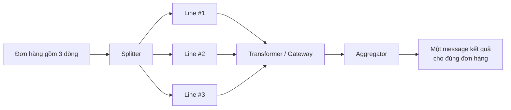
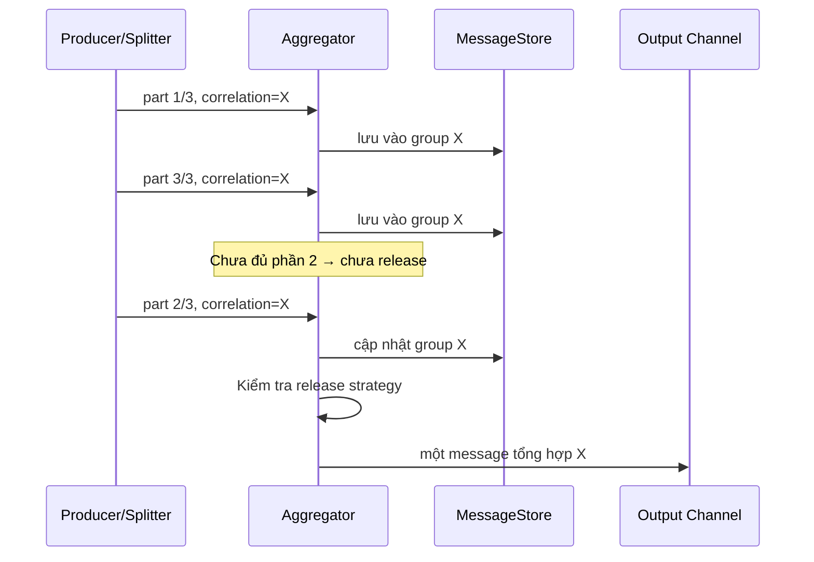

# Aggregator gom nhiều message thành một

## 1. Aggregator giải quyết vấn đề gì?

Trong một luồng tích hợp, một yêu cầu nghiệp vụ thường được chia thành nhiều message để xử lý độc lập. Ví dụ, đơn hàng có ba dòng sản phẩm được tách thành ba message, mỗi message đi qua một Transformer tính tiền, một Router chọn dịch vụ xử lý, hoặc một Gateway gọi hệ thống bên ngoài. Cuối cùng, hệ thống cần **gom các kết quả thuộc cùng đơn hàng** thành một kết quả tổng hợp.

**Aggregator** là một endpoint trong nhóm **Enterprise Integration Patterns (EIP)** thực hiện việc đó. Thay vì xử lý riêng từng message đầu vào, Aggregator:

1. Xác định message thuộc **nhóm nào** bằng một *correlation key*.
2. Giữ các message chưa đủ điều kiện phát kết quả trong một *message group*.
3. Kiểm tra **điều kiện hoàn tất nhóm** (*release strategy*) khi có message mới hoặc khi sự kiện thời gian/kết thúc nhóm được cấu hình.
4. Biến nhóm thành một message đầu ra bằng *message group processor* (thao tác gộp payload).
5. Giải phóng hoặc giữ lại trạng thái nhóm theo chính sách và xử lý message đến trễ.

Trong module **SPRING_INTEGRATION_PATTERN**, nội dung này kết nối trực tiếp với mục tiêu xây dựng luồng thông điệp ít phụ thuộc và dễ mở rộng bằng Spring Integration: phối hợp Splitter, Router, Filter, Transformer, Gateway, retry, error channel, correlation, đồng thời kiểm thử và quan sát các nhánh xử lý.

Sau bài học, người học cần giải thích được **correlation khác release**, xây dựng được flow ghép kết quả, tránh trộn nhóm, quyết định timeout và chính sách message đến trễ, và kiểm tra các tình huống mất/trùng message.

## 2. Luồng tổng quát: từ nhiều message đến một message



Một ví dụ có hai đơn hàng A và B đan xen:

| Thứ tự đến | Correlation key | Phần tử | Số phần dự kiến | Trạng thái |
| --- | --- | --- | --- | --- |
| 1 | `order-A` | A-1 | 3 | Nhóm A có 1/3 |
| 2 | `order-B` | B-1 | 2 | Nhóm B có 1/2 |
| 3 | `order-A` | A-2 | 3 | Nhóm A có 2/3 |
| 4 | `order-B` | B-2 | 2 | Nhóm B đủ 2/2 → phát kết quả B |
| 5 | `order-A` | A-3 | 3 | Nhóm A đủ 3/3 → phát kết quả A |

Điểm cần nhớ: **Aggregator nhóm theo correlation key, không gom tất cả message xuất hiện gần nhau**. Kết quả B được phát trước A là hoàn toàn hợp lệ, mặc dù A xuất hiện sớm hơn.

### Ba quyết định độc lập

| Thành phần | Câu hỏi | Ví dụ |
| --- | --- | --- |
| **Correlation strategy** | Message này thuộc nhóm nào? | Mọi message có `orderId = order-A` vào nhóm A. |
| **Release strategy** | Nhóm nào đã sẵn sàng phát kết quả? | Nhóm đã nhận đủ `sequenceSize` phần hoặc có tín hiệu kết thúc đáng tin cậy. |
| **Output processor** | Nhóm được biến thành kết quả gì? | Danh sách kết quả, tổng số tiền, hoặc object `OrderSummary`. |

Một nhóm đúng chưa chắc đã hoàn tất; một nhóm đủ message chưa chắc đã tạo được output đúng nếu business rules chưa được áp dụng. Tách ba quyết định này sẽ giúp cấu hình dễ đọc và kiểm thử độc lập.

## 3. Correlation: cách xác định thành viên của nhóm

Spring Integration dùng **correlation key** để phân chia các message đi vào Aggregator thành những `MessageGroup` độc lập. Các message có cùng key sẽ được đưa vào cùng nhóm, kể cả khi đến không liên tiếp. Nếu key khác nhau, chúng thuộc hai nhóm khác nhau.

Với luồng Splitter → Aggregator theo mặc định, Splitter có thể tạo các header trình tự:

- `correlationId`: mã liên kết các phần xuất phát từ một message cha.
- `sequenceNumber`: thứ tự phần tử trong message cha.
- `sequenceSize`: tổng số phần tử được phát ra trong chuỗi.

Các header này được Spring Integration dùng cho mục đích điều phối, không nhất thiết là mã đơn hàng nghiệp vụ. Một đơn hàng có thể được xử lý qua nhiều đợt; vì vậy **mã nghiệp vụ `orderId` và mã tương quan của một lần split có thể cần tách biệt**.

Ví dụ:

```text
Message 1
  payload: LineResult(sku="A", amount=120)
  correlationId: split-7f1
  sequenceNumber: 1
  sequenceSize: 3
  orderId: ORDER-204

Message 2
  payload: LineResult(sku="B", amount=80)
  correlationId: split-7f1
  sequenceNumber: 2
  sequenceSize: 3
  orderId: ORDER-204

Message 3
  payload: LineResult(sku="C", amount=60)
  correlationId: split-7f1
  sequenceNumber: 3
  sequenceSize: 3
  orderId: ORDER-204

Aggregator:
  group key: split-7f1
  group size: 3
  output: [LineResult(A,120), LineResult(B,80), LineResult(C,60)]
```

Nếu phía gửi không dùng Splitter mặc định hoặc các phần tử đi qua broker, bạn có thể cấu hình `correlationStrategy` riêng, chẳng hạn lấy `batchId` đã được xác thực. Cần bảo đảm:

1. Mỗi message có key hợp lệ; key `null` hoặc bị thiếu cần được xử lý rõ ràng.
2. Key đủ **duy nhất trong thời gian nhóm tồn tại**. Không tái dùng `orderId` cho nhiều đợt tính toán nếu các kết quả có thể đến trễ; dùng `aggregationAttemptId` hoặc `batchId` riêng nếu cần.
3. Dữ liệu của các tenant khác nhau không được trộn nhóm. Có thể cần key tổng hợp như `tenantId + ":" + batchId`, trong đó `tenantId` phải đến từ nguồn đã xác thực.
4. Nếu tạo correlation từ payload, payload phải có schema và phiên bản rõ ràng để các hệ thống cùng hiểu.
5. Với Splitter/Aggregator, giữ những header điều khiển cần thiết qua các Transformer và các hop. Nếu một bước bỏ `sequenceSize` hoặc thay đổi `correlationId`, release mặc định có thể không còn hoạt động như kỳ vọng.

### Header quan trọng của Aggregator

| Header | Vai trò | Cần lưu ý |
| --- | --- | --- |
| `correlationId` | Dùng để ghép các phần cùng nguồn trong cấu hình phổ biến | Không tự đồng nhất với HTTP correlation hoặc `JMSCorrelationID`. |
| `sequenceNumber` | Thứ tự phần trong chuỗi sau Splitter | Dùng để kiểm tra thiếu/trùng và dựng lại thứ tự nếu business yêu cầu. |
| `sequenceSize` | Số message dự kiến của chuỗi | Chỉ đáng tin khi producer biết đúng số lượng và không tự ý lọc mất phần tử. |
| `replyChannel` | Kênh trả phản hồi trong request/reply nội bộ | Không tự thay thế correlation key của Aggregator. |
| `errorChannel` | Kênh chuyển lỗi theo cấu hình | Giúp đưa lỗi xử lý nhóm đến đúng error flow. |
| `batchId` hoặc `orderId` | Định danh nghiệp vụ do ứng dụng đặt | Thích hợp cho truy vết; có thể dùng làm group key nếu đảm bảo phạm vi duy nhất. |

## 4. Release strategy: khi nào nhóm được phát kết quả?

**Release** là quyết định một message group đã đủ điều kiện để được xử lý và phát thành một output. Có nhiều chính sách; phải chọn theo hợp đồng của producer và consumer.

### 4.1. Nhận đủ số phần dự kiến

Khi dùng Splitter chuẩn, cấu hình Aggregator mặc định thường dùng thông tin `correlationId` và `sequenceSize` để tập hợp và phát nhóm. Điều kiện phát nhóm theo số phần thường được triển khai bằng `SequenceSizeReleaseStrategy`.



Không nên suy ra rằng thứ tự arrival quyết định thứ tự payload được tổng hợp. Nếu downstream cần đúng thứ tự nghiệp vụ, hãy kiểm tra `sequenceNumber`, sắp xếp trong output processor hoặc dùng hợp đồng có thứ tự rõ ràng.

**Chú ý với Filter và Router:** nếu Filter loại một phần tử sau Splitter mà `sequenceSize` vẫn là 3, Aggregator có thể chờ đủ 3 mãi vì chỉ còn 2 message đến. Cần xử lý phần bị loại theo một chính sách được thiết kế trước: gửi placeholder/kết quả loại, thay đổi hợp đồng số lượng ở điểm kiểm soát, hoặc dùng chiến lược phát nhóm khác. Không nên tự sửa `sequenceSize` trên một nhánh riêng lẻ rồi giữ các nhánh khác như cũ.

### 4.2. Số lượng cố định hoặc số lượng từ metadata

Nếu producer cam kết mỗi batch có đúng 3 phần:

```java
.releaseStrategy(group -> group.size() == 3)
```

Với số lượng thay đổi, có thể lấy số lượng mong đợi từ metadata đã xác minh. Tuy nhiên:

- Tất cả message trong nhóm phải cùng giá trị `expectedCount`.
- Giá trị cần lớn hơn 0 và có ngưỡng tối đa để tránh tích lũy nhóm không bao giờ đủ.
- `group.size()` thường là số message trong nhóm; **không tự đại diện cho số business event duy nhất**. Dữ liệu giao lại do retry có thể dẫn tới đếm trùng.
- Nếu một business event có thể được nhận nhiều lần, hãy deduplicate theo `eventId` hoặc `partIndex` bằng cơ chế phù hợp trước khi quyết định release.

### 4.3. Phát nhóm theo điều kiện nghiệp vụ

Có những nhóm không biết tổng số phần trước. Khi đó có thể dùng:

- Một message “batch completed” do producer đáng tin cậy phát sau khi đã gửi đủ các phần.
- Một `ReleaseStrategy` tùy chỉnh xác nhận các loại kết quả bắt buộc đã hiện diện.
- Một deadline nghiệp vụ, kết hợp quy tắc về partial result hoặc error result.

Ví dụ ba dịch vụ báo giá có tên `SHIPPING`, `TAX`, `DISCOUNT`. Có thể release khi nhóm có đủ ba **loại dịch vụ**, thay vì chỉ khi `group.size() == 3`. Như vậy retry kết quả SHIPPING không được tính nhầm thành kết quả TAX.

### 4.4. Timeout và nhóm không bao giờ đủ

Trong thực tế, một phần có thể mất do lỗi mạng, bị Filter loại, service không trả lời, hoặc bị đưa sang error flow. Nếu không có cơ chế kết thúc, trạng thái nhóm có thể tồn tại lâu và chiếm bộ nhớ hoặc database.

Spring Integration hỗ trợ các cấu hình liên quan đến **group timeout** và chính sách **group expiry**. Khi thiết kế cần quyết định:

| Chính sách | Hành vi mong muốn | Khi nào phù hợp |
| --- | --- | --- |
| Chờ đủ mọi phần | Chỉ xuất kết quả khi đủ điều kiện release | Dữ liệu bắt buộc đầy đủ, có upstream retry và cơ chế theo dõi. |
| Timeout rồi báo lỗi | Đánh dấu batch thất bại, chuyển cảnh báo hoặc error flow | Không thể dùng kết quả thiếu. |
| Timeout rồi phát kết quả một phần | Phát phần đã có kèm trạng thái `PARTIAL` và danh sách thiếu | Báo cáo hoặc truy vấn có thể chấp nhận dữ liệu thiếu. |
| Timeout rồi hủy nhóm | Giải phóng bộ nhớ/trạng thái nhóm, xử lý message đến trễ theo quy định | Khối lượng lớn, dữ liệu tạm thời, có cơ chế phục hồi bên ngoài. |

Cờ `sendPartialResultOnExpiry` cùng cấu hình timeout có thể hỗ trợ phát nhóm một phần; tuy nhiên business thường cần tự định nghĩa payload/status `PARTIAL` và danh sách thiếu. **Đừng tự động diễn giải danh sách 2/3 phần thành đơn hàng hoàn chỉnh** chỉ vì Aggregator đã phát một message.

Một lần timeout ở Gateway đợi reply cũng **không đồng nghĩa** nhóm trong Aggregator đã bị xóa. Request deadline, group timeout, MessageStore expiry và retry của broker là các cơ chế độc lập cần được thiết kế thống nhất.

## 5. MessageStore: Aggregator nhớ các phần ở đâu?

Aggregator là một endpoint **có trạng thái** (*stateful*). Những message chưa đủ điều kiện release cần được lưu ở đâu đó. Spring Integration quản lý trạng thái nhóm thông qua `MessageGroupStore`, thường được tích hợp với các loại `MessageStore` phù hợp.

| Cách lưu trữ | Đặc điểm | Hạn chế |
| --- | --- | --- |
| In-memory (ví dụ `SimpleMessageStore`) | Dễ thử nghiệm, triển khai đơn giản, độ trễ thấp | Mất trạng thái khi process khởi động lại; tốn heap theo số nhóm chờ. |
| JDBC message store | Lưu nhóm xuống database, có thể khôi phục sau lỗi tiến trình theo cấu hình | Cần schema, giao dịch, quản lý cleanup/lock và đánh giá throughput. |
| Redis hoặc store dùng chung | Có thể hỗ trợ nhiều instance cùng truy cập trạng thái | Cần kiểm soát đồng thời, tính nhất quán, expiry và semantics của adapter/store. |

Một hệ thống chạy nhiều instance không nên giả định “dùng database chung là đủ”. Khi hai worker cập nhật cùng group, cần kiểm soát transaction và lock, thường thông qua cơ chế lock registry và store phù hợp. Phải kiểm chứng cách message được tiêu thụ từ transport, ghi vào store, phát kết quả và commit/ack. **Persist message group không tự tạo bảo đảm exactly-once** hay bảo đảm output đã được downstream tiếp nhận thành công.

### Vòng đời nhóm

1. Message đầu tiên đến, tạo group với correlation key.
2. Các message tiếp theo cùng key được thêm vào group.
3. Khi release strategy trả đúng, processor tạo một message đầu ra.
4. Group được hoàn tất và quản lý trạng thái theo cấu hình.
5. Khi hết hạn hoặc hoàn tất, hệ thống cần giải phóng tài nguyên; chính sách xử lý message đến muộn phải được xác định.

Cấu hình `expireGroupsUponCompletion` kiểm soát việc xóa trạng thái nhóm đã hoàn tất trong các tình huống tương ứng. Nếu xóa group, **message đến trễ cùng key có thể bắt đầu một group mới**. Nếu giữ metadata nhóm hoàn tất, hệ thống có thể xử lý message đến trễ theo chính sách khác. Không thể coi một cờ cleanup là cơ chế chống trùng nghiệp vụ. Để ngăn một batch đã xử lý bị phát lại, cần idempotency store hoặc trạng thái nghiệp vụ theo `batchId` và `eventId`.

Hãy đo ít nhất số group đang mở, tuổi group lâu nhất, tổng số message chờ, số group hoàn tất, số group timeout và số group còn thiếu phần tử.

## 6. Ví dụ Java DSL: Splitter → Transformer → Aggregator

Đây là mô hình dễ bắt đầu nhất: nhận danh sách dòng đơn hàng, tách thành các message độc lập, biến đổi từng dòng, rồi ghép chúng thành một danh sách kết quả. Splitter và Aggregator nằm trong cùng một flow nên các header trình tự do Splitter tạo ra được giữ xuyên suốt.

```java
import java.math.BigDecimal;

import org.springframework.context.annotation.Bean;
import org.springframework.context.annotation.Configuration;
import org.springframework.integration.config.EnableIntegration;
import org.springframework.integration.dsl.IntegrationFlow;

@Configuration
@EnableIntegration
public class OrderLineAggregationFlow {

    public record OrderLine(String sku, int quantity, BigDecimal unitPrice) {}

    public record LineAmount(String sku, BigDecimal amount) {}

    @Bean
    public IntegrationFlow calculateOrderLines() {
        return IntegrationFlow.from("incomingOrderLines")
            .split()
            .<OrderLine, LineAmount>transform(line ->
                new LineAmount(
                    line.sku(),
                    line.unitPrice().multiply(
                        BigDecimal.valueOf(line.quantity()))
                ))
            .aggregate()
            .channel("calculatedOrderLines")
            .get();
    }
}
```

**Đầu vào:** một `Message<List<OrderLine>>` chứa ba dòng. `split()` tạo message cho từng dòng và kèm thông tin sequence/correlation cần cho ghép nhóm. Transformer tính tiền cho từng dòng nhưng không làm mất header của luồng. `aggregate()` dùng cấu hình mặc định để phát kết quả khi đủ các phần, tạo **một message chứa các payload đã ghép** ở `calculatedOrderLines`.

Kết quả tổng hợp là tập hợp các `LineAmount`; nếu cần tính `grandTotal`, hãy áp dụng Transformer tiếp theo cho collection đó, có kiểm tra kiểu và làm tròn tiền tệ đúng nghiệp vụ. Tên channel được viết để minh họa; ứng dụng thực cần một consumer nhận kết quả và cơ chế quản lý lỗi.

### Diễn tiến với ba dòng

```text
incomingOrderLines:
  [Line(A, 2, 50), Line(B, 1, 80), Line(C, 3, 20)]

Splitter:
  A -> correlation=X, sequence=1/3
  B -> correlation=X, sequence=2/3
  C -> correlation=X, sequence=3/3

Transformer:
  A -> LineAmount(A, 100)
  B -> LineAmount(B, 80)
  C -> LineAmount(C, 60)

Aggregator:
  group X đủ 3/3 -> một message chứa 3 LineAmount

Consumer tiếp theo:
  tính tổng = 240 (nếu nghiệp vụ yêu cầu)
```

Trong ví dụ này, `BigDecimal` phù hợp hơn `double` cho số tiền. Việc Splitter sinh ba message trong một lời gọi không có nghĩa hệ thống tự xử lý song song; để chạy đồng thời, cần các endpoint/channel và executor phù hợp. Nếu một bước ở giữa loại bỏ hoặc đổi correlation header, Aggregator mặc định có thể không release.

## 7. Ví dụ cấu hình correlation/release/output tùy chỉnh

Xét hệ thống nhận các kết quả từ nhiều service. Mỗi request mang `batchId`, mỗi kết quả có `partIndex` từ 1 đến 3. Upstream **đã kiểm tra** rằng mỗi batch có đúng ba phần, không trùng `partIndex` và `batchId` là duy nhất trong một lần xử lý.

Ta muốn gom theo `batchId` và sắp xếp kết quả theo `partIndex` trước khi phát ra. Ví dụ sau dùng Spring Integration Java DSL và một `SimpleMessageStore` để nhìn rõ ba quyết định của Aggregator:

```java
import java.util.Comparator;

import org.springframework.context.annotation.Bean;
import org.springframework.context.annotation.Configuration;
import org.springframework.integration.channel.DirectChannel;
import org.springframework.integration.channel.QueueChannel;
import org.springframework.integration.config.EnableIntegration;
import org.springframework.integration.dsl.IntegrationFlow;
import org.springframework.integration.store.SimpleMessageStore;

@Configuration
@EnableIntegration
public class BatchAggregationConfig {

    @Bean
    public DirectChannel batchParts() {
        return new DirectChannel();
    }

    @Bean
    public QueueChannel completedBatches() {
        return new QueueChannel();
    }

    @Bean
    public IntegrationFlow aggregateBatch(
            DirectChannel batchParts, QueueChannel completedBatches) {

        return IntegrationFlow.from(batchParts)
            .aggregate(spec -> spec
                .correlationStrategy(message -> {
                    Object batchId = message.getHeaders().get("batchId");
                    if (batchId == null) {
                        throw new IllegalArgumentException(
                            "Missing batchId");
                    }
                    return batchId;
                })
                .releaseStrategy(group -> group.size() == 3)
                .outputProcessor(group -> group.getMessages().stream()
                    .sorted(Comparator.comparingInt(message ->
                        ((Number) message.getHeaders()
                            .get("partIndex")).intValue()))
                    .map(message -> message.getPayload())
                    .toList())
                .messageStore(new SimpleMessageStore())
                .expireGroupsUponCompletion(true))
            .channel(completedBatches)
            .get();
    }
}
```

Các đoạn mã quan trọng:

- `correlationStrategy` quyết định group key. Không đưa message thiếu `batchId` vào một “nhóm mặc định”.
- `releaseStrategy` dùng đếm cố định **chỉ vì** upstream cam kết đúng ba phần duy nhất. Trong production, cần kiểm tra trùng `partIndex` và cách nhận biết group hoàn tất.
- `outputProcessor` tự xây payload đầu ra từ các message trong group. Sắp xếp bằng `partIndex` thay vì mặc định tin vào thứ tự arrival.
- `SimpleMessageStore` minh họa lưu nhóm trong memory. Khi restart, trạng thái này không được bảo toàn.
- `expireGroupsUponCompletion(true)` giúp giải phóng group hoàn tất; cần cơ chế chặn batch ID đã xử lý để tránh tác động của message đến muộn.
- `QueueChannel` ở đầu ra giúp mã kiểm thử có thể gọi `receive(timeout)`. Trong flow production, có thể dùng loại channel phù hợp với mục đích xử lý tiếp theo.

Ví dụ chưa có chính sách timeout, xử lý message trùng, persistence hay cơ chế recovery; các phần này được thiết kế riêng theo SLA và hợp đồng dữ liệu. Nếu có nhiều batch xử lý đồng thời, mỗi batch có key riêng; mỗi message đi kèm đầy đủ `batchId`/`partIndex` và thông tin về người gửi đáng tin cậy.

### Tại sao không dùng duy nhất `group.size() == 3` trong mọi hệ thống?

Giả sử nhận các message `(A,1)`, `(A,1)`, `(A,2)`. Nhóm có ba message nhưng **thiếu phần số 3**. Một release strategy chỉ đếm message có thể phát kết quả thiếu hoặc trùng. Khi độ tin cậy quan trọng, điều kiện phát nên dựa trên **ba phần tử duy nhất theo business key** và có chính sách xử lý duplicate ngay tại lúc tiếp nhận.

Tương tự, nếu message có thể đến lại sau khi group bị xóa, một group mới có thể được mở với `batchId` cũ. Giải pháp cần nằm ở mức nghiệp vụ: ghi nhận batch đã xử lý, xác định idempotency key, và quy định rõ thời gian giữ trạng thái.

## 8. Kiểm thử Aggregator: đúng nhóm, đúng thời điểm, đúng kết quả

Đừng chỉ kiểm tra “đã có một output”. Một Aggregator đúng phải chứng minh **không phát sớm**, **không trộn batch**, và **có chính sách với thiếu/trùng/đến trễ**.

Với cấu hình mục 7, có thể viết JUnit 5 và AssertJ kiểm tra luồng end-to-end nội bộ:

```java
import static org.assertj.core.api.Assertions.assertThat;

import org.junit.jupiter.api.Test;
import org.springframework.beans.factory.annotation.Autowired;
import org.springframework.beans.factory.annotation.Qualifier;
import org.springframework.integration.channel.QueueChannel;
import org.springframework.messaging.Message;
import org.springframework.messaging.MessageChannel;
import org.springframework.messaging.support.MessageBuilder;
import org.springframework.test.context.junit.jupiter.SpringJUnitConfig;

@SpringJUnitConfig(BatchAggregationConfig.class)
class BatchAggregationTest {

    @Autowired
    @Qualifier("batchParts")
    MessageChannel parts;

    @Autowired
    @Qualifier("completedBatches")
    QueueChannel results;

    private void send(String batchId, int partIndex, String payload) {
        boolean accepted = parts.send(
            MessageBuilder.withPayload(payload)
                .setHeader("batchId", batchId)
                .setHeader("partIndex", partIndex)
                .build()
        );
        assertThat(accepted).isTrue();
    }

    @Test
    void releasesOnlyAfterThreePartsForSameBatch() {
        send("A", 2, "A-2");
        send("B", 1, "B-1");
        send("A", 1, "A-1");

        assertThat(results.receive(0)).isNull();

        send("A", 3, "A-3");

        Message<?> combined = results.receive(1_000);
        assertThat(combined).isNotNull();
        assertThat(combined.getPayload())
            .isEqualTo(java.util.List.of("A-1", "A-2", "A-3"));

        // B vẫn chỉ có 1/3, không được release cùng A.
        assertThat(results.receive(0)).isNull();
    }
}
```

Mã kiểm thử trên kiểm tra chính sách được triển khai **trên một instance Spring context** và dùng input/output channel nội bộ; nó không xác minh giao dịch qua broker hoặc khả năng khôi phục state sau restart.

Các tình huống cần bổ sung khi triển khai thực tế:

| Test case | Kết quả cần xác minh |
| --- | --- |
| Hai batch có message đan xen | Group A và B hoàn toàn độc lập, output gắn đúng batch. |
| Đến đủ số phần nhưng sai thứ tự | Kết quả không phụ thuộc thứ tự arrival; business ordering được xác định rõ. |
| Thiếu một phần và timeout | Group được giữ, phát partial, hoặc hủy theo chính sách đã cấu hình; metric và log có correlation. |
| Một phần được gửi hai lần | Không phát kết quả giả hoàn tất; duplicate được kiểm soát theo `eventId`/`partIndex`. |
| Group release rồi có message đến trễ | Không tạo output lần hai ngoài chủ đích; idempotency hiệu lực. |
| Filter loại một phần sau Splitter | Aggregator không chờ vô hạn trong im lặng; nhánh lỗi/điều chỉnh hợp đồng được quan sát. |
| Handler downstream lỗi sau khi release | Có retry/recovery và kiểm soát việc phát lại; không coi group cleanup là giao dịch thành công. |
| Restart khi group đang mở | Phù hợp với chính sách lưu trữ: memory mất state, persistent store phục hồi được trong điều kiện cấu hình đúng. |
| Hai application instance cùng cập nhật một key | Không thất lạc hoặc release trùng do race; lock/transaction được kiểm chứng. |

Trong các kiểm thử đồng thời, nên dùng primitive đồng bộ hoặc test support tương ứng thay vì dùng `Thread.sleep` để cố đoán thứ tự thread. Đối với timeout, đặt thời hạn đủ rộng so với scheduler môi trường test và xác nhận hành vi tại cả output, state store và error flow.

## 9. Kết hợp Aggregator với các EIP khác

| Pattern/endpoint | Quan hệ với Aggregator | Điều cần kiểm tra |
| --- | --- | --- |
| **Splitter** | Một message cha thành nhiều message con; Aggregator có thể ghép các kết quả trở lại. | Giữ `correlationId`, `sequenceNumber`, `sequenceSize` hoặc cung cấp chiến lược custom. |
| **Transformer** | Biến đổi payload từng phần hoặc toàn bộ nhóm sau release. | Giữ metadata cần thiết; đảm bảo kiểu output đúng cho nhóm. |
| **Filter** | Loại message không hợp lệ trước hoặc trong luồng xử lý. | Nếu giảm số phần, release dựa trên `sequenceSize` có thể không đạt. |
| **Router** | Phân nhánh xử lý theo loại message. | Có cơ chế đưa mọi nhánh cần thiết về group đúng; không tạo vòng lặp gây duplicate. |
| **Gateway** | Gửi yêu cầu và có thể chờ reply sau khi Aggregator hoàn thành. | Phân biệt request timeout, reply timeout và group timeout. |
| **Retry / Error Channel** | Khôi phục lỗi của từng phần hoặc lỗi khi tạo/phát kết quả nhóm. | Giữ idempotency; không để retry biến một phần thành hai phần hợp lệ. |
| **Resequencer** | Đảm bảo thứ tự phát message theo trình tự, vẫn phát riêng từng message. | Không thay Aggregator nếu cần một kết quả gộp; và ngược lại. |

### Aggregator và Resequencer khác nhau

Cùng có thể sử dụng `correlationId` và `sequenceNumber`, nhưng:

- **Aggregator:** nhận N message, phát **một message đại diện cho cả nhóm**.
- **Resequencer:** nhận N message, **phát lại các message riêng lẻ** theo thứ tự mong muốn.

Nếu mục tiêu là hiển thị tất cả kết quả theo đúng thứ tự và vẫn giữ một message cho mỗi kết quả, dùng Resequencer phù hợp. Nếu mục tiêu là tạo một báo cáo/tổng số tiền duy nhất, dùng Aggregator.

### Header sau khi gom

Thông tin chung giữa các thành viên trong nhóm có thể được giữ lại hoặc hợp nhất theo chính sách xử lý output; header mang giá trị khác nhau giữa các message cần được quyết định rõ. Không giả định reply tự mang toàn bộ header của mọi phần tử. Với API công khai, nên tạo header đầu ra có chủ đích như `batchId`, `businessStatus`, `traceId`, số phần đã xử lý và mã lỗi nếu có.

## 10. Vận hành: timeout, quá tải, lỗi và observability

Một Aggregator có thể trông như “không làm gì” khi thiếu message: thực tế nó đang tích lũy state. Vì vậy cần đo và giới hạn việc giữ nhóm.

**Những rủi ro thường thấy:**

- **Nhóm tồn tại mãi:** mất một phần, sai `sequenceSize`, Filter loại message, hoặc không cấu hình expiry.
- **Memory tăng dần:** nhiều correlation key không bao giờ hoàn tất, store in-memory giữ message payload lớn.
- **Kết quả phát sai:** batchId bị tái sử dụng, tenant bị trộn, duplicate được tính như phần mới, hoặc output processor dùng sai thứ tự.
- **Nhóm phát lại:** late arrival gặp group đã bị xóa, retry downstream không có idempotency.
- **Race khi scale-out:** hai instance cùng xử lý một group nhưng thiếu cơ chế lưu trữ/khóa đồng bộ.
- **Không quan sát được lỗi:** chỉ log payload mà không có `batchId` hoặc các metric về group timeout.

Đề xuất metric cơ bản: `aggregator.groups.open`, `aggregator.group.age.max`, `aggregator.parts.received`, `aggregator.groups.released`, `aggregator.groups.expired`, `aggregator.parts.duplicate`, `aggregator.output.failed`. Đây là **tên metric đề xuất cho ứng dụng**, không khẳng định framework tạo sẵn đúng các tên đó.

Khi ghi log tại ingress, tại release và tại error flow, nên ghi correlation key, số phần đã nhận, số phần dự kiến, tuổi nhóm và trạng thái xử lý. Không ghi token hoặc dữ liệu cá nhân trong header/payload vào log. Với nhiều hệ thống dùng trace context, phải truyền correlation và trace ID nhất quán qua những adapter có ranh giới tin cậy.

### Bảng khoanh vùng lỗi

| Triệu chứng | Khả năng cao | Hướng kiểm tra |
| --- | --- | --- |
| Aggregator không phát output | `correlationId` thiếu/sai, `sequenceSize` không khớp, một phần bị mất | Quan sát headers trước Aggregator và số message trong từng group. |
| Gộp nhầm hai request | Correlation key trùng hoặc chỉ dùng `orderId` chung cho nhiều đợt | Xác minh namespace key, tenant và batch attempt. |
| Phát output khi vẫn thiếu phần | Release strategy đếm duplicate, hoặc dùng count không phản ánh unique item | Kiểm tra `eventId`/`partIndex` và chiến lược dedupe. |
| Payload thiếu thứ tự | Arrival không tuần tự, processor không sắp xếp | Dùng business sequence/index khi tạo output. |
| Group không được thu gom | Thiếu cấu hình cleanup/timeout hoặc group tồn tại sau completion | Kiểm tra chính sách lifecycle của store/aggregator. |
| Có output lặp sau thời gian dài | Late message mở lại key đã cleanup, hoặc downstream retry | Thêm idempotency và quyết định retention của completed group. |
| Chỉ lỗi khi chạy nhiều instance | Store/lock/transaction không hỗ trợ truy cập cùng group an toàn | Kiểm chứng MessageGroupStore, lock registry và transaction. |

## 11. Bài thực hành

**Bài 1 — Ghép hóa đơn.** Một message gồm bốn dòng đơn hàng đi qua Splitter → Transformer → Aggregator. Transformer tính tiền theo `BigDecimal`, Aggregator gom thành một tập kết quả, sau đó tính tổng hóa đơn. Thử cố ý hoán đổi thứ tự các message và xác nhận tổng tiền giữ nguyên.

**Bài 2 — Các batch đan xen.** Tạo hai batch: A có ba phần và B có hai phần. Gửi theo thứ tự A1, B1, A3, B2, A2. Thiết kế correlation và release để B được phát khi đủ hai phần, A được phát khi đủ ba phần. Thêm assertion chứng minh các kết quả không bị trộn.

**Bài 3 — Thiếu phần và timeout.** Một dịch vụ vận chuyển không phản hồi, trong khi TAX và DISCOUNT đã xong. Thiết kế hai chính sách: (a) báo lỗi toàn batch; (b) phát partial result có tên thành phần thiếu. Giải thích cách phân biệt group timeout và Gateway reply timeout.

**Bài 4 — Trùng và đến trễ.** Producer gửi A1, A1 (duplicate), A2, A3. Thêm điều kiện theo `partIndex`/`eventId` để release đúng. Sau đó gửi thêm A3 muộn sau khi nhóm hoàn tất và kiểm chứng cơ chế idempotency.

**Bài 5 — Bền vững và mở rộng.** Thay `SimpleMessageStore` bằng store bền vững phù hợp môi trường. Thử restart khi nhóm nhận 2/3 phần, rồi gửi phần cuối. Mở rộng thành hai instance và kiểm tra cơ chế lock, lỗi phát output và khả năng phát lại an toàn.

Một bài làm đạt yêu cầu phải có: **hợp đồng correlation**, **quy tắc release**, **kiểu payload đầu ra**, **chiến lược timeout/duplicate**, và kiểm thử chứng minh kết quả đúng cho cả trường hợp lỗi.

## 12. Những nguyên tắc cần nhớ

- Aggregator là **stateful endpoint**: nó giữ message group cho đến khi có quyết định release hoặc xử lý kết thúc nhóm.
- **Correlation** xác định *cùng nhóm*; **release** xác định *đủ điều kiện*; **output processor** xác định *kết quả gộp*.
- Splitter → Aggregator hoạt động thuận tiện nhờ header sequence/correlation, nhưng việc Filter hoặc routing làm thất lạc phần tử có thể khiến nhóm không hoàn tất.
- Nhóm nhận đủ N message không đảm bảo có đủ N **phần nghiệp vụ duy nhất**.
- Timeout, cleanup, late arrival, persistent store và idempotency phải được thiết kế cùng nhau. Aggregator không tự bảo đảm exactly-once end-to-end.
- Để tích hợp đáng tin cậy, hãy kiểm thử nhóm xen kẽ, message đến lệch thứ tự, thiếu/trùng phần, khôi phục sau lỗi và hành vi của downstream.

## Tài liệu tham khảo

- [Spring Integration Reference — Aggregator](https://docs.spring.io/spring-integration/reference/aggregator.html)
- [Spring Integration Reference — Correlation and Release Strategy](https://docs.spring.io/spring-integration/reference/aggregator.html)
- [Spring Integration Reference — Splitter](https://docs.spring.io/spring-integration/reference/splitter.html)
- [Spring Integration Reference — Message Store](https://docs.spring.io/spring-integration/reference/message-store.html)
- [Spring Integration Reference — Java DSL](https://docs.spring.io/spring-integration/reference/dsl.html)
- [Enterprise Integration Patterns — Aggregator](https://www.enterpriseintegrationpatterns.com/patterns/messaging/Aggregator.html)

Ví dụ hướng đến Spring Integration phiên bản hiện đại với Java DSL và JUnit 5. Khi dùng vào dự án thực, hãy đối chiếu phiên bản framework, hành vi MessageGroupStore và chi tiết cấu hình timeout/release của endpoint đang chạy.
