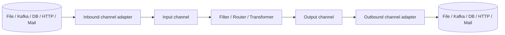
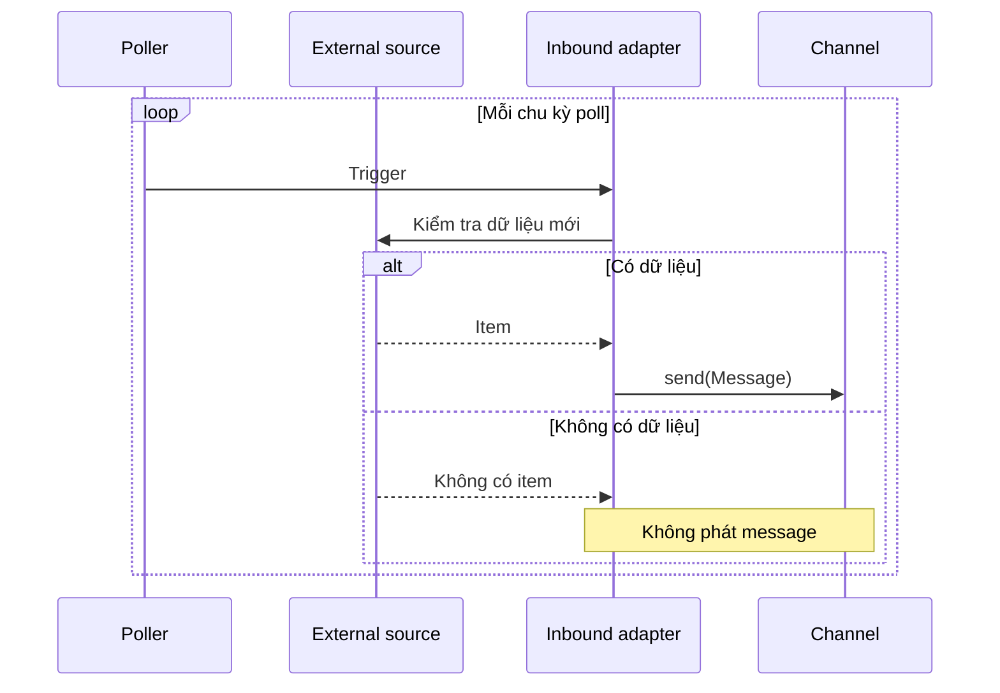
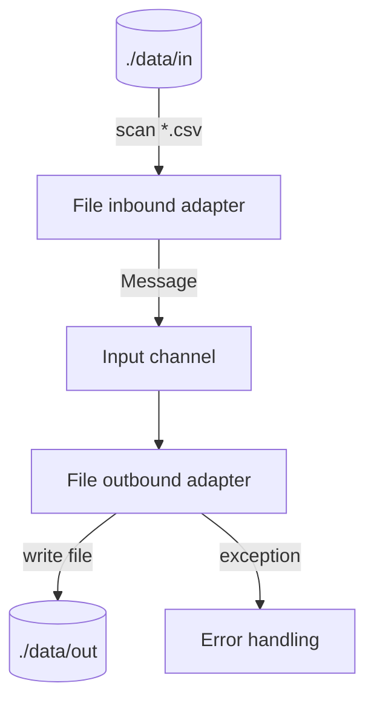
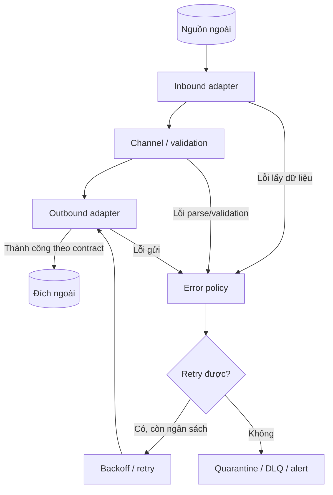
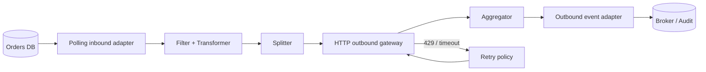

# Channel adapter nối nguồn hoặc đích ngoài

Trong **Spring Integration**, một hệ thống không thể chỉ trao đổi message giữa các thành phần nội bộ. Luồng tích hợp còn phải đọc file, nhận sự kiện từ broker, lấy dữ liệu từ cơ sở dữ liệu, tiếp nhận email, gửi HTTP request hoặc ghi kết quả sang hệ thống khác. **Channel adapter** là loại *endpoint* giúp kết nối những nguồn/đích bên ngoài đó với mô hình `Message<?>` và `MessageChannel` của Spring Integration.

Đây là một trong những thành phần cốt lõi khi triển khai **Enterprise Integration Patterns** (EIP): nguồn và đích có thể thay đổi, trong khi logic ở giữa vẫn được tổ chức bằng Filter, Router, Transformer, Splitter, Aggregator, Gateway, retry, error channel và correlation. Bài học thuộc chương **Endpoint** của module `SPRING_INTEGRATION_PATTERN`, tập trung vào cách thiết kế một ranh giới tích hợp **ít phụ thuộc và dễ mở rộng**, không đánh đồng việc gửi message vào channel với việc hệ thống bên ngoài đã xử lý thành công.

Sau bài này, bạn có thể:

- Phân biệt **inbound channel adapter**, **outbound channel adapter** và **messaging gateway**.
- Nhận diện adapter kiểu **polling** và **message-driven**, chọn cơ chế phù hợp với nguồn dữ liệu.
- Đọc một luồng Java DSL nối file bên ngoài vào channel rồi ghi sang đích ngoài.
- Xác định điểm chuyển đổi payload/headers, xử lý lỗi, retry, idempotency và trạng thái giao nhận.
- Thiết kế kiểm thử cho ranh giới vào/ra, bao gồm trường hợp lỗi tạm thời và message trùng.

## 1. Channel adapter là gì?

Trong Spring Integration, một **endpoint** là thành phần kết nối kênh thông điệp với một bước xử lý. **Channel adapter** là endpoint chuyên làm nhiệm vụ *thích nghi* giữa mô hình message trong ứng dụng và một nguồn/đích khác mô hình này.

Có hai hướng cơ bản, được gọi theo **góc nhìn của luồng Spring Integration**:

| Hướng | Nhiệm vụ | Dòng dữ liệu | Ví dụ |
| --- | --- | --- | --- |
| **Inbound channel adapter** | Đưa dữ liệu/sự kiện **từ bên ngoài vào** hệ thống message. | External source → `Message<?>` → `MessageChannel`. | Quét thư mục để lấy file mới, nhận sự kiện từ MQTT/Kafka, thăm dò bảng dữ liệu. |
| **Outbound channel adapter** | Đưa message **từ hệ thống ra** một hệ thống ngoài. | `MessageChannel` → `Message<?>` → external target. | Ghi file, gửi email, gọi HTTP không cần kết quả nghiệp vụ, xuất dữ liệu qua broker. |

Trong trường hợp thông thường, channel adapter có **ngữ nghĩa một chiều** ở mức trao đổi message: inbound **phát** message vào một channel; outbound **tiêu thụ** message và thực hiện tác động lên đích. Các giao thức bên ngoài vẫn có thể trả mã trạng thái hoặc xác nhận kỹ thuật, nhưng không nên nhầm chúng với **message phản hồi nghiệp vụ** của một request–reply flow.



### Vì sao không để mọi handler gọi trực tiếp API bên ngoài?

Giả sử service xử lý đơn hàng vừa đọc Kafka, vừa tự parse sự kiện, vừa kiểm tra thanh toán, vừa ghi file CSV. Khi chuyển từ Kafka sang RabbitMQ, từ CSV sang REST hoặc khi bổ sung nhánh giám sát, service dễ phải sửa nhiều phần không thuộc nghiệp vụ.

Thay vào đó, đặt một **inbound adapter** chịu trách nhiệm giao tiếp với nguồn; những bước xử lý ở giữa làm việc với payload và headers theo contract; **outbound adapter** chịu trách nhiệm giao tiếp với đích. Nhờ vậy, việc thay transport thường không bắt buộc thay toàn bộ Filter, Transformer hoặc logic nghiệp vụ — với điều kiện hợp đồng message và các bảo đảm giao nhận vẫn được giữ nhất quán.

## 2. Channel adapter, channel và gateway khác nhau thế nào?

Ba khái niệm thường xuất hiện gần nhau nhưng có trách nhiệm riêng:

| Thành phần | Trách nhiệm | Ví dụ câu hỏi mà nó giải quyết |
| --- | --- | --- |
| **`MessageChannel`** | Chuyển message giữa các endpoint trong ứng dụng. | “Message này sẽ đi sang handler nào?” |
| **Channel adapter** | Chuyển dữ liệu qua ranh giới **nguồn/đích ngoài ↔ message**. | “Làm sao nhận file từ thư mục hoặc ghi kết quả ra hệ thống ngoài?” |
| **Messaging gateway** | Thích nghi lời gọi hoặc giao thức **request–reply** với message flow. | “Làm sao gọi một luồng và nhận kết quả hoặc lỗi tương ứng?” |
| **Service Activator** | Kích hoạt một phương thức/service theo message. | “Service nghiệp vụ xử lý nội dung này bằng hàm nào?” |

Ví dụ, một adapter nhận đơn hàng từ broker rồi đưa qua `ordersInput` không có nghĩa nó tự cung cấp API `getOrderStatus()` cho caller. Nếu ứng dụng cần một luồng **yêu cầu → phản hồi**, gateway (hoặc cặp endpoint được thiết kế cho request–reply) thường là mô hình phù hợp hơn.

```text
Một chiều:    External event -> [Inbound adapter] -> Channel -> Handler
Một chiều:    Channel -> [Outbound adapter] -> External system

Yêu cầu/đáp:  Caller -> [Gateway] -> Request channel -> Handler
                    <- Reply channel   <- Response ------┘
```

**Lưu ý thuật ngữ:** “Inbound” không đồng nghĩa “là HTTP server”; “outbound” không đồng nghĩa “là HTTP client”. Chúng mô tả **hướng đi của message so với IntegrationFlow**. Ví dụ, một HTTP inbound gateway nhận request HTTP và trả response; một Kafka inbound adapter nhận record do Kafka đẩy; cả hai đưa dữ liệu từ bên ngoài vào, nhưng khác nhau ở hợp đồng phản hồi.

## 3. Hai kiểu inbound: polling và message-driven

Không phải nguồn ngoài nào cũng chủ động gửi sự kiện. Cách nguồn thông báo dữ liệu mới quyết định cơ chế inbound.

### 3.1. Polling inbound adapter: ứng dụng chủ động hỏi nguồn

Một số nguồn chỉ hỗ trợ thao tác **đọc/lấy dữ liệu** theo yêu cầu: thư mục file, bảng database, FTP/SFTP trong một số cấu hình, hoặc API phải được hỏi định kỳ. Khi đó, hệ thống dùng **poller** để kích hoạt nguồn theo lịch.



Trong Spring Integration, nguồn theo mô hình này thường được biểu diễn bằng `MessageSource<?>`; một `SourcePollingChannelAdapter` nhận lịch từ `PollerMetadata` và gọi nguồn. Những cấu hình quan trọng gồm:

- **Chu kỳ polling:** `fixedDelay` thường tính từ lúc một lần poll kết thúc đến lúc bắt đầu lần kế tiếp; `fixedRate` và cron có ngữ nghĩa lập lịch khác.
- **`maxMessagesPerPoll`:** giới hạn số message lấy trong mỗi đợt poll; không nhất thiết đồng nghĩa với số message tối đa trong toàn hệ thống.
- **Scheduler/thread:** một poll chậm có thể làm chậm các lần poll sau nếu không có thiết kế lập lịch phù hợp.
- **Lọc trạng thái nguồn:** cần nhận diện item đã xử lý, item đang được producer ghi dở, và item có thể đọc lại sau restart.
- **Xử lý lỗi polling:** lỗi lấy dữ liệu và lỗi gửi/ghi xuống downstream phải có chính sách riêng khi cần.

Nếu `MessageSource.receive()` không tìm thấy dữ liệu, nó có thể trả `null` để báo **không có message lần này**. Điều đó **không** có nghĩa Spring tạo `Message<?>` với payload `null`; các message được xây dựng theo API chuẩn của Spring yêu cầu payload khác null.

### 3.2. Message-driven inbound adapter: nguồn đẩy sự kiện đến

Với nguồn hỗ trợ listener/callback, adapter thường đăng ký để nhận thông báo khi có sự kiện mới. Ví dụ: Kafka consumer container, AMQP listener container hoặc callback từ hệ thống MQTT (tùy thư viện và cấu hình cụ thể).

```text
External broker/event
        │ push/callback
        ▼
Message-driven inbound adapter
        │ Spring Message + mapped headers
        ▼
      Channel
        │
        ▼
     Handler/Flow
```

Với kiểu này, không cần poller của Spring Integration đánh thức `MessageSource` định kỳ. Tuy nhiên, **message-driven không đồng nghĩa chắc chắn non-blocking hoặc xử lý song song**: listener có thể chạy trong thread của container, xử lý đồng bộ hoặc ủy quyền sang executor; cơ chế backpressure, prefetch, acknowledgement và concurrency phụ thuộc transport adapter.

### Bảng chọn nhanh

| Khía cạnh | Polling inbound | Message-driven inbound |
| --- | --- | --- |
| Ai khởi phát việc kiểm tra? | Lịch poll trong ứng dụng. | Listener/callback/container khi nguồn có dữ liệu. |
| Phù hợp khi | Nguồn không cung cấp sự kiện push, hoặc cần quét dữ liệu định kỳ. | Nguồn hỗ trợ consumer/listener/event subscription. |
| Độ trễ | Phụ thuộc chu kỳ polling và thời gian xử lý. | Thường phụ thuộc vào việc nguồn đẩy và tốc độ consumer. |
| Điểm cần kiểm soát | Lịch poll, số item mỗi đợt, bộ lọc trùng, khóa nguồn. | Ack, số consumer, prefetch, commit, thứ tự, redelivery. |
| Lỗi thường gặp | Đọc lại cùng file/hàng DB khi restart. | Ack quá sớm, mất thứ tự, xử lý lặp do redelivery. |

## 4. Outbound channel adapter: consumer một chiều ra hệ thống ngoài

Ở hướng outbound, một endpoint tiêu thụ `Message<?>` từ channel rồi tương tác với đích như ghi file, gửi email, gọi HTTP endpoint hoặc publish record sang broker. Ở mức framework, kiểu adapter này thường được triển khai quanh một **`MessageHandler`** chuyên giao tiếp với hệ thống ngoài.

```text
OrderAccepted payload + headers
           │
           ▼
      resultsChannel
           │
           ▼
  Outbound channel adapter
           │  serialization, credentials, mapping
           ▼
      External target
```

Những quyết định bắt buộc cần làm rõ:

1. **Payload đích cần là gì?** File adapter có thể nhận `File`, byte array hoặc `String` theo handler; HTTP adapter thường cần nội dung request/headers; broker adapter cần value/key/metadata đúng schema. Không phải adapter nào cũng tự hiểu đối tượng nghiệp vụ tùy ý.
2. **Header nào cần ánh xạ?** `traceId`, correlation, content type và routing key có thể cần mapping. Không giả định mọi Spring header đều được truyền nguyên xi sang transport.
3. **Thế nào là “gửi thành công”?** Lệnh ghi vào thư mục hoàn thành, HTTP trả 2xx, broker xác nhận publish hay người nhận đã xử lý nghiệp vụ — các mốc này khác nhau.
4. **Nếu gửi thất bại?** Chọn retry có giới hạn, circuit breaker (nếu có), kênh lỗi hoặc lưu để xử lý lại; bảo đảm thao tác chịu được phát lại nếu có thể.
5. **Có cần phản hồi không?** Nếu caller cần body/status như một kết quả được đưa tiếp vào flow, cân nhắc **outbound gateway** thay vì outbound adapter một chiều.

## 5. Thực hành Java DSL: lấy file CSV từ thư mục và ghi sang thư mục khác

Một ví dụ dễ quan sát là **File inbound channel adapter** kết hợp **File outbound channel adapter**. Producer bên ngoài thả file CSV vào thư mục nguồn; Spring Integration quét định kỳ và đưa một Spring message vào flow; handler đầu ra ghi bản sao vào thư mục đích.

### 5.1. Dependency

Nếu dùng Spring Boot cùng Spring Integration, khai báo starter và module file tương ứng (phiên bản nên do BOM/Boot quản lý):

```xml
<dependency>
    <groupId>org.springframework.boot</groupId>
    <artifactId>spring-boot-starter-integration</artifactId>
</dependency>
<dependency>
    <groupId>org.springframework.integration</groupId>
    <artifactId>spring-integration-file</artifactId>
</dependency>
```

### 5.2. Cấu hình một luồng file đơn giản

```java
import java.io.File;
import java.time.Duration;

import org.springframework.context.annotation.Bean;
import org.springframework.context.annotation.Configuration;
import org.springframework.integration.dsl.IntegrationFlow;
import org.springframework.integration.dsl.Pollers;
import org.springframework.integration.file.dsl.Files;
import org.springframework.integration.file.support.FileExistsMode;

@Configuration
class CsvBridgeConfiguration {

    @Bean
    IntegrationFlow copyCsvFiles() {
        return IntegrationFlow
                .from(
                        Files.inboundAdapter(new File("./data/in"))
                                .patternFilter("*.csv"),
                        endpoint -> endpoint.poller(
                                Pollers.fixedDelay(Duration.ofSeconds(5))
                                        .maxMessagesPerPoll(10)
                        )
                )
                .handle(
                        Files.outboundAdapter(new File("./data/out"))
                                .fileExistsMode(FileExistsMode.FAIL)
                )
                .get();
    }
}
```

Ở đây:

1. `Files.inboundAdapter(...)` tạo nguồn đọc file. Adapter phát message có **payload là `File`**; nó không tự động parse mọi cột CSV thành đối tượng nghiệp vụ.
2. `.patternFilter("*.csv")` lọc theo tên file, không thay thế kiểm tra file đã ghi xong hoặc xác minh định dạng CSV.
3. Poller kích hoạt mỗi khoảng thời gian cấu hình và lấy tối đa 10 message trong một lượt poll; số file thực tế phụ thuộc trạng thái thư mục và bộ lọc.
4. `Files.outboundAdapter(...)` tiêu thụ message và ghi file ở đích; `FileExistsMode.FAIL` chọn cách **không ghi đè** khi đã tồn tại file đích cùng tên.
5. `.get()` xây dựng `IntegrationFlow`; Spring quản lý các endpoint thuộc flow khi application context khởi chạy.

Ví dụ này cố ý ngắn để làm rõ ranh giới vào/ra. Để vận hành thực tế, cần bảo đảm thư mục được tạo và có quyền truy cập, tránh đọc file ghi dở, giám sát lỗi, định nghĩa cách xử lý trùng và xác minh hành vi của các adapter trên phiên bản Spring Integration đang dùng. **Đừng xem `patternFilter` hoặc mặc định của file source như bảo đảm xử lý đúng một lần qua restart.**



### 5.3. Muốn xử lý nghiệp vụ thì đặt bước chuyển đổi ở đâu?

Trước khi ghi file đích, ta có thể thêm **Transformer** để đổi `File` thành dữ liệu đã được validate, một **Filter** để loại bỏ bản ghi không hợp lệ, **Router** để chia kết quả thành nhiều đích, và **Splitter/Aggregator** nếu một file chứa nhiều dòng cần xử lý rồi tổng hợp. Ví dụ topology:

```text
File inbound adapter
    -> Message<File>
    -> Parser/Transformer: File -> List<OrderRow>
    -> Validator/Filter
    -> Splitter: List<OrderRow> -> OrderRow messages
    -> Router: domestic / international
    -> Process each row
    -> Aggregator: group by import batch
    -> Serializer: Result -> CSV/JSON
    -> Outbound adapter: file / HTTP / broker
```

Ở đây `Message<File>` và `Message<OrderRow>` không cùng payload type; hãy chọn điểm chuyển đổi rõ ràng để không phải ép kiểu tùy tiện. Khi Splitter tạo nhiều message con, cần giữ `correlationId`, `sequenceNumber`, `sequenceSize` hoặc khóa nhóm phù hợp để Aggregator gom đúng một lần nhập. Nếu file đầu vào không có dòng hợp lệ, phải định nghĩa trạng thái “đã xử lý nhưng kết quả rỗng” một cách rõ ràng; không chờ Aggregator vô hạn vì không có message con.

## 6. Ví dụ thiết kế với nguồn và đích ngoài khác

Adapter nằm ở **ranh giới tích hợp**; không nhất thiết mọi nguồn/đích đều dùng file. Các tình huống điển hình:

| Nguồn/đích | Hướng thường dùng | Điểm kỹ thuật cần xác nhận |
| --- | --- | --- |
| Kafka topic | Inbound listener / outbound publisher | Record key, offset, acknowledgement, redelivery, serialization, partition/order. |
| AMQP/RabbitMQ | Inbound listener / outbound publisher | Exchange, routing key, queue, ack, requeue, dead-letter. |
| SFTP/FTP | Polling inbound / outbound upload | Danh sách file, resume, rename, atomic upload, trạng thái xử lý trùng. |
| Cơ sở dữ liệu | Polling inbound / outbound update | Câu SQL, transaction, checkpoint, khóa hàng, cách nhận biết hàng mới. |
| File system | Polling inbound / outbound write | File ghi dở, dung lượng, tên trùng, lưu trữ và cleanup. |
| HTTP REST | Inbound endpoint hoặc outbound client | Phương thức HTTP, status, timeout, header, bảo mật, request–reply. |
| Email | Mail inbound / outbound | MIME, kích thước, retry, xác thực, dữ liệu nhạy cảm. |

Các giao thức này có adapter riêng và cấu hình riêng; bảng mô tả **kiểu sử dụng phổ biến**, không khẳng định tất cả thư viện và phiên bản đều hỗ trợ cùng những mode hoặc tính năng. Với HTTP, nếu cần nội dung response đi tiếp vào Spring Integration flow thì **HTTP outbound gateway** là lựa chọn tự nhiên hơn outbound channel adapter một chiều.

### Trường hợp A — Kafka → xử lý đơn hàng → API ngoài

```text
Kafka inbound adapter
  -> ordersInput
  -> Transformer (deserialize/map contract)
  -> Filter (valid order?)
  -> Router (order type)
  -> Gateway/handler (gọi API cần kết quả)
  -> outcomeChannel
  -> Kafka/file outbound adapter (phát kết quả)
```

Một **Kafka inbound adapter** nên được cấu hình rõ cơ chế commit/acknowledgement của consumer và các trường hợp xử lý lại. Nếu logic downstream có tác động phụ, sử dụng idempotency key ổn định (ví dụ event ID hoặc command ID trong hợp đồng), không đơn thuần dựa vào Spring `MessageHeaders.id`. Để gọi API cần response, xem xét gateway hoặc một service có contract rõ ràng; outbound channel adapter không tự biến luồng thành request–reply.

### Trường hợp B — Quét dữ liệu định kỳ → gửi email báo cáo

```text
Scheduled poller
  -> JDBC inbound adapter (new rows)
  -> Transformer (rows -> report)
  -> Filter (report not empty?)
  -> Mail outbound adapter
```

Ở đây “không có hàng mới” có thể có nghĩa nguồn không phát message ở lần poll; còn “báo cáo rỗng” có thể là một **payload hợp lệ** nếu nghiệp vụ cần báo tình trạng không phát sinh. Hai tình huống không nên trộn làm một `null` mơ hồ. Nếu báo cáo đã gửi rồi nhưng việc đánh dấu hoàn tất DB lỗi, lần poll sau có thể gửi lại — cần chính sách idempotency/transaction/outbox phù hợp.

## 7. Payload, headers và ranh giới transport

Spring message gồm `payload` và `headers`; khi đi qua adapter, cả hai thường cần ánh xạ sang biểu diễn của transport hoặc từ biểu diễn đó trở về Spring message.

| Thông tin | Nên đặt ở đâu? | Ví dụ tại adapter |
| --- | --- | --- |
| Giá trị nghiệp vụ cần sống qua replay | Payload hoặc hợp đồng sự kiện được serialize | `orderId`, `amount`, `eventId`, `occurredAt`. |
| Thông tin truy vết | Header/transport metadata với mapping có chủ ý | `traceId`, `correlationId` phục vụ logs và observability. |
| Routing theo transport | Metadata do adapter/giao thức quy định | Kafka topic/key, AMQP routing key, tên file đích. |
| Kiểu nội dung | Header hoặc hợp đồng transport | JSON, CSV, content type/charset. |
| Định danh một lần gửi | Metadata framework/transport | Spring message ID, offset Kafka hoặc delivery tag. |

Ví dụ, cùng một `OrderCreated` có thể được gửi sang Kafka hoặc ghi file JSON. **Payload nghiệp vụ** vẫn có ý nghĩa là “đơn hàng đã tạo”, còn cách ánh xạ `traceId`, content type, key, tên file hoặc ack phụ thuộc adapter. Không tự giả định việc thêm một header vào `MessageBuilder` sẽ làm transport ngoài nhận được header đó; nhiều adapter chỉ ánh xạ những header được hỗ trợ hoặc được cấu hình tường minh.

### Không để metadata transport trở thành dữ liệu nghiệp vụ chuẩn

`headers.id` của Spring không thay thế `eventId` được lưu bền vững; Kafka offset không phải mã đơn hàng; một HTTP status 202 không đồng nghĩa đơn hàng đã được thanh toán. Khi nghiệp vụ yêu cầu replay, khử trùng lặp, audit hoặc correlation giữa nhiều hệ thống, hãy thiết kế contract riêng và kiểm thử mapping qua từng adapter.

### Sự vắng mặt và null

Không tìm thấy file/hàng dữ liệu ở một lượt poll thường có nghĩa **không phát message**, không phải phát `Message` với payload null. Khi cần trả trạng thái “không tìm thấy” cho một caller, hãy cân nhắc gateway và result type như `Found`/`NotFound`. Tránh coi mọi exception hoặc timeout ở adapter là payload `null` của một message hợp lệ.

## 8. Retry, lỗi và ranh giới giao nhận

Ở ranh giới ngoại vi, lỗi là tình huống phổ biến: mạng ngắt, broker tạm thời không nhận, file bị khóa, xác thực hết hạn hoặc dịch vụ đích trả lỗi. Không thể chọn một cơ chế retry áp dụng y hệt cho mọi trường hợp.

### Phân loại lỗi trước khi xử lý

| Lỗi | Ví dụ | Hướng xử lý |
| --- | --- | --- |
| Tạm thời (*transient*) | Timeout mạng, broker unavailable, rate limit | Retry có giới hạn, backoff, jitter khi phù hợp; giám sát số lần thử. |
| Dữ liệu không hợp lệ | JSON không đúng schema, số tiền âm | Không retry vô hạn; đưa vào kênh lỗi/quarantine/DLQ hoặc trả kết quả từ chối. |
| Xung đột nghiệp vụ | Đơn đã hủy, sự kiện đã xử lý | Quy tắc idempotency hoặc kết quả nghiệp vụ rõ ràng. |
| Không được phép | 401/403, chứng chỉ không hợp lệ | Kiểm tra lại cấu hình/bảo mật; không retry dồn dập khi chưa xử lý nguyên nhân. |
| Quá tải | Nhiều file/lệnh hơn sức xử lý | Giới hạn polling/concurrency, backpressure theo khả năng adapter, hàng đợi bền vững nếu cần. |

### Error channel và error flow

Trong Spring Integration, lỗi có thể được biểu diễn bằng `ErrorMessage` và chuyển đến `errorChannel` tùy loại endpoint, cách gọi đồng bộ/bất đồng bộ, poller và cấu hình. **Không nên giả định** rằng mọi exception ở bất kỳ adapter nào cũng tự đi vào cùng một error channel, hoặc rằng lỗi đã được ghi log tức là message đã được xử lý an toàn.

Ví dụ topology:



Sơ đồ mô tả **quyết định thiết kế**, không phải những cạnh mà Spring tự động thêm vào flow. Điểm retry thực tế có thể nằm ở consumer container, poller advice, outbound handler hoặc broker; cần tránh vô tình có nhiều lớp retry lồng nhau làm số lần gọi tăng theo cấp số nhân.

### Idempotency và replay

Một luồng nhận từ broker có thể xử lý lại cùng record sau crash, hoặc một file được phát hiện lại sau restart. Vì vậy:

- **Không mặc định exactly-once end-to-end.** Điều kiện này cần cơ chế đồng bộ giao dịch và idempotency trên toàn đường đi, không chỉ một adapter đơn lẻ.
- Sử dụng **định danh nghiệp vụ/event ID bền vững** khi quyết định có lặp thao tác hay không.
- Có thể dùng *idempotent receiver* và metadata store bền vững, hoặc chiến lược outbox/inbox tùy thiết kế; bảo đảm khóa không bị thay sau khi message được dựng lại.
- Với file, kiểm tra atomic rename, trạng thái file đã xử lý, bộ lọc bền vững qua restart và cleanup/archival policy.
- Với broker, kiểm soát thời điểm ack/commit và cách xử lý poison message theo contract transport.

Một thao tác outbound trả thành công ở mức network không tự chứng minh nghiệp vụ bên nhận hoàn tất. Chẳng hạn HTTP 202 có thể chỉ là “đã nhận để xử lý sau”, Kafka producer ack có thể chỉ xác nhận broker đã tiếp nhận record, còn thao tác ghi file thành công không chứng minh hệ thống đọc file đã xử lý nội dung.

## 9. Threading, polling, backpressure và hiệu năng

Thiết kế channel adapter phải làm rõ **nguồn tạo tải** và **đích tiêu thụ tải**:

1. **Polling source:** `fixedDelay`, `maxMessagesPerPoll`, kích thước batch và thời gian xử lý quyết định tốc độ thu thập dữ liệu. Chu kỳ quá ngắn có thể gây tải nền không cần thiết; chu kỳ quá dài làm tăng độ trễ.
2. **Message-driven source:** broker/container có chính sách concurrency, prefetch và ack riêng; tăng consumer không bảo đảm giữ nguyên thứ tự theo khóa nghiệp vụ.
3. **Downstream channel:** `DirectChannel` có thể chạy handler trên thread gửi; `ExecutorChannel` tách thread nhưng không cung cấp lưu trữ bền vững; `QueueChannel` có thể đệm nội bộ nhưng cần giới hạn và chính sách khôi phục.
4. **Reactive bridge:** nếu nối sang `FluxMessageChannel`, Reactive Streams demand không tự làm một inbound adapter imperative hiểu toàn bộ backpressure end-to-end. Phải xem adapter/container có hỗ trợ tạm dừng, giới hạn hoặc bộ đệm phù hợp không.
5. **Outbound side effect:** API chậm, ghi file nặng hoặc broker có latency cao có thể kéo dài thời gian xử lý ở thread của endpoint. Theo dõi thời gian gửi và tránh làm nghẽn các luồng thiết yếu.

```text
Nguồn phát nhanh                   Đích xử lý chậm
     │                                  ▲
     ▼                                  │
Inbound adapter -> Channel/buffer -> Outbound adapter
                       │
           Phải có chính sách capacity,
           timeout, retry, recovery
```

Không nên thêm thread pool hay buffer vô hạn chỉ để làm đẹp số liệu thông lượng tức thời: khi tải kéo dài, bộ nhớ và số message chưa xử lý sẽ tăng không giới hạn. Nếu nghiệp vụ không cho phép mất dữ liệu, hãy chọn broker hoặc store bền vững với capacity planning và cơ chế phục hồi phù hợp.

## 10. Bảo mật và khả năng quan sát tại adapter

Adapter là điểm tiếp xúc với mạng, file system và dịch vụ khác nên thường là vị trí cần chú ý **bảo mật và quan sát**.

**Bảo mật:**

- Cấp tài khoản/quyền **ít nhất cần thiết** cho API, broker, thư mục hoặc database.
- Không hardcode secret, token, mật khẩu hoặc thông tin định danh nhạy cảm trong Java source hay message headers để tiện debug.
- Xác minh TLS, chứng chỉ, endpoint URL, đường dẫn file và quyền ghi; giới hạn loại/kích thước payload có thể nhận.
- Chống dữ liệu độc hại từ nguồn ngoài: validate định dạng, kích thước, encoding, file name/path traversal và schema trước khi đi vào xử lý quan trọng.
- Quy định rõ giới hạn tin cậy của headers; không coi một `traceId` hoặc `userId` tự gắn là bằng chứng xác thực.

**Observability:**

- Đo số message nhận/gửi, số thất bại, retry, độ trễ, backlog, thời gian xử lý và số phần tử trong mỗi poll.
- Theo dõi correlation/trace ID xuyên luồng, nhưng không mặc định `ThreadLocal`/MDC được chuyển đúng qua executor/reactive boundary.
- Ghi log có cấu trúc: nguồn/đích, loại sự kiện, kết quả adapter, lý do lỗi và khóa định danh phù hợp; che bớt hoặc loại bỏ thông tin nhạy cảm.
- Phân biệt **accepted**, **delivered**, **processed** trong dashboard để tránh báo sai rằng một giao dịch nghiệp vụ đã hoàn tất chỉ vì gửi message thành công.

## 11. Chiến lược kiểm thử channel adapter

Kiểm thử không chỉ xác nhận “file xuất hiện” hoặc “HTTP trả 200”, mà phải chứng minh adapter giữ được ngữ nghĩa nghiệp vụ và chính sách lỗi ở ranh giới.

| Loại test | Tình huống | Tiêu chí xác minh |
| --- | --- | --- |
| **Unit test** | Transformer/Filter nhận payload do adapter tạo | Chuyển kiểu, validation, quyết định định tuyến đúng. |
| **Integration test file** | Tạo file trong thư mục tạm, chạy flow | Inbound đọc đúng file sẵn sàng, outbound ghi đúng nội dung và tên; không trùng nếu contract yêu cầu. |
| **Contract test** | Producer/consumer khác service | Schema JSON/Avro, header mapping, content type và semantics của nullable/missing fields chính xác. |
| **Failure test** | Đích không truy cập được hoặc quyền bị từ chối | Retry/backoff, error flow, số lần gửi, tránh mất message hoặc lặp vô hạn. |
| **Restart/replay test** | Process dừng giữa nhận và gửi | Trạng thái đã xử lý, ack/commit, khử trùng lặp và recover đúng kỳ vọng. |
| **Load test** | Producer nhanh hơn consumer | Bounded backlog, thời gian chờ, thông lượng, memory và recovery khi quá tải. |

### Một kịch bản kiểm thử file có thể tái hiện

1. Tạo thư mục nguồn và đích **tách biệt** trong môi trường test; sử dụng vị trí test tạm thay vì đường dẫn sản xuất.
2. Tạo một file `orders-001.csv` có nội dung hợp lệ; kích hoạt flow và chờ có điều kiện đến khi file đích xuất hiện, với **timeout rõ ràng**.
3. Đọc lại nội dung file đích để so sánh byte/encoding, không chỉ so sánh tên.
4. Thả file tên trùng và kiểm tra chính sách `FileExistsMode.FAIL` tạo lỗi đúng kỳ vọng, không lặng lẽ ghi đè.
5. Dừng/khởi động lại ứng dụng để kiểm tra xem file nguồn có được nhận lại hay không; nếu yêu cầu xử lý một lần, cấu hình metadata store/đánh dấu trạng thái bền vững và kiểm chứng.
6. Giả lập lỗi ghi file (đường dẫn không có quyền, disk full) và quan sát error flow/metrics. Không xóa file nguồn trước khi xác nhận cách phục hồi mong muốn.

Khi sử dụng Spring Integration Test, có thể điều khiển endpoint, thay handler bằng mock hoặc dùng `QueueChannel` để quan sát message thay vì gọi hệ thống thật. Với adapter cần broker hoặc database, test tích hợp có thể dùng môi trường cô lập/Testcontainers tùy stack; không cần trói các unit test nghiệp vụ vào một broker chạy thường trực.

## 12. Sai lầm thường gặp

**Sai lầm 1 — Dùng outbound adapter khi thật sự cần response.** Gửi yêu cầu REST rồi cần dữ liệu phản hồi để chọn nhánh tiếp theo nhưng dùng endpoint một chiều. **Khắc phục:** dùng outbound gateway hoặc handler có hợp đồng request–reply rõ ràng.

**Sai lầm 2 — Coi `send()` thành công là nghiệp vụ đã xong.** Channel chỉ chứng minh kết quả tại một ranh giới; downstream có thể xử lý bất đồng bộ hoặc lỗi sau đó. **Khắc phục:** phân định các mốc accepted/delivered/processed và định nghĩa ACK/reply phù hợp.

**Sai lầm 3 — Poll file đang được ghi dở.** Adapter thấy tên file nhưng producer chưa đóng stream, dẫn tới dữ liệu thiếu. **Khắc phục:** dùng atomic rename/marker hoàn tất hoặc cơ chế quan sát file ổn định theo contract nguồn.

**Sai lầm 4 — Tin bộ lọc in-memory là kho checkpoint bền vững.** Restart có thể quét lại item. **Khắc phục:** dùng metadata store bền vững, idempotency key hoặc chuyển file sau khi xử lý theo chính sách có kiểm chứng.

**Sai lầm 5 — Retry mọi lỗi vô hạn.** File sai schema hay HTTP 401 không thể tự sửa qua hàng nghìn lần thử. **Khắc phục:** phân loại lỗi, giới hạn số lần retry, dead-letter/quarantine và cảnh báo.

**Sai lầm 6 — Đưa mọi thuộc tính transport vào payload nghiệp vụ.** Thay broker hoặc HTTP headers phải sửa hàng loạt model. **Khắc phục:** phân tách payload bền vững, headers điều phối và adapter-specific mapping.

**Sai lầm 7 — Giấu lỗi ở `.handle()` hoặc `subscribe()` và chỉ ghi log.** Source có thể tiếp tục ack/commit dù nghiệp vụ chưa hoàn tất. **Khắc phục:** thiết kế failure propagation và chính sách ack đúng ranh giới, kiểm thử replay sau lỗi.

**Sai lầm 8 — Dùng một channel làm bộ đệm vô hạn.** Khi đích chậm, lượng message chờ tăng không kiểm soát. **Khắc phục:** giới hạn capacity, quản lý concurrency và chọn hàng đợi bền vững nếu yêu cầu không mất dữ liệu.

## 13. Bài tập thiết kế: Đồng bộ đơn hàng sang hệ thống vận chuyển

**Bối cảnh:** Một ứng dụng thương mại điện tử lưu đơn hàng vào database. Hệ thống vận chuyển bên ngoài chỉ cho phép gọi HTTP API, thỉnh thoảng trả `429 Too Many Requests`, và mỗi yêu cầu phải có mã `shipmentRequestId` để chống tạo vận đơn trùng. Đơn hàng cần qua bước kiểm tra địa chỉ, tách các kiện hàng và nhận trạng thái vận đơn cuối cùng.

**Yêu cầu thiết kế:**

1. Nếu dữ liệu đơn hàng được lấy theo đợt từ bảng DB, chọn **JDBC polling inbound adapter** hoặc một cơ chế phát sự kiện/outbox phù hợp. Nêu cách chỉ lấy item chưa xử lý và tránh nhiều worker cùng lấy một item.
2. Dùng **Filter** để kiểm tra dữ liệu; **Transformer** để chuyển sang yêu cầu tạo vận đơn; nếu một đơn có nhiều kiện, dùng **Splitter** với correlation rõ ràng.
3. Vì API vận chuyển phải **trả về mã vận đơn**, cân nhắc **HTTP outbound gateway** thay vì outbound adapter một chiều tại bước tạo vận đơn. Chỉ dùng outbound adapter khi việc gửi một chiều là đúng contract.
4. Với HTTP 429, dùng retry có backoff và giới hạn, giữ nguyên `shipmentRequestId` qua các lần thử, không tự phát sinh ID mới mỗi lần retry.
5. Nếu các kiện được xử lý song song, dùng **Aggregator** gom đúng nhóm theo `shipmentBatchId`, xử lý timeout hoặc trường hợp một kiện thất bại.
6. Sau khi nhận kết quả có xác nhận, dùng outbound adapter ghi sự kiện `ShipmentCreated` ra broker hoặc file audit. Không đánh đồng việc broker xác nhận publish với việc bên tiêu thụ đã cập nhật xong.
7. Kiểm thử mất kết nối, restart, request trùng, throttling, payload không hợp lệ và quan sát `traceId` xuyên mọi nhánh.



**Câu hỏi tự đánh giá:** Nếu adapter nguồn nhận một đơn hàng, chuyển vào channel thành công nhưng HTTP gateway chưa trả kết quả, có thể đánh dấu đơn “đã tạo vận đơn” ngay không? **Không.** Trạng thái nghiệp vụ phải dựa vào kết quả xác nhận theo contract của dịch vụ vận chuyển, kèm chính sách xử lý thất bại/idempotency và khả năng khôi phục sau restart.

## Tổng kết

- **Inbound channel adapter** đưa dữ liệu **từ nguồn ngoài vào** Spring Integration; **outbound channel adapter** đưa Spring message **ra đích ngoài**. Chiều inbound/outbound được xác định từ góc nhìn của luồng tích hợp.
- **Polling inbound** được kích hoạt bằng lịch và `MessageSource`; **message-driven inbound** thường dùng listener/container để nhận sự kiện từ nguồn hỗ trợ push.
- Channel adapter thường mang **ngữ nghĩa một chiều**; khi cần request–reply với kết quả để xử lý tiếp, hãy dùng **Gateway** hoặc hợp đồng tương đương.
- Logic nghiệp vụ nên được đặt trong các bước **Filter, Router, Transformer, Splitter, Aggregator** và service; adapter chuyên quản lý mapping, kết nối và vận hành ở ranh giới.
- **Retry, error channel, ack/commit, idempotency, correlation, backpressure, bảo mật và observability** phải được thiết kế theo đặc thù từng transport; không mặc định adapter cung cấp exactly-once end-to-end.
- Đánh giá thành công ở đúng ranh giới: **đã nhận message**, **đã gửi sang đích**, và **đã hoàn thành nghiệp vụ** là ba mốc có thể khác nhau.
