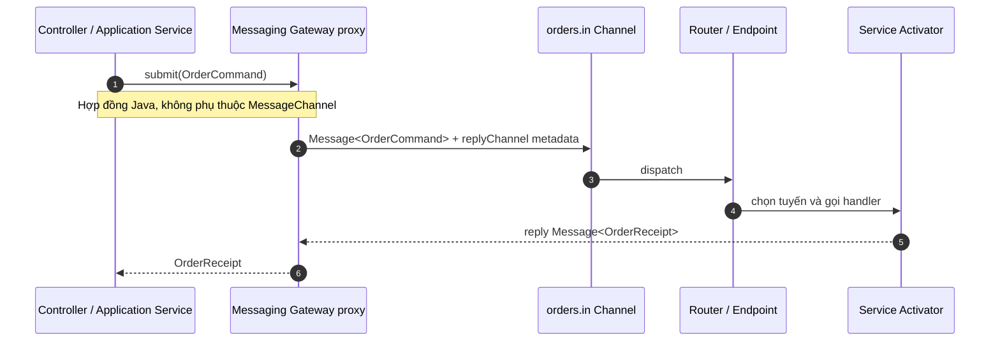
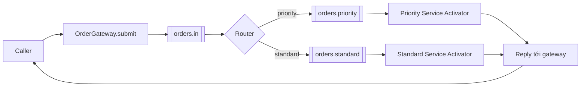
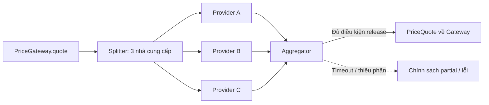
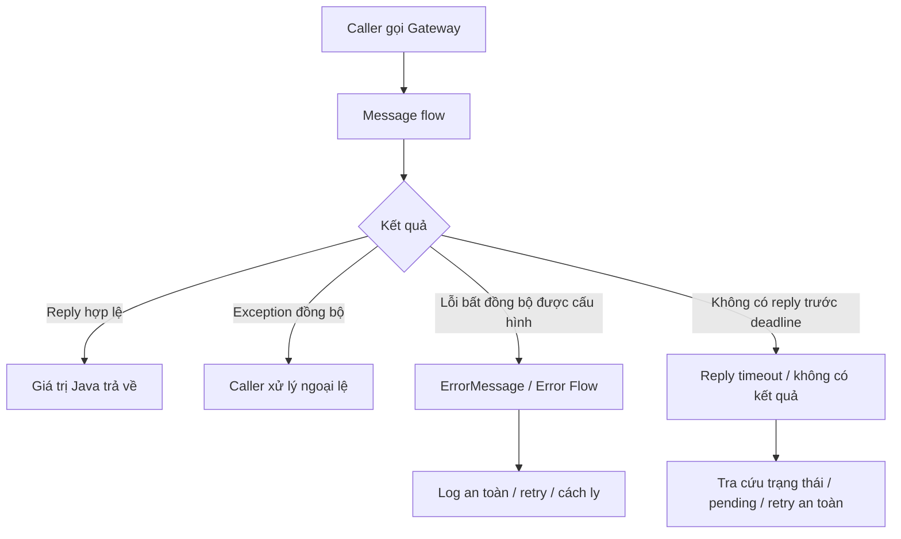

# Gateway tạo facade cho message flow

Trong một ứng dụng Spring, Controller hoặc application service thường muốn gọi một chức năng bằng cú pháp Java quen thuộc: `orderGateway.submit(command)`. Ở phía sau, yêu cầu có thể phải đi qua **Message Channel**, **Filter**, **Transformer**, **Router**, các nhánh xử lý và một **Service Activator**. Nếu mã nghiệp vụ phải trực tiếp tạo `Message`, tự điền header, chọn channel và đợi reply, các chi tiết của luồng tích hợp sẽ tràn vào nơi không nên biết chúng.

**Messaging Gateway** của **Spring Integration** giải quyết vấn đề này bằng cách cung cấp một **facade — giao diện phương thức Java đứng trước message flow**. Caller thấy một hợp đồng đơn giản, còn gateway chuyển lời gọi thành thông điệp gửi vào kênh, sau đó có thể nhận phản hồi và trả về kiểu Java mong đợi.

Trong module `SPRING_INTEGRATION_PATTERN`, Gateway là một thành phần quan trọng để thực hành **Enterprise Integration Patterns (EIP)** theo hướng ít phụ thuộc, dễ mở rộng. Nó kết hợp tốt với Router, Filter, Transformer, Splitter, Aggregator, retry, error channel và correlation; đồng thời tạo ranh giới rõ ràng cho kiểm thử và quan sát các nhánh xử lý.

> **Ý chính:** Gateway là *cách caller nhìn vào hệ thống tích hợp*, không phải toàn bộ luồng tích hợp. Gateway che chi tiết `Message`/`Channel` khỏi mã gọi, nhưng **không tự bảo đảm bất đồng bộ, lưu bền, retry an toàn hay hoàn tất nghiệp vụ trước một deadline**.

## 1. Vấn đề khi không có facade

Giả sử hệ thống nhận lệnh tạo đơn hàng. Đơn ưu tiên được gửi sang tuyến xử lý nhanh, đơn thường sang tuyến tiêu chuẩn. Nếu application service phụ thuộc trực tiếp vào hạ tầng messaging, mã có thể bị kéo theo nhiều quyết định kỹ thuật:

```java
// Phác họa sự phụ thuộc không mong muốn; không phải mã mẫu cần áp dụng.
class OrderController {
    // MessageChannel, MessageBuilder, replyChannel, timeout... bị đưa lên tầng API.
    // Khi thay đổi tên channel hoặc cơ chế trả lời, controller cũng phải thay đổi.
}
```

Điều cần bảo vệ là **ranh giới trách nhiệm**:

- Controller quan tâm đến request, response và hợp đồng HTTP.
- Application service quan tâm đến use case, trạng thái và quy tắc nghiệp vụ.
- Integration flow quan tâm đến chuyển đổi, phân tuyến, gọi handler và liên kết thông điệp.
- Adapter/gateway phía ngoài quan tâm đến giao thức với ERP, broker, đối tác hoặc tài nguyên khác.

Mã gọi nên có thể viết như sau:

```java
OrderReceipt receipt = orderGateway.submit(
    new OrderCommand("ORD-1050", true)
);
```

Caller chỉ cần biết **interface và kiểu dữ liệu**. Nó không cần biết có bao nhiêu Router, tên các channel hay handler nào cuối cùng được gọi.

## 2. Gateway là gì, và facade nằm ở vị trí nào?

Một **facade** cung cấp lối vào đơn giản cho một cấu trúc phía sau phức tạp. Trong Spring Integration, gateway thường được khai báo qua interface Java có `@MessagingGateway`. Framework đăng ký một **proxy** triển khai interface; khi phương thức được gọi, proxy tạo/gửi message và, với phương thức có giá trị trả về, quản lý việc đợi/nhận reply theo cấu hình.



Sơ đồ là **mô hình logic**. Tùy kiểu channel và endpoint, các bước có thể diễn ra ngay trên thread của caller hoặc qua các ranh giới bất đồng bộ. Reply có thể đi qua một reply channel được framework quản lý; trong ví dụ đơn giản, lập trình viên không cần tạo channel đó bằng tay.

### 2.1. Phân biệt các khái niệm dễ bị lẫn

| Thành phần | Trách nhiệm | Có phải facade cho mã gọi không? |
| --- | --- | --- |
| **Messaging Gateway** | Biến lời gọi phương thức thành request message, và reply message thành giá trị trả về khi cần. | **Có** — thường là interface Java. |
| **Message Channel** | Là ranh giới gửi/nhận giữa các bước. | Không; mã gọi không nhất thiết nhìn thấy channel. |
| **Service Activator** | Gọi một method xử lý khi nhận message. | Không; đây là handler phía sau luồng. |
| **Router** | Chọn nhánh/kênh xử lý message. | Không; nó định tuyến bên trong flow. |
| **Channel Adapter** | Nối nguồn hoặc đích ngoài với hệ thống message. | Không nhất thiết; adapter có thể là đầu vào/đầu ra một chiều. |
| **Inbound/Outbound Gateway** | Giao tiếp request–reply với một hệ thống/giao thức bên ngoài, như HTTP. | Là gateway ở **ranh giới giao thức**, khác proxy interface Java dù cùng ý tưởng request–reply. |
| **HTTP API Gateway/reverse proxy** | Định tuyến, bảo vệ và điều hành HTTP ở biên mạng. | **Không đồng nghĩa** `@MessagingGateway`. |

**Lưu ý:** Từ *gateway* trong Spring Integration không luôn chỉ một annotation. Ngoài proxy `@MessagingGateway`, còn có **gateway endpoint** bên trong flow và các **protocol-specific gateways**. Chúng cùng liên quan đến giao tiếp request–reply nhưng nằm ở ranh giới và mức trừu tượng khác nhau.

## 3. Ba cấu phần chính của Messaging Gateway

### 3.1. Interface: hợp đồng nghiệp vụ của facade

Thay vì khai báo `MessageChannel` hoặc `Message<?>` ở nơi gọi, nên bắt đầu từ một interface có kiểu nghiệp vụ rõ ràng:

```java
import org.springframework.integration.annotation.MessagingGateway;

@MessagingGateway(
    defaultRequestChannel = "orders.in",
    defaultReplyTimeout = "3000"
)
public interface OrderGateway {
    OrderReceipt submit(OrderCommand command);
}
```

Ở đây:

- `OrderGateway` là hợp đồng caller có thể inject như một Spring bean sau khi gateway được phát hiện/đăng ký.
- `submit(OrderCommand)` nhận payload ở dạng Java object; caller không bắt buộc tạo `Message`.
- `defaultRequestChannel` xác định kênh gửi request mặc định.
- `defaultReplyTimeout` cấu hình khoảng chờ reply trong những trường hợp gateway phải chờ nhận phản hồi và có áp dụng chính sách timeout.
- `OrderReceipt` mô tả **kết quả caller mong đợi**, không bắt các tầng gọi phải đọc `MessageHeaders`.

Tên `orders.in` là một **hợp đồng tích hợp**. Nếu tên channel đổi, nơi cần sửa thường là cấu hình gateway/flow, không phải từng controller đang gọi `submit(...)`.

### 3.2. Proxy: cầu nối method invocation sang message

Spring Integration tạo proxy cho gateway interface (có thể dùng `@IntegrationComponentScan` để phát hiện những interface này). Khi caller gọi `submit(...)`, proxy chuyển tham số thành request message và gửi tới channel. Nếu có kiểu trả về, proxy cũng phối hợp nhận reply rồi chuyển thành giá trị trả về tương ứng.

Không cần tự khai báo `MessageBuilder` và `replyChannel` ở mọi caller. Tuy nhiên, **không nên suy ra mọi phương thức gateway đều đồng bộ hay đều có reply**: hành vi còn phụ thuộc chữ ký phương thức, cấu hình gateway, channel và flow thực tế.

### 3.3. IntegrationFlow: chuỗi endpoint phía sau facade

Gateway **không thay thế** Filter, Transformer, Router hoặc Service Activator. Nó gửi request vào một luồng đã định nghĩa. Một thông điệp có thể đi qua nhiều bước, hoặc thậm chí chuyển sang broker rồi trở về qua một gateway/adapter khác.



## 4. Ví dụ hoàn chỉnh về cấu trúc: gateway + router + hai handler

Đây là một ví dụ tối giản nhưng đủ thể hiện **rằng facade có thể che giấu nhiều nhánh message flow**. Giả sử project sử dụng Java hỗ trợ `record`, Spring Framework và Spring Integration phiên bản tương thích. Các đoạn mã cùng package có thể được đặt vào các file Java tương ứng.

### 4.1. Kiểu dữ liệu của nghiệp vụ

```java
public record OrderCommand(String orderId, boolean priority) {}

public record OrderReceipt(String orderId, String route, String status) {}
```

Payload của facade được biểu diễn bằng kiểu domain/application rõ nghĩa. Trạng thái `ACCEPTED` trong ví dụ chỉ mô phỏng kết quả được handler trả về, **không phải lời cam kết rằng một ERP hay broker đã xử lý bền vững**.

### 4.2. Facade Java của luồng

```java
import org.springframework.integration.annotation.MessagingGateway;

@MessagingGateway(
    defaultRequestChannel = "orders.in",
    defaultReplyTimeout = "3000"
)
public interface OrderGateway {
    OrderReceipt submit(OrderCommand command);
}
```

### 4.3. Dịch vụ xử lý sau khi định tuyến

```java
public class OrderApplicationService {

    public OrderReceipt submitPriority(OrderCommand command) {
        validate(command);
        return new OrderReceipt(command.orderId(), "priority", "ACCEPTED");
    }

    public OrderReceipt submitStandard(OrderCommand command) {
        validate(command);
        return new OrderReceipt(command.orderId(), "standard", "ACCEPTED");
    }

    private void validate(OrderCommand command) {
        if (command == null || command.orderId() == null
                || command.orderId().isBlank()) {
            throw new IllegalArgumentException("orderId is required");
        }
    }
}
```

Đặt quy tắc `orderId` bắt buộc trong service nhằm làm rõ phần **kiểm tra hợp đồng nghiệp vụ**. Với môi trường thực tế, xác thực, kiểm soát quyền, schema validation và chống xử lý trùng cần được tổ chức phù hợp ở các biên. Không nên để Router vừa phân tuyến vừa trừ tồn kho hoặc thu tiền.

### 4.4. Wiring bằng Spring Integration Java DSL

```java
import org.springframework.context.annotation.Bean;
import org.springframework.context.annotation.Configuration;
import org.springframework.integration.annotation.IntegrationComponentScan;
import org.springframework.integration.config.EnableIntegration;
import org.springframework.integration.dsl.IntegrationFlow;

@Configuration
@EnableIntegration
@IntegrationComponentScan
public class OrderFlowConfiguration {

    @Bean
    OrderApplicationService orderApplicationService() {
        return new OrderApplicationService();
    }

    @Bean
    IntegrationFlow routeOrders() {
        return IntegrationFlow.from("orders.in")
            .route(OrderCommand.class,
                command -> command.priority() ? "priority" : "standard",
                spec -> spec
                    .channelMapping("priority", "orders.priority")
                    .channelMapping("standard", "orders.standard"))
            .get();
    }

    @Bean
    IntegrationFlow priorityOrders(OrderApplicationService service) {
        return IntegrationFlow.from("orders.priority")
            .handle(service, "submitPriority")
            .get();
    }

    @Bean
    IntegrationFlow standardOrders(OrderApplicationService service) {
        return IntegrationFlow.from("orders.standard")
            .handle(service, "submitStandard")
            .get();
    }
}
```

**Giải thích từng bước:**

1. `@EnableIntegration` bật cơ sở hạ tầng Spring Integration cho context; `@IntegrationComponentScan` hỗ trợ tìm và đăng ký gateway interface trong phạm vi package scan đã cấu hình.
2. Proxy `OrderGateway` gửi `OrderCommand` đến channel `orders.in`.
3. Router chọn `orders.priority` hoặc `orders.standard` dựa trên `priority`.
4. Hai flow đích dùng Service Activator (`.handle(...)`) gọi method tương ứng trên `OrderApplicationService`.
5. Method trả về `OrderReceipt`. Trong flow request–reply được nối đúng, reply được chuyển về gateway để caller nhận kiểu `OrderReceipt`.

Trong ứng dụng thật, **package scan phải bao phủ `OrderGateway`**, các bean phải có trong Spring context và mỗi channel đích cần consumer/flow hợp lệ. Ví dụ không khởi tạo HTTP endpoint, broker, transaction hoặc cơ chế lưu bền; chúng là những phần cần bổ sung nếu bài toán yêu cầu.

### 4.5. Caller chỉ phụ thuộc facade

```java
public class PlaceOrderUseCase {
    private final OrderGateway orderGateway;

    public PlaceOrderUseCase(OrderGateway orderGateway) {
        this.orderGateway = orderGateway;
    }

    public OrderReceipt execute(String orderId, boolean priority) {
        return orderGateway.submit(new OrderCommand(orderId, priority));
    }
}
```

Use case không import `Message`, `MessageBuilder` hoặc `MessageChannel`. Nếu sau này hệ thống thêm Filter để kiểm soát schema, Transformer để chuyển sang payload ERP, Splitter để chia dòng hàng hoặc Aggregator để tổng hợp kết quả, chữ ký `execute(...)` **có thể giữ nguyên** miễn là hợp đồng nghiệp vụ không đổi.

## 5. Gateway hỗ trợ request–reply như thế nào?

### 5.1. Request channel và reply channel

Trong một lời gọi có kết quả trả về, gateway thường gửi request message có thông tin giúp flow biết **nơi trả lời** (ví dụ reply-channel metadata). Handler cuối cùng tạo output message/reply; cơ sở hạ tầng messaging định tuyến reply về đúng gateway đang đợi.

Điều này giải thích tại sao code ví dụ **không phải tự tạo một `QueueChannel` trả lời riêng cho từng caller**. Nhưng cơ chế tự động chỉ áp dụng đúng khi endpoint trả về kết quả và đường đi còn giữ được hợp đồng reply.

Nếu flow bỏ message vì Filter, Route không có nhánh phù hợp, handler trả `null` hoặc chuyển qua một transport ngoài mà không có đường trả lời, **caller có thể không nhận reply**. Khi đó phải quyết định rõ hành vi: trả kết quả từ chối, ném lỗi có thể xử lý, hoặc trả trạng thái bất đồng bộ — không âm thầm để caller đợi vô hạn.

### 5.2. Hai loại phương thức gateway

| Chữ ký | Ý nghĩa thiết kế | Điều cần tránh giả định |
| --- | --- | --- |
| `OrderReceipt submit(OrderCommand cmd)` | Caller cần nhận một kết quả từ message flow. | Không mặc định có reply khi flow chặn/drop message hoặc mất correlation. |
| `void publish(OrderEvent event)` | Caller không nhận kết quả nghiệp vụ qua giá trị trả về của method. | `void` **không** tự biến flow thành bền vững, bất đồng bộ hoặc fire-and-forget thật sự ở mọi channel. |

Với `DirectChannel`, một phương thức `void` vẫn có thể chạy handler đồng bộ và truyền exception về caller. Với channel có executor/broker, lời gọi có thể hoàn thành trước khi xử lý nghiệp vụ hoàn tất. **Kiểu trả về và channel cùng quyết định trải nghiệm caller**; không dựa vào riêng một yếu tố.

### 5.3. Timeout: gửi được khác nhận được kết quả

Gateway có thể có hai ngân sách chờ riêng:

- **Request timeout:** thời gian chờ gửi request vào channel trong trường hợp thao tác send có thể chờ, chẳng hạn bounded `QueueChannel` đã đầy.
- **Reply timeout:** thời gian chờ reply trong những đường request–reply có cơ chế chờ, chẳng hạn phần xử lý bất đồng bộ.

Ví dụ tùy chỉnh theo từng method bằng `@Gateway` (đây là **cách khai báo thay thế**, không phải annotation cần thêm vào interface ở mục 4):

```java
import org.springframework.integration.annotation.Gateway;
import org.springframework.integration.annotation.MessagingGateway;

@MessagingGateway
public interface PriceGateway {
    @Gateway(
        requestChannel = "pricing.requests",
        requestTimeout = "200",
        replyTimeout = "1500"
    )
    PriceQuote quote(PriceRequest request);
}

// PriceRequest/PriceQuote do ứng dụng định nghĩa;
// flow pricing.requests phải có handler trả reply.
```

Các giá trị ví dụ tính theo mili giây. **Đặt reply timeout 1500 ms không có nghĩa một handler đồng bộ đang gọi HTTP 10 giây sẽ tự bị cắt sau 1500 ms**. Với luồng đồng bộ qua `DirectChannel`, method xử lý có thể giữ thread lâu hơn. Cần đặt timeout tại HTTP client/broker/database, tính deadline end-to-end và thiết kế cách xử lý reply đến muộn.

**Đặc biệt:** Hết thời gian đợi reply **không chứng minh** hệ thống đích chưa hoàn tất tác vụ. Retry lại lệnh thu tiền hoặc tạo đơn có thể gây tác dụng phụ trùng nếu không có idempotency.

## 6. Phối hợp Gateway với các EIP khác

Gateway tạo cổng vào; các pattern còn lại đảm nhiệm tác vụ bên trong:

| Pattern | Vai trò phía sau Gateway | Câu hỏi thiết kế cần trả lời |
| --- | --- | --- |
| **Filter** | Giữ lại hoặc loại thông điệp không hợp lệ/không liên quan. | Nếu bị loại, caller có nhận response lỗi hay chỉ bị timeout? |
| **Transformer** | Chuẩn hóa payload hoặc chuyển DTO từ caller sang định dạng downstream. | Header và thông tin nhạy cảm nào được phép đi tiếp? |
| **Router** | Gửi request tới một hoặc nhiều nhánh theo điều kiện. | Nhánh mặc định/không hợp lệ xử lý thế nào? |
| **Splitter** | Chia một request thành các phần để xử lý độc lập. | Làm sao theo dõi các phần cùng một yêu cầu? |
| **Aggregator** | Gom các phản hồi liên quan thành kết quả chung. | Correlation, completion, timeout và phản hồi đến muộn ra sao? |
| **Service Activator** | Gọi method nghiệp vụ thực tế. | Kết quả có trả về gateway hay là tác vụ nền? |
| **Outbound Gateway** | Thực hiện request–reply với hệ thống bên ngoài. | Timeout, authentication, retry và correlation trên transport nào? |
| **Error Flow** | Theo dõi/xử lý lỗi khi endpoint phát lỗi hoặc message lỗi. | Exception nào trả trực tiếp về caller, lỗi nào vào channel lỗi? |

### 6.1. Gateway + Filter: không được quên đường từ chối

Giả sử gateway có chữ ký `OrderReceipt submit(...)`. Nếu Filter drop một message mà không sinh reply, caller **không có kết quả nghiệp vụ** để nhận. Một thiết kế tốt cần quyết định cách phản hồi yêu cầu không hợp lệ:

1. Kiểm tra input trước gateway và trả lỗi rõ nghĩa.
2. Hoặc trong flow, định tuyến yêu cầu không hợp lệ sang handler tạo `OrderReceipt` với trạng thái từ chối phù hợp.
3. Hoặc ném một ngoại lệ có hợp đồng rõ và để tầng gọi chuyển thành response đúng.

Chọn cách nào phụ thuộc nơi sở hữu validation. Điều không nên làm là im lặng discard rồi trông chờ reply timeout thay thế một thông báo lỗi nghiệp vụ.

### 6.2. Gateway + Splitter/Aggregator: một request, nhiều phản hồi

Ví dụ gateway nhận `PriceRequest` gồm ba nhà cung cấp. Splitter tách thành ba phần; mỗi nhánh lấy báo giá rồi Aggregator ghép thành một `PriceQuote`. Để trả lời đúng caller, cần:

- **Correlation:** các phản hồi phải cùng khóa request/nhóm, không lẫn với yêu cầu khác.
- **Release strategy:** khi nào đủ kết quả để phát reply?
- **Group timeout/expiry:** nếu một nhà cung cấp không phản hồi, trả một phần, trả lỗi hay chờ thêm?
- **Reply path:** đầu ra Aggregator phải còn được chuyển tới reply channel mà gateway đang chờ, hoặc qua cơ chế mapping tương đương khi rời JVM.
- **Late arrivals:** kết quả đến sau khi caller đã timeout sẽ được xử lý/ghi nhận thế nào?



**Reply timeout của Gateway** và **group timeout của Aggregator** là hai khái niệm khác nhau. Tăng một loại không tự giải quyết thiếu message ở loại kia. Thời hạn toàn bộ request cần được phân bổ nhất quán giữa các bước.

### 6.3. Gateway + retry: lỗi có thể đã tạo hiệu ứng phụ

Giả sử request đi qua outbound gateway tới ERP. ERP đã tạo đơn nhưng response bị mất. Caller của `OrderGateway.submit(...)` nhận timeout rồi tự gọi lại. Nếu không có cơ chế chống trùng, hệ thống có thể tạo hai đơn.

Gateway không tự định nghĩa *exactly once*. Cần sử dụng **idempotency key ổn định** theo nghiệp vụ, tra cứu trạng thái nếu kết quả mơ hồ và đặt chính sách retry/backoff tại ranh giới thích hợp. Với những thao tác nhiều hệ thống, có thể cần lưu trạng thái, outbox hoặc bù trừ theo yêu cầu thực tế.

## 7. Error channel và đường lỗi từ Gateway

Lỗi có thể xảy ra ở nhiều vị trí: Filter/Transformer ném exception, Router không tìm được đích, handler lỗi nghiệp vụ, executor từ chối tác vụ, outbound gateway timeout hoặc phản hồi sai schema.

Ở luồng **đồng bộ**, exception của handler có thể truyền về caller thông qua gateway, đôi khi được framework bọc trong exception liên quan tới messaging. Ở luồng **bất đồng bộ**, endpoint/adapter có thể tạo `ErrorMessage` gửi đến error channel nếu được cấu hình phù hợp. **Không nên mặc định** mọi exception đi vào `errorChannel` hoặc mọi exception đều trả về caller giống nhau.



Chính sách rõ ràng nên phân biệt:

| Lỗi | Hành vi đề xuất ở ranh giới facade |
| --- | --- |
| Thiếu trường bắt buộc | Lỗi validation có mã ổn định, không retry nguyên request vô hạn. |
| Nhánh Router không hợp lệ | Có nhánh xử lý lỗi/nhánh mặc định được định nghĩa; không im lặng bỏ message. |
| Dịch vụ ngoài timeout | Thông báo trạng thái chưa chắc chắn, kiểm tra idempotency/trạng thái trước khi retry. |
| Quá tải channel/executor | Trả trạng thái quá tải hoặc chuyển sang tiếp nhận bền vững theo hợp đồng. |
| Lỗi nghiệp vụ không thể khôi phục | Trả lỗi có nghĩa, không biến mọi exception thành `SUCCESS`. |

Ngoài ra, không log nguyên `Message<?>`, token hay thông tin cá nhân qua `ErrorMessage`/stack trace. Khi cần truy vết, ưu tiên `eventType`, `component`, `errorCode`, `attempt`, correlation ID mờ và trace context được kiểm soát.

## 8. Gateway có luôn che giấu toàn bộ hạ tầng không?

Không hoàn toàn. Gateway giúp **giảm rò rỉ chi tiết kỹ thuật**, nhưng thiết kế interface vẫn phải phản ánh **ngữ nghĩa thực tế**:

- Nếu yêu cầu thực chất là **asynchronous job**, đừng tạo interface ngầm hứa sẽ hoàn tất ngay; có thể trả `JobAccepted`/job ID rồi cho client theo dõi trạng thái.
- Nếu xử lý có khả năng **không trả lời**, cần định nghĩa deadline, kết quả quá hạn và cách lấy lại kết quả.
- Nếu callback phải mang thêm correlation ID, có thể đặt nó trong hợp đồng nghiệp vụ như một định danh mờ hoặc để gateway/flow quản lý header thích hợp.
- Nếu caller muốn kiểm soát xác thực, không đưa access token trần vào mọi `MessageHeaders` như một cách truyền credential tiện lợi.
- Nếu dùng một Gateway cho hàng chục loại nghiệp vụ không liên quan, interface trở thành **God facade** khó kiểm thử và bảo trì.

### 8.1. Lựa chọn giữa facade đồng bộ và facade bất đồng bộ

| Bài toán | Facade thường dễ hiểu hơn | Lưu ý |
| --- | --- | --- |
| Tính báo giá nhanh | `Quote quote(QuoteRequest request)` | Có deadline end-to-end; kết quả có thể lỗi/quá hạn. |
| Gửi thông báo nền | `NotificationAccepted enqueue(Notification command)` | Phân biệt nhận việc và gửi thành công; cần persistence nếu yêu cầu không mất. |
| Phát sự kiện không chờ kết quả | `void publish(Event event)` | `void` không bảo đảm async hay durable; tùy channel và transport. |
| Xử lý batch nhiều nhà cung cấp | `JobId submitBatch(...)` rồi `status(JobId)` | Phù hợp hơn khi Aggregator chờ rất lâu hoặc phản hồi một phần. |

**Thiết kế interface phải nói thật về độ chắc chắn của kết quả**. Một kiểu `OrderReceipt(status="ACCEPTED")` nên chỉ có nghĩa là hệ thống chấp nhận yêu cầu theo hợp đồng được định nghĩa, không đồng nghĩa đã giao hàng hoặc đã ghi ERP thành công nếu chưa có bằng chứng.

## 9. Kiểm thử facade và luồng riêng biệt

Facade giúp kiểm thử ở nhiều mức mà không cần khởi động tất cả dịch vụ ngoài.

### 9.1. Test định tuyến qua gateway

Với các lớp ở mục 4, có thể dùng Spring Test + JUnit 5 để khởi tạo context và gọi gateway như một caller thật:

```java
import static org.junit.jupiter.api.Assertions.assertEquals;

import org.junit.jupiter.api.Test;
import org.springframework.beans.factory.annotation.Autowired;
import org.springframework.test.context.junit.jupiter.SpringJUnitConfig;

@SpringJUnitConfig(OrderFlowConfiguration.class)
class OrderGatewayFlowTest {

    @Autowired
    OrderGateway gateway;

    @Test
    void priorityOrderUsesPriorityBranch() {
        OrderReceipt receipt = gateway.submit(new OrderCommand("ORD-1", true));

        assertEquals("priority", receipt.route());
        assertEquals("ACCEPTED", receipt.status());
    }

    @Test
    void normalOrderUsesStandardBranch() {
        OrderReceipt receipt = gateway.submit(new OrderCommand("ORD-2", false));

        assertEquals("standard", receipt.route());
        assertEquals("ACCEPTED", receipt.status());
    }
}
```

Hai test cho thấy **cùng một interface**, nhưng Router quyết định handler khác nhau. Không cần cho Controller biết tên channel hoặc tự xây `Message`. Nếu cấu hình scan của gateway không bao phủ interface, test sẽ không inject được gateway — đây cũng là lỗi wiring đáng kiểm tra trong project thật.

### 9.2. Các test cần bổ sung trước khi dùng production

| Kịch bản | Điều cần khẳng định |
| --- | --- |
| Input sai (`orderId` rỗng) | Có lỗi có nghĩa, không gửi tiếp nghiệp vụ; caller mapping được lỗi. |
| Filter discard một request có reply | Không để client chờ reply vô nghĩa; phải có chính sách từ chối rõ. |
| Router không có nhánh phù hợp | Không mất message im lặng; có route mặc định hoặc error path. |
| Outbound service chậm | Timeout/exception tuân thủ hợp đồng; không ngộ nhận handler đã bị hủy. |
| Handler không trả reply | Gateway xử lý thiếu reply theo chữ ký và timeout đã cấu hình. |
| Retry cùng `eventId` | Không nhân đôi tác dụng phụ nghiệp vụ. |
| Splitter/Aggregator trả kết quả muộn | Correlation, group expiry và late reply hoạt động đúng. |
| Logging/tracing | Có thể theo request/branch mà không lộ payload, thông tin cá nhân hay token. |

### 9.3. Mock facade trong unit test của caller

Vì `OrderGateway` là interface, unit test của `PlaceOrderUseCase` có thể truyền **fake/mock gateway**, không cần Spring Integration context. Điều này giữ test application layer nhanh, dễ đọc và không phụ thuộc channel topology.

```java
OrderGateway fake = command ->
    new OrderReceipt(command.orderId(), "fake", "ACCEPTED");

PlaceOrderUseCase useCase = new PlaceOrderUseCase(fake);
OrderReceipt result = useCase.execute("ORD-3", true);

// Có thể assert result.orderId(), result.status() theo mục tiêu unit test.
```

Ví dụ trên coi interface chỉ có một abstract method (`submit`), nên có thể dùng lambda như một triển khai thử nghiệm. Với interface có thêm method, dùng fake class hoặc mocking library.

## 10. Quan sát luồng qua facade mà không mất thông tin

Facade giảm phụ thuộc nhưng không nên làm luồng trở thành “hộp đen”. Các thông số đáng theo dõi:

- **Số request qua gateway:** đã nhận, trả reply, timeout, exception.
- **Độ trễ end-to-end:** từ method invocation đến kết quả trả về.
- **Lưu lượng từng nhánh Router:** `priority`, `standard`, unmatched/error.
- **Thời gian ở handler/outbound gateway:** khác với thời gian chờ channel.
- **Retry và failure rate:** theo endpoint/loại lỗi, không theo dữ liệu bí mật.
- **Correlation và tracing:** theo dõi Splitter/Aggregator và request–reply xuyên các ranh giới.

Ví dụ log cấu trúc (minh họa, không phải output mặc định của Spring Integration):

```text
event=order_gateway_completed
gateway=OrderGateway.submit
branch=priority
outcome=accepted
latency_ms=41
correlation_id=24f55ffd-aad6-42da-9e27-a6cb1d365db3
```

Tránh đưa tên/email/địa chỉ khách hàng, access token hoặc toàn bộ message payload vào log. Không sử dụng correlation ID riêng từng request làm **metric label** vì sẽ làm tăng cardinality và có thể lộ dữ liệu liên kết; metrics tổng hợp nên dùng nhãn hữu hạn như `gateway`, `branch`, `result`.

Metrics/tracing cần **cấu hình và kiểm thử** theo phiên bản Spring Integration, Micrometer/observability stack và adapter đang dùng; không tự xuất hiện chỉ vì interface có `@MessagingGateway`.

## 11. Lỗi thiết kế thường gặp

### Lỗi 1 — Đặt toàn bộ nghiệp vụ vào interface Gateway

Gateway chỉ nên là **hợp đồng truy cập flow**, không phải nơi biểu diễn hàng trăm quy tắc nghiệp vụ. Những quyết định như trừ tồn kho hay định giá thuộc use case/domain service; các pattern chịu trách nhiệm luân chuyển thông điệp và xử lý ở ranh giới tích hợp.

### Lỗi 2 — Nhầm `@MessagingGateway` với HTTP API gateway

`@MessagingGateway` tạo proxy Java, không tự tạo REST endpoint hoặc reverse proxy. Nếu cần tiếp nhận HTTP, vẫn phải có Controller hoặc HTTP inbound gateway/adapter phù hợp và cấu hình bảo mật riêng.

### Lỗi 3 — Nghĩ `void` là “đã gửi bền vững ở nền”

`void publish(...)` không hứa sẽ không chặn thread, không mất message hoặc sẽ tự retry. Cần phân tích channel, executor, broker, ack/transaction và trạng thái hoàn thành.

### Lỗi 4 — Dùng reply timeout để ngắt mọi tác vụ đang chạy

Gateway reply timeout không bảo đảm hủy handler đồng bộ hoặc HTTP request của đối tác. Cần client timeout, deadline end-to-end, policy cho late reply và giới hạn tài nguyên ở nơi thích hợp.

### Lỗi 5 — Bỏ qua trường hợp Filter không trả lời

Trong request–reply, discard không có nhánh phản hồi có thể khiến caller không nhận kết quả như mong đợi. Cần một kết quả từ chối hoặc ngoại lệ có hợp đồng rõ, thay vì dùng timeout làm validation message.

### Lỗi 6 — Gateway biết mọi kênh và truyền token vào header

Facade không còn hữu ích nếu caller phải chọn channel, gửi credential qua headers, xử lý từng route hay nối correlation thủ công ở mọi nơi. Tách gateway theo use case/ranh giới, cho integration flow làm phần điều phối, và quản lý credential ở adapter theo đúng đích.

## 12. Câu hỏi tự kiểm tra

**Câu 1.** Caller gọi `orderGateway.submit(command)` nhưng không import `Message` hoặc `MessageChannel`. Vậy ai tạo message?

**Trả lời:** Proxy của Spring Integration cho `@MessagingGateway` chuyển lời gọi thành request message và gửi tới channel được cấu hình.

**Câu 2.** Một Gateway gửi vào `orders.in`, Router chuyển đến `orders.priority`, handler trả `OrderReceipt`. Caller có cần biết `orders.priority` không?

**Trả lời:** Không. Caller chỉ phụ thuộc `OrderGateway`; topology phía sau được quản lý trong flow.

**Câu 3.** Gateway có reply timeout 1 giây, nhưng handler chạy đồng bộ 5 giây. Có chắc handler bị hủy sau 1 giây không?

**Trả lời:** Không. Reply timeout không phải bộ ngắt mọi phương thức đồng bộ. Cần phân tích loại channel và đặt giới hạn thời gian tại client/handler, đồng thời quản lý deadline tổng.

**Câu 4.** Gateway request–reply đi qua Filter, thông điệp bị discard mà không có handler trả lời. Đây có phải là phản hồi validation hợp lệ?

**Trả lời:** Không tự động. Cần định nghĩa kết quả từ chối hoặc lỗi rõ ràng; im lặng discard có thể khiến caller chờ reply rồi timeout.

**Câu 5.** Sau reply timeout, caller retry việc tạo đơn trong ERP. Điều gì phải kiểm tra trước?

**Trả lời:** Xác minh kết quả cũ có thể đã tạo tác dụng phụ; dùng idempotency key và đối soát trạng thái thay vì giả định timeout đồng nghĩa chưa xử lý.

**Câu 6.** Splitter gửi yêu cầu đến ba hệ thống, Aggregator mới có hai phản hồi. Có phải Gateway sẽ tự chọn chính sách trả partial result?

**Trả lời:** Không. Cần thiết kế release strategy, timeout/expiry, correlation và hợp đồng xử lý partial/late results.

## 13. Checklist triển khai Gateway

| Cần kiểm tra | Mục tiêu |
| --- | --- |
| Gateway interface có kiểu nghiệp vụ rõ không? | Caller không phải biết `MessageChannel` và `Message<?>`. |
| Scan/đăng ký `@MessagingGateway` đúng không? | Có Spring bean proxy thật, không chỉ interface trong source. |
| Request channel có flow nhận không? | Không gửi vào channel thiếu subscriber/handler. |
| Flow có Router/Filter đúng hợp đồng không? | Không mất message âm thầm; có nhánh từ chối mặc định khi cần. |
| Reply path có đầy đủ không? | Method có return value thực sự nhận được reply, kể cả khi chia nhánh. |
| Timeout/slow downstream được xử lý không? | Không nhầm reply timeout với thời gian ngắt handler. |
| Retry/idempotency có được thiết kế không? | Không tạo side effect trùng khi mất phản hồi. |
| Correlation/late reply có được kiểm soát không? | Splitter/Aggregator không trộn nhóm, không bỏ sót trường hợp quá hạn. |
| Logs/metrics có an toàn và hữu dụng không? | Có theo dõi flow/branch mà không log payload nhạy cảm. |
| Test ở cả caller và flow chưa? | Caller mock được gateway, flow test được nhánh, lỗi và timeout. |

## Kết luận

**Gateway tạo facade cho message flow** bằng cách chuyển một lời gọi phương thức Java sang thông điệp của Spring Integration, rồi có thể đưa reply trở lại cho caller. Nhờ đó, mã gọi phụ thuộc vào **interface cùng kiểu dữ liệu nghiệp vụ**, còn lớp tích hợp sở hữu **Message, Channel, Endpoint, Router, Filter, Transformer, Splitter, Aggregator và các adapter**.

Một Gateway tốt **không che giấu sự thật về hệ thống**: nó định nghĩa rõ đâu là request–reply, đâu là tác vụ được chấp nhận để xử lý sau, timeout có nghĩa gì và lỗi/retry phải được kiểm soát thế nào. Khi kết hợp gateway với correlation, idempotency, error flow, kiểm thử và observability, ta có một cổng vào **dễ sử dụng cho caller nhưng vẫn minh bạch và vận hành được ở phía sau**.
