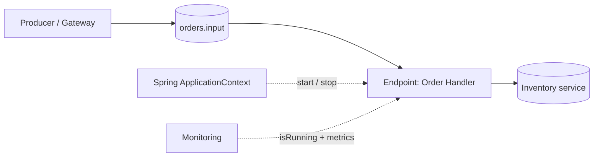
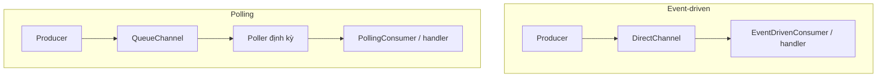
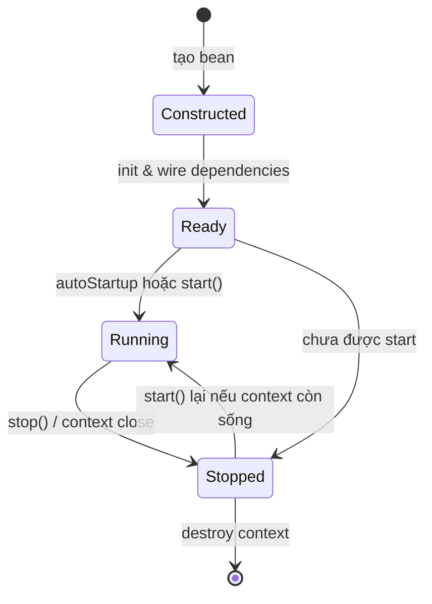
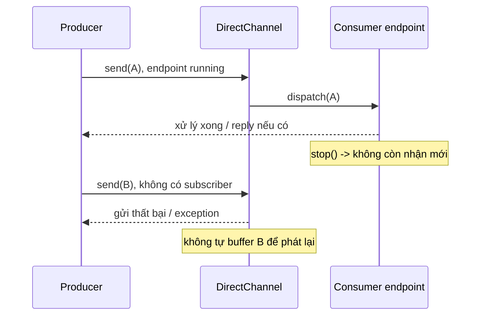
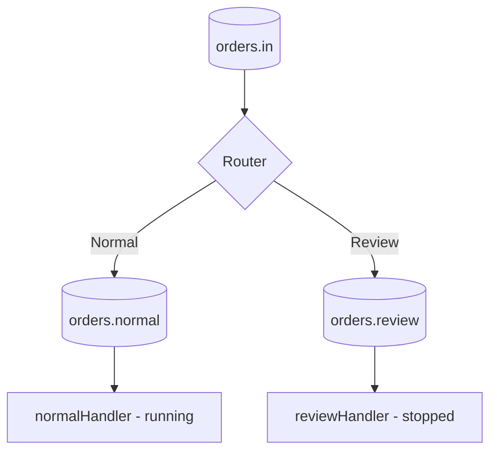

# Endpoint lifecycle và trạng thái running

## 1. Vì sao cần hiểu vòng đời của endpoint?

Trong **Spring Integration**, một integration flow được tạo từ các **message**, **channel** và **endpoint**. Endpoint kết nối channel với nơi phát, nhận hoặc xử lý message: `Service Activator`, `Filter`, `Transformer`, `Router`, `Splitter`, `Aggregator`, inbound/outbound adapter hoặc gateway. Ta thường chú ý logic của endpoint mà quên rằng **endpoint cũng có vòng đời**: được tạo, được khởi động, chạy, dừng và được khởi động lại hoặc hủy khi ứng dụng kết thúc.

Vòng đời trở nên đặc biệt quan trọng khi một nhánh phải tạm dừng để bảo trì, downstream quá tải, broker mất kết nối hoặc hệ thống muốn khởi động từng nhóm thành phần theo thứ tự. Chẳng hạn, bạn tạm dừng consumer xử lý đơn hàng để nâng cấp database. **Channel còn nhận message không? Message đang xử lý có hoàn tất không? `isRunning()` có bảo đảm kết nối database đang khỏe không?** Câu trả lời phụ thuộc loại channel, endpoint và cơ chế lifecycle.



Bài học thuộc chương **Endpoint** của module `SPRING_INTEGRATION_PATTERN`, nơi ta triển khai Enterprise Integration Patterns với Spring Integration để có các luồng thông điệp ít phụ thuộc và dễ mở rộng. Hiểu lifecycle giúp vận hành an toàn các Router, Filter, Transformer, Splitter, Aggregator, Gateway, retry, error channel và correlation, đồng thời kiểm thử và quan sát chính xác từng nhánh xử lý.

Sau bài này, bạn có thể:

1. Phân biệt **bean tồn tại**, **endpoint đang running** và **dịch vụ thực sự khỏe**.
2. Hiểu vai trò của `Lifecycle`, `SmartLifecycle`, `autoStartup`, `phase` và `isRunning()`.
3. Nhận ra sự khác nhau giữa consumer event-driven và polling consumer khi start/stop.
4. Điều khiển một endpoint cụ thể mà không nhầm với việc tắt channel hoặc dừng toàn bộ application context.
5. Dự đoán hành vi khi endpoint dừng nhưng producer vẫn gửi message; thiết kế timeout, backpressure, retry và khôi phục.
6. Kiểm thử startup/shutdown và giám sát điểm nghẽn mà không xem `isRunning()` là health check duy nhất.

## 2. Endpoint nào có vòng đời?

### 2.1. Endpoint là vai trò trong flow, không phải chỉ HTTP endpoint

Một endpoint có thể là điểm kết nối hệ thống ngoài, hoặc một điểm xử lý ở **bên trong** flow:

| Thành phần | Vai trò trong flow | Đối tượng cần quan sát vòng đời |
|---|---|---|
| Inbound adapter | Lấy message từ nguồn ngoài hoặc polling source. | Adapter/container hoặc endpoint nhận dữ liệu. |
| Inbound gateway | Nhận request từ bên ngoài và chuyển vào flow, sau đó gửi reply. | Listener/server adapter và đường request–reply. |
| Service Activator | Gọi logic nghiệp vụ trên message. | Consumer endpoint nối handler với channel. |
| Filter/Router/Transformer | Loại, định tuyến hoặc chuyển đổi message. | Consumer endpoint đăng ký nhận message; không chỉ phép biến đổi. |
| Outbound adapter/gateway | Gửi tới đích ngoài, có hoặc không có phản hồi. | Consumer endpoint và client/transport liên quan. |
| Polling consumer | Lấy message từ một `PollableChannel`. | Lịch poll, đăng ký task và quá trình nhận message. |

**Điểm dễ nhầm:** một handler Java có thể chỉ là bean bình thường với phương thức `handle()`, trong khi **consumer endpoint** là thành phần Spring Integration đăng ký handler đó với input channel. Khi cần dừng tiếp nhận message, thường phải điều khiển **consumer endpoint**, không phải gọi `stop()` tùy ý trên service bean. Tên của service bean cũng không nhất thiết là ID của endpoint.

### 2.2. Event-driven consumer và polling consumer

Hai mô hình phổ biến:



- Với **`SubscribableChannel`** như `DirectChannel`, consumer endpoint đăng ký handler để channel **dispatch message khi được gửi tới**. Việc start/stop thường tác động tới đăng ký nhận message.
- Với **`PollableChannel`** như `QueueChannel`, consumer endpoint phải **chủ động nhận** message theo một poller; start/stop thường tác động tới việc lên lịch và chạy polling task.

Vì vậy, **dừng consumer không đồng nghĩa dừng channel**. Với `DirectChannel` chỉ có một subscriber, gửi vào sau khi endpoint ngừng có thể không còn ai nhận và dẫn tới gửi không thành công/exception. Với `QueueChannel`, producer vẫn có thể enqueue khi poller dừng, cho tới khi queue đầy; các message trong bộ nhớ không tự bền vững qua restart.

## 3. Cơ chế lifecycle của Spring

### 3.1. `Lifecycle` và `SmartLifecycle`

Trong Spring Framework, giao diện `Lifecycle` khai báo ba phương thức cơ bản:

```java
public interface Lifecycle {
    void start();
    void stop();
    boolean isRunning();
}
```

`SmartLifecycle` mở rộng khả năng điều phối với các khái niệm **tự khởi động**, **thứ tự phase** và **callback cho dừng theo cơ chế lifecycle processor**. Nhiều endpoint của Spring Integration triển khai `SmartLifecycle` thông qua hạ tầng endpoint tương ứng.

| Khả năng | Ý nghĩa | Câu hỏi thực tế |
|---|---|---|
| `start()` | Yêu cầu endpoint chuyển sang trạng thái hoạt động. | Có thể bắt đầu nhận message bây giờ không? |
| `stop()` | Yêu cầu endpoint dừng hoạt động. | Làm sao tạm ngừng nhận thêm message? |
| `isRunning()` | Quan sát trạng thái lifecycle tại thời điểm gọi. | Endpoint đã start theo framework chưa? |
| `isAutoStartup()` | Cho biết endpoint được tự khởi động khi context được refresh không. | Có phải bật thủ công sau deploy không? |
| `getPhase()` | Cung cấp phase để điều phối các `SmartLifecycle` beans. | Thành phần nào start trước và stop sau? |
| `stop(Runnable callback)` | Hợp đồng dừng có callback để lifecycle processor theo dõi hoàn tất việc dừng. | Custom endpoint có phối hợp shutdown đúng không? |

**Không phải mọi bean trong flow đều là `SmartLifecycle`**. Ví dụ, một DTO, `MessageHandler` thuần túy hoặc một `MessageChannel` không nhất thiết có `start()`/`stop()`. Cần tìm đúng **bean endpoint đã được đăng ký**, thay vì cố cast mọi bean thành `SmartLifecycle`.

### 3.2. Các trạng thái theo góc nhìn vận hành

Để hiểu lifecycle, có thể mô tả dòng trạng thái khái niệm:



Sơ đồ này là **mô hình tư duy**, không phải tập các giá trị enum `EndpointState` do Spring Integration công bố. Phía API đơn giản hơn: `isRunning()` chủ yếu là `true` hoặc `false`. Nó không phân biệt mọi trạng thái như *starting*, *stopping*, *degraded*, *waiting for broker*, *no subscriber* hoặc *deadlocked*.

Các bước cần phân biệt:

1. **Bean được tạo và khởi tạo:** cấu hình, dependency injection, xử lý các callback khởi tạo đã chạy. Điều này chưa chắc endpoint đang tiêu thụ message.
2. **Application context được refresh:** lifecycle processor bắt đầu những `SmartLifecycle` component có `autoStartup=true` theo quy tắc thứ tự.
3. **Endpoint ở trạng thái running:** thành phần tham gia nhận hoặc phát message theo cơ chế của chính nó.
4. **Endpoint được stop:** ngừng công việc được lifecycle quản lý; không tự động xóa channel, reset dữ liệu hoặc dừng mọi dependency bên ngoài.
5. **Context shutdown/destroy:** container giải phóng các bean và tài nguyên liên quan; không nên kỳ vọng gọi `start()` trên bean đã bị destroy để hồi sinh toàn ứng dụng.

### 3.3. `autoStartup` và `phase`

**`autoStartup=true`** thường là lựa chọn cho những endpoint phải hoạt động ngay sau khi ứng dụng sẵn sàng. Nếu muốn khởi động có điều kiện, đặt **`autoStartup=false`** và có một tác vụ vận hành gọi `start()` khi đã xác minh dependency.

**`phase`** điều khiển tương đối thứ tự start/stop giữa các bean tham gia `SmartLifecycle`:

- Trong điều phối lifecycle thông thường, phase **thấp hơn start trước**, phase **cao hơn start sau**.
- Khi shutdown, thứ tự phase thông thường **đảo ngược**: phase **cao hơn stop trước**, phase **thấp hơn stop sau**.
- Quan hệ dependency thực tế và các lifecycle callback cũng ảnh hưởng thứ tự; phase không thay thế việc thiết kế dependency.

Ví dụ ứng dụng cần hệ thống lắng nghe inbound chỉ hoạt động sau khi downstream đã sẵn sàng: có thể điều phối startup theo phase và điều kiện readiness. Tuy nhiên, **chỉ đặt phase không bảo đảm kết nối broker/database thực sự khỏe**; cần health/probe, retry/reconnect và chính sách khi dependency chưa sẵn sàng.

Trong Java DSL, có thể đặt `.autoStartup(false)` và `.phase(...)` trên cấu hình endpoint phù hợp, ví dụ consumer endpoint khi `.handle(...)`. Khi code chạy, phải kiểm tra ID/bean tương ứng đã được Spring Integration đăng ký đúng như dự kiến.

## 4. Ví dụ thực hành: bật/tắt một endpoint xử lý đơn hàng

### 4.1. Yêu cầu

Xây dựng một `DirectChannel` tên `orders.input` và một service activator xử lý message. Endpoint **không tự chạy** khi khởi tạo Spring context. Operator có thể gọi `start()` để mở tiếp nhận và `stop()` để tạm đóng. Ví dụ dùng một counter để minh họa rõ ràng mà không cần kết nối database.

```text
Producer --send--> orders.input --[orderProcessorEndpoint]--> count++
                                          |
                                   autoStartup=false
                                          |
                               operator start()/stop()
```

### 4.2. Cấu hình với Spring Integration Java DSL

Ví dụ dưới đây hướng tới Java 17+, Spring Boot 3.x và Spring Integration 6.x với dependency `spring-boot-starter-integration`:

```java
import java.util.concurrent.atomic.AtomicInteger;

import org.springframework.context.annotation.Bean;
import org.springframework.context.annotation.Configuration;
import org.springframework.integration.channel.DirectChannel;
import org.springframework.integration.config.EnableIntegration;
import org.springframework.integration.dsl.IntegrationFlow;
import org.springframework.messaging.MessageChannel;

@Configuration
@EnableIntegration
class EndpointLifecycleConfig {

    @Bean(name = "orders.input")
    MessageChannel ordersInput() {
        return new DirectChannel();
    }

    @Bean
    AtomicInteger handledMessageCount() {
        return new AtomicInteger();
    }

    @Bean
    IntegrationFlow processOrders(AtomicInteger handledMessageCount) {
        return IntegrationFlow.from("orders.input")
                .handle(message -> {
                    // Thay bằng service nghiệp vụ trong ứng dụng thực tế.
                    handledMessageCount.incrementAndGet();
                }, endpoint -> endpoint
                        .id("orderProcessorEndpoint")
                        .autoStartup(false)
                        .phase(100))
                .get();
    }
}
```

Giải thích:

- Bean **`orders.input`** là channel giao message đồng bộ.
- `processOrders` là bean **định nghĩa flow**, còn **`orderProcessorEndpoint`** là ID của consumer endpoint được cấu hình trong flow. Đây là đối tượng cần điều khiển lifecycle trong ví dụ.
- `.autoStartup(false)` giữ endpoint chưa đăng ký để xử lý message khi context vừa lên; cần start bằng thao tác chủ động.
- `.phase(100)` minh họa phase của endpoint. Giá trị này **không phải** mức ưu tiên message; nó chỉ có ý nghĩa khi điều phối lifecycle cùng các component khác.
- Counter chỉ làm nhiệm vụ chứng minh handler được gọi; không bảo đảm kết quả nghiệp vụ hoặc độ bền dữ liệu.

### 4.3. Điều khiển endpoint từ Spring context

Lấy **đúng bean endpoint theo ID đã đăng ký**, rồi gọi `start`/`stop`:

```java
import org.springframework.context.ApplicationContext;
import org.springframework.context.SmartLifecycle;

void toggleProcessor(ApplicationContext context) {
    SmartLifecycle endpoint =
            context.getBean("orderProcessorEndpoint", SmartLifecycle.class);

    System.out.println("Before: " + endpoint.isRunning()); // false ban đầu

    endpoint.start();
    System.out.println("Running: " + endpoint.isRunning()); // true

    endpoint.stop();
    System.out.println("After stop: " + endpoint.isRunning()); // false
}
```

Đây là mã minh họa cho **một endpoint có ID ổn định trong application context đang sống**. Trong môi trường production, thay phương thức demo bằng tác vụ điều hành có xác thực, kiểm soát quyền, ghi audit và kiểm tra kết quả. Không cho request Internet bất kỳ quyền gọi `start()`/`stop()` trực tiếp.

**Quan trọng:** `isRunning() == true` chỉ nói endpoint báo mình đã start; nó **không chứng minh** callback xử lý một message bất kỳ đã hoàn tất, endpoint có subscriber đang khỏe, downstream online hoặc consumer đang xử lý với throughput mong muốn.

## 5. Khi dừng endpoint, message sẽ đi đâu?

Đây là câu hỏi quan trọng hơn cả cú pháp `stop()`.

### 5.1. Với `DirectChannel` và endpoint event-driven

Trong ví dụ trên, `DirectChannel` dispatch đồng bộ. Khi endpoint `orderProcessorEndpoint` dừng, nó không còn tham gia nhận message như lúc running. Nếu `orders.input` **không có subscriber khác**, sender có thể nhận kết quả gửi thất bại hoặc exception dispatch/no-subscriber tùy đường gọi; message **không tự nằm chờ** trong `DirectChannel` để xử lý khi endpoint được khởi động lại.



Nếu nhiều subscriber cùng đăng ký với channel điểm-điểm, hành vi khi một endpoint dừng còn phụ thuộc các subscriber còn lại. Không mặc định rằng dừng một endpoint thì toàn channel dừng; ngược lại cũng không khẳng định mọi message vẫn được xử lý bởi endpoint đó.

### 5.2. Với `QueueChannel` và polling consumer

Với `QueueChannel`, producer và consumer tách nhịp:

```text
Producer --> QueueChannel(capacity=100) --> Poller --> Service Activator
                 vẫn nhận khi có chỗ       ^
                                          stop(): không poll mới
```

Khi polling consumer dừng, **queue có thể tiếp tục tích message** nếu còn chỗ. Sau `start()`, poller có thể lấy backlog. Nhưng cần lưu ý:

- Queue có **capacity hữu hạn** sẽ đầy nếu producer tiếp tục gửi trong lúc consumer nghỉ. Việc gửi khi đầy phụ thuộc timeout và hợp đồng gửi.
- Queue mặc định trong bộ nhớ **không tự bền vững qua restart**. Muốn khôi phục sau restart phải chọn message store/broker phù hợp và xác minh delivery guarantee.
- Đã được lấy ra khỏi queue **không đồng nghĩa** message đã xử lý/commit thành công; cần recovery/transaction theo yêu cầu nghiệp vụ.
- `stop()` có thể không hủy tức thì handler **đang chạy** hoặc những task đã được dispatch; điều này phụ thuộc endpoint, scheduler và transport.

### 5.3. Với inbound adapter/gateway và transport ngoài

Một inbound endpoint có thể sở hữu HTTP listener, message listener container, file poller hoặc consumer của broker. `stop()` trên endpoint đúng loại có thể ngừng poll hoặc tạm dừng nhận request/delivery. Tuy nhiên, **cơ chế ack, offset, prefetch, retry, reconnect và message đã nhận nhưng chưa xử lý** thuộc cả adapter lẫn công nghệ ngoài (JMS, RabbitMQ, Kafka, HTTP...).

Không nên cam kết "stop luôn trả lại message về broker". Hãy xác minh hợp đồng cụ thể của adapter và cơ chế transaction/ack; một số handler đang chạy dở vẫn có thể hoàn tất hoặc thất bại khi shutdown.

| Loại flow | Endpoint dừng | Điều producer có thể thấy | Điều phải xác minh |
|---|---|---|---|
| `DirectChannel -> handler` | Consumer unsubscribed | Send không có người nhận hoặc exception; không tự chờ. | Subscriber còn lại, phản hồi lỗi, retry upstream. |
| `QueueChannel -> poller` | Poller ngừng lấy | Send còn nhận cho đến khi queue đầy. | Capacity, TTL/timeout, persistence, backlog sau start. |
| `ExecutorChannel -> handler` | Endpoint không nhận task mới như trước | Có thể bị ảnh hưởng bởi executor và subscriber. | Task đang chờ, rejection policy, thread pool lifecycle. |
| `HTTP inbound gateway` | Listener không nhận thêm theo cơ chế adapter | Có thể gặp lỗi kết nối, HTTP 5xx hoặc hành vi của gateway/load balancer. | Readiness, draining và thông báo phía client. |
| `Broker inbound adapter` | Container/consumer tạm dừng | Producer tới broker có thể vẫn thành công. | Acknowledgment, offset, prefetch, redelivery, DLQ. |

## 6. Polling endpoint: `running` không đồng nghĩa đang xử lý message

Một endpoint được đánh dấu running có thể đang **đợi poll interval**, **queue trống** hoặc **downstream chậm**. Với poller, cần phân biệt ba mức:

1. **Lifecycle running:** endpoint đã được start và lịch polling đang hoạt động.
2. **Receive/poll thực sự:** poller đang lấy được message từ input channel.
3. **Business processing:** handler hoàn tất và side effect được ghi nhận thành công.

Ví dụ cấu hình polling consumer được khởi động thủ công:

```java
import org.springframework.context.annotation.Bean;
import org.springframework.context.annotation.Configuration;
import org.springframework.integration.channel.QueueChannel;
import org.springframework.integration.config.EnableIntegration;
import org.springframework.integration.dsl.IntegrationFlow;
import org.springframework.integration.dsl.Pollers;

@Configuration
@EnableIntegration
class PollingLifecycleConfig {

    @Bean(name = "orders.pending")
    QueueChannel ordersPending() {
        return new QueueChannel(100);
    }

    @Bean
    IntegrationFlow pendingOrderFlow() {
        return IntegrationFlow.from("orders.pending", endpoint -> endpoint
                        .id("pendingOrdersPoller")
                        .autoStartup(false)
                        .poller(Pollers.fixedDelay(200).maxMessagesPerPoll(5)))
                .handle(message -> {
                    // Xử lý một message đã được poll ra khỏi queue.
                    System.out.println(message.getPayload());
                })
                .get();
    }
}
```

**Đọc ví dụ đúng cách:** `QueueChannel(100)` giữ tối đa 100 message **đang chờ**; `maxMessagesPerPoll(5)` là giới hạn số message có thể được lấy trong một lượt poll, không cam kết tiêu thụ đúng 5 message mỗi 200 ms. Khi `pendingOrdersPoller` chưa chạy, send tới queue vẫn có thể thành công nếu còn capacity; khi chạy lại, backlog được lấy dần. Poller scheduler và handler vẫn cần được kiểm soát concurrency, transaction, error handling và khả năng shutdown.

Nếu flow chỉ có queue nhưng **không** có poller hoặc consumer chủ động gọi `receive()`, message sẽ ở trong queue mà không tự biến thành nghiệp vụ hoàn tất.

## 7. `start()` và `stop()` không có nghĩa là "pause/resume toàn hệ thống"

### 7.1. Điều gì xảy ra với công việc đang xử lý?

`stop()` là yêu cầu thay đổi hoạt động của endpoint, **không mặc định là rollback tất cả message đang xử lý**. Tại thời điểm stop, có thể tồn tại:

- Một handler đang thực hiện lời gọi database/HTTP đồng bộ.
- Một task đã được giao cho executor nhưng chưa thực thi.
- Một message đã được poll khỏi queue, đang chờ commit.
- Một nhóm Aggregator chưa nhận đủ các phần liên quan.
- Một yêu cầu gateway đang chờ reply và timeout.

Cách xử lý phụ thuộc loại endpoint, transaction boundary, timeout, scheduler, message store và adapter. Vì vậy, khi xây dựng **graceful shutdown**, nên phân biệt:

```text
1. Chặn message mới ở biên (load balancer / inbound)
2. Cho in-flight xử lý/ack theo deadline đã định
3. Dừng consumer/poller và kiểm tra các task còn lại
4. Xử lý backlog, group đang chờ, retry và recovery
5. Dừng tài nguyên phụ thuộc / đóng application context
```

Đây là **quy trình vận hành đề xuất**, không phải một giao thức tự động áp dụng khi gọi `endpoint.stop()`. Nếu yêu cầu bảo đảm không mất message, cần kết hợp persistence, transaction, acknowledgement và idempotency theo từng transport.

### 7.2. `stop()` khác `destroy()` và khác `remove flow`

| Thao tác | Ý nghĩa | Có thể start lại cùng bean? |
|---|---|---|
| `endpoint.stop()` | Tạm dừng hoạt động theo hợp đồng lifecycle. | Thường **có**, nếu context và dependency còn hợp lệ. |
| `endpoint.start()` | Kích hoạt endpoint đã được đăng ký. | Không cần đăng ký lại flow chỉ vì trước đó stop. |
| Đóng `ApplicationContext` | Dừng lifecycle, giải phóng/destroy bean và tài nguyên. | Không nên gọi start lại trên bean đã bị hủy; cần context mới. |
| Hủy đăng ký flow động | Xóa định nghĩa/đăng ký của flow động theo API quản lý tương ứng. | Có thể cần đăng ký lại flow, không chỉ start endpoint cũ. |

Không dùng lệnh hủy/deregister flow để giải quyết yêu cầu tạm nghỉ ngắn nếu chỉ cần `stop()`. Ngược lại, stop endpoint sẽ không tự xóa dữ liệu trong queue, thay định nghĩa route hoặc chấm dứt mọi subscription của các endpoint khác.

### 7.3. Stop một nhánh sau Router

Giả sử router chia đơn theo giá trị:



Nếu dừng `reviewHandler` mà vẫn để router gửi message tới `orders.review` là `DirectChannel` không có subscriber khác, nhánh này **không trở thành queue chờ**. Nên thiết kế rõ một trong những lựa chọn:

1. **Tạm ngừng nhận tại biên:** không tiếp nhận loại yêu cầu review, trả kết quả rõ ràng.
2. **Dùng buffer bền vững:** gửi review task vào broker/queue được thiết kế cho downtime, rồi resume consumer sau.
3. **Thay route có kiểm soát:** gửi tới nhánh trì hoãn/fallback được phê duyệt, đảm bảo không làm sai nghiệp vụ.

Với nhánh Splitter/Aggregator, việc stop một consumer con có thể làm thiếu phần trong group. Khi khôi phục phải chú ý `correlationId`, `sequenceNumber`, release strategy, expiration, duplicate và thứ tự; không chỉ kiểm tra endpoint đã running là xem như group tự hồi phục.

## 8. Quản lý lifecycle qua API và Control Bus

### 8.1. Điều khiển programmatically

Khi cần thao tác từ một quản trị service bên trong ứng dụng, có thể lấy endpoint qua `ApplicationContext` và gọi `SmartLifecycle` như ví dụ ở phần 4. Cần có **ID endpoint ổn định**, quyền thao tác và chính sách xác nhận.

Một lệnh điều hành tốt nên ghi ít nhất: `operator`, `endpointId`, `action`, `previousRunning`, `currentRunning`, thời gian và `reason`. Với hành động có ảnh hưởng đến hàng đợi, ghi thêm queue depth, in-flight count và trạng thái recovery nếu đo được.

Không nhầm **ID bean của IntegrationFlow**, **ID endpoint do DSL tạo** và **ID handler/service**. Khi truy vấn bằng tên, hãy xác minh object thực sự implement `Lifecycle`/`SmartLifecycle`; không tùy ý cast một transformer service thành endpoint.

### 8.2. Control Bus

Spring Integration có mẫu **Control Bus**, cho phép gửi lệnh điều khiển được đánh giá trong ngữ cảnh integration để thao tác lifecycle của thành phần được cho phép. Đây là cơ chế phù hợp khi hệ thống muốn dùng message để điều khiển các endpoint, nhưng cũng có thể mở ra rủi ro rất lớn nếu input không được tin cậy.

Các nguyên tắc bảo vệ:

- Chỉ cho operator/hệ thống quản trị có thẩm quyền gửi lệnh.
- Không kết nối Control Bus trực tiếp vào public HTTP/API hoặc broker topic có producer không được tin cậy.
- Hạn chế danh sách endpoint/lệnh được phép, ghi audit và giới hạn tần suất.
- Không coi chuỗi lệnh từ user là dữ liệu vô hại; Control Bus dùng khả năng đánh giá biểu thức điều khiển, nên phải đặt phía sau ranh giới tin cậy.
- Sau lệnh start/stop, kiểm tra lại trạng thái endpoint **và** tín hiệu vận hành, không chỉ xác nhận đã gửi lệnh.

Nếu chỉ cần một nút bảo trì cho một consumer, một admin service gọi `SmartLifecycle` trực tiếp với allowlist endpoint thường dễ kiểm soát hơn việc mở một Control Bus tổng quát.

## 9. `isRunning()` khác readiness, liveness và throughput

Giả sử `orderProcessorEndpoint.isRunning() == true`. Các tình huống sau vẫn có thể xảy ra:

- Downstream database đang lỗi, mọi message đều thất bại.
- Broker consumer đã start nhưng mất kết nối và đang reconnect.
- Poller đang chờ vì queue không có message.
- Executor bão hòa, task xếp hàng rất lâu.
- Handler bị deadlock hoặc chậm; số message hoàn tất gần bằng 0.
- Router gửi về một nhánh khác chưa có consumer.
- Error channel nhận nhiều lỗi nhưng không có recovery hợp lý.

Do đó, đừng suy ra "dịch vụ khỏe" chỉ từ `isRunning()`.

| Tín hiệu | Câu hỏi trả lời | Hạn chế |
|---|---|---|
| `endpoint.isRunning()` | Endpoint được báo là running theo lifecycle? | Không chứng minh xử lý thành công hay dependency khỏe. |
| Application readiness | Ứng dụng có nên nhận traffic mới không? | Cần đưa các dependency thiết yếu vào policy cụ thể. |
| Application liveness | Tiến trình có đang sống/đáp ứng tối thiểu không? | Không đồng nghĩa toàn bộ flow thông suốt. |
| Input/processed rate | Message vào và hoàn tất bao nhiêu? | Rate thấp có thể do không có traffic, không hẳn lỗi. |
| Queue depth và oldest age | Backlog có tăng/già đi không? | Phải kết hợp tốc độ vào/ra và capacity. |
| Error/retry/timeout rate | Có lỗi hoặc xử lý lặp nhiều không? | Cần phân biệt lỗi tiếp nhận, lỗi nghiệp vụ và lỗi hạ tầng. |
| Last-success timestamp | Lần xử lý thành công cuối cách hiện tại bao lâu? | Chỉ có ý nghĩa khi có traffic kỳ vọng. |
| In-flight count | Có bao nhiêu message đang được xử lý? | Cần instrumentation, không mặc định do `isRunning()` cung cấp. |

Với ứng dụng có nhiều nhánh, nên thống kê theo **endpoint ID**, **channel ID**, **route** và **service**. Có thể dùng Spring Integration management/metrics, Micrometer Observation, Spring Boot Actuator, logging có cấu trúc và distributed tracing tùy cấu hình. Tránh hardcode tên meter hoặc actuator endpoint từ một phiên bản khác mà không kiểm tra phiên bản đang sử dụng.

### 9.1. Kết hợp lifecycle với distributed tracing và Message History

Message History giúp hiểu **message đã đi qua các component được tracking**; distributed tracing giúp quan sát các span qua thread/service; `isRunning()` chỉ là **trạng thái của endpoint tại thời điểm quan sát**. Ba tín hiệu bổ sung nhau:

```text
orderId = ORD-2001
traceId = trace-2001
endpoint = reviewHandler
running = true
lastSuccess = 10 phút trước
queueDepth = 92/100
errorRate = 85%
```

Một endpoint có `running=true` nhưng các chỉ số như trên vẫn có thể cần cảnh báo hoặc ngừng nhận yêu cầu mới theo chính sách. Không log payload chứa dữ liệu nhạy cảm chỉ để theo dõi lifecycle; business ID, correlation ID, outcome và tên endpoint thường hữu ích hơn.

## 10. Kiểm thử vòng đời: tạo context, start, send, stop

### 10.1. Kiểm thử endpoint event-driven

Sử dụng cấu hình `EndpointLifecycleConfig` ở phần 4. Ví dụ JUnit 5 và Spring Test:

```java
import java.util.concurrent.atomic.AtomicInteger;

import org.junit.jupiter.api.Test;
import org.springframework.beans.factory.annotation.Autowired;
import org.springframework.beans.factory.annotation.Qualifier;
import org.springframework.context.SmartLifecycle;
import org.springframework.messaging.MessageChannel;
import org.springframework.messaging.support.MessageBuilder;
import org.springframework.test.context.junit.jupiter.SpringJUnitConfig;

import static org.junit.jupiter.api.Assertions.assertEquals;
import static org.junit.jupiter.api.Assertions.assertFalse;
import static org.junit.jupiter.api.Assertions.assertTrue;

@SpringJUnitConfig(EndpointLifecycleConfig.class)
class EndpointLifecycleTest {

    @Autowired
    @Qualifier("orderProcessorEndpoint")
    SmartLifecycle processorEndpoint;

    @Autowired
    @Qualifier("orders.input")
    MessageChannel input;

    @Autowired
    AtomicInteger handledMessageCount;

    @Test
    void canStartHandleAndStop() {
        assertFalse(processorEndpoint.isRunning());

        processorEndpoint.start();
        try {
            assertTrue(processorEndpoint.isRunning());
            assertTrue(input.send(
                    MessageBuilder.withPayload("ORD-1").build(), 0));
            assertEquals(1, handledMessageCount.get());
        } finally {
            processorEndpoint.stop();
        }

        assertFalse(processorEndpoint.isRunning());
    }
}
```

**Điều test này chứng minh:** endpoint có thể start từ trạng thái chưa tự động chạy; trong khoảng running, `DirectChannel` giao message cho handler; sau stop, framework báo trạng thái không running. Test dùng counter `AtomicInteger` để dễ quan sát side effect.

**Điều test chưa chứng minh:** gửi vào channel sau khi stop luôn nhận một **loại exception cụ thể**, trong-flight message được drain, transaction được commit, một inbound broker adapter dừng đúng cách hay mọi nhánh của hệ thống đều khỏe. Với direct channel không subscriber, tùy cấu hình, thao tác send có thể không thành công hoặc ném exception; test nào kiểm tra đường này cần xác định rõ hợp đồng ở phiên bản framework đang chạy.

### 10.2. Kiểm thử polling consumer và backlog

Đối với `PollingLifecycleConfig` (phần 6), nên có kiểm thử riêng:

1. Khởi tạo Spring context, xác nhận `pendingOrdersPoller.isRunning()` là `false`.
2. Gửi hai message vào `orders.pending`, xác nhận enqueue thành công và queue depth là 2 (chỉ khi test kiểm soát được toàn bộ producer/consumer).
3. Start endpoint polling; dùng một collector/test handler và **await có timeout** cho tới khi nhận đủ hai message.
4. Dừng polling endpoint; gửi message mới vào queue, xác nhận message còn chờ trong queue và không bị xử lý bởi poller đã dừng (xét độ trễ dừng/in-flight).
5. Start lại, xác nhận message được xử lý một lần theo hợp đồng và backlog giảm.
6. Đặt capacity nhỏ để kiểm tra producer nhận kết quả rõ ràng khi queue đầy.

Không dùng `Thread.sleep(5000)` như điều kiện duy nhất để xác nhận đã hoàn tất; đó là kiểu test dễ flaky trên CI. Dùng latch/await condition, kiểm soát concurrency và deadline. Nếu test liên quan stop trong lúc handler đang chạy, cần một latch **giữ handler** có kiểm soát để đo đúng cách ứng xử, rồi giải phóng latch trong `finally` để không treo test.

### 10.3. Ma trận kiểm thử cần có trước production

| Kịch bản | Hành vi kỳ vọng | Điều phải xác minh |
|---|---|---|
| `autoStartup=false` | Endpoint chưa tự tham gia xử lý khi context lên. | `isRunning=false`; send không bị tính là xử lý thành công nếu endpoint chưa nhận. |
| `start()` thủ công | Endpoint bắt đầu nhận/poll theo loại tương ứng. | Message test đi tới handler; endpoint ID đúng. |
| `stop()` khi idle | Endpoint không còn nhận/poll mới như trước. | `isRunning=false`, không nhầm với destroy. |
| `stop()` khi in-flight | Xử lý theo policy an toàn. | Ack/commit/retry và shutdown deadline; không hứa drain nếu chưa thiết kế. |
| Queue đầy khi poller stopped | Producer được báo quá tải. | `send` timeout/false, không công bố accepted khi chưa enqueue. |
| Start lại sau bảo trì | Backlog/recovery tiến triển. | Không bỏ sót/nhân đôi side effect; correlation còn đúng. |
| Start khi downstream hỏng | Endpoint có thể running nhưng xử lý lỗi. | Health, retry/backoff, error flow, alert. |
| Shutdown application context | Các component dừng theo lifecycle. | Deadline, tài nguyên được giải phóng, không còn task kẹt. |

## 11. Các lỗi thiết kế thường gặp

| Hiểu nhầm | Hậu quả | Cách làm phù hợp |
|---|---|---|
| "Bean đã được tạo thì endpoint đang chạy." | Gửi message vào đường chưa có consumer. | Kiểm tra `autoStartup`, đúng endpoint bean và `isRunning`. |
| "Handler service và endpoint là một object." | Điều khiển nhầm bean, không thay đổi subscription/poller. | Đặt ID endpoint qua Java DSL, lấy bean `SmartLifecycle` đúng. |
| "`isRunning=true` nghĩa là downstream khỏe." | Bỏ qua lỗi broker, database, timeout và backlog. | Kết hợp readiness, processed rate, queue depth, error rate. |
| "Dừng DirectChannel handler thì message tự chờ." | Gửi thất bại hoặc không có reply, mất yêu cầu nếu caller bỏ qua lỗi. | Thiết kế route/buffer hoặc tạm ngừng đầu vào có kiểm soát. |
| "Dừng polling consumer thì mất mọi message trong QueueChannel." | Hiểu sai ranh giới queue và consumer. | Queue vẫn giữ message khi còn chỗ; kiểm tra persistence/restart. |
| "Gọi `stop()` là hủy ngay tất cả in-flight." | Trùng side effect, ack sai hoặc bỏ dở transaction. | Thiết kế graceful shutdown, deadlines, recovery. |
| "`phase` tự chờ database luôn healthy." | Endpoint start khi dependency chưa thực sự sẵn sàng. | Dùng health/readiness/retry kết hợp điều phối phase. |
| "Một endpoint dừng tức tất cả Router/Filter/Aggregator cũng dừng." | Nhầm phạm vi ảnh hưởng, gây lỗi nhánh khác. | Phân định ownership từng endpoint, kiểm tra kênh và consumer còn lại. |
| "Mở Control Bus cho mọi caller là tiện vận hành." | Người không được phép có thể điều khiển flow. | Admin-only, allowlist và audit; không expose endpoint điều khiển ra public. |
| "Start lại là chắc chắn không duplicate." | Retry/redelivery có thể lặp side effect. | Dùng business/event ID ổn định, idempotency và ack policy. |

## 12. Bài tập tự thực hành

1. **Start/stop:** đặt `autoStartup=false` cho `orderProcessorEndpoint`, bật thủ công, gửi hai message, dừng, bật lại và xác nhận counter chỉ tăng khi endpoint thực sự nhận message.
2. **So sánh channel:** thay `DirectChannel` bằng `QueueChannel(3)` và tạo polling endpoint. Khi endpoint stopped, gửi bốn message; xác định ba message nào được enqueue và phản hồi sender của message thứ tư.
3. **Phase:** tạo hai endpoint lifecycle có phase khác nhau và ghi log lúc startup/shutdown. Giải thích thứ tự chạy, đồng thời phân tích vì sao phase không chứng minh database kết nối thành công.
4. **Router:** tạo hai nhánh `normal` và `review`, dừng endpoint của nhánh `review`. Kiểm tra Gateway nhận phản hồi gì và thiết kế một phương án buffer/từ chối phù hợp; không để caller chờ vô hạn.
5. **Splitter/Aggregator:** chia một message thành ba phần, tạm dừng consumer của một nhánh. Thiết kế correlation, timeout, expiry và recovery để Aggregator không chờ vô hạn.
6. **Retry/error channel:** mô phỏng downstream lỗi ngay sau khi endpoint vừa start. Đối chiếu `running=true` với metric lỗi; thiết lập retry có giới hạn và idempotency.
7. **Quan sát:** bổ sung dashboard gồm `endpointId`, `running`, queue depth, processed rate, last-success age và error rate. Tạo cảnh báo khi endpoint running nhưng backlog vẫn tăng.

### Câu hỏi tự kiểm tra

**Câu 1:** Endpoint đã được Spring tạo bean nhưng `autoStartup=false`. Có thể kết luận nó đã sẵn sàng tiêu thụ message không? **Không.** Cần `start()` và kiểm tra điều kiện thực tế của endpoint/transport.

**Câu 2:** Sau `stop()` một consumer trên `DirectChannel`, message tiếp theo có tự chờ tới khi `start()` lại không? **Không.** `DirectChannel` không phải queue; kết quả gửi phụ thuộc subscriber và hợp đồng dispatch.

**Câu 3:** Polling consumer ở trạng thái `running=true` nhưng queue rỗng. Có phải endpoint hỏng không? **Không.** Nó có thể đang chạy đúng và chờ message; cần kết hợp traffic kỳ vọng và health khác.

**Câu 4:** Khi gọi `stop()` lúc handler đang ghi database, framework chắc chắn rollback thao tác đó không? **Không.** Transaction và xử lý in-flight phụ thuộc cấu hình; phải thử nghiệm shutdown/recovery rõ ràng.

**Câu 5:** `phase=100` có đảm bảo endpoint start sau một database thật sự phục vụ được truy vấn không? **Không.** Phase điều phối các lifecycle beans, không thay health check hoặc availability gate.

**Kết luận:** Lifecycle trả lời **endpoint có đang tham gia hoạt động theo hợp đồng của Spring hay không**, không trả lời toàn bộ tình trạng khỏe của integration flow. Muốn vận hành các EIP an toàn, hãy đặt ID endpoint rõ ràng, hiểu `SmartLifecycle`/`autoStartup`/`phase`, chọn đúng channel khi cần tạm ngừng, quản lý backlog và in-flight, rồi kết hợp `isRunning()` với metrics, tracing, error flow, correlation và các bài test start/stop. Đó là cơ sở để triển khai luồng thông điệp ít phụ thuộc, dễ mở rộng và khôi phục có kiểm soát.
