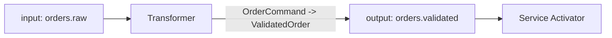
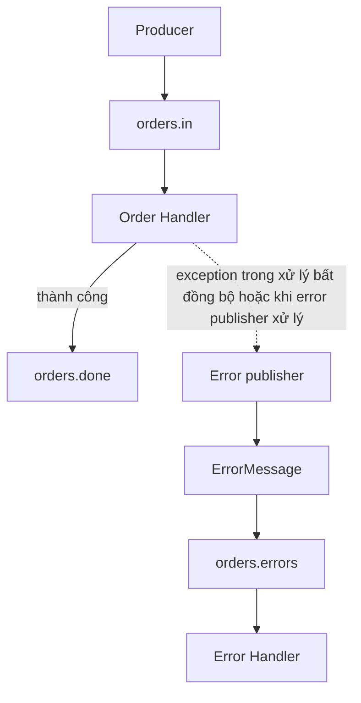
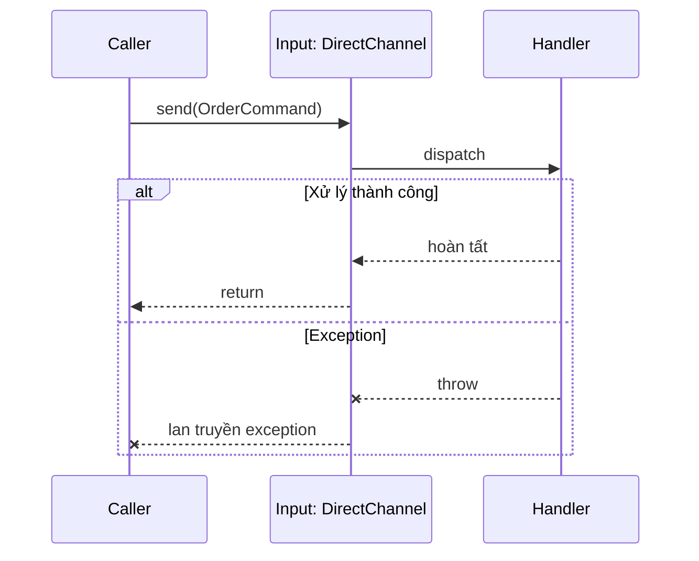
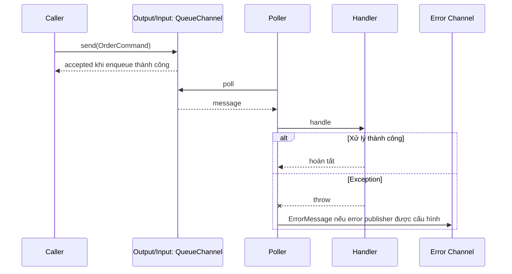
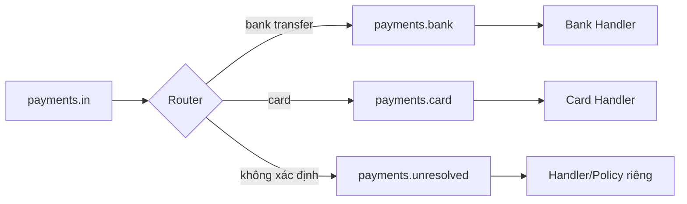
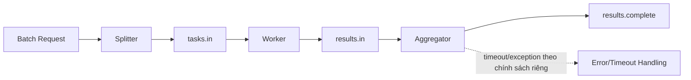

# Input channel, output channel và error channel

Trong Enterprise Integration Patterns (EIP), **endpoint** là điểm kết nối một chức năng xử lý với hệ thống trao đổi message. Endpoint có thể nhận message để kiểm tra, chuyển đổi, định tuyến hoặc gọi nghiệp vụ; một số endpoint còn tạo ra message tiếp theo. Để xác định luồng đi qua đâu, ta cần hiểu ba loại kết nối thường xuất hiện quanh endpoint:

- **Input channel:** nơi endpoint nhận message cần xử lý.
- **Output channel:** nơi endpoint gửi message kết quả hoặc message được chuyển tiếp.
- **Error channel:** đường riêng tiếp nhận **thông tin về lỗi xử lý** khi cơ chế bắt và công bố lỗi được cấu hình để dùng channel đó.

Ba vai trò này giúp đọc, thiết kế và kiểm thử các luồng **Spring Integration** trong module **SPRING_INTEGRATION_PATTERN**. Chúng đặc biệt quan trọng khi ghép **Gateway, Filter, Transformer, Router, Splitter, Aggregator** với retry, correlation và cơ chế quan sát lỗi. Chọn sai hoặc hiểu sai vai trò channel có thể khiến một message biến mất khỏi luồng mong đợi, lỗi không đến nơi theo dõi, hoặc ứng dụng báo thành công trong khi công việc mới chỉ được đưa vào hàng đợi.

> **Điểm cốt lõi:** input, output và error là **vai trò trong một endpoint/luồng**, không phải ba implementation cố định của `MessageChannel`. Cùng một bean channel có thể là output của endpoint trước và input của endpoint sau.

## 1. Nhìn toàn cảnh: endpoint đứng giữa các channel

Giả sử một ứng dụng nhận yêu cầu giữ hàng, kiểm tra dữ liệu, chuyển payload thành yêu cầu kho rồi thực hiện nghiệp vụ.

```mermaid
flowchart LR
    A[Order Gateway] -->|gửi message| IN[orders.in]
    IN -->|input| F[Filter]
    F -->|output| VALID[orders.valid]
    VALID -->|input| T[Transformer]
    T -->|output| READY[orders.ready]
    READY -->|input| H[Inventory Handler]
    H -.->|lỗi theo cơ chế xử lý được cấu hình| ERR[orders.errors]
    ERR --> EH[Error Handler]
```



- Từ góc nhìn **Filter**, `orders.in` là input channel và `orders.valid` là output channel.
- Từ góc nhìn **Transformer**, `orders.valid` trở thành input channel, còn `orders.ready` là output channel.
- Từ góc nhìn **Inventory Handler**, `orders.ready` là input channel. Nếu handler chỉ thực hiện một tác vụ một chiều và không trả kết quả, nó có thể không cần output channel.
- `orders.errors` chỉ nhận thông báo lỗi **khi có một đường công bố lỗi tương ứng**. Một exception từ handler đồng bộ không tự biến thành message trên channel này.

Đồ thị trên biểu diễn các **kết nối logic**. Nó chưa nói message có chạy đồng bộ, được lưu bền hay được retry không. Những tính chất đó phụ thuộc implementation channel, endpoint và cơ chế vận chuyển.

### Phân biệt vai trò và kiểu channel

| Khái niệm | Trả lời câu hỏi | Ví dụ |
| --- | --- | --- |
| Input channel | Endpoint đọc message **từ đâu**? | `orders.in` |
| Output channel | Endpoint gửi message kết quả **đến đâu**? | `orders.valid` |
| Error channel | Thông tin về lỗi được gửi **đến đâu nếu có xử lý lỗi qua message**? | `orders.errors` |
| Kiểu channel | Message được phân phối **bằng cách nào**? | `DirectChannel`, `QueueChannel`, `ExecutorChannel`, `PublishSubscribeChannel` |
| Endpoint | **Ai xử lý** message? | Filter, Router, Transformer, Service Activator |

Một tên như `orders.errors` không khiến Spring Integration tự hiểu đó là kênh lỗi. Vai trò và cách sử dụng được hình thành bởi cấu hình của gateway, handler, poller, error publisher hoặc header liên quan.

## 2. Input channel: cửa vào của một consumer endpoint

**Input channel** là điểm nhận message của thành phần tiêu thụ (consumer endpoint). Một endpoint đọc message từ đó rồi thực hiện hành động tương ứng.

Ví dụ, service activator nhận đơn hàng:

```java
import org.springframework.integration.annotation.ServiceActivator;

class InventoryEndpoint {
    private final InventoryService inventoryService;

    InventoryEndpoint(InventoryService inventoryService) {
        this.inventoryService = inventoryService;
    }

    @ServiceActivator(inputChannel = "orders.ready")
    public void reserve(ValidatedOrder command) {
        inventoryService.reserve(command);
    }
}
```

Ví dụ này minh họa annotation: để hoạt động, class phải được đăng ký thành Spring bean và integration annotation processor phải được bật qua cấu hình Spring Integration. `orders.ready` là tên channel mà endpoint tiêu thụ; không phải tên một phương thức Java.

### 2.1. Có phải endpoint nào cũng có input channel?

**Không.** Các *source endpoint* tạo message từ một nguồn bên ngoài hoặc từ lịch polling có thể có **output channel** mà không có input channel. Ví dụ:

- HTTP inbound gateway nhận HTTP request rồi đưa message vào integration flow.
- Một inbound channel adapter đọc tệp, hàng đợi hoặc nguồn sự kiện rồi phát message.
- Một message source chạy theo poller để tạo message từ nguồn dữ liệu.

Ngược lại, một service activator, filter, transformer hoặc router thường có channel đầu vào vì chúng xử lý message do thành phần khác phát.

### 2.2. Input channel không luôn có cùng cách nhận message

- Với `DirectChannel`, endpoint được gọi đồng bộ khi producer gửi message.
- Với `ExecutorChannel`, thông điệp có thể được dispatch trên thread của executor.
- Với `QueueChannel`, consumer thường cần poller để lấy message khỏi hàng đợi.
- Với `PublishSubscribeChannel`, message có thể tới nhiều subscriber theo cấu hình, khác với một channel chọn một consumer xử lý.

Từ góc nhìn endpoint, cả bốn đều có thể đóng vai trò “input”; nhưng đặc tính thời gian, concurrency và lỗi khác nhau rõ rệt.

## 3. Output channel: đường ra cho kết quả hoặc message chuyển tiếp

Một endpoint tạo message mới hoặc tiếp tục luồng có thể gửi message đó tới **output channel**. Việc gửi tiếp chỉ xảy ra khi endpoint thực sự có một message để phát và xác định được nơi gửi.



**Transformer** có thể chuyển payload `OrderCommand` thành `ValidatedOrder` rồi gửi đến `orders.validated`. **Filter** thường chuyển tiếp message được chấp nhận; khi không đạt điều kiện, filter có thể bỏ hoặc từ chối tùy cấu hình. **Router** có thể chọn một hay nhiều channel tùy kiểu router; vì vậy output của router không nhất thiết chỉ là một đường cố định.

**Splitter** tạo nhiều message đầu ra từ một message đầu vào. **Aggregator** giữ và ghép các message liên quan rồi phát một message kết quả khi đạt điều kiện hoàn thành; nó cần correlation, release strategy, timeout và trạng thái nhóm phù hợp. Tất cả đều có thể sử dụng output channel, nhưng chúng khác nhau ở thời điểm và số lượng message được tạo ra.

### 3.1. Endpoint có thể không có output channel

Một handler chỉ cập nhật database hoặc gửi thông báo có thể là **điểm kết thúc** của luồng một chiều:

```java
@org.springframework.integration.annotation.ServiceActivator(
    inputChannel = "orders.ready")
public void reserve(ValidatedOrder command) {
    inventoryService.reserve(command);
}
```

Phương thức trả về `void`, do đó không có payload kết quả để chuyển tiếp. Nếu sử dụng Java DSL với handler mang kiểu request-reply, trả về `null` là cách thông dụng để kết thúc đường trả lời trong ví dụ một chiều.

Đừng thêm output channel chỉ để “đủ ba channel”. Nếu nghiệp vụ cần biết kết quả, cần định nghĩa một **hợp đồng request-reply** rõ ràng thay vì tùy ý gửi một message không có ý nghĩa.

### 3.2. Output channel cố định và reply channel

Trong một flow tuyến tính, ta thường cấu hình output channel cố định bằng `.channel("orders.validated")` hoặc `outputChannel` tại endpoint.

Với request-reply, Spring Integration còn hỗ trợ thông tin **reply channel** trên message headers (ví dụ header `replyChannel`), để một thành phần trả lời về nơi mà bên yêu cầu xác định. Gateway có thể quản lý reply channel cho request-reply. Khi endpoint không chỉ định output cố định, cơ chế trả lời qua header có thể được sử dụng tùy loại handler.

Vì vậy cần phân biệt:

- **Output channel:** đích phát message tiếp theo trong integration flow.
- **Reply channel:** đích dành cho phản hồi của một yêu cầu, thường do ngữ cảnh request-reply cung cấp.
- **Error channel:** đích dành cho thông tin lỗi; không phải “reply dữ liệu bình thường khi thất bại”.

Một message trả về chứa trạng thái nghiệp vụ `PaymentDeclined` có thể vẫn là **reply hợp lệ**. Nó không nhất thiết là một `ErrorMessage`. Phân biệt lỗi kỹ thuật và kết quả nghiệp vụ giúp API phản hồi chính xác.

## 4. Error channel: khi nào lỗi trở thành message?

**Error channel** nhận một message báo lỗi, thường là `org.springframework.messaging.support.ErrorMessage`. Trong một `ErrorMessage`, payload là một `Throwable` (có thể là `MessagingException` chứa thông tin message gây lỗi). Error flow có thể ghi log, cập nhật metric, tạo cảnh báo, gửi tới nơi xử lý lại hoặc đưa lỗi vào một hàng đợi thích hợp nếu được thiết kế.

Một hình dung:



Đường nét đứt chỉ khả năng phát sinh lỗi; nó **không phải cam kết mọi exception đều tự động được chuyển vào `orders.errors`**.

### 4.1. ErrorMessage chứa những gì?

Một error message có thể có:

- **Payload `Throwable`:** exception gốc hoặc exception được bọc khi gửi/nhận/xử lý message.
- **Headers:** metadata phục vụ định tuyến và xử lý lỗi.
- **Original/failed message:** khi có thông tin này, ta có thể đối chiếu yêu cầu nào gây lỗi, payload nào đã được xử lý và correlation ID nào cần ghi nhận.

Không phải mọi lỗi đều có đủ thông tin message ban đầu. Ví dụ lỗi xảy ra trước khi deserialize thành công có thể thiếu payload theo hợp đồng ứng dụng. Error handler phải chấp nhận tình huống metadata không đầy đủ và không nên mặc định mọi throwable đều là `MessagingException`.

### 4.2. Đồng bộ: exception thường trả về caller

Với `DirectChannel`, handler chạy trên thread của người gửi. Nếu handler ném exception, nó **thường lan lên đường gọi**. Khi không có xử lý đặc biệt, lỗi **không bắt buộc** đi qua error channel.

```text
Thread của caller
  -> orders.in (DirectChannel)
      -> Validator
          -> Inventory Handler
              -> throw IllegalStateException
      <- exception
  <- caller bắt exception
```

Ví dụ: một controller gọi gateway đồng bộ và inventory handler ném exception. Controller có thể nhận lỗi theo chuỗi gọi và quyết định trả response phù hợp. Việc khai báo bean `orders.errors` đứng riêng không tự thay đổi đường đi này.

### 4.3. Bất đồng bộ: lỗi cần được công bố và xử lý ở nơi khác

Với `ExecutorChannel`, một task có thể chạy sau khi sender đã tiếp tục. Với `QueueChannel` có poller, consumer xử lý trên tiến trình polling. Khi exception xảy ra, thread gọi ban đầu có thể không còn đợi để nhận exception đó.

Các thành phần như poller, executor-backed endpoint hoặc message-driven adapter có thể sử dụng **error handler/error publisher** và công bố `ErrorMessage`. Đích có thể đến từ cấu hình endpoint, header `errorChannel` của message hoặc channel lỗi mặc định `errorChannel` tùy ngữ cảnh và quy tắc của thành phần đang xử lý.

**Điểm thiết kế:** phải biết *thành phần nào bắt exception*, *thành phần nào tạo ErrorMessage*, *error channel nào thực sự được sử dụng* và *xử lý sau lỗi có dẫn tới retry, dead-letter hay mất thông tin hay không*.

### 4.4. Error channel không đồng nghĩa với retry hay dead-letter queue

| Cơ chế | Trách nhiệm chính | Không tự đảm bảo |
| --- | --- | --- |
| Error channel | Chuyển thông tin về lỗi đến error handler | Retry, lưu bền, xử lý lại thành công |
| Retry advice/handler | Thử lại một thao tác theo chính sách | Idempotency, không gửi trùng dữ liệu |
| Dead-letter flow/queue | Giữ message lỗi để điều tra/xử lý lại | Tự chữa lỗi nghiệp vụ |
| Idempotency | Chống tác động lặp lại từ cùng một sự kiện/command | Mọi lỗi đã được xử lý hoặc thông báo |
| Correlation ID | Liên kết các bước của cùng yêu cầu | Trình tự message hoặc độ bền lưu trữ |

Một hệ thống sản xuất thường cần kết hợp nhiều cơ chế thay vì chỉ khai báo một error channel có tên đẹp.

## 5. Ví dụ Java DSL: input và output đi qua hai endpoint

Ví dụ sau triển khai một luồng **đồng bộ**: gateway nhận yêu cầu đặt hàng; Filter kiểm tra dữ liệu; Transformer tạo hợp đồng đầu ra; service activator thực hiện nghiệp vụ. Các channel dùng `DirectChannel` để vai trò input/output dễ nhìn.

### 5.1. Định nghĩa payload và hợp đồng gọi

```java
import java.math.BigDecimal;

record OrderCommand(String orderId, BigDecimal amount) {}
record ValidatedOrder(String orderId, BigDecimal amount) {}

interface InventoryService {
    void reserve(ValidatedOrder order);
}
```

```java
import org.springframework.integration.annotation.Gateway;
import org.springframework.integration.annotation.MessagingGateway;

@MessagingGateway
interface OrderGateway {
    @Gateway(requestChannel = "orders.in")
    void submit(OrderCommand order);
}
```

Ở đây gateway là điểm vào của integration flow. Phương thức `submit` trả về `void`, biểu đạt lời gọi một chiều về dữ liệu phản hồi. Vì channel là đồng bộ, điều đó **không** có nghĩa gọi là bất đồng bộ hoặc đã trả về trước khi handler xử lý.

### 5.2. Định nghĩa channel và integration flow

```java
import org.springframework.context.annotation.Bean;
import org.springframework.context.annotation.Configuration;
import org.springframework.integration.annotation.IntegrationComponentScan;
import org.springframework.integration.channel.DirectChannel;
import org.springframework.integration.config.EnableIntegration;
import org.springframework.integration.dsl.IntegrationFlow;
import org.springframework.messaging.MessageChannel;

@Configuration
@EnableIntegration
@IntegrationComponentScan
class OrderEndpointConfig {

    @Bean("orders.in")
    MessageChannel incomingOrders() {
        return new DirectChannel();
    }

    @Bean("orders.ready")
    MessageChannel readyOrders() {
        return new DirectChannel();
    }

    @Bean
    IntegrationFlow validateAndTransformOrders() {
        return IntegrationFlow.from("orders.in")
            .filter(OrderCommand.class,
                order -> order.orderId() != null
                    && !order.orderId().isBlank()
                    && order.amount() != null
                    && order.amount().signum() > 0,
                spec -> spec.throwExceptionOnRejection(true))
            .transform(OrderCommand.class,
                order -> new ValidatedOrder(
                    order.orderId(), order.amount()))
            .channel("orders.ready")
            .get();
    }

    @Bean
    IntegrationFlow reserveInventory(InventoryService inventory) {
        return IntegrationFlow.from("orders.ready")
            .handle(ValidatedOrder.class, (order, headers) -> {
                inventory.reserve(order);
                return null; // kết thúc luồng một chiều
            })
            .get();
    }
}
```

Đây là ví dụ tập trung vào thông điệp; ứng dụng thực tế cần dependencies Spring Integration và một bean triển khai `InventoryService`. Interface `OrderGateway` phải nằm trong phạm vi quét của `@IntegrationComponentScan` hoặc được đăng ký theo cách tương đương.

Sơ đồ liên hệ trực tiếp với mã:

```text
OrderGateway.submit()
    |
    v
"orders.in"        [input của Filter]
    |
    v
Filter(OrderCommand)
    |
    v
Transformer(OrderCommand -> ValidatedOrder)
    |
    v
"orders.ready"     [output của Transformer]
    |
    v
Inventory handler  [input của Service Activator]
    |
    v
Hoàn tất hoặc exception
```

Filter và Transformer trong một `IntegrationFlow` có thể được nối bằng các channel nội bộ do framework cấu hình; không cần định nghĩa một bean channel riêng chỉ để đặt tên mỗi bước.

### 5.3. Kết quả khi chạy thử

| Input | Điều gì xảy ra trong cấu hình này? |
| --- | --- |
| `OrderCommand("O-1", 200000)` | Filter chấp nhận; Transformer tạo `ValidatedOrder`; handler gọi `inventory.reserve` |
| `OrderCommand("", 200000)` | Filter từ chối; do đã bật `throwExceptionOnRejection(true)`, exception đi theo caller đồng bộ |
| `OrderCommand("O-2", -100)` | Filter từ chối vì số tiền không hợp lệ |
| `inventory.reserve` ném exception | Exception có thể lan về lời gọi `gateway.submit` do các channel đang là `DirectChannel` |
| Handler thành công và trả `null` | Luồng một chiều kết thúc, không sinh message kết quả |

Chưa có retry, queue lưu bền hay error flow trong đoạn cấu hình này. Việc đặt tên các channel giúp định tuyến rõ ràng, nhưng không tự cài đặt chính sách xử lý lỗi.

## 6. Thêm một error flow đúng vai trò

Giả sử có các thành phần **đã được cấu hình để công bố ErrorMessage vào `orders.errors`**. Ta có thể triển khai một endpoint tiêu thụ các lỗi ấy:

```java
import org.springframework.context.annotation.Bean;
import org.springframework.context.annotation.Configuration;
import org.springframework.integration.channel.DirectChannel;
import org.springframework.integration.dsl.IntegrationFlow;
import org.springframework.messaging.MessageChannel;

@Configuration
class OrderErrorFlowConfig {

    @Bean("orders.errors")
    MessageChannel ordersErrors() {
        return new DirectChannel();
    }

    @Bean
    IntegrationFlow logOrderErrors() {
        return IntegrationFlow.from("orders.errors")
            .handle(Throwable.class, (failure, headers) -> {
                System.err.println(
                    "Order processing failed: " + failure.getMessage());
                // Thực tế: dùng logger và metric, tránh log payload nhạy cảm.
                return null;
            })
            .get();
    }
}
```

Lý do handler sử dụng `Throwable.class`: `ErrorMessage` là một Spring message mà **payload** của nó là Throwable. Trong Java DSL, handler trên có thể xử lý payload lỗi thay vì giả định `ErrorMessage` nằm bên trong payload.

**Điều kiện bắt buộc:** cần có một thành phần gửi error message tới `orders.errors`. Chỉ tạo bean `orders.errors` và khai báo flow nhận lỗi không tự động chuyển mọi exception của `OrderEndpointConfig` vào đó.

Khi cần trích xuất message gốc, có thể kiểm tra xem Throwable có phải `MessagingException` hay không, rồi đọc thông tin failed message có sẵn. Khi phát cảnh báo, nên kèm business key/correlation ID nếu còn tồn tại, cùng tên endpoint và loại exception.

### Cấu hình nguồn phát ErrorMessage

Thông thường có ba hướng:

1. **Endpoint/poller bất đồng bộ:** cấu hình error handler hoặc error channel phù hợp với thành phần tiêu thụ; khi poller bắt lỗi, nó có thể xuất `ErrorMessage` thay vì đưa exception về người gọi ban đầu.
2. **Message có header `errorChannel`:** một số cơ chế xử lý lỗi sử dụng header này để xác định nơi gửi ErrorMessage. Cần xác minh header có được giữ lại sau Transform/Router hoặc adapter qua mạng không.
3. **Error channel mặc định của application context:** cơ chế tích hợp có thể dùng bean `errorChannel` nếu không có đích lỗi cụ thể. Tên `orders.errors` trong ví dụ là một đích riêng; nó không tự thay thế bean mặc định.

Việc chọn và thứ tự ưu tiên giữa các nguồn đích lỗi **phụ thuộc endpoint/transport và cách cấu hình**. Nên kiểm tra luồng thực tế bằng một exception có chủ đích khi làm integration test.

## 7. Khi chuyển sang bất đồng bộ, quan hệ ba channel thay đổi thế nào?

Để làm rõ tình huống, xem hai phiên bản xử lý cùng một nghiệp vụ.

### 7.1. Phiên bản đồng bộ



Nếu caller yêu cầu kết quả ngay, đường đồng bộ có lợi thế vì bên gọi biết handler đã chạy xong hay gặp lỗi trước khi trả về. Tuy nhiên, thời gian chờ của caller gắn với thời gian xử lý downstream.

### 7.2. Phiên bản có queue và poller



Trong phiên bản này:

- **Input channel** của endpoint chạy theo poller có thể là `QueueChannel`.
- **Output channel** của endpoint trước đó là chính queue ấy; producer gửi vào queue rồi có thể tiếp tục làm việc.
- **Error channel** được dùng bởi cơ chế xử lý lỗi trên thread của poller nếu đã cấu hình thích hợp.
- Một lệnh gửi thành công **không đồng nghĩa** với việc handler đã xử lý xong.
- `QueueChannel` mặc định dùng bộ nhớ, nên chưa có bảo đảm lưu bền sau restart. Nếu cần tính bền vững, phải chọn message store hoặc broker và chiến lược ack/retry phù hợp.

Đặt tên một channel là `orders.async` không khiến nó tự động trở thành bất đồng bộ. Cần chọn loại channel, executor hoặc poller phù hợp, đồng thời xác định khi nào API được phép trả về và ai chịu trách nhiệm quan sát tác vụ còn chờ.

### 7.3. Error flow không thay thế đường trả lời nghiệp vụ

Giả sử một API tạo đơn gửi message vào queue rồi trả về mã “đã tiếp nhận”. Nếu xử lý thất bại sau đó, người dùng không còn đợi HTTP response ban đầu. Đẩy lỗi vào `orders.errors` giúp vận hành phát hiện, nhưng sản phẩm vẫn cần cơ chế cập nhật **trạng thái đơn hàng**, thông báo kết quả hoặc cho phép truy vấn sau.

`ErrorMessage` là thông tin phục vụ luồng lỗi kỹ thuật. Nó không thay thế mô hình trạng thái nghiệp vụ như `PENDING`, `COMPLETED`, `FAILED`. Muốn client nhận phản hồi, cần định nghĩa kênh kết quả hoặc API truy vấn phù hợp.

## 8. Tương tác của ba channel với các EIP khác

### 8.1. Filter

Filter có input và thường có output đối với message được chấp nhận. Message bị từ chối có thể bị bỏ, tạo exception hoặc đi tới discard channel tùy cấu hình. **Discard channel khác error channel:** message không đạt quy tắc lọc không nhất thiết là lỗi kỹ thuật.

Ví dụ: không gửi email quảng cáo cho người dùng từ chối nhận thông báo là một quyết định nghiệp vụ hợp lệ. Trong trường hợp này, discard/log có thể phù hợp hơn exception.

### 8.2. Router

Router đọc message từ input channel rồi chọn một hay nhiều output channel tùy quy tắc. Các nhánh có thể dùng `DirectChannel` hoặc loại channel khác, và có thể có hành vi lỗi riêng.



Nhánh `payments.unresolved` có thể là đích xử lý nghiệp vụ cho loại thanh toán chưa được hỗ trợ. Nếu router được cấu hình ném exception thay vì chọn nhánh, cơ chế lỗi lại phụ thuộc luồng đồng bộ/bất đồng bộ.

### 8.3. Transformer

Transformer nhận message, tạo payload hoặc message mới rồi phát qua output channel. Khi transform lỗi do schema sai, exception có thể đi theo đường lỗi của endpoint; khi transform thành công, metadata cần thiết như correlation ID cần được giữ hoặc ánh xạ theo quy tắc được thiết kế.

Đừng đặt mã xử lý lỗi bí mật trong transformer đến mức caller tưởng mọi message đều hợp lệ. Hãy nêu rõ dữ liệu nào được sửa, dữ liệu nào bị từ chối và dữ liệu nào được chuyển tới error flow.

### 8.4. Splitter và Aggregator

Splitter phát nhiều message có quan hệ với nhau; Aggregator nhận chúng qua input channel, giữ trạng thái nhóm rồi xuất một message kết quả khi đủ điều kiện.



Correlation ID, sequence number, release strategy và timeout là yếu tố quyết định việc Aggregator có hoàn tất nhóm hay không. Input/output channel chuyển message; chúng không tự ghép nhóm hoặc tạo chính sách timeout.

### 8.5. Gateway

Gateway che giấu chi tiết gửi/nhận message trước mã nghiệp vụ. Đối với lệnh một chiều, gateway có thể chỉ dùng request channel. Với request-reply, gateway quản lý đường phản hồi và timeout. Nếu error handling được cấu hình tại gateway, một số lỗi có thể được chuyển hoặc xử lý theo hợp đồng của gateway. Cần kiểm tra rõ return type, thời điểm hoàn tất, reply timeout và exception mà caller nhìn thấy.

## 9. Quan sát thông điệp và lỗi theo từng chặng

Khi production xảy ra sự cố, chỉ biết “message lỗi” chưa đủ. Cần biết message đã tới **input** của endpoint nào, có phát qua **output** tương ứng không và lỗi có tới **error channel** được kỳ vọng không.

| Điểm quan sát | Dữ liệu nên ghi nhận | Câu hỏi cần trả lời |
| --- | --- | --- |
| Trước input channel | Message/business ID, timestamp, nguồn gửi | Producer đã gửi chưa? |
| Khi endpoint bắt đầu | Endpoint name, correlation ID, kiểu payload | Message đã được dispatch tới đúng handler chưa? |
| Sau output channel | Channel name, số message kết quả, độ trễ | Endpoint có phát message tiếp theo không? |
| Tại error publisher | Exception type, failed message nếu có, retry count | Lỗi được bắt tại đâu? |
| Khi error handler chạy | Correlation ID, hành động xử lý, kết quả | Lỗi đã được ghi nhận, retry hay chuyển nơi điều tra chưa? |
| Trong queue/poller | Queue depth, lag, throughput, timeout | Tắc nghẽn ở hàng đợi hay handler? |

Có thể dùng Spring Integration channel interceptor, metrics, log hoặc observation/tracing theo cấu hình ứng dụng. Trước khi công bố “đã có tracing”, cần xác nhận trace context được truyền qua những điểm chuyển thread, adapter và hệ thống ngoài.

**Không log toàn bộ payload nhạy cảm** chỉ để debug. Log ID, loại nghiệp vụ, tên channel, thời điểm và thông tin lỗi vừa đủ thường hiệu quả và an toàn hơn.

## 10. Kiểm thử đúng ngữ nghĩa của từng channel

### 10.1. Kiểm thử input → output

Với flow đồng bộ ở mục 5:

1. Gửi `OrderCommand` hợp lệ qua `OrderGateway`.
2. Dùng mock/spy cho `InventoryService`, xác minh `reserve` nhận `ValidatedOrder` đúng dữ liệu.
3. Gửi `OrderCommand` có `amount <= 0`, xác minh filter từ chối và service không được gọi.
4. Cho service ném exception; kiểm tra caller nhận lỗi theo đường đồng bộ.

Bài test này kiểm tra trách nhiệm của input/output và hợp đồng xử lý, không cần khẳng định có queue hoặc broker.

### 10.2. Kiểm thử error flow riêng

Để xác minh chính error handler, có thể tạo `ErrorMessage` và gửi thẳng vào `orders.errors`:

```java
import org.springframework.messaging.MessageChannel;
import org.springframework.messaging.support.ErrorMessage;

void publishSyntheticError(MessageChannel errors) {
    errors.send(
        new ErrorMessage(
            new IllegalStateException("Synthetic failure")));
}
```

**Giới hạn của bài test:** cách này chỉ chứng minh error channel và handler nhận được ErrorMessage. Nó **không** chứng minh exception thực từ handler, poller hoặc gateway đã được bắt và chuyển đến error channel đúng cách. Để kiểm tra toàn bộ chuỗi, cần một integration test làm handler ném lỗi thực sự rồi quan sát message đến error handler theo cấu hình tương ứng.

### 10.3. Kiểm thử bất đồng bộ có giới hạn thời gian

Nếu input của handler dùng `QueueChannel` hoặc `ExecutorChannel`, không nên assert rằng side effect đã hoàn tất ngay sau khi producer gọi `send`. Hãy đợi một điều kiện có giới hạn thời gian và phân biệt:

- Producer đã enqueue thành công.
- Consumer đã lấy message.
- Handler đã thực hiện side effect.
- Error handler đã nhận ErrorMessage nếu xử lý thất bại.
- Cơ chế retry/ack đã hành xử đúng trong lỗi tạm thời.

Nếu dùng broker bên ngoài, cần kiểm tra thêm serialization, header mapping, redelivery, offset/ack và idempotency.

## 11. Những sai lầm phổ biến và cách tránh

**Nhầm input/output là hai lớp Java riêng.** Chúng là vai trò của các kết nối quanh endpoint; cùng một channel có thể là output của Transformer và input của Service Activator.

**Nghĩ endpoint nào cũng có đủ ba channel.** Source endpoint có thể chỉ có output; terminal handler có thể chỉ có input; error flow có thể chỉ xuất hiện khi được cấu hình thực sự.

**Định nghĩa `orders.errors` rồi tin mọi exception sẽ đến đó.** Với `DirectChannel`, exception thường quay về caller. Cần biết thành phần bắt và công bố ErrorMessage.

**Nhầm message bị Filter loại với lỗi hệ thống.** Filter có thể sử dụng discard channel cho trường hợp không thỏa điều kiện; error channel dành cho lỗi được công bố theo chính sách xử lý.

**Cho rằng reply là output channel cố định.** Request-reply có thể định tuyến câu trả lời bằng reply-channel header do gateway quản lý. Kiểm tra hợp đồng của endpoint thay vì đoán từ tên channel.

**Nhầm enqueue thành công với handler hoàn thành.** Đây là rủi ro lớn khi đổi từ DirectChannel sang QueueChannel hoặc ExecutorChannel; phải định nghĩa trạng thái nghiệp vụ bất đồng bộ.

**Retry vô hạn qua error handler mà không idempotency.** Message có thể gây ghi trùng đơn, giữ kho hai lần hoặc gửi nhiều thông báo. Cần retry có giới hạn, phân loại lỗi và khóa chống xử lý lặp.

**Không giữ correlation ID khi qua Transformer hoặc adapter.** Khi cần truy vết qua nhiều nhánh, xác định rõ headers nào được chuyển tiếp, ánh xạ và persist.

**Bỏ qua subscriber hoặc poller.** Channel có message nhưng không có consumer phù hợp sẽ không tạo ra kết quả mong đợi; queue có thể tích tụ, trong khi DirectChannel thiếu subscriber có thể không dispatch được như thiết kế.

## 12. Bài tập thiết kế: đơn hàng qua ba kênh

Một ứng dụng đặt hàng có các yêu cầu:

- Khách hàng gửi `PlaceOrder`; yêu cầu cần được kiểm tra lập tức.
- Khi hợp lệ, bước trừ tồn kho có thể chạy sau theo queue; ứng dụng phải báo “đang xử lý” cho khách hàng.
- Khi kho từ chối hoặc handler gặp lỗi kỹ thuật, hệ thống phải ghi rõ trạng thái và gửi cảnh báo.
- Nếu kho nhận cùng một yêu cầu hai lần do retry, số tồn không được trừ hai lần.

Hãy thiết kế các thành phần tương ứng.

**Một phương án:**

1. `PlaceOrderGateway` phát message tới `orders.in`; Filter đọc từ input này. Filter từ chối yêu cầu sai bằng kết quả nghiệp vụ hoặc exception theo hợp đồng API.
2. Message hợp lệ được phát tới `orders.work`, một queue có consumer/poller. `orders.work` là output của bước kiểm tra và input của endpoint xử lý kho.
3. Poller/consumer được cấu hình gửi `ErrorMessage` vào `orders.errors` khi lỗi kỹ thuật xảy ra; error handler ghi nhận loại lỗi, correlation ID, retry count và quyết định xử lý tiếp.
4. Handler xử lý theo business key `orderId` với biện pháp idempotency; trạng thái đơn chuyển `PENDING → COMPLETED` hoặc `FAILED` theo kết quả thực tế.
5. Integration test xác minh dữ liệu hợp lệ đi qua output, dữ liệu sai không tới handler, lỗi bất đồng bộ tới error handler, và retry không làm cập nhật tồn kho trùng.

Hãy tự giải thích: nếu gateway trả về trước khi poller nhận message, điều gì mới thật sự thành công? Nếu có log lỗi nhưng khách hàng vẫn nhìn thấy đơn “đang xử lý” mãi, phần nào của thiết kế còn thiếu? Hai câu hỏi này giúp phân biệt *đường lỗi kỹ thuật* với *hợp đồng kết quả nghiệp vụ*.

## Ghi nhớ

**Input channel** là nơi endpoint nhận message; **output channel** là nơi endpoint phát message tiếp theo hoặc kết quả; **error channel** là đường nhận ErrorMessage khi có cơ chế công bố lỗi sử dụng nó. Ba vai trò cùng tồn tại trong một kiến trúc EIP, nhưng không bắt buộc endpoint nào cũng có đủ cả ba.

Để vận dụng đúng Spring Integration, hãy đọc từng endpoint theo thứ tự: **nhận từ đâu → xử lý gì → gửi đi đâu → lỗi được bắt và công bố ở đâu**. Sau đó kiểm tra loại channel, ngữ nghĩa đồng bộ/bất đồng bộ, hợp đồng request-reply, retry, idempotency và correlation. Như vậy, các luồng dùng Gateway, Filter, Transformer, Router, Splitter và Aggregator sẽ dễ theo dõi, dễ kiểm thử và có hành vi lỗi rõ ràng.

