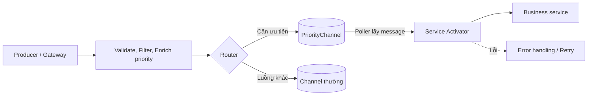
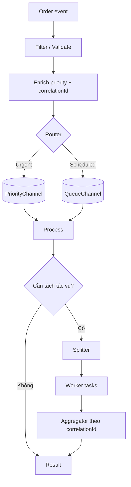

# Priority Channel sắp xếp message theo mức ưu tiên

## 1. Bài toán cần giải quyết

Trong một hệ thống tích hợp, nhiều loại yêu cầu thường đi qua cùng một luồng xử lý: đơn hàng cần giao ngay, giao dịch thông thường, công việc đối soát cuối ngày, thông báo nền. Nếu mọi message được lấy ra theo thứ tự đến, một lượng lớn công việc nền có thể khiến yêu cầu khẩn cấp phải chờ lâu.

**Priority Channel** là cách tổ chức một kênh nhận message có khả năng **ưu tiên lấy message đang chờ dựa trên mức độ quan trọng**. Trong Spring Integration, `PriorityChannel` hiện thực ý tưởng này dưới dạng một kênh có thể được thăm dò (pollable channel). Message được đưa vào kênh, nằm chờ trong hàng đợi và được lấy ra theo độ ưu tiên mà bộ so sánh xác định.

Bài học thuộc nhóm **Priority** trong nội dung **SPRING_INTEGRATION_PATTERN**. Mục tiêu là triển khai Enterprise Integration Patterns bằng Spring Integration để các luồng thông điệp ít phụ thuộc và dễ mở rộng, đồng thời phối hợp được với Router, Filter, Transformer, Splitter, Aggregator, Gateway, retry, error channel và correlation.

Sau bài này, bạn có thể:

- Giải thích sự khác nhau giữa **thứ tự nhận message** và **thứ tự xử lý message**.
- Gắn metadata ưu tiên, cấu hình `PriorityChannel` và tiêu thụ bằng poller.
- Kiểm thử thứ tự lấy message một cách xác định, không phụ thuộc tốc độ thread.
- Nhận ra giới hạn về đồng thời, starvation, bộ nhớ, retry và tính nhất quán của luồng.
- Biết khi nào nên dùng một kênh ưu tiên và khi nào phải tách thành nhiều luồng xử lý.

## 2. Priority Channel nằm ở đâu trong Enterprise Integration Patterns?

Một message có thể đi qua nhiều thành phần trước khi tới nơi xử lý nghiệp vụ. **Router** quyết định message đi vào nhánh nào; **Filter** loại message không hợp lệ; **Transformer** chuyển đổi cấu trúc hoặc bổ sung dữ liệu; **Priority Channel** quyết định thứ tự các message **đang chờ trong chính kênh đó** được lấy ra. Nó không thay thế các pattern còn lại.



Trong nhánh ưu tiên, các thành phần có vai trò rõ ràng:

| Thành phần | Trách nhiệm | Điều cần nhớ |
| --- | --- | --- |
| Producer / Gateway | Gửi yêu cầu và metadata | Không quyết định message nào được xử lý ngay |
| Header Enricher / Transformer | Chuẩn hóa `priority` | Một kiểu dữ liệu, một chính sách ưu tiên |
| `PriorityChannel` | Giữ message chờ và chọn message để lấy | Chỉ sắp xếp những message **còn nằm trong hàng đợi** |
| Poller | Chủ động gọi `receive()` theo lịch | Tần suất, số message/lần và số consumer ảnh hưởng tốc độ |
| Service Activator | Thực hiện nghiệp vụ | Cần quản lý lỗi, idempotency và độ trễ |

Khác với `DirectChannel`, nơi lời gọi `send()` có thể kích hoạt xử lý trực tiếp trên cùng luồng gọi, `PriorityChannel` là một `PollableChannel`: quá trình gửi và quá trình nhận được tách ra, do đó consumer cần một poller hoặc chủ động gọi `receive()`.

## 3. Quy tắc độ ưu tiên và những giới hạn thực tế

Trong trường hợp mặc định của Spring Integration, message có header **`priority`** với giá trị số nguyên được sắp xếp theo hướng **giá trị lớn hơn có ưu tiên cao hơn**. Để tránh nhập nhằng, luồng nên chủ động đặt header này cho mọi message và giới hạn nó trong một thang điểm đã quy ước.

Ví dụ chính sách của hệ thống đơn hàng:

| Nhóm công việc | `priority` | Ý nghĩa |
| --- | ---: | --- |
| Xử lý gian lận hoặc lệnh cần can thiệp gấp | 90 | Khẩn cấp |
| Đơn hàng giao hỏa tốc | 60 | Ưu tiên cao |
| Đơn hàng thông thường | 30 | Bình thường |
| Đồng bộ báo cáo / tác vụ nền | 10 | Thấp |

Giả sử poller chưa bắt đầu nhận message và hệ thống gửi lần lượt:

```text
Thứ tự gửi:       báo-cáo(10) -> đơn-thường(30) -> khẩn(90) -> hỏa-tốc(60)
Thứ tự lấy ra:    khẩn(90) -> hỏa-tốc(60) -> đơn-thường(30) -> báo-cáo(10)
```

Điều này đúng vì **cả bốn message đã chờ trong queue trước khi bắt đầu nhận**. Nếu consumer đã nhận `báo-cáo(10)` để xử lý, một message `khẩn(90)` đến sau không thể giành lại công việc đang chạy. Priority Channel **không có cơ chế ngắt (preemption)**.

Một vài nguyên tắc quan trọng:

1. **Không đồng nhất ưu tiên với SLA tuyệt đối.** Message có độ ưu tiên cao vẫn phụ thuộc số consumer, công việc đang xử lý, downstream và tài nguyên hệ thống.
2. **Không mặc định FIFO với các message đồng mức ưu tiên.** Nếu nghiệp vụ đòi thứ tự ổn định khi bằng nhau, phải có quy tắc phụ (chẳng hạn sequence/time cộng với comparator phù hợp) và kiểm thử nó.
3. **Không coi priority là thứ tự xử lý hoàn tất.** Nhiều consumer có thể nhận message theo thứ tự ưu tiên nhưng hoàn tất theo thứ tự khác nhau.
4. **Không nhầm priority với message ordering của một aggregate.** Nếu mọi sự kiện cùng `orderId` phải được xử lý tuần tự, phải thiết kế thêm ràng buộc ordering/correlation.
5. **Không giao quyền tự chọn priority cho nguồn không tin cậy.** Chuẩn hóa hoặc giới hạn giá trị trước khi message vào queue; dữ liệu đầu vào có thể có priority thiếu, sai kiểu hoặc ngoài khoảng quy định.

## 4. Tạo và tiêu thụ `PriorityChannel` trong Spring Integration

Ví dụ dưới đây sử dụng cấu hình Java. Đây là một luồng xử lý đơn hàng tối giản, với một kênh ưu tiên và một `Service Activator` nhận message thông qua poller.

```java
import org.springframework.context.annotation.Bean;
import org.springframework.context.annotation.Configuration;
import org.springframework.integration.annotation.Poller;
import org.springframework.integration.annotation.ServiceActivator;
import org.springframework.integration.channel.PriorityChannel;
import org.springframework.integration.config.EnableIntegration;
import org.springframework.messaging.MessageHandler;

@Configuration
@EnableIntegration
public class PriorityOrderConfiguration {

    @Bean("priorityOrders")
    public PriorityChannel priorityOrders() {
        return new PriorityChannel();
    }

    @Bean
    @ServiceActivator(
        inputChannel = "priorityOrders",
        poller = @Poller(fixedDelay = "200", maxMessagesPerPoll = "1")
    )
    public MessageHandler priorityOrderHandler() {
        return message -> {
            OrderRequest order = (OrderRequest) message.getPayload();
            Integer priority = (Integer) message.getHeaders().get("priority");
            System.out.printf("Handle order=%s, priority=%s%n", order.id(), priority);
            // Gọi application service; quản lý transaction/idempotency tại đây.
        };
    }

    public record OrderRequest(String id, String category) {}
}
```

Để gửi message, ứng dụng có thể nhận bean `priorityOrders` dưới kiểu `MessageChannel` rồi xây dựng message với header nhất quán:

```java
import org.springframework.beans.factory.annotation.Qualifier;
import org.springframework.messaging.MessageChannel;
import org.springframework.messaging.support.MessageBuilder;
import org.springframework.stereotype.Service;

@Service
public class OrderIngress {
    private final MessageChannel priorityOrders;

    public OrderIngress(@Qualifier("priorityOrders") MessageChannel priorityOrders) {
        this.priorityOrders = priorityOrders;
    }

    public boolean submit(PriorityOrderConfiguration.OrderRequest order, int priority) {
        int normalizedPriority = Math.max(0, Math.min(priority, 100));

        return priorityOrders.send(
            MessageBuilder.withPayload(order)
                .setHeader("priority", normalizedPriority)
                .setHeader("correlationId", order.id())
                .build()
        );
    }
}
```

Ở ví dụ trên:

- `PriorityChannel` nhận message và giữ trong queue cho tới khi được lấy ra.
- Header `priority` được đặt **trước** khi gửi; `normalizedPriority` hạn chế giá trị vào khoảng `0..100`.
- `@Poller(fixedDelay = "200", maxMessagesPerPoll = "1")` yêu cầu poller kiểm tra định kỳ, tối đa một message mỗi lần poll; giá trị thực tế cần hiệu chỉnh theo tải.
- `@ServiceActivator` là consumer, không cần producer biết chi tiết xử lý phía sau.
- Header `correlationId` giúp truy vết các message cùng đơn hàng nhưng **không tự bảo đảm thứ tự** hoặc tự động ghép message lại.

Ví dụ sử dụng `System.out` chỉ để minh họa. Ứng dụng thực tế nên dùng logger có cấu trúc, đo thời gian chờ và đặt business service vào một thành phần riêng.

### 4.1. Vì sao phải cấu hình poller?

`PriorityChannel` không gọi handler ngay khi producer gửi message. Consumer cần chủ động lấy message, nên một endpoint đọc từ kênh pollable phải có poller. Có thể dùng annotation như trên hoặc Java DSL với endpoint poller. Nếu thiếu cơ chế nhận, message vẫn nằm chờ và nghiệp vụ không được kích hoạt.

`fixedDelay` là khoảng cách giữa các lần poll theo lịch của endpoint, **không phải cam kết message sẽ được xử lý trong đúng 200 ms**. Độ trễ thực tế bao gồm thời gian chờ poll, backlog, thời gian xử lý và giới hạn tài nguyên. Khi tăng số consumer để tăng thông lượng, phải xem lại yêu cầu ordering và tính an toàn khi xử lý song song.

### 4.2. Đặt priority ở đâu cho hợp lý?

Không nên để mọi producer định nghĩa ý nghĩa của các số ưu tiên theo cách riêng. Một hướng dễ bảo trì là cho **Transformer/Header Enricher** chuyển `type`, `customerTier`, `deadline` hoặc chính sách nội bộ thành `priority`, sau khi **Filter** đã kiểm tra đầu vào. Khi nhiều nguồn vào cùng kênh, bước chuẩn hóa phải dùng chung quy tắc, ví dụ:

```text
priority = 90  nếu sự kiện cần phản ứng khẩn cấp
priority = 60  nếu đơn hàng thuộc nhóm hỏa tốc
priority = 30  nếu đơn hàng thông thường
priority = 10  nếu tác vụ nền
```

Quy tắc có thể thay đổi cùng yêu cầu nghiệp vụ nhưng cần version hóa và kiểm thử. Đừng gắn trực tiếp các giá trị không được kiểm soát từ HTTP request hay từ đối tác vào hàng đợi ưu tiên.

## 5. Kiểm thử thứ tự một cách xác định

Kiểm thử thứ tự tốt nhất nên tách riêng khả năng sắp xếp của queue khỏi lịch chạy của poller. Khi test, **gửi hết message trước rồi mới gọi `receive()`**; như vậy tránh phụ thuộc lịch trình thread và giúp xác nhận đúng hành vi cần kiểm tra.

```java
import static org.junit.jupiter.api.Assertions.assertEquals;

import org.junit.jupiter.api.Test;
import org.springframework.integration.channel.PriorityChannel;
import org.springframework.messaging.Message;
import org.springframework.messaging.support.MessageBuilder;

class PriorityChannelTest {
    @Test
    void receivesHigherPriorityFirstWhenAllMessagesAreQueued() {
        PriorityChannel channel = new PriorityChannel();

        channel.send(message("batch-report", 10));
        channel.send(message("regular-order", 30));
        channel.send(message("fraud-alert", 90));
        channel.send(message("express-order", 60));

        assertEquals("fraud-alert", channel.receive(0).getPayload());
        assertEquals("express-order", channel.receive(0).getPayload());
        assertEquals("regular-order", channel.receive(0).getPayload());
        assertEquals("batch-report", channel.receive(0).getPayload());
    }

    private static Message<String> message(String payload, int priority) {
        return MessageBuilder.withPayload(payload)
            .setHeader("priority", priority)
            .build();
    }
}
```

`receive(0)` là thao tác lấy message ngay mà không chờ lâu. Test này chỉ kiểm tra **thứ tự dequeue khi tất cả message đã có trong hàng đợi**. Nó không chứng minh rằng hàng đợi bảo đảm thời gian hoàn tất, công bằng giữa nhiều luồng hoặc tính ổn định của thứ tự khi priority bằng nhau.

Với kiểm thử tích hợp, nên bổ sung các tình huống sau:

| Tình huống | Kết quả / bất biến cần kiểm tra |
| --- | --- |
| Có message mức thấp trong khi consumer đang bận; sau đó gửi mức cao | Mức cao được chọn trước các message mức thấp **vẫn chờ** sau khi consumer rảnh |
| Priority bị thiếu, sai kiểu hoặc ngoài phạm vi | Bước chuẩn hóa/kiểm tra đầu vào xử lý theo chính sách đã định |
| Cùng `priority` nhưng khác `correlationId` | Không giả định FIFO nếu chưa cài quy tắc phụ |
| Handler ném exception | Message đi vào luồng lỗi/retry mong muốn, có log và cơ chế tránh xử lý lặp ngoài ý muốn |
| Nhiều producer và consumer | Không đánh đồng thứ tự nhận với thứ tự hoàn thành |
| Tải đến lớn hơn khả năng xử lý | Theo dõi backlog, thời gian chờ, bộ nhớ và ngưỡng cảnh báo |

## 6. Kết hợp với Router, Splitter, Aggregator và correlation

Độ ưu tiên là thuộc tính **cục bộ của một hàng đợi**, còn correlation là cách xác định những message thuộc cùng một tiến trình nghiệp vụ. Hai khái niệm này giải quyết vấn đề khác nhau.

Ví dụ luồng xử lý đơn hàng gồm bước kiểm tra gian lận và bước đối soát:



- **Router:** Chọn nhánh xử lý phù hợp. Khi mức tải và SLA khác biệt lớn, có thể tách hẳn hàng đợi khẩn và hàng đợi thông thường thay vì chỉ dùng một priority queue.
- **Splitter:** Tách một message thành nhiều công việc con. Cần cân nhắc có sao chép priority sang các message con hay tính lại theo mục đích từng tác vụ.
- **Aggregator:** Ghép các kết quả theo khóa correlation và điều kiện hoàn tất. Priority không thay thế `correlationId`, `sequenceNumber`, `sequenceSize` hay chiến lược hoàn tất của aggregator.
- **Gateway:** Cung cấp giao diện gửi message cho ứng dụng. Gateway đồng bộ có thể phải chờ kết quả, do đó cần timeout phù hợp khi yêu cầu nằm sau một queue có backlog.

**Tình huống cần tránh:** một đơn hàng phát ra các sự kiện `CREATED`, `PAID`, `CANCELLED` với priority khác nhau, rồi mọi sự kiện đi vào cùng queue. Nếu nghiệp vụ bắt buộc nhận chúng đúng thứ tự nhân quả thì `PriorityChannel` đơn lẻ không đáp ứng yêu cầu: sự kiện đến sau nhưng có độ ưu tiên lớn hơn có thể được lấy trước. Hãy phân vùng theo khóa đơn hàng, tuần tự hóa theo khóa hoặc thiết kế lại giới hạn ưu tiên ở đúng cấp công việc.

## 7. Retry, lỗi và các rủi ro khi đưa vào production

### 7.1. Starvation: message ưu tiên thấp có thể chờ vô hạn

Nếu message `priority=90` liên tục đi vào nhanh hơn khả năng xử lý, các message `priority=10` có thể liên tục bị vượt qua. Đây là **starvation**. Việc dùng priority queue không tự bảo đảm fairness.

Các biện pháp có thể dùng theo mức độ quan trọng của bài toán:

- Tách queue và worker pool theo mức SLA (ví dụ khẩn, thường, nền), áp dụng hạn mức xử lý cho mỗi lớp.
- Dành năng lực tối thiểu cho công việc bình thường/nền để không bị bỏ đói.
- Thiết kế chính sách tăng ưu tiên theo thời gian chờ (*aging*) nếu bộ so sánh và cách cập nhật hàng đợi có thể bảo đảm chính sách đó.
- Theo dõi thời gian chờ theo từng mức priority; đừng chỉ nhìn độ dài queue tổng.

Lưu ý: tăng priority của một message **sau khi nó đã nằm trong queue** không tự động đồng nghĩa hàng đợi sẽ sắp xếp lại theo chính sách aging. Cần thiết kế lại bước chọn message hoặc lấy message ra và đưa vào lại theo cơ chế có kiểm soát.

### 7.2. Retry không nên che mất quy tắc ưu tiên

Khi handler lỗi, xác định rõ hệ thống sẽ retry ngay tại chỗ, retry sau một khoảng trễ hay gửi sang error/recovery flow. Retry ngay trong cùng consumer có thể làm message ưu tiên khác phải chờ. Retry bằng cách gửi lại vào `PriorityChannel` có thể thay đổi vị trí tương đối, tạo vòng lặp hoặc nhân bản tác vụ nếu không giới hạn số lần thử.

Một thiết kế thực tế nên có:

1. Chính sách retry theo loại lỗi (lỗi tạm thời và lỗi nghiệp vụ).
2. Giới hạn số lần thử, backoff và điểm kết thúc vào error channel hoặc dead-letter flow.
3. Khóa idempotency của thao tác nghiệp vụ để xử lý an toàn khi message được gửi/nhận lại.
4. Log mang `messageId`, `correlationId`, `priority`, attempt và nguyên nhân lỗi.

Spring Integration hỗ trợ các cơ chế advice, error channel và luồng phục hồi, nhưng cấu hình cụ thể phụ thuộc kiểu endpoint và cách triển khai transaction. **PriorityChannel không tự thêm retry, không bảo đảm exactly-once và không thay thế error handling.**

### 7.3. Backpressure, lưu trữ và độ bền

Một `PriorityChannel` mặc định là hàng đợi trong tiến trình ứng dụng. Do đó phải xem xét khả năng tăng bộ nhớ khi producer nhanh hơn consumer và mất các message đang chờ nếu tiến trình ngừng đột ngột. Việc ưu tiên sắp xếp message không đồng nghĩa có lưu trữ bền vững hoặc cơ chế xác nhận nhận message của một message broker.

Với yêu cầu đảm bảo không mất message hoặc chia tải giữa nhiều instance, có thể cần broker/hàng đợi bền vững, chiến lược phân lớp mức ưu tiên tại broker hoặc tách luồng theo SLA. Không được mặc định rằng thứ tự ưu tiên của `PriorityChannel` ở một JVM sẽ được duy trì trên nhiều instance hay qua lần restart.

## 8. Quan sát và vận hành luồng ưu tiên

Một luồng ưu tiên hữu ích khi đo được **message nào được chờ bao lâu**, chứ không chỉ kiểm tra rằng message có header `priority`.

| Chỉ số / tín hiệu | Ý nghĩa | Dấu hiệu cần điều tra |
| --- | --- | --- |
| Số message đang đợi, theo mức priority | Backlog của mỗi lớp việc | Mức thấp tăng mãi hoặc mức cao không giảm |
| Tuổi của message cũ nhất | Nguy cơ starvation/SLA | Có message chờ quá ngưỡng cho phép |
| Độ trễ từ enqueue đến dequeue | Thời gian chờ thật | Độ trễ cao dù handler nhanh |
| Thời gian xử lý handler | Năng lực downstream | Công việc dài giữ consumer bận |
| Tần suất exception và retry | Độ ổn định | Retry chiếm dụng năng lực các lớp khác |
| Số message vào/ra theo priority | Tương quan giữa tải và thông lượng | Tải đầu vào vượt năng lực xử lý |

Có thể gắn timestamp tại ingress để tính thời gian chờ, đồng thời đưa `correlationId` vào logging và tracing. Cần phân biệt **thời điểm gửi**, **thời điểm lấy khỏi queue**, **thời điểm xử lý xong** để giải thích đúng số liệu.

Đối với luồng có nhiều nhánh Router/Filter, nên truy vết cả nhánh xử lý và lý do chọn priority. Điều này giúp phát hiện trường hợp Transformer đặt sai header hoặc một nguồn gửi quá nhiều tác vụ với mức khẩn.

## 9. Khi nào nên và không nên dùng Priority Channel?

| Tình huống | Lựa chọn phù hợp |
| --- | --- |
| Một consumer hoặc một nhóm consumer cần ưu tiên công việc đang chờ trong một ứng dụng | `PriorityChannel` kết hợp poller và chính sách header |
| Công việc có SLA rất khác nhau và cần tránh starvation | Phân lớp bằng Router, nhiều queue và năng lực xử lý dành riêng |
| Các message cùng khóa phải xử lý đúng thứ tự phát sinh | Cơ chế tuần tự hóa theo khóa/ordering; chỉ dùng priority khi không phá vỡ bất biến |
| Cần hàng đợi bền vững qua restart, nhiều instance cùng tiêu thụ | Thiết kế với broker hoặc storage phù hợp, kiểm tra chính sách ưu tiên thực tế |
| Chỉ cần định tuyến sang các nghiệp vụ khác nhau | `Router` thường là lựa chọn trực tiếp hơn |
| Message phải xử lý ngay theo lời gọi đồng bộ, không cần queue | Cân nhắc channel và endpoint đồng bộ thay vì pollable queue |

## 10. Bài thực hành đề xuất

Hãy mở rộng ví dụ đơn hàng ở mục 4 thành luồng xử lý ba nhóm `URGENT`, `NORMAL`, `BATCH`.

1. Tạo một bước chuẩn hóa chuyển `category` thành `priority` lần lượt là `90`, `30`, `10`; từ chối category không hợp lệ.
2. Gửi ngẫu nhiên ít nhất 20 message vào `PriorityChannel` trong lúc chưa bắt đầu nhận; kiểm tra thứ tự dequeue từ cao xuống thấp.
3. Bổ sung `correlationId` bằng mã đơn hàng và đo thời gian chờ từ lúc gửi tới lúc handler nhận.
4. Thử consumer chạy chậm rồi gửi thêm message khẩn; quan sát một message đang chạy không bị ngắt, trong khi message khẩn có thể vượt các message còn chờ.
5. Mô phỏng lỗi tạm thời ở handler; cấu hình giới hạn retry và ghi nhận message thất bại vào nhánh lỗi. Kiểm tra nghiệp vụ không tạo tác dụng phụ trùng khi thử lại.
6. Đẩy liên tục message khẩn và quan sát độ trễ của `BATCH`; từ kết quả, đề xuất chính sách tránh starvation.

**Tiêu chí hoàn thành:** giải thích được vì sao `PriorityChannel` thay đổi thứ tự lấy khỏi hàng đợi nhưng không bảo đảm thứ tự hoàn tất; kiểm thử được ít nhất một ca ưu tiên cao, một ca lỗi/retry và một ca tải kéo dài; có log hoặc metric để theo dõi backlog và thời gian chờ theo mức ưu tiên.

## 11. Câu hỏi tự kiểm tra

1. Vì sao `PriorityChannel` cần poller còn một luồng dùng `DirectChannel` có thể xử lý ngay khi gọi `send()`?
2. Nếu message thấp ưu tiên đã được consumer nhận, message cao ưu tiên vừa tới có thể thay thế công việc đang chạy không? Vì sao?
3. Vì sao không được mặc định FIFO cho hai message có cùng priority?
4. Một luồng Splitter/Aggregator đã có `correlationId` có tự bảo đảm ordering khi thêm Priority Channel không?
5. Khi queue có nguy cơ starvation và mất dữ liệu sau restart, bạn cần thay đổi kiến trúc ở những điểm nào?

**Ghi nhớ:** Priority Channel tối ưu **quyền được lấy ra xử lý tiếp theo của message đang đợi**. Để một luồng doanh nghiệp an toàn, phải kết hợp chính sách phân loại ưu tiên, poller, kiểm thử ordering, correlation, retry/error handling và khả năng giám sát thực tế.
