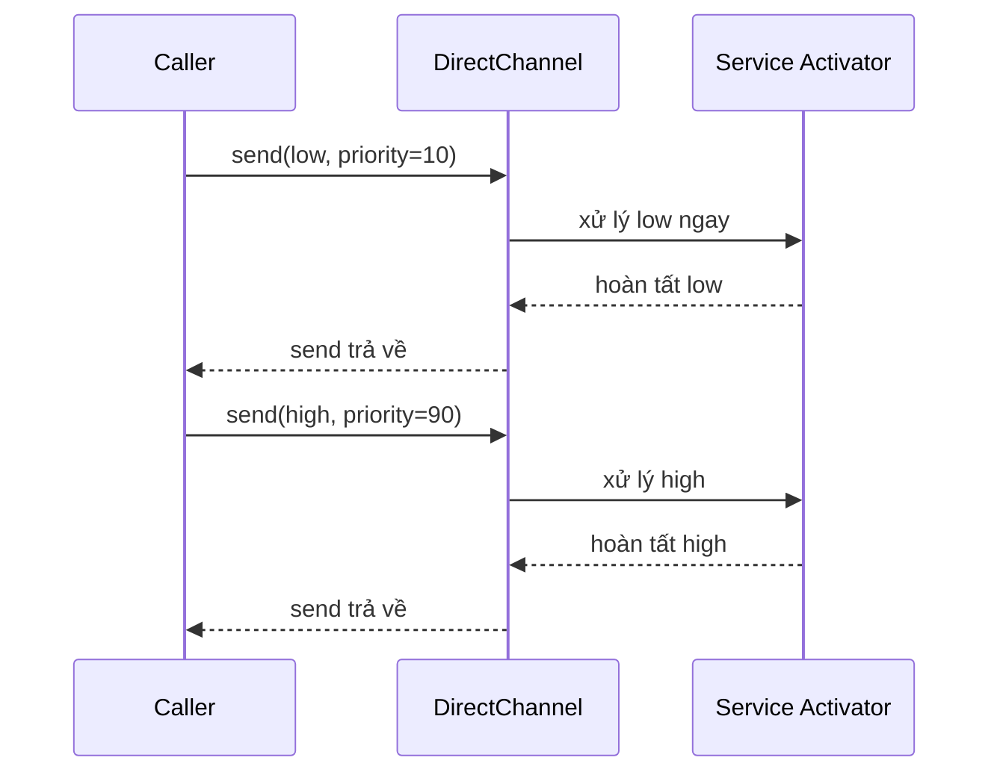
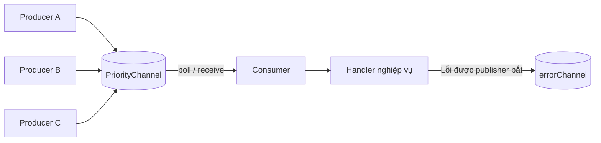

# Priority trong flow đồng bộ và bất đồng bộ của Spring Integration

## 1. Mục tiêu bài học

Trong module `SPRING_INTEGRATION_PATTERN`, chúng ta triển khai **Enterprise Integration Patterns** với Spring Integration để tạo những luồng message ít phụ thuộc, dễ mở rộng, kiểm thử và quan sát được. Khi phối hợp Router, Filter, Transformer, Splitter, Aggregator, Gateway, retry, Error Channel và correlation, hệ thống thường phải xử lý nhiều message cùng lúc. Một số công việc, chẳng hạn cảnh báo khẩn hoặc đơn hàng gần hết thời hạn xử lý, có mức ưu tiên cao hơn công việc thông thường.

**Priority** cho phép diễn đạt mức quan trọng của message và, khi có một hàng đợi hỗ trợ ưu tiên, quyết định message nào được lấy ra trước. Nhưng **gắn header priority không tự bảo đảm message sẽ chạy trước hoặc hoàn tất trước**. Kết quả phụ thuộc loại `MessageChannel`, thời điểm message đi vào queue, số consumer, thread pool và trạng thái công việc đang chạy.

Sau bài này, bạn có thể:

- Phân biệt **mức ưu tiên của message**, **thứ tự lấy khỏi queue**, **thứ tự bắt đầu xử lý** và **thứ tự hoàn tất**.
- Giải thích tại sao `DirectChannel` đồng bộ không tự sắp xếp lại những lời gọi `send()`.
- Cấu hình `PriorityChannel` và hiểu điều kiện để message ưu tiên cao được nhận trước.
- Phân biệt `PriorityChannel` với `ExecutorChannel`, `QueueChannel` và poller bất đồng bộ.
- Viết ví dụ Java DSL/JUnit kiểm chứng thứ tự nhận từ queue, ranh giới thread và giới hạn của priority.
- Thiết kế chống starvation, backpressure, timeout, retry và bảo toàn correlation trong các EIP.

## 2. Priority là chính sách chọn việc, không phải lời hứa hoàn thành

Trong một hệ thống có ba công việc đang chờ:

| Message | Priority | Ý nghĩa nghiệp vụ ví dụ |
| --- | ---: | --- |
| `order-standard` | 10 | Đơn hàng bình thường. |
| `order-express` | 90 | Đơn hàng giao nhanh. |
| `fraud-review` | 50 | Kiểm tra gian lận cần xử lý sớm. |

Nếu cả ba **đang nằm trong cùng một `PriorityChannel`** và chưa có consumer lấy đi, message có priority 90 thường được lấy ra trước, tiếp theo là 50 rồi 10.

Nhưng nếu `order-standard` đã được worker lấy lúc 10:00:00 và tới 10:00:01 mới có `order-express`, hàng đợi **không thể thu hồi và ngắt ngang** công việc đã chạy:

```text
10:00:00  Worker nhận standard (priority=10), bắt đầu xử lý
10:00:01  Express (priority=90) mới đi vào PriorityChannel
10:00:02  Worker vẫn đang xử lý standard
10:00:10  Worker hoàn tất standard và mới lấy express
```

Đây là sự khác biệt giữa **priority scheduling tại điểm dequeue** và **preemption** (ngắt công việc đang chạy). `PriorityChannel` hỗ trợ chọn message chờ theo priority, **không cung cấp preemption**.

### Bốn khái niệm cần tách bạch

| Thuật ngữ | Câu hỏi | Priority có quyết định chắc chắn không? |
| --- | --- | --- |
| Enqueue order | Message nào vào queue trước? | Không. Phụ thuộc nguồn và thời điểm gửi. |
| Dequeue order | Message chờ nào được consumer lấy ra trước? | Có thể, nếu channel thực sự dùng chính sách ưu tiên. |
| Start order | Handler bắt đầu message nào trước? | Không chắc; còn tùy poller, executor, số consumer. |
| Completion order | Message nào kết thúc trước? | Không chắc; phụ thuộc thời gian chạy, I/O, retry, lock và transaction. |

**Ưu tiên cao không đồng nghĩa độ trễ tuyệt đối thấp.** Nếu worker đang bận hoặc queue quá tải, một message rất quan trọng vẫn có thể bị chậm.

## 3. Các loại channel và ngữ nghĩa ưu tiên

| Channel | Mô hình xử lý | Ảnh hưởng của header priority |
| --- | --- | --- |
| `DirectChannel` | Dispatcher gọi handler trên thread của người gửi; thông thường đồng bộ. | Không tự sắp thứ tự lại các lời gọi send. |
| `QueueChannel` | Pollable channel với hành vi hàng đợi thông thường. | Không tự trở thành priority queue chỉ nhờ header. |
| `PriorityChannel` | Pollable channel chọn message theo thứ tự ưu tiên của queue. | Có thể thay đổi thứ tự dequeue của các message còn chờ. |
| `ExecutorChannel` | Dispatcher bàn giao công việc cho executor và handler chạy trên worker thread. | Header priority không tự cấu hình lịch ưu tiên của executor. |
| `PublishSubscribeChannel` | Phát message đến các subscriber theo cấu hình. | Không phải priority queue; cần thiết kế riêng nếu muốn ưu tiên xử lý. |

Trong Spring Integration, header quy ước thường dùng cho mức ưu tiên là `priority`, giá trị nên là một số nguyên. Với `PriorityChannel`, comparator mặc định của channel dùng thông tin priority để chọn message chờ. Nếu nghiệp vụ dùng tiêu chí khác như deadline hoặc tier khách hàng, có thể xây dựng comparator riêng, nhưng phải kiểm thử tính nhất quán và khả năng thiếu dữ liệu.

**Không nên dùng một chuỗi như `"urgent"` rồi tự giả định comparator mặc định sẽ hiểu đó là priority cao nhất.** Hãy chuẩn hóa kiểu dữ liệu và các mức ưu tiên ngay tại boundary.

## 4. Flow đồng bộ: DirectChannel giữ thứ tự lời gọi, không lập lịch

Khi một caller tuần tự gửi `low` rồi `high` vào `DirectChannel`, và handler chạy đồng bộ, handler thường nhận `low` trong lời gọi đầu tiên. Header `priority=100` của message thứ hai **không làm message đầu tiên chờ lại**:



Với **nhiều caller thread**, các lời gọi vào cùng một channel có thể xen kẽ theo lịch của JVM; không có bảo đảm một thứ tự toàn cục chỉ dựa vào thời gian quan sát trong log. Nếu cần một thứ tự xử lý theo priority, phải **gom việc chờ tại một hàng đợi thích hợp** rồi để consumer nhận theo chính sách.

Đối với lỗi, `DirectChannel` đồng bộ có thể truyền exception từ handler về caller. Việc dùng `PriorityChannel`/poller sau một ranh giới bất đồng bộ có thể thay đổi ai nhận exception và thời điểm Error Channel được sử dụng.

## 5. Flow dùng PriorityChannel: ưu tiên tại thời điểm lấy message

`PriorityChannel` là một `PollableChannel`. Điều này có nghĩa producer **gửi message vào queue**, còn consumer gọi `receive()` hoặc một polling endpoint lấy message ra sau đó. **Khoảng cách giữa send và receive** tạo cơ hội cho nhiều message cùng chờ, rồi mới được sắp xếp theo mức ưu tiên.



Khi cả ba message trong ví dụ đã nằm trong queue trước khi consumer gọi `receive()`, ta mong đợi thứ tự **90 → 50 → 10**. Nếu consumer đã lấy message 10 trước lúc message 90 được gửi, priority không thể đảo ngược công việc đang chạy.

### Header và thiếu priority

Hãy quy định mức mặc định cho dữ liệu thiếu priority ở boundary. Khi dùng comparator mặc định, các message không có priority có thể được xem theo giá trị mặc định mà channel cung cấp; thay vì dựa vào chi tiết này, nên **chủ động gắn priority rõ ràng** cho những loại message cần so sánh.

Với các message **có cùng priority**, không được tự giả định FIFO hoặc thứ tự ổn định nếu không có contract tie-breaker. Nếu nghiệp vụ bắt buộc FIFO trong cùng tier, hãy dùng comparator có thứ tự phụ nhất quán hoặc tổ chức hàng đợi riêng và kiểm thử rõ quy tắc.

## 6. Ví dụ Java DSL: DirectChannel, PriorityChannel và ExecutorChannel

Ví dụ sau dùng Java 17 và Spring Integration Java DSL. Nó cố ý **không gắn poller vào PriorityChannel trong cùng cấu hình** để test có thể gửi đủ ba message trước, rồi tự gọi `receive()` kiểm chứng thứ tự dequeue. Hai flow khác minh họa handler đồng bộ và executor bất đồng bộ.

Trong Spring Boot có thể dùng `spring-boot-starter-integration`; phần test có thể dùng `spring-boot-starter-test` cho JUnit 5, Spring Test và AssertJ.

```java
import java.util.concurrent.BlockingQueue;
import java.util.concurrent.LinkedBlockingQueue;
import java.util.concurrent.TimeUnit;

import org.springframework.context.annotation.Bean;
import org.springframework.context.annotation.Configuration;
import org.springframework.integration.channel.DirectChannel;
import org.springframework.integration.channel.ExecutorChannel;
import org.springframework.integration.channel.PriorityChannel;
import org.springframework.integration.config.EnableIntegration;
import org.springframework.integration.dsl.IntegrationFlow;
import org.springframework.messaging.Message;
import org.springframework.messaging.MessageChannel;
import org.springframework.messaging.PollableChannel;
import org.springframework.scheduling.concurrent.ThreadPoolTaskExecutor;

@Configuration
@EnableIntegration
public class PriorityFlowLessonConfig {

    public record WorkItem(String id) {}
    public record Observation(String id, String threadName) {}

    public static class Probe {
        private final BlockingQueue<Observation> sync = new LinkedBlockingQueue<>();
        private final BlockingQueue<Observation> async = new LinkedBlockingQueue<>();

        void recordSync(WorkItem item) {
            sync.add(new Observation(item.id(),
                Thread.currentThread().getName()));
        }

        void recordAsync(WorkItem item) {
            async.add(new Observation(item.id(),
                Thread.currentThread().getName()));
        }

        public Observation nextSync() {
            return sync.poll();
        }

        public Observation awaitAsync() throws InterruptedException {
            return async.poll(5, TimeUnit.SECONDS);
        }
    }

    @Bean
    public Probe priorityProbe() {
        return new Probe();
    }

    @Bean
    public MessageChannel directInput() {
        return new DirectChannel();
    }

    @Bean
    public PollableChannel priorityInbox() {
        return new PriorityChannel();
    }

    @Bean
    public ThreadPoolTaskExecutor priorityWorkers() {
        ThreadPoolTaskExecutor executor = new ThreadPoolTaskExecutor();
        executor.setCorePoolSize(2);
        executor.setMaxPoolSize(2);
        executor.setQueueCapacity(20);
        executor.setThreadNamePrefix("priority-worker-");
        return executor;
    }

    @Bean
    public MessageChannel asyncInput(ThreadPoolTaskExecutor priorityWorkers) {
        return new ExecutorChannel(priorityWorkers);
    }

    @Bean
    public IntegrationFlow directFlow(Probe priorityProbe) {
        return IntegrationFlow.from("directInput")
            .handle((Message<?> message) ->
                priorityProbe.recordSync((WorkItem) message.getPayload()))
            .get();
    }

    @Bean
    public IntegrationFlow executorFlow(Probe priorityProbe) {
        return IntegrationFlow.from("asyncInput")
            .handle((Message<?> message) ->
                priorityProbe.recordAsync((WorkItem) message.getPayload()))
            .get();
    }
}
```

Ý nghĩa của cấu hình:

1. `directInput` và `directFlow`: ghi nhận message trên thread gửi. Không dùng queue priority.
2. `priorityInbox`: giữ message chờ và cho phép một consumer lấy ra theo priority. **Ví dụ này chưa có consumer chạy nền**, nhằm kiểm tra thứ tự thuần túy.
3. `asyncInput` dùng `ExecutorChannel` và thread pool. Người gửi bàn giao công việc trước khi worker kết thúc; header priority **không tự thay đổi scheduler của pool**.
4. `Probe` giữ observation cho test; trong production cần hệ thống metric/log hoặc kho trạng thái phù hợp, không sử dụng queue quan sát trong bộ nhớ làm đảm bảo tin cậy.

### Khi cần một polling consumer thật

Sau khi đã kiểm chứng cách queue sắp thứ tự, có thể thêm một **consumer polling** vào cấu hình ứng dụng (không thêm đồng thời vào cấu hình của bài test bên dưới):

```java
import org.springframework.context.annotation.Bean;
import org.springframework.integration.dsl.IntegrationFlow;
import org.springframework.integration.dsl.Pollers;
import org.springframework.messaging.Message;

// Mẫu mở rộng trong @Configuration có bean priorityInbox đã định nghĩa.
@Bean
public IntegrationFlow priorityConsumerFlow() {
    return IntegrationFlow
        .from("priorityInbox",
            endpoint -> endpoint.poller(
                Pollers.fixedDelay(200).maxMessagesPerPoll(1)))
        .handle((Message<?> message) -> {
            // Thay bằng logic nghiệp vụ thật.
            System.out.println("Processing " + message.getPayload());
        })
        .get();
}
```

Poller có thể lấy message **ngay khi nó xuất hiện**. Vì vậy, với producer chạy liên tục, không thể lấy kết quả một bài test đã nạp sẵn queue làm lời hứa rằng mọi message ưu tiên cao đến sau sẽ vượt qua message ưu tiên thấp đã được lấy trước. `maxMessagesPerPoll(1)` chỉ giới hạn số message được lấy trong một lần poll; nó không cung cấp cơ chế ngắt công việc.

## 7. Kiểm thử thứ tự dequeue và ranh giới đồng bộ/bất đồng bộ

Trong test, chỉ so sánh thứ tự khi **tất cả message đã vào PriorityChannel trước khi `receive()`**. Với `ExecutorChannel`, test xác minh chúng được xử lý ở worker thread nhưng **không** khẳng định thứ tự xử lý theo header.

```java
import java.util.List;

import org.junit.jupiter.api.Test;
import org.springframework.beans.factory.annotation.Autowired;
import org.springframework.beans.factory.annotation.Qualifier;
import org.springframework.messaging.Message;
import org.springframework.messaging.MessageChannel;
import org.springframework.messaging.PollableChannel;
import org.springframework.messaging.support.MessageBuilder;
import org.springframework.test.context.junit.jupiter.SpringJUnitConfig;

import static org.assertj.core.api.Assertions.assertThat;

@SpringJUnitConfig(PriorityFlowLessonConfig.class)
class PriorityFlowLessonTest {

    @Autowired
    @Qualifier("priorityInbox")
    PollableChannel priorityInbox;

    @Autowired
    @Qualifier("directInput")
    MessageChannel directInput;

    @Autowired
    @Qualifier("asyncInput")
    MessageChannel asyncInput;

    @Autowired
    PriorityFlowLessonConfig.Probe probe;

    private static Message<PriorityFlowLessonConfig.WorkItem> job(
            String id, int priority) {
        return MessageBuilder
            .withPayload(new PriorityFlowLessonConfig.WorkItem(id))
            .setHeader("priority", priority)
            .build();
    }

    @Test
    void priorityChannelDequeuesWaitingMessagesByPriority() {
        assertThat(priorityInbox.send(job("low", 10))).isTrue();
        assertThat(priorityInbox.send(job("high", 90))).isTrue();
        assertThat(priorityInbox.send(job("medium", 50))).isTrue();

        assertThat(priorityInbox.receive(0).getPayload())
            .isEqualTo(new PriorityFlowLessonConfig.WorkItem("high"));
        assertThat(priorityInbox.receive(0).getPayload())
            .isEqualTo(new PriorityFlowLessonConfig.WorkItem("medium"));
        assertThat(priorityInbox.receive(0).getPayload())
            .isEqualTo(new PriorityFlowLessonConfig.WorkItem("low"));
        assertThat(priorityInbox.receive(0)).isNull();
    }

    @Test
    void directChannelDoesNotReorderSequentialSends() {
        String callerThread = Thread.currentThread().getName();

        assertThat(directInput.send(job("low-direct", 10))).isTrue();
        assertThat(directInput.send(job("high-direct", 90))).isTrue();

        var first = probe.nextSync();
        var second = probe.nextSync();
        assertThat(first.id()).isEqualTo("low-direct");
        assertThat(second.id()).isEqualTo("high-direct");
        assertThat(first.threadName()).isEqualTo(callerThread);
        assertThat(second.threadName()).isEqualTo(callerThread);
    }

    @Test
    void executorChannelUsesWorkersWithoutPriorityOrderGuarantee()
            throws InterruptedException {
        assertThat(asyncInput.send(job("low-async", 10))).isTrue();
        assertThat(asyncInput.send(job("high-async", 90))).isTrue();

        var first = probe.awaitAsync();
        var second = probe.awaitAsync();

        assertThat(first).isNotNull();
        assertThat(second).isNotNull();
        assertThat(first.threadName()).startsWith("priority-worker-");
        assertThat(second.threadName()).startsWith("priority-worker-");
        assertThat(List.of(first.id(), second.id()))
            .containsExactlyInAnyOrder("low-async", "high-async");
        // Không assert high-async hoàn tất trước low-async:
        // ExecutorChannel không phải PriorityChannel.
    }
}
```

Ở test thứ nhất, không có poller tranh lấy message nên thứ tự 90 → 50 → 10 kiểm chứng đúng **đặc tính của priority queue**. Test thứ hai nhấn mạnh cơ chế đồng bộ. Test thứ ba nhấn mạnh **ranh giới thread** và cố tình không khẳng định thứ tự hoàn tất.

**Giới hạn:** Các ví dụ chưa chạy tác vụ I/O thật, transaction hoặc adapter broker. `send()` thành công ở `ExecutorChannel` không thay thế việc xác minh công việc nghiệp vụ hoàn tất. Khi cần chắc chắn trạng thái, hãy dùng completion event, trạng thái xử lý hoặc các phép thử tích hợp phù hợp.

## 8. Priority trong flow bất đồng bộ thực tế

Trong hệ thống, việc chuyển từ `DirectChannel` sang `PriorityChannel` thường đi kèm **polling consumer**. Luồng lúc này trở thành bất đồng bộ với producer: message có thể chờ trong queue rồi mới được xử lý trên thread poller. Tuy nhiên, sự bất đồng bộ **đến từ việc tách producer–consumer**, không phải vì số priority tự tạo ra thread.

Xem hai phương án:

```text
A. Producer --> PriorityChannel --> Poller(1 worker) --> Handler
    - Khi nhiều message cùng chờ, poller chọn priority cao trước.
    - Message đang chạy không bị ngắt.

B. Producer --> ExecutorChannel --> ThreadPool(4 workers) --> Handler
    - Tác vụ được giao cho executor, có thể chạy song song.
    - Chỉ gắn header priority chưa đổi cách executor xếp task.
```

### Nếu kết hợp PriorityChannel và nhiều consumer

```text
Producer --> PriorityChannel --> consumer 1 (nhận high, chạy 8s)
                           \--> consumer 2 (nhận medium, chạy 1s)
                           \--> consumer 3 (nhận low, chạy 2s)
```

Message ưu tiên thấp có thể **hoàn thành trước** message ưu tiên cao vì thời gian chạy khác nhau. Các consumer có thể tranh nhận gần như đồng thời, nên không dùng completion order để suy ra priority queue bị lỗi.

### Thực thi đồng thời và bảo toàn thứ tự

Nếu business contract yêu cầu xử lý tuần tự, giữ một consumer hoặc thiết kế partition theo khóa nghiệp vụ; đổi lại throughput có thể giảm. Nếu business chỉ yêu cầu “ưu tiên chọn việc khi worker rảnh” nhưng cho phép chạy song song, nhiều consumer có thể phù hợp hơn. Nên ghi rõ SLA là **thời gian chờ tới khi bắt đầu**, hay **thời gian hoàn tất**, bởi hai mục tiêu đòi hỏi đo lường khác nhau.

## 9. Starvation, fairness và backpressure

Một rủi ro của priority queue là **starvation**: message priority thấp luôn bị message priority cao mới đến vượt lên, dẫn tới chờ rất lâu.

| Vấn đề | Triệu chứng | Hướng giải quyết |
| --- | --- | --- |
| Starvation | Queue thấp ưu tiên không được lấy, tuổi message tăng. | Giới hạn số công việc high liên tiếp; aging priority; chia quota hoặc tách lane. |
| High priority flood | Tác vụ khẩn liên tục chiếm worker. | Rate limit đầu vào và giới hạn ngân sách ưu tiên. |
| Queue tăng không giới hạn | Bộ nhớ/độ trễ tăng khi producer nhanh hơn consumer. | Giới hạn backlog, giám sát queue depth, backpressure hoặc broker phù hợp. |
| Retry chiếm hàng đầu | Công việc lỗi lặp lại nhiều lần ở priority cao. | Backoff ngoài hot queue, giới hạn retry, dead-letter/quarantine. |
| Thứ tự bằng nhau không ổn định | Hai message cùng priority đổi vị trí. | Comparator với tie-breaker đáng tin cậy nếu nghiệp vụ yêu cầu. |
| Priority inversion qua resource lock | Message cao phải đợi lock do message thấp giữ. | Kiểm soát critical section, cô lập tài nguyên và đo wait time. |

Một chiến lược phổ biến là **aging**: tăng mức ưu tiên hiệu dụng khi message chờ quá lâu. Nếu áp dụng, cần lưu ý comparator của queue không phải lúc nào cũng tự sắp xếp lại theo thời gian trôi qua; có thể phải làm mới thứ tự bằng một scheduler hoặc cơ chế phân phối khác. Đừng chỉ dùng `System.currentTimeMillis()` trong comparator rồi cho rằng queue sẽ tự tái sắp xếp liên tục.

**Backpressure quan trọng hơn nhãn ưu tiên.** Nếu mọi producer có thể đẩy vô hạn công việc vào bộ nhớ, hệ thống vẫn có thể quá tải dù đang xử lý đúng thứ tự priority.

## 10. Priority và các EIP liên quan

### Router, Filter và Transformer

Router có thể phân luồng theo priority (ví dụ lane `critical` và `standard`), còn `PriorityChannel` sắp xếp **trong một hàng đợi**. Hai cơ chế không đồng nghĩa nhau:

- **Routing theo tier:** chọn kênh cho từng nhóm công việc, có thể cô lập số consumer và SLA.
- **Priority queue:** chọn message nào được lấy trước khi nhiều message cùng chờ một queue.

Filter có thể loại message không đủ điều kiện; không dùng Filter kết hợp `nullChannel` để âm thầm bỏ message thấp ưu tiên nếu chính sách yêu cầu bảo toàn dữ liệu. Transformer có thể thay đổi headers; nếu priority là contract quan trọng, hãy xác nhận header `priority` được giữ hoặc gắn lại có chủ đích.

### Splitter, Aggregator và correlation

Một message gốc được Splitter tách thành nhiều phần có thể mang cùng priority hoặc priority khác nhau. Nếu ưu tiên chỉ một số message con, chúng có thể đến Aggregator sớm hơn nhưng nhóm vẫn phải đợi đủ điều kiện release. `PriorityChannel` **không tự thay đổi** `correlationId`, `sequenceNumber`, `sequenceSize` hay release strategy của Aggregator.

Nếu một phần bị lỗi hoặc retry, Aggregator có thể chờ đến timeout. Hãy thiết kế timeout, partial result, compensation hoặc chính sách lỗi nhóm; không coi ưu tiên cao là bảo đảm nhóm hoàn tất trước.

### Gateway và request-reply

Gateway đồng bộ có thể đang chờ reply với timeout. Nếu message được đưa vào PriorityChannel và có backlog, thời gian chờ queue sẽ tính vào độ trễ tổng thể. **Priority cao không bảo đảm vượt qua một handler đang chạy**, nên Gateway vẫn có thể timeout. Cần điều chỉnh timeout/async contract và theo dõi queue wait.

### Retry và Error Channel

Lỗi kỹ thuật xảy ra sau khi message được lấy khỏi queue vẫn cần retry advice hoặc error publisher phù hợp. `PriorityChannel` không tự retry và `errorChannel` không tự phát lại message gốc.

Một công việc ưu tiên cao thất bại liên tục có thể làm đói công việc khác. Khi lỗi vượt giới hạn, chuyển sang quarantine/dead-letter hoặc chờ backoff bên ngoài hàng nóng. Nếu cần phát lại, phải biết idempotency key và trạng thái side effect, nhất là với thanh toán.

## 11. Đo lường priority đúng mục tiêu

Nên ghi nhận **thời gian chờ**, **thời gian xử lý**, **kết quả** và **mức ưu tiên** riêng:

| Metric hoặc dữ liệu | Ý nghĩa |
| --- | --- |
| `messages_enqueued_total{flow,priority_band}` | Lượng công việc nhận vào từng band. |
| `queue_wait_seconds{flow,priority_band}` | Thời gian từ enqueue đến khi consumer nhận. |
| `processing_duration_seconds{flow,priority_band}` | Thời gian từ bắt đầu đến hoàn tất handler. |
| `queue_depth{flow,priority_band}` | Backlog theo band, nếu được instrument phù hợp. |
| `message_failures_total{flow,priority_band,type}` | Lỗi thực thi sau dequeue. |
| `message_oldest_age_seconds{flow,priority_band}` | Phát hiện starvation sớm. |

Hãy **giới hạn số giá trị của priority band** (ví dụ `critical`, `normal`, `bulk`) để metric không bùng nổ cardinality. `eventId` và `correlationId` phù hợp hơn cho structured log/tracing, không nên đặt thành nhãn metric.

Với luồng bất đồng bộ, đừng nhầm `send() == true` với công việc đã hoàn thành. Đo `accepted`, `started`, `succeeded`, `failed`, `retried` bằng các tín hiệu riêng. Khi dùng nhiều worker, cần phân biệt completion order khác dequeue order trước khi kết luận hàng đợi không tuân thủ priority.

## 12. Các lỗi thiết kế thường gặp

| Sai lầm | Hậu quả | Khuyến nghị |
| --- | --- | --- |
| Gắn `priority=100` rồi gửi vào `DirectChannel` và mong vượt hàng | Không có queue để sắp xếp. | Dùng `PriorityChannel` với consumer phù hợp khi thật sự cần ưu tiên chờ. |
| Dùng `ExecutorChannel` và tưởng header priority tự ưu tiên task | Executor vẫn chạy theo chính sách của nó. | Thiết kế queue/dispatcher ưu tiên rõ ràng và kiểm thử. |
| Kiểm tra thứ tự hoàn tất để xác nhận priority queue | I/O, concurrency, retry làm kết quả khác thứ tự dequeue. | Đo dequeue/start riêng và dùng test có queue đã được nạp sẵn. |
| Cho rằng message high mới đến sẽ cướp CPU từ low đang chạy | Không có preemption. | Đặt timeout, chia nhỏ công việc hoặc dùng worker lane riêng. |
| Không có giới hạn cho các message high | Low/normal bị starvation. | Aging, quota, rate limit và cảnh báo tuổi message. |
| Dùng priority làm căn cứ bỏ qua transaction/retry | Có thể xử lý trùng hoặc mất dữ liệu. | Giữ thiết kế idempotency, ACK, retry và error flow độc lập. |
| Bỏ qua metadata correlation sau Transformer/Splitter | Khó kết hợp và điều tra nhóm. | Bảo toàn headers cần thiết và có hợp đồng rõ ràng. |

## 13. Bài tập thực hành

**Bối cảnh:** Một nền tảng thương mại điện tử cần xử lý đơn hàng thường, giao nhanh và cảnh báo thanh toán. Hệ thống có thể nhận hàng nghìn message mỗi phút và dùng poller, worker pool để xử lý.

1. Gửi lần lượt `low=10`, `high=90`, `medium=50` vào một `PriorityChannel` **chưa có poller**; dự đoán thứ tự `receive()` và viết JUnit test.
2. Gửi cùng các message vào `DirectChannel` trên một thread. Giải thích vì sao header priority không đảo thứ tự hai lời gọi tuần tự.
3. Đưa hai message qua `ExecutorChannel` hai worker. Kiểm tra tên thread và giải thích vì sao không nên assert completion order.
4. Cấu hình polling consumer cho PriorityChannel, rồi gửi message high **sau khi** low đã được lấy. Phân tích vì sao high không thể ngắt công việc đang chạy.
5. Thiết kế retry cho đơn hàng ưu tiên cao nhưng provider timeout; tránh retry nóng gây starvation và dùng idempotency.
6. Tạo một tình huống Splitter/Aggregator trong đó các phần có priority khác nhau; thiết kế correlation và timeout để nhóm không chờ vô hạn.
7. Đề xuất metric theo priority band và một quy tắc cảnh báo khi message low đã chờ quá lâu.

**Câu hỏi tự kiểm tra:** Priority giúp quyết định thứ tự *dequeue* hay luôn quyết định thứ tự *completion*? Tại sao thêm header priority vào `ExecutorChannel` chưa đủ? Khi nào PriorityChannel giúp ích cho một flow đồng bộ? Vì sao retry cần được thiết kế riêng với chính sách ưu tiên?

## 14. Ghi nhớ

**Priority chỉ có ý nghĩa lập lịch khi có một cơ chế thực sự sử dụng nó.** Trong Spring Integration, `DirectChannel` đồng bộ không tự xếp hàng theo header priority; `PriorityChannel` có thể lấy message đang chờ theo mức ưu tiên; `ExecutorChannel` đưa công việc sang thread khác nhưng không tự biến priority của message thành lịch ưu tiên cho executor. Hãy đo riêng thứ tự dequeue, thời điểm bắt đầu và hoàn tất; thiết kế chống starvation, backpressure, correlation, retry và error handling để luồng xử lý vừa nhanh vừa đáng tin cậy.
