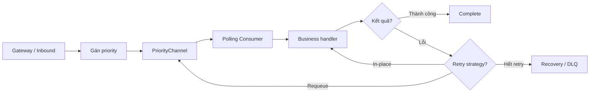
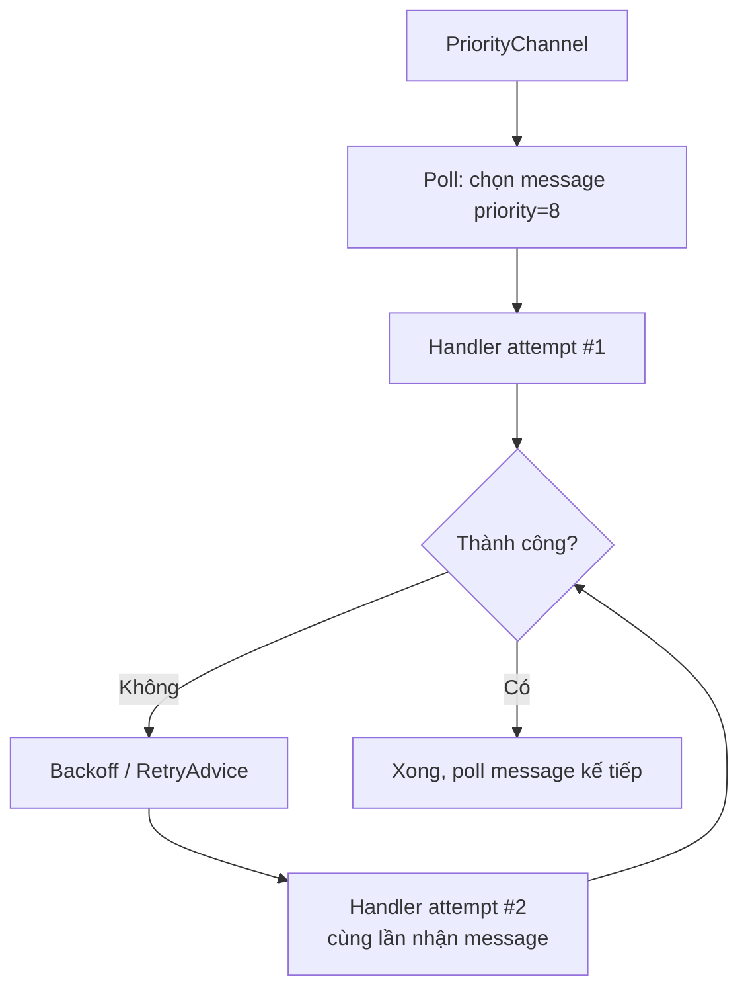
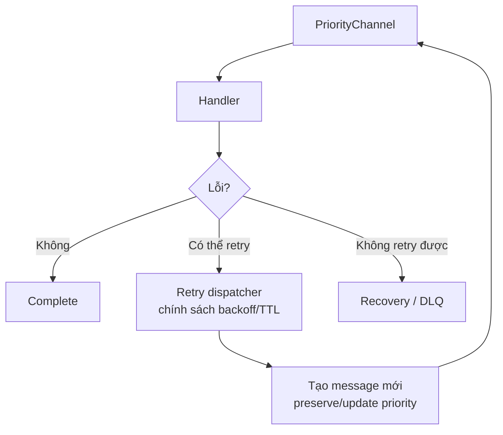
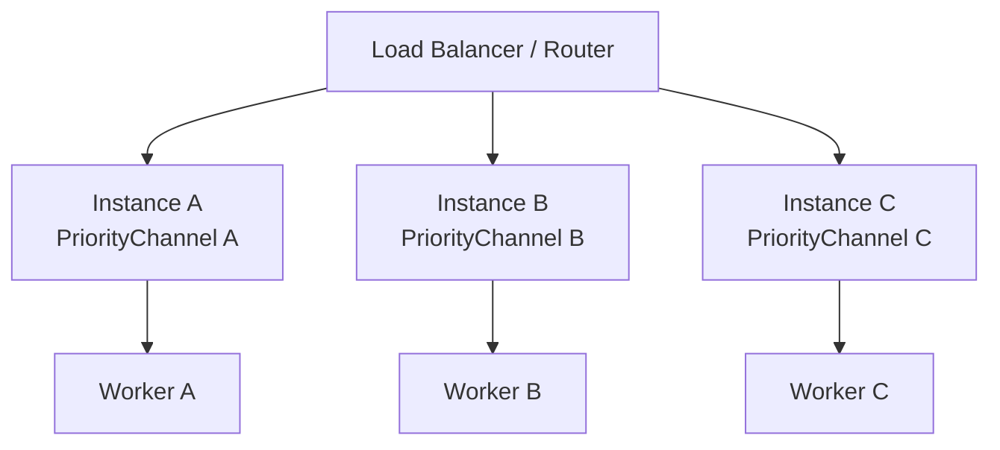

# Retry message có giữ priority không?

Trong một hệ thống tích hợp, message ưu tiên cao thường cần được xử lý trước message thông thường. Spring Integration hỗ trợ **Priority Channel** để chọn thứ tự lấy message dựa trên độ ưu tiên. Tuy nhiên, sau khi handler thất bại, câu hỏi “**Retry message có giữ priority không?**” không có câu trả lời đúng cho mọi kiểu retry.

**Câu trả lời ngắn:** nếu cơ chế retry gọi lại handler trên **message đã được lấy ra khỏi channel**, thuộc tính priority của message có thể vẫn tồn tại trong headers nhưng **PriorityChannel không tham gia sắp xếp giữa các attempt đó**. Nếu retry bằng cách **đưa lại message vào PriorityChannel hoặc gửi message mới qua broker**, thứ tự xử lý tiếp theo phụ thuộc vào việc priority có được sao chép/ánh xạ sang message mới, cách comparator/broker hoạt động và chính sách scheduling. Không được mặc định rằng mọi cơ chế retry giữ nguyên priority và vị trí cũ trong queue.

Bài thuộc chương **Priority** của module **SPRING_INTEGRATION_PATTERN**. Module tập trung triển khai Enterprise Integration Patterns (EIP) bằng Spring Integration để xây dựng luồng thông điệp ít phụ thuộc, dễ mở rộng; thực hành Router, Filter, Transformer, Splitter, Aggregator, Gateway, retry, error channel và correlation, đồng thời kiểm thử, theo dõi các nhánh xử lý.

Sau bài học, bạn có thể:

- Giải thích sự khác nhau giữa **giá trị priority trong header** và **thứ tự message được xử lý thực tế**.
- Phân biệt retry nội bộ tại handler, retry thông qua requeue, deferred retry, error channel, DLQ và republish.
- Giữ hoặc điều chỉnh `MessageHeaders.PRIORITY` theo chính sách có kiểm soát khi tạo message mới.
- Hiểu các trường hợp retry làm nghẽn consumer, đảo thứ tự, gây starvation hoặc thay đổi latency của message ưu tiên cao.
- Viết flow và test ở mức Spring Integration Java DSL, phân biệt kênh ưu tiên trong JVM với ưu tiên do broker thực thi.
- Theo dõi attempt, priority, queue age, correlation và idempotency mà không đưa dữ liệu nhạy cảm vào log.

## 1. Priority có thể mang ba nghĩa khác nhau

Trước khi hỏi “có giữ priority không?”, cần biết đang nói tới loại ưu tiên nào.

| Khái niệm | Ý nghĩa | Điều cần kiểm chứng |
| --- | --- | --- |
| **Priority metadata** | Giá trị được gắn vào `MessageHeaders.PRIORITY` hoặc metadata tương đương | Giá trị có còn trong message sau khi biến đổi/retry? |
| **Queue ordering** | Quy tắc channel/broker chọn message tiếp theo để lấy ra | Comparator, priority range, cách xử lý message đồng hạng |
| **Scheduling/execution priority** | Message thực sự được handler chạy sớm hay muộn | Có bao nhiêu worker, retry backoff, in-flight, fairness, downstream latency |

Một message có header `priority=9` không tự động “đẩy” một handler đang thực hiện message `priority=1` ra khỏi CPU. Priority queue chủ yếu quyết định **message nào được chọn khi consumer có thể lấy message tiếp theo**. Nó thường không có cơ chế preemption đối với công việc đã bắt đầu.

Ví dụ:

```text
10:00:00  Worker đã lấy Job A, priority=1, bắt đầu gọi API 5 giây
10:00:01  Job B, priority=9, vào PriorityChannel
10:00:02  Job B vẫn ở queue; Worker đang xử lý A
10:00:05  Worker hoàn thành A rồi mới có cơ hội lấy B
```

Trong trường hợp đó, header priority của B không sai. Chỉ là **thứ tự lấy message** và **thời gian thực thi** là hai chuyện khác nhau.

### Dòng chảy tổng quát



Sơ đồ khái quát hai chiến lược; trong thực tế việc retry/requeue và error publishing do endpoint, advice, adapter hoặc ứng dụng cấu hình. Những mũi tên này không có nghĩa Spring Integration tự động requeue mọi lỗi vào channel.

## 2. PriorityChannel trong Spring Integration hoạt động thế nào?

`PriorityChannel` là một `PollableChannel` có hàng đợi sắp xếp theo comparator, thường dựa trên header `MessageHeaders.PRIORITY`. Với cách so sánh ưu tiên mặc định theo giá trị số, mức ưu tiên cao hơn được chọn trước khi consumer lấy message, **nếu các message vẫn còn đang chờ trong channel**.

Ví dụ:

```text
Message A: priority=2
Message B: priority=9
Message C: priority=5

Khi cả A, B, C đều chờ:
poll #1 -> B
poll #2 -> C
poll #3 -> A
```

Điều kiện quan trọng là **cả ba message đang ở trong queue tại lúc poll**. Nếu consumer đã lấy A trước khi B đến, B không thể làm A “chui ngược” vào queue.

Đối với message cùng priority, đừng dựa vào giả định FIFO tuyệt đối khi thay đổi comparator, endpoint, môi trường chạy hoặc broker. Nếu thứ tự trong cùng mức ưu tiên là một yêu cầu nghiệp vụ, hãy định nghĩa và kiểm thử rõ tie-breaking, sequencing hoặc mô hình xử lý phù hợp.

### Cách gắn priority

Dùng hằng `MessageHeaders.PRIORITY` thay vì viết một key tuỳ ý không được channel/broker nhận biết:

```java
import org.springframework.messaging.Message;
import org.springframework.messaging.MessageHeaders;
import org.springframework.messaging.support.MessageBuilder;

Message<String> urgent = MessageBuilder.withPayload("urgent-job")
        .setHeader(MessageHeaders.PRIORITY, 9)
        .setHeader("requestCorrelationId", "req_42")
        .build();
```

`MessageHeaders.PRIORITY` là thuộc tính của **message**. Spring Integration còn cần một **channel/adapter có hỗ trợ priority** để sử dụng nó cho việc sắp thứ tự. `DirectChannel` không có queue để sắp xếp; `ExecutorChannel` giao việc cho executor theo cơ chế riêng; broker/adapter bên ngoài có semantics priority khác nhau.

**Chú ý:** giá trị `9` ở ví dụ chỉ là một mức priority được ứng dụng lựa chọn. Dải hợp lệ và mapping qua broker cần kiểm tra theo công nghệ vận chuyển; không suy rằng giá trị trên header luôn được giữ nguyên từ Java đến hệ thống bên ngoài.

## 3. Retry in-place: giữ message nhưng không trở lại priority queue

Trường hợp phổ biến là một polling consumer lấy message khỏi `PriorityChannel`, sau đó handler được bọc bằng `RequestHandlerRetryAdvice` hoặc Spring Retry tương đương.



Trong kiểu retry này:

1. Message đã **ra khỏi** PriorityChannel tại lần poll đầu.
2. Retry advice gọi lại công đoạn xử lý; message **không tự được thêm lại vào PriorityChannel** giữa các attempt.
3. Header `priority` thường vẫn hiện diện trên message được handler sử dụng nếu handler/advice không tạo message khác hoặc ghi đè header.
4. Các message khác trong channel **không được chọn xen vào** chỉ bởi vì handler đang backoff; nếu chỉ có một consumer và retry đồng bộ, worker có thể bị chiếm trong suốt thời gian thử lại.
5. Thứ tự xử lý sau attempt cuối cùng chỉ được xác định khi consumer quay lại poll queue.

Vì vậy, “priority được giữ” ở đây đúng về mặt **metadata của message** nhưng chưa chắc có ý nghĩa về **lịch xử lý giữa các attempt**.

### Minh họa thứ tự thực tế

```text
Queue ban đầu: A(priority=8), B(priority=7), C(priority=2)

t=0    Worker poll A
t=1    A attempt #1 thất bại
t=2    RetryAdvice đợi 3 giây
t=3    D(priority=9) mới đến, đang chờ trong queue
t=5    A attempt #2, vẫn chạy trước D trên worker đó
t=6    A thành công
t=7    Worker poll D(priority=9), rồi B, rồi C
```

Không có đảm bảo một message priority 9 được **thực thi ngay** khi một worker đang bị block bởi retry của priority 8.

## 4. Ví dụ Java DSL: PriorityChannel cùng RetryAdvice ở handler

Ví dụ sau sử dụng Java 17+, Spring Integration Java DSL và Spring Retry. Đây là một mô hình **pollable PriorityChannel cục bộ trong JVM**, không phải broker phân tán.

```java
import org.springframework.context.annotation.Bean;
import org.springframework.context.annotation.Configuration;
import org.springframework.integration.channel.PriorityChannel;
import org.springframework.integration.dsl.IntegrationFlow;
import org.springframework.integration.dsl.Pollers;
import org.springframework.integration.handler.advice.RequestHandlerRetryAdvice;
import org.springframework.messaging.MessageChannel;

import org.springframework.retry.policy.SimpleRetryPolicy;
import org.springframework.retry.backoff.FixedBackOffPolicy;
import org.springframework.retry.support.RetryTemplate;

record WorkItem(String id, String payload) { }

class WorkHandler {
    public void process(WorkItem item) {
        // Gọi hệ thống phụ thuộc / thực hiện nghiệp vụ.
        // Có thể ném RuntimeException để advice đánh giá retry.
    }
}

@Configuration
class PriorityRetryFlowConfig {

    @Bean
    PriorityChannel priorityWorkQueue() {
        return new PriorityChannel(100);
    }

    @Bean
    RequestHandlerRetryAdvice workRetryAdvice() {
        RetryTemplate template = new RetryTemplate();

        SimpleRetryPolicy retryPolicy = new SimpleRetryPolicy(3);
        FixedBackOffPolicy backOff = new FixedBackOffPolicy();
        backOff.setBackOffPeriod(500L);

        template.setRetryPolicy(retryPolicy);
        template.setBackOffPolicy(backOff);

        RequestHandlerRetryAdvice advice = new RequestHandlerRetryAdvice();
        advice.setRetryTemplate(template);
        return advice;
    }

    @Bean
    WorkHandler workHandler() {
        return new WorkHandler();
    }

    @Bean
    IntegrationFlow priorityWorkerFlow(
            WorkHandler workHandler,
            RequestHandlerRetryAdvice workRetryAdvice) {
        return IntegrationFlow.from("priorityWorkQueue")
                .handle(workHandler, "process", endpoint -> endpoint
                        .poller(Pollers.fixedDelay(100)
                                .maxMessagesPerPoll(1))
                        .advice(workRetryAdvice))
                .get();
    }
}
```

Giải thích:

- `PriorityChannel(100)` tạo một hàng đợi có giới hạn kích thước trong cùng ứng dụng (đối chiếu constructor/API với phiên bản Spring Integration sử dụng).
- Poller lấy message tiếp theo khi đến lượt. Comparator của channel quyết định message ưu tiên hơn **trong số message đang chờ**.
- `RequestHandlerRetryAdvice` bọc lời gọi handler bằng `RetryTemplate`; ở ví dụ policy có tổng số attempt tối đa bằng 3, với backoff cố định 500 ms giữa các lần thử.
- Retry advice **không** tự đưa message về `priorityWorkQueue` sau mỗi attempt. Trong thời gian handler đang retry, priority queue tiếp tục giữ các message chờ.
- Khi hết retry và handler còn ném lỗi, cách phát `ErrorMessage`, xử lý exception hoặc recovery phụ thuộc poller, error channel và cấu hình endpoint. Đoạn ví dụ chưa triển khai DLQ/requeue.
- Mỗi call đến handler phải được thiết kế idempotent hoặc có chiến lược bù trừ; retry có thể lặp lại side effect nếu lần trước đã thực hiện một phần.

**Quan trọng:** code là ví dụ học tập về vị trí của priority và advice. Cần chạy test ở phiên bản dependency thực tế, định nghĩa exception retry được phép, timeout của downstream, error flow, metric, thread pool và chính sách duy trì message khi restart. Trong-memory queue không phải tự động có durability qua process crash.

### Nếu cần xử lý message ưu tiên mới đến ngay trong lúc backoff?

Có thể tăng số consumer (nếu nghiệp vụ cho phép song song), thiết kế deferred retry thay vì chờ trên worker, hoặc tách các nhóm priority thành lane/queue có concurrency riêng. Mỗi lựa chọn có trade-off về ordering, tải downstream, idempotency và công bằng. Đừng mặc định một queue ưu tiên đơn với một poller mang lại latency tốt cho mọi trường hợp.

## 5. Retry bằng requeue: priority được xét lại ở lần poll sau

Một chiến lược khác là khi xử lý thất bại, hệ thống **tạo message để gửi lại vào một queue**. Khi đó message retry phải cạnh tranh với các message đang chờ, và priority bắt đầu có ý nghĩa trở lại tại **lần chọn tiếp theo**.



Ví dụ:

```text
Queue có B(priority=6), C(priority=2)
Handler đã lấy A(priority=8) và thất bại
A được requeue với priority=8

Sau khi requeue, nếu B, C và A đều chờ:
poll tiếp theo thường chọn A(priority=8) trước B(priority=6)
```

Điều đó **không có nghĩa A giữ vị trí queue ban đầu**. Nó được đưa vào quá trình sắp xếp lại; nếu có D(priority=9), D có thể được lấy trước A. Nếu A và B có cùng priority, thứ tự phụ thuộc tie-breaker/implementation, không nên khẳng định giữ đúng thứ tự ban đầu.

### Những trường hợp message retry mất hoặc đổi priority

| Cách tạo/chuyển message | Điều cần kiểm tra |
| --- | --- |
| Gửi lại nguyên `Message<?>` vào PriorityChannel | Header priority còn nhưng phải xét queue capacity, in-flight và duplicate |
| `MessageBuilder.fromMessage(original)` | Có sao chép header priority hay bị bước sau ghi đè? |
| `MessageBuilder.withPayload(...)` tạo message mới | Nếu không copy/set priority, header có thể vắng mặt |
| Transformer trả message/payload mới | Header propagation theo contract của transformer/endpoint |
| Error flow dùng `ErrorMessage` | Header của `ErrorMessage` không mặc định tương đương failed message |
| Gửi qua outbound broker adapter | Header mapping và thuộc tính priority của broker/producer |
| DLQ rồi republish | Tooling và consumer republisher có giữ/chuẩn hóa priority không? |
| Thay policy theo số lần retry | Priority có thể được tăng, giảm hoặc giữ theo quyết định nghiệp vụ |

**Câu hỏi cốt lõi là “priority được dùng để chọn message nào ở lần tiếp theo?”**, không chỉ “có trường tên `priority` trong object hay không?”.

## 6. Giữ header priority khi tạo message retry

Nếu muốn **giữ nguyên priority nghiệp vụ**, hãy đọc giá trị từ message thất bại được xác minh và tạo message mới theo một policy rõ. Ví dụ mã minh họa trong một utility:

```java
import org.springframework.messaging.Message;
import org.springframework.messaging.MessageHeaders;
import org.springframework.messaging.support.MessageBuilder;

final class RetryMessageFactory {

    private RetryMessageFactory() { }

    static <T> Message<T> forRetry(
            Message<T> failed, int nextAttempt) {

        if (nextAttempt <= 1 || nextAttempt > 5) {
            throw new IllegalArgumentException("Invalid retry attempt");
        }

        Object raw = failed.getHeaders().get(MessageHeaders.PRIORITY);
        int priority = (raw instanceof Integer value && value >= 0
                && value <= 9) ? value : 0;

        return MessageBuilder.fromMessage(failed)
                .setHeader(MessageHeaders.PRIORITY, priority)
                .setHeader("retryAttempt", nextAttempt)
                .build();
    }
}
```

**Điểm đáng chú ý:**

1. `MessageBuilder.fromMessage(failed)` là một cách tạo builder từ message đã có. Ví dụ vẫn đặt **tường minh** header priority để diễn đạt policy và giới hạn 0–9 của ứng dụng.
2. `retryAttempt` là metadata mới của lần gửi lại; nên có một giới hạn retry rõ, không thể tăng mãi.
3. Header `MessageHeaders.ID` của message không nên dùng làm idempotency key nghiệp vụ tuyệt đối. Khi tạo message mới hoặc đi qua adapter, định danh message có thể thay đổi theo framework/transport; cần một `businessOperationId` ổn định do ứng dụng quy định.
4. Những header không cần thiết hoặc không đáng tin phải được lọc trước khi gửi qua ranh giới service. `fromMessage(...)` không thay thế header allowlist khi republish ra bên ngoài.
5. Đảm bảo `priority` đến từ nguồn/policy tin cậy, không trao quyền cho client tùy ý gắn priority 9 để vượt mọi đơn hàng khác.
6. Việc có header priority 9 trong message mới **không đủ** để bảo đảm broker sử dụng priority đó; cần mapping/cấu hình adapter phù hợp.

Đây là ví dụ về **xây dựng message**, không phải một recovery flow hoàn chỉnh. Một hệ thống production cần quy định nơi lưu message đang chờ retry, thời điểm hết hạn, khả năng gửi lại nhiều lần, tác động đến transaction/ack và xử lý khi `send(...)` thất bại.

## 7. So sánh ba kiểu retry bằng một kịch bản

Giả định A có priority 8, B có priority 6, C có priority 2; A thất bại ở lần xử lý đầu.

| Cơ chế | A sẽ đi đâu? | Priority có quyết định vị trí A lúc retry? |
| --- | --- | --- |
| **RetryAdvice in-place** | Vẫn trong lời gọi handler hiện tại | Không. Handler retry ngay, queue chưa lấy message mới |
| **Requeue về PriorityChannel** | Trở lại queue cùng B/C (nếu send thành công) | Có, nếu priority header/comparator được giữ đúng |
| **Delayed retry rồi republish** | Đến scheduler/queue trì hoãn, sau đó lại vào queue đích | Chỉ sau khi được đưa lại vào queue đích; còn phụ thuộc timing và broker |

Nếu retry in-place kéo dài, **B và C đều chờ** trên một worker. Nếu requeue A giữ priority 8 và thất bại liên tục, nó có thể được chọn lặp lại trước B/C, gây **starvation**. Nếu delayed retry A tạm rời queue, B/C có cơ hội được xử lý trong thời gian đợi, nhưng ordering ban đầu không còn được duy trì.

Không có cơ chế nào phù hợp tuyệt đối:

- Retry tại handler đơn giản, dễ giữ cùng context, nhưng có thể chiếm thread lâu.
- Requeue giúp nhường worker, nhưng cần kiểm soát duplicate, ordering, TTL, ack và loop vô hạn.
- Delayed retry giảm áp lực downstream nhưng tăng độ phức tạp scheduling, lưu trữ và quan sát.

## 8. Có nên giảm priority sau mỗi lần retry?

Đây là **chính sách nghiệp vụ**, không phải quy tắc mặc định của Spring Integration. Một số phương án:

| Policy | Ví dụ A từ priority 8 sau hai lỗi | Ưu điểm | Nguy cơ |
| --- | --- | --- | --- |
| **KEEP** | 8 → 8 → 8 | Giữ SLA và ý nghĩa khẩn cấp ban đầu | Message lỗi liên tục có thể chiếm đầu queue |
| **DECREASE** | 8 → 6 → 4 | Nhường tài nguyên cho message mới khỏe mạnh | Công việc khẩn cấp có thể bị trì hoãn không mong muốn |
| **INCREASE** | 8 → 9 → 9 | Cố ưu tiên phục hồi tác vụ rất quan trọng | Có thể làm trầm trọng retry storm/starvation |
| **SEPARATE RETRY LANE** | 8 → hàng đợi retry riêng | Hạn chế cản trở luồng chính | Cần quản trị thêm queue/scheduler |
| **TIME-BASED AGING** | Điểm chọn tăng theo thời gian chờ | Giảm starvation của message thấp | Cần comparator/scheduler được kiểm chứng |

**Không tăng priority chỉ vì retry nhiều.** Một message đã thất bại nhiều lần có thể đang chờ dependency hồi phục; việc đưa nó lên cao hơn có thể làm nghẽn mọi request mới.

Ví dụ policy đơn giản có thể là:

- Với lỗi tạm thời: giữ **businessPriority** trong header gốc, dùng backoff/deferred retry.
- Với quá nhiều attempt: chuyển sang recovery/DLQ có phân loại, không cố requeue vô hạn.
- Với SLA khẩn cấp: có lane và capacity dành riêng, nhưng vẫn có circuit breaker/rate limiter cho dependency.
- Với message cũ: dùng TTL/deadline và ưu tiên theo chính sách tổng hợp thay vì chỉ so một số cố định.

Nếu định nghĩa thêm `effectivePriority` dùng cho queue, ghi rõ đó là giá trị có thể thay đổi theo retry; đừng viết đè `businessPriority` không có cách phục hồi hoặc audit.

## 9. Priority và backoff có thể mâu thuẫn về mục tiêu

Một message có priority cao có thể phải chờ retry **lâu hơn** do backoff theo policy lỗi. Ví dụ:

```text
A(priority=9): upstream trả HTTP 503, phải backoff 30 giây
B(priority=4): xử lý được ngay
C(priority=4): xử lý được ngay
```

Nếu worker giữ A trong retry in-place 30 giây, B và C có thể bị chậm dù dependency của chúng đang khỏe. Nếu A được hoãn ở scheduler, B và C tiếp tục chạy; khi A đến hạn, nó được đưa về queue và cạnh tranh lại theo priority.

Do đó cần phân biệt:

- **Business priority:** mức khẩn cấp của công việc.
- **Next eligible time:** khi nào message đủ điều kiện retry.
- **Deadline/TTL:** đến lúc nào message còn ý nghĩa nghiệp vụ.
- **Fairness:** lượng capacity tối thiểu dành cho các mức khác.
- **Retry budget:** số lần/tổng thời gian retry được phép.

Một hệ thống tốt không dùng một trường `priority` duy nhất để quyết định tất cả các điều trên. Priority không thay thế retry policy, circuit breaker hay rate limiter.

### Retry storm và circuit breaker

Khi downstream gặp sự cố, hàng nghìn message priority cao có thể cùng retry. Nếu cứ requeue với priority cao mà không backoff, nhóm đó có thể ăn hết worker/connection pool. Circuit breaker hoặc retry budget giúp ngăn lời gọi liên tục đến dependency đang lỗi; queue/retry lane vẫn cần giám sát backlog và thời gian chờ. Đừng suy “priority cao” đồng nghĩa được bỏ qua giới hạn an toàn của hệ thống.

## 10. Error channel, failedMessage và DLQ có tự giữ priority không?

Khi một endpoint phát `ErrorMessage`, payload lỗi thường là `Throwable`; với `MessagingException` có thể truy được `getFailedMessage()`. Tuy nhiên, **ErrorMessage là một message khác** với message nghiệp vụ đã thất bại, và không nên coi mọi header trên ErrorMessage là bản sao đầy đủ của original message.

Khi triển khai một recovery handler:

1. Xác định `Throwable` và tìm **failed message** đúng chặng, có thể kiểm tra `MessagingException.getFailedMessage()` nếu phù hợp.
2. Lấy business operation ID, request correlation và priority **đã xác thực** từ message nghiệp vụ phù hợp.
3. Xác định lỗi có retry được hay không và đã hết retry budget chưa.
4. Nếu cần requeue, tạo message mới bằng factory có chính sách priority; đặt attempt metadata và expiry.
5. Nếu không retry được, chuyển sang DLQ/quarantine/terminal error theo yêu cầu; đừng đẩy vào `nullChannel` chỉ để hết exception.
6. Ghi Counter/log cho `retried`, `exhausted`, `dead_lettered` theo đúng semantics.

Một đoạn giả mã chính sách:

```text
onError(errorMessage):
  failed = extractFailedBusinessMessage(errorMessage)
  if failed is null:
      recordUncorrelatedFailureAndAlert()
      return

  if isRetryable(errorMessage) and attempts(failed) < maxAttempts:
      message = rebuildForRetry(failed, KEEP_BUSINESS_PRIORITY)
      enqueueAfterBackoff(message)
  else:
      sendToDeadLetterWithMetadata(failed, errorCode)
```

Đây là **pseudocode**, không phải API có sẵn thực hiện đầy đủ các hàm trên. Với lỗi đồng bộ từ `DirectChannel`, exception có thể được ném về caller thay vì tự động đi qua `errorChannel`; với poller/adapter bất đồng bộ, cơ chế phát lỗi phụ thuộc cấu hình.

### DLQ có phải PriorityChannel không?

Không. DLQ là nơi giữ message lỗi phục vụ điều tra/recovery; nó có thể dùng queue FIFO, broker queue hoặc lưu bền vững theo thiết kế. Khi replay từ DLQ, **priority có được giữ hay không** phụ thuộc việc metadata được lưu và mapper của công cụ replay. Một DLQ giữ được body nhưng mất header priority sẽ không thể tự biết priority nghiệp vụ ban đầu.

Với yêu cầu replay nghiêm ngặt, lưu cả `businessPriority`, `originalMessageId`/`businessOperationId`, attempt, error code, thời gian và version của schema trong một envelope có kiểm soát.

## 11. Khi qua broker, priority không còn chỉ là header Java

Trong hệ thống nhiều service, một message retry có thể qua JMS, RabbitMQ, Kafka hoặc hệ thống khác. Mỗi transport có semantics khác nhau:

| Transport/mô hình | Điều cần lưu ý |
| --- | --- |
| **Spring Integration PriorityChannel cục bộ** | Comparator chọn message đang nằm trong queue của instance đó |
| **JMS** | JMS có khái niệm message priority; producer/adapter và broker phải ánh xạ, hỗ trợ và cấu hình đúng |
| **RabbitMQ priority queue** | Cần cấu hình queue hỗ trợ priority và publisher đặt thuộc tính message priority; không mặc định mọi queue là priority queue |
| **Kafka partition** | Bảo đảm thứ tự theo offset trong partition theo cơ chế Kafka, không mặc định xếp message theo một header `priority` |
| **Delayed/retry topic/queue** | Sau thời gian chờ, publisher/consumer quyết định metadata nào được mang sang đích |
| **DLQ** | Giữ thông tin để replay theo khả năng transport và công cụ, không phải bảo đảm thứ tự/priority nguyên trạng |

**Đừng đồng nhất các mức ưu tiên.** Header `MessageHeaders.PRIORITY` trên một Spring Message, JMS priority, AMQP message priority và một thuộc tính tùy chỉnh trong Kafka không có nghĩa tự động liên thông. Adapter/header mapper có thể chuyển, bỏ hoặc chuẩn hóa metadata; hãy kiểm tra và test đường đi thực tế.

Một broker priority queue cũng có thể phát message theo cơ chế batching, prefetch hoặc consumer scheduling: message ưu tiên cao xuất hiện sau khi consumer đã prefetch message thấp không nhất thiết được thực thi trước các message đó.

## 12. Một PriorityChannel trên mỗi instance không tạo thứ tự toàn cụm

Giả sử service chạy ba replica, mỗi replica có một `PriorityChannel` riêng:



Priority 9 đang chờ ở A có thể bị chậm hơn priority 3 đang chạy ở B nếu A bận hoặc bị backoff. Không có **một hàng đợi toàn cục** để so các message trên ba instance.

Do đó, khi cần SLA ưu tiên ở cấp cluster, hãy quyết định rõ:

- Có cần **global ordering** không, hay chỉ cần ưu tiên tương đối theo partition/worker?
- Có những lane riêng theo priority, ví dụ `urgent` và `standard`, hay một queue chung?
- Worker có được lấy message vượt mức concurrency cho từng lane không?
- Retry có được phép chuyển lane và có cần giữ business priority không?
- Có thể scale lane urgent riêng không, và giới hạn downstream chung như thế nào?
- Chiến lược fairness nào giúp standard không bị starvation?

Global ordering nghiêm ngặt thường có trade-off lớn về throughput và availability. Nhiều hệ thống chọn **ưu tiên có giới hạn** thay vì bắt buộc mọi message khẩn cấp toàn cụm phải hoàn thành trước mọi message thông thường.

## 13. Correlation, idempotency và thứ tự nghiệp vụ

Retry có thể dẫn tới lặp side effect và tạo message mới. Ngay cả khi priority giữ nguyên, cần bảo vệ **tính đúng đắn nghiệp vụ**.

| Metadata | Vai trò |
| --- | --- |
| `businessOperationId` | Khóa idempotency của tác vụ, ổn định qua retry |
| `requestCorrelationId` | Liên kết các sự kiện thuộc một yêu cầu |
| `MessageHeaders.ID` | Nhận diện message trong từng bước; không nên dựa vào tính ổn định tuyệt đối qua republish |
| `MessageHeaders.PRIORITY` | Giá trị dùng cho thứ tự ở channel có hỗ trợ |
| `retryAttempt` | Lần thử hiện tại theo policy |
| `originalPriority` | Có thể lưu mức nghiệp vụ ban đầu nếu policy điều chỉnh effective priority |
| `nextEligibleAt` | Thời điểm đủ điều kiện retry khi dùng deferred scheduling |
| `deadline` | Thời hạn xử lý nghiệp vụ |
| `correlationId`/`sequenceNumber` | Metadata nhóm Splitter/Aggregator khi có |

Một message priority 9 không được phép bỏ qua idempotency. Nếu lần attempt đầu đã ghi DB nhưng acknowledgement bị mất, attempt tiếp theo có thể lặp việc ghi. Tránh giải quyết bằng cách hạ priority: đó là vấn đề xác nhận/idempotency và transaction, không phải độ ưu tiên.

### Khi Splitter/Aggregator tham gia

Một yêu cầu có thể được tách thành nhiều phần tử, mỗi phần mang correlation và sequence. Nếu một phần tử thất bại rồi được requeue với priority cao, cần xác định:

- Priority của **từng item** có giữ theo request gốc hay được tính riêng?
- Aggregator chờ đủ nhóm hay có release strategy cho một phần tử lỗi?
- Retry làm thay đổi `sequenceNumber`/`sequenceSize` hoặc `correlationId` không?
- Nếu một item được xử lý hai lần, aggregator/dedup có nhận duplicate không?
- Liệu nâng priority cho một item giúp nhóm hoàn tất sớm hay chỉ tạo starvation cho nhóm khác?

Đừng dùng thứ tự poll của PriorityChannel để suy thứ tự business sequence. Priority ordering và sequence ordering phục vụ hai mục đích khác nhau.

## 14. Quan sát priority và retry bằng metrics, logs, traces

Muốn kiểm chứng “retry có giữ priority không” trong production, phải quan sát **giá trị header ở cả lúc nhận, lúc retry và lúc dequeue**, không chỉ đọc log lỗi cuối.

Một bộ sự kiện structured log gợi ý:

```json
{
  "event": "integration.retry_requeued",
  "flow": "orderFulfillment",
  "stage": "inventoryWorker",
  "requestCorrelationId": "req_42",
  "businessOperationId": "op_42",
  "messageId": "2e7743aa-1d89-4c12-8c73-7a22c2d75b4e",
  "businessPriority": 8,
  "effectivePriority": 8,
  "retryAttempt": 2,
  "reasonCode": "UPSTREAM_TIMEOUT"
}
```

Không ghi payload hay token vào log. `businessOperationId` và request ID cũng cần được quản trị quyền truy cập, độ dài, định dạng và retention.

| Metric | Đơn vị | Câu hỏi |
| --- | --- | --- |
| `priority_queue_depth` | Message chờ, theo priority bucket hữu hạn | Message ưu tiên nào đang backlog? |
| `priority_queue_oldest_age` | Giây chờ | Message thấp có bị starvation không? |
| `handler_attempts_total` | Attempt | Retry tạo thêm bao nhiêu lời gọi? |
| `retry_requeued_total` | Message/lần requeue | Bao nhiêu lần đưa lại vào queue? |
| `retry_exhausted_total` | Terminal failure | Bao nhiêu message hết retry? |
| `processing_duration` | Thời gian handler | Retry làm tăng thời gian xử lý thế nào? |
| `end_to_end_duration` | Thời gian yêu cầu | SLA theo priority có được đáp ứng? |
| `dead_letter_total` | Message vào DLQ | Priority nào thất bại cuối? |

Tên metric trên do ứng dụng đề xuất. Với metric labels, chỉ dùng tập priority hữu hạn (`urgent`, `normal`, `background` hoặc mức số đã giới hạn); không dùng request ID, message ID hoặc exception text làm tag.

**Một số đặc điểm khi đo:**

- Retry in-place có thể tăng `attempts` nhưng **không tăng `requeued`**.
- Một message requeue ba lần có thể tạo ba event; không đồng nghĩa ba message nghiệp vụ khác nhau.
- Queue depth có thể giảm vì một worker đã lấy message ra, nhưng request vẫn còn đang backoff trong handler.
- Trace spans cho retry chỉ xuất hiện khi đã instrument; tracing sampling không bảo đảm mọi attempt đều có span được lưu.

## 15. Kiểm thử có hệ thống thay vì đoán

### Test 1 — PriorityChannel lấy message ưu tiên cao trước

Ví dụ JUnit 5 tạo ba message trước khi bất kỳ consumer nào poll:

```java
import static org.junit.jupiter.api.Assertions.assertEquals;
import static org.junit.jupiter.api.Assertions.assertNotNull;

import org.junit.jupiter.api.Test;
import org.springframework.integration.channel.PriorityChannel;
import org.springframework.messaging.Message;
import org.springframework.messaging.MessageHeaders;
import org.springframework.messaging.support.MessageBuilder;

class PriorityChannelOrderingTest {

    @Test
    void takesHigherPriorityAmongWaitingMessages() {
        PriorityChannel queue = new PriorityChannel(10);

        queue.send(MessageBuilder.withPayload("low")
                .setHeader(MessageHeaders.PRIORITY, 1).build());
        queue.send(MessageBuilder.withPayload("high")
                .setHeader(MessageHeaders.PRIORITY, 9).build());
        queue.send(MessageBuilder.withPayload("medium")
                .setHeader(MessageHeaders.PRIORITY, 5).build());

        Message<?> first = queue.receive(0);
        Message<?> second = queue.receive(0);
        Message<?> third = queue.receive(0);

        assertNotNull(first);
        assertNotNull(second);
        assertNotNull(third);

        assertEquals("high", first.getPayload());
        assertEquals("medium", second.getPayload());
        assertEquals("low", third.getPayload());
    }
}
```

Bài test chỉ kiểm tra **sắp xếp message đã chờ trong một PriorityChannel cục bộ**, không kiểm tra retry hoặc nhiều consumer. Với message đồng hạng, cần kiểm thử comparator/tie-breaking theo yêu cầu.

### Test 2 — Rebuild retry message giữ priority đã chuẩn hóa

```java
import static org.junit.jupiter.api.Assertions.assertEquals;

import org.junit.jupiter.api.Test;
import org.springframework.messaging.Message;
import org.springframework.messaging.MessageHeaders;
import org.springframework.messaging.support.MessageBuilder;

class RetryMessageFactoryTest {

    @Test
    void preservesConfiguredBusinessPriority() {
        Message<String> original = MessageBuilder.withPayload("job-42")
                .setHeader(MessageHeaders.PRIORITY, 8)
                .setHeader("requestCorrelationId", "req_42")
                .build();

        Message<String> retried = RetryMessageFactory.forRetry(original, 2);

        assertEquals(8, retried.getHeaders().get(MessageHeaders.PRIORITY));
        assertEquals("req_42",
                retried.getHeaders().get("requestCorrelationId"));
        assertEquals(2, retried.getHeaders().get("retryAttempt"));
    }
}
```

Nếu factory tạo message bằng `MessageBuilder.withPayload(...)` mà không sao chép priority, test phải phát hiện header thiếu hoặc bị đưa về default theo policy. Đừng chỉ assert payload bằng nhau.

### Test 3 — Retry in-place không cho queue sắp lại giữa các attempt

Với một consumer, tạo kịch bản:

1. Cho A(priority=8) vào PriorityChannel và đợi handler lấy A.
2. Ở attempt đầu của A, chủ động phát sinh exception tạm thời và chặn ngắn ở backoff đã kiểm soát.
3. Trong lúc A đang backoff, gửi D(priority=9).
4. Xác nhận attempt thứ hai của A được gọi trước khi consumer quay lại poll lấy D.
5. Sau khi A hoàn thành/hết retry, xác nhận D được lấy tiếp nếu còn chờ và không có message ưu tiên hơn.

Cần đồng bộ bằng latch/clock giả hoặc cơ chế kiểm thử có giới hạn thay vì phụ thuộc `Thread.sleep` ngẫu nhiên. Nếu có nhiều consumer, trật tự thực thi có thể khác và test cần mô tả concurrency rõ.

### Test 4 — Requeue vào priority queue

1. Tạo B(priority=6), C(priority=2) đang chờ.
2. Tạo bản retry của A(priority=8) bằng factory và gửi lại vào queue.
3. Đảm bảo `send` thành công, sau đó poll các message khi không có consumer khác.
4. Xác nhận A được chọn trước B/C.
5. Thử A thiếu header hoặc priority không hợp lệ, kiểm tra policy default/reject.
6. Thử queue đầy và failure khi requeue: phải có recovery rõ, không bỏ message âm thầm.

### Test 5 — Multi-instance, broker, fairness

| Kịch bản | Kết quả cần xác minh |
| --- | --- |
| PriorityChannel A/B ở hai JVM | Không có global priority ordering mặc định |
| Retry qua JMS/RabbitMQ | Priority được mapper/broker áp dụng nếu đã cấu hình |
| Kafka republish | Thứ tự theo partition/offset, không dựa vào header priority tự tạo |
| Prefetch nhiều message | Message cao mới đến không luôn vượt message thấp đã giao cho consumer |
| Hàng priority cao liên tục | Queue age thấp có thể tăng; cần fairness/aging |
| Handler có side effect rồi retry | Idempotency ngăn ghi/đặt hàng trùng |
| Retry của một item Splitter | Group correlation/sequence không bị phá |
| DLQ replay | Có lưu priority và operation ID cần thiết |
| Bật/tắt DEBUG | Kết quả queue/handler không thay đổi |
| ErrorMessage thiếu failedMessage | Recovery không suy bừa priority từ message lỗi |

## 16. Các sai lầm phổ biến và cách sửa

| Sai lầm | Hậu quả | Cách khắc phục |
| --- | --- | --- |
| “Header priority vẫn còn, vậy retry sẽ chen lên trước” | Nhầm metadata với scheduling của retry in-place | Xác định retry có requeue không |
| Requeue bằng message mới nhưng không copy priority | Job khẩn cấp trở thành default priority | Test factory và header mapping |
| Giữ priority cao, requeue ngay vô hạn | Starvation, retry storm, quá tải upstream | Retry budget, backoff, DLQ hoặc lane riêng |
| Tăng priority ở mọi lần retry | Message lỗi chiếm queue lâu dài | Chọn policy theo SLA và loại lỗi |
| So thứ tự thực thi trên nhiều worker như queue FIFO | Test flaky và kết luận sai | Phân biệt dequeue order với completion order |
| Coi PriorityChannel in-memory là queue bền vững | Mất message khi process crash | Chọn persistence/transport phù hợp |
| Mong global priority từ nhiều replica | SLA toàn cụm không như dự kiến | Chọn topology/lane/scheduler có contract rõ |
| Dùng priority làm quyền cao do client tự khai | Lạm dụng quota hoặc bỏ qua fairness | Validate/derive priority ở trusted ingress |
| Bỏ message retry vào nullChannel để hết exception | Mất nghiệp vụ và che lỗi | Recovery, error channel, DLQ |
| Dùng messageId mới như khóa nghiệp vụ | Duplicate side effect sau republish | Stable businessOperationId + idempotency |
| Nhìn số WARN để đếm retry | Log level/sampling và log trùng | Đếm attempts/requeues bằng metric tại điểm thực |
| Để BackOff dài trên một poller đơn | Job khác dù priority cao vẫn phải chờ | Deferred retry hoặc tăng concurrency có kiểm soát |

## 17. Bài tập thực hành: ưu tiên đơn hàng sau retry

**Bối cảnh:** một hệ thống đặt hàng nhận ba loại công việc: `urgent`, `standard` và `background`. Router phân loại, Transformer chuẩn hóa payload, rồi gửi đến PriorityChannel để một poller gọi Inventory Gateway. Khi upstream timeout, job được retry. Một số job được Splitter tách thành nhiều item và Aggregator gom kết quả.

Thiết kế theo các bước:

1. Định nghĩa mapping `urgent=9`, `standard=5`, `background=1`. Xác nhận priority do ứng dụng đặt sau khi xác thực dữ liệu, không tin giá trị raw từ client.
2. Tạo `PriorityChannel` cục bộ có capacity hữu hạn và worker flow. Viết test khi ba message đã nằm trong queue trước lúc poll.
3. Cấu hình retry in-place tối đa 3 attempt với backoff có giới hạn. Gửi D(priority=9) trong lúc A(priority=8) đang retry; quan sát vì sao D không preempt A trên cùng worker.
4. Thay bằng một thiết kế deferred retry: đưa message lỗi vào retry scheduler/queue, đặt `nextEligibleAt` và chỉ requeue sau khi đủ điều kiện. Giữ `businessPriority`.
5. Tạo factory rebuild message và test header priority, request correlation, attempt cùng business operation ID được truyền đúng.
6. Thử **KEEP** và **DECREASE** priority khi retry. So p95 latency theo từng loại, số message bị starvation và throughput tổng.
7. Gây lỗi đến khi hết retry rồi đưa vào error flow/DLQ. Kiểm tra thông tin priority và operation ID để replay có kiểm soát.
8. Gây một message con lỗi trong Splitter; đảm bảo correlation/sequence và Aggregator release strategy không bị phá.
9. Chạy hai instance với PriorityChannel riêng; giải thích vì sao priority 9 ở replica A có thể hoàn thành sau priority 5 ở replica B.
10. Thu metric `attempts`, `requeued`, `queue oldest age` và log structured có `businessPriority`/`effectivePriority`. Đảm bảo log không ghi payload nhạy cảm.
11. Mô phỏng queue đầy, worker shutdown và crash trong lúc retry. Viết rõ đường recovery, khả năng mất/duplicate và điều kiện chấp nhận của hệ thống.

**Tiêu chí hoàn thành:** có thể trả lời chính xác ở từng chiến lược liệu header priority được giữ, liệu queue xét lại priority và thứ tự hoàn thành có thể thay đổi. Không có retry vô hạn, không mất message quan trọng âm thầm, có khả năng chống duplicate và đủ số liệu phát hiện starvation.

### Câu hỏi tự kiểm tra

1. Trong retry in-place, vì sao message priority 9 mới đến không nhất thiết chạy trước attempt tiếp theo của message priority 8?
2. `MessageHeaders.PRIORITY` còn nguyên có đủ để chứng minh retry được scheduler ưu tiên không?
3. Requeue một message mới cần sao chép/đặt những header và business ID nào?
4. Nếu RetryAdvice đã retry bên trong handler, `PriorityChannel` có nhận lại message sau mỗi attempt không?
5. Khi một message được requeue priority 8, nó có mặc nhiên giữ **vị trí** trước khi fail trong queue không?
6. Vì sao việc giảm priority theo số lần retry có thể cải thiện fairness nhưng làm chậm một job khẩn cấp?
7. Những khác biệt nào giữa PriorityChannel cục bộ, JMS priority, RabbitMQ priority queue và Kafka partition?
8. Tại sao prefetch hoặc nhiều worker làm thay đổi completion order?
9. `ErrorMessage` có thể được dùng trực tiếp như một business message với priority gốc không?
10. Vì sao stable business operation ID quan trọng hơn message ID khi xử lý retry?
11. Khi nào nên tách retry queue riêng hoặc dùng backoff scheduler thay vì block một polling consumer?
12. Nếu queue age của job priority thấp tăng mãi, bạn cần đo và điều chỉnh những gì?

## 18. Tài liệu tham khảo

- [Spring Integration — Priority Channel](https://docs.spring.io/spring-integration/reference/channel/implementations.html): các cách triển khai channel, bao gồm PriorityChannel.
- [Spring Integration — Message Headers](https://docs.spring.io/spring-integration/reference/message.html): cấu trúc Message và metadata.
- [Spring Integration — Polling Consumer](https://docs.spring.io/spring-integration/reference/endpoint.html): poller và endpoint lấy message từ PollableChannel.
- [Spring Integration — Retry Advice](https://docs.spring.io/spring-integration/reference/handler-advice/classes.html): handler advice, retry và recovery.
- [Spring Integration — Error Handling](https://docs.spring.io/spring-integration/reference/error-handling.html): ErrorMessage, error channel, lỗi đồng bộ/bất đồng bộ.
- [Spring Integration — Splitter](https://docs.spring.io/spring-integration/reference/splitter.html) và [Aggregator](https://docs.spring.io/spring-integration/reference/aggregator.html): correlation và release strategy.
- [Spring Retry Reference](https://docs.spring.io/spring-retry/reference/): RetryTemplate, policy và backoff.
- [Spring Framework — Messaging](https://docs.spring.io/spring-framework/reference/integration.html#spring-integration): các khái niệm message và channel.
- [RabbitMQ — Priority Queues](https://www.rabbitmq.com/docs/priority): điều kiện hỗ trợ priority và hạn chế thực tế.
- [Apache Kafka — Design](https://kafka.apache.org/documentation/): partition, offset và ordering.
- [Micrometer — Metrics Concepts](https://docs.micrometer.io/micrometer/reference/concepts.html): counter, timer, gauge và cardinality.

**Ghi nhớ:** Retry có thể **giữ header priority** mà vẫn **không được PriorityChannel sắp xếp lại** nếu retry đang diễn ra bên trong handler. Chỉ khi message trở lại một queue có hỗ trợ ưu tiên thì priority mới được xem xét ở lần chọn tiếp theo; khi qua transformer, error flow, DLQ, broker hoặc message mới, phải xác minh header mapping và chính sách retry. Hãy đo queue age, attempt, requeue và kết quả cuối, đồng thời bảo vệ idempotency, fairness và correlation để priority không làm hỏng tính đúng đắn nghiệp vụ.
