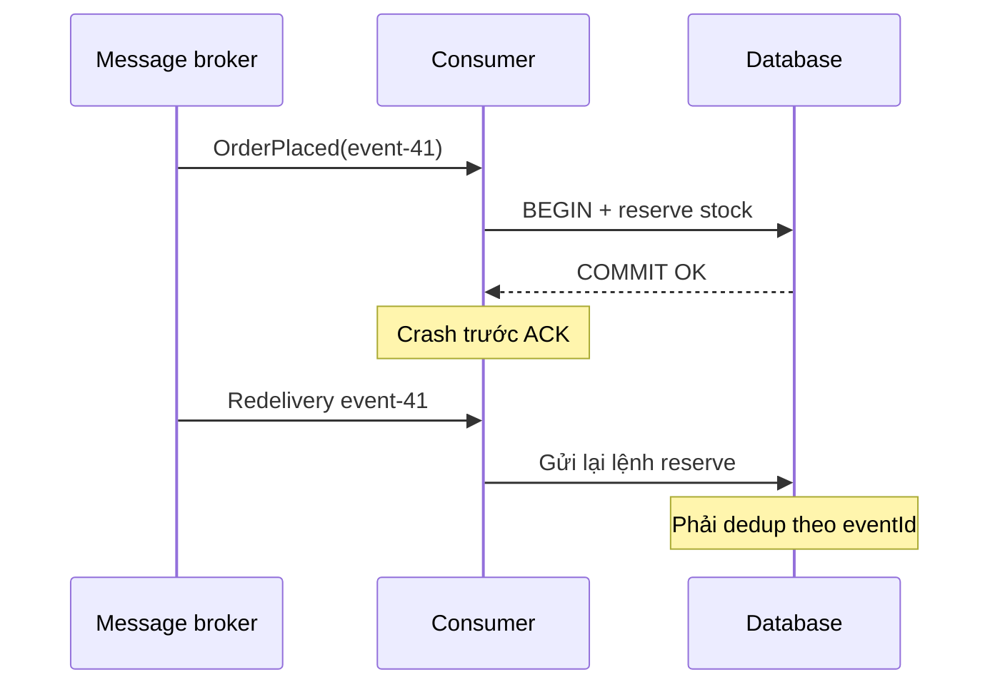
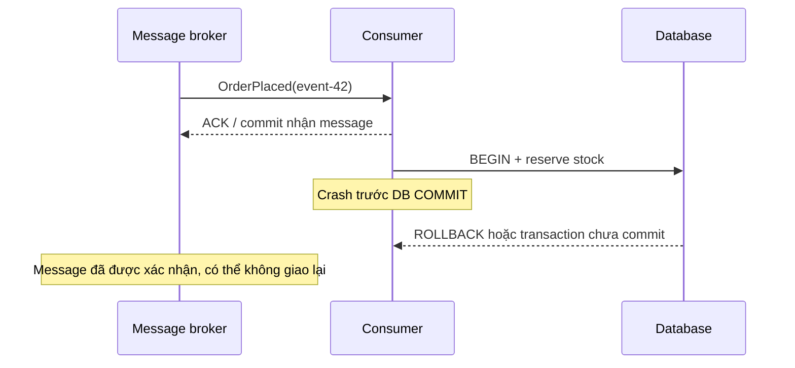
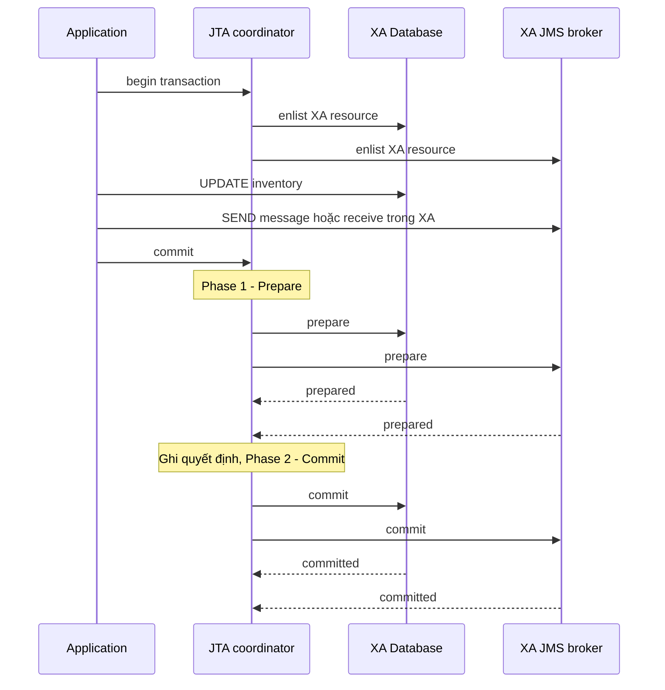
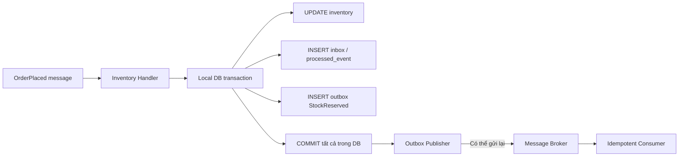
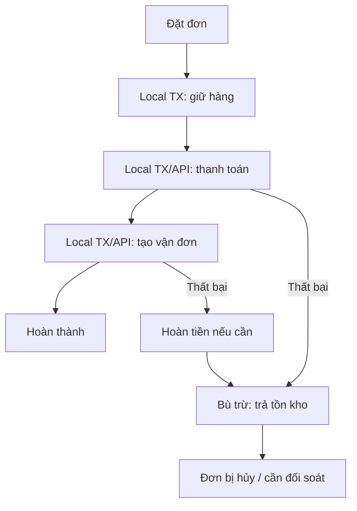

# Giao dịch local và distributed transaction trong Spring Integration

## 1. Bài toán: ghi database và xử lý message có thực sự là một giao dịch?

Một hệ thống thương mại điện tử nhận sự kiện `OrderPlaced` từ message broker. Spring Integration dùng Filter để từ chối dữ liệu sai, Transformer để chuẩn hóa, Router để chọn kho, rồi một handler cập nhật tồn kho trong database. Sau khi giữ hàng thành công, hệ thống cần phát sự kiện `StockReserved` cho dịch vụ giao vận.

Điều gì xảy ra nếu ứng dụng **đã commit database nhưng crash trước khi xác nhận message**? Broker có thể giao lại, dẫn đến xử lý cùng đơn hai lần. Ngược lại, nếu ứng dụng **đã gửi message tiếp theo rồi database rollback**, dịch vụ downstream có thể hành động dựa trên một thay đổi chưa từng được commit.

Đây là vấn đề trọng tâm của **Transactional messaging**, đặc biệt khi phân biệt **giao dịch local (local transaction)** với **giao dịch phân tán (distributed transaction)**.

Trong module `SPRING_INTEGRATION_PATTERN`, chúng ta học cách triển khai Enterprise Integration Patterns bằng Spring Integration nhằm tạo luồng thông điệp ít phụ thuộc, dễ mở rộng. Transaction boundary phải được hiểu cùng Router, Filter, Transformer, Splitter, Aggregator, Gateway, retry, error channel, correlation và các bài kiểm thử từng nhánh.

**Mục tiêu học tập:**

1. Xác định tài nguyên nào thực sự tham gia một transaction và thao tác nào nằm ngoài phạm vi rollback.
2. Phân biệt JDBC/JMS local transaction, transaction synchronization, JTA/XA và two-phase commit (2PC).
3. Giải thích các cửa sổ lỗi gây **mất message**, **redelivery** hoặc **side effect trùng lặp**.
4. Quyết định khi nào nên dùng XA, transactional outbox/inbox, idempotent consumer hoặc saga.
5. Thiết kế flow Spring Integration có transaction boundary rõ ràng và đo được kết quả commit, rollback, retry, recovery.

## 2. Các khái niệm phải tách riêng

| Khái niệm | Ý nghĩa | Có bảo đảm gì? |
| --- | --- | --- |
| **Local transaction** | Một transaction manager quản lý một tài nguyên giao dịch, ví dụ một `DataSource` JDBC | Atomicity cho các thao tác thuộc **chính tài nguyên đó** |
| **Local JMS transaction** | Một JMS session transacted quản lý receive/send trong phạm vi session/broker tương ứng | Không mặc nhiên gộp commit với một database |
| **Transaction synchronization** | Đăng ký callback chạy trước/sau commit/rollback của transaction đang hoạt động | Cùng trình tự xử lý, **không nhất thiết commit nguyên tử** nhiều tài nguyên |
| **Distributed transaction** | Một đơn vị công việc liên quan nhiều transactional resources | Cần cơ chế điều phối và tài nguyên tương thích để có atomicity |
| **JTA/XA + 2PC** | JTA transaction manager điều phối các tài nguyên XA qua prepare/commit | Có thể commit/rollback một nhóm tài nguyên XA như một đơn vị, với điều kiện cấu hình và recovery đúng |
| **Transactional outbox** | Ghi business data và sự kiện cần phát trong cùng database transaction | Không mất ý định phát khi DB commit; publisher vẫn có thể gửi trùng |
| **Idempotent consumer / inbox** | Ghi nhận identity của message đã xử lý cùng hiệu ứng nghiệp vụ | Tránh áp dụng lại side effect ở consumer khi redelivery |
| **Saga** | Chuỗi local transactions có bước bù trừ khi một bước sau thất bại | Eventual consistency theo quy trình, không phải ACID toàn cục |

**Điểm mấu chốt:** Có `@Transactional` trong service **không đồng nghĩa** một HTTP API, một database khác hoặc message broker đã tự động tham gia cùng transaction. Phải xác nhận transaction manager, connection factory, adapter và tài nguyên thật sự được enlist.

## 3. Local transaction trong một database

Một transaction JDBC dùng `DataSourceTransactionManager` (hoặc transaction manager phù hợp với JPA/JDBC) để điều phối nhiều câu SQL thực hiện trên cùng một nguồn dữ liệu.

Ví dụ giữ hàng:

```text
BEGIN (database local transaction)
  INSERT processed_event(event_id)
  UPDATE inventory SET available = available - quantity
  INSERT stock_reservation(...)
  INSERT outbox_event(...)
COMMIT
```

Nếu update tồn kho ném exception và transaction rollback, cả dấu đã xử lý lẫn reservation/outbox trong transaction này đều rollback. Nếu transaction commit, các bản ghi cùng xuất hiện. Đây là **atomicity nội bộ của database**, không phải atomicity với broker hoặc HTTP.

### 3.1. Ví dụ lược đồ PostgreSQL

```sql
CREATE TABLE inventory (
    tenant_id VARCHAR(64) NOT NULL,
    sku VARCHAR(128) NOT NULL,
    available INTEGER NOT NULL CHECK (available >= 0),
    PRIMARY KEY (tenant_id, sku)
);

CREATE TABLE processed_order_events (
    tenant_id VARCHAR(64) NOT NULL,
    event_id VARCHAR(128) NOT NULL,
    PRIMARY KEY (tenant_id, event_id)
);

CREATE TABLE stock_reservations (
    tenant_id VARCHAR(64) NOT NULL,
    event_id VARCHAR(128) NOT NULL,
    order_id VARCHAR(128) NOT NULL,
    sku VARCHAR(128) NOT NULL,
    quantity INTEGER NOT NULL,
    PRIMARY KEY (tenant_id, event_id)
);

CREATE TABLE outbox_events (
    event_id VARCHAR(128) PRIMARY KEY,
    event_type VARCHAR(64) NOT NULL,
    payload TEXT NOT NULL,
    published BOOLEAN NOT NULL DEFAULT FALSE
);
```

Đây là mô hình đơn giản để học; production cần thêm timestamp, trạng thái outbox, kiểm soát xung đột payload, retry count và kế hoạch retention. `processed_order_events` chỉ có tác dụng nếu khóa `tenantId + eventId` có nghĩa ổn định; một event ID bị dùng lại với dữ liệu khác phải được phát hiện, không âm thầm chấp nhận.

### 3.2. Service local transaction với Spring JDBC

Đoạn Java dưới đây dùng `JdbcTemplate` và `@Transactional`. Mọi câu SQL trong phương thức được kỳ vọng sử dụng một transaction của database **khi method được gọi thông qua Spring proxy và transaction manager phù hợp**.

```java
import org.springframework.jdbc.core.JdbcTemplate;
import org.springframework.stereotype.Service;
import org.springframework.transaction.annotation.Transactional;

record ReserveStock(
        String tenantId, String eventId, String orderId,
        String sku, int quantity) {}

@Service
public class InventoryService {

    private final JdbcTemplate jdbc;

    public InventoryService(JdbcTemplate jdbc) {
        this.jdbc = jdbc;
    }

    @Transactional(transactionManager = "inventoryTransactionManager")
    public void reserve(ReserveStock event) {
        if (event.eventId() == null || event.eventId().isBlank()
                || event.quantity() <= 0) {
            throw new IllegalArgumentException("Invalid stock event");
        }

        // PostgreSQL: thao tác claim identity là nguyên tử.
        int claimed = jdbc.update("""
                INSERT INTO processed_order_events (tenant_id, event_id)
                VALUES (?, ?)
                ON CONFLICT DO NOTHING
                """, event.tenantId(), event.eventId());

        if (claimed == 0) {
            // Đã xử lý cùng identity trước đó.
            // Production phải đối chiếu fingerprint trước khi trả thành công.
            return;
        }

        int updated = jdbc.update("""
                UPDATE inventory
                   SET available = available - ?
                 WHERE tenant_id = ?
                   AND sku = ?
                   AND available >= ?
                """,
                event.quantity(), event.tenantId(),
                event.sku(), event.quantity());

        if (updated != 1) {
            throw new IllegalStateException("Insufficient inventory");
        }

        jdbc.update("""
                INSERT INTO stock_reservations
                    (tenant_id, event_id, order_id, sku, quantity)
                VALUES (?, ?, ?, ?, ?)
                """, event.tenantId(), event.eventId(), event.orderId(),
                event.sku(), event.quantity());

        jdbc.update("""
                INSERT INTO outbox_events
                    (event_id, event_type, payload)
                VALUES (?, 'STOCK_RESERVED', ?)
                """,
                event.eventId(),
                event.orderId() + ":" + event.sku());
    }
}
```

**Các giới hạn cần hiểu:** `InventoryService` chỉ bảo vệ những bản ghi nằm trong cùng transaction JDBC. Nó không tự xác nhận message ở broker, không tự phát outbox, cũng không biến việc gửi email/API thành phần có thể rollback. Trong ứng dụng thật, cần cấu hình bean `inventoryTransactionManager` cho đúng `DataSource`.

### 3.3. Gắn service vào Spring Integration flow

```java
import org.springframework.context.annotation.Bean;
import org.springframework.context.annotation.Configuration;
import org.springframework.integration.channel.DirectChannel;
import org.springframework.integration.dsl.IntegrationFlow;
import org.springframework.messaging.MessageChannel;

@Configuration
class StockFlowConfiguration {

    @Bean
    MessageChannel reserveStockInput() {
        return new DirectChannel();
    }

    @Bean
    IntegrationFlow reserveStockFlow(InventoryService inventoryService) {
        return IntegrationFlow.from("reserveStockInput")
                .handle(inventoryService, "reserve")
                .get();
    }
}
```

`DirectChannel` dispatch đồng bộ trên thread của caller. Nếu `InventoryService.reserve(...)` được gọi qua transactional Spring bean/proxy, transaction bao quanh method service này; không mặc định bao cả những bước upstream thực hiện trước khi service vào transaction.

## 4. Hai cửa sổ lỗi khi phối hợp database và broker bằng local transactions

Giả sử consumer nhận một message từ JMS, xử lý rồi cập nhật DB. Nếu nhận message và ghi database **không nằm trong cùng một XA transaction**, ta phải chọn trình tự commit, và trình tự nào cũng có cửa sổ lỗi.

### Cửa sổ A — DB commit trước, broker ack sau



DB đã commit, nhưng broker chưa biết consumer xử lý xong và có thể redeliver. Nếu `reserve` không idempotent, tồn kho bị trừ thêm. **Inbox/dedup** với unique key được ghi trong cùng local transaction sẽ ngăn tác động trùng.

### Cửa sổ B — Broker ack trước, DB commit sau



Broker đã được xác nhận nhưng thay đổi database chưa commit; **message có nguy cơ bị mất về mặt nghiệp vụ**. Transaction synchronization và thứ tự callback có thể giúp chọn một trình tự nhất quán hơn, nhưng không loại bỏ toàn bộ cửa sổ crash nếu hai resource không có atomic commit chung.

| Thứ tự thực tế | Nếu crash giữa hai bước | Hậu quả chính | Biện pháp |
| --- | --- | --- | --- |
| DB commit → broker ack | DB đã thay đổi, broker có thể giao lại | Trùng xử lý | Inbox/idempotency |
| Broker ack → DB commit | Message không còn, DB chưa đổi | Mất xử lý | Tránh ack sớm; cân nhắc XA hoặc thiết kế khác |
| DB commit chứa outbox → publisher gửi | Outbox còn công việc nếu publisher crash | Có thể phát lại; ít nguy cơ mất ý định phát | Outbox + consumer idempotent |
| XA commit đồng bộ DB + broker | Tài nguyên cùng giao dịch XA | Atomicity theo điều kiện XA/2PC | JTA/XA, log recovery, kiểm tra vận hành |

## 5. Transaction synchronization không phải distributed transaction

Spring hỗ trợ `TransactionSynchronization` để chạy công việc tại các mốc `beforeCommit`, `afterCommit`, `afterCompletion`. Spring Integration cũng hỗ trợ transaction synchronization trong các flow được kích hoạt bằng poller/transactional message source.

Ví dụ **ý tưởng** sau chỉ đăng ký callback sau commit của một local transaction:

```java
import org.springframework.transaction.support.TransactionSynchronization;
import org.springframework.transaction.support.TransactionSynchronizationManager;

void publishAfterCommit(OrderEvent event, EventPublisher publisher) {
    if (!TransactionSynchronizationManager.isSynchronizationActive()) {
        throw new IllegalStateException("No active transaction synchronization");
    }

    TransactionSynchronizationManager.registerSynchronization(
            new TransactionSynchronization() {
                @Override
                public void afterCommit() {
                    publisher.publish(event);
                }
            });
}
```

`OrderEvent` và `EventPublisher` ở đây là các interface/kiểu nghiệp vụ do ứng dụng cung cấp. Cần gọi method minh họa khi một transaction có synchronization đang hoạt động và việc publish phù hợp với hợp đồng ứng dụng.

**Cửa sổ lỗi vẫn tồn tại:** Database có thể đã commit, sau đó process crash trước hoặc trong `afterCommit()`. Callback sẽ không được chạy lại chỉ vì application restart, nên ý định phát message có thể bị mất. Đó là lý do transactional outbox thường phù hợp hơn với luồng cần delivery đáng tin cậy.

Tương tự, đăng ký một callback `afterRollback` để đưa message vào failure channel có thể hữu ích để vận hành, nhưng callback này không tự biến việc ghi failure sang resource khác thành atomic transaction. Muốn bản ghi failure tồn tại, cần bảo đảm kho lưu và transaction riêng phù hợp.

## 6. Distributed transaction là gì?

**Distributed transaction** là một đơn vị công việc trải trên nhiều transactional resources, ví dụ một database và một JMS broker, hoặc hai database độc lập. Mục tiêu là tránh trường hợp một tài nguyên commit nhưng tài nguyên còn lại rollback.

Một cách phổ biến là **JTA/XA two-phase commit (2PC)**:

- **JTA** là API/quy ước quản lý giao dịch tại Java; JTA transaction manager đóng vai trò coordinator.
- **XA** là giao thức/tập hợp contract để tài nguyên cung cấp khả năng `prepare`, `commit`, `rollback`, recovery; cần XA-capable `DataSource`, connection factory và broker thật sự hỗ trợ.
- **2PC** là giao thức coordinator hỏi mọi resource có sẵn sàng commit hay chưa, rồi quyết định commit hoặc rollback.

### Hai giai đoạn của 2PC



Nếu một resource bỏ phiếu từ chối prepare, coordinator hướng tới rollback thay vì commit. Sau khi đã quyết định commit, nếu kết nối tới một resource đứt, transaction có thể ở trạng thái **in-doubt** cho tới khi coordinator/resource recovery khôi phục quyết định.

**2PC không đồng nghĩa “không thể thất bại”**. Hệ thống vẫn cần:

1. Transaction log của coordinator được lưu bền vững và cấu hình recovery.
2. Resource manager hỗ trợ XA đúng nghĩa; không dùng một `DataSource`/`ConnectionFactory` local thường và mặc định nó đã enlist XA.
3. Giới hạn timeout, giám sát transaction in-doubt, cảnh báo heuristic outcome.
4. Chiến lược vận hành khi coordinator bị lỗi giữa prepare và commit.
5. Hiểu chi phí giữ resource/lock, tác động tới độ trễ và khả năng mở rộng.

Một tài nguyên có thể rơi vào **heuristic commit/rollback**, khiến kết quả cần được đối soát thủ công. Vì vậy 2PC cung cấp atomicity mạnh theo điều kiện của các participant, nhưng không nên mô tả như phép màu loại bỏ mọi tình huống bất thường.

## 7. Cấu hình JTA/XA trong Spring và Spring Integration

Ví dụ về mặt cấu trúc, một service gửi JMS và cập nhật database trong cùng **JTA transaction**:

```java
import org.springframework.jdbc.core.JdbcTemplate;
import org.springframework.jms.core.JmsTemplate;
import org.springframework.stereotype.Service;
import org.springframework.transaction.annotation.Transactional;

@Service
public class XaOrderService {

    private final JdbcTemplate jdbc;
    private final JmsTemplate jms;

    public XaOrderService(JdbcTemplate jdbc, JmsTemplate jms) {
        this.jdbc = jdbc;
        this.jms = jms;
    }

    @Transactional(transactionManager = "jtaTransactionManager")
    public void persistAndPublish(OrderEvent event) {
        jdbc.update(
                "INSERT INTO orders (event_id, status) VALUES (?, ?)",
                event.eventId(), "ACCEPTED");

        jms.convertAndSend("stock.reservation.request", event.eventId());
    }
}

record OrderEvent(String eventId) {}
```

**Điều kiện bắt buộc để đoạn trên có atomicity đa tài nguyên:** `JdbcTemplate` và `JmsTemplate` phải dùng **XA-aware** `DataSource` và `ConnectionFactory` được enlist vào **cùng JTA transaction**. Ứng dụng cần một JTA transaction manager thực như Narayana (hoặc giải pháp JTA được hỗ trợ) với cấu hình recovery đầy đủ. Nếu dùng local `DataSourceTransactionManager` và JMS template không tham gia XA, annotation `@Transactional` trên cùng method **không đủ để bảo đảm distributed transaction**.

Đối với **inbound JMS consumer**, nếu muốn cả việc **nhận/ack message** tham gia cùng XA transaction với DB, JMS listener container phải được cấu hình để tham gia chính JTA transaction đó. Chỉ đặt `@Transactional("jtaTransactionManager")` bên trong handler không tự chứng minh lượt receive của container đã enlist; transaction của consumer và transaction của service có thể khác nhau.

### Mẫu IntegrationFlow gọi service

```java
import org.springframework.context.annotation.Bean;
import org.springframework.context.annotation.Configuration;
import org.springframework.integration.dsl.IntegrationFlow;

@Configuration
class XaOrderFlowConfiguration {

    @Bean
    IntegrationFlow xaOrderFlow(XaOrderService service) {
        return IntegrationFlow.from("orders.input")
                .handle(service, "persistAndPublish")
                .get();
    }
}
```

Channel `orders.input` và adapter đầu vào được ứng dụng khai báo riêng. Trong một flow đồng bộ, phương thức service chạy trong JTA transaction khi được gọi qua Spring proxy và mọi tài nguyên đã enlist hợp lệ. Nếu luồng có `ExecutorChannel` hoặc `@Async` trước handler, transaction imperative gắn thread hiện tại sẽ không tự đi qua thread khác.

### Ranh giới khả thi của XA

Không phải tất cả hệ thống đều là XA resource. Một REST API, email/SMS provider hay đa số endpoint SaaS **không** cung cấp `XAResource` để tham gia 2PC. Kafka transactions có thể tạo atomicity theo phạm vi Kafka producer/consumer được hỗ trợ, nhưng **không tự làm commit DB và Kafka thành một XA transaction**. Phải đọc tài liệu adapter/driver cụ thể và phân biệt giao dịch của broker với giao dịch toàn hệ thống.

## 8. Khi nào local transaction và outbox tốt hơn XA?

XA có thể phù hợp khi cần commit đồng bộ trên hai resource XA tương thích và ứng dụng chấp nhận chi phí phối hợp, timeout, log recovery. Tuy nhiên, trong các kiến trúc microservice, Kafka/HTTP hoặc nhiều provider ngoài, outbox + idempotent consumer thường khả thi hơn.

### Mẫu transactional outbox



Trong một DB transaction, handler ghi **business data**, **inbox/processed event marker** và **outbox event**. Khi commit thành công, publisher có thể phục hồi công việc phát đi sau crash bằng cách đọc lại outbox. Nếu publisher gửi message nhưng crash trước khi đánh dấu `published`, nó có thể gửi lặp; phía nhận phải idempotent.

**Outbox không bảo đảm exactly-once delivery**. Nó chủ yếu giải quyết cửa sổ “database đã commit nhưng ứng dụng chưa phát sự kiện”, đổi lấy cơ chế gửi có thể lặp và eventual consistency. Dùng unique key, event ID ổn định, retry có giới hạn, DLQ và theo dõi backlog để vận hành.

### Mẫu inbox/idempotent consumer

```text
Consumer nhận eventId=evt-101
  BEGIN DB transaction
    INSERT processed_event(evt-101) với UNIQUE(eventId)
    Nếu đã tồn tại: không áp dụng side effect lần nữa
    Nếu mới: UPDATE inventory + INSERT reservation
  COMMIT
  ACK broker khi việc tiếp nhận thành công theo hợp đồng
```

Crash sau DB commit nhưng trước broker ack sẽ tạo redelivery; unique key trong DB ngăn cập nhật tồn kho lần hai. Phải xử lý cả **cùng event ID nhưng payload khác**, transaction rollback, concurrency của nhiều consumer và thời hạn giữ record.

### Saga khi không thể commit nguyên tử

Một order có các bước giữ hàng, trừ tiền, tạo vận đơn ở các hệ thống khác nhau:



Saga **không phải rollback ACID toàn cục**: bước bù trừ là hành động nghiệp vụ mới, cũng có thể thất bại và cần retry, idempotency, trạng thái bền vững. Với thao tác không thể đảo ngược, cần mô hình trạng thái và quy trình can thiệp thay vì giả định bù trừ luôn thành công.

## 9. So sánh lựa chọn kiến trúc

| Tiêu chí | Local DB TX | JTA/XA 2PC | Outbox + inbox | Saga |
| --- | --- | --- | --- | --- |
| Phạm vi | Một DB/resource | Nhiều XA resources | Từng DB local; trao đổi message bất đồng bộ | Nhiều dịch vụ với local TX và compensation |
| Commit nguyên tử xuyên resource? | Không | Có, trong phạm vi XA tham gia đúng | Không | Không |
| Khi crash sau DB commit | Cần giải quyết broker ack/publish | XA recovery theo coordinator | Outbox có công việc cần phát | Workflow tiếp tục/khôi phục theo trạng thái |
| Độ trễ | Thấp đến vừa | Có thể cao hơn do prepare/commit và khóa | Thường bất đồng bộ/eventual | Nhiều bước, eventual |
| Độ phức tạp vận hành | Thấp | Cao: coordinator log, in-doubt/heuristics | Trung bình: outbox publisher, dedup, backlog | Cao: trạng thái/bù trừ/quy trình |
| Kết nối HTTP/SaaS | Không rollback được | Thường không thể enlist | Có thể gửi qua worker nhưng phải đối soát | Phù hợp nếu có bù trừ hoặc quy trình lỗi |
| Trường hợp nên ưu tiên | Ghi nhiều bảng trong cùng DB | Hai tài nguyên XA thực sự cần atomic commit | Microservice/event-driven, DB + broker | Chuỗi nghiệp vụ nhiều dịch vụ |

**Quy tắc lựa chọn:** Bắt đầu từ câu hỏi “cần bảo đảm điều gì khi crash?”, không bắt đầu từ việc chọn annotation. Nếu yêu cầu chỉ là “không mất sự kiện đã commit” và downstream chấp nhận phát lặp có dedup, outbox thường đơn giản hơn XA. Nếu thực sự cần commit đồng bộ hai XA resource, cân nhắc JTA/XA cùng rủi ro phục hồi.

## 10. Ranh giới transaction trong các mẫu Spring Integration

### DirectChannel và async boundary

`DirectChannel` dùng thread của sender để dispatch tới subscriber; transaction đang hoạt động trên cùng thread **có thể** được dùng trong các bước đồng bộ tiếp theo. `ExecutorChannel` và `@Async` chuyển xử lý sang thread khác, nên transaction imperative qua `ThreadLocal` **không tự lan truyền**.

`QueueChannel`/broker cũng tạo điểm bàn giao; producer commit xong không đồng nghĩa consumer đang ở cùng physical transaction. Mỗi consumer thường cần transaction và cơ chế ack/rollback riêng.

### Poller và transaction synchronization

Spring Integration cho phép poller thực hiện `receive()` và luồng đồng bộ sau đó trong transaction khi được cấu hình transaction advice tương ứng. Nếu poller lấy message từ tài nguyên hỗ trợ transaction, rollback có thể khiến message có thể được nhận lại **theo semantics của source**. Không có bảo đảm chung cho tất cả message source; một số source như file system hoặc HTTP không hỗ trợ rollback theo cách giống JMS/database.

### Router, Filter và Transformer

Các thành phần này có thể thay đổi tuyến đường và payload nhưng **không tạo thêm atomicity**. Nếu Filter đã loại message, cần xác định broker có ack/commit hay không. Nếu Transformer làm mất `eventId`/`correlationId`, các cơ chế dedup và recovery khó liên kết dữ liệu. Lỗi validation không nên được retry vô hạn như lỗi database tạm thời.

### Splitter/Aggregator

Splitter tạo nhiều part; từng part có thể nằm trong transaction hoặc consumer khác nhau. **Một transaction local của part A không tự rollback part B** đã commit trên một thread/node khác. Aggregator cần correlation ID, sequence headers, timeout và quy tắc xử lý nhóm thiếu part. Khi retry/replay, dùng idempotency theo `eventId + partId` để tránh phát kết quả nhóm nhiều lần.

### Gateway và reply

Gateway đồng bộ cần phân biệt **handler đã chạy xong** với **transaction đã commit và kết quả chắc chắn**. Timeout Gateway không chứng minh downstream chưa thực hiện side effect. Với giao dịch phân tán hoặc saga dài, cân nhắc trả `ACCEPTED/PENDING` cùng correlation ID rồi dùng kênh theo dõi trạng thái thay vì giữ request đồng bộ trong suốt workflow.

### Error channel, retry và recovery

`ErrorMessage` và `errorChannel` là cơ chế truyền lỗi, **không phải distributed transaction manager**. `RequestHandlerRetryAdvice` có thể thử lại handler; `RecoveryCallback` có thể ghi failure hoặc chuyển DLQ. Nếu recovery callback trả bình thường, inbound adapter có thể xem message đã xử lý xong và ack; nếu failure record chưa được lưu bền vững, đây là nguy cơ mất khả năng khôi phục.

## 11. Retry, rollback và transaction ordering

Với một handler database có retry, thứ tự advice ảnh hưởng mạnh đến transaction:

```text
RetryAdvice(
    TransactionAdvice(
        handler()
    )
)
=> Mỗi attempt có cơ hội dùng một transaction mới.

TransactionAdvice(
    RetryAdvice(
        handler()
    )
)
=> Nhiều attempts có thể dùng một transaction đã rollback-only.
```

Nếu một method `@Transactional(REQUIRED)` đánh dấu transaction chung là `rollback-only` sau lỗi, việc retry bên trong cùng physical transaction có thể dẫn đến `UnexpectedRollbackException` khi commit. Thường nên rollback attempt thất bại **trước** khi thử lại lỗi database có khả năng phục hồi.

Tuy nhiên, một transaction của **poller/JMS listener/caller** có thể đã bắt đầu bên ngoài cả hai advice. `PROPAGATION_REQUIRED` khi đó tham gia transaction ngoài; `REQUIRES_NEW` tạo transaction riêng nếu manager hỗ trợ suspend/resume, nhưng có thể làm tăng nhu cầu connection và mở ra khác biệt commit với transaction broker bên ngoài.

Với stateless retry, broker redelivery có thể nhân tổng số attempts: `maxAttempts = 3` ở handler và 4 broker deliveries có thể tạo tới **12 handler calls**. Statefull retry theo identity giúp quản lý retry context giữa deliveries trong phạm vi cache/triển khai phù hợp nhưng **không** tự cung cấp exactly-once side effect.

## 12. Các tình huống lỗi phải thiết kế trước

| Sự cố | Local DB + broker không XA | XA 2PC | Outbox/inbox hoặc saga |
| --- | --- | --- | --- |
| Crash sau DB commit, trước broker ack | Có redelivery; cần dedup | Recovery theo quyết định XA nếu receive đã enlist | Inbox ngăn side effect trùng |
| Crash sau DB commit, trước publish | Có thể mất event nếu không lưu ý định phát | XA send có thể cùng transaction nếu resource hỗ trợ | Outbox còn event chưa gửi |
| Crash sau publish, trước đánh dấu đã gửi | Có thể gửi trùng khi restart | XA send thuộc cùng unit nếu enlist đúng | Consumer dedup qua event ID |
| Một XA resource không trả lời khi commit | Không áp dụng nếu không XA | Có thể in-doubt; cần log recovery | Không có 2PC, dùng retry/trạng thái bền |
| HTTP provider đã xử lý nhưng timeout | Local TX không rollback HTTP | HTTP thông thường không enlist XA | Idempotency key, đối soát hoặc compensation |
| Consumer xử lý lỗi validation | Broker có thể redeliver nếu rollback | Có thể rollback unit, nhưng lỗi không tự biến mất | DLQ/validation branch, tránh retry vô hạn |
| Recovery recorder lỗi | Nguy cơ ack sai hoặc mất failure | Recovery cũng cần transaction/thiết kế riêng | Store bền, retry/DLQ có giám sát |
| Thay consumer node giữa redeliveries | Retry state in-memory có thể mất | XA manager recovery cần cấu hình đúng | Durable inbox/outbox độc lập node |

**Câu hỏi kiểm tra cho từng kịch bản:** Có thể mất dữ liệu không? Có thể lặp side effect không? Có trạng thái `UNKNOWN` không? Ai phát lại, giới hạn bao nhiêu lần, và người vận hành đối soát bằng khóa gì?

## 13. Kiểm thử local và distributed transaction

Không thể chứng minh atomicity chỉ bằng cách thấy handler ném exception hoặc verify mock method được gọi. Cần **đọc trạng thái đã commit** từ hệ thống thực và quan sát cách nguồn message xử lý rollback/ack.

### 13.1. Ma trận kiểm thử local transaction

| Kịch bản | DB sau xử lý | Broker/message behavior |
| --- | --- | --- |
| Xử lý thành công | Reservation, inventory và outbox cùng commit | Consumer có thể ack sau xử lý thành công |
| Lỗi giữa update inventory và insert outbox | Cả thay đổi inventory và dấu processed rollback | Nguồn có thể redeliver tùy cấu hình |
| Crash sau DB commit, trước ack | DB đã thay đổi đúng một lần | Broker giao lại; inbox bỏ qua lặp |
| Hai consumer đồng thời xử lý cùng `eventId` | Unique key bảo đảm chỉ một transaction áp dụng side effect | Cả hai có thể nhận message, một lần là duplicate |
| Một `eventId` có payload khác | Không âm thầm ghi như cùng tác vụ | Báo conflict, chuyển nhánh xử lý rõ ràng |
| Recovery recorder cũng dùng TX đã rollback-only | Bản ghi failure có thể bị rollback | Không ack như đã lưu lỗi nếu chưa bền vững |

Đo transaction commit/rollback bằng transaction manager instrumentation **và** truy vấn DB bằng connection/transaction độc lập sau khi method kết thúc. Với PostgreSQL, dùng Testcontainers hoặc database test có semantics phù hợp; không kết luận chỉ từ H2 nếu bài toán phụ thuộc locking/isolation của PostgreSQL.

### 13.2. Ma trận kiểm thử XA/JTA

| Kịch bản | Kỳ vọng |
| --- | --- |
| JDBC + JMS XA đều chuẩn bị và commit | Cả hai cùng commit trong phạm vi transaction |
| JDBC ném lỗi trước prepare | JMS send/receive và DB cùng rollback theo quyết định coordinator |
| JMS resource từ chối prepare | Coordinator rollback các participant đã tham gia |
| Coordinator crash sau prepare | Recovery log cho phép giải quyết các giao dịch in-doubt |
| Một resource chậm hoặc mất kết nối khi commit | Có cảnh báo/khôi phục, không coi operation là chắc chắn hoàn thành |
| ConnectionFactory bị cấu hình non-XA | Test phải phát hiện resource không tham gia transaction chung |
| Consumer chưa enlist receive vào JTA | DB rollback/commit không được coi là atomic với ack |

**Không nên cố tình kill production resource để kiểm thử.** Trong môi trường tích hợp được cô lập, có thể dùng fault injection/stop container sau prepare hoặc quanh commit và kiểm tra recovery state qua transaction logs. Bài học ở đây là thiết kế kiểm thử, không triển khai một framework chaos chuyên dụng.

### 13.3. Kiểm thử outbox và saga

- Commit DB rồi dừng publisher: outbox vẫn còn bản ghi cần gửi.
- Publisher gửi xong rồi crash trước khi cập nhật trạng thái: publisher có thể gửi lại, consumer chỉ áp dụng một side effect.
- Consumer xử lý rồi crash trước ack: inbox nhận ra event đã commit, không nhân bản kết quả.
- Saga thất bại sau bước thanh toán: workflow kích hoạt compensation; nếu compensation lỗi, trạng thái chờ khôi phục vẫn tồn tại.
- Cùng idempotency key nhưng payload thay đổi: báo conflict thay vì trả thành công giả.
- Đo `correlationId` và `eventId` xuyên các nhánh, kể cả part của Splitter.

## 14. Khả năng quan sát trong vận hành

Các tín hiệu vận hành cần ghi nhận:

- **Transaction metrics:** số local/JTA transactions đã begin, commit, rollback, timeout và `UnexpectedRollbackException`.
- **XA recovery:** số in-doubt/heuristic transactions, tuổi giao dịch chờ recovery và tình trạng coordinator log.
- **Broker delivery:** receive/ack/rollback/redelivery, số DLQ và độ trễ xử lý.
- **Outbox/inbox:** backlog chưa phát, số lần gửi lại, duplicate bị chặn, lỗi key conflict, tuổi bản ghi pending.
- **Saga:** số workflow ở trạng thái `PENDING`, `COMPENSATING`, `FAILED`, thời gian hoàn thành hoặc đối soát.
- **Flow tracing:** event ID, correlation ID, endpoint/Router branch, part ID của Splitter/Aggregator, exception type và transaction outcome.

Tránh đưa `eventId`, `orderId` hoặc payload riêng lẻ vào metric labels có cardinality cao. Dùng log/tracing có kiểm soát; metric labels nên là nhóm lỗi, resource, tên endpoint và outcome. Không mặc định Spring Integration xuất sẵn mọi metric trong danh sách — cần instrumentation phù hợp với phiên bản/adapter.

## 15. Sai lầm thường gặp

| Sai lầm | Hậu quả | Cách sửa |
| --- | --- | --- |
| Thấy `@Transactional` rồi kết luận JDBC + JMS là atomic | Một resource commit, resource kia rollback | Kiểm tra JTA manager và XA enlistment thật |
| Cho rằng `afterCommit()` luôn phát được event | Crash trước callback gây mất thông báo | Transactional outbox |
| ACK broker trước DB commit | Message mất nếu DB rollback | Điều chỉnh ranh giới, dùng XA hoặc idempotent xử lý |
| Retry sau DB commit nhưng không dedup | Trừ tồn, tạo reservation trùng | Inbox/unique key trong cùng DB TX |
| Transaction ở ngoài retry cho lỗi deadlock | TX có thể rollback-only | Retry bao TX per attempt khi phù hợp |
| `ExecutorChannel` được cho là giữ TX từ caller | Dữ liệu thread mới không tham gia TX trước | Thiết kế transaction tại consumer thread |
| Hiểu XA là bao được HTTP/SMTP | Không thể rollback API đã thực hiện | Idempotency/compensation |
| Hiểu outbox là exactly-once delivery | Publisher crash có thể phát trùng | Idempotent consumer |
| Dùng Saga như transaction rollback tức thời | Bù trừ thất bại, trạng thái tạm không nhất quán | Workflow bền, retry/monitor compensation |
| Không vận hành XA recovery log | Giao dịch in-doubt kéo dài | Persistence và quy trình khôi phục coordinator |
| Nuốt exception trong recovery rồi ACK | Message lỗi bị mất khả năng điều tra | Lưu failure bền vững, xác định ack contract |

## 16. Bài thực hành tổng hợp

Xây dựng luồng `OrderPlaced → Filter → Transformer → Router`. Nhánh **Inventory** nhận `ReserveStock`, cập nhật tồn kho, lưu `processed_event` và ghi `StockReserved` vào outbox trong **một local database transaction**. Publisher đọc outbox và gửi message đến broker; nhánh **Shipping** nhận message, kiểm tra inbox rồi gọi API tạo vận đơn bằng idempotency key ổn định. Lưu correlation ID từ order cho mọi nhánh.

Sau đó thực hiện hai phương án so sánh:

1. **Local DB + outbox/inbox:** Kiểm thử crash sau DB commit nhưng trước ack, crash sau publish nhưng trước cập nhật outbox, hai consumer đồng thời và timeout provider sau khi đã tạo vận đơn.
2. **XA/JTA (trong môi trường hỗ trợ):** Cấu hình XA-capable DB và JMS broker dưới cùng JTA transaction manager. Kiểm thử lỗi ở bước prepare, lỗi kết nối trong commit/recovery và kiểm tra trạng thái thực trên cả hai tài nguyên.

Thiết kế thêm một Saga ba bước giữ hàng → thanh toán → vận đơn; khi tạo vận đơn thất bại, ghi trạng thái để hoàn tiền/trả hàng và kiểm thử việc bù trừ cũng có thể thất bại. Theo dõi attempts, transaction outcome, redelivery, outbox backlog, DLQ, correlation ID và trạng thái workflow.

**Tiêu chí hoàn thành:** Giải thích được chính xác tài nguyên nào thuộc mỗi transaction, phân biệt transaction synchronization với XA atomic commit, xác minh không mất hoặc lặp side effect trái hợp đồng khi crash, chỉ ack message sau điều kiện xử lý đã định, có dữ liệu bền vững để recovery/đối soát, và kiểm thử được các nhánh Router, Gateway, retry, error channel, Splitter/Aggregator liên quan.

## Tài liệu tham khảo

- [Spring Integration — Transaction Support](https://docs.spring.io/spring-integration/reference/transactions.html): transaction boundaries, poller và transaction synchronization.
- [Spring Integration — Transaction Synchronization](https://docs.spring.io/spring-integration/reference/transactions.html#transaction-synchronization): callback theo transaction và giới hạn của đồng bộ resource.
- [Spring Integration — Ordering Advices](https://docs.spring.io/spring-integration/reference/handler-advice/order.html): thứ tự Retry và Transaction advice.
- [Spring Framework — Declarative Transaction Management](https://docs.spring.io/spring-framework/reference/data-access/transaction/declarative.html): `@Transactional`, transaction manager và propagation.
- [Spring Framework — Transaction Propagation](https://docs.spring.io/spring-framework/reference/data-access/transaction/declarative/tx-propagation.html): `REQUIRED`, `REQUIRES_NEW` và rollback-only semantics.
- [Jakarta Transactions Specification](https://jakarta.ee/specifications/transactions/): JTA và khung tiêu chuẩn điều phối giao dịch phân tán.
