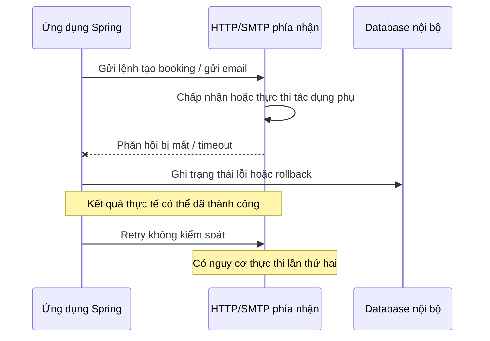
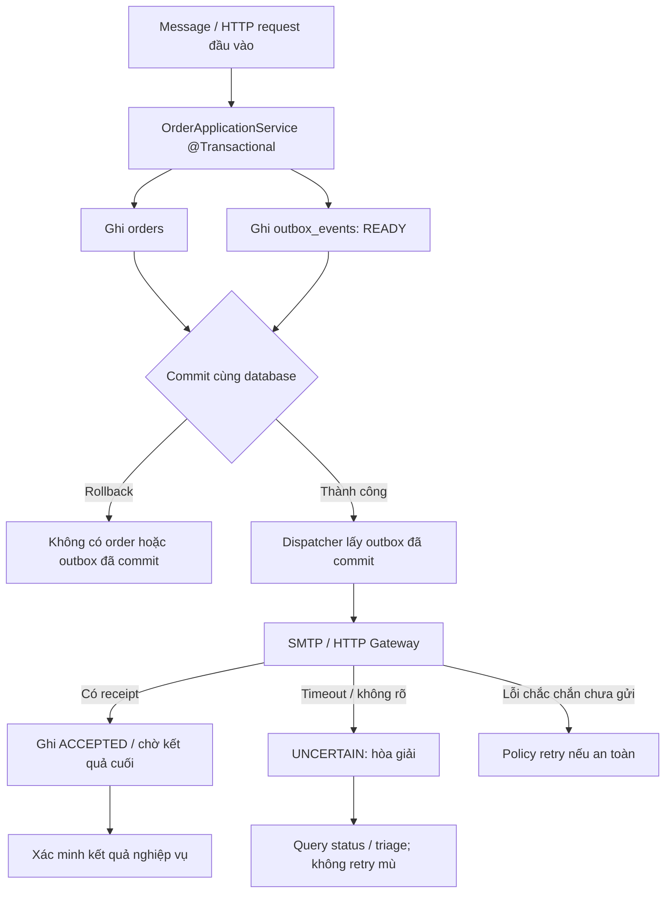
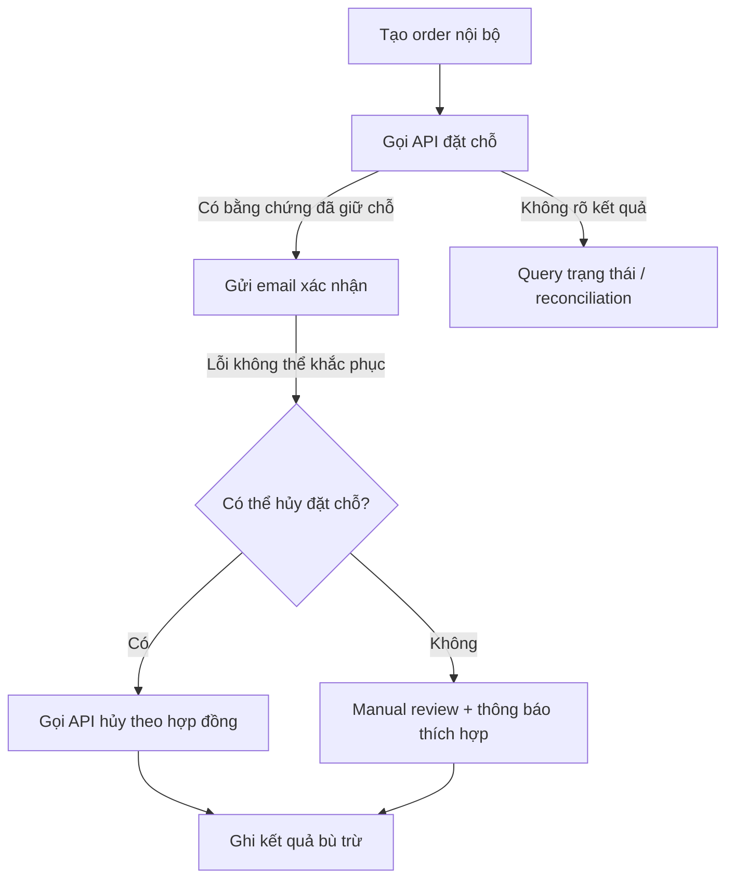

# Không giả định SMTP hoặc HTTP rollback được

Trong module **SPRING_INTEGRATION_PATTERN**, ta triển khai **Enterprise Integration Patterns (EIP)** với Spring Integration để tạo các luồng message ít phụ thuộc, dễ mở rộng. Các Router, Filter, Transformer, Splitter, Aggregator và Gateway thường phối hợp với cơ sở dữ liệu, broker, HTTP API hoặc máy chủ SMTP. Khi một bước lỗi, Spring Integration có thể phát `ErrorMessage` qua error channel, retry hoặc đưa message vào dead letter. Nhưng cần phân biệt rất rõ: **rollback một transaction trong ứng dụng không có nghĩa mọi hành động ngoài ứng dụng đều được hoàn tác**.

Bài học **“Không giả định SMTP hoặc HTTP rollback được”** tập trung vào giới hạn transaction khi gửi email hoặc gọi HTTP, những khoảng hở lỗi sau commit/trước ACK, cách dùng **Transactional Outbox**, **idempotency**, **reconciliation** và **compensation**, cùng ví dụ Java/Spring Integration và bộ tình huống kiểm thử. Mục tiêu là xây dựng luồng xử lý đúng khi một tác dụng phụ bên ngoài **đã xảy ra nhưng ứng dụng không biết chắc kết quả**.

> **Ý chính:** Database transaction chỉ bảo đảm atomicity đối với **những tài nguyên thật sự tham gia transaction đó**. Lệnh gửi SMTP hoặc HTTP thông thường không tham gia transaction JDBC; gọi `rollback` không thể “thu hồi email đã gửi” hay “hủy request HTTP đã được đối tác xử lý”.

## 1. Transaction bảo vệ phạm vi nào?

Xét một nghiệp vụ tạo đơn hàng:

1. Ghi `orders` vào database.
2. Gọi HTTP API đặt chỗ bên đối tác.
3. Gửi email xác nhận bằng SMTP.
4. Cập nhật trạng thái và trả kết quả.

Nếu đặt cả bốn bước trong một method `@Transactional`, ta **không tự động có một transaction phân tán** bao phủ database, HTTP server và SMTP server. Phạm vi có thể là:

| Thành phần | Có thể tham gia cùng JDBC transaction mặc định? | Điều xảy ra khi JDBC rollback |
| --- | --- | --- |
| Cùng database, cùng transaction manager/kết nối thích hợp | Có | Các thay đổi chưa commit được hoàn tác |
| Một database khác | Không mặc định | Phụ thuộc cách phối hợp transaction thực tế |
| Publish tới broker | Không mặc định | Cần cơ chế transaction/confirm hoặc outbox riêng |
| HTTP request đã gửi | Không | Đối tác có thể đã thực thi và commit |
| SMTP server đã nhận message | Không | Email đã được SMTP relay chấp nhận có thể tiếp tục được chuyển đi |
| Một lời gọi bất đồng bộ trong thread/process khác | Không mặc định | Không được suy ra nó cùng transaction hoặc context |

Ngay cả khi có JTA/XA với **các tài nguyên hỗ trợ giao thức tương ứng**, không nên suy rộng rằng endpoint HTTP bất kỳ hoặc SMTP phổ thông đều có thể enlist vào transaction đó. Spring `@Transactional`, `TransactionInterceptor` hoặc transaction trên poller **không phải phép màu hoàn tác tác dụng phụ từ xa**.

### Ví dụ sai: gọi dịch vụ ngoài khi JDBC transaction còn mở

```java
@Service
public class OrderApplicationService {
    private final OrderRepository orders;
    private final PartnerHttpClient partner;
    private final MailGateway mail;

    @Transactional
    public void placeOrder(CreateOrderCommand command) {
        orders.insert(command.orderId());

        partner.reserve(command.orderId());  // HTTP ra ngoài
        mail.sendConfirmation(command.orderId()); // SMTP ra ngoài

        orders.markConfirmed(command.orderId());

        // Nếu exception xảy ra tại đây, DB có thể rollback.
        // Nhưng reserve() hoặc sendConfirmation() có thể đã có tác dụng.
    }
}
```

Đoạn code mang tính **phản ví dụ**, các class phụ trợ là giao diện nghiệp vụ giả định. Nếu lỗi xảy ra sau `partner.reserve(...)` hoặc `mail.sendConfirmation(...)`, transaction của database có thể rollback trong khi đối tác đã đặt chỗ hoặc email đã được relay nhận. Hệ thống có thể ở trạng thái **bên ngoài đã thành công, nội bộ lại báo thất bại**.

**Không nên chỉ sửa bằng cách bắt mọi exception.** Nếu nuốt lỗi, hệ thống còn có thể báo thành công dù một bước quan trọng chưa được thực hiện. Cần thiết kế hợp đồng kết quả và cơ chế khôi phục theo từng tác dụng phụ.

## 2. Một timeout không có nghĩa tác dụng phụ thất bại

Trong mô hình request–response, người gửi thấy kết quả của **đường truyền phản hồi**, không trực tiếp thấy mọi trạng thái bên trong server nhận.



Một timeout có **ít nhất ba khả năng**:

- Request chưa tới server: chưa có tác dụng phụ.
- Request tới server, nhưng server chưa/không thực thi.
- Request đã được thực thi hoặc nhận vào hàng đợi bên server, chỉ có response thất lạc.

Nếu không có cơ chế kiểm tra trạng thái, ứng dụng thường **không phân biệt chắc chắn** ba trường hợp đó. Retry mù có thể tạo email trùng, đặt chỗ trùng, thanh toán trùng hoặc kích hoạt webhook hai lần.

### HTTP: mã thành công và idempotency có giới hạn

| Tình huống | Điều có thể khẳng định | Việc nên làm |
| --- | --- | --- |
| HTTP 2xx với hợp đồng đồng bộ | Endpoint thông báo thành công theo hợp đồng | Ghi kết quả/receipt; xác minh nghiệp vụ nếu cần |
| HTTP 202 Accepted | Request được chấp nhận để xử lý sau | Theo dõi trạng thái job, không mặc định đã hoàn thành |
| HTTP timeout sau khi gửi | Không chắc server có xử lý hay không | Query trạng thái hoặc retry với idempotency key được đối tác hỗ trợ |
| HTTP 409 Conflict | Có xung đột theo hợp đồng API | Phân loại: trùng đã hoàn tất hay xung đột nghiệp vụ? |
| HTTP 429 / 503 | Có thể là lỗi tạm thời | Retry theo hạn mức, backoff và `Retry-After` khi phù hợp |
| HTTP 400 do payload không hợp lệ | Thường không tự sửa khi retry | Không retry vô nghĩa; đưa vào xử lý lỗi dữ liệu |

Phương thức HTTP có đặc tính idempotency ở mức đặc tả (ví dụ PUT/DELETE), nhưng **không nên suy ra mọi triển khai bên ngoài xử lý đúng như kỳ vọng nghiệp vụ**. Đặc biệt, POST thường tạo tác dụng phụ và cần **hợp đồng idempotency do server đích thực sự hỗ trợ**.

Một header `Idempotency-Key` do client tự gửi **chưa đủ**; phía nhận phải thực thi quy tắc chống trùng, xác định phạm vi key, hạn lưu và cách xử lý request cùng key nhưng payload khác nhau. Khi retry, dùng **cùng key cho cùng thao tác nghiệp vụ**, không tạo key mới trên mỗi attempt.

### SMTP: đã gửi không đồng nghĩa đã đến hộp thư

SMTP relay có thể trả phản hồi chấp nhận thông điệp (chẳng hạn `250` sau khi nhận dữ liệu). Điều đó thường thể hiện **relay chấp nhận trách nhiệm xử lý tiếp**, không chứng minh người nhận đã mở hoặc thậm chí chắc chắn đã nhận email cuối cùng.

Nếu client timeout sau khi relay nhận dữ liệu, ứng dụng có thể không biết message đã được chấp nhận chưa. Gửi lại có thể tạo **hai email**. Không nên giả định `Message-ID` tự nó là idempotency key được SMTP server hoặc mọi mailbox provider dùng để loại trùng. Muốn hạn chế trùng, cần quy trình riêng của nhà cung cấp email nếu có, đối chiếu delivery event/receipt, hoặc chính sách chấp nhận rủi ro.

**Đã gửi email là tác dụng phụ không thể rollback bằng JDBC.** Việc gửi email đính chính sau đó là một **hành động bù trừ** (*compensation*), không phải “hoàn tác” email trước.

## 3. Các khoảng hở lỗi trong một giao dịch nghiệp vụ

Giả sử nghiệp vụ vừa muốn ghi DB vừa gọi đối tác:

| Thứ tự | Lỗi ở đâu? | Trạng thái có thể xảy ra | Rủi ro |
| --- | --- | --- | --- |
| Gọi HTTP/SMTP **trước** DB commit | DB rollback sau khi bên ngoài chấp nhận | Ngoài thành công, DB không ghi nhận | Side effect “mồ côi” |
| DB commit **trước** gọi HTTP/SMTP | Ứng dụng crash sau commit nhưng trước send | DB đã ghi, lệnh ngoài chưa chạy | Bỏ sót tác vụ |
| Gửi thành công, trước khi đánh dấu DB | Crash/mất kết nối DB | Ngoài đã thực thi, DB còn trạng thái chờ | Retry có thể tạo trùng |
| HTTP timeout sau khi gửi | Phản hồi thất lạc | Không rõ đã thực thi hay chưa | Retry mù |
| SMTP đã được relay nhận, phản hồi mất | Client tưởng lỗi | Có thể email đã được gửi đi | Email trùng |
| Ghi trạng thái đã gửi thành công nhưng nguồn chưa ACK | Broker redeliver | Message xử lý lại | Duplicates nếu thiếu idempotency |

Không tồn tại thứ tự tuyến tính đơn giản nào bảo đảm **atomicity xuyên JDBC và SMTP/HTTP** chỉ bằng việc di chuyển lệnh gọi vào trước hay sau `commit`.

### Vì sao “gửi sau commit” vẫn chưa đủ?

`@TransactionalEventListener(phase = AFTER_COMMIT)` hoặc `TransactionSynchronization.afterCommit()` có thể giúp tránh gọi dịch vụ ngoài trước khi giao dịch được commit. Nhưng callback **chạy trong tiến trình hiện tại**. Nếu ứng dụng dừng ngay sau DB commit, callback có thể chưa chạy; sự kiện không có bản ghi bền vững để phục hồi.

Gửi sau commit hữu ích trong trường hợp **best effort** được chấp nhận. Nếu không được phép mất thông báo hoặc lệnh gửi đi, cần cách lưu **ý định gửi** trong cùng transaction với thay đổi nghiệp vụ, ví dụ **Transactional Outbox**.

## 4. Transactional Outbox: commit dữ liệu và ý định gửi cùng nhau

Mô hình outbox ghi một **business state** và một **outbox event/command** trong **cùng transaction database**. Một dispatcher riêng sẽ lấy event đã commit và gửi ra HTTP/SMTP hoặc broker.



**Outbox bảo đảm điều gì?** Nếu database transaction commit, cả order và ý định gửi đều hiện diện; nếu rollback, cả hai cùng không được ghi. Tuy nhiên, dispatcher có thể gửi xong rồi crash trước khi đánh dấu đã gửi. Vì thế outbox thường hỗ trợ **at-least-once dispatch**, chứ **không tự tạo exactly-once side effect** ở SMTP hoặc HTTP.

Một hệ thống muốn “không gửi trùng” phải phối hợp:
- Idempotency ở bên nhận nếu có (đặc biệt hữu ích cho HTTP).
- Đối chiếu trạng thái khi kết quả gửi không chắc chắn.
- Hợp đồng nghiệp vụ/compensation khi bên nhận không thể deduplicate.
- Giới hạn retry, cảnh báo, trạng thái cách ly và audit.

## 5. Thiết kế bảng order và outbox minh họa

Ví dụ PostgreSQL cho lệnh gửi thông báo sau khi đơn hàng được tạo:

```sql
CREATE TABLE orders (
    order_id UUID PRIMARY KEY,
    state VARCHAR(24) NOT NULL,
    created_at TIMESTAMPTZ NOT NULL DEFAULT NOW()
);

CREATE TABLE outbox_events (
    event_id UUID PRIMARY KEY,
    order_id UUID NOT NULL REFERENCES orders(order_id),
    effect_type VARCHAR(64) NOT NULL,
    status VARCHAR(24) NOT NULL DEFAULT 'READY',
    attempt_count INTEGER NOT NULL DEFAULT 0
        CHECK (attempt_count >= 0),
    created_at TIMESTAMPTZ NOT NULL DEFAULT NOW(),
    next_attempt_at TIMESTAMPTZ NOT NULL DEFAULT NOW(),
    claimed_at TIMESTAMPTZ,
    accepted_at TIMESTAMPTZ,
    last_reason_code VARCHAR(80),
    CONSTRAINT uq_outbox_order_effect
        UNIQUE (order_id, effect_type)
);

CREATE INDEX idx_outbox_ready
    ON outbox_events (next_attempt_at, created_at)
    WHERE status = 'READY';

CREATE INDEX idx_outbox_claimed
    ON outbox_events (claimed_at)
    WHERE status = 'CLAIMED';
```

`event_id` là định danh ổn định của **một ý định gửi**. `attempt_count` tăng khi dispatcher claim lần xử lý, **không phải** bằng chứng dịch vụ ngoài đã nhận. Trạng thái minh họa:

| Trạng thái | Ý nghĩa | Chính sách |
| --- | --- | --- |
| `READY` | Intent đã commit, chưa có worker đang giữ | Có thể claim |
| `CLAIMED` | Một worker đã lấy quyền xử lý | Không có worker khác tự gửi |
| `ACCEPTED` | Giao thức/đối tác đã xác nhận theo hợp đồng | Theo dõi kết quả cuối nếu API bất đồng bộ |
| `UNCERTAIN` | Không xác định chắc request đã được nhận/thực hiện | Đối chiếu, không retry mù |
| `RETRY_READY` | Có bằng chứng thử lại an toàn; cần đưa vào lịch | Chỉ chuyển thành `READY` theo policy |
| `QUARANTINED` | Hết ngân sách hoặc cần quyết định thủ công | Không tự phát lại |
| `COMPLETED` | Đã xác minh kết quả nghiệp vụ cuối | Đóng và audit |

Bảng trên đơn giản hóa cho **một loại thông báo trên mỗi đơn**; ràng buộc `UNIQUE(order_id,effect_type)` sẽ cần điều chỉnh nếu nghiệp vụ cho phép nhiều thông báo cùng loại ở các lần cập nhật khác nhau. Trong ví dụ không lưu email hay token vào outbox; dispatcher cần tìm thông tin đích từ kho dữ liệu có phân quyền hoặc tham chiếu payload được bảo vệ.

### Java: ghi order và outbox cùng transaction

```java
package demo.integration;

import java.util.UUID;

import org.springframework.jdbc.core.JdbcTemplate;
import org.springframework.stereotype.Service;
import org.springframework.transaction.annotation.Transactional;

@Service
public class OrderApplicationService {

    private final JdbcTemplate jdbc;

    public OrderApplicationService(JdbcTemplate jdbc) {
        this.jdbc = jdbc;
    }

    @Transactional
    public UUID createOrder(UUID orderId) {
        jdbc.update(
                "INSERT INTO orders (order_id, state) VALUES (?, ?)",
                orderId, "CREATED");

        UUID eventId = UUID.randomUUID();
        jdbc.update("""
                INSERT INTO outbox_events
                    (event_id, order_id, effect_type, status)
                VALUES (?, ?, ?, 'READY')
                """,
                eventId, orderId, "SEND_ORDER_CONFIRMATION");

        // KHÔNG gọi SMTP/HTTP tại đây.
        // Lỗi ở INSERT thứ hai làm cả transaction rollback
        // nếu được quản lý cùng DataSourceTransactionManager.
        return eventId;
    }
}
```

Trong ví dụ này, `@Transactional` yêu cầu transaction manager thực sự được cấu hình và method được gọi thông qua Spring proxy. Không gọi method từ chính class qua `this.createOrder(...)` và mặc định mong proxy giao dịch vẫn hoạt động. `JdbcTemplate` phải dùng cùng `DataSource` và transaction manager đúng. Các chi tiết cấu hình phụ thuộc ứng dụng.

**Không đặt `gateway.sendEmail(...)` sau hai INSERT nhưng vẫn bên trong method `@Transactional`.** Chính việc tách dispatch khỏi transaction là cốt lõi của outbox.

## 6. Claim outbox an toàn khi có nhiều dispatcher

Nếu hai instance cùng đọc `READY` rồi gửi trước khi đánh dấu trạng thái, chúng có thể cùng gọi HTTP/SMTP. Cần **claim nguyên tử** từ database.

Ví dụ PostgreSQL sử dụng `FOR UPDATE SKIP LOCKED`:

```sql
WITH selected AS (
    SELECT event_id
    FROM outbox_events
    WHERE status = 'READY'
      AND next_attempt_at <= NOW()
    ORDER BY created_at
    FOR UPDATE SKIP LOCKED
    LIMIT :batch_size
)
UPDATE outbox_events AS outbox
SET status = 'CLAIMED',
    claimed_at = NOW(),
    attempt_count = attempt_count + 1
FROM selected
WHERE outbox.event_id = selected.event_id
RETURNING outbox.event_id, outbox.order_id,
          outbox.effect_type, outbox.attempt_count;
```

Truy vấn claim phải chạy trong transaction database riêng và commit **trước khi bắt đầu gửi ra ngoài**. Không giữ lock/transaction JDBC mở trong suốt thời gian HTTP/SMTP network call. Nếu có nhiều worker, một hàng chỉ nên được claim bởi một worker trong cùng thời điểm.

**Crash khi `CLAIMED`:** một record có thể mắc kẹt nếu worker dừng. Không được tự động đổi mọi `CLAIMED` cũ về `READY` và gửi lại SMTP, vì worker có thể đã gửi xong nhưng chưa kịp ghi trạng thái. Cần job **reconciliation** xác định trường hợp nào đã hoàn tất, trường hợp nào chắc chắn chưa gửi và trường hợp nào vẫn không rõ.

Với HTTP API có idempotency key được hỗ trợ và còn hiệu lực, replay cùng key có thể an toàn theo hợp đồng. Với SMTP thông thường, retry sau kết quả không rõ có thể tạo email trùng; lựa chọn xử lý thủ công hay chấp nhận duplicate phải được quyết định rõ.

## 7. Dispatcher: không đánh đồng `send()` với kết quả cuối cùng

Một dispatcher minh họa nhận bản ghi đã claim, gọi một gateway trừu tượng rồi cập nhật trạng thái. Những mảnh code dưới đây dùng Java 17 và Spring JDBC/Scheduling.

```java
package demo.integration;

import java.util.List;
import java.util.UUID;

import org.springframework.jdbc.core.JdbcTemplate;
import org.springframework.stereotype.Repository;
import org.springframework.transaction.annotation.Transactional;

@Repository
public class OutboxRepository {

    private final JdbcTemplate jdbc;

    public OutboxRepository(JdbcTemplate jdbc) {
        this.jdbc = jdbc;
    }

    public record ClaimedEvent(
            UUID eventId, UUID orderId,
            String effectType, int attemptCount) {}

    @Transactional
    public List<ClaimedEvent> claimBatch(int batchSize) {
        return jdbc.query("""
                WITH selected AS (
                    SELECT event_id
                    FROM outbox_events
                    WHERE status = 'READY'
                      AND next_attempt_at <= NOW()
                    ORDER BY created_at
                    FOR UPDATE SKIP LOCKED
                    LIMIT ?
                )
                UPDATE outbox_events AS o
                SET status = 'CLAIMED',
                    claimed_at = NOW(),
                    attempt_count = attempt_count + 1
                FROM selected
                WHERE o.event_id = selected.event_id
                RETURNING o.event_id, o.order_id,
                          o.effect_type, o.attempt_count
                """,
                (rs, rowNum) -> new ClaimedEvent(
                        rs.getObject("event_id", UUID.class),
                        rs.getObject("order_id", UUID.class),
                        rs.getString("effect_type"),
                        rs.getInt("attempt_count")),
                batchSize);
    }

    @Transactional
    public void markAccepted(UUID eventId) {
        int updated = jdbc.update("""
                UPDATE outbox_events
                SET status = 'ACCEPTED', accepted_at = NOW(),
                    last_reason_code = NULL
                WHERE event_id = ? AND status = 'CLAIMED'
                """, eventId);

        if (updated != 1) {
            throw new IllegalStateException("OUTBOX_STATE_CHANGED");
        }
    }

    @Transactional
    public void markUncertain(UUID eventId) {
        int updated = jdbc.update("""
                UPDATE outbox_events
                SET status = 'UNCERTAIN',
                    last_reason_code = 'DELIVERY_OUTCOME_UNKNOWN'
                WHERE event_id = ? AND status = 'CLAIMED'
                """, eventId);

        if (updated != 1) {
            throw new IllegalStateException("OUTBOX_STATE_CHANGED");
        }
    }
}
```

Lưu ý: truy vấn `claimBatch()` dùng cú pháp PostgreSQL (không chạy nguyên văn trên mọi database). Repository chưa có xử lý lease, phân loại HTTP status, retention hoặc audit đầy đủ. Những chức năng đó cần thiết khi triển khai production.

```java
package demo.integration;

import org.springframework.scheduling.annotation.Scheduled;
import org.springframework.stereotype.Component;

@Component
public class OutboxDispatcher {

    private final OutboxRepository repository;
    private final ExternalEffectGateway gateway;

    public OutboxDispatcher(
            OutboxRepository repository, ExternalEffectGateway gateway) {
        this.repository = repository;
        this.gateway = gateway;
    }

    @Scheduled(fixedDelay = 5_000)
    public void dispatch() {
        for (var event : repository.claimBatch(20)) {
            try {
                // Gateway có thể đã gây tác dụng phụ trước khi ném lỗi.
                gateway.deliver(event);
            } catch (Exception failure) {
                // Không log raw payload/credential/exception message.
                // Chuyển sang UNCERTAIN để điều tra/reconcile.
                repository.markUncertain(event.eventId());
                continue;
            }

            // Chỉ khẳng định gateway trả về theo hợp đồng.
            // Nếu DB lỗi ở bước này, record có thể còn CLAIMED
            // dù phía ngoài đã nhận: KHÔNG tự động resend.
            repository.markAccepted(event.eventId());
        }
    }

    public interface ExternalEffectGateway {
        void deliver(OutboxRepository.ClaimedEvent event);
    }
}
```

Ví dụ này **cố ý thận trọng**: khi `gateway.deliver(...)` ném exception, đưa record sang `UNCERTAIN`, dù lỗi có thể xảy ra trước khi gửi. Ứng dụng thật nên phân loại thành “chắc chắn chưa gửi”, “được xác nhận chấp nhận”, “không rõ kết quả” và “bị từ chối vĩnh viễn”, rồi mới chọn retry, quarantine hoặc reconcile. Không phải tất cả lỗi đều cần triage thủ công, nhưng tuyệt đối không retry mọi lỗi một cách mù quáng. Để phương thức `@Scheduled` thực sự được gọi, ứng dụng phải bật scheduling (ví dụ `@EnableScheduling` trong cấu hình Spring) và đăng ký các bean gateway/repository cần thiết.

**Giới hạn quan trọng:** lời gọi `markAccepted(...)` có thể thất bại sau khi gateway trả về. Record vẫn ở `CLAIMED`; reconciliation phải xử lý chứ không tự gửi lại vô hạn. Nếu `markUncertain(...)` cũng gặp sự cố database, trạng thái có thể vẫn `CLAIMED`, vì vậy cần cảnh báo cho lỗi repository và job kiểm tra các claim quá hạn.

### Tích hợp vào Spring Integration

Spring Integration có thể thực hiện vai trò điều phối các bước của dispatcher, nhưng **không thay đổi ranh giới atomicity**. Ví dụ một channel đồng bộ gọi gateway cho event đã claim:

```java
package demo.integration;

import org.springframework.context.annotation.Bean;
import org.springframework.context.annotation.Configuration;
import org.springframework.integration.channel.DirectChannel;
import org.springframework.integration.config.EnableIntegration;
import org.springframework.integration.dsl.IntegrationFlow;
import org.springframework.messaging.MessageChannel;

@Configuration
@EnableIntegration
public class OutboxOutboundFlow {

    @Bean
    MessageChannel externalEffectInput() {
        return new DirectChannel();
    }

    @Bean
    IntegrationFlow externalEffectFlow(
            OutboxDispatcher.ExternalEffectGateway gateway) {
        return IntegrationFlow.from("externalEffectInput")
                .handle(gateway, "deliver")
                .get();
    }
}
```

Nếu dispatcher muốn gọi qua channel thay vì trực tiếp qua gateway:

```java
// Sau khi đã claim/commit outbox, bên ngoài transaction JDBC:
Message<OutboxRepository.ClaimedEvent> message =
        MessageBuilder.withPayload(event).build();
boolean accepted = externalEffectInput.send(message);
```

Đoạn bổ sung cần import `org.springframework.messaging.Message` và `org.springframework.messaging.support.MessageBuilder`. Với `DirectChannel` và handler đồng bộ, exception có thể truyền về caller, nhưng **`accepted == true` không nhất thiết chứng minh một HTTP API bất đồng bộ đã hoàn thành nghiệp vụ hoặc email đến người nhận**. Không dùng kết quả của channel để tuyên bố tác dụng phụ ngoài đã rollback được.

Khi dùng `RequestHandlerRetryAdvice` trên outbound handler, phải nhớ rằng **mỗi retry có thể thực hiện lại side effect**. Nếu gateway không bảo đảm idempotency, retry advice mặc định có thể khiến email gửi trùng. Đường retry/error channel phải dựa trên hợp đồng cụ thể của HTTP/SMTP và phân loại kết quả không rõ.

## 8. HTTP idempotency: gửi cùng ý định bằng cùng khóa

Khi phía đối tác hỗ trợ idempotency key đúng nghĩa, có thể truyền khóa ổn định từ outbox:

```java
package demo.integration;

import org.springframework.web.client.RestClient;

public final class PartnerHttpGateway
        implements OutboxDispatcher.ExternalEffectGateway {

    private final RestClient client;

    public PartnerHttpGateway(RestClient client) {
        this.client = client;
    }

    @Override
    public void deliver(OutboxRepository.ClaimedEvent event) {
        client.post()
              .uri("/partner/orders/{id}/reserve", event.orderId())
              // Không sinh UUID mới cho từng attempt.
              .header("Idempotency-Key", event.eventId().toString())
              .retrieve()
              .toBodilessEntity();
    }
}
```

Đây là ví dụ Spring Framework `RestClient`, **không phải đảm bảo mọi đối tác hỗ trợ header này**. Phía nhận phải ghi nhận key nguyên tử cùng tác vụ hoặc theo thiết kế có thể khôi phục; cần tài liệu về thời hạn key, key collision, payload mismatch và semantics kết quả lặp lại. Nếu key đã hết thời hạn trước lần retry, rủi ro duplicate có thể quay lại.

**Phân loại response đúng hợp đồng:**
- HTTP 2xx có thể là request đã được chấp nhận; với 202, tiếp tục theo dõi kết quả bất đồng bộ.
- HTTP timeout là **unknown**, không mặc định là “chưa chạy”.
- Khi API có endpoint query theo `eventId` hoặc external operation ID, dùng nó để reconcile.
- Nếu không có hỗ trợ idempotency hoặc query trạng thái, cân nhắc quy trình manual review/compensation, không tự động retry vô hạn.

Với RabbitMQ/JMS/Kafka làm nguồn, broker có thể redeliver một message sau restart hoặc NACK. **Idempotency phải bao trùm cả retry trong ứng dụng và redelivery từ broker**, không chỉ một chu kỳ `RetryTemplate`.

## 9. SMTP: cần chính sách chống email trùng và xử lý kết quả mơ hồ

Khác với nhiều HTTP API nghiệp vụ, SMTP phổ thông không cung cấp một giao thức idempotency cho toàn bộ luồng gửi email. Khi có lỗi kết nối, không thể luôn xác định email đã được relay chấp nhận hay chưa.

Một chính sách phù hợp có thể là:

1. Mỗi thông báo nghiệp vụ có `notificationId` ổn định trong outbox.
2. Trước khi gửi, lưu đủ thông tin về lần gửi có kiểm soát (không lưu token trong log).
3. Sau khi SMTP gateway trả về xác nhận chấp nhận, đánh dấu **ACCEPTED_BY_RELAY** hoặc tương đương, không báo “đã đọc email”.
4. Nếu kết quả không rõ, đưa bản ghi vào `UNCERTAIN`; kiểm tra event/receipt của nhà cung cấp nếu có, hoặc đối chiếu thủ công.
5. Nếu phải retry, ghi nhận khả năng email trùng và lựa chọn ưu tiên (ví dụ thông báo nhắc lại có thể chấp nhận trùng hơn email kích hoạt giao dịch).
6. Nếu email đã gửi sai, hành động tiếp theo là **thông báo đính chính hoặc quy trình bù trừ**, không phải rollback dữ liệu gửi qua SMTP.

**Có thể dùng nhà cung cấp email có API idempotency hoặc event ID riêng**, nhưng phải xác minh hợp đồng cụ thể của dịch vụ đó. Không gán mặc định khả năng này cho chuẩn SMTP hoặc `Message-ID`.

### Quyết định retry theo loại tác dụng phụ

| Tác dụng phụ | Nếu kết quả không rõ | Hướng xử lý |
| --- | --- | --- |
| HTTP tạo booking, server có idempotency | Có thể gửi lại với **cùng key** trong thời hạn bảo đảm | Retry có giới hạn/backoff; query trạng thái |
| HTTP thanh toán không có idempotency | Không thể phân biệt đã thu tiền hay chưa | Hòa giải giao dịch trước khi retry |
| SMTP xác nhận đơn hàng | Có thể relay đã nhận, email có thể trùng | Kiểm tra provider events; chính sách duplicate rõ ràng |
| Gửi email marketing/nhắc nhở | Trùng có thể làm phiền người nhận | Ưu tiên giới hạn/phê duyệt và dedupe |
| Đọc dữ liệu bằng HTTP GET không gây tác dụng phụ theo hợp đồng | Thường có thể retry | Giới hạn số lần/timeouts, bảo vệ rate limits |
| Lệnh idempotent nhưng deadline nghiệp vụ đã qua | Retry có thể vẫn sai nghiệp vụ | Dừng và chuyển trạng thái hết hạn |

## 10. Saga/compensation không phải rollback vật lý

Khi một quy trình có nhiều side effect, ta có thể thiết kế **Saga** với hành động bù trừ theo nghiệp vụ. Ví dụ:



**Compensation là một tác vụ mới**, cũng có thể thất bại, timeout hoặc được thực hiện hai lần. Nó cần idempotency, retry budget, correlation, audit và giám sát riêng. Ví dụ một cuộc gọi `cancelReservation()` có thể trả lỗi dù đối tác đã hủy xong; phải đối chiếu trạng thái, không chuyển sang vòng lặp bù trừ vô hạn.

Một email đã ra ngoài không thể “unsend” qua một transaction JDBC. Email đính chính chỉ giảm tác động nghiệp vụ, không xóa sự tồn tại của email cũ.

### Ranh giới ở Router, Splitter/Aggregator và Gateway

- **Router:** các nhánh có side effect khác nhau; exception ở một nhánh không rollback được side effect đã xảy ra ở nhánh khác.
- **Splitter:** nhiều fragment gửi đến các dịch vụ riêng; nếu fragment thứ ba lỗi, hai fragment trước có thể đã xử lý thành công.
- **Aggregator:** kết quả tổng hợp có thể chưa đầy đủ; không mặc định gửi lại toàn bộ fragment mà không kiểm tra idempotency/correlation.
- **Gateway:** một request đồng bộ có thể timeout trong khi downstream bất đồng bộ vẫn tiếp tục xử lý; timeout phản hồi không phải bằng chứng rollback.
- **Error channel/dead letter:** cung cấp đường quan sát và cách ly lỗi; **không hoàn tác request HTTP hay SMTP**.

Khi thiết kế flow, hãy vẽ **ranh giới commit của từng hệ thống**, không chỉ vẽ mũi tên message.

## 11. Kiểm thử failure windows, không chỉ luồng thành công

Để chứng minh thiết kế đúng, test phải tác động vào từng khoảng hở giữa **commit DB, claim, send và cập nhật trạng thái**.

| Ca thử | Tình huống | Kỳ vọng |
| --- | --- | --- |
| 1 | INSERT order thành công, INSERT outbox lỗi | Cả order và outbox cùng rollback |
| 2 | DB commit xong, process crash trước dispatcher | Outbox vẫn ở `READY` và có thể claim sau restart |
| 3 | Hai dispatcher claim đồng thời | Mỗi event chỉ được claim bởi một worker |
| 4 | HTTP tác vụ thành công nhưng response timeout | Trạng thái `UNCERTAIN`; không tự tạo key mới |
| 5 | HTTP retry với cùng idempotency key | Server được kỳ vọng dedupe nếu hợp đồng hỗ trợ |
| 6 | SMTP relay đã nhận, client mất kết nối | Không tự coi là thất bại chắc chắn; tránh gửi lại mù |
| 7 | Gateway thành công, DB lỗi khi `markAccepted` | Event có thể còn `CLAIMED`; reconciliation không resend vô điều kiện |
| 8 | Worker chết khi `CLAIMED` | Không tự reset `READY` cho tác vụ không idempotent |
| 9 | Broker redeliver cùng event | Dedup/idempotency giữ tác dụng phụ không lặp sai |
| 10 | Retry hết nhưng side effect vẫn unknown | Đưa vào quarantine/triage, không mất lịch sử |
| 11 | Compensation API timeout | Kiểm tra trạng thái bù trừ, không giả định đã hủy |
| 12 | Lỗi lưu audit/dead letter | Không log raw payload hoặc âm thầm báo đã lưu |
| 13 | Event có correlation ID và tenant | Giữ dấu vết tin cậy, không rò thông tin nhạy cảm |

Với PostgreSQL và transaction/repository, cần **integration test trên database có hành vi lock/transaction phù hợp**, chẳng hạn môi trường test cách ly hoặc Testcontainers. Test với database giả lập không bảo đảm `SKIP LOCKED` và transaction semantics giống production.

### Unit test: quyết định khi kết quả gửi không rõ

Ta có thể tách quyết định sau khi gọi dịch vụ ngoài thành một hàm thuần để test dễ hiểu:

```java
package demo.integration;

public final class DispatchDecisionPolicy {
    private DispatchDecisionPolicy() {}

    public enum Outcome {
        CONFIRMED_ACCEPTED,
        CONFIRMED_NOT_SENT,
        UNKNOWN
    }

    public enum Action {
        MARK_ACCEPTED,
        RETRY_AFTER_BACKOFF,
        RECONCILE
    }

    public static Action decide(
            Outcome outcome, boolean retryAllowed,
            int attemptsMade, int maxAttempts) {

        if (attemptsMade < 1 || maxAttempts < 1) {
            throw new IllegalArgumentException("Invalid attempts");
        }
        if (outcome == Outcome.CONFIRMED_ACCEPTED) {
            return Action.MARK_ACCEPTED;
        }
        if (outcome == Outcome.UNKNOWN) {
            // Không cho phép retry mù dù còn budget.
            return Action.RECONCILE;
        }
        // Chỉ áp dụng khi có bằng chứng yêu cầu CHƯA được gửi.
        if (retryAllowed && attemptsMade < maxAttempts) {
            return Action.RETRY_AFTER_BACKOFF;
        }
        return Action.RECONCILE;
    }
}
```

Ví dụ JUnit 5:

```java
package demo.integration;

import static demo.integration.DispatchDecisionPolicy.*;
import static org.assertj.core.api.Assertions.assertThat;

import org.junit.jupiter.api.Test;

class DispatchDecisionPolicyTest {

    @Test
    void unknownOutcomeMustBeReconciledNotBlindlyRetried() {
        assertThat(decide(Outcome.UNKNOWN, true, 1, 5))
                .isEqualTo(Action.RECONCILE);
    }

    @Test
    void confirmedAcceptedMustNotBeRetried() {
        assertThat(decide(Outcome.CONFIRMED_ACCEPTED, true, 1, 5))
                .isEqualTo(Action.MARK_ACCEPTED);
    }

    @Test
    void confirmedNotSentCanRetryWithinBudget() {
        assertThat(decide(Outcome.CONFIRMED_NOT_SENT, true, 1, 3))
                .isEqualTo(Action.RETRY_AFTER_BACKOFF);
    }

    @Test
    void confirmedNotSentStopsAtBudget() {
        assertThat(decide(Outcome.CONFIRMED_NOT_SENT, true, 3, 3))
                .isEqualTo(Action.RECONCILE);
    }
}
```

Đây là **test minh họa của policy**, chưa chạy trong repository tại STEP 4. Không nên suy ra mọi exception có thể được gán chắc chắn là `CONFIRMED_NOT_SENT`. Để chứng minh điều đó, adapter hoặc giao thức phải cung cấp bằng chứng phù hợp; các timeout sau khi bắt đầu gửi thường thuộc `UNKNOWN`.

## 12. Observability, correlation và dead letter cho giao dịch đa hệ thống

Một hệ thống transactional messaging cần quan sát được **tình trạng tác vụ** thay vì chỉ đo số exception:

| Metric/tín hiệu gợi ý | Ý nghĩa |
| --- | --- |
| `outbox_ready_total` | Số intent đã commit nhưng chưa dispatch |
| `outbox_oldest_ready_age_seconds` | Tuổi intent chờ lâu nhất |
| `outbox_claimed_stale_total` | Claim quá thời gian dự kiến, cần reconcile |
| `external_effect_accepted_total` | Đối tác/relay xác nhận đã chấp nhận |
| `external_effect_uncertain_total` | Tác vụ không rõ kết quả |
| `external_effect_reconciled_total` | Số tác vụ đã đối chiếu xong |
| `external_effect_duplicate_prevented_total` | Số tác vụ được idempotency chặn trùng (nếu đo được) |
| `compensation_failed_total` | Bù trừ nghiệp vụ thất bại |
| `outbox_quarantined_total` | Intent cần can thiệp thủ công |

Các tên metric là **gợi ý**, không phải metric có sẵn tự động. Dùng nhãn cardinality thấp như `flowId`, `effectType`, `reasonCode`, `partner`; không dùng raw order ID, email, token hoặc request body làm metric label.

Audit nên ghi:
- `eventId`, `correlationId`, `orderId` dạng định danh được phép và `effectType`.
- Trạng thái local transaction và outbox (READY, CLAIMED, ACCEPTED, UNCERTAIN, COMPLETED).
- External operation ID, idempotency key reference, dấu vết reconciliation khi có.
- Thời điểm claim, send, receipt, callback và kết quả đối chiếu.
- Quyết định của người vận hành khi retry hoặc compensation.

Không ghi nguyên Authorization header, SMTP credentials, toàn bộ payload hoặc exception message vào audit/log. Nếu payload cần lưu để replay, dùng schema và kho bảo vệ riêng, gắn tham chiếu trong outbox/dead letter.

## 13. Lỗi thiết kế phổ biến

| Sai sót | Hậu quả | Cách khắc phục |
| --- | --- | --- |
| Bọc DB + SMTP/HTTP trong `@Transactional` và mong rollback tất cả | DB rollback nhưng side effect vẫn xảy ra | Xác định ranh giới transaction; outbox/reconciliation |
| Gửi HTTP/SMTP trước DB commit | Tác dụng phụ mồ côi khi DB rollback | Ghi intent bền vững cùng business state |
| Dùng `AFTER_COMMIT` callback làm queue duy nhất | Crash sau commit gây mất tác vụ | Transactional Outbox |
| Retry HTTP POST với idempotency key mới mỗi lần | Tạo booking/thanh toán trùng | Khóa ổn định và server hỗ trợ dedupe |
| Retry SMTP sau timeout như chắc chắn chưa gửi | Email trùng | UNCERTAIN, đối chiếu/duplicate policy |
| Coi SMTP accepted là delivered/đã đọc | Audit trạng thái sai | Phân biệt accepted/delivered/bounced/read |
| Tự reset mọi `CLAIMED` cũ thành `READY` | Gửi trùng tác vụ bên ngoài | Lease, reconciliation, kiểm tra idempotency |
| Giữ JDBC transaction mở trong khi gọi HTTP | Lock lâu, giảm throughput nhưng vẫn không rollback HTTP | Claim/commit trước khi gọi ra ngoài |
| Coi publish thành công là nghiệp vụ hoàn tất | Lỗi downstream xuất hiện sau | Theo dõi trạng thái nghiệp vụ cuối cùng |
| Compensation như rollback không thể lỗi | Trạng thái liên hệ thống bị lệch | Saga có retry/idempotency/audit riêng |
| Không có dead letter/quarantine cho trường hợp unknown | Vòng retry vô hạn hoặc mất dấu vết | Trạng thái UNCERTAIN, SLA xử lý ngoại lệ |
| Log toàn bộ request/headers khi lỗi | Lộ token và PII | Error taxonomy + log đã lọc |

## 14. Câu hỏi tự kiểm tra

1. Vì sao `@Transactional` không hoàn tác được email đã gửi hoặc booking đã tạo qua HTTP?
2. HTTP timeout sau khi POST có những kết quả thực tế nào? Vì sao không suy ra “server chưa xử lý”?
3. SMTP server trả `250` chứng minh điều gì và không chứng minh điều gì?
4. Vì sao một listener `AFTER_COMMIT` không đủ thay cho Transactional Outbox trong yêu cầu không mất tác vụ?
5. Outbox bảo đảm atomicity cho hai loại thay đổi nào? Nó có tạo exactly-once effect ngoài hệ thống không?
6. Khi hai worker cùng đọc record `READY`, làm sao ngăn cả hai gửi cùng một tác vụ?
7. Worker crash sau HTTP thành công nhưng trước `markAccepted`. Vì sao không thể tự gửi lại với key mới?
8. Tại sao SMTP Message-ID không phải cơ chế idempotency được bảo đảm bởi mọi relay?
9. Với HTTP API có idempotency key, key nên gắn với điều gì và tồn tại trong bao lâu?
10. Khi nào cần reconciliation hoặc quarantine thay vì retry?
11. Nếu Saga đã gửi email rồi phải hủy đặt chỗ, compensation nào có thể thực hiện và điều gì không thể hoàn tác?
12. Trong Splitter/Aggregator, vì sao rollback một nhánh không đủ bảo đảm các nhánh khác không có side effect?
13. Những khoảng hở lỗi nào phải được kiểm thử giữa DB commit, claim, send, receipt và ACK?
14. Làm sao theo dõi trạng thái `UNCERTAIN` mà không làm rò payload hay credentials?

## Tài liệu tham khảo

- [Spring Framework Reference — Transaction Management](https://docs.spring.io/spring-framework/reference/data-access/transaction.html): phạm vi và cơ chế transaction.
- [Spring Framework Reference — Transaction-bound Events](https://docs.spring.io/spring-framework/reference/data-access/transaction/event.html): `@TransactionalEventListener` và các phase.
- [Spring Integration Reference — Transaction Support](https://docs.spring.io/spring-integration/reference/transactions.html): transaction trong endpoint/poller.
- [Spring Integration Reference — Error Handling](https://docs.spring.io/spring-integration/reference/error-handling.html): `ErrorMessage`, error channel và recovery flow.
- [Spring Integration Reference — Handler Advice](https://docs.spring.io/spring-integration/reference/handler-advice.html): retry advice và phạm vi handler.
- [RFC 9110 — HTTP Semantics](https://www.rfc-editor.org/rfc/rfc9110): mã phản hồi và đặc tính idempotency của phương thức HTTP.
- [RFC 5321 — Simple Mail Transfer Protocol](https://www.rfc-editor.org/rfc/rfc5321): SMTP và phản hồi/chấp nhận thông điệp.
- [Microservices.io — Transactional Outbox Pattern](https://microservices.io/patterns/data/transactional-outbox): mô hình lưu ý định gửi cùng business transaction.

**Ghi nhớ:** **DB rollback không thể thu hồi side effect đã xảy ra qua SMTP hoặc HTTP**. Thiết kế đúng phải phân biệt commit nội bộ với kết quả từ xa; ghi intent bằng Transactional Outbox khi cần độ bền vững; dùng idempotency theo hợp đồng của bên nhận; xem timeout là *chưa rõ kết quả*; reconcile trước khi retry không an toàn; và dùng compensation như một nghiệp vụ mới, có thể lỗi, thay vì giả định rollback toàn hệ thống.
