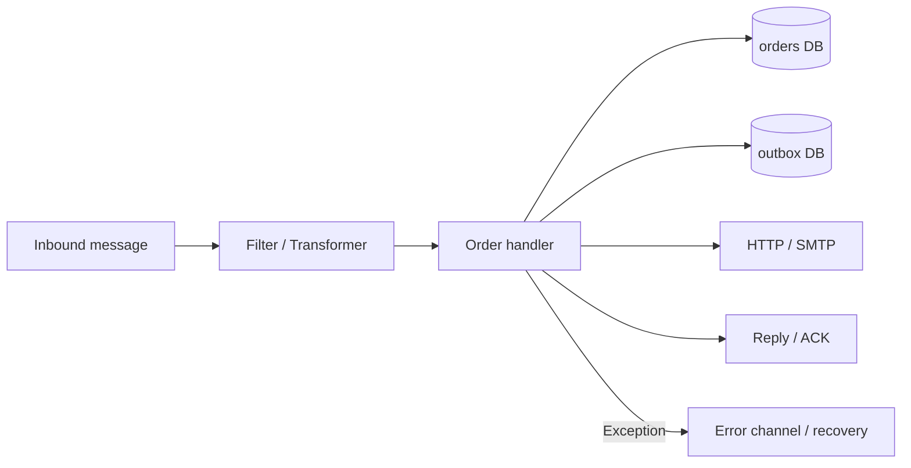
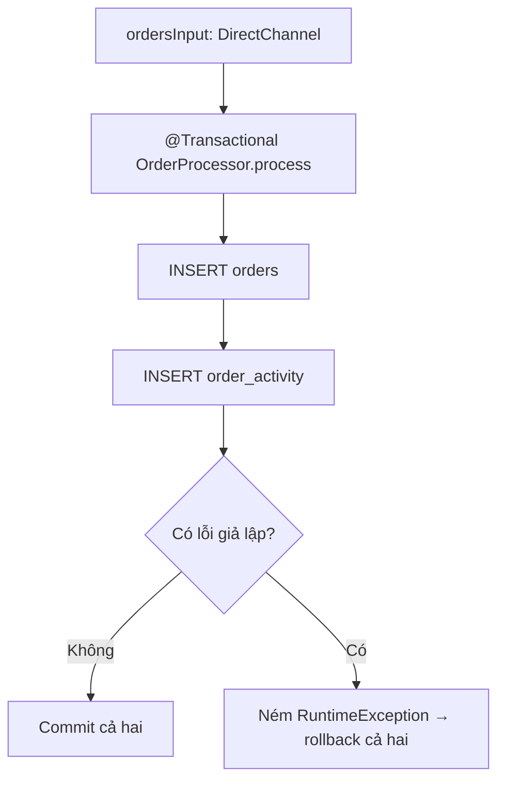
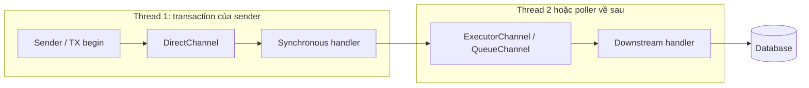
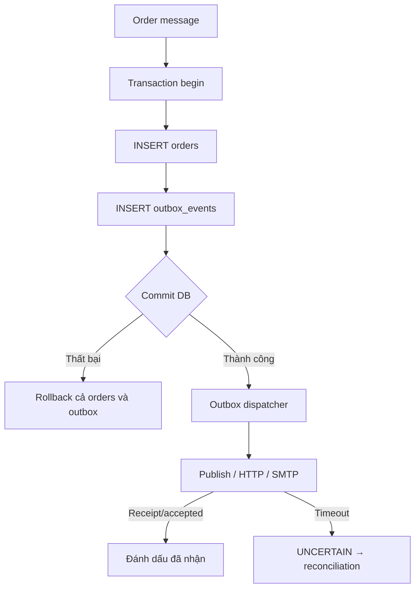

# Kiểm thử transaction với message flow

Trong module **SPRING_INTEGRATION_PATTERN**, Spring Integration được dùng để triển khai **Enterprise Integration Patterns** (Router, Filter, Transformer, Splitter, Aggregator, Gateway, retry, error channel và correlation) nhằm xây dựng luồng thông điệp **ít phụ thuộc, dễ mở rộng**. Khi các flow đọc hoặc ghi database, nhận message từ broker hay gọi hệ thống bên ngoài, transaction giúp giới hạn trạng thái dở dang. Nhưng **cấu hình có transaction chưa đủ chứng minh hệ thống xử lý lỗi đúng**: phải kiểm thử được commit, rollback, ACK/redelivery, idempotency và các khoảng hở khi tiến trình crash.

Bài **“Kiểm thử transaction với message flow”** chỉ ra cách xác định ranh giới transaction, thiết kế kịch bản kiểm thử và minh họa bằng **Java 17+, Spring Integration 6.x, Spring JDBC, Spring Test và JUnit 5**. Chúng ta sẽ thực hành trên một flow đồng bộ dùng `DirectChannel`, sau đó mở rộng cách tư duy cho `QueueChannel`, `ExecutorChannel`, poller, broker, retry, dead letter và transactional outbox.

> **Nguyên tắc kiểm thử:** Không chỉ xác nhận handler ném exception. Phải kiểm tra **trạng thái bền vững sau khi exception thoát ra**, message được xác nhận hay giao lại ở đâu, và tác dụng phụ nào không nằm trong cùng transaction.

## 1. Xác định phạm vi transaction trước khi viết test

Một message có thể đi qua nhiều endpoint:



Những mũi tên trên **không mặc nhiên nằm trong một transaction duy nhất**. Cần làm rõ:

- Transaction manager nào quản lý tài nguyên nào: JDBC `DataSourceTransactionManager`, JPA transaction manager hoặc transaction của broker?
- Transaction bắt đầu ở đâu: inbound poller, một advice của endpoint, hay service có `@Transactional`?
- Các endpoint có chạy **cùng thread** và cùng transaction context không?
- Khi có exception, exception có thoát đến ranh giới transaction để kích hoạt rollback không?
- Tài nguyên nào **không** tham gia transaction: HTTP API, SMTP và đa số hành động bên ngoài?
- Sau commit hoặc rollback, inbound adapter **ACK/NACK/redeliver** theo hợp đồng nào?

### Phân biệt các loại bảo đảm

| Khái niệm | Kiểm thử điều gì? | Không nên suy ra |
| --- | --- | --- |
| **Atomicity cục bộ** | Hai thay đổi cùng DB hoặc cùng resource transaction được commit/rollback cùng nhau | Giao dịch HTTP/SMTP cũng rollback |
| **Transaction propagation** | Lệnh gọi trong cùng thread có tham gia transaction hiện hữu theo cấu hình? | Thread mới tự mang transaction qua |
| **Broker redelivery** | Message được giao lại khi xử lý thất bại theo cấu hình adapter/broker | Mọi lỗi DB đều dẫn đến đúng một lần redelivery |
| **At-least-once processing** | Message không bị mất khi retry, có thể xử lý trùng | Không có duplicate |
| **Idempotent business effect** | Nhận lại cùng `eventId` không tạo tác dụng phụ trùng | Toàn hệ thống đạt exactly-once |
| **Transactional outbox** | Business state và ý định phát event được commit cùng DB transaction | Đối tác ngoài nhận đúng một lần |
| **Dead letter** | Message lỗi được lưu theo chính sách, còn thông tin để điều tra | Gửi vào channel tên “deadLetter” là lưu bền vững |

Với `@Transactional` mặc định trên Spring, exception dạng `RuntimeException` và `Error` thường kích hoạt rollback; checked exception không mặc định kích hoạt rollback nếu không cấu hình thêm `rollbackFor`. Nếu service bắt exception rồi trả kết quả bình thường, transaction có thể commit. Đây là những hành vi **phải có test**.

## 2. Lập ma trận kiểm thử trước khi triển khai

Một chiến lược tốt kết hợp nhiều tầng:

| Tầng | Công cụ gợi ý | Chứng minh được | Giới hạn |
| --- | --- | --- | --- |
| Unit test policy | JUnit 5, AssertJ | Loại lỗi nào retry, xử lý duplicate, trạng thái khi thất bại | Không chứng minh commit thật |
| Integration test local DB | Spring Test, H2 hoặc database phù hợp | `@Transactional` và ghi/rollback trên cùng database | Khác production về lock, isolation và SQL |
| Integration test database production-compatible | Testcontainers PostgreSQL/MySQL | Isolation, unique constraint, `SKIP LOCKED`, rollback thật | Tốn tài nguyên hơn |
| Broker integration test | Broker chạy trong môi trường test | ACK/NACK, redelivery, DLQ, consumer crash | Phụ thuộc adapter và cấu hình broker |
| End-to-end failure test | Hệ thống test gồm DB, broker, HTTP stub, audit | Failure window khi commit–publish–ACK, duplicate, reconciliation | Khó tái hiện mọi kiểu crash/network |
| Observability test | Metrics, tracing, audit assertion | Có bằng chứng commit/rollback và trạng thái lỗi | Metric/log không thay thế kiểm tra dữ liệu |

**Không cần dùng cùng một loại test cho mọi rủi ro.** Kiểm thử unit đủ cho logic phân loại lỗi, nhưng nếu mục tiêu là chứng minh transaction rollback khi database thực sự ghi, cần integration test cùng transaction manager tương ứng. Với broker, cần kiểm tra bằng broker thật hoặc môi trường tương đương để tránh kết luận sai từ mock.

## 3. Ví dụ nền: handler đồng bộ với JDBC transaction

Ta xây dựng một flow đơn giản:

1. Input channel nhận mã đơn hàng dạng `String`.
2. `OrderProcessor` thực hiện hai INSERT vào bảng `orders` và `order_activity`.
3. Nếu mã đơn bắt đầu bằng `FAIL-`, processor ném exception **sau cả hai INSERT**.
4. Cả hai câu lệnh cùng được quản lý bởi `@Transactional` trên một service.
5. Handler được gọi từ `DirectChannel`, nên xử lý diễn ra đồng bộ theo thread của bên gửi trong ví dụ.

Mục tiêu test: **message thành công làm cả hai bảng có dữ liệu; message thất bại không để lại hàng nào trong cả hai bảng**.



### 3.1. Cấu hình Spring Integration và transaction manager

Ví dụ dưới đây là **cấu hình kiểm thử độc lập**, có thể đặt vào package `demo.integration`. Nó dùng database H2 nhúng để minh họa transaction cục bộ; cần dependencies phù hợp cho Spring Integration, Spring JDBC, Spring AOP/transaction, Spring Test, JUnit Jupiter, AssertJ và H2.

```java
package demo.integration;

import javax.sql.DataSource;

import org.springframework.context.annotation.Bean;
import org.springframework.context.annotation.Configuration;
import org.springframework.integration.channel.DirectChannel;
import org.springframework.integration.config.EnableIntegration;
import org.springframework.integration.dsl.IntegrationFlow;
import org.springframework.jdbc.core.JdbcTemplate;
import org.springframework.jdbc.datasource.DataSourceTransactionManager;
import org.springframework.jdbc.datasource.embedded.EmbeddedDatabaseBuilder;
import org.springframework.jdbc.datasource.embedded.EmbeddedDatabaseType;
import org.springframework.messaging.MessageChannel;
import org.springframework.transaction.PlatformTransactionManager;
import org.springframework.transaction.annotation.EnableTransactionManagement;
import org.springframework.transaction.annotation.Transactional;
import org.springframework.transaction.support.TransactionSynchronizationManager;

@Configuration
@EnableIntegration
@EnableTransactionManagement(proxyTargetClass = true)
public class TransactionalFlowTestConfiguration {

    @Bean
    DataSource dataSource() {
        return new EmbeddedDatabaseBuilder()
                .setType(EmbeddedDatabaseType.H2)
                .build();
    }

    @Bean
    JdbcTemplate jdbcTemplate(DataSource dataSource) {
        return new JdbcTemplate(dataSource);
    }

    @Bean
    PlatformTransactionManager transactionManager(
            DataSource dataSource) {
        return new DataSourceTransactionManager(dataSource);
    }

    @Bean
    MessageChannel ordersInput() {
        return new DirectChannel();
    }

    @Bean
    OrderProcessor orderProcessor(JdbcTemplate jdbc) {
        return new OrderProcessor(jdbc);
    }

    @Bean
    IntegrationFlow ordersFlow(OrderProcessor processor) {
        return IntegrationFlow.from("ordersInput")
                .handle(processor, "process")
                .get();
    }

    public static class OrderProcessor {
        private final JdbcTemplate jdbc;

        public OrderProcessor(JdbcTemplate jdbc) {
            this.jdbc = jdbc;
        }

        @Transactional
        public void process(String orderId) {
            // Bắt lỗi nếu service không chạy qua transaction proxy.
            if (!TransactionSynchronizationManager
                    .isActualTransactionActive()) {
                throw new IllegalStateException("NO_ACTIVE_TRANSACTION");
            }

            jdbc.update("""
                    INSERT INTO orders (order_id, status)
                    VALUES (?, 'PENDING')
                    """, orderId);
            jdbc.update("""
                    INSERT INTO order_activity (order_id, action)
                    VALUES (?, 'RECEIVED')
                    """, orderId);

            if (orderId.startsWith("FAIL-")) {
                throw new IllegalStateException(
                        "SIMULATED_FAILURE_AFTER_TWO_WRITES");
            }
        }
    }
}
```

**Các điểm quan trọng:**

- `@EnableTransactionManagement` bật cách dùng transaction advice cho `@Transactional`; `proxyTargetClass = true` minh họa class-based proxy. Ứng dụng Spring Boot có thể cấu hình các thành phần này bằng cơ chế tự cấu hình, nhưng test không nên âm thầm phụ thuộc vào giả định đó.
- `DataSourceTransactionManager` quản lý transaction trên DataSource được inject vào `JdbcTemplate`. Nếu hai câu lệnh dùng các nguồn kết nối không nằm trong cùng transaction, kết quả rollback có thể khác.
- Service `OrderProcessor` được Spring tạo thành bean, và flow sử dụng bean có transaction advice. Nếu gọi `process(...)` trực tiếp trên object tự `new`, hoặc self-invocation bỏ qua proxy, `@Transactional` có thể không có hiệu lực.
- `DirectChannel` không tự mở transaction; transaction bắt đầu khi lời gọi tới method có advice. Cấu hình này **không** nói rằng mọi endpoint trong flow đều cùng transaction.
- Đây là ví dụ cho **một handler + một database**, không có HTTP/SMTP, broker hoặc JPA.

### 3.2. Integration test xác minh commit và rollback thật

Test cố ý **không gắn `@Transactional` lên test class hoặc test method**. Nếu test tự mở transaction và tự rollback sau mỗi test, nó có thể tạo kết quả “database trống” ngay cả khi cách xử lý transaction trong ứng dụng không đúng, hoặc không chứng minh được trạng thái commit sau handler.

```java
package demo.integration;

import static org.assertj.core.api.Assertions.assertThat;
import static org.assertj.core.api.Assertions.assertThatThrownBy;

import org.junit.jupiter.api.BeforeEach;
import org.junit.jupiter.api.Test;
import org.springframework.beans.factory.annotation.Autowired;
import org.springframework.beans.factory.annotation.Qualifier;
import org.springframework.jdbc.core.JdbcTemplate;
import org.springframework.messaging.MessageChannel;
import org.springframework.messaging.support.MessageBuilder;
import org.springframework.test.context.junit.jupiter.SpringJUnitConfig;

@SpringJUnitConfig(TransactionalFlowTestConfiguration.class)
class TransactionalFlowIntegrationTest {

    @Autowired
    @Qualifier("ordersInput")
    MessageChannel input;

    @Autowired
    JdbcTemplate jdbc;

    @BeforeEach
    void prepareSchemaAndClearData() {
        jdbc.execute("""
                CREATE TABLE IF NOT EXISTS orders (
                    order_id VARCHAR(80) PRIMARY KEY,
                    status VARCHAR(24) NOT NULL
                )
                """);
        jdbc.execute("""
                CREATE TABLE IF NOT EXISTS order_activity (
                    order_id VARCHAR(80) NOT NULL,
                    action VARCHAR(32) NOT NULL
                )
                """);
        jdbc.update("DELETE FROM order_activity");
        jdbc.update("DELETE FROM orders");
    }

    @Test
    void successfulHandlerCommitsBothWrites() {
        boolean accepted = input.send(
                MessageBuilder.withPayload("OK-101").build());

        assertThat(accepted).isTrue();
        assertThat(count("orders", "OK-101")).isEqualTo(1);
        assertThat(count("order_activity", "OK-101")).isEqualTo(1);
    }

    @Test
    void runtimeFailureRollsBackBothWrites() {
        assertThatThrownBy(() -> input.send(
                MessageBuilder.withPayload("FAIL-101").build()))
                .hasRootCauseInstanceOf(IllegalStateException.class);

        // Đọc lại bằng JdbcTemplate ngoài transaction của handler:
        assertThat(count("orders", "FAIL-101")).isZero();
        assertThat(count("order_activity", "FAIL-101")).isZero();
    }

    @Test
    void earlierCommittedMessageSurvivesLaterFailure() {
        assertThat(input.send(
                MessageBuilder.withPayload("OK-102").build()))
                .isTrue();

        assertThatThrownBy(() -> input.send(
                MessageBuilder.withPayload("FAIL-102").build()))
                .hasRootCauseInstanceOf(IllegalStateException.class);

        assertThat(count("orders", "OK-102")).isEqualTo(1);
        assertThat(count("order_activity", "OK-102")).isEqualTo(1);
        assertThat(count("orders", "FAIL-102")).isZero();
        assertThat(count("order_activity", "FAIL-102")).isZero();
    }

    private int count(String table, String orderId) {
        // table là hằng nội bộ trong test, không đến từ người dùng.
        Integer result = jdbc.queryForObject(
                "SELECT COUNT(*) FROM " + table + " WHERE order_id = ?",
                Integer.class, orderId);
        return result == null ? 0 : result;
    }
}
```

Ở đây, sau lỗi của `FAIL-101`, cả hai INSERT bị rollback. Sau đó, ta vẫn tìm thấy dữ liệu `OK-102` đã commit trong request trước: rollback có **phạm vi transaction**, không xóa mọi bản ghi cùng flow.

**Độ tin cậy của test:** H2 đủ để minh họa giao dịch JDBC cơ bản, nhưng không chứng minh được toàn bộ hành vi của PostgreSQL, MySQL hoặc các broker. Khi nghiệp vụ phụ thuộc locking, isolation level, dialect SQL, claim cạnh tranh hoặc recovery sau mất kết nối, chạy cùng kịch bản trên database tương thích production (ví dụ Testcontainers) là cần thiết.

## 4. Những trường hợp rất dễ cho kết quả test sai

### 4.1. Test tự chạy trong transaction

Ví dụ thường dẫn đến kết luận nhầm:

```java
// KHÔNG dùng như phép kiểm duy nhất để khẳng định business commit.
// @Transactional trên test có thể khiến framework rollback sau test.
@Transactional
@Test
void misleadingTest() {
    input.send(MessageBuilder.withPayload("OK-1").build());
    assertThat(count("orders", "OK-1")).isEqualTo(1);
}
```

Truy vấn trong cùng transaction của test có thể thấy dữ liệu **chưa commit**. Khi framework rollback để dọn dữ liệu cuối test, việc bảng trống không chứng minh handler đã rollback khi exception. Cách tốt hơn: để transaction do flow/service tạo, rồi kiểm tra từ một transaction/kết nối độc lập **sau khi lời gọi kết thúc**.

### 4.2. Handler tự bắt exception rồi trả bình thường

```java
@Transactional
public void processAndSuppress(String orderId) {
    jdbc.update("INSERT INTO orders(order_id,status) VALUES (?, 'PENDING')",
            orderId);
    try {
        callFailureProneLogic();
    } catch (RuntimeException failure) {
        // Nếu không rethrow hoặc không đánh dấu rollback,
        // transaction có thể commit mặc dù nghiệp vụ lỗi.
        recordSafeDiagnosticCode("DOWNSTREAM_FAILED");
    }
}
```

Cần test xem dữ liệu có commit khi không mong muốn không. Một cách xử lý là ném lại exception để transaction advice rollback; cách khác là đánh dấu rollback-only **có chủ đích** hoặc thiết kế trạng thái nghiệp vụ rõ ràng thay vì giả lập rollback.

### 4.3. Checked exception không mặc định rollback

```java
@Transactional(rollbackFor = java.io.IOException.class)
public void processChecked(String orderId)
        throws java.io.IOException {
    jdbc.update("INSERT INTO orders(order_id,status) VALUES (?, 'PENDING')",
            orderId);
    throw new java.io.IOException("Temporary file failure");
}
```

Nếu không khai báo `rollbackFor` và không có quy tắc rollback tùy chỉnh, checked exception có thể làm transaction **commit** theo mặc định. Test cần phân biệt behavior kỳ vọng với behavior thực tế, không dựa vào cách exception được đặt tên.

### 4.4. Self-invocation bỏ qua transaction proxy

```java
public void processAll(String orderId) {
    // this.processOne(...) không đi qua Spring proxy mặc định.
    this.processOne(orderId);
}

@Transactional
public void processOne(String orderId) {
    jdbc.update("INSERT INTO orders(order_id,status) VALUES (?, 'PENDING')",
            orderId);
}
```

Khi chạy qua `processAll(...)` trên cùng object, transaction advice của `processOne(...)` có thể không được áp dụng. Test nên gọi qua đúng flow hoặc bean proxy mà production sử dụng và có assertion xác nhận transaction thực sự đang hoạt động trong nhánh cần kiểm tra.

## 5. Ranh giới đồng bộ/bất đồng bộ của message channel

Một transaction dựa trên Spring thường gắn với thread xử lý. Spring Integration hỗ trợ nhiều loại channel với semantics khác nhau:

| Channel / luồng | Hành vi quan trọng | Câu hỏi test |
| --- | --- | --- |
| `DirectChannel` | Handler được gọi đồng bộ trong thread của sender | Transaction đang mở có bao quanh đoạn downstream đồng bộ được gọi không? |
| `ExecutorChannel` | Chuyển xử lý cho thread trong executor | Có transaction mới ở phía consumer? Không giả định truyền ThreadLocal của sender |
| `QueueChannel` | Message được giữ để poll sau, tách sender/receiver | Message đã được lưu bền vững chưa? Ai mở transaction khi poll và xử lý? |
| Polling consumer | Poller nhận message rồi thực thi handler theo lịch | Transaction bắt đầu trước hay sau khi lấy message? Thời điểm ack/checkpoint? |
| Broker inbound adapter | Broker giao message qua giao thức riêng | ACK/NACK, transaction, redelivery và offset được cấu hình ra sao? |
| Gateway | Caller có thể chờ reply hoặc timeout | Timeout có chứng minh downstream rollback không? |



**Không giả định transaction vượt qua `ExecutorChannel` hoặc `QueueChannel`.** Dù sender dùng `@Transactional`, công việc sau ranh giới bất đồng bộ phải có quy tắc transaction, retry và dedup riêng. Nếu `QueueChannel` dùng kho memory mặc định, nó không đáp ứng yêu cầu bền vững qua restart.

### Kịch bản kiểm thử chuyển thread

1. Trong sender, ghi DB rồi gửi message qua `ExecutorChannel`.
2. Consumer trên thread khác cố ghi database và ném exception.
3. Xác minh transaction sender đã commit/rollback **độc lập** với transaction của consumer theo thiết kế.
4. Kiểm tra consumer có `@Transactional` hoặc transaction advice riêng nếu cần.
5. Dùng latch, future hoặc polling có timeout để chờ kết quả, **không dùng `Thread.sleep(...)` như cách đồng bộ hóa duy nhất**.
6. Không khẳng định rollback xuyên thread chỉ vì cùng `correlationId`.

Ngoài kiểm thử dữ liệu, có thể ghi nhận `TransactionSynchronizationManager.isActualTransactionActive()` và thread name trong test. Nhưng thông tin đó chỉ giúp chẩn đoán phạm vi chạy, **không thay thế assertion kiểm tra trạng thái đã commit**.

## 6. Kiểm thử transaction ở poller

Trong các flow polling, transaction thường được cấu hình **tại poller** để bao quanh thao tác nhận và xử lý đồng bộ tiếp theo, tùy nguồn và endpoint. Spring Integration có hỗ trợ transaction trong polling consumer, nhưng cần xem cấu hình đúng loại adapter.

Mô hình minh họa:

```text
poller:
  begin transaction
  read work item from transactional store
  send to DirectChannel
  handler writes database
  if success: commit
  if RuntimeException escapes: rollback
  if after boundary crossed to async worker:
       downstream work has its own transaction policy
```

Đây là **pseudocode**, không phải syntax cấu hình cụ thể. Với database polling, tác dụng của rollback lên trạng thái “đã lấy item” phụ thuộc truy vấn, row lock, update marker và transaction manager. Với filesystem hoặc nguồn không hỗ trợ transaction, rollback database không nhất thiết đưa file/message về trạng thái chưa đọc.

### Ma trận poller cần kiểm thử

| Tình huống | Assertion mong đợi |
| --- | --- |
| Poll thành công và handler xử lý xong | Data commit, work item được đánh dấu theo hợp đồng |
| Handler ném RuntimeException | Database rollback trong phạm vi poll transaction |
| Exception bị error handler nuốt | Kiểm tra liệu transaction đã commit không; điều chỉnh nếu không đúng policy |
| Worker dừng trước commit | Work item có thể được lấy lại theo thiết kế nguồn |
| Worker dừng ngay sau commit | Có bằng chứng hoàn tất, không xử lý trùng khi poll lại |
| Poller gửi sang thread bất đồng bộ | Downstream không được giả định nằm cùng TX |
| Poller lỗi trước khi nhận item | Không bị đánh dấu item đã hoàn thành |
| Nhiều instance cùng poll | Lock/claim ngăn xử lý đồng thời vượt hợp đồng |

**Không lấy kết quả `errorChannel` làm bằng chứng rollback.** Có `ErrorMessage` chứng minh lỗi được phát theo một đường; điều đó không tự chứng minh giao dịch với database đã bị rollback. Cần truy vấn lại trạng thái sau transaction.

## 7. Kiểm thử ACK/NACK và redelivery với broker

JMS, AMQP/RabbitMQ, Kafka và các adapter có **semantics khác nhau**. Transaction của database và thao tác xác nhận message nguồn **không tự động nằm trong một giao dịch nguyên tử chung**.

### Những trường hợp phải tách rõ

| Failure window | Rủi ro | Test cần quan sát |
| --- | --- | --- |
| Broker giao message, DB chưa ghi | Consumer crash | Message có được giao lại theo broker policy không? |
| DB ghi thành công nhưng chưa commit | Handler lỗi | DB rollback, broker xử lý lại/ACK theo cấu hình nào? |
| DB commit thành công, ACK/offset commit thất bại | Broker redeliver | Dedupe không tạo business effect lần hai |
| Broker ACK thành công, DB commit thất bại | Có thể mất message nghiệp vụ | Thiết kế phải tránh thứ tự không an toàn hoặc có cơ chế khôi phục |
| Publish tới broker đích thành công, producer nhận timeout | Không rõ có publish trùng hay không | Idempotency/dedup/outbox |
| Lỗi được đưa vào DLQ | Message đã được ghi bền vững chưa? | Publisher confirm/transaction, dữ liệu lỗi và trạng thái ACK |

Với JMS, cần biết listener container dùng local session transaction, JDBC transaction hay một cơ chế phối hợp phù hợp. Với RabbitMQ, xét manual/auto ack, requeue, publisher confirm và DLX. Với Kafka, xét offset commit, retry/DLT và transaction producer/consumer theo cấu hình adapter. **Không có một cấu hình `@Transactional` chung nào đủ mô tả tất cả.**

### Kiểm thử broker phải có bằng chứng thực tế

Một bộ test tốt nên:

1. Gửi message có `eventId` cố định vào broker test.
2. Thiết lập handler cố tình lỗi trong lần đầu.
3. Đếm số lần consumer nhận và số lần business handler chạy riêng biệt.
4. Kiểm tra bản ghi database sau lần lỗi và sau redelivery.
5. Xác minh message có/không còn ở source queue, DLQ/DLT hoặc partition offset phù hợp.
6. Khởi động lại consumer ở các mốc trước commit và trước ACK.
7. Kiểm tra duplicate không tạo thêm side effect, hoặc hệ thống phát hiện được trường hợp không xác định.

Để kiểm tra delivery trong môi trường bất đồng bộ, dùng deadline hữu hạn và cơ chế chờ trên trạng thái broker/DB; tránh assertion ngay lập tức khi consumer chưa có thời gian xử lý.

## 8. RetryAdvice, TransactionAdvice và thứ tự bao quanh handler

Retry và transaction là hai cơ chế khác nhau. Nếu một handler có cả hai advice, **thứ tự advice thay đổi phạm vi rollback**.

### Mô hình A — Mỗi attempt có một transaction riêng

```text
RetryAdvice (vòng ngoài)
  ├─ Attempt 1 → TransactionAdvice begin → handler → rollback
  ├─ Attempt 2 → TransactionAdvice begin → handler → rollback
  └─ Attempt 3 → TransactionAdvice begin → handler → commit
```

Thiết kế này có thể phù hợp khi mỗi attempt phải rollback toàn bộ thay đổi cục bộ trước lần thử tiếp theo. Test phải chứng minh dữ liệu tạm của attempt 1/2 không tồn tại sau khi attempt 3 thành công.

### Mô hình B — Một transaction bao quanh cả chu kỳ retry

```text
TransactionAdvice (vòng ngoài): begin
  RetryAdvice
    ├─ Attempt 1 → exception được retry xử lý
    ├─ Attempt 2 → exception được retry xử lý
    └─ Attempt 3 → handler trả về
  transaction commit/rollback theo trạng thái cuối
```

Trong trường hợp này, các attempt có thể chạy trong cùng transaction. Nếu có exception làm transaction bị đánh dấu **rollback-only**, lời gọi cuối có thể trả về thành công nhưng commit thất bại. Với JPA/JDBC, một số lỗi tài nguyên có thể làm transaction không còn sử dụng an toàn. Do đó, **không gộp mọi retry vào một transaction dài một cách mặc định**.

Khi dùng `RequestHandlerRetryAdvice` của Spring Integration kết hợp transaction advice, phải xác định precedence hoặc nesting đúng trong cấu hình, rồi **test bằng một lỗi được giả lập ở attempt đầu**. Không chỉ nhìn vào một annotation và đoán thứ tự.

### Những assertion cần có

| Kịch bản | Điều cần chứng minh |
| --- | --- |
| Attempt đầu lỗi, attempt sau thành công | Chỉ dữ liệu hợp lệ từ transaction commit tồn tại |
| Tất cả attempts lỗi | Không còn thay đổi dở dang trong phạm vi DB transaction được kỳ vọng |
| Exception không retryable | Không gọi thêm handler |
| Retry bị hết ngân sách | Recovery/error flow chỉ được kích hoạt theo chính sách |
| Transaction rollback-only | Không đánh dấu nghiệp vụ thành công trước khi commit |
| Endpoint có side effect HTTP/SMTP | Retry không được giả định hoàn tác side effect trước đó |
| Broker redelivery sau vòng retry | Bộ đếm attempts và delivery được quan sát tách biệt |

**Lưu ý:** số `maxAttempts=3` của `SimpleRetryPolicy` là **tổng 3 lần gọi**, kể cả lần đầu. Retry ở tầng HTTP client hoặc broker có thể tạo thêm lần xử lý ngoài 3 attempt đó. Test nên đo riêng từng tầng để không bỏ sót retry storm.

## 9. Error channel, recovery và dead letter không thay thế rollback

Khi handler gặp lỗi, Spring Integration có thể phát `ErrorMessage` vào error channel bằng cơ chế của endpoint, poller hoặc recovery callback. Nhưng:

- Với `DirectChannel` đồng bộ, exception có thể truyền thẳng về caller.
- `RequestHandlerRetryAdvice` có thể dùng `ErrorMessageSendingRecoverer` để chuyển lỗi cuối chu kỳ sang channel riêng.
- `ErrorMessage.getOriginalMessage()` hoặc `MessagingException.getFailedMessage()` hỗ trợ truy vết message liên quan.
- `QueueChannel` mặc định trong bộ nhớ **không** bảo đảm dead letter bền vững qua restart.
- Việc error flow **nhận** message không xác nhận database rollback hoặc ACK của broker đã xảy ra.

### Một test có thể “xanh” nhưng sai nghiệp vụ

Giả sử handler ghi DB, ném exception, recovery callback gửi vào dead letter và trả về bình thường. Nếu recovery được cấu hình sao cho exception **không thoát** ra khỏi transaction boundary, transaction có thể commit dù message đi vào DLC. Test chỉ kiểm tra “dead letter có record” sẽ bỏ sót sai lệch này.

Phải kiểm tra **đồng thời**:

1. Message đã đến recovery/error flow theo policy.
2. Trạng thái DB có rollback/commit đúng yêu cầu.
3. Nơi lưu dead letter thực sự bền vững, không chỉ ở memory channel.
4. Broker có ACK/NACK/redelivery đúng hợp đồng, không âm thầm mất hoặc nhân đôi message.
5. Exception trong chính dead-letter writer có bị nuốt hay dẫn đến một đường rollback/alert phù hợp.

Không đẩy lỗi ghi DLC quay lại chính error flow vô hạn. Nếu primary store lỗi, cần thiết kế fallback/alert hoặc nguồn có redelivery phù hợp; test cả trường hợp **dead-letter store thất bại**.

## 10. Kiểm thử Transactional Outbox: commit state và intent cùng nhau

Khi flow phải ghi database và phát message/HTTP/SMTP, **Transactional Outbox** là mẫu quan trọng để tránh mất ý định gửi khi tiến trình crash sau DB commit.



Một schema tối thiểu để thử nghiệm (PostgreSQL):

```sql
CREATE TABLE orders (
    order_id UUID PRIMARY KEY,
    status VARCHAR(24) NOT NULL
);

CREATE TABLE outbox_events (
    event_id UUID PRIMARY KEY,
    order_id UUID NOT NULL REFERENCES orders(order_id),
    event_type VARCHAR(64) NOT NULL,
    status VARCHAR(24) NOT NULL DEFAULT 'READY',
    attempt_count INTEGER NOT NULL DEFAULT 0,
    created_at TIMESTAMPTZ NOT NULL DEFAULT NOW(),
    UNIQUE (order_id, event_type)
);
```

Trong cùng một method `@Transactional`, ghi `orders` và `outbox_events`. Test các trường hợp:

| Tình huống | Assertion sau khi transaction kết thúc |
| --- | --- |
| Cả hai INSERT thành công | Có một order và một outbox event |
| INSERT outbox lỗi sau khi order đã INSERT | **Không** có order lẫn outbox event |
| Process crash sau commit trước publish | Outbox `READY` vẫn tồn tại để dispatcher xử lý |
| Dispatcher gửi xong nhưng crash trước cập nhật | Intent có thể còn ở `READY/CLAIMED`; hệ thống có phương án dedupe/reconciliation |
| Hai dispatcher claim cùng event | Tối đa một worker claim được tại một thời điểm |
| Broker redeliver input với cùng `eventId` | Không tạo thêm order/intent ngoài chính sách |
| HTTP timeout sau dispatch | Trạng thái `UNCERTAIN`, không coi chắc chắn chưa gửi |
| Outbox tồn đọng nhiều giờ | Có metric age/backlog và cảnh báo |

**Outbox không tự bảo đảm exactly-once ngoài hệ thống.** Nếu dispatcher gửi thành công rồi mất phản hồi hoặc crash, có khả năng gửi lại; cần idempotency key ở phía nhận hoặc reconciliation. Với SMTP thông thường, email đã được relay chấp nhận không thể rollback bằng transaction JDBC.

## 11. Kiểm thử idempotency khi message bị giao lại

Với broker có at-least-once delivery, xử lý trùng là một tình huống bình thường. Một cách kiểm soát đối với business effect trong database là **inbox/dedup table** với khóa ổn định:

```sql
CREATE TABLE processed_messages (
    consumer_name VARCHAR(80) NOT NULL,
    event_id VARCHAR(128) NOT NULL,
    processed_at TIMESTAMPTZ NOT NULL DEFAULT NOW(),
    PRIMARY KEY (consumer_name, event_id)
);

-- Bên trong CÙNG transaction với business writes:
INSERT INTO processed_messages (consumer_name, event_id)
VALUES (:consumer_name, :event_id)
ON CONFLICT DO NOTHING
RETURNING event_id;
```

Nếu INSERT trả về một hàng, message chưa được handler này đánh dấu xử lý trước đó: tiếp tục business writes **trong cùng transaction**. Nếu không có hàng nào trả về, có thể coi là duplicate đã được commit trước đó theo hợp đồng, không thực thi lại business effect.

**Vì sao phải cùng transaction?** Nếu đánh dấu `processed_messages` đã thành công ở một transaction riêng rồi business update thất bại, lần redelivery có thể bị bỏ qua nhầm. Ngược lại, nếu business update commit trước khi ghi marker, redelivery có thể làm business effect lặp lại.

### Ma trận test idempotency

1. Gửi một `eventId` lần đầu: business state thay đổi đúng một lần, marker tồn tại.
2. Gửi lại **cùng eventId**: không có thêm business effect.
3. Gây lỗi sau INSERT marker nhưng trước business commit: marker cũng rollback; redelivery vẫn có thể xử lý.
4. Gửi hai message cùng eventId **đồng thời**: unique constraint/locking ngăn duplicate theo isolation policy.
5. Gửi cùng eventId với payload khác: phát hiện xung đột dữ liệu nếu hợp đồng yêu cầu, **không âm thầm coi cả hai tương đương**.
6. Gửi lại sau restart consumer: dedup vẫn hoạt động vì marker được lưu bền vững.

Một marker trong database chỉ bảo vệ những tác dụng phụ thuộc transaction đó. Nếu business handler đồng thời gọi HTTP/SMTP, cần thêm outbox, idempotency phía nhận và phương án hòa giải; marker không thể rollback tác dụng phụ bên ngoài.

## 12. Fault injection: kiểm tra các khoảng hở giữa commit, publish và ACK

Trong môi trường test, hãy đặt điểm gây lỗi tại **các ranh giới có ý nghĩa**, không chỉ ném exception ngay khi handler bắt đầu.

| Mốc gây lỗi | Dữ liệu cần kiểm tra | Hành vi message mong đợi |
| --- | --- | --- |
| Trước INSERT thứ nhất | Cả DB tables trống | Nguồn không bị xác nhận hoàn tất sai |
| Sau INSERT thứ nhất, trước INSERT thứ hai | Thay đổi thứ nhất rollback nếu cùng TX | Retry/redelivery theo policy |
| Sau cả hai INSERT, trước commit | Cả hai rollback khi exception thoát | Không phát kết quả success |
| Ngay sau commit, trước publish | Order/outbox tồn tại | Dispatcher có thể phục hồi |
| Publish thành công, trước ghi trạng thái | Có khả năng đã gửi ra ngoài | Reconcile/dedupe; không retry mù |
| DB commit thành công, broker ACK thất bại | DB đã có kết quả | Redelivery không tạo duplicate |
| Broker ACK trước khi DB commit thất bại | Nguy cơ mất message | Test phải phát hiện thiết kế không an toàn |
| Retry handler lần đầu lỗi, lần sau thành công | Chỉ dữ liệu commit tồn tại | Không nhân đôi tác dụng phụ |
| Ghi dead letter thất bại | Record chưa được xác nhận bền vững | Có alert/rollback theo nguồn |
| Consumer/dispatcher crash khi giữ claim | Có bằng chứng trạng thái claim | Không tự gửi lại side effect thiếu idempotency |

Để mô phỏng crash đúng nghĩa, **không chỉ ném exception trong cùng JVM**. Tùy mục tiêu, có thể dừng container consumer/database/broker sau một barrier được kiểm soát, rồi khởi động lại và đối chiếu dữ liệu bền vững. Cần dùng correlation và idempotency key để kết nối các lần chạy.

### Quy tắc cho phép đo

- **Đếm business effects**, không chỉ handler invocations.
- Xem state ở database sau khi transaction kết thúc và sau khi hệ thống ổn định.
- Với broker, kiểm tra queue/offset/ACK phù hợp; tránh đo dựa trên log một cách duy nhất.
- Với HTTP, mock/stub có thể giả lập timeout **sau khi server thực hiện side effect**, không chỉ connection refused trước khi gửi.
- Với SMTP, test tình huống relay đã chấp nhận nhưng response về client bị mất; không giả định có thể thu hồi email.
- Dùng test timeout giới hạn để các trường hợp deadlock hoặc retry vô hạn **fail rõ ràng**, không treo cả bộ test.

## 13. Observability cho transaction test

Audit, tracing và metric hỗ trợ giải thích **vì sao test thất bại**, nhưng vẫn phải đối chiếu với dữ liệu cuối cùng.

Một record sự kiện kiểm thử/vận hành có thể chứa:

- `eventId` và `correlationId` ổn định qua các lần delivery/replay.
- `flowId`, tên endpoint, nguồn message và loại channel.
- `transactionOutcome`: `COMMITTED`, `ROLLED_BACK` hoặc `UNKNOWN`, chỉ gán khi có bằng chứng.
- `handlerAttempts`, `brokerDeliveryCount` và `replayCount` **tách riêng**.
- `outboxStatus`, `deadLetterStatus` và reason code an toàn.
- `traceId` và thời điểm commit/ACK/publish.

Các metric gợi ý:

| Metric | Mục đích | Nhãn nên dùng |
| --- | --- | --- |
| `message_flow_committed_total` | Số lần flow ghi DB thành công | Flow, outcome |
| `message_flow_rollback_total` | Số transaction rollback | Flow, reason code |
| `broker_redelivery_total` | Số message được giao lại | Consumer, topic/queue có kiểm soát |
| `idempotency_duplicate_total` | Số duplicate bị chặn | Flow |
| `outbox_ready_count` | Số intent chưa phát | Event type |
| `outbox_oldest_age_seconds` | Tuổi intent chờ lâu nhất | Flow |
| `dead_letter_persist_failed_total` | Lỗi lưu thông điệp lỗi | Flow |

Đây là **đề xuất đặt tên metric**, không phải metric mặc định framework luôn phát. Không dùng email, token, raw payload, exception message hoặc `eventId` làm metric label. Với tracing/audit, giữ thông tin cần điều tra theo chính sách phân quyền và retention.

## 14. Checklist kiểm thử transaction cho từng message flow

Trước khi coi một flow “transaction-safe”, tự rà soát:

- [ ] Có tài liệu ranh giới transaction và resource/transaction manager được chọn.
- [ ] Có test **commit** đọc lại dữ liệu từ bên ngoài transaction của handler.
- [ ] Có test **rollback sau khi đã ghi nhiều câu lệnh**, không chỉ lỗi trước khi ghi.
- [ ] Có test exception mặc định và checked exception/`rollbackFor` khi liên quan.
- [ ] Có test exception bị bắt hoặc recovery callback trả bình thường khiến TX có thể commit.
- [ ] Có test transaction proxy/self-invocation và service được gọi qua wiring production.
- [ ] Có test ranh giới `DirectChannel` với `QueueChannel`/`ExecutorChannel` nếu flow dùng chúng.
- [ ] Có test retry advice và transaction advice **theo đúng thứ tự**, đếm được attempts.
- [ ] Có test nguồn broker ACK/NACK/redelivery và restart khi hệ thống dùng broker.
- [ ] Có test duplicate `eventId`, concurrent delivery và rollback marker.
- [ ] Có test outbox state/intent, crash trước/sau publish và reconciliation.
- [ ] Có test lỗi trong error flow, ghi DLC thất bại và bảo toàn message theo hợp đồng.
- [ ] Có kiểm tra HTTP/SMTP side effect không được coi là rollback cùng DB.
- [ ] Có assertions trên trạng thái nghiệp vụ cuối cùng, không chỉ mock invocations/log.
- [ ] Có timeout hữu hạn, dữ liệu test tách biệt và không lộ credentials/payload trong log.

## 15. Câu hỏi tự kiểm tra

1. Vì sao `@Transactional` trên một handler không chứng minh toàn bộ IntegrationFlow cùng transaction?
2. Với `DirectChannel`, transaction đồng bộ có thể bao quanh những phần nào? Điều gì thay đổi khi chuyển sang `ExecutorChannel`?
3. Vì sao không nên gắn `@Transactional` lên chính test rồi kết luận “handler đã rollback” chỉ vì database trống sau test?
4. Sau hai INSERT, handler ném `RuntimeException`; những assertion nào chứng minh rollback thực sự xảy ra?
5. Handler bắt exception rồi trả thành công: giao dịch có thể commit không? Khi nào?
6. Checked exception ảnh hưởng đến rollback mặc định ra sao?
7. Khác biệt giữa retry ngoài transaction và retry trong cùng transaction là gì?
8. Khi broker redeliver sau khi DB đã commit, cách nào giúp tránh business effect trùng?
9. Vì sao một dead letter được lưu không có nghĩa transaction nguồn đã rollback?
10. Transactional Outbox bảo đảm atomicity cho những dữ liệu nào, và không bảo đảm điều gì đối với HTTP/SMTP?
11. Hai dispatcher claim cùng outbox event cần được kiểm thử ra sao?
12. Khi HTTP timeout sau khi đối tác đã xử lý, có nên tạo idempotency key mới để retry không?
13. Trong Splitter/Aggregator, rollback của một fragment có tự hoàn tác những fragment khác đã xử lý qua dịch vụ ngoài không?
14. Nếu consumer crash sau DB commit trước ACK, test nên kiểm tra những trạng thái nào?
15. Một IntegrationFlow test xanh trên H2 nhưng fail trên PostgreSQL có thể do những khác biệt nào?
16. Vì sao log “transaction rollback” chưa đủ thay cho truy vấn lại business state?

## Tài liệu tham khảo

- [Spring Framework Reference — Transaction Management](https://docs.spring.io/spring-framework/reference/data-access/transaction.html): quản lý transaction, propagation và rollback.
- [Spring Framework Reference — Declarative Transaction Rollback](https://docs.spring.io/spring-framework/reference/data-access/transaction/declarative/rolling-back.html): quy tắc rollback và `rollbackFor`.
- [Spring Framework Reference — Testing: Transaction Management](https://docs.spring.io/spring-framework/reference/testing/testcontext-framework/tx.html): transaction trong test và lưu ý khi kiểm tra commit.
- [Spring Integration Reference — Transaction Support](https://docs.spring.io/spring-integration/reference/transactions.html): transaction trong poller, message flow và endpoint.
- [Spring Integration Reference — Message Channels](https://docs.spring.io/spring-integration/reference/channel.html): `DirectChannel`, `ExecutorChannel`, `QueueChannel`.
- [Spring Integration Reference — Error Handling](https://docs.spring.io/spring-integration/reference/error-handling.html): error channel, `ErrorMessage` và đường xử lý lỗi.
- [Spring Integration Reference — Handler Advice](https://docs.spring.io/spring-integration/reference/handler-advice.html): advice bao quanh handler và tương tác với retry.
- [Spring Test — JUnit Jupiter Integration](https://docs.spring.io/spring-framework/reference/testing/testcontext-framework/support-classes.html): chạy Spring context trong JUnit.
- [Testcontainers Documentation](https://java.testcontainers.org/): tạo môi trường database/broker thực tế cho integration test.

**Ghi nhớ:** Kiểm thử transaction với message flow phải có **phạm vi tài nguyên rõ ràng**, test **commit và rollback sau khi thực sự ghi dữ liệu**, kiểm tra **channel đồng bộ/bất đồng bộ**, **retry và transaction advice**, **ACK/redelivery**, **idempotency**, **outbox** và các **failure windows**. Một test chỉ thấy exception hoặc dead letter là chưa đủ; bằng chứng quan trọng nhất là **trạng thái đã commit, quyền xử lý message tại nguồn và tác dụng phụ thực tế sau khi lỗi xảy ra**.
