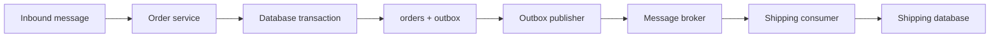
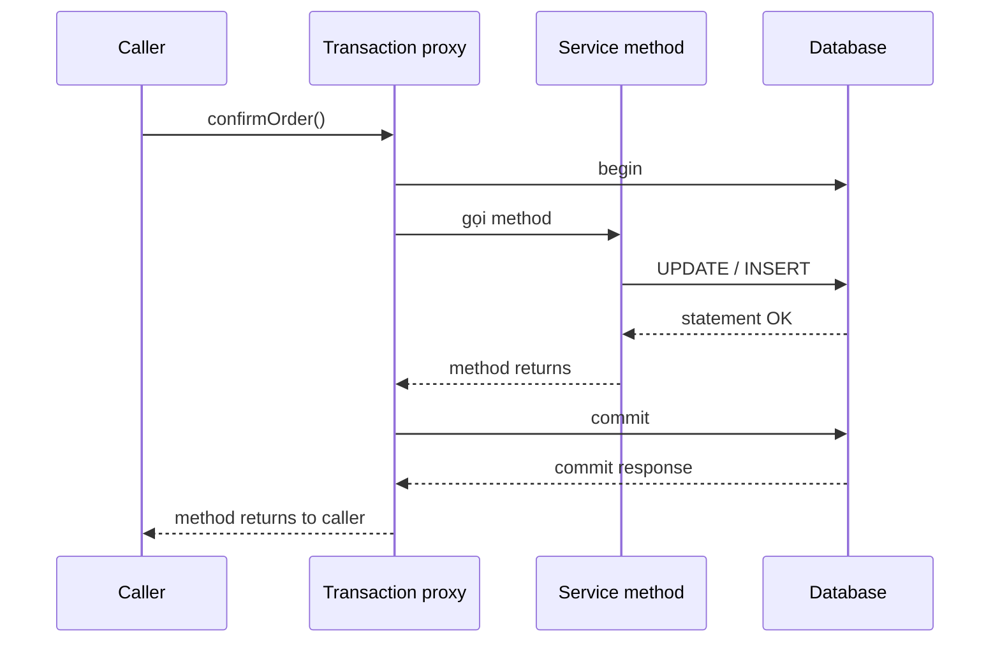
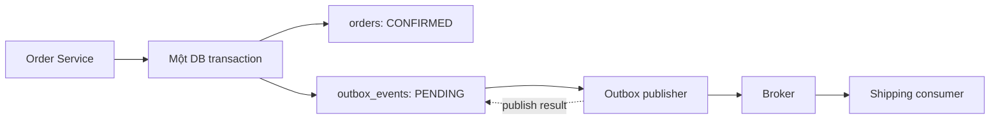
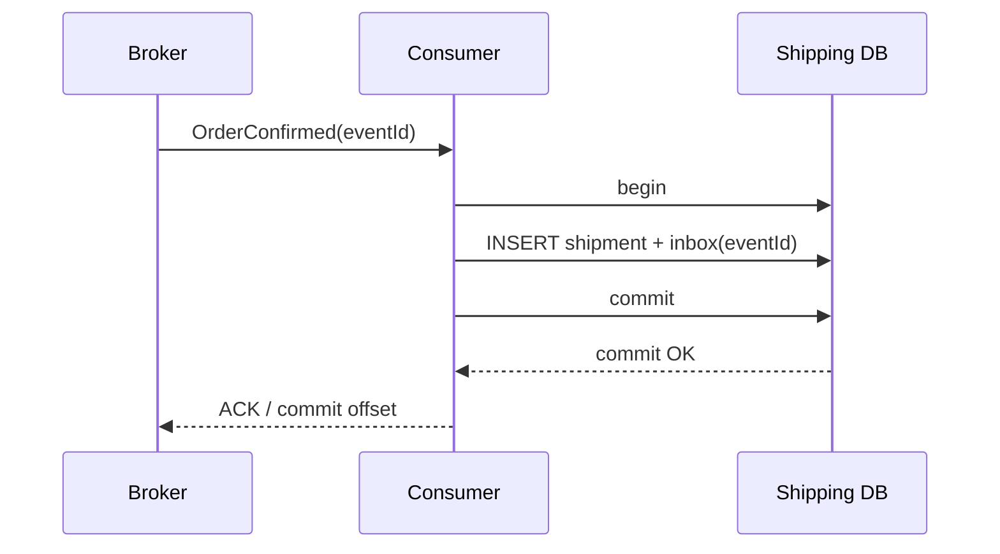
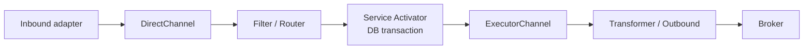
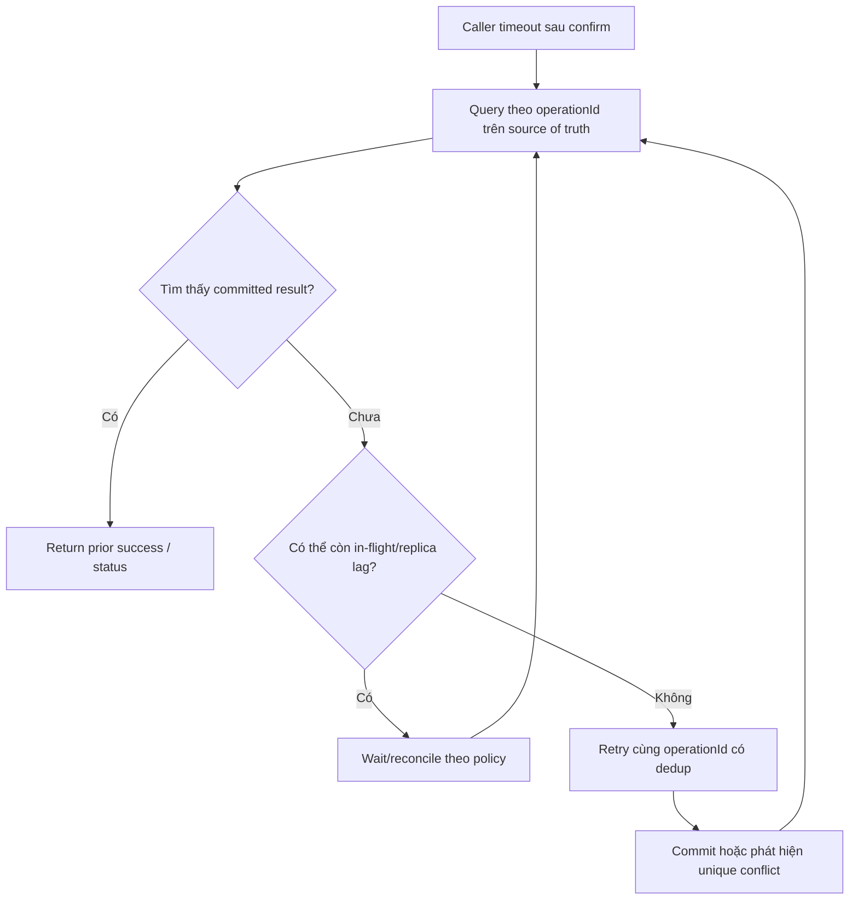

# Bằng chứng khi transaction commit thành công

Một flow Spring Integration có thể nhận message từ Gateway, đi qua Filter, Router, Transformer, Service Activator, ghi cơ sở dữ liệu rồi phát sự kiện cho service khác. Trong log xuất hiện dòng `Order confirmed`, nhưng khách hàng vẫn báo chưa thấy đơn; hoặc HTTP client nhận timeout dù database thực tế đã cập nhật. Khi đó, câu hỏi **“Bằng chứng nào chứng minh transaction đã commit thành công?”** phải được trả lời **theo đúng resource và ranh giới transaction**, không bằng một dòng log chung chung.

**Kết luận chính:** một transaction local được xem là commit thành công theo hợp đồng của transaction manager khi thao tác commit hoàn tất mà không báo lỗi; bằng chứng bền vững có thể kiểm chứng thêm là **trạng thái đã commit** trong resource có thẩm quyền (ví dụ hàng dữ liệu và outbox record cùng tồn tại). Nhưng điều đó **không tự chứng minh** message đã được broker tiếp nhận, consumer đã xử lý hay nghiệp vụ liên hệ thống đã kết thúc. Mỗi ranh giới cần xác nhận riêng. Nếu kết nối đứt đúng lúc commit, phía client có thể không biết chắc kết quả dù server đã commit.

Bài thuộc chương **Transactional messaging** của module **SPRING_INTEGRATION_PATTERN**. Module tập trung học triển khai Enterprise Integration Patterns với Spring Integration để xây dựng luồng thông điệp ít phụ thuộc, dễ mở rộng; thực hành Router, Filter, Transformer, Splitter, Aggregator, Gateway, retry, error channel, correlation và kiểm thử, theo dõi các nhánh xử lý. Bài này hướng dẫn phân loại các bằng chứng giao dịch đáng tin cậy và xây dựng đường phục hồi khi thông tin commit bị mơ hồ.

Sau khi học, bạn có thể:

- Phân biệt `flush`, câu lệnh SQL thành công, `commit`, callback `afterCommit`, broker publish confirm, consumer ACK và hoàn thành nghiệp vụ.
- Biết thời điểm `@Transactional`/`TransactionTemplate` thực sự commit trong Spring.
- Áp dụng **transactional outbox** để chứng minh thay đổi DB và ý định phát event được lưu cùng một transaction.
- Xử lý crash trước/sau commit và trường hợp kết quả commit không xác định mà không tạo duplicate side effect.
- Thiết kế correlation, idempotency, audit, metric và kiểm thử đúng nguồn bằng chứng cho từng bước.
- Hiểu khi nào transaction local đủ, khi nào cần điều phối nhiều resource bằng XA/JTA hoặc mô hình saga và bù trừ.

## 1. Trước hết, xác định “commit cái gì?”

Một hệ thống nhắn tin thường có nhiều resource độc lập:



Trong sơ đồ này có thể có **nhiều điểm xác nhận độc lập**, ví dụ:

1. Database của `orders` commit trạng thái đơn.
2. Cùng transaction đó commit một bản ghi `outbox`.
3. Publisher gửi event và broker xác nhận theo cơ chế producer.
4. Consumer nhận event và hoàn tất transaction trên database của `shipping`.
5. Consumer ACK hoặc commit offset sau khi xử lý theo cấu hình.
6. Một bước nghiệp vụ cuối cùng xác nhận đơn đã có vận đơn.

Nếu chỉ có bằng chứng cho bước 1, không được tuyên bố bước 4 hoặc 6 đã hoàn thành. Câu hỏi vận hành phải nói rõ: **local DB committed**, **outbox persisted**, **broker accepted**, **consumer processed**, hay **business outcome completed**.

### Các mệnh đề khác nhau về độ mạnh

| Mệnh đề | Phạm vi có thể chứng minh | Không tự chứng minh |
| --- | --- | --- |
| “Lệnh UPDATE trả về 1 row” | Statement được thực thi trong transaction hiện tại | Transaction đã commit |
| “JPA flush thành công” | SQL/đồng bộ trạng thái đã được đẩy tới DB trong transaction | Commit hoàn tất |
| “Transaction manager trả về sau commit” | Resource được quản lý báo commit thành công theo contract | Broker và downstream đã xử lý |
| “Đọc thấy order=CONFIRMED trên DB có thẩm quyền” | Trạng thái đã được công bố theo mức nhất quán của phép đọc | Event đã publish hoặc được consume |
| “Outbox row cùng tồn tại với order state” | Ý định publish đã được lưu cùng giao dịch DB | Publisher đã gửi event |
| “Broker confirm/transaction commit thành công” | Broker xác nhận theo cơ chế đã cấu hình | Consumer đã commit database |
| “Consumer ACK” | Transport ghi nhận tiến độ nhận/xử lý theo ack mode | Mọi side effect đều bền vững nếu ACK đặt sai chỗ |
| “Shipping record đã commit và query được” | Resource shipping có trạng thái đã commit | Toàn bộ tác vụ liên quan khác đã hoàn tất |

Lưu ý: ngay cả việc đọc được dữ liệu cũng phải xét **đọc từ primary hay replica**, isolation level, độ trễ replication và khóa nghiệp vụ được truy vấn. Read replica chưa kịp cập nhật có thể gây **false negative**, không đủ để kết luận primary chưa commit.

## 2. Những tín hiệu dễ bị nhầm là bằng chứng commit

### Log “success” được ghi bên trong transaction

```java
@Transactional
public void confirm(String orderId) {
    orderRepository.markConfirmed(orderId);
    log.info("Order committed: {}", orderId);
    // Sau dòng này vẫn có thể xảy ra lỗi hoặc transaction bị rollback.
}
```

Trong code trên, dòng log chạy **trước ranh giới commit của proxy transaction**. Nó không chứng minh dữ liệu đã commit. Exception, trạng thái rollback-only, optimistic lock hoặc lỗi ở bước commit có thể khiến transaction rollback sau dòng `INFO`.

### `save()`, `update()` hoặc `flush()` không tương đương commit

Một câu lệnh SQL thành công và số dòng affected là bằng chứng **thay đổi đã được áp dụng trong phạm vi transaction**, nhưng thay đổi có thể chưa hiển thị cho transaction khác và vẫn có thể rollback. Với JPA, `flush()` đồng bộ thay đổi đang chờ xuống DB, không thay thế `commit()`. Đừng gọi trạng thái “committed” ở giai đoạn này.

### Không có exception ở handler cũng chưa chắc đủ

Nếu handler chạy trong một transaction do poller, message listener container hoặc interceptor quản lý, handler có thể trả về trước khi transaction manager thực hiện commit. Đặc biệt với `@Transactional`, chỉ thị được áp dụng qua cơ chế proxy hoặc transaction aspect khi thỏa điều kiện; lời gọi tự gọi nội bộ (self-invocation) có thể không qua proxy như mong muốn.

### HTTP 200, queue ACK hay log ERROR vắng mặt không phải bằng chứng chung

- HTTP 200 từ **một service** chỉ có ý nghĩa theo contract của endpoint đó và thời điểm nó tạo response.
- Inbound broker ACK có thể được phát trước DB commit nếu cấu hình xử lý không đúng.
- Việc không thấy `ERROR` có thể do log level, collector/drop hoặc crash trước khi log.
- Trace/span báo `OK` có thể là đánh giá ở một chặng, không phản ánh resource thứ hai.

**Quy tắc:** mỗi tín hiệu phải được gắn với một **thao tác, resource và điểm thời gian cụ thể**.

## 3. Commit thực sự diễn ra ở đâu trong Spring?

Với một phương thức `@Transactional` được gọi qua proxy phù hợp, trình quản lý transaction thường thực hiện:



Sơ đồ trên là trình tự **thành công lý tưởng** và đơn giản hóa chi tiết flush, synchronization, propagation và transaction manager. Việc service method return **bên trong proxy** chưa đủ; caller chỉ nhận lời gọi proxy trả về thành công sau khi transaction completion hoàn tất theo contract của manager.

Có một số bẫy:

- Method đang chạy bên trong một **transaction bao ngoài** với propagation `REQUIRED` có thể chưa commit khi method con trả về. Commit thật nằm ở boundary của **transaction ngoài cùng**.
- `@Transactional` đặt lên method không được gọi qua Spring proxy, phương thức không phù hợp cơ chế weaving/proxy hoặc bean tự gọi chính mình có thể không tạo transaction như kỳ vọng.
- Transaction trên DB và một lời gọi broker không tự tạo thành một atomic transaction chỉ vì cùng nằm trong một method `@Transactional`.
- Một endpoint bất đồng bộ qua `ExecutorChannel`, broker, queue hoặc poller mới có thể dùng thread/transaction khác. Transaction context không mặc định đi theo message sang service khác.
- Transaction synchronization callback ở giai đoạn `afterCommit` không tự biến thao tác gọi mạng sau đó thành cùng transaction với database.

### TransactionTemplate dễ quan sát ranh giới hơn

Với `TransactionTemplate.execute(...)`, callback làm việc trong một transaction do template quản lý; nếu template **mở và hoàn tất chính transaction đó**, lời gọi chỉ trả về thành công sau khi commit thành công theo manager. Nếu tham gia transaction sẵn có, cũng phải hiểu propagation và transaction bên ngoài; không được coi mọi lần `execute` return đều là commit độc lập.

## 4. Bằng chứng: xếp theo độ tin cậy và khả năng kiểm chứng

Không phải một bằng chứng duy nhất phù hợp với mọi yêu cầu. Hãy ghép **kết quả thao tác** với **trạng thái bền vững có thể kiểm chứng**.

| Bằng chứng | Mạnh về điều gì? | Những giới hạn phải nêu |
| --- | --- | --- |
| Transaction manager báo commit return thành công | Resource manager đã hoàn tất commit theo contract | Client có thể crash trước khi nhận phản hồi; chưa nói về resource khác |
| Truy vấn DB bằng business operation ID | Có thể xác minh trạng thái bền vững sau commit | Phải query đúng nguồn, đúng isolation/read consistency |
| Record outbox cùng transaction | DB state và sự kiện cần publish cùng được lưu/rollback | Chưa chứng minh đã gửi event tới broker |
| DB transaction log/CDC commit record | Phản ánh thay đổi committed theo cơ chế DB/CDC | Connector có độ trễ, offset và chính sách retention |
| Broker publish confirm hoặc producer transaction result | Broker xác nhận việc ghi/giao dịch theo cấu hình | Chưa chứng minh consumer xử lý và side effect hoàn tất |
| Consumer inbox/dedup record + business state | Có thể xác minh một operation đã được xử lý tại consumer | Chưa khẳng định mọi hệ thống khác đã đồng bộ |
| Audit record bền vững | Lịch sử cho vận hành/tuân thủ nếu có transaction và integrity phù hợp | “Audit log” dạng text best-effort không đủ |
| Log/trace/metric | Quan sát, tìm kiếm, điều tra đường đi | Có thể phát sớm, mất, trùng, sampling; không thay durable state |

**Bằng chứng mạnh nhất cho một câu hỏi cụ thể** là dấu vết nằm đúng **resource sở hữu sự thật nghiệp vụ**, theo contract lưu trữ/replication đã thống nhất. Một commit return thành công có thể đủ cho request đồng bộ đơn giản; một hoạt động liên hệ thống lại đòi truy vết nhiều resource và trạng thái cuối.

## 5. Các cửa sổ crash quanh transaction

Các sự cố thường không rơi đúng vào “trước” hoặc “sau” theo cách caller có thể biết chắc:

```text
T0: nhận yêu cầu
T1: BEGIN
T2: UPDATE orders
T3: INSERT outbox
T4: gửi COMMIT tới DB
T5: DB commit thành công
T6: DB trả ACK commit
T7: application trả HTTP success
T8: outbox publisher gửi event tới broker
```

| Crash hoặc timeout | Điều có thể xảy ra | Phải làm gì? |
| --- | --- | --- |
| Trước T4 | Transaction có thể rollback nếu connection đóng; còn tùy DB | Không công bố success; kiểm tra trạng thái |
| Giữa T4 và T6 | DB có thể commit hoặc chưa; client không biết chắc | Xử lý **commit outcome unknown** |
| Sau T5, trước T7 | DB đã commit nhưng client không nhận success | Retry bằng idempotency key và truy vấn trạng thái |
| Sau T7, trước T8 | DB commit và client nhận success, event chưa publish | Outbox publisher tiếp tục từ bản ghi bền vững |
| Sau broker nhận event, trước publisher lưu trạng thái “sent” | Event có thể được publish lại | Consumer phải idempotent |
| Sau consumer ghi DB, trước khi gửi ACK | Broker có thể redeliver | Consumer dùng inbox/dedup hoặc idempotent update |

Đừng dùng `Thread.sleep`, log hoặc một cờ trong RAM để nối hai resource rồi coi là transaction. Những khoảng lỗi này vẫn xuất hiện khi process bị kill, máy mất điện, network timeout hoặc executor bị shutdown.

### “Commit failed” có luôn nghĩa rollback?

Không. Có các lỗi xác định như constraint violation làm rollback; cũng có lỗi **không xác định kết quả** như mất kết nối đúng lúc nhận phản hồi commit. Khi trạng thái không rõ, không nên tự động thực hiện một nghiệp vụ mới với operation ID khác. Thay vào đó hãy **đối chiếu dữ liệu bền vững theo ID ổn định**, rồi quyết định retry hay phục hồi.

## 6. Transactional outbox: bằng chứng ý định phát message cùng commit DB

Khi cần vừa thay đổi DB vừa thông báo event cho service khác, **transactional outbox** là một mô hình quan trọng:



Ý nghĩa:

1. Service cập nhật bảng `orders` và thêm `outbox_events` **trong cùng transaction của cùng resource/transaction manager**.
2. Nếu transaction rollback, cả hai thay đổi rollback.
3. Nếu commit, cả hai thay đổi được lưu; đây là bằng chứng durable về trạng thái đơn **và ý định cần phát event**.
4. Publisher đọc record `PENDING`, gửi event, nhận xác nhận theo cơ chế broker rồi cập nhật trạng thái dispatch.
5. Nếu publisher crash, record vẫn có thể được quét và gửi lại.

Outbox **không cam kết exactly-once end-to-end**. Publisher có thể gửi thành công nhưng chết trước khi đánh dấu record; khi phục hồi nó gửi lại. Consumer phải xử lý duplicate, ví dụ dựa trên `eventId`/`operationId` duy nhất.

### Một schema minh họa

```sql
CREATE TABLE orders (
    order_id        VARCHAR(100) PRIMARY KEY,
    status          VARCHAR(32) NOT NULL
);

CREATE TABLE integration_outbox (
    event_id        VARCHAR(100) PRIMARY KEY,
    operation_id    VARCHAR(100) NOT NULL UNIQUE,
    aggregate_id    VARCHAR(100) NOT NULL,
    event_type      VARCHAR(80) NOT NULL,
    payload_json    TEXT NOT NULL,
    publish_status  VARCHAR(20) NOT NULL,
    created_at      TIMESTAMP NOT NULL DEFAULT CURRENT_TIMESTAMP
);
```

Schema này chỉ mô tả ý tưởng, cần điều chỉnh kiểu thời gian, constraint, khóa, index, retry lease, dead-letter và định nghĩa idempotency theo DB thực tế. Đặc biệt, `operation_id` duy nhất là một cách chống tạo **nhiều outbox event cho cùng một ý định nghiệp vụ**; phải chọn operation ID đúng phạm vi.

## 7. Ví dụ Java: chỉ trả xác nhận sau transaction DB hoàn tất

Ví dụ dùng Java 17+, Spring JDBC và Spring Transaction. `TransactionTemplate` quản lý **một transaction local** trên datasource chứa cả `orders` và `integration_outbox`. Đoạn code này **không tự phát event ra broker**, nên lời xác nhận chỉ nói tới phần DB.

```java
import java.util.UUID;

import org.springframework.jdbc.core.JdbcTemplate;
import org.springframework.stereotype.Service;
import org.springframework.transaction.support.TransactionTemplate;

record CommitReceipt(String operationId, String eventId, String state) { }

@Service
class OrderConfirmationService {

    private final JdbcTemplate jdbc;
    private final TransactionTemplate transactions;

    OrderConfirmationService(
            JdbcTemplate jdbc,
            TransactionTemplate transactions) {
        this.jdbc = jdbc;
        this.transactions = transactions;
    }

    CommitReceipt confirm(
            String orderId,
            String operationId,
            String eventJson) {

        // operationId phải được caller / trusted ingress duy trì ổn định
        // khi retry cùng một yêu cầu nghiệp vụ.
        String eventId = UUID.randomUUID().toString();

        CommitReceipt receipt = transactions.execute(status -> {
            int changed = jdbc.update(
                    "UPDATE orders SET status = ? " +
                    "WHERE order_id = ? AND status = ?",
                    "CONFIRMED", orderId, "PENDING");

            if (changed != 1) {
                throw new IllegalStateException(
                        "Order cannot transition from PENDING");
            }

            jdbc.update(
                    "INSERT INTO integration_outbox " +
                    "(event_id, operation_id, aggregate_id, " +
                    "event_type, payload_json, publish_status) " +
                    "VALUES (?, ?, ?, ?, ?, ?)",
                    eventId,
                    operationId,
                    orderId,
                    "OrderConfirmed",
                    eventJson,
                    "PENDING");

            // Đây mới là dữ liệu kết quả được TẠO bên trong callback,
            // CHƯA phải bằng chứng commit ở thời điểm dòng này chạy.
            return new CommitReceipt(operationId, eventId,
                    "DB_COMMITTED");
        });

        if (receipt == null) {
            throw new IllegalStateException(
                    "No transaction result");
        }

        // Chỉ tới đây sau khi TransactionTemplate.execute trả thành công
        // và nếu template thật sự quản lý transaction hoàn tất ở đây.
        // Không đồng nghĩa event đã publish hoặc consumer đã xử lý.
        return receipt;
    }
}
```

**Điều kiện quan trọng để ví dụ đúng:**

- `TransactionTemplate` phải được gắn với transaction manager thực sự quản lý **cùng datasource** mà `JdbcTemplate` dùng. Không được để write `orders` và write `outbox` vô tình nằm trên hai datasource/transaction độc lập.
- Phải có **ranh giới transaction mới/độc lập được hoàn tất tại đây** nếu muốn receipt được hiểu là DB đã commit tại lúc `confirm()` return. Nếu template tham gia transaction bao ngoài, chỉ ranh giới ngoài mới commit thật.
- `JdbcTemplate.update(...)` chỉ trả số dòng affected của statement, **không** tự chứng minh commit.
- `eventJson` phải được tạo bằng serializer và schema đã được validate. Không nối chuỗi JSON chứa raw user input rồi đưa vào outbox.
- `operationId` cần cơ chế chống trùng. Ví dụ trên **minh họa đường thành công của một yêu cầu mới**, chưa xử lý trường hợp replay của cùng operation ID hoặc trạng thái đơn đã là `CONFIRMED`.
- Unique constraint trên `operation_id`/`event_id` giúp chống duplicate ở DB, nhưng production cần bắt conflict và đối chiếu **trạng thái đã commit** thay vì chỉ ném lỗi 500.
- `state="DB_COMMITTED"` là tên trạng thái ở **receipt của service**, không phải thuộc tính được DB tự sinh. Hãy trình bày rõ resource mà receipt nói tới.

Nếu code bị lỗi ở bước INSERT outbox và transaction manager thực hiện rollback, trạng thái đơn và outbox phải cùng rollback. Nếu commit response bị mất, caller vẫn cần quy trình xác minh theo `operationId`.

### Cách đối chiếu durable state

Một truy vấn vào database có thẩm quyền, ngoài transaction vừa kết thúc, có thể dùng để xác minh:

```sql
SELECT o.order_id, o.status,
       x.operation_id, x.event_id, x.publish_status
FROM orders o
LEFT JOIN integration_outbox x
    ON x.aggregate_id = o.order_id
WHERE o.order_id = ?
  AND x.operation_id = ?;
```

Ở ví dụ này, nếu thấy `orders.status=CONFIRMED` và outbox của đúng operation ID tồn tại, có bằng chứng durable cho **trạng thái đơn và outbox**, không phải rằng event đã phát. Dùng đúng source of truth và consistency level; một read replica có thể trễ. Cần xét concurrency và schema nếu một order có nhiều operation hợp lệ.

## 8. `afterCommit` giúp quan sát, nhưng không phải hàng đợi bền vững

Spring hỗ trợ `TransactionSynchronization` và listener theo phase transaction để xử lý sau commit. Ví dụ:

```java
import org.springframework.transaction.support.TransactionSynchronization;
import org.springframework.transaction.support.TransactionSynchronizationManager;

static void registerAfterCommitLog(
        String operationId, Runnable recordMetric) {

    if (!TransactionSynchronizationManager.isSynchronizationActive()
            || !TransactionSynchronizationManager.isActualTransactionActive()) {
        throw new IllegalStateException("No active transaction");
    }

    TransactionSynchronizationManager.registerSynchronization(
            new TransactionSynchronization() {
                @Override
                public void afterCommit() {
                    recordMetric.run();
                    // Có thể ghi một structured log metadata an toàn tại đây.
                }
            });
}
```

Các điều cần hiểu:

1. `afterCommit()` chạy **sau khi transaction resource đã commit thành công** trong vòng đời synchronization thông thường.
2. Nếu JVM crash giữa lúc DB commit và callback, callback **không được thực thi**; do đó log/metric tại callback không thể là nguồn duy nhất để tái dựng mọi commit.
3. Exception trong callback có thể được đưa lên caller hoặc ảnh hưởng đường trả lời theo cách framework định nghĩa, **dù transaction DB không thể “uncommit”**. Đừng dựa vào một lần callback lỗi để suy DB rollback.
4. Trong pha synchronization sau commit, một số resource có thể vẫn gắn với thread. Nếu callback cần một **DB write mới** có transaction riêng, hãy mở một transaction mới theo cấu hình phù hợp (chẳng hạn `REQUIRES_NEW`) thay vì tưởng rằng nó thuộc commit đã hoàn tất.
5. `TransactionSynchronizationManager.isSynchronizationActive()` không một mình chứng minh transaction thật tồn tại; ví dụ kiểm tra thêm trạng thái actual transaction nhưng vẫn phải hiểu manager được sử dụng.

Tương tự, `@TransactionalEventListener(phase = AFTER_COMMIT)` có ích để phát sự kiện nội bộ sau commit, nhưng **không tạo độ bền** cho lời gọi HTTP/broker tiếp theo. Nếu có yêu cầu không mất event khi crash, ghi outbox **trong transaction gốc** thường thích hợp hơn một lời gọi publish chỉ ở `afterCommit`.

### `afterCompletion` có ý nghĩa khác

`afterCompletion(int status)` có thể nhận trạng thái commit, rollback hoặc unknown theo contract của Spring. Đây là nơi phù hợp để cleanup và telemetry tổng kết, nhưng callback không phải là database transaction log. Nếu status unknown, **không** được tự chuyển thành “rollback chắc chắn”. Cần đối chiếu resource có thẩm quyền.

## 9. Broker publish confirmation là bằng chứng của broker, không phải DB

Một producer có thể phát event sau khi DB commit:

```text
DB: COMMITTED
   |
   v
Publisher -> Broker
   |
   v
Broker confirm/ack
```

Broker confirm là bằng chứng **ở phía broker theo cơ chế/cấu hình sử dụng**, không phải bằng chứng DB đã commit hay consumer đã xử lý. Độ bền của event còn phụ thuộc vào queue/topic, replica, publisher mode, confirm mode, retention và guarantee của transport.

| Trường hợp | Có thể nói gì? | Chưa thể nói gì? |
| --- | --- | --- |
| DB commit OK, broker publish chưa chạy | DB đã commit, outbox có thể đang pending | Broker đã nhận event |
| Producer gửi event nhưng không nhận confirm | Kết quả publish có thể không xác định | Event chắc chắn chưa được ghi |
| Broker confirm OK | Broker xác nhận theo contract producer | Shipping đã cập nhật DB |
| Consumer nhận event | Event đã đến consumer | Side effect đã commit |
| Consumer DB commit OK, ACK chưa tới broker | Consumer có thể đã hoàn tất DB | Broker sẽ không redeliver |
| Consumer ACK OK | Broker thấy tiến độ xử lý theo mode | Toàn bộ downstream đã hoàn tất nếu ACK đặt sai ranh giới |

**Chú ý công nghệ:** JMS, RabbitMQ, Kafka và các adapter Spring Integration không có cùng semantics transaction/confirm. Kafka producer transaction, JMS session transaction và local JDBC transaction là những phạm vi khác nhau; một “transaction” trong một resource không tự bao trùm resource khác.

### Có nên dùng XA/JTA?

Nếu yêu cầu atomic commit thật sự giữa nhiều resource có hỗ trợ XA và tổ chức chấp nhận độ phức tạp, có thể xem xét JTA/XA. Tuy nhiên phải kiểm tra **cả hai** resource/driver/transaction manager có tham gia cùng global transaction không, khả năng recovery của coordinator và trạng thái in-doubt.

Không dùng thuật ngữ “2PC” để mô tả một flow chỉ lần lượt gọi `DB.commit` rồi `broker.send`. Nếu không có giao dịch phân tán thật, mô hình thực tế là **hai thao tác riêng** với cửa sổ lỗi giữa chúng. Outbox + at-least-once delivery + idempotent consumer thường là một lựa chọn khác phù hợp, nhưng vẫn cần đáp ứng SLA và đặc điểm hệ thống.

## 10. Consumer ACK, DB commit và xử lý trùng

Một consumer nhận `OrderConfirmed` để tạo shipment:



Đây là thứ tự xử lý mong muốn ở nhiều kiến trúc: **DB commit trước rồi mới ACK broker**. Nhưng nếu crash sau DB commit, trước ACK, broker có thể giao lại event. Vì vậy consumer nên dùng một `inbox`/dedup table cùng transaction với thay đổi shipping, với unique constraint trên `eventId` hoặc business operation ID.

Pseudo-code:

```text
consume(event):
  begin local DB transaction
  if inbox already contains event.id:
      commit/no-op
  else:
      insert inbox(event.id)
      apply idempotent business change
      commit
  ACK broker according to adapter contract
```

Nếu side effect là gọi dịch vụ bên ngoài không tham gia cùng transaction DB, inbox đơn thuần chưa bảo đảm atomicity với lời gọi đó. Cần thiết kế thêm outbox/command bù trừ/semantics idempotency tại dịch vụ đích.

**Quan trọng:** ACK không phải commit của ứng dụng. Có adapter tự ACK khi method return, có listener/session mode khác; lỗi và transaction propagation phụ thuộc connector thực tế. Phải kiểm thử với công nghệ và cấu hình đang dùng.

## 11. Transaction boundary trong Spring Integration flow

Một flow có thể chứa nhiều pattern; nhưng không phải tất cả nằm trong một transaction chỉ vì chúng xuất hiện trong cùng đoạn Java DSL.



Các ranh giới cần phân biệt:

- **`DirectChannel`:** thường gọi handler trong thread gửi, nên có thể tham gia transaction context của caller nếu transaction đã tồn tại; bản thân DirectChannel không mở transaction tự động cho mọi trường hợp.
- **Polling endpoint:** transaction có thể được cấu hình trên poller/advice; phạm vi và tài nguyên được enlist quyết định commit thực sự bao trùm bước nào.
- **`@Transactional` trên handler/service:** tùy proxy, propagation và loại transaction manager; không thể suy rằng cả flow nằm trong cùng transaction.
- **`ExecutorChannel`, queue/poller và broker:** có ranh giới bất đồng bộ; transaction context gắn với thread cũ không mặc định được truyền sang thread hoặc service mới.
- **Gateway request/reply:** reply đã được tạo ở một stage không tự chứng minh các stage async downstream đã hoàn tất, nếu kiến trúc không chờ chúng.
- **Splitter/Aggregator:** message con và message nhóm có thể đi qua nhiều transaction khác nhau; completion group không thay commit của từng resource.
- **Retry advice:** có thể retry một lời gọi handler bên trong hoặc bên ngoài ranh giới transaction. Cần phân biệt một **attempt** với một **committed operation**.

### Một lưu ý về retry trong cùng transaction

Nếu một lần thao tác DB thất bại và transaction hiện tại bị đánh dấu `rollback-only`, tiếp tục retry bên trong cùng transaction có thể không cứu được commit cuối. Retry nên được thiết kế ở ranh giới tạo transaction **mới phù hợp cho từng attempt** khi cần. Cần kiểm tra thứ tự của retry advice và transaction advice, cũng như exception nào retry được, để tránh tưởng rằng ba lần gọi handler là ba lần commit độc lập.

## 12. Log, metric và trace giúp điều tra nhưng không thay durable proof

Một bộ structured event có thể phân biệt các mốc:

```json
{
  "event": "orders.db_commit_returned",
  "operationId": "op_42",
  "aggregateId": "ORD-42",
  "outboxEventId": "evt_42",
  "dbResource": "orders-primary",
  "outcome": "COMMIT_RETURNED"
}
```

Đây là **schema minh họa do ứng dụng định nghĩa**. Event chỉ nên được tạo sau ranh giới commit tương ứng, nhưng bản ghi log vẫn có thể mất hoặc không xuất ra. Không ghi `event=transaction_committed` **ở bên trong callback transaction trước khi commit**.

Các trường nên có:

| Trường | Lý do |
| --- | --- |
| `operationId`/idempotency key | Truy vấn trạng thái bền vững sau timeout/retry |
| `requestCorrelationId` | Kết nối inbound Gateway với các nhánh EIP |
| `outboxEventId` | Theo dõi một event qua publisher, broker và consumer |
| `aggregateId` | Truy vấn trạng thái nghiệp vụ có phân quyền |
| `transactionBoundary`/`dbResource` | Biết commit của resource nào |
| `event`/`outcome` | Phân biệt attempt, committed, published, consumed, failed |
| `durationMs` | Phân tích chậm ở stage commit/publish |
| `traceId`/`spanId` | Xem hành trình khi tracing đã được cấu hình và được lấy mẫu |

**Không đưa raw SQL params, token, payload nhạy cảm hoặc exception message tự do** vào log. Các ID nghiệp vụ cũng phải được chuẩn hóa, bảo vệ quyền truy cập và thời gian lưu.

### Metrics cần đúng đơn vị

Một bộ metric gợi ý:

- `db_transaction_attempts_total`: số lần cố thực hiện giao dịch.
- `db_transaction_commit_returned_total`: số lần manager trả về thành công ở đúng boundary đã instrument.
- `db_transaction_rollback_total`: rollback đã được xác định.
- `db_transaction_unknown_total`: kết quả commit không rõ sau lỗi giao tiếp.
- `outbox_pending`/`outbox_oldest_age`: số và tuổi record chờ publish.
- `outbox_publish_attempts_total`, `outbox_confirmed_total`: theo semantics publisher.
- `consumer_processed_total`, `consumer_duplicate_total`, `consumer_failed_total`: theo định nghĩa consumer.

Đây là **tên ví dụ**, không khẳng định Spring tạo sẵn mọi meter. Đừng dùng `operationId` hay `eventId` làm tag metric có cardinality cao. Log/trace dùng để tìm một trường hợp; metric dùng để tổng hợp lưu lượng và tình trạng.

**Nhớ:** metrics và traces cũng có thể sampling, exporter trễ, pipeline drop. Khi có mâu thuẫn, quay về durable resource state và contract giao dịch thay vì coi số dòng log là nguồn sự thật.

## 13. Audit bền vững khác log “transaction success”

Nếu cần bằng chứng kiểm toán, phải định nghĩa rõ:

1. **Ai** yêu cầu thay đổi và quyền thực hiện.
2. **Operation ID** gắn với sự thay đổi, không phụ thuộc request timeout.
3. **State transition** từ trạng thái nào sang trạng thái nào.
4. **Resource** nào sở hữu transaction.
5. **Commit boundary** nào bảo đảm thay đổi và audit record được lưu cùng nhau.
6. **Tính toàn vẹn** và quyền truy cập audit data.
7. **Thời gian lưu, truy vấn, đối soát và phục hồi**.

Một bảng audit ghi **trong cùng database transaction** với thay đổi chính có thể cung cấp bằng chứng bền vững theo hợp đồng DB, miễn là schema và chính sách integrity phù hợp. Một dòng text log `INFO commit success` không cung cấp các đặc tính đó và có thể bị mất nếu process crash trước flush.

Nếu audit nằm trên một hệ thống độc lập và chỉ gửi sau commit, cần outbox hoặc cơ chế tương đương để chống mất tín hiệu giữa hai resource. Đồng thời, log phục vụ điều tra có thể vẫn ghi event, nhưng không được xem là kho audit chính thức nếu không có các guarantee tương ứng.

## 14. Commit outcome unknown: xử lý ra sao khi caller nhận timeout?

Đây là tình huống quan trọng nhất trong thực tế. Ví dụ HTTP client gửi `confirmOrder(op_42)`; DB commit xong, nhưng kết nối tới service bị đứt trước khi HTTP 200 quay về. Client thấy timeout. Nếu client gửi **operation ID mới** và service thực hiện thêm một giao dịch, có thể gây duplicate shipment hoặc double charge.

Chiến lược an toàn:

1. Cấp `operationId` ổn định tại ingress hoặc client tin cậy; client **dùng lại ID này** khi retry cùng hành động.
2. Trong DB, đặt unique constraint hoặc record idempotency và ràng buộc kết quả cùng transaction với thay đổi nghiệp vụ.
3. Khi retry, query theo `operationId` trên nguồn có thẩm quyền.
4. Nếu tìm thấy trạng thái đã commit hợp lệ, **trả lại kết quả cũ** thay vì thực hiện side effect mới.
5. Nếu chưa thấy, xem xét isolation/replication lag, transaction còn in-flight và cơ chế khóa; đừng coi một lần query “không có” là bằng chứng tuyệt đối rằng commit trước không xảy ra.
6. Nếu xác định chắc chưa commit theo contract và thời hạn, thực hiện lại **cùng operation ID**, để constraint/dedup ngăn trùng nếu xuất hiện race.
7. Nếu tiếp tục không rõ, trả trạng thái `PENDING/UNKNOWN` và có reconciliation/alert, thay vì tự tuyên bố thất bại hoặc thành công chắc chắn.



Mô hình này giả định đã có business idempotency logic, unique index và quy tắc xác định một operation đã hoàn tất. Không chỉ dùng một biến `HashSet` trong RAM vì restart hoặc scale có thể xóa lịch sử dedup. Với thanh toán/đơn hàng, cân nhắc trạng thái `PENDING` được lưu bền vững và quy trình hòa giải với hệ thống đối tác.

## 15. Kiểm thử commit bằng resource thật, không chỉ nhìn log

### Những kiểm thử dễ tạo kết luận sai

- Test `@Transactional` của Spring Test Framework thường rollback ở cuối test; một query trong cùng test transaction thấy dữ liệu **không chứng minh production commit**.
- Mock `repository.save(...)` trả về thành công chỉ cho thấy method được gọi, không kiểm tra transaction manager.
- Test assert log chứa `"COMMIT_OK"` trước khi thoát method không phát hiện lỗi ở pha commit.
- Test chỉ đọc một replica có thể thất bại do replication lag, không phải do transaction rollback.
- Test happy path không phát hiện được hai cửa sổ crash *sau DB commit trước HTTP reply* và *sau broker publish trước outbox mark*.

### Ma trận test khuyến nghị

| Kịch bản | Điều cần xác minh | Bằng chứng ưu tiên |
| --- | --- | --- |
| Đường thành công DB | Order đổi trạng thái, outbox xuất hiện | Query trên DB sau khi transaction kết thúc |
| Exception trước commit | Không có order transition hoặc outbox mới | Query ở transaction độc lập |
| INSERT outbox lỗi | UPDATE order cũng rollback | Cùng DB transaction, query sau rollback |
| Constraint violation | Service trả lỗi xác định, không publish | DB state + error classification |
| Transaction bị rollback-only | Không phát receipt `DB_COMMITTED` | Transaction boundary và DB state |
| Crash trước commit | Không công bố kết quả chắc chắn | Query/recovery theo operation ID |
| Network mất ACK commit | Kết quả được đánh dấu unknown nếu cần | Idempotency lookup, không suy từ timeout |
| Crash sau DB commit trước HTTP reply | Retry cùng ID trả trạng thái cũ | Durable operation/outbox |
| Crash sau DB commit trước publish | Outbox record còn và được quét lại | Outbox pending + publisher |
| Publish thành công nhưng chưa mark sent | Consumer xử lý duplicate an toàn | Broker + consumer inbox/dedup |
| Consumer DB commit trước ACK rồi crash | Redelivery không nhân đôi side effect | Consumer DB + inbox |
| Retry advice lặp attempt | Không tạo nhiều operation độc lập ngoài policy | Operation ID và constraints |
| ExecutorChannel tách thread | Không giả định transaction/trace context được truyền | Resource boundaries, trace propagation |
| Splitter/Aggregator | Group release không thay DB commit của từng item | Durable per-item/group state |
| Metric/log collector tắt | Business commit vẫn theo contract | DB/broker authoritative state |
| Khi rollback, không có event publish sai | Publisher chỉ lấy outbox record committed | DB outbox + broker test |

### Thiết kế integration test commit/rollback

Nên chạy với **database và transaction manager phù hợp phiên bản đang dùng** (ví dụ container database trong môi trường test). Mỗi test:

1. Chuẩn bị order ở trạng thái `PENDING` cùng operation ID mới.
2. Gọi public service boundary thực sự có transaction, không gọi trực tiếp method nội bộ bỏ qua proxy.
3. Đợi method return rồi dùng **transaction/connection đọc độc lập** query `orders` và `integration_outbox`.
4. Gây lỗi sau UPDATE nhưng trước INSERT outbox; xác nhận **cả hai không commit**.
5. Gây commit exception/timeout giả trong tầng giao tiếp; xác nhận client không kết luận “chắc chắn rollback” khi trạng thái có thể unknown.
6. Mô phỏng publisher chạy lại nhiều lần; consumer phải giữ đúng một side effect theo event ID.
7. Kiểm tra event/metric/log chỉ mô tả trạng thái đã chứng thực, không phát sinh `COMMIT_SUCCESS` từ giai đoạn mới gọi `save()`.

Để test khoảng crash thật, cần failure injection ở ranh giới resource/publisher thay vì chỉ throw exception trong handler. Cấu hình database, broker và adapter thật sẽ quyết định cách phục hồi.

## 16. Case study: một đơn hàng được xác nhận nhưng không thấy shipment

**Bối cảnh:** Gateway nhận `ConfirmOrder(op_42)`. Filter kiểm tra dữ liệu, Router chọn nhánh `standard`, Service Activator cập nhật `orders`. Sau đó cần phát `OrderConfirmed` đến shipping. Một vài request client bị timeout và một số đơn đã confirm nhưng shipping chưa có vận đơn.

### Phân tích theo từng bằng chứng

| Câu hỏi | Cách kiểm tra | Nếu có bằng chứng |
| --- | --- | --- |
| Order DB đã commit chưa? | Query order/operation ID trên source of truth | Biết trạng thái tại resource orders |
| Outbox event có cùng commit không? | Query outbox theo `operationId` | Biết ý định publish đã được lưu |
| Publisher đã phát chưa? | Outbox state + broker confirm/publisher records | Biết tiến độ publish theo contract |
| Broker có giữ event không? | Broker metadata/offset hoặc queue theo công nghệ | Biết event đã đến transport |
| Shipping đã xử lý chưa? | Inbox/dedup và shipment DB | Biết side effect ở shipping |
| Shipping đã trả kết quả cuối chưa? | Business status/event của shipping | Biết toàn hành trình đang ở giai đoạn nào |

### Một lần chạy có thể trông như sau

```text
T0  Gateway nhận ConfirmOrder(operationId=op_42)
T1  Filter hợp lệ, Router chọn standard
T2  DB transaction: UPDATE orders + INSERT outbox
T3  DB commit thành công
T4  Kết nối HTTP bị đứt trước khi client nhận response
T5  Client retry cùng operationId=op_42
T6  Service đọc DB, thấy operation đã commit -> trả kết quả cũ
T7  Publisher đọc outbox PENDING, publish OrderConfirmed
T8  Broker confirm, publisher crash trước khi mark sent
T9  Publisher khởi động lại, gửi event lần nữa
T10 Shipping consumer dùng eventId/inbox, tạo đúng một shipment
```

Không có mâu thuẫn nếu:

- Client ở T4 thấy timeout nhưng DB đã commit.
- Publisher gửi hai lần nhưng shipping chỉ tạo một vận đơn nhờ idempotency.
- Log T3 bị mất nhưng outbox và order vẫn là bằng chứng durable.
- Một trace không chứa T8–T10 do sampling hoặc ngữ cảnh bất đồng bộ, trong khi business status hoàn tất.

**Kết luận vận hành:** cần đối chiếu từng ranh giới transaction và transport, không kết luận từ duy nhất response timeout, một log `INFO` hoặc một broker ACK.

## 17. Các sai lầm phổ biến

| Sai lầm | Vì sao sai? | Cách sửa |
| --- | --- | --- |
| Log “commit success” ngay sau `save()` | Transaction có thể chưa commit hoặc rollback | Ghi đúng sau boundary, kiểm chứng durable state |
| Xem `flush()` là commit | SQL đã được đồng bộ nhưng vẫn rollback được | Phân biệt flush và commit |
| Method `@Transactional` nội bộ return là commit | Proxy/outer transaction chưa chắc kết thúc | Xác định outermost transaction boundary |
| Gọi broker trong cùng method rồi coi atomic với DB | Hai resource không mặc định chung transaction | Outbox hoặc global transaction đúng contract |
| Chỉ dùng `afterCommit` để gửi event bắt buộc | Crash sau commit trước callback gây mất event | Ghi outbox trong transaction gốc |
| Không biết kết quả commit thì tạo operation ID mới | Có thể double charge/double shipment | Retry cùng ID, query/dedup |
| HTTP timeout được hiểu là rollback | Commit có thể đã hoàn tất trước khi reply mất | Reconcile theo source of truth |
| Publish confirm được coi consumer đã xử lý | Confirm chỉ ở phía broker | Consumer inbox/DB status |
| Consumer ACK trước DB commit | Crash có thể mất side effect nhưng message không redeliver | Thiết kế commit-before-ACK theo adapter contract |
| Dùng log line để đếm commit | Log có thể thiếu/lặp/sampling | Metric đúng boundary, DB audit/durable proof |
| Đọc replica trễ rồi kết luận chưa commit | Replication lag, isolation khác | Đọc đúng nguồn nhất quán |
| Test `@Transactional` rồi query trong cùng test | Test có thể rollback cuối test | Verify sau boundary bằng transaction độc lập |
| Retry trong transaction rollback-only | Attempt tiếp theo có thể không commit được | Xác định thứ tự retry/transaction advice |
| Outbox event có nhưng bảo “broker đã nhận” | Event còn PENDING có thể chưa publish | Theo dõi publisher/broker confirms riêng |
| Commit DB thành công nhưng log afterCommit thất bại => rollback | Callback lỗi không đảo được commit đã xảy ra | Phân loại lỗi sau commit và đối chiếu DB |
| Dùng `nullChannel` để nuốt failure cuối | Che mất message cần recovery | Error channel, DLQ, outbox/saga phù hợp |

## 18. Bài thực hành: tạo bằng chứng commit và khả năng phục hồi

**Đề bài:** xây dựng flow xác nhận đơn có Gateway → Filter → Router → Service Activator ghi `orders` và `integration_outbox`, sau đó publisher phát `OrderConfirmed` và consumer shipping xử lý. Thực hiện bằng Spring Integration Java DSL và các thành phần Spring Transaction thích hợp.

1. Định nghĩa rõ các trạng thái `PENDING`, `DB_COMMITTED`, `OUTBOX_PENDING`, `PUBLISHED`, `CONSUMED`, `BUSINESS_COMPLETED`. Mỗi trạng thái phải chỉ ra **resource** sở hữu sự thật, không chỉ là text log.
2. Cấp `operationId` ổn định ở ingress. Nếu client retry cùng ý định, dùng lại ID đó.
3. Dùng transaction local cập nhật order và insert outbox cùng DB. Kiểm tra trường hợp UPDATE thành công nhưng outbox INSERT lỗi: cả hai phải rollback.
4. Chỉ trả receipt “DB committed” sau ranh giới commit thật. Nếu có outer transaction, xác định lại điểm gửi receipt.
5. Đặt unique constraint/idempotency record theo operation ID; xử lý replay mà không tạo side effect trùng.
6. Viết outbox publisher với retry, giới hạn attempt/age, broker confirmation và xử lý crash ngay sau publish trước mark-sent.
7. Viết shipping consumer có dedup/inbox trong cùng transaction với cập nhật shipment; ACK theo contract của adapter.
8. Thử mất HTTP reply sau commit; client retry cùng ID và nhận trạng thái đã commit.
9. Thử DB commit outcome unknown; không kết luận rollback chỉ dựa vào exception kết nối, mà query/reconcile.
10. Gắn structured log/metric/trace theo `operationId`, `outboxEventId` và các stage; không ghi payload nhạy cảm.
11. Chạy test rollback, success commit, duplicate delivery, publisher restart, consumer crash trước ACK và read replica lag giả lập.
12. Trình bày bảng chứng cứ theo từng bước: DB committed? outbox persisted? broker confirmed? consumer DB committed? business result?

**Tiêu chí hoàn thành:** có thể chứng minh bằng **trạng thái bền vững** rằng update order và outbox cùng commit; một lần timeout không tạo thêm operation khác; publish/consumer retry không nhân đôi nghiệp vụ; các trạng thái unknown được đối soát rõ thay vì đoán từ log.

### Câu hỏi tự kiểm tra

1. Tại sao một dòng `INFO Order committed` bên trong method `@Transactional` chưa chứng minh commit?
2. `flush()` khác `commit()` về khả năng rollback và độ bền như thế nào?
3. `TransactionTemplate.execute()` return trong trường hợp nào vẫn chưa phải ranh giới commit cuối của transaction?
4. Sau DB commit trước HTTP response, client timeout. Cần làm gì trước khi retry?
5. Transactional outbox chứng minh điều gì và **không** chứng minh điều gì?
6. Vì sao `afterCommit` đơn lẻ không bảo đảm event được publish nếu process crash?
7. Broker confirm có chứng minh shipping consumer đã ghi database không?
8. Vì sao consumer phải dùng idempotency ngay cả khi publisher dùng outbox?
9. Lỗi mạng đúng lúc commit khác lỗi constraint violation trước commit ra sao?
10. Trong Spring Integration, việc đổi sang `ExecutorChannel` ảnh hưởng transaction context thế nào?
11. Vì sao không nên dùng log/trace được lấy mẫu làm bằng chứng kiểm toán duy nhất?
12. Một test `@Transactional` có rollback sau test có thể tạo kết luận sai thế nào?
13. Khi DB read replica chưa thấy outbox, có thể kết luận primary chưa commit không?
14. Khi dùng retry advice và transaction advice, vì sao thứ tự advice ảnh hưởng khả năng mỗi attempt commit/rollback?
15. Một operation có log `PUBLISHED` nhưng shipping chưa tạo shipment, cần kiểm tra bằng chứng ở những resource nào?

## 19. Tài liệu tham khảo

- [Spring Framework — Transaction Management](https://docs.spring.io/spring-framework/reference/data-access/transaction.html): transaction abstraction, propagation và quản lý resource.
- [Spring Framework — Declarative Transaction Management](https://docs.spring.io/spring-framework/reference/data-access/transaction/declarative.html): `@Transactional`, transaction proxy và thời điểm commit.
- [Spring Framework — Programmatic Transaction Management](https://docs.spring.io/spring-framework/reference/data-access/transaction/programmatic.html): `TransactionTemplate` và ranh giới giao dịch.
- [Spring Framework — Transaction-bound Events](https://docs.spring.io/spring-framework/reference/data-access/transaction/event.html): `@TransactionalEventListener` và các phase transaction.
- [Spring Integration — Transaction Support](https://docs.spring.io/spring-integration/reference/transactions.html): transaction management trong message flow/poller.
- [Spring Integration — Error Handling](https://docs.spring.io/spring-integration/reference/error-handling.html): `ErrorMessage`, error channel và xử lý lỗi.
- [Spring Integration — Message Channels](https://docs.spring.io/spring-integration/reference/channel.html): synchronous/asynchronous channel boundaries.
- [Spring Integration — Gateway](https://docs.spring.io/spring-integration/reference/gateway.html): request/reply và kết quả gọi flow.
- [Spring Integration — Retry Advice](https://docs.spring.io/spring-integration/reference/handler-advice/classes.html): retry và transaction advice.
- [Transactional Outbox Pattern — microservices.io](https://microservices.io/patterns/data/transactional-outbox.html): outbox, publisher và vấn đề duplicate.
- [Idempotent Consumer Pattern — microservices.io](https://microservices.io/patterns/communication-style/idempotent-consumer.html): ngăn xử lý trùng sau redelivery.
- [Spring Boot — Observability](https://docs.spring.io/spring-boot/reference/actuator/observability.html): metrics, tracing và logging phục vụ điều tra.
- [OWASP Logging Cheat Sheet](https://cheatsheetseries.owasp.org/cheatsheets/Logging_Cheat_Sheet.html): quản lý dữ liệu nhạy cảm trong log.

**Ghi nhớ:** **commit là sự thật của một resource và một transaction boundary cụ thể**. `save()`, `flush()`, log `INFO`, callback, publish confirm và consumer ACK mang các ý nghĩa khác nhau. Nếu DB và outbox được commit cùng transaction, chúng là bằng chứng bền vững về thay đổi nghiệp vụ và ý định phát event; phần gửi broker và xử lý downstream vẫn cần xác nhận, retry và idempotency riêng. Khi kết quả commit không rõ, hãy đối chiếu nguồn dữ liệu có thẩm quyền theo operation ID ổn định trước khi làm lại.
