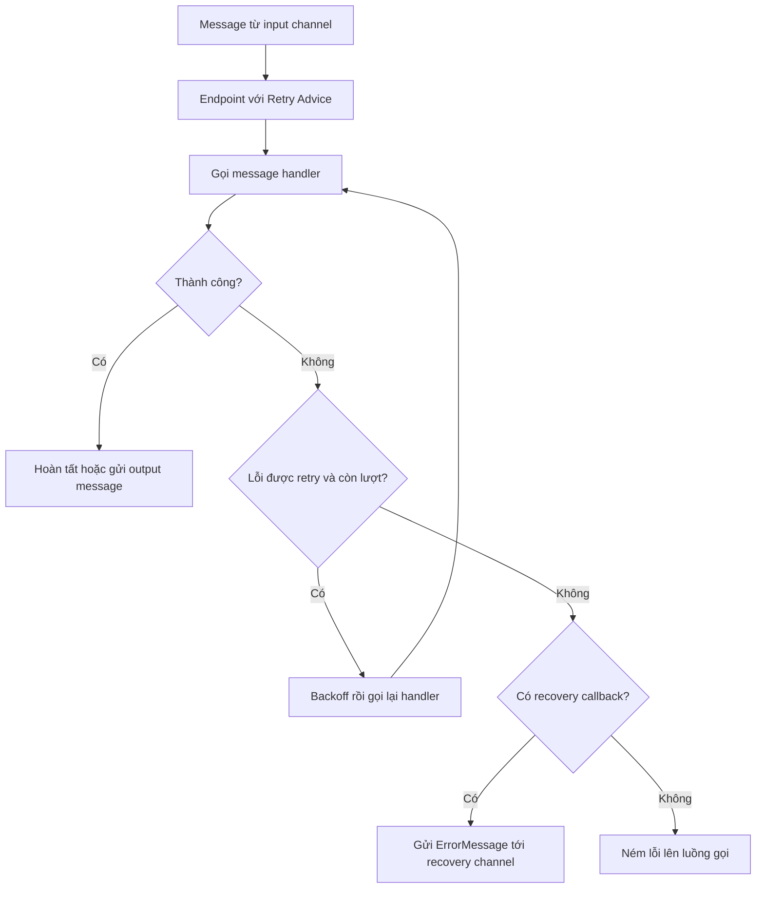

# Retry advice cho message handler trong Spring Integration

## 1. Bài toán và mục tiêu

Trong một luồng **Enterprise Integration Patterns (EIP)**, message handler thường phải gọi hệ thống bên ngoài: API vận chuyển, dịch vụ thanh toán, cơ sở dữ liệu hoặc một hệ thống nội bộ khác. Các lời gọi này có thể thất bại tạm thời vì quá tải, timeout, mất kết nối ngắn hạn hay lỗi HTTP 503. Nếu hủy toàn bộ luồng ngay ở lỗi đầu tiên, hệ thống dễ bỏ lỡ những giao dịch có thể hoàn thành sau vài lần thử.

**Retry advice cho message handler** cho phép Spring Integration thử gọi lại *chính handler đó* theo một chính sách có kiểm soát. Đây là một cách triển khai mẫu Retry trong Spring Integration, phối hợp được với Router, Filter, Transformer, Gateway, error channel và correlation để xây dựng luồng thông điệp ít phụ thuộc, dễ mở rộng, dễ theo dõi.

Sau bài này, bạn có thể:

- Giải thích vị trí của `RequestHandlerRetryAdvice` trong chuỗi xử lý message.
- Cấu hình số lần thử, khoảng nghỉ tăng dần và loại lỗi được phép retry.
- Chuyển lỗi sang nhánh khôi phục sau khi hết lượt thử, tránh thất bại âm thầm.
- Phân biệt retry đồng bộ trong handler với việc broker phát lại message hoặc retry cả luồng.
- Thiết kế tính idempotent, correlation, kiểm thử và quan sát các nhánh thành công/thất bại.

## 2. Retry advice hoạt động ở đâu?

Spring Integration xử lý message qua các endpoint. Khi endpoint gọi một `MessageHandler` và được cấu hình `RequestHandlerRetryAdvice`, lời gọi handler được bao quanh bởi một **advice chain**. Nếu handler ném ngoại lệ thuộc diện retry, advice cho chạy lại handler theo chính sách của Spring Retry.



Điểm quan trọng:

1. **Phạm vi retry là handler được gắn advice.** Các bước Transformer, Filter hoặc Router trước đó không tự chạy lại. Để retry một bước khác, cần gắn advice đúng endpoint tương ứng.
2. **Retry mặc định là stateless và đồng bộ.** Các lần thử diễn ra trong cùng một lời gọi handler; backoff giữ luồng xử lý chờ. Với `DirectChannel`, điều đó cũng giữ luồng của bên gửi. Đây không phải thao tác tự đưa message vào queue để thực hiện sau.
3. **Một lần thử bao gồm lần gọi đầu tiên.** `maxAttempts = 3` nghĩa là tối đa ba lần gọi handler, không phải ba lần gọi lại cộng thêm một lần đầu.
4. **Handler phải để lỗi thoát ra.** Nếu handler bắt ngoại lệ rồi trả kết quả thành công, advice không biết rằng cần retry.
5. **Recovery quyết định đường đi sau khi hết lượt.** Nếu không đặt recovery callback, ngoại lệ cuối cùng thường được truyền về caller. Nếu cấu hình recoverer gửi error message rồi kết thúc bình thường, caller cần được thiết kế để hiểu trạng thái nghiệp vụ thay vì mặc nhiên xem đó là thành công.

### Retry, redelivery và error channel khác nhau thế nào?

| Cơ chế | Đơn vị được thực hiện lại | Thời điểm thường gặp | Điều cần lưu ý |
| --- | --- | --- | --- |
| `RequestHandlerRetryAdvice` | Lời gọi một message handler | Khi handler ném lỗi | Backoff có thể giữ thread; phải chọn lỗi retry phù hợp |
| Broker redelivery | Message được giao lại cho consumer | Sau `nack`, rollback hoặc kết nối lại | Có thể chạy lại các bước của luồng; đòi hỏi idempotency |
| Error channel | Chuyển lỗi thành `ErrorMessage` để xử lý | Khi luồng gửi lỗi đến cơ chế xử lý lỗi | Error channel tự nó không retry handler |
| Recovery/dead-letter | Ghi nhận hoặc chuyển message thất bại | Sau khi không thể xử lý tiếp | Cần lưu đủ thông tin để điều tra và phát lại có kiểm soát |

## 3. Tình huống thực tế: gửi yêu cầu vận chuyển

Giả sử hệ thống nhận `ShippingCommand(orderId, idempotencyKey)` và gọi API hãng vận chuyển:

- Nếu mạng chập chờn hoặc hãng vận chuyển báo lỗi tạm thời, thử tối đa **3 lần**.
- Nghỉ **200 ms**, rồi **400 ms** giữa các lần thử; giới hạn backoff tối đa **1.000 ms** để chính sách còn phù hợp khi tăng số lần thử.
- Nếu dữ liệu không hợp lệ hoặc yêu cầu bị từ chối vĩnh viễn, **không retry**.
- Khi mọi lần thử đều thất bại, gửi lỗi vào `shippingRetryErrors` để ghi nhận, cảnh báo hoặc chuyển sang dead-letter queue.

Với Spring Boot, dự án cần các thành phần Spring Integration và **Spring Retry** (`org.springframework.retry:spring-retry`). Đoạn Java sau minh họa phần cấu hình trọng tâm. Hai interface `ShippingService` và `ShippingFailureRecorder` là adapter nghiệp vụ cần được ứng dụng cung cấp dưới dạng Spring bean.

```java
import java.util.HashMap;
import java.util.Map;

import org.springframework.beans.factory.annotation.Qualifier;
import org.springframework.context.annotation.Bean;
import org.springframework.context.annotation.Configuration;
import org.springframework.integration.channel.DirectChannel;
import org.springframework.integration.dsl.IntegrationFlow;
import org.springframework.integration.handler.advice.ErrorMessageSendingRecoverer;
import org.springframework.integration.handler.advice.RequestHandlerRetryAdvice;
import org.springframework.messaging.MessageChannel;
import org.springframework.messaging.support.ErrorMessage;
import org.springframework.retry.backoff.ExponentialBackOffPolicy;
import org.springframework.retry.policy.SimpleRetryPolicy;
import org.springframework.retry.support.RetryTemplate;

@Configuration
public class ShippingIntegrationConfiguration {

    @Bean
    MessageChannel shippingRequests() {
        return new DirectChannel();
    }

    @Bean
    MessageChannel shippingRetryErrors() {
        return new DirectChannel();
    }

    @Bean
    RequestHandlerRetryAdvice shippingRetryAdvice(
            @Qualifier("shippingRetryErrors") MessageChannel recoveryChannel) {

        Map<Class<? extends Throwable>, Boolean> retryable = new HashMap<>();
        retryable.put(TemporaryCarrierException.class, true);

        // traverseCauses = true: tìm nguyên nhân gốc khi exception bị bọc.
        SimpleRetryPolicy retryPolicy =
                new SimpleRetryPolicy(3, retryable, true);

        ExponentialBackOffPolicy backOff = new ExponentialBackOffPolicy();
        backOff.setInitialInterval(200L);
        backOff.setMultiplier(2.0);
        backOff.setMaxInterval(1_000L);

        RetryTemplate template = new RetryTemplate();
        template.setRetryPolicy(retryPolicy);
        template.setBackOffPolicy(backOff);

        RequestHandlerRetryAdvice advice = new RequestHandlerRetryAdvice();
        advice.setRetryTemplate(template);
        advice.setRecoveryCallback(
                new ErrorMessageSendingRecoverer(recoveryChannel));
        return advice;
    }

    @Bean
    IntegrationFlow shippingFlow(ShippingService shippingService,
                                 RequestHandlerRetryAdvice shippingRetryAdvice) {
        return IntegrationFlow.from("shippingRequests")
                .handle(shippingService, "send",
                        endpoint -> endpoint.advice(shippingRetryAdvice))
                .get();
    }

    @Bean
    IntegrationFlow shippingRecoveryFlow(ShippingFailureRecorder recorder) {
        return IntegrationFlow.from("shippingRetryErrors")
                .handle(message -> recorder.record((ErrorMessage) message))
                .get();
    }
}

record ShippingCommand(String orderId, String idempotencyKey) {}

interface ShippingService {
    void send(ShippingCommand command);
}

interface ShippingFailureRecorder {
    void record(ErrorMessage error);
}

class TemporaryCarrierException extends RuntimeException {
    TemporaryCarrierException(String message, Throwable cause) {
        super(message, cause);
    }
}
```

**Cách sử dụng:** Gửi một `Message<ShippingCommand>` vào bean channel `shippingRequests`. `ShippingService.send(...)` gọi API của hãng vận chuyển và ném `TemporaryCarrierException` khi gặp lỗi tạm thời. `ShippingFailureRecorder.record(...)` phải thực hiện một hành động có thể kiểm chứng, ví dụ lưu bản ghi lỗi và định danh đơn hàng vào cơ sở dữ liệu hoặc gửi tới dead-letter queue; việc chỉ ghi log thường chưa đủ để khôi phục giao dịch.

### Đọc từng phần của cấu hình

- `endpoint.advice(shippingRetryAdvice)` gắn advice vào **đúng handler `send`**. Việc khai báo bean advice nhưng không gắn vào endpoint sẽ không làm handler retry.
- `SimpleRetryPolicy(3, retryable, true)` giới hạn tổng số lần thử và chỉ retry lỗi tạm thời đã khai báo. Tham số `true` cho phép xét chuỗi nguyên nhân (`cause`) khi Spring Messaging bọc ngoại lệ do handler ném ra.
- `ExponentialBackOffPolicy` giới hạn nhịp retry, giúp tránh gọi API liên tiếp ngay lúc phụ thuộc đang quá tải. Với ba attempts của ví dụ, hai khoảng nghỉ dự kiến là 200 ms và 400 ms, chưa tính thời gian thực thi.
- `ErrorMessageSendingRecoverer` dùng recovery callback sau khi hết lượt retry, đưa một `ErrorMessage` về channel riêng. Nhánh này cần có consumer hoạt động và chiến lược lưu lỗi đáng tin cậy.
- `shippingRequests` là `DirectChannel`, phù hợp để nhìn thấy rõ hành vi đồng bộ. Có thể thay channel hoặc bố trí queue phù hợp khi cần tách tải, nhưng phải xét lại transaction, timeout và cơ chế phát lại.

> **Lưu ý về kiểu lỗi:** Chính sách trong ví dụ cố ý chỉ retry `TemporaryCarrierException`. Ứng dụng cần chuyển các lỗi timeout, reset kết nối hoặc HTTP 503 từ thư viện client thành loại lỗi này; giữ nguyên ngoại lệ validation hoặc HTTP 4xx không thể sửa bằng thử lại. Không nên mặc định retry mọi `Exception`.

## 4. Thiết kế handler để retry an toàn

Giả sử một lệnh đã được hãng vận chuyển xử lý, nhưng phản hồi về phía ứng dụng bị timeout. Retry có thể gửi lại chính yêu cầu đó. Vì vậy, **retry không bảo đảm exactly-once**: cùng tác vụ có thể được thực hiện nhiều lần ở hệ thống đích.

Một handler phù hợp có thể dùng định danh ổn định trong mỗi attempt:

```java
// Ví dụ triển khai logic send(ShippingCommand command).
// CarrierApi là adapter của ứng dụng tới HTTP client thực tế.
public void send(ShippingCommand command) {
    try {
        carrierApi.createShipment(
                command.orderId(),
                command.idempotencyKey()); // Giữ nguyên key qua mọi attempt.
    } catch (CarrierTimeoutException | CarrierUnavailableException ex) {
        throw new TemporaryCarrierException("Carrier đang lỗi tạm thời", ex);
    }
    // Lỗi dữ liệu/ủy quyền không được chuyển thành TemporaryCarrierException.
}
```

Ở đây `CarrierApi`, `CarrierTimeoutException` và `CarrierUnavailableException` là các kiểu do adapter của ứng dụng định nghĩa, không phải lớp có sẵn của Spring Integration. Bên nhận cần hỗ trợ idempotency key hoặc ứng dụng phải có cơ chế ngăn tác động trùng lặp (chẳng hạn lưu `orderId` + trạng thái xử lý với ràng buộc duy nhất). Không tạo idempotency key mới trong mỗi attempt.

Các nguyên tắc đi kèm:

1. **Giới hạn thời gian gọi bên ngoài.** Timeout của HTTP/database phải được cấu hình riêng. Retry policy không thay thế connect timeout, read timeout hoặc deadline tổng.
2. **Phân loại lỗi rõ ràng.** Retry timeout, lỗi kết nối tạm thời hoặc 5xx phù hợp; không retry lỗi schema, business rule, thông tin xác thực sai hay dữ liệu không hợp lệ.
3. **Không nhân đôi side effect.** Nếu handler vừa trừ tiền, vừa gửi email, retry cả handler có thể lặp cả hai hành động. Tách thành các bước/handler độc lập hoặc dùng outbox và idempotency.
4. **Không retry vô hạn.** Nhiều consumer đồng thời retry có thể làm quá tải hệ thống đích. Kết hợp giới hạn concurrency, backoff, jitter (khi cần), circuit breaker và cảnh báo.
5. **Tôn trọng transaction.** Nếu có database transaction hoặc broker acknowledgement, cần hiểu rollback sẽ phát lại *message* hay chỉ lời gọi handler; một transaction thất bại có thể đã bị đánh dấu rollback-only trước khi retry.

## 5. Recovery, correlation và nhánh xử lý lỗi

Sau khi hết lượt, `ErrorMessageSendingRecoverer` chuyển thông tin lỗi vào `shippingRetryErrors`. Handler ở nhánh lỗi nên ghi ít nhất: định danh message, `orderId`, `idempotencyKey`, loại ngoại lệ, nguyên nhân, thời điểm và trạng thái xử lý. Khi có `MessagingException` chứa `failedMessage`, có thể lấy headers và payload của message gốc từ đó; cần kiểm tra kiểu ngoại lệ thực tế thay vì ép kiểu không điều kiện.

Ví dụ đọc message bị lỗi:

```java
import org.springframework.messaging.Message;
import org.springframework.messaging.MessagingException;
import org.springframework.messaging.support.ErrorMessage;

void inspectFailure(ErrorMessage error) {
    Throwable failure = error.getPayload();
    if (failure instanceof MessagingException messagingException) {
        Message<?> original = messagingException.getFailedMessage();
        if (original != null) {
            Object payload = original.getPayload();
            Object correlationId = original.getHeaders().get("correlationId");
            // Ghi thông tin phục vụ truy vết, tránh ghi dữ liệu nhạy cảm.
        }
    }
}
```

Nếu ứng dụng dùng Splitter/Aggregator hoặc các nhánh Router, giữ ổn định correlation ID, sequence headers và định danh nghiệp vụ xuyên suốt retry. Một attempt thành công ở nhánh A và một attempt thất bại ở nhánh B cần được theo dõi riêng; retry không có nghĩa là chạy lại toàn bộ các nhánh.

**Recovery là một quyết định nghiệp vụ:** gửi thông báo vận hành, lưu retry job để xử lý sau hoặc dead-letter queue đều có thể phù hợp. Nếu API được gọi qua Gateway và caller cần biết kết quả thất bại, hãy định nghĩa hợp đồng trả lời rõ ràng: thông báo trạng thái thất bại hoặc truyền lỗi theo yêu cầu. Đừng coi việc recovery callback kết thúc bình thường là bằng chứng giao dịch đã hoàn tất.

### Khi nào cần retry có trạng thái?

Stateless retry mặc định thử lại trong cùng lời gọi. Với giao dịch mà một lỗi phải dẫn tới rollback rồi broker giao lại message, cân nhắc **stateful retry** và khóa định danh ổn định để lưu trạng thái số lần thử qua các lần giao lại. Cần thiết kế cùng với cơ chế acknowledgement/redelivery của adapter; không bật stateful retry chỉ để thay một timeout đơn giản. Nếu muốn chạy lại sau nhiều phút mà không chiếm thread, một hàng đợi retry hoặc bộ lập lịch là mô hình thích hợp hơn backoff đồng bộ.

## 6. Kiểm thử hành vi, không chỉ kiểm tra cấu hình

Nên có các trường hợp sau trong bài kiểm thử tích hợp với handler giả lập, counter số lần gọi và recorder thu nhận lỗi:

| Kịch bản | Số lần gọi `send` mong đợi | Điều cần khẳng định |
| --- | ---: | --- |
| Handler thành công ngay | 1 | Không có bản ghi ở recovery channel |
| Hai lần lỗi tạm thời, lần ba thành công | 3 | Chỉ có một kết quả nghiệp vụ, không gửi recovery |
| Luôn ném `TemporaryCarrierException` | 3 | Có một `ErrorMessage` đến `shippingRetryErrors` |
| Ném lỗi validation không nằm trong danh sách retry | 1 | Chuyển ngay sang recovery, không backoff retry |
| API đã xử lý nhưng response timeout | Tùy giả lập, tối đa 3 | Các lần gọi dùng cùng idempotency key |

Ví dụ kiểm thử riêng chính sách `RetryTemplate` bằng JUnit 5 (mã này kiểm tra cơ chế Retry; bài kiểm thử tích hợp vẫn cần xác nhận advice đã gắn vào handler):

```java
@Test
void retriesTransientFailureUntilThirdAttempt() {
    AtomicInteger calls = new AtomicInteger();

    RetryTemplate template = new RetryTemplate();
    template.setRetryPolicy(new SimpleRetryPolicy(
            3, Map.of(TemporaryCarrierException.class, true), true));
    template.setBackOffPolicy(new NoBackOffPolicy()); // Test không phải chờ.

    String result = template.execute(context -> {
        if (calls.incrementAndGet() < 3) {
            throw new TemporaryCarrierException("temporary", null);
        }
        return "sent";
    });

    assertEquals("sent", result);
    assertEquals(3, calls.get());
}
```

Đoạn kiểm thử dùng `AtomicInteger`, `Map`, `RetryTemplate`, `SimpleRetryPolicy`, `NoBackOffPolicy` và `assertEquals` của JUnit 5; thêm imports phù hợp vào test class. Ở mức luồng, gửi message vào `shippingRequests`, dùng fake `ShippingService` để ném lỗi theo kịch bản và fake `ShippingFailureRecorder` để quan sát nhánh recovery. Kiểm tra cả exception bị bọc, timeout và tình huống error channel không có consumer để tránh mất lỗi khi triển khai.

## 7. Theo dõi và vận hành

Để phát hiện retry che lấp một hệ thống phụ thuộc đang suy giảm, nên theo dõi:

- **Attempts / recovery / success:** số lần handler được gọi, số lệnh thành công sau retry và số lệnh hết lượt thử, theo endpoint và loại lỗi.
- **Latency:** thời gian handler, tổng thời gian retry (bao gồm backoff) và thời gian chờ của Gateway.
- **Tải và backlog:** thread đang chờ retry, độ sâu queue, số bản ghi dead-letter và số lượng message được phát lại.
- **Correlation:** message ID, correlation ID, order ID, trace ID và idempotency key để ghép các attempt; không đưa dữ liệu nhạy cảm hoặc payload lớn vào nhãn metric.

Có thể dùng Micrometer/Actuator và khả năng quan sát của Spring Integration, kết hợp log có cấu trúc tại handler và recovery. Metrics mặc định của framework không nhất thiết tách sẵn từng attempt; nếu cần số liệu đó, bổ sung listener/instrumentation phù hợp cho `RetryTemplate` hoặc adapter. Cảnh báo nên dựa vào **tỷ lệ recovery và độ trễ**, vì tổng số retry cao có thể báo hiệu sự cố ở downstream dù hầu hết lệnh cuối cùng vẫn thành công.

## 8. Lỗi thường gặp và cách khắc phục

| Triệu chứng | Nguyên nhân có thể | Hướng xử lý |
| --- | --- | --- |
| Handler không retry | Advice chưa được gắn vào endpoint; handler đã nuốt lỗi | Kiểm tra `.advice(...)`, cho lỗi phù hợp thoát khỏi handler |
| Chỉ thử một lần dù là lỗi tạm thời | Lớp ngoại lệ không khớp retry policy | Map đúng exception và xét `cause` nếu bị bọc |
| Trùng đơn hàng/giao dịch | Side effect đã hoàn thành trước timeout | Idempotency key, deduplication, outbox hoặc transaction phù hợp |
| Gateway chậm hoặc timeout | Retry đồng bộ và backoff quá dài | Tính tổng deadline, giảm attempts hoặc chuyển sang queue retry |
| Lỗi biến mất khỏi luồng gọi | Recovery callback đã xử lý lỗi | Ghi trạng thái thất bại rõ ràng; kiểm tra hợp đồng reply |
| Hết lượt nhưng không lưu được lỗi | Recovery channel thiếu consumer hoặc recorder lỗi | Kiểm thử nhánh recovery, giám sát và lưu lỗi bền vững |

## 9. Bài thực hành đề xuất

Xây dựng một flow nhận `ShippingCommand` qua Gateway, dùng Router tách lệnh theo hãng vận chuyển, gắn `RequestHandlerRetryAdvice` cho handler của một hãng thường xuyên timeout, rồi chuyển lỗi hết lượt sang kênh `shippingRetryErrors`. Gửi ba loại input: thành công, lỗi tạm thời và lỗi validation. Đo số lần gọi, tổng thời gian xử lý, correlation ID, số message được recovery, rồi thử mô phỏng một response timeout sau khi downstream đã nhận đơn để xác nhận cơ chế idempotency.

**Tiêu chí hoàn thành:** Mỗi message có đường đi xác định; lỗi tạm thời được thử có giới hạn; lỗi vĩnh viễn không lặp; các nhánh xử lý có thể truy vết; lệnh thất bại sau retry được lưu để phục hồi; không có tác động nghiệp vụ trùng lặp trong kịch bản timeout.

