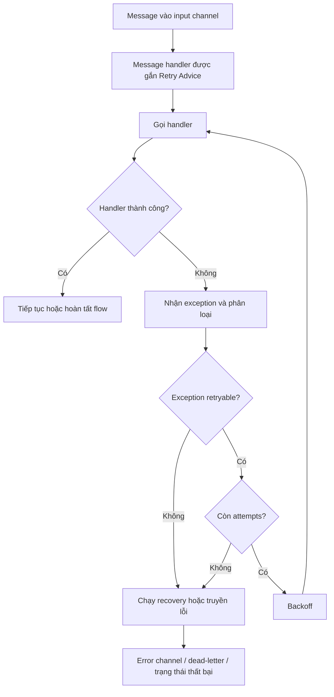

# Retry theo exception type trong Spring Integration

## 1. Vì sao phải phân loại ngoại lệ trước khi retry?

Trong một luồng **Enterprise Integration Patterns (EIP)** với Spring Integration, message thường đi qua Filter, Transformer, Router, Splitter hoặc Gateway trước khi một message handler gọi dịch vụ bên ngoài. Nếu đối tác tạm thời không phản hồi, gọi lại handler có thể giúp giao dịch hoàn tất. Nhưng nếu dữ liệu đầu vào sai hoặc người dùng không có quyền, gọi lại nhiều lần chỉ làm chậm luồng và tăng tải.

**Retry theo exception type** là cách chọn có điều kiện: ngoại lệ nào được retry, ngoại lệ nào phải thất bại ngay, và có thể áp dụng số lần thử khác nhau cho từng nhóm. Trong module `SPRING_INTEGRATION_PATTERN`, kỹ thuật này giúp luồng thông điệp ít phụ thuộc và dễ mở rộng, đồng thời giữ rõ nhánh thành công, error channel, correlation và các kết quả cần kiểm thử.

Sau bài học, bạn sẽ biết cách:

- Phân biệt lỗi tạm thời, lỗi nghiệp vụ vĩnh viễn và lỗi lập trình.
- Dùng `SimpleRetryPolicy` để cho phép retry theo **lớp ngoại lệ** và xét chuỗi `cause` khi ngoại lệ bị bọc.
- Gắn chính sách vào `RequestHandlerRetryAdvice` của đúng message handler.
- Xử lý lỗi không được retry hoặc đã hết lượt thử bằng recovery/error channel.
- Kiểm thử việc phân loại, số lần gọi, idempotency và khả năng truy vết message.

## 2. Quy tắc phân loại lỗi

Không nên bắt đầu bằng quy tắc “mọi exception đều retry được”. Chính sách phải dựa trên **khả năng thành công của lần thử tiếp theo** và tác động nghiệp vụ nếu handler chạy lặp.

| Nguồn lỗi | Ví dụ | Chính sách gợi ý | Lý do |
| --- | --- | --- | --- |
| Kết nối tạm thời | Connection reset, read timeout, lỗi mạng ngắn hạn | Retry có giới hạn | Có thể phục hồi khi kết nối ổn định |
| Dịch vụ tạm thời không sẵn sàng | HTTP 503, máy chủ quá tải ngắn hạn | Retry với backoff | Tạo thời gian để downstream hồi phục |
| Giới hạn tần suất | HTTP 429 | Chỉ retry khi phù hợp; tôn trọng `Retry-After` | Retry quá sớm làm tăng áp lực lên hệ thống đích |
| Xung đột ghi tạm thời | Deadlock hoặc optimistic lock conflict có thể giải quyết bằng tải lại trạng thái | Cân nhắc retry toàn đơn vị công việc | Cần xét transaction và idempotency |
| Dữ liệu không hợp lệ | Thiếu trường bắt buộc, lỗi quy tắc nghiệp vụ | Không retry | Đầu vào không tự thay đổi sau vài trăm mili giây |
| Không được phép truy cập | Sai quyền, token không hợp lệ | Không retry cùng yêu cầu | Cần sửa quyền hoặc làm mới thông tin xác thực qua quy trình riêng |
| Lỗi lập trình | `NullPointerException`, invariant bị phá vỡ | Không retry | Phần mềm cần được sửa hoặc dữ liệu cần xử lý riêng |
| Giao dịch đã hoàn tất nhưng phản hồi thất lạc | Timeout sau khi phía đối tác đã tạo đơn | Có thể retry **nếu idempotent** | Nếu không, dễ tạo hai giao dịch |

Đây là **gợi ý theo tình huống**, không phải ánh xạ cố định từ mọi HTTP status sang retry. Chẳng hạn HTTP 500 có thể do lỗi tạm thời hoặc lỗi logic tồn tại lâu dài; HTTP 404 đôi khi do eventual consistency nhưng thường không thể xử lý bằng thử ngay. Adapter gọi dịch vụ nên chuyển lỗi kỹ thuật thành những ngoại lệ phản ánh ý nghĩa nghiệp vụ, rồi mới đưa vào retry policy.

Một hệ thống có thể định nghĩa ba ngoại lệ:

```java
// Hai lỗi có khả năng tự phục hồi.
class PartnerTimeoutException extends RuntimeException {
    PartnerTimeoutException(String message, Throwable cause) {
        super(message, cause);
    }
}

class PartnerUnavailableException extends RuntimeException {
    PartnerUnavailableException(String message, Throwable cause) {
        super(message, cause);
    }
}

// Dữ liệu sẽ tiếp tục sai nếu gửi lại nguyên yêu cầu.
class InvalidShipmentException extends RuntimeException {
    InvalidShipmentException(String message) {
        super(message);
    }
}
```

Ưu điểm của cách chuẩn hóa này là retry policy không cần biết một nhà cung cấp HTTP client cụ thể ném `SocketTimeoutException`, `ResourceAccessException` hay một kiểu exception riêng. Một thay đổi thư viện HTTP không buộc toàn bộ flow đổi chính sách.

## 3. Luồng quyết định khi handler ném exception



`RequestHandlerRetryAdvice` bao quanh lời gọi **một handler** thông qua advice chain của Spring Integration, còn `RetryTemplate` thực thi chính sách retry do Spring Retry cung cấp. Mặc định retry trong handler mang tính đồng bộ: `maxAttempts = 3` nghĩa là tối đa **3 lần thực thi handler tính cả lần đầu**, với tối đa 2 khoảng chờ backoff.

Điểm cần phân biệt: **retry handler** không tự phát lại message từ nguồn, không tự chạy lại Transformer hay Router trước handler và không tự đảm bảo giao dịch xảy ra chính xác một lần. Nếu adapter broker phát lại message sau rollback/negative acknowledgement, đó là một cơ chế khác; có thể cần kết hợp với retry có trạng thái và kiểm soát trùng lặp.

## 4. Cấu hình `SimpleRetryPolicy` theo exception type

Với một tập loại lỗi có cùng giới hạn số lần thử, `SimpleRetryPolicy` là lựa chọn gọn. Ta tạo danh sách lớp exception được retry, đặt `traverseCauses = true` để xét nguyên nhân khi ngoại lệ từ handler bị tầng messaging bọc lại, rồi gắn policy cho `RetryTemplate`.

Ví dụ: message chứa yêu cầu tạo vận đơn. Chỉ `PartnerTimeoutException` và `PartnerUnavailableException` được thử lại; `InvalidShipmentException` và những lỗi không được khai báo sẽ đi thẳng đến recovery.

```java
import java.util.HashMap;
import java.util.Map;

import org.springframework.beans.factory.annotation.Qualifier;
import org.springframework.context.annotation.Bean;
import org.springframework.context.annotation.Configuration;
import org.springframework.integration.channel.DirectChannel;
import org.springframework.integration.dsl.IntegrationFlow;
import org.springframework.integration.handler.advice.ErrorMessageSendingRecoverer;
import org.springframework.integration.handler.advice.RequestHandlerRetryAdvice;
import org.springframework.messaging.MessageChannel;
import org.springframework.messaging.support.ErrorMessage;
import org.springframework.retry.backoff.ExponentialBackOffPolicy;
import org.springframework.retry.policy.SimpleRetryPolicy;
import org.springframework.retry.support.RetryTemplate;

@Configuration
public class PartnerShipmentIntegrationConfiguration {

    @Bean
    MessageChannel shipmentRequests() {
        return new DirectChannel();
    }

    @Bean
    MessageChannel shipmentFailures() {
        return new DirectChannel();
    }

    @Bean
    RequestHandlerRetryAdvice shipmentRetryAdvice(
            @Qualifier("shipmentFailures") MessageChannel failures) {

        Map<Class<? extends Throwable>, Boolean> retryable = new HashMap<>();
        retryable.put(PartnerTimeoutException.class, true);
        retryable.put(PartnerUnavailableException.class, true);
        retryable.put(InvalidShipmentException.class, false);

        // 3 attempts tính cả lần đầu; xem xét nguyên nhân bị bọc bên trong.
        SimpleRetryPolicy policy = new SimpleRetryPolicy(3, retryable, true);

        ExponentialBackOffPolicy backoff = new ExponentialBackOffPolicy();
        backoff.setInitialInterval(200L); // ms
        backoff.setMultiplier(2.0);
        backoff.setMaxInterval(1_000L);

        RetryTemplate template = new RetryTemplate();
        template.setRetryPolicy(policy);
        template.setBackOffPolicy(backoff);

        RequestHandlerRetryAdvice advice = new RequestHandlerRetryAdvice();
        advice.setRetryTemplate(template);
        advice.setRecoveryCallback(new ErrorMessageSendingRecoverer(failures));
        return advice;
    }

    @Bean
    IntegrationFlow shipmentFlow(PartnerShipmentClient partnerClient,
                                 RequestHandlerRetryAdvice shipmentRetryAdvice) {
        return IntegrationFlow.from("shipmentRequests")
                .handle(partnerClient, "submit",
                        endpoint -> endpoint.advice(shipmentRetryAdvice))
                .get();
    }

    @Bean
    IntegrationFlow shipmentFailureFlow(ShipmentFailureRecorder recorder) {
        return IntegrationFlow.from("shipmentFailures")
                .handle(message -> recorder.record((ErrorMessage) message))
                .get();
    }
}

record ShipmentRequest(String orderId, String idempotencyKey) {}

interface PartnerShipmentClient {
    void submit(ShipmentRequest shipment);
}

interface ShipmentFailureRecorder {
    void record(ErrorMessage error);
}
```

Ứng dụng cần cung cấp các bean `PartnerShipmentClient` và `ShipmentFailureRecorder`; ba lớp ngoại lệ đã định nghĩa ở mục 2. Thêm Spring Integration, Spring Retry (`org.springframework.retry:spring-retry`) và các phụ thuộc Spring phù hợp vào dự án. Đoạn cấu hình thể hiện wiring chính; việc gọi HTTP và lưu dead-letter là phần triển khai của adapter nghiệp vụ.

### Đọc chính sách một cách chính xác

- `retryable.put(X.class, true)` cho phép thử lại với exception thuộc nhóm được cấu hình. `false` từ chối retry cho nhóm ngoại lệ đó. Với bản đồ allowlist như ví dụ, exception không nằm trong nhóm được cho phép sẽ không được retry.
- `SimpleRetryPolicy(3, retryable, true)` giới hạn số attempts và bật tìm kiếm trong chuỗi `cause`. Điều này hữu ích khi `MessagingException` hoặc `MessageHandlingException` giữ ngoại lệ gốc bên trong. Không cần cố retry lớp wrapper chung như `Exception.class`.
- Chính sách xét lớp ngoại lệ, bao gồm quan hệ kế thừa. Khi dùng quy tắc rộng và hẹp đan xen, hãy kiểm thử ngoại lệ con để tránh một quy tắc rộng che mất quyết định nghiệp vụ mong muốn.
- `ExponentialBackOffPolicy` chờ khoảng 200 ms rồi 400 ms khi phải retry đủ ba attempts. Với exception không retryable, handler chỉ được gọi một lần, không cần chờ thêm.
- `.advice(shipmentRetryAdvice)` mới thực sự áp dụng retry lên handler `submit`. Chỉ khai báo bean `RequestHandlerRetryAdvice` chưa đủ.
- `ErrorMessageSendingRecoverer` nhận lỗi sau khi policy từ chối retry hoặc đã hết attempts; rồi đẩy `ErrorMessage` sang `shipmentFailures`. Nhánh ghi lỗi phải có consumer và nơi lưu lỗi đáng tin cậy.

### Ví dụ diễn biến của từng message

| Message | Exception từ `submit` | Số lần gọi tối đa | Nhánh cuối cùng |
| --- | --- | ---: | --- |
| A | Thành công ngay | 1 | Thành công |
| B | Timeout hai lần, lần thứ ba thành công | 3 | Thành công |
| C | Luôn ném `PartnerUnavailableException` | 3 | Recovery/error channel |
| D | Ném `InvalidShipmentException` | 1 | Recovery/error channel |
| E | Ném `NullPointerException` | 1 | Recovery/error channel, cần điều tra lỗi code |

Khi gắn recovery callback kiểu gửi `ErrorMessage`, advice có thể kết thúc mà không tiếp tục ném lỗi cho caller sau khi recovery thành công. Nếu caller sử dụng **Gateway** và cần biết trạng thái giao dịch, phải thiết kế rõ response hoặc cách truyền lỗi; không được diễn giải việc không ném exception thành “đã tạo vận đơn”.

## 5. Xử lý ngoại lệ bị bọc: `traverseCauses`

Một message handler có thể ném `PartnerTimeoutException`, nhưng tầng invocation/messaging đóng gói nó thành `MessageHandlingException` hoặc ngoại lệ khác. Nếu chỉ nhìn kiểu ở lớp ngoài cùng, retry policy dễ đánh giá sai.

Ví dụ chuỗi nguyên nhân:

```text
MessageHandlingException
└── PartnerTimeoutException
    └── SocketTimeoutException
```

Giải pháp thường dùng là cho phép `SimpleRetryPolicy` duyệt `Throwable.getCause()` bằng tham số `traverseCauses = true`. Khi policy gặp một lỗi có thể retry ở lớp nguyên nhân, nó có thể quyết định thử lại dù wrapper bên ngoài không nằm trong allowlist. Nếu exception bị adapter **nuốt** rồi chỉ ghi log hoặc trả về giá trị bình thường, retry advice sẽ không thể nhận biết lỗi.

Không nên bật retry chung cho `RuntimeException.class` hoặc `MessagingException.class` chỉ vì một số ngoại lệ được bọc. Quy tắc quá rộng có thể khiến lỗi dữ liệu và lỗi lập trình bị thử lại. Đối với những wrapper phức tạp có thể chứa nhiều loại lỗi, nên chuẩn hóa exception tại ranh giới adapter và viết test cho đúng chuỗi `cause` thực tế.

## 6. Adapter quyết định exception type như thế nào?

Retry policy chỉ nhìn lớp ngoại lệ; nó không biết sẵn HTTP status nào có thể phục hồi. Adapter gọi đối tác chịu trách nhiệm **dịch lỗi từ client library sang loại nghiệp vụ phù hợp**.

```java
// Mã minh họa phần thân PartnerShipmentClient.submit(...).
// carrierApi và Http*Exception là các kiểu do adapter ứng dụng định nghĩa.
public void submit(ShipmentRequest shipment) {
    try {
        carrierApi.createShipment(
                shipment.orderId(),
                shipment.idempotencyKey());
    } catch (HttpReadTimeoutException ex) {
        throw new PartnerTimeoutException("Đối tác quá thời gian phản hồi", ex);
    } catch (HttpServiceUnavailableException ex) {
        throw new PartnerUnavailableException("Đối tác tạm ngừng phục vụ", ex);
    } catch (HttpBadRequestException ex) {
        throw new InvalidShipmentException("Dữ liệu vận đơn không hợp lệ");
    }
}
```

Các `Http*Exception` và `carrierApi` trong ví dụ là **mã giả lập ở tầng adapter**, không phải API có sẵn của Spring Integration. Với thư viện HTTP cụ thể, hãy bắt đúng kiểu exception thực tế, giải mã status/body có kiểm soát và map thành `PartnerTimeoutException`, `PartnerUnavailableException`, `InvalidShipmentException` hoặc loại khác tương ứng.

Nếu đối tác trả HTTP 429 cùng thời điểm `Retry-After`, cách xử lý cần tôn trọng thông tin thời gian đó thay vì chỉ áp dụng backoff cố định. Nếu lỗi xảy ra sau khi request có thể đã được xử lý, yêu cầu gửi lại phải giữ cùng **idempotency key** để ngăn tạo bản ghi hoặc thu phí hai lần.

## 7. Khi cần số attempts khác nhau theo loại lỗi

`SimpleRetryPolicy` ở mục 4 áp dụng **cùng một `maxAttempts`** cho tất cả lỗi retryable. Khi timeout có thể thử bốn lần nhưng lỗi dịch vụ không sẵn sàng chỉ nên thử hai lần, có thể dùng `ExceptionClassifierRetryPolicy` để lựa chọn `RetryPolicy` dựa trên exception.

```java
import java.util.Map;
import org.springframework.retry.policy.ExceptionClassifierRetryPolicy;
import org.springframework.retry.policy.NeverRetryPolicy;
import org.springframework.retry.policy.SimpleRetryPolicy;

ExceptionClassifierRetryPolicy byException = new ExceptionClassifierRetryPolicy();
byException.setPolicyMap(Map.of(
        PartnerTimeoutException.class, new SimpleRetryPolicy(4),
        PartnerUnavailableException.class, new SimpleRetryPolicy(2),
        InvalidShipmentException.class, new NeverRetryPolicy()
));

// Gắn policy đã phân loại vào RetryTemplate như cấu hình ở mục 4:
// template.setRetryPolicy(byException);
```

Điểm cần chú ý: cơ chế phân loại của `ExceptionClassifierRetryPolicy` hoạt động theo classifier được cấu hình cho exception. Khi lỗi thực tế bị bọc, **đừng mặc định** nó sẽ duyệt chuỗi `cause` giống `SimpleRetryPolicy(..., true)`; có thể cần một classifier riêng có giải bọc nguyên nhân hoặc chuẩn hóa ngoại lệ trước khi đến policy. Nên xử lý rõ loại ngoại lệ không có trong bản đồ và kiểm thử trường hợp kiểu lỗi thay đổi giữa các attempts.

`RetryTemplate` có chính sách backoff của riêng nó, nên ví dụ trên mới phân biệt **số lần thử**, chưa thể hiện backoff khác nhau cho từng exception. Nếu mỗi nhóm lỗi cần deadline, backoff, circuit breaker hoặc kênh recovery khác nhau, cân nhắc tách thành những endpoint/advice riêng cho từng nhánh Router, hoặc viết chiến lược nâng cao có kiểm thử độc lập.

## 8. Tích hợp với các mẫu EIP khác

Trong hệ thống Spring Integration, loại exception và vị trí gắn advice quyết định điều gì được thực hiện lại:

- **Filter:** Một message bị loại theo điều kiện nghiệp vụ bình thường không phải là exception và không cần retry. Lỗi khi Filter gọi hệ thống phụ thuộc có thể retry nếu gắn advice đúng endpoint.
- **Transformer:** Nếu lỗi parse/validation là lỗi dữ liệu, hãy chuyển sang nhánh lỗi. Không nên retry một Transformer thuần túy nhận cùng input và luôn ném cùng exception.
- **Router:** Mỗi nhánh có thể dùng policy riêng. Handler gọi hệ thống A timeout không có nghĩa là phải chạy lại các nhánh đã thành công ở hệ thống B.
- **Splitter/Aggregator:** Giữ correlation ID, sequence headers và khóa nghiệp vụ ổn định. Một nhánh retry không bảo đảm mọi phần của nhóm message đều sẽ hoàn thành; cần chính sách timeout/partial-result cho Aggregator.
- **Gateway:** Retry đồng bộ làm tăng thời gian caller phải chờ. Tổng thời gian gọi + backoff cần nằm trong timeout của Gateway và SLA.
- **Error channel:** Dùng để quan sát, lưu lỗi hoặc định tuyến recovery. Error channel không tự suy ra điều kiện retry; policy phải nằm ở handler hoặc ở cơ chế redelivery được thiết kế riêng.

Ví dụ: Router phân nhánh `carrier = A` và `carrier = B`. Nhánh A có thể retry `PartnerTimeoutException` ba lần, nhánh B chỉ retry `PartnerUnavailableException` hai lần. Cách bố trí endpoint tách biệt giúp thay đổi chính sách của một đối tác mà ít ảnh hưởng đến những phần khác của luồng.

## 9. Kiểm thử đúng nhánh theo exception type

Viết test cho chính sách và test cho flow là hai việc bổ sung nhau. Kiểm thử `RetryTemplate` chứng minh logic phân loại, còn kiểm thử luồng xác nhận advice thực sự được gắn vào handler, recovery được kích hoạt và headers quan trọng không bị mất.

### Ma trận kiểm thử

| Tình huống | Kết quả mong đợi |
| --- | --- |
| Handler trả thành công | 1 attempt, không gửi recovery |
| `PartnerTimeoutException` hai lần rồi thành công | 3 attempts, không gửi recovery |
| `PartnerUnavailableException` liên tiếp | Đủ 3 attempts theo `SimpleRetryPolicy`, 1 recovery |
| `InvalidShipmentException` | 1 attempt, chuyển recovery ngay |
| `NullPointerException` | 1 attempt, không retry lỗi lập trình |
| Ngoại lệ wrapper chứa `PartnerTimeoutException` | Được retry nếu policy cho phép duyệt `cause` |
| Lỗi xảy ra sau khi downstream đã xử lý | Cùng idempotency key ở mọi attempts |
| Recovery channel không xử lý được lỗi | Quan sát được lỗi của nhánh recovery; không đánh dấu nghiệp vụ đã thành công |

### Ví dụ JUnit 5 kiểm tra phân loại

```java
import java.util.Map;
import java.util.concurrent.atomic.AtomicInteger;

import org.junit.jupiter.api.Test;
import org.springframework.retry.backoff.NoBackOffPolicy;
import org.springframework.retry.policy.SimpleRetryPolicy;
import org.springframework.retry.support.RetryTemplate;

import static org.junit.jupiter.api.Assertions.assertEquals;
import static org.junit.jupiter.api.Assertions.assertThrows;

class ExceptionTypeRetryPolicyTest {

    private RetryTemplate retryTemplate() {
        RetryTemplate template = new RetryTemplate();
        template.setRetryPolicy(new SimpleRetryPolicy(3,
                Map.of(PartnerTimeoutException.class, true), true));
        template.setBackOffPolicy(new NoBackOffPolicy());
        return template;
    }

    @Test
    void retriesTimeoutThenSucceeds() {
        AtomicInteger attempts = new AtomicInteger();

        String result = retryTemplate().execute(context -> {
            if (attempts.incrementAndGet() < 3) {
                throw new PartnerTimeoutException("temporary", null);
            }
            return "ok";
        });

        assertEquals("ok", result);
        assertEquals(3, attempts.get());
    }

    @Test
    void doesNotRetryInvalidData() {
        AtomicInteger attempts = new AtomicInteger();

        assertThrows(InvalidShipmentException.class,
                () -> retryTemplate().execute(context -> {
                    attempts.incrementAndGet();
                    throw new InvalidShipmentException("missing address");
                }));

        assertEquals(1, attempts.get());
    }

    @Test
    void retriesWrappedTimeoutWhenTraversingCauses() {
        AtomicInteger attempts = new AtomicInteger();

        String result = retryTemplate().execute(context -> {
            if (attempts.incrementAndGet() == 1) {
                throw new IllegalStateException("wrapper",
                        new PartnerTimeoutException("temporary", null));
            }
            return "ok";
        });

        assertEquals("ok", result);
        assertEquals(2, attempts.get());
    }
}
```

Trong test, `NoBackOffPolicy` giúp tránh thời gian chờ; các lớp ngoại lệ dùng định nghĩa ở mục 2. Khi đưa chính sách vào flow thực tế, thêm kiểm thử gửi `Message<ShipmentRequest>` tới `shipmentRequests` bằng fake `PartnerShipmentClient` và fake `ShipmentFailureRecorder`. Kiểm tra payload, message headers (`correlationId`, message ID, trace ID nếu có), số lần gọi handler và số `ErrorMessage` thu được.

## 10. Quan sát và xử lý khi hết lượt thử

Retry theo exception type có hiệu quả khi người vận hành hiểu **lỗi nào đang được thử lại và vì sao**. Theo dõi theo endpoint và loại lỗi đã được chuẩn hóa:

- Số attempts theo loại exception, tỷ lệ thành công sau retry và tỷ lệ chuyển recovery.
- Thời gian mỗi attempt, tổng thời gian chờ backoff, timeout và độ dài hàng đợi.
- `orderId`, correlation ID và idempotency key để truy tìm cùng một giao dịch qua các nhánh; tránh dùng dữ liệu có độ phân biệt quá cao làm nhãn metric.
- Tỷ lệ lỗi không retryable, vì tăng bất thường có thể báo hiệu thay đổi schema hoặc lỗi dữ liệu đầu vào.

Ở recovery, cần lưu message gốc hoặc thông tin để truy hồi, loại exception cuối cùng và nguyên nhân, số attempts nếu hệ thống thu thập được, thời điểm, cùng trạng thái nghiệp vụ. Với `ErrorMessage`, payload là `Throwable`; khi throwable là `MessagingException`, có thể truy cập `getFailedMessage()` để lấy headers/payload gốc nếu thông tin đó tồn tại. Không ép kiểu vô điều kiện vì exception trong thực tế có thể khác nhau.

Nếu cần phát lại thủ công hoặc qua dead-letter queue, phải xử lý tính idempotent và tránh vòng lặp retry vô hạn. Với lỗi nghiệp vụ, thông báo người dùng hoặc đưa vào hàng chờ sửa dữ liệu thường hữu ích hơn việc tự phát lại cùng message.

## 11. Những sai lầm thường gặp

| Sai lầm | Hậu quả | Cách xử lý |
| --- | --- | --- |
| Retry tất cả `Exception` | Retry cả lỗi validation, code và phân quyền | Dùng allowlist exception có thể phục hồi |
| Match lớp wrapper mà không xét `cause` | Bỏ sót lỗi tạm thời ở tầng dưới | Chuẩn hóa exception hoặc bật `traverseCauses` phù hợp |
| Bắt exception trong handler rồi trả về bình thường | Retry advice không nhận ra lỗi | Để lỗi thoát ra hoặc biến thành kết quả nghiệp vụ tường minh |
| Đếm `maxAttempts` như số lần retry thêm | Gọi vượt giới hạn mong muốn | Tính cả lần gọi đầu tiên |
| Retry side effect không idempotent | Tạo trùng vận đơn, gửi trùng thông báo | Dùng khóa idempotency và lưu trạng thái |
| Chỉ xử lý lỗi tạm thời mà bỏ quên lỗi vĩnh viễn | Mất message hoặc khó điều tra | Thiết kế recovery/error channel cho cả lỗi không retryable |
| Gắn advice nhầm endpoint | Retry nhầm công đoạn hoặc không retry | Kiểm thử đường đi thật qua channel |
| Backoff quá dài trong flow đồng bộ | Gateway timeout, giữ thread lâu | Tính deadline tổng hoặc chuyển sang xử lý bất đồng bộ |

## 12. Bài thực hành

Xây dựng luồng nhận `ShipmentRequest` qua Gateway, dùng Router tách theo hãng vận chuyển và gắn `RequestHandlerRetryAdvice` vào handler gọi hãng A. Cho handler giả lập ném lần lượt `PartnerTimeoutException`, `PartnerUnavailableException` và `InvalidShipmentException`; xác minh lần thử, khoảng chờ, nhánh recovery và correlation ID. Sau đó thay số attempts bằng `ExceptionClassifierRetryPolicy` để timeout được thử nhiều hơn service-unavailable và bổ sung case exception bị bọc.

**Tiêu chí hoàn thành:** Retry chỉ xảy ra với loại lỗi được phép; mọi message thất bại được đưa vào nhánh xử lý xác định; không sinh tác động nghiệp vụ trùng lặp khi downstream đã xử lý nhưng phản hồi timeout; các bước Router, Gateway và error channel đều có kết quả quan sát và kiểm thử được.
