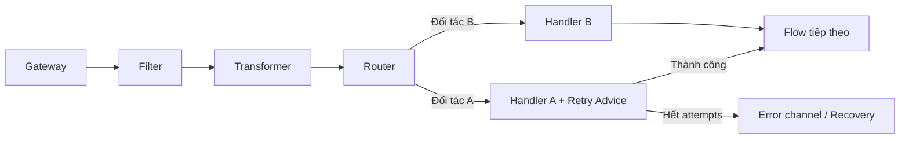

# Số lần thử và backoff trong Spring Integration

## 1. Bài toán: thử lại bao nhiêu lần, chờ bao lâu?

Trong luồng **Enterprise Integration Patterns (EIP)**, một message thường đi qua Router, Filter, Transformer hoặc Splitter rồi đến message handler gọi hệ thống ngoài: API vận chuyển, cổng thanh toán, kho hàng hay cơ sở dữ liệu. Những hệ thống này có thể phản hồi chậm hoặc tạm thời không sẵn sàng. **Retry** giúp xử lý lỗi thoáng qua, nhưng gọi lại quá nhiều lần hoặc quá nhanh có thể làm quá tải downstream, giữ thread lâu, vượt timeout của Gateway và tạo tác động nghiệp vụ trùng lặp.

Vì thế, một chính sách retry cần trả lời đồng thời ba câu hỏi:

1. **Thử bao nhiêu lần?** Gồm lần gọi đầu tiên và các lần gọi lại.
2. **Chờ bao lâu giữa các lần?** Dùng *backoff* để tránh lặp ngay khi downstream vừa lỗi.
3. **Khi nào dừng?** Dừng vì thành công, vì ngoại lệ không retry được, vì hết attempts hoặc vì một giới hạn thời gian bên ngoài.

Trong module `SPRING_INTEGRATION_PATTERN`, việc chọn attempts/backoff phù hợp giúp xây dựng luồng thông điệp ít phụ thuộc và dễ mở rộng. Các tham số này cần phối hợp với Gateway, error channel, correlation, kiểm thử và quan sát từng nhánh xử lý; chúng không chỉ là những con số để đưa vào cấu hình.

**Mục tiêu học tập:** Sau bài này, bạn có thể tính ngân sách thời gian cho một handler được retry, cấu hình `RequestHandlerRetryAdvice` với Spring Retry, chọn `BackOffPolicy`, nhận diện retry storm, kiểm thử số attempts và thiết kế nhánh recovery có thể truy vết.

## 2. Hiểu đúng `maxAttempts`

Với Spring Retry, `maxAttempts` là **tổng số lần thực thi**, bao gồm lần đầu tiên. Do đó:

| `maxAttempts` | Lần gọi đầu | Số lần gọi lại tối đa | Số khoảng backoff tối đa |
| ---: | ---: | ---: | ---: |
| 1 | 1 | 0 | 0 |
| 2 | 1 | 1 | 1 |
| 3 | 1 | 2 | 2 |
| 4 | 1 | 3 | 3 |

Ví dụ `maxAttempts = 4`:

```text
T0               T1               T2               T3
│                │                │                │
├─ attempt #1 ──X│                │                │
│    chờ b1      ├─ attempt #2 ──X│                │
│                │    chờ b2      ├─ attempt #3 ──X│
│                │                │    chờ b3      ├─ attempt #4
│                │                │                └─ thành công hoặc recovery
```

Trong sơ đồ, `X` là ngoại lệ có thể retry, còn `b1`, `b2`, `b3` là thời gian chờ trước attempt tiếp theo. Nếu attempt #2 thành công thì attempts #3, #4 và các khoảng chờ tương ứng **không xảy ra**. Nếu gặp lỗi không được retry ở attempt #1, chính sách dừng ngay, dù vẫn còn số attempts lý thuyết.

`RequestHandlerRetryAdvice` của Spring Integration bao quanh một **message handler** qua advice chain. Nó sử dụng `RetryTemplate` của Spring Retry để quyết định chạy lại lời gọi handler đó. Mặc định đây là retry **đồng bộ, stateless**: các lần thử diễn ra trong cùng lượt xử lý message, không phải tự động xếp lịch phát lại message qua broker.

> Đừng nhầm `maxAttempts = 3` với “retry ba lần sau lần đầu”. Đếm sai một lần có thể làm tăng đáng kể tải khi nhiều consumer chạy đồng thời.

## 3. Backoff là gì và có những cách nào?

Backoff là **khoảng chờ sau một attempt thất bại trước khi thực hiện attempt tiếp theo**. Mục đích là cho hệ thống phụ thuộc có cơ hội phục hồi và giảm tần suất request khi lỗi xảy ra hàng loạt.

Spring Retry cung cấp một số chính sách thông dụng:

| Chính sách | Đặc điểm | Phù hợp khi | Điểm cần lưu ý |
| --- | --- | --- | --- |
| `NoBackOffPolicy` | Không chờ giữa các attempts | Kiểm thử, tác vụ thuần bộ nhớ rất ngắn | Dễ tạo retry storm nếu dùng với API ngoài |
| `FixedBackOffPolicy` | Mọi lần chờ có cùng độ dài | Lỗi thoáng qua đơn giản, tải ổn định | Nhiều client có thể retry đồng loạt |
| `ExponentialBackOffPolicy` | Mỗi lần chờ dài hơn theo hệ số nhân, đến mức trần | Downstream tạm quá tải, lỗi mạng lặp | Cần đặt trần và kiểm soát tổng thời gian |
| `UniformRandomBackOffPolicy` | Chọn thời gian chờ ngẫu nhiên trong khoảng cấu hình | Giảm hiện tượng nhiều client thử cùng nhịp | Thời gian chờ thay đổi giữa các lần chạy |
| `ExponentialRandomBackOffPolicy` | Tăng thời gian chờ theo hướng exponential có yếu tố ngẫu nhiên | Nhiều consumer có nguy cơ cùng retry | Phân phối ngẫu nhiên khác full jitter; nên hiểu chính sách cụ thể |

Ví dụ với **fixed backoff 300 ms** và 4 attempts, tối đa ba khoảng chờ là:

```text
attempt 1 --300 ms--> attempt 2 --300 ms--> attempt 3 --300 ms--> attempt 4
                 Tổng thời gian chờ = 900 ms
```

Ví dụ với **exponential backoff**, `initialInterval = 250 ms`, `multiplier = 2`, `maxInterval = 1.000 ms`, 4 attempts:

```text
attempt 1 --250 ms--> attempt 2 --500 ms--> attempt 3 --1.000 ms--> attempt 4
                 Tổng thời gian chờ = 1.750 ms
```

Với ví dụ exponential, thời gian chờ ở lần thứ `i` (bắt đầu từ `i = 1`) có thể ước tính:

\[
b_i = \min\bigl(B_{\max},\; B_0 \times m^{i-1}\bigr),\qquad i=1,\ldots,N-1
\]

Trong đó `N` là `maxAttempts`, `B0` là khoảng chờ đầu, `m` là hệ số nhân và `Bmax` là giới hạn tối đa. Công thức mô tả exponential backoff thông thường; các policy có yếu tố ngẫu nhiên không nhất thiết tuân theo đúng từng giá trị này.

### Vì sao cần giới hạn `maxInterval`?

Nếu không có trần phù hợp, chuỗi backoff có thể tăng rất nhanh: 250, 500, 1.000, 2.000, 4.000, 8.000 ms... Một vài lần thử sau đã làm Gateway hoặc client chờ lâu hơn SLA cho phép. `maxInterval` giới hạn **mỗi khoảng chờ** chứ không tự giới hạn tổng thời gian thực thi.

### Vì sao cần yếu tố ngẫu nhiên (*jitter*)?

Giả sử 500 instance cùng nhận lỗi HTTP 503 lúc 10:00:00. Nếu tất cả đều retry sau đúng 500 ms, downstream sẽ nhận một đợt request lớn khác vào 10:00:00.500. Randomized backoff phân tán thời điểm thử lại để giảm hiện tượng các client đồng bộ nhịp. Khi cần kiểu *full jitter*, *equal jitter* hoặc quy luật phân phối cụ thể, hãy triển khai/kiểm chứng policy tương ứng; đừng mặc định mọi policy có chữ `Random` đều dùng cùng một thuật toán.

## 4. Tính ngân sách thời gian cho retry

Backoff chỉ là một phần độ trễ. Mỗi attempt còn có thời gian kết nối, đọc dữ liệu và xử lý. Nếu handler tốn tối đa `t` mili giây cho mỗi attempt và có `N` attempts, ta có ước lượng:

\[
T_{\text{retry}} \approx \sum_{k=1}^{N} t_k + \sum_{i=1}^{N-1} b_i + T_{\text{overhead}}
\]

Với ví dụ `N = 4`, timeout của lời gọi API là **800 ms/attempt**, các khoảng chờ lần lượt **250, 500, 1.000 ms**:

| Thành phần | Giá trị |
| --- | ---: |
| Thời gian xử lý tối đa ước tính của 4 attempts | `4 × 800 = 3.200 ms` |
| Tổng thời gian chờ exponential | `250 + 500 + 1.000 = 1.750 ms` |
| Tổng thời gian trước khi tính overhead | **4.950 ms** |

Như vậy, một yêu cầu nhìn tưởng chỉ “gọi API timeout 800 ms” có thể giữ caller gần **5 giây** nếu phải thử đủ bốn lần. Đây là phép tính *ước lượng* khi các timeout được áp dụng đúng; thời gian lập lịch, xử lý exception, serialization và các thao tác phụ có thể khiến thực tế dài hơn.

Khi thiết kế Gateway và message handler:

- Cấu hình **connect timeout/read timeout/deadline** tại HTTP hoặc database client; retry policy không thay thế chúng.
- Chọn số attempts, backoff, giới hạn đồng thời và deadline **như một bộ thông số**.
- Với `DirectChannel` và handler đồng bộ, backoff giữ thread gọi handler chờ. Một số timeout trên Gateway hoặc channel chỉ giới hạn thao tác gửi/nhận message; không nhất thiết ngắt được một lời gọi downstream đang chặn thread.
- Nếu yêu cầu có deadline ngắn mà downstream có thể lỗi hàng phút, cân nhắc queue retry, bộ lập lịch hoặc quy trình bất đồng bộ thay vì giữ Gateway chờ.
- Đối với HTTP 429 có `Retry-After`, cần thiết kế chính sách tôn trọng chỉ dẫn của downstream. Một `ExponentialBackOffPolicy` cố định không tự đọc header HTTP.

## 5. Cấu hình Spring Integration: attempts + exponential backoff

Xét luồng tạo vận đơn: message chứa `ShipmentCommand(orderId, idempotencyKey)` và được chuyển đến handler gọi hãng vận chuyển. Chỉ lỗi kỹ thuật tạm thời (`TemporaryCarrierException`) được phép retry. Ta chọn tối đa **4 attempts**, exponential backoff **250 → 500 → 1.000 ms**, rồi chuyển lỗi sang channel `shipmentRetryFailures` nếu không xử lý được.

Ứng dụng Spring cần Spring Integration và Spring Retry (`org.springframework.retry:spring-retry`). Ví dụ Java dưới đây thể hiện phần wiring chính; các adapter nghiệp vụ `CarrierClient` và `ShipmentFailureRecorder` cần được ứng dụng cung cấp thành bean Spring.

```java
import java.util.HashMap;
import java.util.Map;

import org.springframework.beans.factory.annotation.Qualifier;
import org.springframework.context.annotation.Bean;
import org.springframework.context.annotation.Configuration;
import org.springframework.integration.channel.DirectChannel;
import org.springframework.integration.dsl.IntegrationFlow;
import org.springframework.integration.handler.advice.ErrorMessageSendingRecoverer;
import org.springframework.integration.handler.advice.RequestHandlerRetryAdvice;
import org.springframework.messaging.MessageChannel;
import org.springframework.messaging.support.ErrorMessage;
import org.springframework.retry.backoff.ExponentialBackOffPolicy;
import org.springframework.retry.policy.SimpleRetryPolicy;
import org.springframework.retry.support.RetryTemplate;

@Configuration
public class ShipmentRetryConfiguration {

    @Bean
    MessageChannel shipmentRequests() {
        return new DirectChannel();
    }

    @Bean
    MessageChannel shipmentRetryFailures() {
        return new DirectChannel();
    }

    @Bean
    RequestHandlerRetryAdvice shipmentRetryAdvice(
            @Qualifier("shipmentRetryFailures") MessageChannel failures) {

        Map<Class<? extends Throwable>, Boolean> retryable = new HashMap<>();
        retryable.put(TemporaryCarrierException.class, true);

        // 4 attempts: 1 lần gọi đầu và tối đa 3 lần gọi lại.
        SimpleRetryPolicy retryPolicy =
                new SimpleRetryPolicy(4, retryable, true);

        ExponentialBackOffPolicy backOff = new ExponentialBackOffPolicy();
        backOff.setInitialInterval(250L);
        backOff.setMultiplier(2.0);
        backOff.setMaxInterval(1_000L);

        RetryTemplate template = new RetryTemplate();
        template.setRetryPolicy(retryPolicy);
        template.setBackOffPolicy(backOff);

        RequestHandlerRetryAdvice advice = new RequestHandlerRetryAdvice();
        advice.setRetryTemplate(template);
        advice.setRecoveryCallback(
                new ErrorMessageSendingRecoverer(failures));
        return advice;
    }

    @Bean
    IntegrationFlow shipmentFlow(CarrierClient carrierClient,
                                 RequestHandlerRetryAdvice shipmentRetryAdvice) {
        return IntegrationFlow.from("shipmentRequests")
                .handle(carrierClient, "createShipment",
                        endpoint -> endpoint.advice(shipmentRetryAdvice))
                .get();
    }

    @Bean
    IntegrationFlow shipmentFailureFlow(ShipmentFailureRecorder recorder) {
        return IntegrationFlow.from("shipmentRetryFailures")
                .handle(message -> recorder.record((ErrorMessage) message))
                .get();
    }
}

record ShipmentCommand(String orderId, String idempotencyKey) {}

interface CarrierClient {
    void createShipment(ShipmentCommand command);
}

interface ShipmentFailureRecorder {
    void record(ErrorMessage error);
}

class TemporaryCarrierException extends RuntimeException {
    TemporaryCarrierException(String message, Throwable cause) {
        super(message, cause);
    }
}
```

### Điều gì diễn ra khi một message đi qua flow?

1. Message vào `shipmentRequests`, sau đó endpoint gọi `CarrierClient.createShipment(...)`.
2. Nếu handler thành công ngay, flow kết thúc với **1 attempt**; không có backoff.
3. Nếu handler ném `TemporaryCarrierException`, retry policy cho phép gọi lại sau thời gian chờ tương ứng. `traverseCauses = true` giúp xét lỗi tạm thời khi ngoại lệ bị tầng messaging bọc trong chuỗi nguyên nhân.
4. Nếu lỗi không thuộc diện retry (ví dụ validation) hoặc vẫn thất bại sau attempt thứ tư, recovery callback gửi `ErrorMessage` tới `shipmentRetryFailures`.
5. `ShipmentFailureRecorder` cần lưu thông tin lỗi và message gốc để vận hành có thể điều tra/phát lại an toàn; đây là adapter ứng dụng chứ không phải nơi tự động retry tiếp.

**Không retry mọi exception.** Lỗi dữ liệu không hợp lệ, sai quyền và lỗi lập trình thường không thể giải quyết bằng cách chờ 250 ms rồi gọi lại. Thay vì map cả `Exception.class` thành `true`, hãy phân loại lỗi ở adapter và duy trì allowlist như ví dụ.

**Không ngầm coi recovery là thành công.** `ErrorMessageSendingRecoverer` thực hiện callback sau khi retry thất bại; nếu callback kết thúc bình thường, caller có thể không nhận lại exception gốc. Một Gateway cần trạng thái thất bại rõ ràng trong hợp đồng phản hồi hoặc cơ chế truyền lỗi riêng.

## 6. Thay đổi chính sách backoff mà không đổi flow

Khi dùng `RetryTemplate`, việc đổi policy chỉ tác động tới **khoảng chờ giữa các attempts**. Quy tắc phân loại exception và số attempts do `RetryPolicy` quyết định.

### Chờ cố định

```java
import org.springframework.retry.backoff.FixedBackOffPolicy;

FixedBackOffPolicy fixed = new FixedBackOffPolicy();
fixed.setBackOffPeriod(300L); // ms, sau mỗi attempt thất bại còn được retry.
template.setBackOffPolicy(fixed);
```

### Chờ ngẫu nhiên trong một khoảng

```java
import org.springframework.retry.backoff.UniformRandomBackOffPolicy;

UniformRandomBackOffPolicy random = new UniformRandomBackOffPolicy();
random.setMinBackOffPeriod(200L);
random.setMaxBackOffPeriod(700L);
template.setBackOffPolicy(random);
```

### Exponential có ngẫu nhiên

```java
import org.springframework.retry.backoff.ExponentialRandomBackOffPolicy;

ExponentialRandomBackOffPolicy randomized =
        new ExponentialRandomBackOffPolicy();
randomized.setInitialInterval(250L);
randomized.setMultiplier(2.0);
randomized.setMaxInterval(2_000L);
template.setBackOffPolicy(randomized);
```

Trong các đoạn này, `template` là `RetryTemplate` đã được khai báo ở mục 5; chỉ chọn **một** backoff policy cho mỗi cấu hình. Có thể khai báo một policy riêng cho từng nhánh Router/handler nếu các đối tác có SLA và tốc độ phục hồi khác nhau. Đừng sửa chính sách dùng chung theo từng message khi các thread đang xử lý đồng thời; hãy quyết định policy qua cấu hình endpoint hoặc cơ chế phân loại được thiết kế rõ ràng.

## 7. Retry phải phối hợp với các mẫu EIP khác

Vị trí gắn retry advice ảnh hưởng trực tiếp đến những gì có thể bị thực hiện lại:



- **Router:** Retry trên Handler A không làm Router chạy lại và không tự gọi lại Handler B. Hai nhánh có thể cấu hình số attempts khác nhau theo SLA từng hệ thống.
- **Filter/Transformer:** Một kết quả Filter loại message bình thường không phải lỗi. Với Transformer thuần túy bị lỗi dữ liệu, tăng attempts thường không giúp ích.
- **Splitter/Aggregator:** Một phần message có thể retry trong khi các phần khác thành công. Cần giữ correlation ID, sequence headers và thiết kế timeout/partial-result của Aggregator để không chờ vô hạn.
- **Gateway:** Retry đồng bộ cộng backoff kéo dài thời gian caller đợi. Nên tính tổng deadline, giới hạn concurrency và xác định điều gì xảy ra khi caller đã timeout nhưng handler vẫn tiếp tục.
- **Error channel:** Đưa lỗi hết attempts vào nhánh recovery, lưu dấu vết và trạng thái giao dịch. Error channel tự nó không phải backoff policy và không mặc định tạo cơ chế redelivery.

Với broker (Kafka, RabbitMQ, JMS...), **message redelivery** có thể chạy lại consumer hoặc nhiều bước xử lý hơn so với retry advice tại handler. Khi phối hợp hai cơ chế, giới hạn attempts của từng tầng có thể **nhân lên**: ví dụ broker giao lại 3 lần, mỗi lần handler retry 4 attempts có thể dẫn đến tới 12 lời gọi downstream. Phải tính tổng số lần gọi thực tế và kiểm soát vòng lặp phát lại.

## 8. Idempotency và tải hệ thống

Retry đặc biệt nguy hiểm nếu downstream **đã nhận và xử lý yêu cầu** nhưng response bị timeout. Handler có thể gửi tiếp cùng một lệnh, dẫn đến tạo hai vận đơn hoặc thu phí hai lần.

Một lệnh nên mang khóa idempotency ổn định:

```java
// Mã minh họa logic CarrierClient.createShipment(...).
// carrierApi là adapter của ứng dụng, không phải lớp Spring Integration.
public void createShipment(ShipmentCommand command) {
    try {
        carrierApi.submit(
                command.orderId(),
                command.idempotencyKey());
    } catch (CarrierTimeoutException | CarrierUnavailableException ex) {
        throw new TemporaryCarrierException("Lỗi tạm thời khi gửi vận đơn", ex);
    }
}
```

Các kiểu `CarrierTimeoutException`, `CarrierUnavailableException` và `carrierApi` là ví dụ ở tầng adapter, phải được triển khai bằng client phù hợp. Giữ **cùng `idempotencyKey` qua tất cả attempts** và bảo đảm bên nhận hỗ trợ khóa này hoặc có cơ chế deduplication ở tầng nghiệp vụ. Retry không tự mang lại bảo đảm exactly-once.

Ngoài ra, nếu 100 consumer cùng nhận lỗi và mỗi message có 4 attempts, downstream có thể bị gọi thêm hàng trăm lần trong thời gian ngắn. Kết hợp attempts/backoff với:

- Giới hạn concurrency và số kết nối đồng thời.
- Timeout theo attempt, timeout tổng và tốc độ gửi request.
- Jitter để giảm các đợt retry cùng nhịp.
- Circuit breaker hoặc tạm ngừng tiêu thụ khi hệ thống phụ thuộc không phục hồi.
- Queue retry có trì hoãn cho lỗi cần chờ lâu, thay vì dùng thread sleep trong luồng đồng bộ.

## 9. Kiểm thử số attempts và hành vi backoff

Nên kiểm thử **quyết định retry** độc lập với cấu hình thời gian chờ, rồi kiểm thử luồng thực tế có advice/recovery. Để test chạy nhanh và ổn định, dùng `NoBackOffPolicy` cho những test chỉ kiểm tra số attempts; tránh `Thread.sleep(...)` và so sánh thời gian chính xác tới mili giây.

### Ví dụ JUnit 5: lần thứ ba thành công

```java
import java.util.Map;
import java.util.concurrent.atomic.AtomicInteger;

import org.junit.jupiter.api.Test;
import org.springframework.retry.backoff.NoBackOffPolicy;
import org.springframework.retry.policy.SimpleRetryPolicy;
import org.springframework.retry.support.RetryTemplate;

import static org.junit.jupiter.api.Assertions.assertEquals;
import static org.junit.jupiter.api.Assertions.assertThrows;

class RetryAttemptTest {

    private RetryTemplate template() {
        RetryTemplate retry = new RetryTemplate();
        retry.setRetryPolicy(new SimpleRetryPolicy(
                4, Map.of(TemporaryCarrierException.class, true), true));
        retry.setBackOffPolicy(new NoBackOffPolicy());
        return retry;
    }

    @Test
    void succeedsOnThirdAttempt() {
        AtomicInteger calls = new AtomicInteger();

        String result = template().execute(context -> {
            if (calls.incrementAndGet() < 3) {
                throw new TemporaryCarrierException("transient", null);
            }
            return "created";
        });

        assertEquals("created", result);
        assertEquals(3, calls.get());
    }

    @Test
    void stopsAfterFourFailedAttempts() {
        AtomicInteger calls = new AtomicInteger();

        assertThrows(TemporaryCarrierException.class,
                () -> template().execute(context -> {
                    calls.incrementAndGet();
                    throw new TemporaryCarrierException("still down", null);
                }));

        assertEquals(4, calls.get());
    }
}
```

Các test này kiểm chứng `RetryTemplate` **không có recovery callback**; khi hết attempts, ngoại lệ được ném ra. Trong luồng ví dụ mục 5, `RequestHandlerRetryAdvice` đã có `ErrorMessageSendingRecoverer`, nên test tích hợp phải kiểm tra error channel nhận lỗi thay vì luôn mong chờ exception thoát về caller.

### Ma trận kiểm thử tích hợp

| Kịch bản | Số lần gọi handler | Backoff | Kỳ vọng |
| --- | ---: | --- | --- |
| Thành công ở lần đầu | 1 | Không có | Flow hoàn tất, không có recovery |
| Lỗi tạm thời ở lần 1, lần 2 thành công | 2 | 250 ms | Thành công, không có recovery |
| Lỗi tạm thời ở lần 1–3, lần 4 thành công | 4 | 250 + 500 + 1.000 ms | Thành công, không có recovery |
| Lỗi tạm thời suốt 4 attempts | 4 | 250 + 500 + 1.000 ms | Một nhánh recovery, lưu đầy đủ lỗi |
| Lỗi validation không retryable | 1 | Không có | Chuyển recovery ngay |
| Đã tạo đơn nhưng response timeout | Tối đa 4 | Theo policy | Idempotency key không đổi; không tạo trùng đơn |

Khi cần xác minh **chuỗi khoảng chờ** ở mức unit test, có thể sử dụng một sleeper/clock được thay thế hoặc quan sát các sự kiện của retry policy phù hợp với phiên bản Spring Retry đang dùng, thay vì dựa vào đồng hồ thực. Với test tích hợp, có thể kiểm tra độ trễ theo **khoảng cho phép rộng** và xác nhận thứ tự attempts bằng log/recorder.

## 10. Quan sát trong môi trường vận hành

Việc tăng `maxAttempts` có thể làm tỷ lệ thành công cuối cùng cao hơn nhưng đồng thời che đi sự cố thực sự của downstream. Theo dõi tối thiểu:

- **Attempts trên mỗi message:** phân phối 1, 2, 3, 4 attempts theo handler và exception type.
- **Recovery rate:** số message hết attempts hoặc không retryable, tỷ lệ xử lý thành công sau retry.
- **End-to-end latency:** độ trễ Gateway và flow, gồm thời gian gọi bên ngoài và chờ backoff.
- **Concurrency/backlog:** thread đang chờ retry, lượng message tồn trong queue, số lượng dead-letter cần xử lý.
- **Correlation:** message ID, correlation ID, order ID và trace ID; liên kết các attempts của cùng một giao dịch bằng khóa ổn định.

Spring Integration có thể tích hợp cơ chế quan sát/metrics của Spring và Micrometer, nhưng bộ metric mặc định không nhất thiết ghi riêng số attempts cho từng message. Nếu cần quan sát chính xác từng lần thử, bổ sung instrumentation hoặc `RetryListener` vào `RetryTemplate` một cách có kiểm soát; tránh đưa payload nhạy cảm và định danh có cardinality cao vào nhãn metric.

Phần recovery nên lưu thông tin cần thiết để vận hành phát lại an toàn: nguyên nhân cuối cùng, message gốc khi có, số attempts nếu thu thập được, định danh nghiệp vụ, idempotency key và thời điểm. Sau recovery, cần một quyết định nghiệp vụ rõ ràng: báo thất bại, chờ xử lý thủ công hoặc chuyển sang hàng đợi phát lại có kiểm soát.

## 11. Lỗi thường gặp khi chọn số lần thử và backoff

| Sai lầm | Hậu quả | Cách xử lý |
| --- | --- | --- |
| Hiểu `maxAttempts = 3` là ba lần retry sau lần đầu | Gọi API nhiều hơn dự định | Tính lần đầu vào tổng attempts |
| Retry ngay lập tức hàng loạt | Downstream tiếp tục quá tải | Backoff, jitter, concurrency limit |
| Tăng attempts nhưng không tính tổng timeout | Gateway/caller chờ quá SLA | Tính `attempt duration + backoff`, đặt deadline |
| Không giới hạn `maxInterval` | Một attempt muộn có thể phải chờ quá lâu | Đặt trần phù hợp với SLA |
| Chỉ cấu hình backoff mà không phân loại exception | Retry cả lỗi dữ liệu và lỗi lập trình | Dùng allowlist exception có thể phục hồi |
| Retry bên trong handler và redelivery ở broker cùng lúc | Tổng số lần gọi tăng theo tích hai tầng | Tính tổng budget, giới hạn redelivery |
| Mỗi attempt tạo idempotency key mới | Tạo trùng giao dịch | Giữ khóa nghiệp vụ ổn định |
| Recovery kết thúc bình thường nhưng caller tưởng đã thành công | Sai trạng thái nghiệp vụ | Xây dựng hợp đồng phản hồi/lưu trạng thái thất bại |

## 12. Bài thực hành

Thiết kế một flow nhận `ShipmentCommand` qua Gateway, dùng Router tách theo hãng vận chuyển A/B. Gắn `RequestHandlerRetryAdvice` riêng cho A với `maxAttempts = 4`, `initialInterval = 250 ms`, `multiplier = 2`, `maxInterval = 1.000 ms`; B dùng fixed backoff 300 ms và tối đa 2 attempts. Cho handler giả lập thất bại theo các kịch bản thành công ngay, thành công sau retry, hết attempts và lỗi validation.

Ghi lại số attempts, khoảng chờ thực tế theo mốc thời gian, tổng latency, correlation ID và message vào error channel. Tiếp đó, mô phỏng timeout xảy ra **sau khi** downstream đã tạo đơn để kiểm chứng idempotency. Cuối cùng, tăng số consumer đồng thời để quan sát retry đồng nhịp và thử chính sách có ngẫu nhiên.

**Tiêu chí hoàn thành:** Các nhánh có số attempts/backoff đúng cấu hình, tổng thời gian đáp ứng nằm trong ngân sách đã tính, lỗi vĩnh viễn không bị retry, lỗi hết attempts được lưu phục hồi, và việc thử lại không sinh tác động nghiệp vụ trùng lặp.
