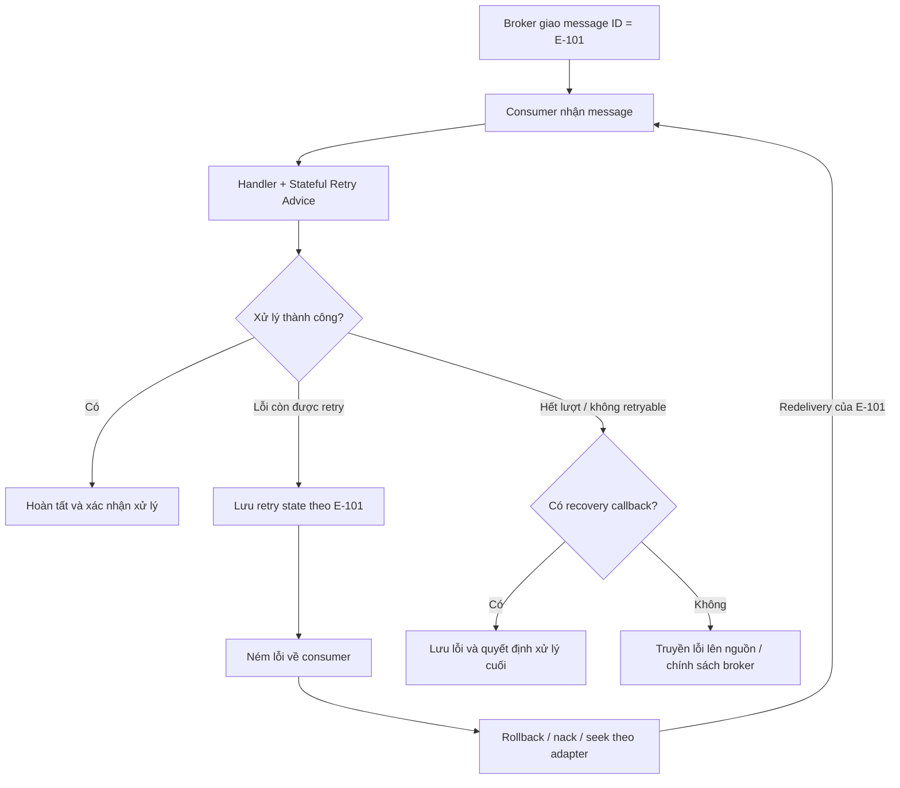

# Stateful retry theo message identity trong Spring Integration

## 1. Bài toán: một message quay lại nhiều lần có còn là cùng một lần retry?

Trong một luồng **Enterprise Integration Patterns (EIP)**, message có thể đi qua Filter, Transformer, Router hoặc Splitter trước khi tới handler gọi một hệ thống bên ngoài. Giả sử handler tạo vận đơn thất bại vì hãng vận chuyển trả HTTP 503. Nếu đầu vào là một broker hỗ trợ redelivery (JMS, RabbitMQ hoặc Kafka với cơ chế đọc lại phù hợp), lỗi có thể được ném ngược về consumer để message được giao lại sau đó.

Khi message quay lại, handler cần phân biệt hai trường hợp: **đây là lần thử tiếp theo của cùng một message** hay **đây là một message nghiệp vụ mới**. Nếu mỗi lần giao lại đều khởi tạo bộ đếm mới, giới hạn retry ở tầng handler có thể trở nên vô nghĩa. Ngược lại, nếu hai message khác nhau dùng chung khóa retry, lỗi của message này có thể làm message kia bị coi là đã hết lượt.

**Stateful retry theo message identity** giải quyết việc nhận diện một chuỗi xử lý qua nhiều lần giao lại. Trong module `SPRING_INTEGRATION_PATTERN`, cơ chế này hỗ trợ xây dựng luồng ít phụ thuộc và dễ mở rộng, kết hợp được với Gateway, Router, error channel, correlation, kiểm thử và theo dõi riêng từng nhánh.

Sau bài học, bạn có thể:

- Phân biệt **stateless retry** trong một lời gọi với **stateful retry** qua nhiều lần redelivery.
- Chọn khóa định danh ổn định và tránh trùng lặp giữa các message.
- Gắn stateful retry vào `RequestHandlerRetryAdvice` theo API tương ứng với Spring Integration 6.x hoặc 7.x.
- Hiểu cách exception, transaction rollback, broker redelivery và recovery phối hợp với nhau.
- Kiểm thử cách lưu/khôi phục trạng thái retry, giới hạn số lần thử và khả năng idempotent.

## 2. Stateless và stateful retry khác nhau ở đâu?

| Đặc điểm | Stateless retry | Stateful retry |
| --- | --- | --- |
| Bộ đếm retry | Trong một lần gọi advice/handler | Gắn với khóa định danh message, dùng lại khi message được giao lại |
| Sau handler ném lỗi retryable | Thường gọi lại ngay trong cùng lượt xử lý sau backoff | Ghi nhớ trạng thái và cho lỗi thoát lên caller để hệ thống nguồn xử lý |
| Ai tạo lần thử tiếp theo? | Retry advice | Nguồn gửi, consumer hoặc broker redelivery |
| Phạm vi thời gian | Một lượt gọi handler | Nhiều lượt delivery của cùng một message |
| Điều kiện quan trọng | Handler được gắn advice và lỗi có thể retry | Khóa identity ổn định **và** cơ chế gửi lại thật sự hoạt động |
| Phù hợp với | HTTP đồng bộ, thao tác ngắn, retry ngay | Consumer có transaction/acknowledgement và redelivery |
| Rủi ro chính | Giữ thread, kéo dài Gateway timeout | Mất/trùng retry state, vòng lặp redelivery, lệch trạng thái giữa các node |

Với stateful retry, **advice không tự tạo một hàng đợi phát lại**. Nó chỉ nhận ra rằng một message được giao lại có cùng identity với message từng thất bại. Broker hoặc nguồn gọi phải thực hiện việc resubmit. Tùy adapter, điều đó có thể đến từ rollback transaction, negative acknowledgement, seek/reposition hoặc một cơ chế phát lại do ứng dụng xây dựng.



Sơ đồ là mô hình logic; thao tác cụ thể để giao lại message phụ thuộc loại broker, transaction mode và error handler của adapter. Một ứng dụng chỉ dùng `DirectChannel` và không có nguồn gửi lại sẽ không tự chạy thêm attempts chỉ vì bật stateful retry.

## 3. Message identity: chọn khóa nào để ghi nhớ đúng retry state?

**Message identity** ở đây là *khóa dùng để liên kết các lần delivery của cùng một công việc*, không nhất thiết trùng với `MessageHeaders.ID` do Spring Messaging sinh ra.

| Ứng viên khóa | Có nên dùng? | Lý do |
| --- | --- | --- |
| ID nghiệp vụ của sự kiện, ví dụ `eventId` | Thường phù hợp | Giữ ổn định khi giao lại cùng sự kiện; nên duy nhất trong phạm vi hệ thống |
| `tenantId + eventId` | Phù hợp với ứng dụng đa tenant | Tránh trùng khóa giữa hai tenant phát sinh cùng ID |
| JMS message ID được giữ qua redelivery | Phù hợp khi được adapter bảo toàn | Gắn với một message broker cụ thể; cần kiểm tra headers thực tế |
| Kafka `topic + partition + offset` | Phù hợp để định danh bản ghi được đọc lại | Offset của cùng record ổn định; `key` Kafka đơn lẻ có thể trùng nhiều bản ghi |
| `orderId` đơn lẻ | Chỉ dùng nếu một order luôn tương ứng đúng một công việc | Một order có thể có nhiều sự kiện/thao tác riêng biệt |
| `MessageHeaders.ID` của Spring | Không nên mặc định dùng | Có thể thay đổi khi chuyển đổi hoặc tạo `Message` mới |
| Thời gian hiện tại hoặc UUID sinh khi vào handler | Không phù hợp | Mỗi lần redelivery sinh khóa mới, mất lịch sử retry |

Ví dụ message nghiệp vụ:

```java
record ShipmentEvent(
        String tenantId,
        String eventId,
        String orderId,
        String idempotencyKey) {}
```

Với sự kiện `tenantId = "vn"`, `eventId = "evt-101"`, khóa retry có thể là `shipment:vn:evt-101`. Tất cả lần giao lại sự kiện đó phải tạo cùng khóa. Một sự kiện `evt-102` cần khóa riêng, kể cả nếu cùng `orderId`.

### Những nguyên tắc bắt buộc cho khóa

1. **Ổn định qua redelivery:** Broker có thể bọc message vào đối tượng mới. Khóa phải xuất phát từ trường bền vững trong payload hoặc header được bảo toàn.
2. **Duy nhất trong phạm vi hợp lý:** Nếu hai luồng dùng chung advice/cache và tạo trùng identity, phải thêm prefix theo loại nghiệp vụ, nguồn hoặc tenant.
3. **Không `null` hoặc rỗng:** Không cho nhiều message thiếu ID vô tình chia sẻ một retry state. Coi đó là lỗi đầu vào cần xử lý rõ.
4. **Không lẫn retry identity với idempotency key:** Retry identity dùng để nhớ số lần thất bại; idempotency key dùng để ngăn tác động nghiệp vụ trùng lặp ở đích. Có thể liên hệ nhưng phục vụ hai mục tiêu khác nhau.
5. **Hiểu vòng đời của ID:** Khi một sự kiện mới có cùng `orderId` nhưng khác `eventId`, không được kế thừa retry count của sự kiện cũ.

## 4. Vòng đời một message khi có rollback và redelivery

Giả sử chính sách cho phép **1 lần gọi đầu và 2 lần retry**, tổng cộng tối đa **3 lần thực thi handler**. Handler luôn ném `TemporaryCarrierException`. Trong một chuỗi redelivery điển hình:

| Delivery | Identity | Điều advice biết | Hành động thường thấy |
| --- | --- | --- | --- |
| Lần 1 | `shipment:vn:evt-101` | Chưa có trạng thái | Gọi handler, lỗi; lưu state và truyền lỗi để rollback/redelivery |
| Lần 2 | `shipment:vn:evt-101` | Đã thất bại một attempt | Thử tiếp; nếu vẫn lỗi thì truyền lỗi, giữ state |
| Lần 3 | `shipment:vn:evt-101` | Đã thất bại hai attempts | Thử tiếp theo policy; nếu vẫn lỗi thì đánh dấu chuỗi đã hết khả năng retry |
| Lần giao lại sau khi hết retry (nếu xảy ra) | `shipment:vn:evt-101` | State đã hết lượt | Advice chuyển recovery hoặc ném lỗi hết retry tùy cấu hình/phiên bản |

Với Spring Integration 6.x, tài liệu minh họa `SimpleRetryPolicy(3)` cho ba lần handler thất bại và một lượt delivery tiếp theo kích hoạt recovery. Spring Integration 7.x cũng mô tả việc nhận biết trạng thái kết thúc khi message được gửi lại; hãy kiểm thử chính xác trình tự của phiên bản đang dùng.

**Đừng đồng nhất số lần broker giao lại với số lần handler được gọi.** Delivery dùng để phát hiện hết lượt có thể không thực thi handler. Một broker cũng có giới hạn redelivery riêng; nếu broker chuyển message vào dead-letter queue quá sớm, advice có thể không có cơ hội thực hiện recovery theo kế hoạch.

Khi handler thành công, retry state của chuỗi xử lý được hoàn tất. Khi không còn retry, cần quyết định rõ nơi lưu thất bại và lúc nào được xác nhận message cho broker. Nếu recovery báo lỗi, việc ném exception và giao lại tiếp sẽ phụ thuộc transaction/error handler; không nên ngầm giả định message đã được xử lý xong.

## 5. Cấu hình stateful retry với Spring Integration 7.x

**Lưu ý phiên bản:** Spring Integration 7.x chuyển phần retry sang `org.springframework.core.retry` của Spring Framework. API kích hoạt stateful retry là `RequestHandlerRetryAdvice.setStateKeyFunction(...)`. Trong Spring Integration 6.x, API khác: `setRetryStateGenerator(...)` cùng Spring Retry. Hai cách cấu hình này **không hoán đổi trực tiếp** được. Ví dụ chính dưới đây dành cho **Spring Integration 7.1.x / Spring Framework 7.x**.

Luồng nhận `ShipmentEvent` từ channel `shipmentEvents`. Một consumer của JMS/RabbitMQ/Kafka cần được cấu hình riêng để đưa message vào channel và thực hiện redelivery khi handler ném lỗi. Cấu hình dưới đây tập trung vào advice, khóa định danh và nhánh recovery:

```java
import java.time.Duration;

import org.springframework.beans.factory.annotation.Qualifier;
import org.springframework.context.annotation.Bean;
import org.springframework.context.annotation.Configuration;
import org.springframework.core.retry.RetryPolicy;
import org.springframework.integration.channel.DirectChannel;
import org.springframework.integration.dsl.IntegrationFlow;
import org.springframework.integration.handler.advice.ErrorMessageSendingRecoverer;
import org.springframework.integration.handler.advice.RequestHandlerRetryAdvice;
import org.springframework.messaging.Message;
import org.springframework.messaging.MessageChannel;
import org.springframework.messaging.support.ErrorMessage;

@Configuration
public class StatefulShipmentConfiguration {

    @Bean
    MessageChannel shipmentEvents() {
        return new DirectChannel();
    }

    @Bean
    MessageChannel shipmentRetryFailures() {
        return new DirectChannel();
    }

    static String retryKey(Message<?> message) {
        ShipmentEvent event = (ShipmentEvent) message.getPayload();
        if (event.tenantId() == null || event.tenantId().isBlank()
                || event.eventId() == null || event.eventId().isBlank()) {
            throw new IllegalArgumentException("Missing stable shipment identity");
        }
        return "shipment:" + event.tenantId() + ":" + event.eventId();
    }

    @Bean
    RequestHandlerRetryAdvice shipmentStatefulAdvice(
            @Qualifier("shipmentRetryFailures") MessageChannel failures) {

        // Spring Framework 7: maxRetries = số lần gọi lại SAU lần đầu.
        RetryPolicy policy = RetryPolicy.builder()
                .maxRetries(2) // Tối đa 3 lần thực thi handler.
                .delay(Duration.ofMillis(200))
                .multiplier(2.0)
                .maxDelay(Duration.ofSeconds(1))
                .includes(TemporaryCarrierException.class)
                .build();

        RequestHandlerRetryAdvice advice = new RequestHandlerRetryAdvice();
        advice.setRetryPolicy(policy);
        advice.setStateKeyFunction(StatefulShipmentConfiguration::retryKey);
        advice.setStateCacheSize(500); // Ví dụ cấu hình; điều chỉnh theo tải.
        advice.setRecoveryCallback(new ErrorMessageSendingRecoverer(failures));
        return advice;
    }

    @Bean
    IntegrationFlow shipmentFlow(ShipmentDispatcher dispatcher,
                                 RequestHandlerRetryAdvice shipmentStatefulAdvice) {
        return IntegrationFlow.from("shipmentEvents")
                .handle(dispatcher, "send",
                        endpoint -> endpoint.advice(shipmentStatefulAdvice))
                .get();
    }

    @Bean
    IntegrationFlow shipmentRecoveryFlow(ShipmentFailureRecorder recorder) {
        return IntegrationFlow.from("shipmentRetryFailures")
                .handle(message -> recorder.record((ErrorMessage) message))
                .get();
    }
}

record ShipmentEvent(String tenantId, String eventId,
                     String orderId, String idempotencyKey) {}

interface ShipmentDispatcher {
    void send(ShipmentEvent event);
}

interface ShipmentFailureRecorder {
    void record(ErrorMessage error);
}

class TemporaryCarrierException extends RuntimeException {
    TemporaryCarrierException(String message, Throwable cause) {
        super(message, cause);
    }
}
```

### Đọc cấu hình

- `setStateKeyFunction(...)` xác định cùng một công việc qua nhiều lượt delivery. **Đây là công tắc kích hoạt stateful retry** trong Spring Integration 7.x.
- `RetryPolicy.builder().maxRetries(2)` cho phép tối đa **2 lần retry sau lần đầu**. Không đọc tham số này như `SimpleRetryPolicy(3)` của Spring Retry 6.x: tên và cách đếm khác nhau.
- `includes(TemporaryCarrierException.class)` giới hạn lỗi được phép retry. Nếu lỗi từ handler bị bao trong `MessagingException` hoặc một wrapper khác, cần kiểm thử chuỗi exception thực tế và điều chỉnh chính sách bằng predicate/chuẩn hóa tại adapter; không nên mở rộng thành mọi `RuntimeException`.
- `delay(...)`, `multiplier(...)`, `maxDelay(...)` xác định backoff. Với stateful retry 7.x, các lần redelivery do nguồn chịu trách nhiệm; **một lần xử lý được gửi lại có thể còn phải chờ backoff** trước khi gọi handler, vì vậy không nên gọi đây là giải pháp hoàn toàn không bao giờ giữ thread.
- `setStateCacheSize(500)` chỉ là ví dụ thay cho giá trị mặc định **100** ở Spring Integration 7.x. Cache trong advice không phải một nơi lưu trữ bền vững qua restart hoặc phân tán giữa các instance.
- `ErrorMessageSendingRecoverer` chuyển lỗi sau khi hết retry sang nhánh lưu lỗi. Recorder cần thực sự lưu/truyền lỗi tới nơi có thể điều tra và tái xử lý; callback kết thúc bình thường có thể khiến upstream coi xử lý đã thành công.

**Điều kiện tiên quyết:** Dự án phải có các bean triển khai `ShipmentDispatcher` và `ShipmentFailureRecorder`, cùng một adapter nguồn được cấu hình phù hợp. Luồng Java DSL trên chỉ khai báo channel và endpoint; **nó không tạo ra broker redelivery**. Nếu gửi đúng một lần vào `DirectChannel` rồi không gửi lại, handler chỉ có cơ hội thực hiện một attempt stateful ở lượt đó.

### `newMessagePredicate` và trường hợp sử dụng lại khóa

Spring Integration 7.x còn cung cấp `setNewMessagePredicate(Predicate<Message<?>>)` để yêu cầu **bắt đầu state mới** khi một message được xem là mới dù trùng khóa; chỉ dùng khi có quy tắc rõ ràng, chẳng hạn có thế hệ dữ liệu hoặc phiên bản sự kiện.

Tránh cấu hình predicate luôn trả `true`: điều đó có thể làm số attempts bị đặt lại ở mỗi lần redelivery. Nếu có thể, thiết kế một identity thực sự duy nhất cho mỗi sự kiện sẽ rõ ràng và an toàn hơn. `setStateCacheSize(...)` và `setNewMessagePredicate(...)` chỉ có ý nghĩa với stateful retry.

## 6. Cấu hình tương đương với Spring Integration 6.x

Nếu ứng dụng đang dùng **Spring Integration 6.x + Spring Retry**, lớp `RetryStateGenerator` và `SpelExpressionRetryStateGenerator` tạo khóa cho `RetryTemplate` lưu state của từng message. Ví dụ sau là phần **cấu hình advice cho 6.x**, không dùng chung trong một dự án 7.x:

```java
import java.util.Map;

import org.springframework.integration.handler.advice.ErrorMessageSendingRecoverer;
import org.springframework.integration.handler.advice.RequestHandlerRetryAdvice;
import org.springframework.integration.handler.advice.SpelExpressionRetryStateGenerator;
import org.springframework.messaging.MessageChannel;
import org.springframework.retry.backoff.NoBackOffPolicy;
import org.springframework.retry.policy.SimpleRetryPolicy;
import org.springframework.retry.support.RetryTemplate;

RequestHandlerRetryAdvice statefulAdvice6x(MessageChannel failureChannel) {
    RetryTemplate retryTemplate = new RetryTemplate();
    retryTemplate.setRetryPolicy(new SimpleRetryPolicy(
            3, Map.of(TemporaryCarrierException.class, true), true));
    retryTemplate.setBackOffPolicy(new NoBackOffPolicy());

    RequestHandlerRetryAdvice advice = new RequestHandlerRetryAdvice();
    advice.setRetryTemplate(retryTemplate);
    advice.setRetryStateGenerator(
            new SpelExpressionRetryStateGenerator("headers['retryIdentity']"));
    advice.setRecoveryCallback(
            new ErrorMessageSendingRecoverer(failureChannel));
    return advice;
}
```

Ở đây adapter cần đặt header `retryIdentity` giống nhau cho mọi delivery của cùng sự kiện (ví dụ `shipment:vn:evt-101`) **trước khi** message đến handler. Có thể dùng `headers['jms_messageId']` nếu hệ thống thực sự giữ ổn định header JMS đó. Không chọn header có thể bị tái tạo khác nhau ở mỗi lần giao lại.

Khác biệt quan trọng:

| Mục | Spring Integration 6.x | Spring Integration 7.x |
| --- | --- | --- |
| API bật stateful | `setRetryStateGenerator(...)` | `setStateKeyFunction(...)` |
| Tạo khóa | `SpelExpressionRetryStateGenerator` hoặc `RetryStateGenerator` tùy biến | `Function<Message<?>, Object>` |
| Retry policy | `org.springframework.retry.policy.SimpleRetryPolicy` | `org.springframework.core.retry.RetryPolicy` |
| Tham số giới hạn | `maxAttempts = 3` nghĩa là **3 lần handler** | `maxRetries = 2` nghĩa là **2 lần gọi lại**, tối đa **3 lần handler** |
| Đặt policy | `advice.setRetryTemplate(template)` | `advice.setRetryPolicy(policy)` |
| Lưu trạng thái | Retry context cache trong Spring Retry | State cache do advice quản lý, cấu hình `stateCacheSize` |

Spring Integration 7.x đã loại bỏ `RetryStateGenerator` và `SpelExpressionRetryStateGenerator`. Khi nâng cấp module, kiểm tra API hiện có và di chuyển cả logic định danh, retry policy, recovery lẫn test redelivery; không chỉ thay tên phương thức.

## 7. Điều phối rollback, acknowledgement và recovery

Stateful retry hữu ích khi việc rollback phải xảy ra **trước** lần thử tiếp theo, chẳng hạn transaction đọc message từ JMS hoặc khi consumer dùng broker để quản lý việc giao lại.

### Lượt thất bại còn khả năng retry

Handler ném một exception được policy cho phép retry. Advice nhớ trạng thái bằng retry key, tiếp tục truyền exception để consumer có thể rollback hoặc yêu cầu redelivery. Nếu ứng dụng bắt exception ở tầng ngoài rồi luôn ack message, sẽ không còn lượt delivery tiếp theo và chuỗi stateful dừng ở đó.

### Lượt cuối và nhánh recovery

Sau khi hết retry, hai hướng xử lý phổ biến là:

1. **Có `RecoveryCallback`:** ghi `ErrorMessage`, đưa sang dead-letter flow hoặc lưu bản ghi thất bại; quyết định khi nào đánh dấu message đã xử lý xong. Recovery phải có khả năng lưu lỗi đáng tin cậy.
2. **Không có recovery callback:** exception hết retry được truyền về upstream; broker/error handler quyết định dead-letter, loại bỏ hoặc giao lại. Nếu cứ redelivery không giới hạn mà không có trạng thái bền vững, nguy cơ lặp vô tận hoặc thử lại từ đầu vẫn tồn tại.

Đừng nhầm **error channel** với broker **dead-letter queue**. Error channel là đường xử lý `ErrorMessage` trong ứng dụng Spring Integration; dead-letter queue là cơ chế lưu message thất bại theo hạ tầng messaging. Có thể nối hai cơ chế qua adapter phù hợp, nhưng chúng không tự động là một.

### Ví dụ các adapter nguồn

| Nguồn | Cơ chế gửi lại có thể dùng | Điều cần kiểm tra |
| --- | --- | --- |
| JMS | Rollback session/transaction để broker redeliver | Transaction được bật, giới hạn broker delivery, identity có giữ nguyên |
| RabbitMQ | Consumer reject/nack và requeue hoặc cơ chế retry/dead-letter | Không tạo vòng requeue nóng; handler ném lỗi có được chuyển thành nack đúng cách |
| Kafka | Consumer error handler seek/reposition hoặc retry topic | Commit offset, partition/offset và cách redelivery được thực hiện trong cấu hình thật |
| HTTP Gateway đồng bộ | Caller chủ động gửi lại cùng event | Không có broker tự redeliver; caller cần giữ identity và deadline |

Trong hệ thống phân tán nhiều instance, cache retry nội bộ của node A không được tự động chia sẻ cho node B. Nếu broker có thể giao lại cùng sự kiện cho node khác, cần thiết kế cố định phân vùng hoặc lưu attempt/poison-message status theo phương án phù hợp. Không dựa vào cache trong bộ nhớ như một cam kết về số lần retry tuyệt đối qua restart, rebalance và failover.

## 8. Correlation, Router, Splitter và idempotency

Stateful retry theo identity giải quyết bài toán **nhớ tiến độ thử lại**, nhưng không tự giải quyết toàn bộ bài toán xử lý message một lần duy nhất.

- **Router:** Một event có thể được chuyển sang nhiều handler. Nếu dùng chung retry state cho các handler khác nhau, nên phân biệt khóa bằng tên endpoint/nhánh, ví dụ `shipment:A:tenant:eventId` và `shipment:B:tenant:eventId`.
- **Filter/Transformer:** Nếu tạo `Message` mới, phải giữ header identity hoặc payload event ID. Một lỗi validation không thể tự hết khi retry cùng payload nên nên đi nhánh lỗi rõ ràng.
- **Splitter/Aggregator:** Với từng phần message được tách, khóa cần thêm `partId` hoặc sequence number nếu retry state được lưu theo từng phần; đồng thời giữ correlation ID của nhóm để Aggregator ghép các phần đúng.
- **Gateway:** Khi gateway gửi lại cùng request, cần định nghĩa được liệu đó là *redelivery của cùng event* hay một lệnh nghiệp vụ mới. Không dùng thời điểm gửi làm định danh retry.
- **Error channel:** Lưu thông tin gốc để tra cứu: source, retry key, correlation ID, event ID, order ID, lỗi cuối và lịch sử attempts nếu có.

Ví dụ hai message có cùng `orderId = O-42` nhưng `eventId = create-42` và `eventId = cancel-42` là **hai công việc khác nhau**. Dùng `orderId` làm khóa sẽ vô tình gộp state của tạo và hủy đơn; dùng `eventId` (có namespace thích hợp) sẽ tách được.

### Idempotency khi downstream đã xử lý nhưng phản hồi thất lạc

Giả sử API đối tác **đã tạo vận đơn**, nhưng response bị timeout. Message bị broker giao lại theo cùng retry identity. Nếu handler gọi lại API mà không có idempotency, có thể tạo vận đơn thứ hai, dù bộ đếm retry đang đúng.

```java
// Logic minh họa của ShipmentDispatcher.send(...).
// carrierApi và các loại ngoại lệ bên dưới là adapter nghiệp vụ của ứng dụng.
public void send(ShipmentEvent event) {
    try {
        carrierApi.createShipment(event.orderId(), event.idempotencyKey());
    } catch (CarrierTimeoutException | CarrierUnavailableException ex) {
        throw new TemporaryCarrierException("Đối tác tạm thời không phản hồi", ex);
    }
}
```

`idempotencyKey` phải **giữ nguyên xuyên suốt** các lần gửi lại của cùng thao tác, và hệ thống đích phải hỗ trợ deduplication hoặc ứng dụng cần tự đảm bảo tính idempotent. Retry state và idempotency cần được thiết kế cùng nhau, song không thay thế lẫn nhau.

## 9. Khi nào không nên dùng stateful retry?

Không phải hệ thống nào cũng cần stateful retry. Hãy cân nhắc lựa chọn khác khi:

- Caller đồng bộ không có cơ chế resubmit hoặc không thể giữ cùng identity. Khi đó stateless retry có giới hạn thường đơn giản hơn.
- Nguồn message đã có retry topic, delayed queue và cơ chế đếm attempts đủ tin cậy. Thêm một bộ đếm nội bộ khác có thể làm tổng số lần gọi khó kiểm soát.
- Thời gian chờ giữa các attempts là phút hoặc giờ. Một hàng đợi trì hoãn hoặc scheduler có lưu trạng thái bền vững thường thích hợp hơn.
- Bài toán yêu cầu kiểm soát attempts xuyên qua restart, nhiều pod hoặc nhiều vùng triển khai. Cần trạng thái bền vững ở broker/database hoặc giải pháp phân tán được thiết kế rõ, thay vì mặc định tin vào cache cục bộ.

## 10. Kiểm thử đúng identity và chuỗi redelivery

Kiểm thử stateful retry cần mô phỏng **nhiều lần đưa cùng một sự kiện quay lại endpoint**, thay vì chỉ gọi một handler liên tục trong cùng thread.

### Kiểm thử hàm tạo retry key

Với cấu hình 7.x ở mục 5, ví dụ JUnit 5 sau chứng minh rằng Spring `Message` có ID/headers khác nhau vẫn tạo **cùng retry key** nếu sự kiện nghiệp vụ không đổi:

```java
import org.junit.jupiter.api.Test;
import org.springframework.messaging.Message;
import org.springframework.messaging.support.MessageBuilder;

import static org.junit.jupiter.api.Assertions.assertEquals;
import static org.junit.jupiter.api.Assertions.assertNotEquals;
import static org.junit.jupiter.api.Assertions.assertThrows;

class ShipmentRetryIdentityTest {

    @Test
    void redeliveredMessagesShareTheSameBusinessRetryKey() {
        ShipmentEvent event = new ShipmentEvent(
                "vn", "evt-101", "order-42", "idem-42");

        Message<ShipmentEvent> first = MessageBuilder.withPayload(event)
                .setHeader("delivery", 1).build();
        Message<ShipmentEvent> redelivery = MessageBuilder.withPayload(event)
                .setHeader("delivery", 2).build();

        assertEquals(StatefulShipmentConfiguration.retryKey(first),
                StatefulShipmentConfiguration.retryKey(redelivery));
        assertEquals("shipment:vn:evt-101",
                StatefulShipmentConfiguration.retryKey(redelivery));
    }

    @Test
    void differentEventIdentityMustNotShareState() {
        Message<ShipmentEvent> a = MessageBuilder.withPayload(
                new ShipmentEvent("vn", "evt-101", "order-42", "idem-a"))
                .build();
        Message<ShipmentEvent> b = MessageBuilder.withPayload(
                new ShipmentEvent("vn", "evt-102", "order-42", "idem-b"))
                .build();

        assertNotEquals(StatefulShipmentConfiguration.retryKey(a),
                StatefulShipmentConfiguration.retryKey(b));
    }

    @Test
    void missingEventIdIsRejected() {
        Message<ShipmentEvent> invalid = MessageBuilder.withPayload(
                new ShipmentEvent("vn", "", "order-42", "idem-42"))
                .build();

        assertThrows(IllegalArgumentException.class,
                () -> StatefulShipmentConfiguration.retryKey(invalid));
    }
}
```

Đoạn test trên chỉ kiểm tra hàm identity; nó **chưa chứng minh** broker rollback/redelivery và retry policy vận hành đúng. Cần thêm test tích hợp dùng container broker hoặc consumer test adapter trong cấu hình triển khai thật.

### Ma trận kiểm thử tích hợp

| Tình huống | Kỳ vọng |
| --- | --- |
| Message mới, handler thành công | Handler gọi một lần; không sinh recovery |
| Cùng `eventId` được giao lại sau lỗi tạm thời | Retry state được nhận lại; lần sau tiếp tục tiến độ thay vì bắt đầu từ 0 |
| Cùng `orderId` nhưng `eventId` khác | Hai state tách biệt, không ảnh hưởng số attempts của nhau |
| Handler thất bại cho tới hết retry | Số lần gọi handler không vượt ngân sách; có nhánh recovery hoặc lỗi cuối theo thiết kế |
| Exception không retryable | Không tạo chuỗi retry kéo dài với cùng dữ liệu sai |
| Header Spring `id` thay đổi khi redelivery | Retry key từ event vẫn ổn định |
| Recovery callback không lưu được lỗi | Không ack thành công một cách âm thầm; quan sát được lỗi recovery |
| Consumer đổi node hoặc ứng dụng restart giữa các lượt | Xác nhận rõ retry state có mất không; kiểm chứng cơ chế bền vững bổ sung nếu cần |
| API đã xử lý nhưng response timeout | Các lần thử có idempotency key giống nhau; không tạo trùng tác động |

Khi kiểm thử, đo **hai bộ đếm riêng**: số lượt broker delivery và số lượt handler thật sự được gọi. Theo dõi thêm trạng thái transaction/ack, số recovery message, dead-letter, correlation ID và thứ tự sự kiện. Nếu dùng backoff, chỉ kiểm tra trong khoảng sai số hợp lý để tránh test phụ thuộc thời gian chính xác đến từng mili giây.

## 11. Quan sát và vận hành

Các tín hiệu vận hành quan trọng:

- **Retry state theo identity:** số identity đang còn trạng thái, số lần xóa/evict cache, số khóa bị trùng hoặc rỗng.
- **Delivery và attempts:** so sánh lượt broker giao message với lượt handler chạy theo endpoint, exception type và tenant/nguồn.
- **Recovery/dead-letter:** số message hết lượt, lý do, tuổi message, thời gian từ attempt đầu đến recovery cuối.
- **Tải:** số consumer đang xử lý, backlog, số message redelivery liên tục, thời gian chờ và tình trạng downstream.
- **Correlation:** event ID, retry identity, trace ID và định danh nghiệp vụ để tra vết qua Router/Splitter/Gateway và error channel.

Tránh đưa các giá trị identity riêng lẻ vào nhãn metric vì cardinality quá cao; lưu chúng trong log/tracing có kiểm soát. Không ghi payload chứa dữ liệu nhạy cảm chỉ để thuận tiện điều tra. Nếu có nhiều node, cảnh báo khi sự kiện thường xuyên quay lại ở node khác hoặc khi số lần broker redelivery cao nhưng stateful counter liên tục bắt đầu lại.

## 12. Những sai lầm thường gặp

| Sai lầm | Hậu quả | Cách xử lý |
| --- | --- | --- |
| Dùng `headers.id` mà mỗi lượt delivery tạo message mới | Không nhận ra cùng một sự kiện | Dùng event ID hoặc broker ID được bảo toàn |
| Dùng chung `orderId` cho nhiều thao tác | Gộp retry state của những message khác nhau | Thêm event/operation ID và namespace |
| Bật stateful nhưng không có cơ chế redelivery | Chỉ xử lý một lần, không bao giờ đến lượt retry tiếp | Cấu hình transaction/nack/seek hoặc resubmit |
| Bắt lỗi rồi ack luôn | Broker không gửi lại message | Để exception được xử lý đúng theo chính sách broker |
| Cache nhỏ hoặc node thay đổi | Retry state bị mất, số lần thử có thể bắt đầu lại | Giám sát eviction, định tuyến hoặc lưu trạng thái bền vững |
| Cho `newMessagePredicate` luôn trả `true` | Reset state liên tục | Chỉ refresh khi chắc chắn đó là sự kiện mới |
| Dùng `maxRetries` của 7.x như `maxAttempts` của 6.x | Sai số lần handler gọi | Kiểm tra cách đếm theo phiên bản |
| Recovery trả thành công nhưng lỗi không được lưu | Message có thể bị ack/mất khả năng điều tra | Lưu lỗi bền vững, kiểm tra lỗi trong recovery |
| Nhầm identity với idempotency | Có retry state đúng nhưng vẫn tạo trùng giao dịch | Giữ idempotency key và cơ chế chống trùng ở downstream |

## 13. Bài thực hành

Thiết kế một flow nhận sự kiện `ShipmentEvent` từ broker, dùng Router chọn hãng vận chuyển và gắn stateful retry vào handler của hãng A. Khóa retry gồm tên nhánh, tenant và event ID. Cấu hình chính sách tương đương **một lần đầu + hai lần retry** cho lỗi tạm thời; lỗi validation không được retry. Cho handler A thất bại theo ba kịch bản: thành công sau một lần redelivery, thất bại tới recovery, và thất bại sau khi downstream đã hoàn tất giao dịch nhưng phản hồi timeout.

Kiểm tra identity còn nguyên qua redelivery, số lượt delivery khác số lượt handler, nguồn thực sự rollback hoặc seek, nhánh recovery lưu được message gốc, các phần Splitter/Aggregator vẫn giữ correlation, và downstream không tạo vận đơn trùng lặp. Cuối cùng thử ứng dụng restart hoặc thay consumer node để đánh giá tác động của cache state nội bộ.

**Tiêu chí hoàn thành:** Cùng một message có retry state nhất quán qua các lượt giao lại trong điều kiện đã thiết kế; message khác không dùng chung state; lỗi được dừng và định tuyến đúng khi hết lượt; transaction/ack phù hợp với kết quả recovery; mọi tác động nghiệp vụ có cơ chế idempotency.

## Tài liệu tham khảo theo phiên bản

- [Spring Integration 7.1 — Retry Advice](https://docs.spring.io/spring-integration/reference/handler-advice/classes.html): `stateKeyFunction`, `stateCacheSize`, `newMessagePredicate` và stateful redelivery.
- [Spring Integration 6.5 — Retry Advice](https://docs.spring.io/spring-integration/reference/6.5/handler-advice/classes.html): `RetryStateGenerator`, `SpelExpressionRetryStateGenerator` và Spring Retry.
- [Spring Framework 7 — Resilience Features](https://docs.spring.io/spring-framework/reference/core/resilience.html): `RetryPolicy`, `maxRetries` và các lựa chọn backoff.
