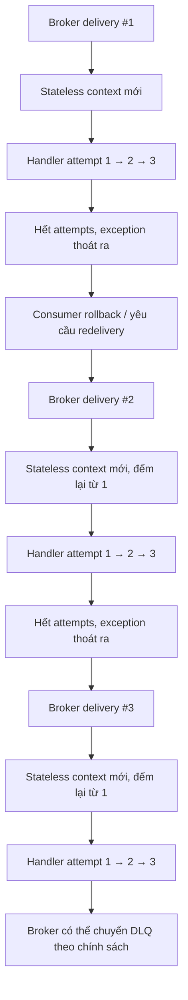
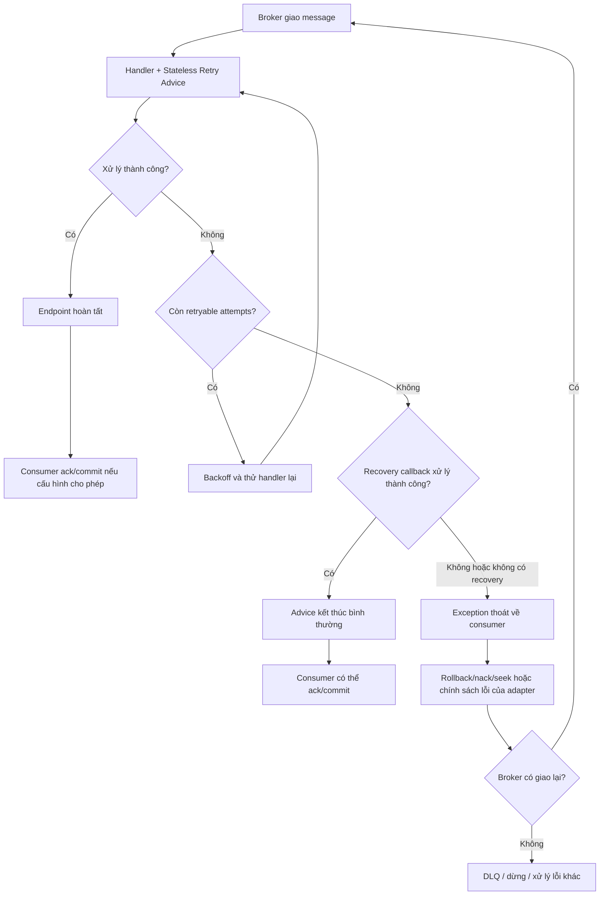

# Stateless retry và mỗi lần redelivery trong Spring Integration

## 1. Vấn đề: message được giao lại có tiếp tục bộ đếm retry cũ không?

Giả sử một luồng Spring Integration nhận sự kiện tạo vận đơn từ broker. Message đi qua Filter kiểm tra dữ liệu, Transformer chuẩn hóa, Router chọn hãng vận chuyển, rồi một message handler gọi API đối tác. Đối tác trả lỗi tạm thời, nên handler được gắn `RequestHandlerRetryAdvice` để thử lại.

Sau khi handler thử hết số lần cho phép và vẫn thất bại, lỗi được truyền ngược về consumer. Nếu consumer rollback hoặc yêu cầu broker giao lại, **cùng một sự kiện nghiệp vụ có thể được xử lý lại từ đầu**. Vấn đề là bộ đếm của `RequestHandlerRetryAdvice` sẽ hoạt động thế nào trong lượt giao lại đó.

Với **stateless retry**, trạng thái số lần thử chỉ tồn tại trong **một lần thực thi retry**. Khi broker redeliver và endpoint được gọi lại, một retry context mới được tạo: bộ đếm quay về đầu, dù payload, `eventId` và khóa nghiệp vụ vẫn giống lần trước. Đây là đặc điểm cốt lõi của bài **“Stateless retry và mỗi lần redelivery”** thuộc chương **Retry** trong module `SPRING_INTEGRATION_PATTERN`.

Kiến thức này giúp thiết kế các luồng Enterprise Integration Patterns ít phụ thuộc, dễ mở rộng, đồng thời phối hợp Router, Filter, Transformer, Splitter/Aggregator, Gateway, error channel, correlation, kiểm thử và giám sát từng nhánh xử lý mà không làm số lần gọi downstream tăng ngoài dự kiến.

Sau bài học, bạn có thể:

- Giải thích tại sao stateless retry **không giữ attempt count qua các lượt redelivery**.
- Tính số lần handler có thể thực thi khi retry ở nhiều tầng.
- Xác định khi nào ngoại lệ phải được truyền ngược để broker redeliver, và khi nào recovery kết thúc việc xử lý.
- Cấu hình `RequestHandlerRetryAdvice` theo kiểu stateless và phân loại exception.
- Kiểm thử riêng số attempts của handler, số delivery của broker, idempotency và khả năng truy vết.

## 2. Ba khái niệm phải tách biệt

| Khái niệm | Ai thực hiện? | Phạm vi | Ví dụ |
| --- | --- | --- | --- |
| **Handler attempt** | Handler dưới sự điều phối của retry advice | Một lần gọi handler | Gọi API tạo vận đơn lần 1, lần 2, lần 3 |
| **Stateless retry operation** | `RetryTemplate` hoặc retry policy trong advice | Một lượt gọi endpoint có retry | Tối đa 3 attempts, có backoff giữa các lần |
| **Broker delivery/redelivery** | Consumer và broker/adapter nguồn | Một lần broker giao message cho ứng dụng | Giao lần đầu, rồi giao lại sau rollback/nack/seek |

Một lần delivery có thể chứa **nhiều handler attempts**. Ngược lại, redelivery có thể chạy lại cả một đoạn pipeline trước handler, tùy cách adapter, transaction và flow được tổ chức. Retry advice đặt trên handler chỉ điều khiển attempts **bên trong lượt xử lý hiện tại**.

Trong Spring Integration 6.x, `RequestHandlerRetryAdvice` sử dụng `RetryTemplate` của Spring Retry. Nếu không cấu hình `RetryStateGenerator`, advice hoạt động kiểu stateless. Từ Spring Integration 7.x, các API retry chuyển sang Spring Framework; stateless vẫn là cách dùng khi không cung cấp hàm khóa state. Các đoạn cấu hình Java của mỗi phiên bản được trình bày riêng ở phần sau.

## 3. Mỗi lần redelivery sẽ bắt đầu chuỗi retry mới

Giả sử handler được phép **3 attempts tính cả lần đầu** và broker thực hiện tối đa **3 lượt delivery tính cả lần giao đầu tiên**. Downstream luôn thất bại với lỗi được retry.



| Delivery | Attempts trong delivery đó | Số lượt handler cộng dồn |
| --- | --- | ---: |
| Lần 1 | #1, #2, #3 | 3 |
| Lần 2 | #1, #2, #3 | 6 |
| Lần 3 | #1, #2, #3 | 9 |

Trong ví dụ này, **`maxAttempts = 3` không có nghĩa là chỉ được gọi downstream tối đa ba lần trên toàn bộ vòng đời sự kiện**. Nó chỉ ràng buộc một lần thực thi `RetryTemplate`. Nếu message đi qua endpoint một lần nữa, stateless retry không dùng lại lịch sử attempts trước đó.

Đặt:

- `A` = số attempts tối đa trong một delivery.
- `D` = số delivery tối đa của broker, **bao gồm** lượt giao đầu tiên.
- `H` = tổng số lần handler được gọi.

Khi mọi attempts đều thất bại và lỗi luôn được truyền ra để broker giao lại, giới hạn lý thuyết là:

\[
H_{\max}=A\times D
\]

Nếu `A = 4`, `D = 5`, downstream có thể nhận **20 request** cho cùng một sự kiện. Đây là trần theo giả định broker thực sự giới hạn 5 deliveries và không có tầng retry bổ sung. Trong thực tế, `H` có thể nhỏ hơn vì một attempt thành công sớm, gặp exception không retryable, recovery xử lý lỗi hoặc broker dừng giao lại.

**Nếu không có giới hạn redelivery ở broker**, công thức trên không tạo ra một giới hạn hữu hạn: các context stateless có thể liên tục bắt đầu lại. Một message lỗi vĩnh viễn có nguy cơ trở thành *poison message* lặp vô hạn.

## 4. Khi nào broker sẽ giao lại, và khi nào không?

Điểm quyết định là **điều gì xảy ra với exception sau khi lời gọi handler kết thúc**. Cấu hình retry một mình không quyết định acknowledgement hay rollback.



### Trường hợp A — Không có recovery callback

Khi attempts đã hết, `RetryTemplate` thường ném lỗi cuối cùng. Nếu handler được gọi qua `DirectChannel` từ consumer đồng bộ, lỗi có thể đi ngược lên consumer. **Chỉ khi adapter nguồn được cấu hình** để rollback, nack/requeue hoặc seek đọc lại, broker mới phát sinh delivery mới. Nếu ứng dụng bắt rồi nuốt exception, hoặc consumer ack bất chấp kết quả, sẽ không có redelivery theo cơ chế đó.

### Trường hợp B — Có recovery callback xử lý thành công

Ví dụ callback dùng `ErrorMessageSendingRecoverer` gửi lỗi vào channel `shipmentFailures`, nơi một recorder lưu bản ghi thất bại. Nếu recoverer kết thúc bình thường, advice có thể trả về mà **không ném exception gốc**. Consumer có thể xem lượt giao đó là thành công và ack/commit, nên broker **không nhất thiết giao lại**. Recovery phải có ngữ nghĩa nghiệp vụ rõ: đã ghi nhận thất bại, đã chuyển dead-letter hoặc đã ra quyết định kết thúc; không được hiểu nhầm là downstream đã xử lý thành công.

### Trường hợp C — Recovery cũng thất bại

Nếu channel không có consumer, recorder không lưu được hoặc recovery ném exception, lỗi có thể tiếp tục thoát ra. Lúc đó adapter nguồn lại quyết định rollback, redelivery hoặc chuyển DLQ. Vì thế nhánh recovery cũng cần được kiểm thử và quan sát, đặc biệt trước khi broker xác nhận message.

### Trường hợp D — Lỗi không nằm trong danh sách được retry

Policy có thể dừng ngay ở **attempt đầu tiên**. Việc dừng retry ở handler không đồng nghĩa broker sẽ không redeliver. Nếu exception vẫn làm transaction rollback, broker có thể giao lại message dù lần nào handler cũng chỉ thực hiện một attempt. Hãy có hướng xử lý riêng cho lỗi validation, lỗi dữ liệu hoặc lỗi lập trình để tránh vòng lặp vô nghĩa.

## 5. Ví dụ cấu hình stateless retry với Spring Integration 6.x

Ví dụ dưới đây dùng Spring Integration **6.x** và Spring Retry. Flow nhận `ShipmentCommand`, gắn retry advice vào handler gọi API vận chuyển. Chỉ `TemporaryCarrierException` được retry; retry tối đa 3 attempts và chờ cố định 200 ms giữa các lần. **Cố ý không đặt recovery callback** để có thể quan sát exception thoát ngược về nguồn và khiến broker redeliver khi nguồn đã được cấu hình phù hợp.

```java
import java.util.Map;

import org.springframework.context.annotation.Bean;
import org.springframework.context.annotation.Configuration;
import org.springframework.integration.channel.DirectChannel;
import org.springframework.integration.dsl.IntegrationFlow;
import org.springframework.integration.handler.advice.RequestHandlerRetryAdvice;
import org.springframework.messaging.MessageChannel;
import org.springframework.retry.backoff.FixedBackOffPolicy;
import org.springframework.retry.policy.SimpleRetryPolicy;
import org.springframework.retry.support.RetryTemplate;

@Configuration
public class StatelessShipmentRetryConfiguration {

    @Bean
    MessageChannel shipmentInput() {
        return new DirectChannel();
    }

    @Bean
    RequestHandlerRetryAdvice statelessRetryAdvice() {
        // 3 attempts tính cả lần đầu.
        SimpleRetryPolicy retryPolicy = new SimpleRetryPolicy(
                3, Map.of(TemporaryCarrierException.class, true), true);

        FixedBackOffPolicy backOffPolicy = new FixedBackOffPolicy();
        backOffPolicy.setBackOffPeriod(200L);

        RetryTemplate template = new RetryTemplate();
        template.setRetryPolicy(retryPolicy);
        template.setBackOffPolicy(backOffPolicy);

        RequestHandlerRetryAdvice advice = new RequestHandlerRetryAdvice();
        advice.setRetryTemplate(template);
        // Không setRetryStateGenerator: đây là stateless retry.
        // Không setRecoveryCallback: lỗi còn có thể thoát về consumer.
        return advice;
    }

    @Bean
    IntegrationFlow shipmentFlow(CarrierClient carrierClient,
                                 RequestHandlerRetryAdvice statelessRetryAdvice) {
        return IntegrationFlow.from("shipmentInput")
                .handle(carrierClient, "send",
                        endpoint -> endpoint.advice(statelessRetryAdvice))
                .get();
    }
}

record ShipmentCommand(String eventId, String orderId, String idempotencyKey) {}

interface CarrierClient {
    void send(ShipmentCommand command);
}

class TemporaryCarrierException extends RuntimeException {
    TemporaryCarrierException(String message, Throwable cause) {
        super(message, cause);
    }
}
```

Để chạy ví dụ, ứng dụng cần bean triển khai `CarrierClient` và các phụ thuộc Spring Integration, Spring Retry (`org.springframework.retry:spring-retry`). Cấu hình Java DSL ở trên **chỉ định nghĩa channel và handler**; nó chưa tạo inbound adapter, transaction manager, quy tắc broker redelivery hoặc dead-letter. Nguồn JMS/RabbitMQ/Kafka phải được nối vào `shipmentInput` và cấu hình rollback/ack riêng.

### Vì sao đây là stateless?

- `RequestHandlerRetryAdvice` được gắn đúng vào handler `send`; các bước Router/Transformer trước handler không tự chạy lại trong một lần thực hiện advice.
- `RetryTemplate` có `SimpleRetryPolicy(3, ..., true)`: tối đa 3 attempts trong một lượt gọi, có thể nhận biết exception nằm trong chuỗi `cause`.
- `FixedBackOffPolicy` chờ 200 ms sau mỗi attempt thất bại **nếu còn được retry**: tổng backoff tối đa 400 ms trên một delivery.
- Không có `RetryStateGenerator`: retry context không được liên kết tới một khóa identity bền giữa các lần endpoint được gọi.
- Không có recovery callback: sau khi hết attempts, exception được truyền ra, cho phép adapter nguồn áp dụng chính sách lỗi và phát lại riêng của nó.

Khi dùng `SimpleRetryPolicy` với danh sách cho phép như trên, `InvalidShipmentException` hoặc `NullPointerException` không nằm trong danh sách sẽ **không được retry tại handler**. Nhưng nếu consumer rollback vì những ngoại lệ đó, broker vẫn có thể giao message lại. Cần xử lý lỗi không thể phục hồi bằng nhánh lỗi/dead-letter phù hợp.

## 6. Nếu dùng Spring Integration 7.x

Spring Integration **7.x** đã chuyển từ các API của Spring Retry sang retry thuộc Spring Framework. Không sao chép phần cấu hình `RetryTemplate` của 6.x vào dự án 7.x mà không điều chỉnh.

Ý tưởng tương ứng cho stateless retry ở 7.x là thiết lập `RetryPolicy` của Spring Framework trên `RequestHandlerRetryAdvice` và **không** cung cấp `stateKeyFunction`:

```java
import java.time.Duration;

import org.springframework.core.retry.RetryPolicy;
import org.springframework.integration.handler.advice.RequestHandlerRetryAdvice;

RetryPolicy policy = RetryPolicy.builder()
        .maxRetries(2) // 2 lần gọi lại SAU lần đầu, tổng 3 attempts.
        .delay(Duration.ofMillis(200))
        .includes(TemporaryCarrierException.class)
        .build();

RequestHandlerRetryAdvice advice = new RequestHandlerRetryAdvice();
advice.setRetryPolicy(policy);
// Không setStateKeyFunction(...): xử lý theo kiểu stateless.
```

Đoạn này chỉ minh họa cấu hình advice và cần đặt trong một phương thức cấu hình Java hợp lệ. Điểm dễ nhầm nhất là **cách đếm**: trong Spring Retry 6.x, `maxAttempts = 3` là tổng số lần gọi; trong API Spring Framework 7.x, `maxRetries = 2` là hai lần thử lại **sau** lần gọi đầu. Cả hai ví dụ đều cho tối đa 3 lần thực thi handler trong mỗi lượt delivery.

## 7. Kết hợp retry của handler và redelivery của broker

Hãy xem cả hai tầng như hai **ngân sách độc lập**. Một policy ở handler xác định số lần gọi downstream trên mỗi lượt; một policy ở consumer/broker quyết định một sự kiện có thể quay lại bao nhiêu lượt.

| Nguồn | Redelivery thường phụ thuộc vào | Điều phải kiểm chứng |
| --- | --- | --- |
| JMS | Session rollback, transaction và chính sách redelivery của broker | Lượt giao đầu có tính vào giới hạn không; `JMSRedelivered`/delivery count được cung cấp thế nào |
| RabbitMQ | Ack, reject/nack, requeue, DLX hoặc retry queue | Có đang requeue ngay liên tục không; bao giờ chuyển DLQ |
| Kafka | Error handler, seek/reposition, commit offset hoặc retry topic | Record có được đọc lại cùng `topic/partition/offset` không; ai giữ bộ đếm attempts |
| Gateway HTTP đồng bộ | Caller chủ động gửi lại request | Gateway không có broker tự redeliver; cần deadline và identity ổn định |

Không có một thuộc tính cấu hình `maxDeliveries` chung cho mọi broker. Trong bài toán thực tế, hãy xác nhận bằng tài liệu và test của **adapter/consumer/broker cụ thể** xem giới hạn được đếm theo delivery, lần giao lại, hay số lần xử lý thất bại.

### Backoff ở hai tầng không giống nhau

Backoff của `RetryTemplate` chạy **trong một lượt delivery**; với `DirectChannel` và consumer đồng bộ, nó giữ luồng xử lý chờ. Broker delay hoặc retry topic thường xảy ra **giữa các lượt delivery** và có thể giải phóng thread trong thời gian đợi. Nếu cả hai cùng bật backoff, tổng độ trễ gồm cả hai phần.

Giả sử `A = 3` attempts/delivery, mỗi HTTP attempt timeout tối đa 500 ms, fixed backoff 200 ms, và broker giao message **3 lần** với hai khoảng cách 2 giây giữa các lượt:

\[
T_{\text{delivery}} \approx 3\times500+2\times200=1{.}900\;\text{ms}
\]

\[
T_{\text{total}} \approx 3\times1{.}900+2\times2{.}000=9{.}700\;\text{ms}
\]

Đây là thời gian **ước lượng**, chưa gồm overhead của broker, consumer, chuyển đổi message, transaction và lập lịch. Nếu Gateway chờ kết quả trong 3 giây, không thể coi toàn bộ chuỗi này là một lời gọi đồng bộ bình thường. Thời gian xử lý có thể kéo dài lâu hơn cả deadline của client.

### Vì sao retry ở nhiều tầng có thể làm quá tải?

Nếu 200 message đồng thời gặp cùng một lỗi, một lần delivery có 3 attempts đã có thể tạo tới 600 lời gọi downstream. Nếu broker giao lại 4 lượt, tổng số request lý thuyết lên tới 2.400. Nếu một adapter còn có retry riêng trong HTTP client, con số thực tế có thể tăng thêm. Cần có giới hạn đồng thời, timeout, exponential backoff/jitter, circuit breaker hoặc delayed queue để tránh *retry storm*.

## 8. Có thể dùng correlation ID để giữ retry state không?

Trong **stateless retry**, dù message có cùng correlation ID hoặc event ID qua redelivery, số attempts **vẫn được bắt đầu lại**. Các định danh này chỉ giúp truy vết, không tự biến một retry context thành stateful.

Ví dụ:

```text
eventId: evt-101
correlationId: shipment-batch-7
delivery 1: handler attempts 1, 2, 3 → lỗi
delivery 2: handler attempts 1, 2, 3 → lỗi
delivery 3: handler attempt 1 → thành công

Tổng handler calls: 7
Retry state được nhớ qua delivery: không
```

Để theo dõi đúng, nên ghi **hai loại đếm**:

- `deliveryCount`: broker/adapter đã giao sự kiện bao nhiêu lần.
- `handlerAttempt`: handler được gọi lần thứ mấy **trong delivery hiện tại**.

Khi xuất log hoặc tracing, ghép `eventId`, `correlationId`, `deliveryCount`, `handlerAttempt`, tên endpoint và exception type. Với Kafka, có thể dùng `topic`, `partition` và `offset` để xác định bản ghi; đừng mặc định Kafka có một cờ `redelivered` giống JMS. Với JMS hoặc RabbitMQ, cần đọc metadata theo adapter đang dùng.

### Stateless retry không giải quyết idempotency

Nếu đối tác **đã tạo vận đơn** nhưng response bị timeout, một attempt tiếp theo hoặc broker redelivery có thể gọi lại nghiệp vụ đã hoàn thành. Cùng event ID chỉ phục vụ truy vết; cần thêm `idempotencyKey` ổn định và cơ chế deduplication ở downstream.

```java
// Phần logic minh họa của CarrierClient.send(...).
// carrierApi và các exception là thành phần adapter do ứng dụng định nghĩa.
public void send(ShipmentCommand command) {
    try {
        carrierApi.createShipment(
                command.orderId(),
                command.idempotencyKey());
    } catch (CarrierTimeoutException | CarrierUnavailableException ex) {
        throw new TemporaryCarrierException("Carrier tạm thời không phản hồi", ex);
    }
}
```

`idempotencyKey` phải **giữ nguyên qua attempts lẫn broker deliveries** của cùng thao tác. Nếu hệ thống đích không hỗ trợ idempotency, ứng dụng cần một cách chống trùng thích hợp, ví dụ bảng trạng thái nghiệp vụ có ràng buộc duy nhất hoặc transactional outbox. Retry không cung cấp exactly-once cho một side effect bên ngoài.

## 9. Khi nào nên chuyển sang stateful retry?

Nếu yêu cầu nghiệp vụ quy định **tổng cộng tối đa 3 attempts cho cùng một sự kiện, bất kể broker giao lại bao nhiêu lần**, stateless retry độc lập ở từng delivery không đủ để bảo đảm yêu cầu đó.

Các hướng xử lý gồm:

1. **Stateful retry theo identity:** advice lưu retry state theo một khóa ổn định, chẳng hạn `tenantId + eventId`. Spring Integration 6.x dùng `RetryStateGenerator`; Spring Integration 7.x dùng `stateKeyFunction`. Cần kiểm chứng vòng đời cache, redelivery và recovery với phiên bản thực tế.
2. **Chỉ retry ở tầng broker/consumer:** đặt attempts ở handler bằng 1, quản lý lần giao lại và dead-letter tại adapter hoặc broker. Phù hợp khi hạ tầng nguồn đã cung cấp retry topic/delayed delivery và giới hạn attempts đáng tin cậy.
3. **Lưu trạng thái attempts bền vững ở ứng dụng:** dùng DB hoặc cơ chế phân tán để quản lý attempts theo event ID nếu phải giữ giới hạn xuyên restart hoặc nhiều instance.

Tuy nhiên, stateful retry có lưu trong bộ nhớ cũng **không mặc nhiên bền vững** khi restart, cache eviction, consumer rebalance hoặc một broker chuyển message sang node khác. Với hệ phân tán, thiết kế lưu trạng thái và khóa định danh phải gắn với thực tế vận hành.

## 10. Kiểm thử: chứng minh bộ đếm reset qua mỗi delivery

Kiểm thử cần tách hai tầng: unit test cho `RetryTemplate` và integration test cho nguồn message. Một unit test chạy `RetryTemplate.execute(...)` **hai lần liên tiếp** sẽ minh họa hai stateless retry operations độc lập; đó là mô phỏng hai lượt delivery, chưa phải kiểm thử broker thật.

### JUnit 5: hai lượt, mỗi lượt có ba attempts

Ví dụ này dùng API Spring Retry của Spring Integration **6.x** và không có recovery callback:

```java
import java.util.Map;
import java.util.concurrent.atomic.AtomicInteger;

import org.junit.jupiter.api.Test;
import org.springframework.retry.backoff.NoBackOffPolicy;
import org.springframework.retry.policy.SimpleRetryPolicy;
import org.springframework.retry.support.RetryTemplate;

import static org.junit.jupiter.api.Assertions.assertEquals;
import static org.junit.jupiter.api.Assertions.assertThrows;

class StatelessRedeliveryTest {

    @Test
    void retryCountStartsOverForEachExecution() {
        RetryTemplate template = new RetryTemplate();
        template.setRetryPolicy(new SimpleRetryPolicy(
                3, Map.of(TemporaryCarrierException.class, true), true));
        template.setBackOffPolicy(new NoBackOffPolicy());

        AtomicInteger handlerCalls = new AtomicInteger();

        // Mô phỏng hai lượt delivery của cùng một sự kiện.
        for (int delivery = 1; delivery <= 2; delivery++) {
            assertThrows(TemporaryCarrierException.class,
                    () -> template.execute(context -> {
                        handlerCalls.incrementAndGet();
                        throw new TemporaryCarrierException("503", null);
                    }));

            assertEquals(delivery * 3, handlerCalls.get());
        }

        assertEquals(6, handlerCalls.get());
    }
}
```

Với `NoBackOffPolicy`, test không phải chờ thời gian thật. Kết quả mong đợi là 3 handler calls sau lần `execute` thứ nhất và 6 sau lần `execute` thứ hai. `RetryTemplate` được **tái sử dụng**, nhưng mỗi `execute` bắt đầu một retry context mới vì test không dùng stateful `RetryState`.

### Ma trận kiểm thử tích hợp

| Kịch bản | Handler attempts | Broker deliveries | Điều cần xác nhận |
| --- | ---: | ---: | --- |
| Thành công ngay | 1 | 1 | Consumer ack, không redeliver |
| Thành công ở attempt #3 của delivery #1 | 3 | 1 | Retry xử lý xong trước khi broker cần redeliver |
| Hết 3 attempts rồi delivery #2 thành công ngay | 4 | 2 | Bộ đếm reset khi delivery #2 bắt đầu |
| Ba deliveries đều thất bại với 3 attempts mỗi lượt | 9 | 3 | Có giới hạn broker; message được xử lý lỗi cuối hoặc DLQ |
| Validation không retryable, consumer vẫn rollback | 1 mỗi delivery | Tùy broker | Không retry ở handler nhưng broker vẫn có thể giao lại |
| Recovery callback lưu lỗi và kết thúc bình thường | Tối đa 3 | Có thể chỉ 1 | Xác nhận ack/commit phù hợp sau recovery |
| Recovery callback ném exception | Tùy policy | Tùy broker | Broker áp dụng chính sách lỗi mới, không mất message |
| Handler thành công ở downstream nhưng response timeout | Tùy kịch bản | Có thể nhiều | Idempotency key không đổi; không tạo tác động trùng |

Ở mức tích hợp, dùng consumer và broker thực tế (hoặc test container phù hợp), fake `CarrierClient` đếm số lời gọi, recorder thu `ErrorMessage` và một đích giả lập kiểm chứng side effect. Kiểm tra cả rollback, ack/commit, thời gian redelivery và DLQ; một test chỉ gọi `channel.send(...)` liên tiếp **chưa chứng minh** broker có redelivery đúng.

## 11. Các dấu hiệu quan sát cần thiết

Một hệ thống có thể báo tỷ lệ message thành công cao trong khi số lần gọi downstream đang tăng mạnh. Vì thế nên theo dõi:

- **Attempts per delivery:** trung bình và phân phối số lần handler được gọi cho một lượt delivery.
- **Deliveries per event:** số lần một event ID đi vào consumer; phân biệt nguồn gửi lại có chủ đích với consumer rollback.
- **Total downstream calls per event:** tổng request thực tế gửi đến đối tác, để phát hiện việc nhân attempts giữa các tầng.
- **Recovery/DLQ:** tỷ lệ hết attempts, số message chuyển lỗi và thời gian mắc kẹt trong vòng redelivery.
- **Latency và backlog:** thời gian backoff trong thread, thời gian chờ giữa deliveries, số consumer đang hoạt động và chiều dài queue.
- **Correlation:** event ID, correlation ID, trace ID và transaction ID để nối đúng các lượt xử lý.

Có thể dùng Micrometer/Actuator cùng log có cấu trúc và instrumentation của retry. Không giả định tất cả metric mặc định của framework đều có số `handlerAttempt` hay `deliveryCount`; ứng dụng có thể cần `RetryListener`, interceptor hoặc metadata của adapter để đo riêng. Không đưa ID từng event vào metric labels có cardinality cao; dùng log hoặc tracing có kiểm soát.

## 12. Các lỗi thiết kế thường gặp

| Sai lầm | Hậu quả | Cách xử lý |
| --- | --- | --- |
| Hiểu `maxAttempts = 3` là giới hạn cho toàn bộ vòng đời message | Tổng số gọi downstream lớn hơn dự kiến | Nhân ngân sách handler với giới hạn broker delivery |
| Nghĩ cùng correlation ID sẽ tự nhớ retry state | Attempts reset sau redelivery | Dùng stateful retry hoặc lưu trạng thái bên ngoài khi cần |
| Không kiểm tra ack/rollback của adapter | Không redeliver, hoặc redeliver vô hạn | Viết test tích hợp với transaction/error handler thực tế |
| Gắn recoverer và vẫn mong broker giao lại | Recovery có thể nuốt exception, consumer ack | Xác định rõ kết thúc nghiệp vụ và nhánh lỗi |
| Cho broker requeue ngay sau khi handler đã retry nhiều lần | Retry storm, downstream quá tải | Delay/jitter, concurrency limit, circuit breaker, DLQ |
| Retry cả lỗi validation | Nhiều delivery đều thất bại vô ích | Phân loại exception và dùng dead-letter/validation flow |
| Retry nhiều tầng nhưng không có idempotency | Tạo trùng vận đơn/giao dịch | Khóa idempotency và deduplication |
| Dựa vào cache retry cục bộ để giới hạn toàn cụm | Mất số attempts khi restart hoặc chuyển node | Lưu trạng thái bền vững hoặc quản lý retry tại broker |

## 13. Bài thực hành tổng hợp

Xây dựng một flow nhận `ShipmentCommand` từ broker, đi qua Filter kiểm tra dữ liệu, Transformer chuẩn hóa và Router chọn đối tác A/B. Gắn **stateless retry** cho handler A với tối đa **3 attempts**, fixed backoff **200 ms**, chỉ retry `TemporaryCarrierException`. Cấu hình nguồn sao cho broker có tối đa **3 deliveries** gồm lượt đầu và hai lượt giao lại, rồi đưa message hết lượt vào DLQ theo chính sách nguồn.

Lần lượt thử: thành công ngay; lỗi hai attempts rồi thành công; hết attempts ở delivery #1 nhưng thành công ở delivery #2; thất bại cả ba deliveries; lỗi validation không retryable; downstream đã xử lý nhưng phản hồi timeout. Ghi `eventId`, `deliveryCount`, `handlerAttempt`, correlation ID, tổng số lời gọi và số message chuyển DLQ.

Sau đó bật `ErrorMessageSendingRecoverer` cùng một recorder lưu lỗi đáng tin cậy, quan sát xem delivery tiếp theo còn xảy ra hay không. So sánh kết quả với trường hợp không có recovery callback, rồi quyết định tầng nào nên chịu trách nhiệm retry nếu yêu cầu nghiệp vụ chỉ cho phép tổng cộng ba lần gọi downstream.

**Tiêu chí hoàn thành:** Nêu được chính xác số attempts trên từng delivery và tổng số handler calls; phân biệt được điều kiện retry tại handler với điều kiện redelivery tại broker; có cơ chế kết thúc message lỗi thay vì lặp vô hạn; giữ được correlation và idempotency qua tất cả lượt xử lý.
