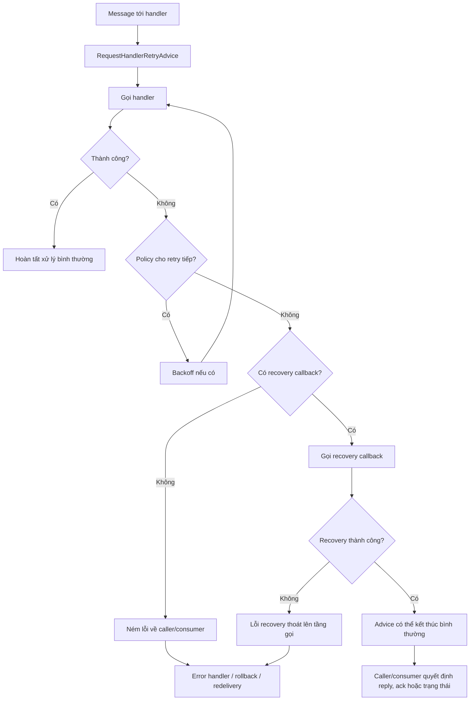
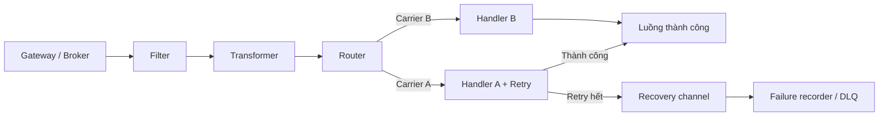

# Recovery callback sau khi retry hết trong Spring Integration

## 1. Recovery callback giải quyết vấn đề gì?

Trong một luồng Enterprise Integration Patterns (EIP), message thường đi qua Router, Filter hoặc Transformer rồi tới message handler gọi hệ thống bên ngoài. Một handler gửi yêu cầu tạo vận đơn có thể gặp timeout, HTTP 503 hoặc lỗi kết nối ngắn hạn. Retry giúp thử lại các lỗi có khả năng phục hồi; nhưng nếu đã dùng hết lượt thử mà vẫn thất bại, hệ thống cần **quyết định số phận của message**.

**Recovery callback** là hành động được gọi khi chính sách retry dừng mà chưa đạt kết quả thành công. Trong Spring Integration, `RequestHandlerRetryAdvice` có thể được cấu hình để dùng `ErrorMessageSendingRecoverer`: thành phần này đưa thông tin lỗi cuối vào một `MessageChannel` dưới dạng `ErrorMessage`. Một luồng recovery độc lập có thể ghi nhận thất bại, gửi cảnh báo hoặc chuyển dữ liệu cần phát lại tới nơi lưu bền vững.

Trong module `SPRING_INTEGRATION_PATTERN`, kỹ thuật này nối các mẫu Retry, error channel, Gateway và correlation thành luồng thông điệp ít phụ thuộc, dễ mở rộng và kiểm thử được. Các điểm quan trọng cần nắm:

- Recovery chạy khi retry **đã dừng vì lỗi**, không chạy sau một attempt thành công.
- Khi callback trả về bình thường, lỗi ban đầu có thể **không còn được ném lên caller**. Điều này ảnh hưởng trực tiếp tới acknowledgement của broker và hợp đồng của Gateway.
- Chuyển lỗi vào một channel **chưa đồng nghĩa** lỗi đã được lưu bền vững, nghiệp vụ đã hoàn thành hay message chắc chắn có thể phát lại.
- Nếu chính recovery thất bại, lỗi mới có thể thoát lên tầng gọi; phải biết adapter/transaction sẽ xử lý kết quả ấy thế nào.

Sau bài này, bạn có thể cấu hình recoverer, giải thích từng nhánh thành công/thất bại, lấy dữ liệu cần thiết từ `ErrorMessage`, kiểm soát ack/rollback và viết kiểm thử cho các trường hợp hết lượt retry.

## 2. Recovery nằm ở đâu trong vòng đời retry?



Một policy ví dụ cho phép tối đa **3 attempts tính cả lần gọi đầu**. Khi handler thất bại cả ba lần, callback được gọi **một lần cho một chuỗi retry đã hết lượt**. Nếu exception bị policy coi là không retryable ngay từ lần đầu, chuỗi có thể dừng sau một attempt và cũng đi vào recovery nếu callback được cấu hình. Đây là lý do cần phân loại lỗi và lưu nguyên nhân cuối cùng.

| Kịch bản | Số handler calls (policy 3 attempts) | Recovery callback | Kết quả thường thấy |
| --- | ---: | --- | --- |
| Handler thành công ngay | 1 | Không | Luồng thành công |
| Lỗi tạm thời hai lần, lần ba thành công | 3 | Không | Luồng thành công |
| Luôn lỗi tạm thời | 3 | Có | Lưu lỗi hoặc chuyển nhánh failure |
| Lỗi validation không được retry | 1 | Có nếu dùng recovery cho nhánh này | Ghi nhận lỗi dữ liệu, tránh retry vô nghĩa |
| Retry hết nhưng không có callback | 3 | Không | Ngoại lệ được truyền lên caller |
| Retry hết, callback lại ném lỗi | 3 | Có nhưng thất bại | Ngoại lệ của recovery cần được xử lý |

Điều kiện chính xác về exception và số attempts phụ thuộc `RetryPolicy` và phiên bản thư viện. Đừng hiểu recovery là "thử lại thêm một lần"; nó **xử lý kết quả thất bại** của chuỗi đã kết thúc.

## 3. Recovery callback, error channel và dead-letter khác nhau

Ba khái niệm thường đi cùng nhau nhưng đảm nhận các vai trò khác nhau:

| Thành phần | Trách nhiệm | Không tự bảo đảm |
| --- | --- | --- |
| `RecoveryCallback` | Quyết định hành động sau khi policy dừng retry | Thành công nghiệp vụ hoặc lưu dữ liệu bền vững |
| `ErrorMessageSendingRecoverer` | Tạo và gửi `ErrorMessage` tới channel được chỉ định | Có consumer, có lưu DB hoặc broker DLQ |
| Spring Integration error channel | Truyền message lỗi cho các handler/flow xử lý | Tự phát lại handler hoặc tự rollback transaction |
| Broker dead-letter queue (DLQ) | Lưu message không thể xử lý theo quy tắc broker/adapter | Tự khôi phục nghiệp vụ hoặc tự bảo đảm idempotency |

`ErrorMessageSendingRecoverer` có thể gửi vào một **recovery channel riêng** như `shipmentRecoveryErrors`, khác với `errorChannel` toàn cục. Channel riêng giúp tách lỗi tạo vận đơn khỏi lỗi của các luồng khác, và cho phép áp dụng quy trình lưu, cảnh báo, phát lại riêng.

Đặc biệt, `ErrorMessageSendingRecoverer` mặc định dùng `ErrorMessageStrategy` để tạo `ErrorMessage`; thông điệp có payload kiểu `Throwable`. Nếu ngữ cảnh lỗi còn chứa message gốc, `ErrorMessage.getOriginalMessage()` có thể trả về message đó. Không nên giả định trường này luôn tồn tại; ngoại lệ `MessagingException` cũng có thể chứa `failedMessage`.

## 4. Thiết kế tình huống thực tế

Một ứng dụng thương mại điện tử đẩy `ShipmentCommand` vào luồng tích hợp với hãng vận chuyển. Quy tắc:

1. Lỗi kết nối hoặc dịch vụ tạm ngừng có thể retry tối đa **3 attempts**; giữa các lần thử chờ 200 ms rồi 400 ms.
2. Lỗi validation hoặc cấu hình không đúng **không retry**; vẫn cần ghi nhận thất bại để xử lý.
3. Khi không thể hoàn thành, đưa `ErrorMessage` vào `shipmentRecoveryErrors`, lấy định danh đơn hàng và lưu một bản ghi thất bại.
4. Bản ghi phải có `eventId`, `orderId`, `idempotencyKey`, correlation ID, loại lỗi, thời điểm và trạng thái xử lý; có thể ghi thêm số attempts nếu có instrumentation.
5. Sau recovery, không được trả lời rằng đã tạo vận đơn nếu thực tế downstream chưa thành công.

Ví dụ payload:

```java
record ShipmentCommand(String eventId, String orderId,
                       String idempotencyKey) {}
```

`eventId` nhận diện sự kiện cần xử lý; `idempotencyKey` dùng để ngăn tạo vận đơn trùng lặp khi request đã được downstream thực hiện nhưng response bị thất lạc. Hai định danh này có thể liên hệ với nhau nhưng phục vụ mục đích khác nhau.

## 5. Cấu hình Java DSL với Spring Integration 6.x

Ví dụ sau minh họa `RequestHandlerRetryAdvice`, `RetryTemplate`, `SimpleRetryPolicy`, exponential backoff và `ErrorMessageSendingRecoverer` trong **Spring Integration 6.x + Spring Retry**. Dự án cần các dependency Spring Integration và `org.springframework.retry:spring-retry` tương thích.

```java
import java.util.Map;

import org.springframework.beans.factory.annotation.Qualifier;
import org.springframework.context.annotation.Bean;
import org.springframework.context.annotation.Configuration;
import org.springframework.integration.channel.DirectChannel;
import org.springframework.integration.dsl.IntegrationFlow;
import org.springframework.integration.handler.advice.ErrorMessageSendingRecoverer;
import org.springframework.integration.handler.advice.RequestHandlerRetryAdvice;
import org.springframework.messaging.MessageChannel;
import org.springframework.messaging.support.ErrorMessage;
import org.springframework.retry.backoff.ExponentialBackOffPolicy;
import org.springframework.retry.policy.SimpleRetryPolicy;
import org.springframework.retry.support.RetryTemplate;

@Configuration
public class ShipmentRecoveryConfiguration {

    @Bean
    MessageChannel shipmentRequests() {
        return new DirectChannel();
    }

    @Bean
    MessageChannel shipmentRecoveryErrors() {
        return new DirectChannel();
    }

    @Bean
    RequestHandlerRetryAdvice shipmentRetryAdvice(
            @Qualifier("shipmentRecoveryErrors") MessageChannel recoveryChannel) {

        // Tối đa 3 lần gọi handler, tính cả lần đầu.
        SimpleRetryPolicy retryPolicy = new SimpleRetryPolicy(
                3, Map.of(TemporaryCarrierException.class, true), true);

        ExponentialBackOffPolicy backoff = new ExponentialBackOffPolicy();
        backoff.setInitialInterval(200L);
        backoff.setMultiplier(2.0);
        backoff.setMaxInterval(1_000L);

        RetryTemplate template = new RetryTemplate();
        template.setRetryPolicy(retryPolicy);
        template.setBackOffPolicy(backoff);

        RequestHandlerRetryAdvice advice = new RequestHandlerRetryAdvice();
        advice.setRetryTemplate(template);
        advice.setRecoveryCallback(
                new ErrorMessageSendingRecoverer(recoveryChannel));
        return advice;
    }

    @Bean
    IntegrationFlow shipmentFlow(CarrierClient client,
                                 RequestHandlerRetryAdvice shipmentRetryAdvice) {
        return IntegrationFlow.from("shipmentRequests")
                .handle(client, "submit",
                        endpoint -> endpoint.advice(shipmentRetryAdvice))
                .get();
    }

    @Bean
    IntegrationFlow shipmentRecoveryFlow(ShipmentFailureRecorder recorder) {
        return IntegrationFlow.from("shipmentRecoveryErrors")
                .handle(message -> recorder.record((ErrorMessage) message))
                .get();
    }
}

interface CarrierClient {
    void submit(ShipmentCommand command);
}

interface ShipmentFailureRecorder {
    void record(ErrorMessage error);
}

class TemporaryCarrierException extends RuntimeException {
    TemporaryCarrierException(String message, Throwable cause) {
        super(message, cause);
    }
}
```

Các kiểu `ShipmentCommand`, `CarrierClient` và `ShipmentFailureRecorder` là một phần của ứng dụng; cần cung cấp bean triển khai hai interface nghiệp vụ. `CarrierClient.submit(...)` nên biến timeout, reset connection hoặc HTTP 503 thành `TemporaryCarrierException`. Lỗi dữ liệu và lỗi lập trình không nên bị bọc thành loại retryable này. Ví dụ là **luồng gửi một chiều** để tập trung vào recovery; Gateway cần trả kết quả có hợp đồng riêng.

### Vì sao chỉ cần gắn recovery vào advice?

- `.advice(shipmentRetryAdvice)` gắn advice vào chính handler `submit`. Chỉ khai báo một bean retry advice sẽ không làm mọi handler tự retry.
- `SimpleRetryPolicy(3, ..., true)` cho phép retry lỗi tạm thời và tìm trong chuỗi `cause` nếu exception bị Spring Messaging bọc. Các exception khác dừng sau lần đầu.
- `ExponentialBackOffPolicy` chờ 200 ms rồi 400 ms nếu cần đủ ba attempts. Tổng thời gian chờ tối đa ở ví dụ là 600 ms, **chưa tính thời gian gọi API**.
- `setRecoveryCallback(new ErrorMessageSendingRecoverer(recoveryChannel))` quyết định xử lý khi policy dừng: xuất `ErrorMessage` vào channel đã chọn.
- `shipmentRecoveryFlow` phải có consumer thực sự lưu bản ghi thất bại. Nếu chỉ `log.info(...)`, message có thể bị xác nhận hoàn tất trong khi chưa có cách khôi phục.

Trong production, bảo đảm database/queue nhận bản ghi lỗi có tính bền vững. Nếu bước ghi lỗi là một phần của cùng transaction với một thao tác cần rollback, hãy thiết kế ranh giới giao dịch hợp lý; nếu transaction chung rollback cả bản ghi lỗi thì recovery trông như thành công nhưng dữ liệu lỗi lại không được lưu.

## 6. Phiên bản Spring Integration 7.x dùng RetryPolicy khác

Spring Integration **7.x** chuyển sang Retry Support của Spring Framework (`org.springframework.core.retry`) thay vì cấu hình `RetryTemplate` của Spring Retry như 6.x. Vẫn có thể dùng `ErrorMessageSendingRecoverer` và `setRecoveryCallback(...)`; phần thay đổi là cách tạo policy và quy ước đếm.

```java
import java.time.Duration;

import org.springframework.core.retry.RetryPolicy;
import org.springframework.integration.handler.advice.ErrorMessageSendingRecoverer;
import org.springframework.integration.handler.advice.RequestHandlerRetryAdvice;
import org.springframework.messaging.MessageChannel;

RequestHandlerRetryAdvice retryAdvice7x(MessageChannel recoveryChannel) {
    RetryPolicy policy = RetryPolicy.builder()
            .maxRetries(2) // Hai lần retry SAU lần đầu: tổng 3 attempts.
            .delay(Duration.ofMillis(200))
            .multiplier(2.0)
            .maxDelay(Duration.ofSeconds(1))
            .includes(TemporaryCarrierException.class)
            .build();

    RequestHandlerRetryAdvice advice = new RequestHandlerRetryAdvice();
    advice.setRetryPolicy(policy);
    advice.setRecoveryCallback(
            new ErrorMessageSendingRecoverer(recoveryChannel));
    return advice;
}
```

Đây là phương thức cấu hình minh họa, đặt trong lớp cấu hình/bean phù hợp của ứng dụng. Cả hai ví dụ nhắm tới tối đa **ba lần gọi handler**, nhưng `SimpleRetryPolicy(3)` của 6.x tính **cả lần đầu**, còn `maxRetries(2)` của Spring Framework 7.x là **hai lần gọi lại sau lần đầu**. Nên kiểm thử đúng phiên bản thư viện đang sử dụng; không trộn import giữa hai hệ API.

## 7. Đọc `ErrorMessage` để lưu đúng sự kiện thất bại

Recovery flow không nên phụ thuộc vào việc payload của `ErrorMessage` luôn là một `MessageHandlingException`. Theo Spring Messaging, payload là `Throwable`; `ErrorMessage.getOriginalMessage()` hoặc `MessagingException.getFailedMessage()` **có thể** mang message gần điểm gặp lỗi. Nên đọc có kiểm tra kiểu và xử lý khi dữ liệu gốc không hiện diện.

```java
import org.springframework.messaging.Message;
import org.springframework.messaging.MessagingException;
import org.springframework.messaging.support.ErrorMessage;

void recordFailure(ErrorMessage error) {
    Throwable failure = error.getPayload();
    Message<?> source = error.getOriginalMessage();

    if (source == null && failure instanceof MessagingException messagingError) {
        source = messagingError.getFailedMessage();
    }

    if (source != null && source.getPayload() instanceof ShipmentCommand command) {
        String eventId = command.eventId();
        String orderId = command.orderId();
        String idempotencyKey = command.idempotencyKey();
        Object correlationId = source.getHeaders().get("correlationId");

        // Chuyển các trường trên và failure sang kho lưu lỗi bền vững.
        // Không log toàn bộ payload hoặc thông tin nhạy cảm.
    } else {
        // Ghi lỗi kỹ thuật và dấu vết hiện có để không bỏ sót thất bại.
    }
}
```

Đây là phần minh họa trích xuất dữ liệu, **chưa phải triển khai lưu bền vững**. Trong ứng dụng thật, `ShipmentFailureRecorder.record(...)` phải ghi vào bảng failure, gửi đến DLQ có xác nhận hoặc cơ chế đáng tin cậy khác; nếu lưu lỗi thất bại, không nên trả về thành công âm thầm. Một bản ghi failure thường cần:

| Trường | Mục đích |
| --- | --- |
| `eventId`, `orderId`, `tenantId` nếu có | Định danh sự kiện và phạm vi nghiệp vụ |
| `idempotencyKey` | Hỗ trợ kiểm tra và phát lại mà không tạo side effect trùng |
| `correlationId`, `traceId` | Liên kết lỗi với các nhánh Router/Splitter/Gateway |
| Loại exception và thông tin nguyên nhân | Phân loại lỗi tạm thời/vĩnh viễn, hỗ trợ điều tra |
| `failedAt`, `status`, `nextAction` | Vận hành quy trình khắc phục và phát lại |
| `attemptCount` nếu có đo riêng | Giải thích policy đã hoạt động như thế nào |

Không giả định `ErrorMessage` tự điền đủ số attempts hoặc mọi header. Các giá trị bổ sung có thể cần ghi qua retry listener, adapter hoặc instrumentation riêng. Khi lưu thông tin lỗi, cần kiểm soát dữ liệu cá nhân, bí mật và kích thước payload.

## 8. Recovery thành công không đồng nghĩa nghiệp vụ thành công

Đây là điểm dễ gây lỗi nghiêm trọng khi tích hợp Gateway và broker. Xét hai kết quả khác nhau:

**Kết quả xử lý nghiệp vụ:** Hãng vận chuyển đã tạo vận đơn hay chưa?

**Kết quả recovery:** Ứng dụng đã lưu được thông tin thất bại hoặc chuyển được message tới nhánh xử lý sau hay chưa?

Callback `ErrorMessageSendingRecoverer` có thể hoàn tất việc gửi lỗi và trả về bình thường. Tầng consumer có thể coi lượt xử lý message là hoàn tất, thực hiện ack hoặc commit. Nhưng bản ghi vận đơn vẫn có thể chưa được tạo. Nếu đây là một request/reply Gateway, kết quả recovery `null` có thể khiến gateway không nhận được reply hoặc vi phạm yêu cầu có reply; cũng không thể tự hiểu `null` là trạng thái thành công.

```text
ShipmentCommand(eventId=evt-77)
  -> handler gọi carrier: thất bại
  -> retry hết
  -> recovery lưu trạng thái: FAILED_PENDING_REVIEW
  -> nguồn có thể ack theo hợp đồng xử lý lỗi

Kết quả xử lý message: đã ghi nhận thất bại
Kết quả tạo vận đơn: chưa thành công
```

Các chiến lược ứng dụng có thể lựa chọn:

1. **Fire-and-forget hoặc consumer bất đồng bộ:** Recovery lưu thất bại ở một kho bền vững và kết thúc. Chỉ ack khi việc tiếp nhận thất bại đã được đảm bảo theo mức độ tin cậy cần thiết.
2. **Gateway đồng bộ cần phản hồi:** Trả một kết quả nghiệp vụ rõ ràng (`FAILED`, `PENDING_RETRY`, mã lỗi, correlation ID) qua flow được thiết kế riêng, hoặc cho exception truyền về caller theo hợp đồng.
3. **Transaction cần rollback và broker redelivery:** Có thể không gắn callback nuốt lỗi; hoặc callback xử lý rồi truyền lỗi theo chính sách đã xác định. Nếu broker có DLQ/limit redelivery tin cậy, tránh hai tầng cùng quản lý lại một sự kiện không kiểm soát.

**Quan trọng:** Recovery callback không tự bảo đảm `ack`, `nack`, rollback hoặc commit. Những hành động này được quyết định bởi inbound adapter, transaction manager và error handler ở tầng nguồn.

## 9. Recovery failure: chính nhánh xử lý lỗi cũng có thể lỗi

Nhánh recovery có thể thất bại vì database không sẵn sàng, DLQ không nhận message, channel không có subscriber, serialization lỗi hoặc dữ liệu nguồn thiếu. Nếu recovery luôn nuốt lỗi, hệ thống có thể mất khả năng điều tra và phát lại.

| Tình huống | Điều cần kiểm tra | Phương án xử lý |
| --- | --- | --- |
| Recovery channel không có consumer | `DirectChannel`/`PublishSubscribeChannel` có subscriber và có ném lỗi không | Đảm bảo subscriber, kiểm thử lúc khởi động/dừng |
| Database lưu failure bị lỗi | Có transaction/rollback, lời gọi có ném exception không | Truyền lỗi cho nguồn hoặc dùng outbox/DLQ bền vững |
| Message không có payload gốc | Có `originalMessage`, `failedMessage` hoặc headers khác không | Lưu dấu vết kỹ thuật, không ép kiểu vô điều kiện |
| Failure recorder gửi nhiều lần | Cùng sự kiện bị broker redeliver | Dedupe theo event ID và trạng thái failure |
| Downstream xử lý thành công nhưng trả timeout | Recovery bị đánh dấu lỗi dù tác vụ đã xong | Đối soát theo idempotency key trước khi phát lại |
| Recovery callback chặn thread quá lâu | Gateway timeout, consumer backlog | Giới hạn thời gian, cân nhắc lưu nhanh qua hàng đợi bền vững |

Ví dụ: handler đã retry ba lần, recovery định ghi vào DB nhưng DB cũng đang lỗi. Nếu exception của recorder truyền ngược về consumer và broker redeliver, **chuỗi stateless retry có thể chạy lại từ đầu**. Cần tính tổng budget retries ở handler và lượt redelivery của broker. Nếu dùng stateful retry theo identity, phải đảm bảo retry state ổn định qua các lượt và xét cả trường hợp cache mất state.

## 10. Recovery và các mẫu EIP khác



- **Router:** Mỗi nhánh có thể có recovery channel riêng. Lỗi carrier A không làm các nhánh khác tự động retry hoặc rollback; cần quyết định riêng nếu có fan-out.
- **Filter/Transformer:** Lỗi validation hoặc message bị Filter loại bình thường không đồng nghĩa retry exhaustion. Chỉ những lỗi do endpoint có advice xử lý mới đi theo callback của advice đó.
- **Splitter/Aggregator:** Một part bị recovery có thể khiến Aggregator không bao giờ có đủ nhóm. Cần cơ chế timeout, thông báo part thất bại hoặc quy tắc partial result; giữ correlation ID và sequence headers khi đưa vào recovery.
- **Gateway:** Tránh trả success nếu downstream đã thất bại. Định nghĩa hợp đồng `PENDING`, `FAILED`, exception hoặc reply cụ thể.
- **Error channel:** `ErrorMessageSendingRecoverer` là một nguồn chủ động đưa lỗi vào channel. Ngoại lệ phát sinh từ endpoint đồng bộ khác có thể được truyền lên caller mà không đi qua error channel toàn cục theo cùng cách.
- **Dead-letter:** Chuyển qua DLQ cần adapter/producer và chính sách lưu trữ cụ thể, không tự xảy ra chỉ vì đặt tên channel là `...Failures`.

Khi nhiều nhánh cần tổng hợp trạng thái, một bản ghi failure nên giữ `eventId`, `partId` (nếu có), `correlationId`, tên endpoint và trạng thái cuối để phát lại đúng phần còn thiếu. Việc phát lại cả event khi vài nhánh đã hoàn tất đòi hỏi idempotency hoặc cơ chế bù trừ.

## 11. Kiểm thử recovery callback

Kiểm thử riêng retry policy có thể đảm bảo callback chạy khi hết lượt. Kiểm thử tích hợp mới chứng minh được advice đã gắn đúng handler, message đi vào recovery channel và consumer xử lý ack/rollback như mong muốn.

### JUnit 5: recovery được gọi đúng một lần sau ba attempts

Ví dụ dưới đây dùng `RetryTemplate` của Spring Retry **6.x**; nó kiểm tra semantics callback độc lập với channel:

```java
import java.util.Map;
import java.util.concurrent.atomic.AtomicInteger;

import org.junit.jupiter.api.Test;
import org.springframework.retry.backoff.NoBackOffPolicy;
import org.springframework.retry.policy.SimpleRetryPolicy;
import org.springframework.retry.support.RetryTemplate;

import static org.junit.jupiter.api.Assertions.assertEquals;

class RetryRecoveryCallbackTest {

    @Test
    void invokesRecoveryOnceWhenAttemptsAreExhausted() {
        AtomicInteger handlerCalls = new AtomicInteger();
        AtomicInteger recoveryCalls = new AtomicInteger();

        RetryTemplate template = new RetryTemplate();
        template.setRetryPolicy(new SimpleRetryPolicy(
                3, Map.of(TemporaryCarrierException.class, true), true));
        template.setBackOffPolicy(new NoBackOffPolicy());

        String outcome = template.execute(context -> {
            handlerCalls.incrementAndGet();
            throw new TemporaryCarrierException("carrier unavailable", null);
        }, context -> {
            recoveryCalls.incrementAndGet();
            return "FAILED_RECORDED";
        });

        assertEquals(3, handlerCalls.get());
        assertEquals(1, recoveryCalls.get());
        assertEquals("FAILED_RECORDED", outcome);
    }
}
```

Ở đây `NoBackOffPolicy` giúp test không phải chờ. Test chứng minh rằng callback chỉ chạy một lần sau khi policy dừng. Kết quả `FAILED_RECORDED` là giá trị mô phỏng của callback, **chưa chứng minh** một bản ghi thực tế đã được lưu vào DB.

### Ma trận kiểm thử tích hợp cho `ErrorMessageSendingRecoverer`

| Kịch bản | Handler calls | Recovery message | Xác minh thêm |
| --- | ---: | ---: | --- |
| Thành công ngay | 1 | 0 | Luồng thành công bình thường |
| Hai lần lỗi tạm thời, lần ba thành công | 3 | 0 | Không gửi failure sai |
| Luôn lỗi tạm thời | 3 | 1 | Có exception cuối và định danh sự kiện |
| Lỗi validation không retryable | 1 | 1 | Không chờ backoff hay retry vô ích |
| Recovery channel không có subscriber | Tối đa theo policy | Không xử lý thành công | Lỗi recovery được phát hiện rõ |
| Recorder ném lỗi khi lưu | Tối đa theo policy | Gửi có thể thất bại | Kiểm tra rollback/ack của nguồn |
| Broker redelivery sau recovery lỗi | Có thể lặp cả chuỗi retry | Tùy mỗi lượt | Dedupe failure và tính tổng số handler calls |
| Gateway chờ reply khi recovery trả `null` | Tùy lỗi | Có thể có 1 | Không coi `null` là đã tạo vận đơn |
| Carrier đã tạo đơn nhưng response timeout | Tùy policy | Có thể 1 | Đối soát idempotency, không tạo đơn trùng |

Trong test tích hợp, thay `CarrierClient` bằng fake đếm attempts và `ShipmentFailureRecorder` bằng một recorder thu thông tin lỗi. Gửi message thật qua `shipmentRequests`, kiểm tra đúng một `ErrorMessage` ở lần hết lượt. Sau đó bổ sung inbound adapter của broker trong test container để xác nhận ack/rollback, thay vì giả định từ kết quả `channel.send(...)`.

## 12. Quan sát, vận hành và phát lại

Một recovery flow đáng tin cậy cần trả lời được: lỗi của event nào, đã thử bao nhiêu lần, đã được ghi nhận ở đâu, và ai được quyền xử lý tiếp?

- **Attempts và exhausted count:** số lần gọi handler, số chuỗi retry hết lượt và loại exception cuối.
- **Recovery delivery success/failure:** số `ErrorMessage` đã được consumer xử lý và số lần recorder không thể lưu.
- **Pending failures:** số bản ghi lỗi đang chờ xử lý, tuổi bản ghi, số lần phát lại, kết quả phát lại.
- **Latency:** thời gian handler + backoff + thời gian lưu failure, đặc biệt khi cùng thread với Gateway hoặc consumer.
- **Correlation:** trace ID, correlation ID, event ID và endpoint ID để nối thông tin từ Router đến recoverer.

Phát lại message thất bại cần quy trình: xác định nguyên nhân, sửa dữ liệu hoặc xác nhận downstream đã phục hồi, giữ idempotency key, đánh dấu trạng thái đang xử lý, gửi lại có kiểm soát, rồi cập nhật kết quả. Không tự động replay mọi lỗi validation hoặc lỗi lập trình. Tránh lưu payload nhạy cảm trong log và không đưa từng `eventId` vào nhãn metric có cardinality quá lớn.

## 13. Những lỗi thiết kế thường gặp

| Sai lầm | Hậu quả | Cách xử lý |
| --- | --- | --- |
| Cho rằng recovery nghĩa là đã xử lý nghiệp vụ | Caller nhận sai trạng thái, message có thể được ack | Tách trạng thái xử lý nghiệp vụ khỏi trạng thái lưu lỗi |
| Chỉ viết log trong recovery | Thiếu bản ghi để điều tra/phát lại | Lưu bền vững hoặc dùng DLQ có xác nhận |
| Tưởng error channel tự retry | Message đứng ở nhánh lỗi hoặc bị kết thúc | Thiết kế rõ cơ chế retry/replay |
| Không kiểm tra exception không retryable | Callback kích hoạt sớm hơn dự kiến | Kiểm thử phân loại lỗi và chính sách retry |
| Không xác minh `originalMessage` có tồn tại | Null pointer hoặc mất correlation | Kiểm tra cả `getOriginalMessage()` và `getFailedMessage()` |
| Recovery thất bại nhưng bị nuốt lỗi | Mất message lỗi | Truyền lỗi rõ ràng và kiểm tra kết quả lưu |
| Kết hợp retry handler với broker redelivery thiếu giới hạn | Retry storm hoặc lặp vô hạn | Đếm tổng requests, giới hạn retry tại từng tầng |
| Phát lại mà thay idempotency key | Tạo tác động nghiệp vụ trùng lặp | Giữ key ổn định và đối soát downstream |

## 14. Bài thực hành

Xây dựng flow nhận `ShipmentCommand` qua Gateway hoặc inbound adapter, dùng Router chọn carrier A/B. Gắn `RequestHandlerRetryAdvice` vào handler A với tối đa **3 attempts**, backoff 200 rồi 400 ms và chỉ retry lỗi tạm thời. Gửi lỗi cuối sang `shipmentRecoveryErrors` bằng `ErrorMessageSendingRecoverer`. Viết recorder lưu failure dưới dạng bản ghi có `eventId`, `correlationId`, `idempotencyKey`, loại lỗi, thời điểm và trạng thái `PENDING_REVIEW`.

Chạy các kịch bản: thành công ngay, thành công ở lần ba, lỗi hết retry, lỗi validation, recovery recorder thất bại, broker redelivery, và carrier đã tạo vận đơn nhưng phản hồi timeout. Đo số handler calls, recovery messages, trạng thái lưu lỗi, quyết định ack/rollback và kết quả Gateway. Sau đó thử phát lại một failure có idempotency key cũ, xác nhận không tạo giao dịch trùng.

**Tiêu chí hoàn thành:** Mỗi message có trạng thái cuối rõ ràng; callback chỉ kích hoạt khi policy dừng mà handler chưa thành công; lỗi được lưu hoặc truyền ngược theo hợp đồng; correlation và idempotency được giữ nguyên; không có acknowledgement sai hoặc thành công nghiệp vụ giả tạo.

## Tài liệu tham khảo

- [Spring Integration 7.1 — Retry Advice](https://docs.spring.io/spring-integration/reference/handler-advice/classes.html): `RequestHandlerRetryAdvice`, `RecoveryCallback`, `ErrorMessageSendingRecoverer` và `RetryPolicy` của Spring Framework.
- [Spring Integration 6.5 — Retry Advice](https://docs.spring.io/spring-integration/reference/6.5/handler-advice/classes.html): `RetryTemplate`, `SimpleRetryPolicy` và cấu hình recovery của Spring Retry.
- [Spring Integration — Error Handling](https://docs.spring.io/spring-integration/reference/error-handling.html): `ErrorMessage`, `ErrorMessageStrategy`, error channel và ngữ cảnh message gốc.
