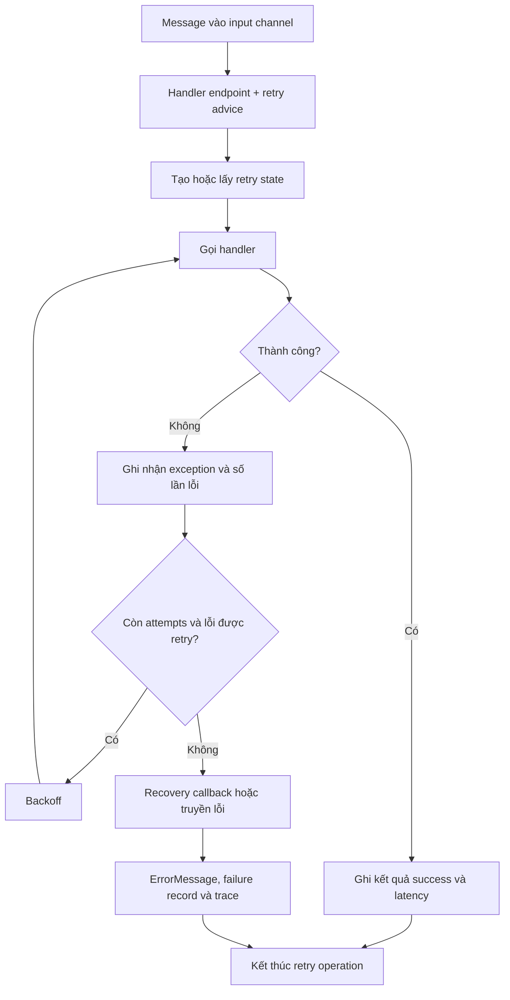

# Retry context và thông tin chẩn đoán trong Spring Integration

## 1. Vì sao phải quan sát từng lần retry?

Một luồng **Enterprise Integration Patterns (EIP)** thường nhận message từ Gateway hoặc broker, đi qua Filter, Transformer, Router, Splitter rồi gọi hệ thống ngoài qua message handler. Khi handler báo timeout hoặc dịch vụ bên ngoài tạm thời không sẵn sàng, `RequestHandlerRetryAdvice` có thể thử lại. Điều khó là phân biệt **một yêu cầu đã thành công ngay**, **một yêu cầu thành công sau vài lần thử**, và **một yêu cầu thất bại rồi đi vào recovery**.

Nếu chỉ ghi log `Exception` cuối cùng, nhóm vận hành không biết handler đã gọi đối tác bao nhiêu lần, backoff có gây timeout Gateway không, hay có nhiều message cùng bị lỗi một đối tác. **Retry context** giữ trạng thái của một chuỗi retry; **thông tin chẩn đoán** chuyển trạng thái ấy thành log, metric, trace và bản ghi lỗi có thể dùng để điều tra.

Trong module `SPRING_INTEGRATION_PATTERN`, chủ đề này giúp xây dựng luồng thông điệp ít phụ thuộc, dễ mở rộng, đồng thời theo dõi được các nhánh Router, Filter, Transformer, Splitter, Aggregator, Gateway, retry, error channel và correlation.

Sau bài học, bạn có thể:

- Hiểu vòng đời của retry context, thời điểm đếm attempts và cách đọc ngoại lệ cuối.
- Ghi nhận các tín hiệu retry bằng `RetryListener` trong Spring Integration 6.x/Spring Retry.
- Phân biệt API `RetryContext` (Spring Retry) và `RetryState` (Spring Framework 7.x).
- Liên kết retry diagnostics với `eventId`, `correlationId`, message headers và recovery.
- Viết kiểm thử cho số lần thử, chuỗi ngoại lệ, lần thành công sau retry và lần hết attempts.
- Thiết kế metric/log có khả năng quan sát mà không làm lộ dữ liệu hoặc tạo số lượng nhãn quá lớn.

## 2. Retry context nằm ở đâu trong luồng xử lý?

`RequestHandlerRetryAdvice` bọc lời gọi **một message handler**. Retry context thuộc về việc thực thi retry đó, không phải mặc định là một trường trong payload hay header của `Message`.



Một lần broker **redelivery** có thể tạo retry operation mới nếu advice chạy ở chế độ stateless. Khi dùng stateful retry, trạng thái được nhận diện lại qua khóa identity theo cách cấu hình của phiên bản thư viện. Vì vậy, cần tách số attempts của handler khỏi số lượt broker đã giao lại message.

| Dữ liệu | Ý nghĩa | Nguồn phù hợp |
| --- | --- | --- |
| Attempt / retry count | Tiến độ trong chuỗi retry | Retry context hoặc listener |
| Exception cuối | Nguyên nhân thất bại gần nhất | Context, listener hoặc `ErrorMessage` |
| Thời gian xử lý và backoff | Độ trễ của handler và toàn chuỗi | Timer/instrumentation quanh operation |
| `eventId` hoặc khóa nghiệp vụ | Sự kiện nào đang được xử lý | Payload/headers do ứng dụng cung cấp |
| `correlationId` / trace ID | Các nhánh và service nào liên quan | Message headers và tracing |
| Delivery count | Broker đã giao message bao nhiêu lần | Metadata của adapter/broker |
| Recovery outcome | Lỗi đã được lưu/chuyển DLQ hay chưa | Recovery handler và kho lỗi |

Không nên coi các dữ liệu trên là một đối tượng duy nhất do framework tự điền. Một thiết kế observability tốt nối chúng lại bằng định danh nghiệp vụ ổn định.

## 3. `RetryContext` trong Spring Retry 2.x (Spring Integration 6.x)

Với **Spring Integration 6.x** dùng Spring Retry, interface `org.springframework.retry.RetryContext` cung cấp một số API quan trọng:

| API | Diễn giải | Điểm cần chú ý |
| --- | --- | --- |
| `getRetryCount()` | Số lần lỗi/đếm retry đã được ghi nhận cho context | Trước attempt đầu thường là `0`; sau một attempt thất bại thường là `1` |
| `getLastThrowable()` | Ngoại lệ gần nhất mà policy ghi nhận | Có thể `null`; không dùng mà thiếu kiểm tra |
| `getParent()` | Context cha khi retry lồng nhau | Có thể `null` nếu không có retry lồng |
| `getAttribute(name)` | Lấy metadata tự lưu vào context | Chỉ tồn tại trong vòng đời context thích hợp |
| `setAttribute(name, value)` | Gắn dữ liệu tạm thời như mốc bắt đầu | Không dùng làm kho dữ liệu bền vững |
| `setExhaustedOnly()` | Đánh dấu chỉ cho phép kết thúc retry | Dùng thận trọng, có thể thay đổi luồng xử lý |

### Đếm attempts thế nào cho đúng?

Trong một chuỗi mà handler thất bại hai lần rồi thành công ở lần thứ ba:

| Thời điểm quan sát | `getRetryCount()` thường thấy | Lời gọi handler tương ứng |
| --- | ---: | --- |
| Ngay trước lần đầu | 0 | Attempt #1 |
| Sau lỗi lần đầu tại `onError` | 1 | Attempt #1 thất bại |
| Trước lần thứ hai | 1 | Attempt #2 |
| Sau lỗi lần thứ hai tại `onError` | 2 | Attempt #2 thất bại |
| Trước lần thứ ba | 2 | Attempt #3 |
| Sau khi lần ba thành công | 2 | Có 3 attempts, nhưng chỉ 2 lần lỗi |

Vì vậy, `getRetryCount()` **không luôn bằng tổng số lần handler đã được gọi** tại mọi thời điểm. Trong callback của handler, cách diễn giải phổ biến là `attemptNumber = context.getRetryCount() + 1`. Trong `onError`, `getRetryCount()` thường là số lần gọi **đã thất bại**. Muốn đếm tổng lời gọi đã thực thi một cách không phụ thuộc ngữ cảnh callback, hãy đo tại điểm handler được gọi hoặc dùng listener với quy ước được kiểm thử.

### Context không phải nơi lưu trạng thái nghiệp vụ

Không dùng `RetryContext` để lưu đơn hàng, transaction ID vĩnh viễn hoặc dữ liệu phải phục hồi sau restart. Với stateless retry, context kết thúc cùng operation và được tạo lại ở redelivery tiếp theo. Với stateful retry, retry state có thể được lưu theo identity trong cache; khả năng tồn tại qua restart, rebalance hoặc đổi node phải được thiết kế riêng.

## 4. Ghi chẩn đoán với `RetryListener` trong Spring Integration 6.x

`RetryListener` nhận các sự kiện theo vòng đời:

- `open(...)`: trước chuỗi retry, có thể khởi tạo đồng hồ đo thời gian.
- `onError(...)`: sau **mỗi attempt thất bại**, kể cả lần lỗi cuối.
- `onSuccess(...)`: sau một attempt thành công; hỗ trợ trong Spring Retry 2.x.
- `close(...)`: sau khi chuỗi retry kết thúc, dù kết quả cuối cùng là thành công hay thất bại/recovery.

Ví dụ sau tạo `RetryTemplate` với tối đa ba attempts. Listener ghi các tín hiệu chẩn đoán kỹ thuật; code đặt trong một lớp `@Configuration` và kết nối tới `RequestHandlerRetryAdvice`. Dùng SLF4J để tránh đưa nguyên payload của message vào log.

```java
import java.util.Map;

import org.slf4j.Logger;
import org.slf4j.LoggerFactory;
import org.springframework.beans.factory.annotation.Bean;
import org.springframework.context.annotation.Configuration;
import org.springframework.retry.RetryCallback;
import org.springframework.retry.RetryContext;
import org.springframework.retry.RetryListener;
import org.springframework.retry.backoff.FixedBackOffPolicy;
import org.springframework.retry.policy.SimpleRetryPolicy;
import org.springframework.retry.support.RetryTemplate;

@Configuration
public class RetryDiagnosticsConfiguration {

    private static final Logger log =
            LoggerFactory.getLogger(RetryDiagnosticsConfiguration.class);

    @Bean
    RetryTemplate shipmentRetryTemplate() {
        RetryTemplate template = new RetryTemplate();

        template.setRetryPolicy(new SimpleRetryPolicy(
                3, Map.of(TemporaryCarrierException.class, true), true));

        FixedBackOffPolicy backoff = new FixedBackOffPolicy();
        backoff.setBackOffPeriod(200L);
        template.setBackOffPolicy(backoff);

        template.registerListener(new RetryListener() {
            @Override
            public <T, E extends Throwable> boolean open(
                    RetryContext context, RetryCallback<T, E> callback) {
                context.setAttribute("startedNanos", System.nanoTime());
                return true;
            }

            @Override
            public <T, E extends Throwable> void onError(
                    RetryContext context,
                    RetryCallback<T, E> callback,
                    Throwable error) {
                log.warn("retry_failed_attempts={} error_type={}",
                        context.getRetryCount(),
                        error.getClass().getSimpleName());
            }

            @Override
            public <T, E extends Throwable> void close(
                    RetryContext context,
                    RetryCallback<T, E> callback,
                    Throwable lastError) {
                Object started = context.getAttribute("startedNanos");
                if (started instanceof Long startedNanos) {
                    long elapsedMs =
                            (System.nanoTime() - startedNanos) / 1_000_000L;
                    log.info("retry_finished failed_attempts={} elapsed_ms={}",
                            context.getRetryCount(), elapsedMs);
                }
            }
        });

        return template;
    }
}

class TemporaryCarrierException extends RuntimeException {
    TemporaryCarrierException(String message, Throwable cause) {
        super(message, cause);
    }
}
```

Điểm chính: listener được gắn vào **chính `RetryTemplate` mà advice sử dụng**, không phải chỉ tạo một bean listener rời. `onError` báo từng attempt thất bại; `close` giúp đo khoảng thời gian cả operation, bao gồm backoff. Code trên mới ghi log minh họa, chưa tích hợp `MeterRegistry` hoặc persistence.

### Gắn template vào handler có recovery

```java
import org.springframework.beans.factory.annotation.Qualifier;
import org.springframework.context.annotation.Bean;
import org.springframework.integration.dsl.IntegrationFlow;
import org.springframework.integration.handler.advice.ErrorMessageSendingRecoverer;
import org.springframework.integration.handler.advice.RequestHandlerRetryAdvice;
import org.springframework.messaging.MessageChannel;
import org.springframework.retry.support.RetryTemplate;

@Bean
RequestHandlerRetryAdvice shipmentRetryAdvice(
        RetryTemplate shipmentRetryTemplate,
        @Qualifier("shipmentFailures") MessageChannel failureChannel) {

    RequestHandlerRetryAdvice advice = new RequestHandlerRetryAdvice();
    advice.setRetryTemplate(shipmentRetryTemplate);
    advice.setRecoveryCallback(
            new ErrorMessageSendingRecoverer(failureChannel));
    return advice;
}

@Bean
IntegrationFlow shipmentFlow(ShipmentSender sender,
                             RequestHandlerRetryAdvice shipmentRetryAdvice) {
    return IntegrationFlow.from("shipmentRequests")
            .handle(sender, "send",
                    endpoint -> endpoint.advice(shipmentRetryAdvice))
            .get();
}
```

Hai phương thức này cần được đặt trong lớp cấu hình Spring hợp lệ; các bean channel `shipmentRequests` và `shipmentFailures`, `ShipmentSender` và recovery consumer phải được ứng dụng khai báo. `ShipmentSender` là adapter nghiệp vụ gửi yêu cầu vận chuyển. Các đoạn code thuộc **Spring Integration 6.x/Spring Retry 2.x** và không thể đổi nguyên import sang 7.x.

**Giới hạn chẩn đoán của listener:** `RetryListener` không tự cung cấp `eventId`, `orderId` hoặc headers của message. Để gắn log với message cụ thể, cần bổ sung dữ liệu tại biên handler, MDC/trace context hoặc instrumentation có thể truy cập đúng message; tránh đưa một biến mutable dùng chung cho mọi request vào listener singleton.

## 5. Đọc retry context bên trong handler

Khi cần biết số thứ tự attempt ngay tại handler (Spring Retry 2.x), có thể đọc context đang hoạt động bằng `RetrySynchronizationManager.getContext()`. Ví dụ:

```java
import org.springframework.messaging.Message;
import org.springframework.retry.RetryContext;
import org.springframework.retry.support.RetrySynchronizationManager;

void send(Message<ShipmentCommand> message) {
    RetryContext context = RetrySynchronizationManager.getContext();
    int attemptNumber =
            context == null ? 1 : context.getRetryCount() + 1;

    ShipmentCommand shipment = message.getPayload();
    String eventId = shipment.eventId();
    Object correlationId = message.getHeaders().get("correlationId");

    // Log/tracing có cấu trúc:
    // endpoint=shipmentSender, event_id=eventId,
    // correlation_id=correlationId, attempt=attemptNumber

    carrierApi.createShipment(
            shipment.orderId(), shipment.idempotencyKey());
}
```

`ShipmentCommand` được định nghĩa ví dụ như sau, còn `carrierApi` là adapter của ứng dụng:

```java
record ShipmentCommand(String eventId, String orderId,
                       String idempotencyKey) {}
```

`getContext()` có thể trả về `null` khi handler được gọi ngoài retry advice hoặc trong một luồng thực thi không có context tương ứng. Do đó, kiểm tra `null` trước khi đọc. Không gọi `RetrySynchronizationManager.register(...)` hay `clear()` từ handler: đó là thao tác nội bộ quản lý context của framework.

**Lưu ý thread:** Mặc định Spring Retry 2.x có thể dùng `ThreadLocal` cho context. Khi xử lý bất đồng bộ, đổi thread, dùng Reactor hoặc executor, không giả định context tự truyền theo tất cả các ranh giới đó. Cần truyền định danh nghiệp vụ và trace context bằng cơ chế phù hợp với hạ tầng; với virtual threads, phiên bản Spring Retry cũng có lựa chọn quản lý context riêng. Không sử dụng retry context như một kho thông tin truyền xuyên service.

## 6. Spring Integration 7.x: `RetryState` và `RetryListener` mới

Từ **Spring Integration 7.x**, retry advice dựa trên các API ở package `org.springframework.core.retry` của Spring Framework 7. API này khác với `org.springframework.retry.RetryContext` ở Spring Retry 2.x; không thể dùng các import `RetryContext` cũ và mặc định chúng có cùng hành vi.

Trong Spring Framework 7.x, `RetryState` có thể cung cấp:

| API | Vai trò |
| --- | --- |
| `getRetryCount()` | `0` đại diện lần gọi đầu; `1` đại diện lần retry đầu, v.v. |
| `getExceptions()` | Danh sách exception đã ghi nhận theo thứ tự xuất hiện |
| `getLastException()` | Exception cuối trong danh sách; cần chắc chắn đã có exception trước khi gọi |
| `isSuccessful()` | Trạng thái kết quả thành công theo retry state |

`RetryListener.onRetryableExecution(...)` được hỗ trợ trong Spring Framework **7.0.2 trở lên** và được gọi sau mỗi attempt, kể cả lần đầu. Đoạn ví dụ dưới đây dành cho một `RetryTemplate` của **Spring Framework 7.0.2+/7.1.x** được sử dụng độc lập; nó minh họa API quan sát, không khẳng định rằng một bean listener tự động được gắn vào advice trong Spring Integration:

```java
import org.springframework.core.retry.RetryListener;
import org.springframework.core.retry.RetryPolicy;
import org.springframework.core.retry.RetryState;
import org.springframework.core.retry.RetryTemplate;
import org.springframework.core.retry.Retryable;

RetryPolicy policy = RetryPolicy.builder()
        .maxRetries(2) // Hai lần retry sau lần đầu: tối đa 3 attempts.
        .includes(TemporaryCarrierException.class)
        .build();

RetryTemplate template = new RetryTemplate(policy);
template.setRetryListener(new RetryListener() {
    @Override
    public void onRetryableExecution(
            RetryPolicy policy, Retryable<?> operation, RetryState state) {
        int retryCount = state.getRetryCount();
        if (!state.isSuccessful()) {
            Throwable error = state.getLastException();
            System.out.printf("retry_count=%d error_type=%s%n",
                    retryCount, error.getClass().getSimpleName());
        }
    }
});
```

Đoạn code trên là phần minh họa khai báo trong một phương thức Java. Muốn thực thi thử, gọi `template.invoke(...)` hoặc `template.execute(...)` với một operation cụ thể. Ở Spring Framework 7, `invoke` thường ném ngoại lệ gốc cuối khi hết retry, còn `execute` có thể ném `RetryException` chứa lịch sử các lần lỗi; chọn API theo hợp đồng cần quan sát.

Để gắn policy cho handler Spring Integration 7.x, cấu hình `RequestHandlerRetryAdvice.setRetryPolicy(policy)`. Cách gắn listener vào tiến trình advice cần dựa trên API của phiên bản Spring Integration đang chạy, hoặc đặt instrumentation tại handler/flow; không mặc nhiên sử dụng `setRetryTemplate(...)` của Spring Integration 6.x.

**Không giữ tham chiếu tới `RetryState` sau callback.** Đây là đối tượng trạng thái đang thay đổi, chỉ dùng để đọc trong vòng đời callback. Nếu cần lưu lịch sử cho vận hành, sao chép ra dữ liệu bất biến cần thiết như attempt number, exception type, duration và correlation ID.

### So sánh nhanh hai thế hệ API

| Mục | Spring Integration 6.x / Spring Retry 2.x | Spring Integration 7.x / Spring Framework 7.x |
| --- | --- | --- |
| Trạng thái retry | `org.springframework.retry.RetryContext` | `org.springframework.core.retry.RetryState` |
| Listener | `org.springframework.retry.RetryListener` | `org.springframework.core.retry.RetryListener` |
| Sự kiện quan sát | `open`, `onError`, `onSuccess`, `close` | `onRetryableExecution` và các callback theo API phiên bản |
| Cách đếm giới hạn | `SimpleRetryPolicy(maxAttempts=3)`: tối đa 3 lần gọi | `RetryPolicy.builder().maxRetries(2)`: tối đa 3 lần gọi |
| Cấu hình advice | `setRetryTemplate(...)` | `setRetryPolicy(...)` |
| Nhận diện stateful retry | `setRetryStateGenerator(...)` | `setStateKeyFunction(...)` |

## 7. Correlation ID và trace: kết nối các attempts với message gốc

`RetryContext` giúp biết **đang thử tới đâu**; còn `correlationId` giúp biết **đó là công việc nào và liên quan nhánh nào**. Một luồng xử lý vận đơn có thể dùng:

```text
eventId         = shipment-created-8841
orderId         = order-8841
correlationId   = checkout-2026-8841
endpoint        = carrierAHandler
deliveryCount   = 2
attempt         = 3
exceptionType   = TemporaryCarrierException
outcome         = RECOVERY
```

Với một message đi qua Splitter/Aggregator, các part có thể chia sẻ correlation ID nhưng **cần phân biệt part ID hoặc sequence number** để biết phần nào bị retry. Với Router, thêm tên nhánh/endpoint để tránh hiểu nhầm một lỗi ở carrier A là lỗi của toàn bộ các nhánh.

Không coi `MessageHeaders.ID` là identity bền vững qua mọi lần broker redelivery; message có thể được tái tạo với ID mới. Nếu cần nhận diện cùng event giữa các lần giao, dùng `eventId` hoặc broker record identity được bảo toàn theo hợp đồng adapter.

### Ví dụ một chuỗi log dễ điều tra

```text
INFO  event=shipment-created-8841 endpoint=carrierA attempt=1 action=start
WARN  event=shipment-created-8841 endpoint=carrierA attempt=1 error=TIMEOUT
INFO  event=shipment-created-8841 endpoint=carrierA attempt=2 action=start
WARN  event=shipment-created-8841 endpoint=carrierA attempt=2 error=503
INFO  event=shipment-created-8841 endpoint=carrierA attempt=3 action=start
ERROR event=shipment-created-8841 endpoint=carrierA attempts=3 outcome=RECOVERY
INFO  event=shipment-created-8841 failure_record=stored status=PENDING_REVIEW
```

Đây là **định dạng log đề xuất**, không phải log framework tự sinh. Cần tạo trace/log ở handler, listener và recovery recorder theo cùng định danh. Khi áp dụng MDC trong luồng đồng bộ, bảo đảm dọn MDC trong `finally`; tránh lan identity của message trước sang message tiếp theo trên thread được tái sử dụng.

## 8. Recovery và chẩn đoán exception cuối

Khi retry hết lượt hoặc policy từ chối retry tiếp, `RequestHandlerRetryAdvice` có thể gọi `ErrorMessageSendingRecoverer` để gửi `ErrorMessage` tới recovery channel. `ErrorMessage` chứa `Throwable`, đôi khi có message gốc qua `getOriginalMessage()` hoặc trong `MessagingException.getFailedMessage()`.

```java
import org.springframework.messaging.Message;
import org.springframework.messaging.MessagingException;
import org.springframework.messaging.support.ErrorMessage;

void recordFailure(ErrorMessage errorMessage) {
    Throwable error = errorMessage.getPayload();
    Message<?> source = errorMessage.getOriginalMessage();

    if (source == null && error instanceof MessagingException messagingError) {
        source = messagingError.getFailedMessage();
    }

    String exceptionType = error.getClass().getSimpleName();
    if (source != null) {
        Object correlationId = source.getHeaders().get("correlationId");
        Object payload = source.getPayload();
        // Lưu thông tin chẩn đoán và message ID theo hợp đồng ứng dụng.
    }
    // Lưu lỗi vào DB hoặc DLQ đáng tin cậy; xử lý cả khi source == null.
}
```

Một bản ghi thất bại nên có: `eventId`, nguồn, endpoint, correlation ID, loại exception, cause chain đã rút gọn, tổng attempts **nếu đã được đo**, thời điểm lỗi đầu/cuối, trạng thái recovery và idempotency key. Không giả định `ErrorMessage` tự mang toàn bộ lịch sử retry hoặc `RetryContext`; nếu cần phải thu thập chủ động bằng listener/instrumentation.

Nếu recovery callback kết thúc bình thường, exception gốc có thể không còn được truyền về consumer. Điều này có thể làm broker ack/commit và Gateway không nhận exception như kỳ vọng. **Outcome của recovery** (đã lưu lỗi thành công) khác **outcome nghiệp vụ** (đã tạo vận đơn thành công). Cần báo trạng thái chính xác và kiểm thử hợp đồng reply/ack/rollback.

## 9. Thiết kế metric và cảnh báo

Đừng chỉ đếm số exception cuối. Một upstream chậm có thể được retry thành công nhưng vẫn ảnh hưởng mạnh tới latency, tài nguyên và trải nghiệm người dùng.

| Metric hoặc tín hiệu | Gợi ý đo | Ý nghĩa vận hành |
| --- | --- | --- |
| `handler_attempts_total` | Counter theo endpoint và exception class đã chuẩn hóa | Đánh giá tải tăng thêm do retry |
| `retry_operations_total` | Counter theo outcome: success, recovered, failed | Tỷ lệ chuỗi retry đạt kết quả cuối |
| `retry_exhausted_total` | Counter khi policy hết attempts | Cảnh báo hệ thống downstream suy giảm |
| `retry_operation_duration` | Timer toàn chuỗi, gồm handler và backoff | Theo dõi độ trễ thực tế của Gateway/consumer |
| `delivery_count` | Metadata từ broker/adapter | Phát hiện redelivery chồng với retry handler |
| `recovery_failure_total` | Counter khi recorder hoặc error channel lỗi | Phát hiện nguy cơ mất khả năng khôi phục |
| `retry_context_cache_size` nếu có stateful | Đo cache/state thực tế | Theo dõi eviction, áp lực bộ nhớ và identity |

Các tên metric ở bảng là **thiết kế đề xuất của ứng dụng**, không có nghĩa Spring Integration xuất sẵn tất cả. Có thể dùng Micrometer/Actuator, instrumentation ở handler, retry listener và tính năng quan sát theo phiên bản Spring đang triển khai.

Để tránh **high cardinality**, metric labels nên hạn chế ở endpoint, nhóm exception và outcome. Không đưa `eventId`, `orderId`, `correlationId` hay payload riêng lẻ thành label; ghi chúng vào structured logs/traces hoặc kho failure có quyền truy cập phù hợp.

Với retry đồng bộ, tổng thời gian xử lý gần bằng tổng thời gian các attempts cộng các khoảng backoff và overhead. Khi thời gian gần vượt timeout Gateway hoặc SLA, số lần retry thành công cao không đủ để kết luận hệ thống khỏe.

## 10. Stateless, stateful và redelivery: chẩn đoán đúng tầng

Retry context và số delivery có thể khác nhau:

| Kịch bản | Retry context | Cách đo để tránh nhầm |
| --- | --- | --- |
| Stateless, một delivery với ba attempts | Một context trong operation | Đếm 3 handler calls, 1 broker delivery |
| Stateless, broker redelivery hai lần | Mỗi delivery thường có context mới | Đếm tổng calls qua `eventId`, không chỉ context cuối |
| Stateful, cùng event được giao lại | State gắn với khóa message identity | Đo retry key, trạng thái cache và delivery count |
| Retry trong HTTP client ngoài handler | Có thể không xuất hiện trong listener Spring Retry | Cần instrumentation của HTTP client |
| Recovery thất bại rồi broker redeliver | Có thể lại tạo chuỗi retry mới | Đo cả recovery failures và broker deliveries |

Ví dụ handler có `maxAttempts = 3`, broker giao event **2 lần** sau rollback. Khi cả hai lượt đều lỗi, tổng cộng có thể có **6 lời gọi handler**, dù `RetryContext` cuối cùng chỉ phản ánh chuỗi ba attempts của lượt thứ hai. Nếu HTTP client cũng tự retry, tổng số request tới downstream còn có thể lớn hơn.

Để giữ ngữ nghĩa **idempotent**, cùng một sự kiện phải dùng khóa idempotency ổn định qua attempts và deliveries. Retry diagnostics giúp phát hiện lặp, nhưng bản thân context hay listener không bảo đảm side effect chỉ thực hiện một lần.

## 11. Kiểm thử listener và retry context

Đối với Spring Integration 6.x/Spring Retry 2.x, có thể kiểm thử listener độc lập với broker. Ví dụ dưới đây chứng minh handler lỗi hai lần, thành công lần ba và `onError` thấy hai lần lỗi được đánh số `1`, `2`:

```java
import java.util.ArrayList;
import java.util.List;
import java.util.Map;
import java.util.concurrent.atomic.AtomicInteger;

import org.junit.jupiter.api.Test;
import org.springframework.retry.RetryCallback;
import org.springframework.retry.RetryContext;
import org.springframework.retry.RetryListener;
import org.springframework.retry.backoff.NoBackOffPolicy;
import org.springframework.retry.policy.SimpleRetryPolicy;
import org.springframework.retry.support.RetryTemplate;

import static org.junit.jupiter.api.Assertions.assertEquals;

class RetryDiagnosticsTest {

    @Test
    void listenerSeesFailedAttemptsBeforeSuccess() {
        AtomicInteger calls = new AtomicInteger();
        List<Integer> failedAttemptNumbers = new ArrayList<>();

        RetryTemplate template = new RetryTemplate();
        template.setRetryPolicy(new SimpleRetryPolicy(
                3, Map.of(TemporaryCarrierException.class, true), true));
        template.setBackOffPolicy(new NoBackOffPolicy());
        template.registerListener(new RetryListener() {
            @Override
            public <T, E extends Throwable> void onError(
                    RetryContext context,
                    RetryCallback<T, E> callback,
                    Throwable throwable) {
                failedAttemptNumbers.add(context.getRetryCount());
            }
        });

        String outcome = template.execute(context -> {
            if (calls.incrementAndGet() < 3) {
                throw new TemporaryCarrierException("temporary", null);
            }
            return "SENT";
        });

        assertEquals("SENT", outcome);
        assertEquals(3, calls.get());
        assertEquals(List.of(1, 2), failedAttemptNumbers);
    }
}
```

Test dùng `NoBackOffPolicy` để không phải chờ thời gian thật. Khi test một chuỗi thất bại cả ba attempts, kỳ vọng `onError` ghi `[1, 2, 3]`; nếu cấu hình recovery, kiểm tra callback chạy đúng một lần, nhận được exception cuối và có bản ghi failure.

### Ma trận kiểm thử tích hợp đề xuất

| Kịch bản | Điều phải khẳng định |
| --- | --- |
| Thành công ở lần đầu | 1 handler call, không có failure event, không recovery |
| Lỗi hai attempts rồi thành công | 3 handler calls; listener ghi hai lỗi; outcome thành công |
| Lỗi tạm thời hết ba attempts | Ba lỗi; một recovery outcome hoặc exception cuối |
| Exception validation không retryable | Một handler call, không phát sinh backoff retry |
| Exception bị `MessagingException` bọc | Retry policy nhận diện cause nếu cấu hình phù hợp |
| Broker giao lại cùng `eventId` | Tổng handler calls và delivery count không bị nhầm với retry count |
| Splitter có một part lỗi | Part ID và correlation ID xác định đúng nhánh lỗi |
| Recovery recorder không lưu được | Quan sát được lỗi recovery; ack/rollback phù hợp |
| Gateway timeout trước khi handler kết thúc | Truy vết được chuỗi retry còn tiếp tục, không báo thành công giả |
| Downstream thành công nhưng response timeout | Idempotency key không đổi, không tạo side effect trùng |

Trong test tích hợp, gắn advice vào endpoint thật bằng `.advice(...)`, dùng fake handler đếm calls, recorder thu `ErrorMessage`, và broker test/container khi cần xác minh redelivery. Một test chỉ chạy `RetryTemplate.execute(...)` không chứng minh Router, Gateway, transaction hay acknowledgement đang vận hành đúng.

## 12. Lỗi chẩn đoán thường gặp

| Sai lầm | Hậu quả | Cách xử lý |
| --- | --- | --- |
| Đọc `getRetryCount()` như tổng attempts ở mọi callback | Báo sai số lần thử, nhất là khi attempt cuối thành công | Phân biệt trước/sau attempt và kiểm thử listener |
| Gắn listener vào template không được advice sử dụng | Không có log retry dù handler đang retry | Dùng đúng template được gắn vào endpoint |
| Dựa vào `RetryContext` để lưu state dài hạn | Mất thông tin sau operation/restart | Ghi log, metric hoặc failure record bền vững |
| Mong listener tự biết `eventId` | Log không có ngữ cảnh message | Gắn correlation ở biên handler và trace context |
| Ghi full stack trace ở mọi attempt | Log quá lớn, khó tìm lỗi gốc | Giới hạn log, phân loại và lưu stack trace chọn lọc |
| Đưa `orderId` hoặc `eventId` vào metric label | Bùng nổ cardinality và chi phí quan sát | Dùng labels thấp cardinality, ID ở log/trace |
| Nhầm broker delivery count với retry count | Đánh giá sai tổng số request downstream | Đếm độc lập hai tầng |
| Coi recovery callback hoàn tất là nghiệp vụ thành công | Ack sai hoặc trả success sai cho Gateway | Tách trạng thái failure-recorded với business-success |
| Dùng chung API Spring Retry 6.x cho Spring Framework 7.x | Lỗi biên dịch hoặc sai semantics | Kiểm tra đúng package, số lần thử và listener API |

## 13. Bài thực hành

Xây dựng một luồng nhận `ShipmentCommand` từ Gateway hoặc message broker, đi qua Filter, Transformer, Router rồi gọi carrier A bằng một handler có `RequestHandlerRetryAdvice`. Cấu hình chỉ retry `TemporaryCarrierException`, tối đa ba attempts và backoff 200 ms. Với Spring Integration 6.x, gắn `RetryListener` để ghi failed attempt count, loại lỗi và thời gian operation; với Spring Integration 7.x, sử dụng API `RetryState`/`RetryListener` phù hợp để quan sát.

Chạy các trường hợp: thành công ngay; lỗi hai lần rồi thành công; hết retry rồi recovery; validation không retryable; broker redelivery; một nhánh Splitter lỗi; downstream đã xử lý nhưng response timeout. Tạo dashboard nhỏ hiển thị attempts, exhausted count, recovery rate và latency theo endpoint. Dùng correlation ID để mở log của cùng event mà không đưa ID vào nhãn metric.

**Tiêu chí hoàn thành:** Xác định được chính xác số handler calls và số broker deliveries; exception cuối và nhánh recovery có thể truy vết về event gốc; các chỉ số không nhầm lẫn giữa thất bại tạm thời và thất bại cuối; Gateway/consumer phản ánh trạng thái nghiệp vụ chính xác; replay dùng idempotency key ổn định.

## Tài liệu tham khảo

- [Spring Retry 2.x — RetryContext API](https://docs.spring.io/spring-retry/docs/2.0.x/apidocs/spring.retry/org/springframework/retry/RetryContext.html): `getRetryCount()`, `getLastThrowable()`, context attributes.
- [Spring Retry 2.x — RetryListener API](https://docs.spring.io/spring-retry/docs/2.0.x/apidocs/spring.retry/org/springframework/retry/RetryListener.html): vòng đời `open`, `onError`, `onSuccess`, `close`.
- [Spring Framework 7 — Resilience Features](https://docs.spring.io/spring-framework/reference/core/resilience.html): `RetryPolicy`, `RetryState`, `RetryListener` và chẩn đoán qua `RetryTemplate`.
- [Spring Integration — Retry Advice](https://docs.spring.io/spring-integration/reference/handler-advice/classes.html): `RequestHandlerRetryAdvice`, stateful/stateless retry và recovery.
