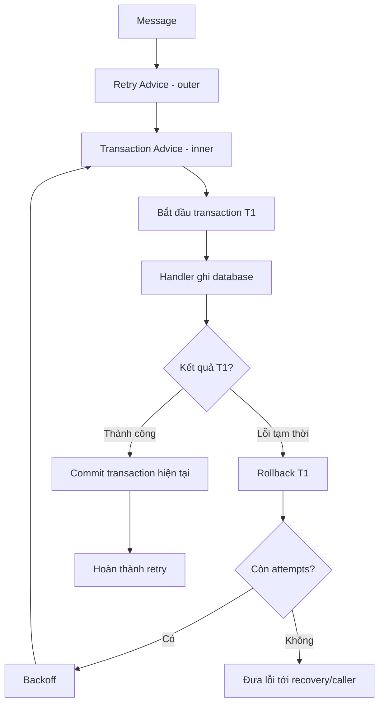
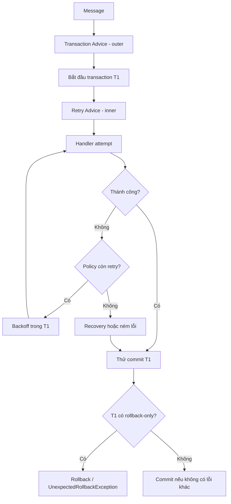
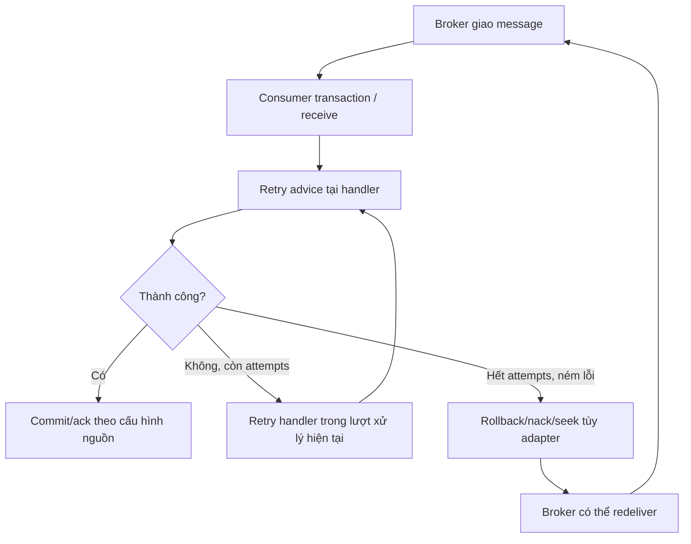

# Retry cùng transaction trong Spring Integration

## 1. Bài toán: retry thành công nhưng transaction vẫn rollback

Giả sử ứng dụng nhận một lệnh giữ hàng `StockCommand` từ Gateway hoặc message broker. Lệnh đi qua Filter để loại dữ liệu sai, Transformer để chuẩn hóa, Router để chọn kho, rồi handler ghi số lượng hàng tồn vào database. Trong giờ cao điểm, hai giao dịch có thể tranh chấp cùng một dòng dữ liệu. Database trả lỗi deadlock hoặc xung đột khóa có thể phục hồi; hệ thống thử lại và lần sau thao tác thành công.

Vấn đề xuất hiện khi **lần thử sau dùng lại một transaction đã bị đánh dấu rollback-only**. Handler có thể chạy xong mà không ném lỗi, nhưng lúc commit lại phát sinh `UnexpectedRollbackException`. Ngược lại, nếu mỗi attempt mở một transaction độc lập, attempt thất bại có thể rollback trước khi attempt tiếp theo bắt đầu.

Chương **Retry** của module `SPRING_INTEGRATION_PATTERN` nghiên cứu cách triển khai Enterprise Integration Patterns với Spring Integration để xây dựng luồng thông điệp ít phụ thuộc, dễ mở rộng. **Retry cùng transaction** là một điểm giao giữa retry advice, transaction management, Router, Filter, Transformer, Gateway, error channel, correlation và kiểm thử các nhánh thành công/thất bại.

Sau bài học, bạn có thể:

- Xác định transaction bắt đầu và kết thúc tại đâu trong một message flow.
- Chọn đúng **thứ tự Retry advice và Transaction advice** theo mục tiêu nghiệp vụ.
- Giải thích `rollback-only`, `PROPAGATION_REQUIRED`, `REQUIRES_NEW` và `UnexpectedRollbackException`.
- Kết hợp stateless/stateful retry với broker rollback, redelivery và recovery.
- Bảo đảm side effect bên ngoài không bị thực hiện nhiều lần khi retry.
- Kiểm thử số attempts, commit/rollback và tính nhất quán của dữ liệu thực.

## 2. Ba ranh giới phải phân biệt

Một message đi qua Spring Integration có thể nằm trong ba phạm vi khác nhau:

| Phạm vi | Ví dụ | Ai quản lý? |
| --- | --- | --- |
| **Retry operation** | Handler được gọi tối đa ba lần vì lỗi tạm thời | `RequestHandlerRetryAdvice` và retry policy |
| **Database transaction** | Một lần đặt giữ hàng: cập nhật inventory và insert reservation | `PlatformTransactionManager` / Spring Transaction |
| **Broker delivery** | Message được JMS/RabbitMQ/Kafka giao lại sau khi xử lý thất bại | Inbound adapter, consumer, broker/error handler |

Ba phạm vi này có thể chồng nhau nhưng **không mặc định có cùng thời gian sống**. Ví dụ một broker delivery bao một stateless retry operation có ba attempts; trong mỗi attempt có thể mở một database transaction. Nếu tất cả đều thất bại, broker có thể giao message lại; lần giao sau lại tạo một retry operation mới.

Không phải mọi tài nguyên đều thuộc transaction. **Một transaction JDBC không rollback được lời gọi HTTP đã gửi**, email đã phát hoặc hành động đã hoàn tất tại một dịch vụ bên ngoài. Với các side effect đó, phải bổ sung idempotency, outbox, trạng thái bù trừ hoặc cơ chế phối hợp phù hợp.

## 3. Thứ tự advice quyết định số transaction

Spring Integration cho phép gắn nhiều advice vào endpoint. Advice đầu tiên trong danh sách là **lớp ngoài cùng**; advice cuối gần handler nhất.

### Cách A — Retry ở ngoài, transaction ở trong



Biểu diễn bằng thứ tự advice:

```text
RetryAdvice(
    TransactionAdvice(
        handler()
    )
)
```

**Mỗi attempt có cơ hội sử dụng một transaction mới**. Nếu `T1` rollback, `T2` bắt đầu sau khi retry advice bắt được ngoại lệ. Đây thường là lựa chọn cho lỗi database có thể phục hồi như deadlock hoặc tranh chấp khóa, bởi dữ liệu và trạng thái transaction của attempt trước được dọn trước attempt tiếp theo.

Nếu **đã có một transaction ở bên ngoài toàn bộ endpoint** (chẳng hạn transaction của inbound JMS consumer hoặc caller), việc dùng `PROPAGATION_REQUIRED` ở advice trong có thể chỉ tham gia transaction cũ. Khi thật sự muốn tách thành physical transaction mới cho từng attempt, phải chủ động cấu hình `REQUIRES_NEW` và xác minh transaction manager có thể tạm ngưng transaction ngoài; cách này có chi phí tài nguyên và hệ quả nhất quán cần đánh giá.

### Cách B — Transaction ở ngoài, retry ở trong



Biểu diễn bằng thứ tự advice:

```text
TransactionAdvice(
    RetryAdvice(
        handler()
    )
)
```

**Cả chuỗi attempts và recovery callback (nếu có) nằm trong một transaction** theo phạm vi advice. Cách này có thể phù hợp với một đơn vị công việc mà lỗi chưa làm transaction bị đánh dấu rollback-only, nhưng nguy hiểm nếu thao tác database đã đặt cờ rollback hoặc giữ khóa quá lâu.

| Tiêu chí | Retry ngoài → TX trong | TX ngoài → Retry trong |
| --- | --- | --- |
| Transaction trên các attempts | Thường mỗi attempt một TX riêng | Thường cùng một TX |
| Khi attempt đầu rollback | Có thể bắt đầu TX mới | TX chung có thể đã rollback-only |
| Thời gian giữ khóa DB | Thường ngắn theo attempt | Có thể kéo qua mọi backoff |
| Recovery callback | Nằm ngoài TX của attempt đã rollback | Có thể chạy trong cùng TX chung |
| Phù hợp | Deadlock, lỗi ghi tạm thời cần rollback rồi thử lại | Trường hợp đặc biệt có thể giữ một TX hợp lệ xuyên attempts |
| Cần kiểm chứng | TX ngoài có sẵn, propagation, commit từng attempt | Rollback-only, lock timeout, transaction timeout |

**Quan trọng:** Thứ tự advice chỉ cho biết phạm vi lồng nhau. Transaction thực tế còn chịu ảnh hưởng bởi propagation, transaction manager, proxy, nguồn tạo transaction trước đó và thread nơi handler chạy.

## 4. Vì sao `rollback-only` làm retry trong cùng transaction thất bại?

Trong Spring Transaction, `PROPAGATION_REQUIRED` thường dùng chung một **physical transaction** khi có transaction đang hoạt động. Một phương thức tham gia transaction có thể đánh dấu transaction là `rollback-only` khi gặp lỗi. Caller bên ngoài có thể bắt exception và tiếp tục chương trình, nhưng **không thể biến một transaction đã bị đánh dấu rollback-only trở lại trạng thái có thể commit**.

Ví dụ:

```text
T1 bắt đầu
  attempt 1 -> DB conflict -> transaction T1 bị đánh dấu rollback-only
  retry advice bắt exception
  attempt 2 -> handler trả về bình thường
  commit T1 -> rollback thực tế, có thể ném UnexpectedRollbackException
```

Lỗi này đặc biệt dễ gặp nếu handler gọi một service `@Transactional(propagation = REQUIRED)`: service ném `RuntimeException` qua transactional proxy; interceptor đánh dấu transaction chung cần rollback trước khi retry advice bắt lỗi.

**Không phải mọi exception đều tự động đặt rollback-only.** Điều đó còn tùy rollback rules, loại exception, trạng thái JDBC/JPA và thời điểm ném lỗi. Nhưng khi transaction đã rollback-only thì bắt exception, ghi log hay chạy một attempt nữa bên trong cùng physical transaction không làm nó trở lại hợp lệ.

### So sánh propagation

| Propagation | Khi đã có transaction bên ngoài | Ý nghĩa với retry |
| --- | --- | --- |
| `REQUIRED` | Tham gia physical TX hiện có | Có thể giữ trạng thái rollback-only giữa attempts |
| `REQUIRES_NEW` | Tạm ngưng TX ngoài và mở physical TX độc lập | Cho phép commit/rollback từng attempt riêng nếu được hỗ trợ |
| `NESTED` | Dùng savepoint trong cùng physical TX khi manager hỗ trợ | Có thể rollback phần việc tới savepoint; không thay thế cơ chế retry transaction mới |
| `NOT_SUPPORTED` | Chạy ngoài TX (nếu có) | Không phù hợp nếu cần tính nguyên tử của ghi DB |

`REQUIRES_NEW` có thể cần thêm một connection trong lúc connection của TX ngoài vẫn đang được giữ, làm tăng nguy cơ cạn pool khi tải đồng thời cao. Không bật nó ở mọi nơi chỉ để làm retry chạy được; phải xác định rõ transaction owner và ranh giới nhất quán.

## 5. Java DSL / annotation example với Spring Integration 6.x

Ví dụ dưới đây dùng **Spring Integration 6.x + Spring Retry 2.x** để giữ hàng tồn kho. Nó tách hai advice theo thứ tự:

1. `inventoryRetryAdvice` ở ngoài, bắt ngoại lệ tạm thời và thử tối đa **3 attempts kể cả lần đầu**.
2. `txPerAttempt` ở trong, mở một transaction DB mới cho mỗi attempt.

```java
import java.util.Map;

import org.springframework.context.annotation.Bean;
import org.springframework.context.annotation.Configuration;
import org.springframework.integration.annotation.MessageEndpoint;
import org.springframework.integration.annotation.ServiceActivator;
import org.springframework.integration.channel.DirectChannel;
import org.springframework.integration.handler.advice.RequestHandlerRetryAdvice;
import org.springframework.integration.transaction.TransactionInterceptorBuilder;
import org.springframework.messaging.MessageChannel;
import org.springframework.retry.backoff.FixedBackOffPolicy;
import org.springframework.retry.policy.SimpleRetryPolicy;
import org.springframework.retry.support.RetryTemplate;
import org.springframework.transaction.PlatformTransactionManager;
import org.springframework.transaction.annotation.Propagation;
import org.springframework.transaction.interceptor.TransactionInterceptor;

@Configuration
public class StockRetryTransactionConfiguration {

    @Bean
    MessageChannel stockCommands() {
        return new DirectChannel();
    }

    @Bean
    RequestHandlerRetryAdvice inventoryRetryAdvice() {
        SimpleRetryPolicy retryPolicy = new SimpleRetryPolicy(
                3,
                Map.of(RetryableInventoryConflict.class, true),
                true);

        FixedBackOffPolicy backoff = new FixedBackOffPolicy();
        backoff.setBackOffPeriod(100L);

        RetryTemplate template = new RetryTemplate();
        template.setRetryPolicy(retryPolicy);
        template.setBackOffPolicy(backoff);

        RequestHandlerRetryAdvice advice = new RequestHandlerRetryAdvice();
        advice.setRetryTemplate(template);
        // Không gắn recovery: lỗi cuối truyền lên caller/consumer.
        return advice;
    }

    @Bean
    TransactionInterceptor txPerAttempt(
            PlatformTransactionManager transactionManager) {
        return new TransactionInterceptorBuilder(false)
                .transactionManager(transactionManager)
                .propagation(Propagation.REQUIRES_NEW)
                .build();
    }
}

record StockCommand(String eventId, String sku,
                    int quantity, String idempotencyKey) {}

class RetryableInventoryConflict extends RuntimeException {
    RetryableInventoryConflict(String message, Throwable cause) {
        super(message, cause);
    }
}

interface InventoryService {
    void reserve(StockCommand command);
}

@MessageEndpoint
class InventoryEndpoint {

    private final InventoryService inventoryService;

    InventoryEndpoint(InventoryService inventoryService) {
        this.inventoryService = inventoryService;
    }

    @ServiceActivator(
            inputChannel = "stockCommands",
            adviceChain = { "inventoryRetryAdvice", "txPerAttempt" })
    public void reserve(StockCommand command) {
        inventoryService.reserve(command);
    }
}
```

Đây là ví dụ cấu hình và hợp đồng adapter; ứng dụng cần cung cấp `InventoryService` có triển khai ghi dữ liệu, `PlatformTransactionManager` quản lý database thực và các dependency Spring Integration, Spring Retry, Spring Transaction phù hợp. Adapter nên chuyển các lỗi tranh chấp có thể phục hồi thành `RetryableInventoryConflict`, giữ nguyên các lỗi validation không retryable.

**Vì sao thứ tự có tác dụng?** Tại `@ServiceActivator`, tên advice đầu là lớp ngoài cùng. Retry sẽ quan sát cả ngoại lệ xảy ra ở handler **và lỗi được ném ra khi transaction bên trong kết thúc**. Vì thế nếu việc commit của một attempt thất bại và lỗi được phân loại retryable, lời gọi có thể được thực hiện lại trong một transaction mới.

Một ví dụ logic của `InventoryService.reserve(...)`:

```java
public void reserve(StockCommand command) {
    // 1. Kiểm tra eventId / idempotencyKey đã xử lý hay chưa.
    // 2. Kiểm tra tồn kho và ghi reservation trong cùng DB transaction.
    // 3. Một lỗi deadlock/lock conflict có thể được adapter ánh xạ
    //    thành RetryableInventoryConflict để advice quyết định retry.
}
```

**Không đặt thêm `@Transactional(REQUIRED)` bao ngoài lời gọi tới advice** mà vẫn kỳ vọng từng attempt có physical TX mới theo mặc định. `REQUIRES_NEW` ở ví dụ làm rõ ý định độc lập, nhưng cần xem xét transaction của inbound adapter/broker và khả năng tạm ngưng transaction ngoài.

### Nếu muốn cùng một transaction cho toàn bộ attempts

Đổi thứ tự advice thành:

```java
@ServiceActivator(
        inputChannel = "stockCommands",
        adviceChain = { "txForOperation", "inventoryRetryAdvice" })
public void reserve(StockCommand command) {
    inventoryService.reserve(command);
}
```

Trong cấu hình này, `txForOperation` là một `TransactionInterceptor` khác, dùng propagation được chọn cho toàn operation (thường `REQUIRED`) và đã được khai báo bean. **Không đổi tên bean `txPerAttempt` thành `txForOperation` mà vẫn giữ `REQUIRES_NEW` nếu chưa hiểu rõ TX bên ngoài.** Hãy kiểm thử cả rollback-only, thời gian giữ khóa và hành vi recovery trước khi dùng trong production.

## 6. Phiên bản Spring Integration 7.x

Spring Integration 7.x dựa trên **Spring Framework Retry Support** (`org.springframework.core.retry`); không dùng `RetryTemplate` của Spring Retry 2.x để cấu hình `RequestHandlerRetryAdvice` theo mẫu 6.x. Ý tưởng lồng transaction và retry **không thay đổi**: thứ tự advice và propagation vẫn quyết định phạm vi transaction.

Phần tạo retry advice cho Spring Integration 7.x:

```java
import java.time.Duration;

import org.springframework.core.retry.RetryPolicy;
import org.springframework.integration.handler.advice.RequestHandlerRetryAdvice;

RequestHandlerRetryAdvice inventoryRetryAdvice7x() {
    RetryPolicy policy = RetryPolicy.builder()
            .maxRetries(2) // 2 lần gọi lại, tối đa 3 lần gọi handler.
            .includes(RetryableInventoryConflict.class)
            .delay(Duration.ofMillis(100))
            .build();

    RequestHandlerRetryAdvice advice = new RequestHandlerRetryAdvice();
    advice.setRetryPolicy(policy);
    return advice;
}
```

Đoạn trên là phần khai báo nằm trong lớp cấu hình Java; có thể biến thành `@Bean` và dùng tên bean tương ứng trong `adviceChain`. Ở Spring Integration 6.x, `SimpleRetryPolicy(3)` đếm **tổng** ba attempts; ở API Spring Framework 7.x, `maxRetries(2)` biểu thị hai lần gọi lại **sau** lần đầu.

Transaction advice có thể tiếp tục dùng `TransactionInterceptorBuilder` của Spring Integration hoặc transaction interceptor của Spring Framework. Chọn `TransactionHandleMessageAdvice` khi cần mở transaction bao trùm `MessageHandler.handleMessage()` và luồng downstream; một `TransactionInterceptor` thông thường trên reply-producing handler có thể chỉ bao method nội bộ `handleRequestMessage()`.

## 7. Transaction bên ngoài từ poller, broker và Gateway

Transaction có thể đã bắt đầu **trước khi message đến handler**. Khi đó cấu hình ở endpoint không phải toàn bộ câu chuyện.

### 7.1 Poller transactional

Với một `PollableChannel` hoặc message source được poll trong transaction, Spring Integration cho phép cấu hình transaction advice tại poller. Transaction có thể bao cả `receive()` và các xử lý đồng bộ tiếp theo. Nếu poller có transaction, một handler dùng `REQUIRED` sẽ tham gia TX đang có trên cùng thread. Retry tại handler mà giữ nguyên TX ấy có thể gặp rollback-only.

Khi nhiều advice được gắn vào poller, thứ tự advice cũng cần được xác định. Spring Integration có transaction synchronization cho các hoạt động `beforeCommit`, `afterCommit` và `afterRollback`, nhưng synchronization chỉ chạy thao tác ở thời điểm tương ứng; nó **không biến HTTP, file hoặc API ngoài thành resource transactional**.

### 7.2 Broker message listener

Nếu consumer JMS nhận message trong transaction và lời gọi handler cuối cùng ném exception, container có thể rollback việc nhận message để broker redeliver. Điều này khác với việc retry handler ngay trong cùng một lượt nhận message:



Với **stateless retry**, mỗi lần broker redeliver có thể khởi tạo chuỗi attempts mới. Ví dụ handler thử tối đa 3 lần trên mỗi delivery, broker giao tối đa 4 lượt, có thể lên tới **12 handler calls**, chưa tính retry bên trong HTTP client.

Với **stateful retry**, advice liên kết trạng thái bằng message identity ổn định; lỗi được đẩy ngược để nguồn giao lại message. Cơ chế này phù hợp khi mỗi lần thử cần transaction consumption mới hoặc rollback thật trước khi thử lại. Nó **không tự thực hiện redelivery**. Trong 6.x dùng `RetryStateGenerator`; trong 7.x dùng `stateKeyFunction`. Cache trong memory không mặc nhiên bền vững qua restart hoặc đổi node.

### 7.3 Gateway đồng bộ

Một Gateway có thể gọi handler trên cùng thread và transaction của caller. Khi retry có backoff, caller phải chờ cả xử lý và các khoảng nghỉ. Nếu Gateway có timeout hoặc caller đã hủy request, transaction thực tế không nhất thiết được ngắt ngay. Hãy tính timeout của database client, broker và Gateway theo cùng một ngân sách độ trễ, đồng thời xác định rõ trạng thái kết quả để tránh trả `SUCCESS` khi giao dịch chưa commit.

### 7.4 Ranh giới thread

Transaction kiểu imperative thường gắn với **thread hiện tại**. `DirectChannel` giữ luồng gọi đồng bộ nên có thể cùng transaction; `ExecutorChannel`, pollable channel hoặc một lời gọi `@Async` tạo thread mới sẽ làm đứt ngữ cảnh transaction theo cơ chế thông thường. Không mặc định rollback ở thread trước sẽ rollback công việc đã bàn giao thành công sang thread sau.

## 8. Retry và recovery trong transaction

`RequestHandlerRetryAdvice` có thể được gắn `RecoveryCallback`, ví dụ `ErrorMessageSendingRecoverer`. Tuy nhiên, quyết định recovery có nằm trong transaction hay không phụ thuộc vào thứ tự advice và propagation:

| Kiểu cấu hình | Recovery callback | Rủi ro cần kiểm tra |
| --- | --- | --- |
| Retry ngoài → TX trong | Recovery nằm ngoài TX của từng attempt đã rollback | Lưu lỗi cần transaction riêng và có xác nhận |
| TX ngoài → Retry trong | Recovery có thể nằm trong cùng TX với attempts | Nếu TX rollback-only, bản ghi recovery cũng có thể rollback |
| Broker TX bên ngoài tất cả | Recovery có thể kết thúc bình thường trước khi ack | Broker có thể ack dù nghiệp vụ chính thất bại nếu lỗi đã được xử lý |

Nếu recovery phải lưu bản ghi thất bại để vận hành xử lý sau, nên tách hợp đồng rõ:

1. **Success nghiệp vụ:** hàng đã được giữ, transaction ghi chính đã commit.
2. **Failure recorded:** nghiệp vụ chưa thành công nhưng bản ghi lỗi đã được lưu bền vững.
3. **Failure not recorded:** cả nghiệp vụ và lưu lỗi đều thất bại; exception nên đi tới cơ chế xử lý của nguồn để không mất khả năng phục hồi.

Một failure recorder có thể dùng một service được gọi qua Spring proxy với transaction `REQUIRES_NEW` để lưu độc lập. Dù vậy, nếu sử dụng cơ sở dữ liệu/broker liên quan nhiều transaction hoặc XA/JTA, cần xác minh hành vi suspend/resume và mức nhất quán thực tế. `REQUIRES_NEW` không biến một lời gọi HTTP hay một lần gửi message ngoài transaction thành atomic.

**Cẩn thận với recovery nuốt exception:** Khi `ErrorMessageSendingRecoverer` hoàn tất bình thường, caller/broker có thể coi message xử lý xong và ack. Chỉ ack khi thất bại đã được ghi nhận theo yêu cầu hệ thống; nếu cần broker tự redeliver, có thể để exception thoát ra và giao quyền quyết định cho consumer/error handler.

## 9. Side effect và tính idempotent

Một transaction DB chỉ điều khiển các resource có tham gia cùng transaction. Xét handler:

```java
void reserveAndNotify(StockCommand command) {
    inventoryRepository.reserve(command.sku(), command.quantity());
    carrierHttpClient.notifyReservation(command.eventId()); // HTTP side effect
}
```

Nếu database rollback sau khi HTTP thành công, một attempt mới có thể gọi API lần nữa. Kết quả là HTTP nhận hai yêu cầu nhưng DB chỉ ghi một bản reservation cuối cùng. Trường hợp ngược lại cũng có thể xảy ra: downstream xử lý xong nhưng response timeout, handler tưởng thất bại và retry.

Các chiến lược phổ biến:

- **Idempotency key:** Dùng `eventId` hoặc khóa nghiệp vụ ổn định cho mọi attempts/deliveries; phía nhận hoặc phía gửi phải có cơ chế chống xử lý trùng.
- **Transactional outbox:** Ghi trạng thái nghiệp vụ và sự kiện cần phát vào bảng outbox trong **cùng một DB transaction**; worker độc lập phát sự kiện sau commit, có kiểm soát deduplication.
- **Saga/compensation:** Khi nhiều service không thể dùng một ACID transaction chung, thiết kế bước bù trừ cho các hành động đã hoàn tất.
- **Retry scope nhỏ:** Chỉ retry bước có thể khôi phục, thay vì retry cả flow có nhiều side effects không idempotent.

Đừng coi `@Transactional` là bảo đảm **exactly-once end-to-end** khi tương tác với HTTP, SMTP hoặc hai broker không tham gia cùng transaction manager.

## 10. Kiểm thử ranh giới transaction

Kiểm thử retry thuần túy bằng mock chỉ chứng minh số lần gọi. Để xác nhận commit/rollback, cần **database transactional thật** (có thể dùng test database hoặc Testcontainers), một `PlatformTransactionManager` thật và quan sát trạng thái sau khi operation kết thúc.

### Ví dụ ngắn: retry bao quanh transaction

Đoạn dưới minh họa cùng ý tưởng **mỗi attempt có transaction mới** ở mức Spring Retry và `TransactionTemplate` của Spring Integration 6.x. Đây là một phương thức minh họa có sẵn `RetryTemplate`, `PlatformTransactionManager` và adapter `reservationRepository`:

```java
import org.springframework.transaction.TransactionDefinition;
import org.springframework.transaction.support.TransactionTemplate;

String reserveWithFreshTransactions(
        RetryTemplate retryTemplate,
        PlatformTransactionManager manager,
        StockCommand command,
        ReservationRepository reservationRepository) {

    TransactionTemplate tx = new TransactionTemplate(manager);
    tx.setPropagationBehavior(TransactionDefinition.PROPAGATION_REQUIRES_NEW);

    return retryTemplate.execute(context ->
            tx.execute(status -> {
                reservationRepository.reserve(
                        command.sku(), command.quantity(),
                        command.idempotencyKey());
                return "RESERVED";
            }));
}
```

Ở đây `ReservationRepository` là adapter của ứng dụng. Nếu `reserve(...)` ném lỗi retryable, transaction template rollback trước khi retry template mở attempt tiếp theo. Nếu repository thực sự commit thành công rồi phương thức downstream khác lại lỗi, việc retry có thể lặp một transaction đã commit, vì vậy vẫn cần idempotency.

### Ma trận kiểm thử cần có

| Tình huống | Số attempts dự kiến | Điều cần kiểm tra ở DB và luồng |
| --- | ---: | --- |
| Thành công lần đầu | 1 | Một transaction commit, reservation đúng một lần |
| Deadlock ở lần 1, thành công lần 2 | 2 | T1 rollback, T2 commit; không còn dữ liệu dở của T1 |
| Lỗi tạm thời cả 3 lần | 3 | Cả ba TX rollback, không có reservation thành công |
| Validation không retryable | 1 | Không thêm attempts, không commit dữ liệu lỗi |
| TX ngoài có sẵn và `REQUIRED` | Tùy | Có bị rollback-only dù attempt sau không ném lỗi không |
| TX ngoài và inner `REQUIRES_NEW` | Tùy | Có đúng physical TX mới từng attempt, có bị cạn connection pool không |
| Recovery ghi cùng TX rollback-only | Tùy | Bản ghi failure có tồn tại sau rollback không |
| Recovery `REQUIRES_NEW` | Tùy | Bản ghi failure commit độc lập, caller/broker biết trạng thái chính |
| Broker giao lại sau rollback | A × D tối đa | Số handler calls, delivery count, DLQ và idempotency |
| Handler gọi API ngoài rồi DB rollback | Tùy | Không tạo side effect trùng ở downstream |
| ExecutorChannel ngắt thread | Tùy | Transaction có thực sự tới handler sau async boundary không |

### Kiểm tra commit thực tế, tránh kết luận từ log

Trong integration test, tạo một repository ghi dấu `attemptId` và trạng thái business vào cùng transaction. Sau mỗi request, truy vấn DB bằng **transaction độc lập** để xem những dòng nào thật sự tồn tại; việc handler đã chạy hoặc đã in log “saved” không chứng minh transaction commit. Có thể dùng spy transaction manager để đếm `begin`, `commit`, `rollback`, nhưng vẫn nên có test kiểm tra dữ liệu bền vững.

Đối với broker, dùng consumer/adapter được cấu hình như production trong môi trường test phù hợp, ném exception có kiểm soát và kiểm tra rõ `ack`, `nack`, offset commit hoặc rollback; đừng coi một test `channel.send(...)` đơn thuần là kiểm thử broker redelivery.

## 11. Theo dõi và vận hành

Các chỉ số quan trọng khi retry kết hợp transaction:

- **Attempt outcome:** số attempts theo exception type, endpoint và tình trạng cuối cùng.
- **Transaction outcome:** số TX begin/commit/rollback, tỷ lệ `rollback-only`, deadlock và `UnexpectedRollbackException`.
- **End-to-end latency:** tổng thời gian handler, thời gian giữ lock và backoff của cả chuỗi.
- **Broker redelivery:** delivery count của cùng `eventId`, số message chuyển DLQ và retry ở các tầng.
- **Recovery persistence:** tỷ lệ ghi failure thành công, số lần recorder thất bại và số bản ghi đang chờ xử lý.
- **Correlation:** message ID, event ID, trace/correlation ID, endpoint và transaction outcome, để nối các nhánh Router và Splitter/Aggregator.

Trong metrics, tránh đưa `orderId`, `eventId` hoặc payload thành nhãn có cardinality cao. Ghi định danh vào structured log/tracing; đặt metric labels ở mức endpoint, nhóm lỗi, transaction outcome. Giám sát connection pool khi dùng `REQUIRES_NEW`, vì nhu cầu connection đồng thời có thể tăng bất ngờ.

## 12. Những sai lầm thường gặp

| Sai lầm | Hậu quả | Cách khắc phục |
| --- | --- | --- |
| Đặt transaction ngoài retry nhưng muốn TX mới sau rollback | Retry chạy trong TX đã rollback-only | Đảo thứ tự advice, xem lại propagation |
| Nghĩ `REQUIRED` luôn mở transaction mới | Handler dùng chung TX ngoài bị rollback-only | Xác định transaction owner; dùng `REQUIRES_NEW` khi thật sự cần |
| Coi exception được bắt là transaction đã phục hồi | Commit cuối ném `UnexpectedRollbackException` | Kiểm thử rollback flag và commit thật |
| Gắn advice lên handler nhưng TX thực tế do poller bắt đầu | Ranh giới TX không đúng dự tính | Xem transaction từ nguồn và toàn call chain |
| Đưa async channel vào giữa flow | TX không còn đi qua ranh giới thread | Tạo transaction riêng ở consumer/handler mới |
| Retry cả handler có HTTP side effect | Gửi trùng yêu cầu bên ngoài | Idempotency/outbox/saga, tách scope retry |
| Recovery lưu trong TX đã rollback-only | Mất bản ghi failure sau rollback | Dùng transaction phục hồi độc lập hoặc DLQ đáng tin cậy |
| Recovery trả bình thường nên coi nghiệp vụ success | Ack/commit sai trạng thái | Định nghĩa rõ `FAILED_RECORDED` và `BUSINESS_SUCCESS` |
| Không giới hạn broker redelivery và handler retry | Tổng attempts tăng nhiều tầng | Tính A × D, backoff, DLQ và deadline |
| Chỉ đếm handler calls, không kiểm tra DB | Test xanh dù mọi attempt rollback | Truy vấn trạng thái đã commit và kiểm tra transaction |

## 13. Bài thực hành

Xây dựng một flow nhận `StockCommand` từ Gateway hoặc broker, dùng Filter từ chối số lượng âm, Transformer chuẩn hóa SKU và Router chọn kho A/B. Nhánh kho A ghi inventory và reservation vào database; nhánh B gọi một API ngoài. Gắn `RequestHandlerRetryAdvice` cho A, policy tối đa **3 attempts** và fixed backoff 100 ms. Thử hai thứ tự advice:

1. **Retry ngoài, transaction trong:** Lần đầu giả lập deadlock, lần hai thành công; chứng minh T1 rollback, T2 commit.
2. **Transaction ngoài, retry trong:** Cho một service transactional ném ngoại lệ và đánh dấu rollback-only; quan sát attempt sau và kết quả commit. Nếu commit thất bại, giải thích vì sao bắt exception chưa đủ.

Tiếp theo thử broker redelivery khi handler đã hết attempts, bật recovery channel ghi failure, và mô phỏng API bên ngoài đã xử lý nhưng response bị timeout. Đo số lần gọi handler, số transaction commit/rollback, số lượt broker delivery, correlation ID, số failure records còn tồn tại và số side effects ở downstream. Đánh giá sự khác biệt khi dùng `REQUIRES_NEW`, khi chuyển sang `ExecutorChannel` và khi lưu failure trong transaction riêng.

**Tiêu chí hoàn thành:** Ranh giới transaction được xác định chính xác; mỗi attempt có trạng thái commit/rollback đúng thiết kế; các lỗi tạm thời được retry trong transaction còn hợp lệ; recovery không làm mất thông tin thất bại; message không được ack như thành công khi nghiệp vụ chưa hoàn tất; không có tác động nghiệp vụ trùng lặp khi redelivery hoặc retry.

## Tài liệu tham khảo

- [Spring Integration — Ordering Advices within Advice Chain](https://docs.spring.io/spring-integration/reference/handler-advice/order.html): thứ tự advice ngoài/trong và tác động tới transaction.
- [Spring Integration — Transaction Support](https://docs.spring.io/spring-integration/reference/transactions.html): transaction boundaries, poller và transaction synchronization.
- [Spring Integration — TransactionHandleMessageAdvice](https://docs.spring.io/spring-integration/reference/handler-advice/tx-handle-message.html): phân biệt transaction trên method nội bộ và toàn bộ flow.
- [Spring Integration — Retry Advice](https://docs.spring.io/spring-integration/reference/handler-advice/classes.html): stateless/stateful retry và recovery.
- [Spring Framework — Transaction Propagation](https://docs.spring.io/spring-framework/reference/data-access/transaction/declarative/tx-propagation.html): `REQUIRED`, `REQUIRES_NEW`, `NESTED` và `UnexpectedRollbackException`.
