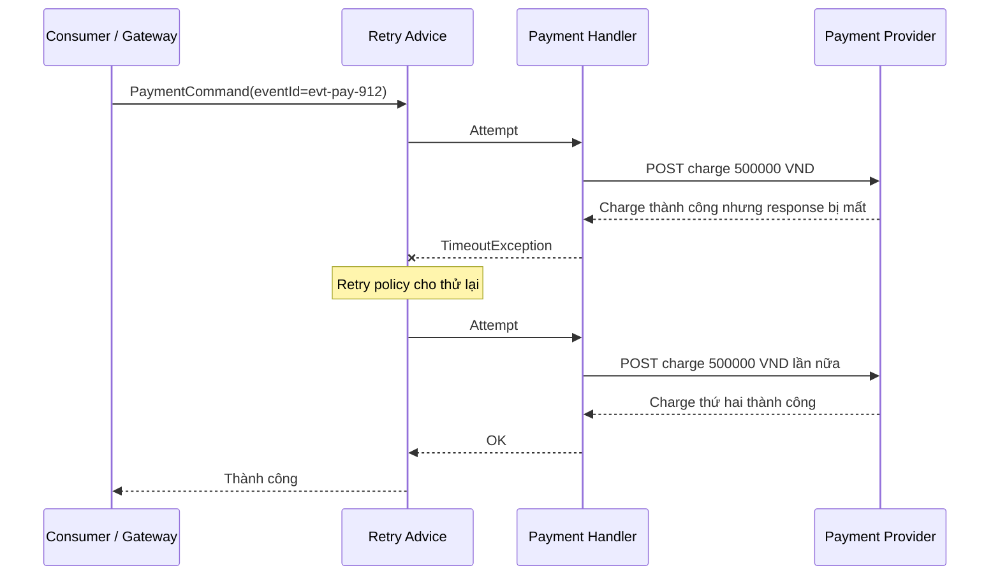
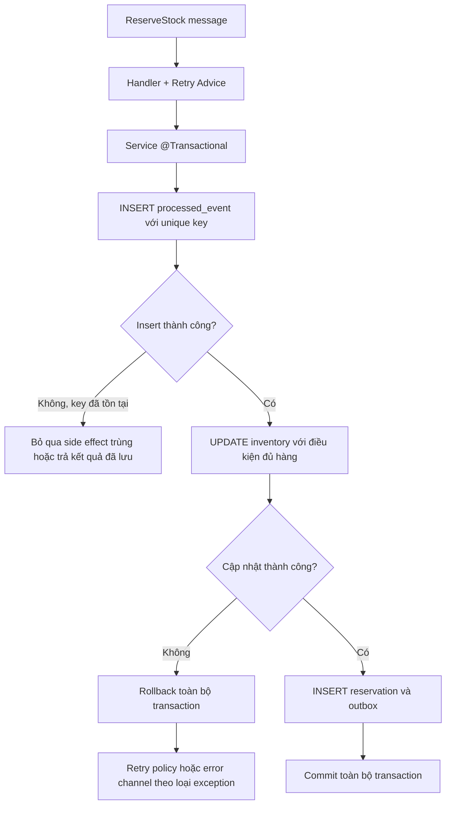
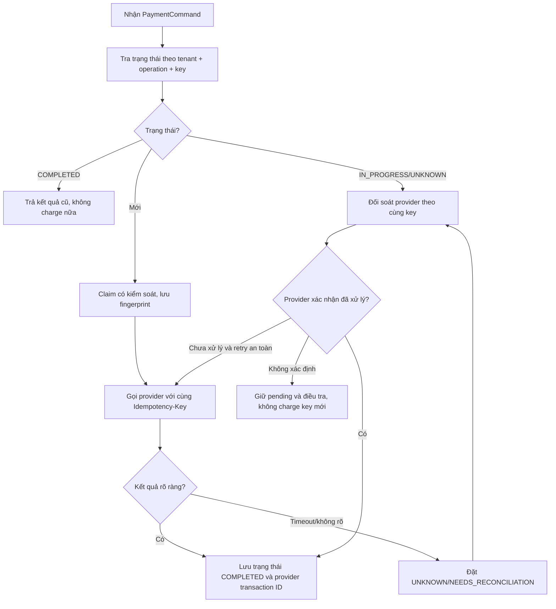

# Retry không idempotent gây side effect lặp trong Spring Integration

## 1. Vấn đề: một lần retry có thể tạo hai giao dịch thật

Một message trong luồng **Enterprise Integration Patterns (EIP)** có thể đi qua Filter, Transformer và Router rồi đến handler tạo vận đơn, trừ tồn kho hoặc yêu cầu thanh toán. Nếu downstream nhận và xử lý yêu cầu **thành công** nhưng phản hồi bị thất lạc, handler sẽ thấy timeout. Cơ chế retry có thể gửi lại **chính lệnh đó**; nếu phía nhận không chống trùng, hai lần gửi có thể tạo hai vận đơn, trừ kho hai lần hoặc thu tiền hai lần.

Đó là bài toán **“Retry không idempotent gây side effect lặp”** của chương **Retry**, thuộc module `SPRING_INTEGRATION_PATTERN`. Mục tiêu của module là triển khai các Enterprise Integration Patterns bằng Spring Integration để xây dựng luồng thông điệp ít phụ thuộc, dễ mở rộng và có khả năng kiểm thử, theo dõi các nhánh Router, Filter, Transformer, Splitter, Aggregator, Gateway, retry, error channel và correlation.

Retry giúp tăng xác suất **yêu cầu được xử lý**, nhưng tự nó **không bảo đảm yêu cầu chỉ gây tác động một lần**. Vì thế, tính đúng đắn của retry phải được thiết kế cùng với idempotency, transaction, recovery và khả năng quan sát.

Sau bài học, bạn sẽ biết cách:

- Nhận diện các tình huống timeout/phát lại dẫn đến side effect trùng.
- Phân biệt **at-least-once delivery**, **idempotent operation**, **deduplication** và tuyên bố **exactly-once**.
- Thiết kế khóa idempotency theo tenant, loại thao tác và định danh sự kiện.
- Chặn ghi trùng bằng **unique constraint và transaction nguyên tử**; không dùng kiểm tra rồi ghi tách rời.
- Hiểu giới hạn của transaction database khi handler còn gọi HTTP, email hoặc broker khác.
- Sử dụng Idempotent Receiver, transactional outbox/inbox và recovery phù hợp.
- Kiểm thử retry sau timeout, redelivery, concurrency, crash window và payload xung đột.

## 2. Idempotent là gì?

Một thao tác được gọi là **idempotent** nếu thực hiện lại nhiều lần với cùng ý nghĩa yêu cầu tạo ra **cùng hiệu ứng nghiệp vụ cuối cùng** như thực hiện một lần. Điều đó không bắt buộc HTTP response hoặc thời gian phản hồi luôn giống nhau; điều quan trọng là kết quả và tác động được kiểm soát.

Ví dụ:

| Thao tác | Idempotent sẵn? | Nguy cơ khi retry | Cách bảo vệ |
| --- | --- | --- | --- |
| `PUT /orders/42/status` với cùng trạng thái | Thường có thể idempotent | Ít thay đổi dữ liệu cuối, nhưng vẫn có thể bắn event lặp | Chống trùng event/audit |
| `POST /payments` tạo giao dịch mới mỗi lần | Không | Thu tiền hai lần | Idempotency key ở payment provider |
| `UPDATE stock SET quantity = quantity - 1` | Không | Trừ kho hai lần | Dedup theo event ID trong cùng DB transaction |
| `INSERT shipment` với ID ngẫu nhiên mới | Không | Tạo nhiều vận đơn | Unique business key hoặc idempotency API |
| Gửi email/SMS | Thường không | Gửi trùng thông báo | Outbox, khóa tác vụ gửi, chiến lược phía provider |
| Đặt một giá trị cố định bằng `SET` | Thường idempotent về trạng thái | Audit/log/callback vẫn có thể lặp | Kiểm soát mọi side effect phụ |

**Idempotency phải xét tác động thực tế**, không chỉ phép ghi dữ liệu chính. Ví dụ cập nhật đơn hàng bằng cùng trạng thái có thể không làm thay đổi row cuối cùng, nhưng một trigger gửi email mỗi lần update vẫn tạo tác động lặp.

## 3. Kịch bản kinh điển: downstream thành công, response timeout

Xét sự kiện `evt-pay-912` từ luồng thanh toán:



Caller có thể chỉ thấy một response “thành công”, trong khi khách đã bị thu tiền **hai lần**. Retry thành công về mặt kỹ thuật nhưng **thất bại về tính đúng đắn nghiệp vụ**.

### Trạng thái sau một timeout là “chưa biết”, không phải chắc chắn thất bại

| Điều hệ thống nhìn thấy | Trạng thái thật có thể xảy ra | Hành động an toàn |
| --- | --- | --- |
| Connect timeout trước khi gửi request | Downstream có thể chưa nhận | Retry có điều kiện |
| Read timeout sau khi gửi | Downstream có thể đã xử lý và commit | Tra cứu theo idempotency key hoặc retry với cùng key |
| HTTP 503 | Có thể chưa xử lý hoặc đã có side effect trước khi báo lỗi | Tùy hợp đồng API và idempotency |
| Consumer bị crash sau khi xử lý nhưng trước ack | Side effect đã commit; broker có thể giao lại | Dedup ở consumer hoặc downstream |
| Response trả thành công nhưng Gateway caller đã timeout | Caller có thể gửi lại lần nữa | Duy trì cùng khóa yêu cầu qua cả các lần gửi từ caller |

Vì vậy, không được suy luận rằng “đã ném exception thì rollback được mọi side effect”. Một HTTP request đã hoàn tất không thể tự rollback bởi transaction JDBC trong Spring.

## 4. Những tầng có thể làm lặp tác động

Một lệnh có thể đi qua nhiều cơ chế retry/redelivery, mỗi cơ chế có giới hạn riêng:

```text
Client retry (gửi lại HTTP request)
  └─ Gateway / ứng dụng
       └─ Broker redelivery (sau rollback/nack/seek)
            └─ RequestHandlerRetryAdvice (thử lại handler)
                 └─ HTTP client retry (nếu được cấu hình)
                      └─ Downstream side effect
```

Ví dụ minh họa: handler có tối đa **3 attempts** mỗi delivery, broker giao tối đa **4 deliveries** và HTTP client thực hiện tối đa **2 request** cho mỗi lần handler gọi. Trong kịch bản luôn lỗi và cả ba tầng đều kích hoạt, số request downstream tối đa theo các giả định ấy có thể là:

\[
3 \times 4 \times 2 = 24
\]

Nếu caller còn gửi lại request từ đầu hai lần thì tổng request có thể lớn hơn. Đây là **tích các giới hạn giả định**, không phải một thông số Spring Integration tự tính.

**Stateless retry** có thể bắt đầu lại bộ đếm khi broker redeliver; **stateful retry** lưu retry state theo message identity, nhưng không biến side effect bên ngoài thành idempotent. Retry identity chỉ giúp quản lý tiến độ thử lại, còn idempotency key giúp nhận diện **một thao tác không được thực hiện trùng**.

## 5. Thiết kế khóa idempotency chính xác

Một khóa tốt cần ổn định xuyên suốt attempts, broker redelivery, gọi lại từ client và lần phát lại thủ công của **cùng một thao tác**.

Ví dụ:

```text
tenantId        = vn-shop
operation       = create-shipment
eventId         = evt-912
idempotencyKey  = vn-shop:create-shipment:evt-912
```

Những nguyên tắc quan trọng:

1. **Duy nhất trong phạm vi cần bảo vệ:** Ghép tenant, loại thao tác và event ID. Hai sự kiện `create-shipment` và `cancel-shipment` cho cùng một order phải có khóa khác nhau.
2. **Giữ nguyên khi retry:** Không sinh UUID mới trong handler hoặc mỗi lần gọi HTTP. Nếu key thay đổi, downstream không thể nhận ra tác vụ lặp.
3. **Tách khỏi correlation ID khi cần:** Correlation ID của một batch có thể dùng chung cho nhiều part; dùng trực tiếp làm idempotency key sẽ gộp nhầm các tác vụ.
4. **Gắn với fingerprint của yêu cầu:** Cùng key nhưng amount/currency/order khác là xung đột dữ liệu, phải báo lỗi rõ ràng; không âm thầm trả kết quả cũ.
5. **Có chính sách lưu giữ:** TTL quá ngắn có thể cho phép gửi lại tác vụ cũ sau khi record bị xóa. Điều chỉnh theo chu kỳ nghiệp vụ, thời gian broker giữ message và quy định lưu trữ.
6. **Có quyền và phạm vi truy cập:** Khóa của tenant này không được dùng để truy xuất kết quả hoặc chiếm key của tenant khác.

| Khóa | Nhược điểm | Thay thế |
| --- | --- | --- |
| `MessageHeaders.ID` của Spring | Có thể được tạo mới khi broker redeliver hoặc Transformer tạo message khác | ID sự kiện bền vững trong payload/header đã bảo toàn |
| `orderId` duy nhất | Một đơn có thể có nhiều lần giao, hủy, hoàn tiền | `operation + eventId` |
| Timestamp hiện tại | Mỗi retry lại sinh khóa mới | UUID/event ID sinh **trước lần gửi đầu** và được lưu |
| Hash của mọi payload field | Một thay đổi không liên quan làm khóa mới; hai thao tác hợp lệ giống payload có thể bị gộp | Key riêng của intent + fingerprint để phát hiện key reuse |

Không dùng idempotency key làm mật khẩu hoặc bí mật xác thực. Đây là **định danh** để đối soát, không thay thế cơ chế authorization.

## 6. Idempotent Receiver trong Spring Integration

Spring Integration có mẫu **Idempotent Receiver** với `IdempotentReceiverInterceptor` và `MetadataStoreSelector`. Interceptor được gắn vào endpoint để quyết định message có phải bản lặp hay không.

Theo cấu hình:

- Khi selector cho rằng message bị lặp, interceptor có thể **đặt header `duplicateMessage = true`** rồi vẫn chuyển message tới handler.
- Nếu cấu hình `discardChannel` hoặc `throwExceptionOnRejection = true`, message lặp có thể bị loại khỏi lời gọi handler.
- `MetadataStoreSelector` có thể sử dụng `ConcurrentMetadataStore` để nhớ khóa đã thấy; store mặc định kiểu trong bộ nhớ không bảo đảm giữ state sau restart.

**Rất quan trọng:** “Đã thấy message” **không đồng nghĩa** “side effect đã commit”. Nếu selector đánh dấu một key là đã xử lý **trước** khi handler gửi giao dịch rồi handler gặp lỗi, bản redelivery có thể bị loại mất, khiến tác vụ **chưa hoàn tất nhưng không còn được thực hiện**.

Do đó khi dùng Idempotent Receiver:

1. Hiểu chính xác thời điểm claim key và thời điểm đánh dấu hoàn thành.
2. Thiết kế xử lý rollback/release claim khi handler thất bại.
3. Không đánh dấu hoàn tất chỉ vì message đã đi qua Filter hoặc interceptor.
4. Khi các worker chạy song song, dùng store có thao tác compare-and-set/unique key nguyên tử; `ConcurrentHashMap` chỉ bảo vệ trong cùng process, không bảo vệ toàn cụm.
5. Có cơ chế phân biệt **IN_PROGRESS**, **COMPLETED**, **FAILED**, **UNKNOWN/NEEDS_RECONCILIATION** cho các side effect không thể rollback.

Interceptor rất hữu ích để tổ chức một endpoint, nhưng **không thay thế** transaction và ràng buộc nhất quán trong database nghiệp vụ.

## 7. Chặn side effect trùng trong cùng database bằng transaction nguyên tử

Ví dụ nghiệp vụ **trừ tồn kho đúng một lần cho một sự kiện đặt giữ hàng**. Có thể đặt bản ghi “đã xử lý event” và cập nhật tồn kho trong **cùng một database transaction**. Nếu transaction rollback thì cả dấu xử lý lẫn thay đổi tồn kho đều rollback, giúp broker redelivery có thể thử lại an toàn.

### 7.1. Sơ đồ luồng



### 7.2. Lược đồ PostgreSQL minh họa

```sql
CREATE TABLE processed_events (
    consumer_name text NOT NULL,
    tenant_id text NOT NULL,
    event_id text NOT NULL,
    PRIMARY KEY (consumer_name, tenant_id, event_id)
);

CREATE TABLE inventory (
    tenant_id text NOT NULL,
    sku text NOT NULL,
    available integer NOT NULL CHECK (available >= 0),
    PRIMARY KEY (tenant_id, sku)
);

CREATE TABLE stock_reservations (
    tenant_id text NOT NULL,
    event_id text NOT NULL,
    sku text NOT NULL,
    quantity integer NOT NULL,
    PRIMARY KEY (tenant_id, event_id)
);

CREATE TABLE outbox_events (
    tenant_id text NOT NULL,
    event_id text NOT NULL,
    event_type text NOT NULL,
    sku text NOT NULL,
    quantity integer NOT NULL,
    published boolean NOT NULL DEFAULT false,
    PRIMARY KEY (tenant_id, event_id, event_type)
);
```

Các tên bảng/cột mang tính minh họa. Trong production cần thêm timestamps, trạng thái phát sự kiện, giới hạn dữ liệu, fingerprint và cơ chế giám sát; nếu khóa event có thể bị sử dụng lại với payload khác, cần lưu hash yêu cầu để phát hiện xung đột.

### 7.3. Java với Spring Transaction và JDBC

Ví dụ dùng Spring JDBC và Spring Transaction; phương thức `reserve(...)` được gọi **qua Spring bean/proxy** để `@Transactional` có hiệu lực. Unique constraint là chốt an toàn cho truy cập đồng thời.

```java
import org.springframework.jdbc.core.JdbcTemplate;
import org.springframework.stereotype.Service;
import org.springframework.transaction.annotation.Transactional;

record ReserveStock(String tenantId, String eventId,
                    String sku, int quantity, String idempotencyKey) {}

@Service
class StockReservationService {

    private final JdbcTemplate jdbc;

    StockReservationService(JdbcTemplate jdbc) {
        this.jdbc = jdbc;
    }

    @Transactional
    public void reserve(ReserveStock command) {
        if (command.quantity() <= 0
                || command.eventId() == null || command.eventId().isBlank()) {
            throw new IllegalArgumentException("Invalid reservation command");
        }

        int inserted = jdbc.update("""
                INSERT INTO processed_events
                    (consumer_name, tenant_id, event_id)
                VALUES (?, ?, ?)
                ON CONFLICT DO NOTHING
                """,
                "stock-reserver", command.tenantId(), command.eventId());

        // Cùng event đã commit ở lượt xử lý trước.
        if (inserted == 0) {
            return;
        }

        int changed = jdbc.update("""
                UPDATE inventory
                   SET available = available - ?
                 WHERE tenant_id = ?
                   AND sku = ?
                   AND available >= ?
                """,
                command.quantity(), command.tenantId(),
                command.sku(), command.quantity());

        if (changed != 1) {
            // Transaction rollback cả dấu processed_event vừa insert.
            throw new IllegalArgumentException("Not enough inventory");
        }

        jdbc.update("""
                INSERT INTO stock_reservations
                    (tenant_id, event_id, sku, quantity)
                VALUES (?, ?, ?, ?)
                """,
                command.tenantId(), command.eventId(),
                command.sku(), command.quantity());

        jdbc.update("""
                INSERT INTO outbox_events
                    (tenant_id, event_id, event_type, sku, quantity)
                VALUES (?, ?, 'STOCK_RESERVED', ?, ?)
                """,
                command.tenantId(), command.eventId(),
                command.sku(), command.quantity());
    }
}
```

**Tại sao ví dụ này hạn chế trùng tác động?**

- Lượt xử lý đầu ghi `processed_events`, trừ tồn kho, tạo reservation và outbox trong **một physical database transaction**.
- Nếu transaction thành công nhưng response cho consumer bị mất, redelivery sẽ thấy unique key đã tồn tại và **không trừ kho lần hai**.
- Nếu transaction thất bại, cả dấu đã xử lý lẫn trừ kho đều rollback. Redelivery có thể thử lại sau khi nguyên nhân lỗi được khắc phục.
- Hai consumer đồng thời xử lý cùng `tenantId/eventId` không thể cùng insert thành công dưới unique constraint; database thực thi loại trừ cần thiết.

Đây chỉ là chống trùng **trong một database**. Nếu ở giữa phương thức này còn gọi HTTP tạo vận đơn, transaction PostgreSQL **không** rollback được cuộc gọi đã thành công ở hệ thống ngoài.

**Giới hạn của ví dụ:** Nhánh `inserted == 0` trả về bình thường chỉ hợp lệ khi event ID chắc chắn đại diện cùng payload nghiệp vụ. Ứng dụng thực cần đối chiếu fingerprint và có thể trả lại kết quả reservation trước đó, không âm thầm chấp nhận cùng event ID nhưng SKU/quantity khác. Ngoài ra, lỗi hết hàng là lỗi nghiệp vụ cần đi nhánh xử lý xác định, không retry vô hạn cùng dữ liệu.

## 8. Gắn retry advice vào đúng handler

Với **Spring Integration 6.x + Spring Retry**, có thể dùng `RequestHandlerRetryAdvice` ở ngoài service `@Transactional`. Vì transaction của service hoàn tất trước khi exception quay về advice, một deadlock/temporary DB failure có thể rollback rồi được retry trong transaction mới.

```java
import java.util.Map;

import org.springframework.context.annotation.Bean;
import org.springframework.context.annotation.Configuration;
import org.springframework.integration.annotation.MessageEndpoint;
import org.springframework.integration.annotation.ServiceActivator;
import org.springframework.integration.channel.DirectChannel;
import org.springframework.integration.handler.advice.RequestHandlerRetryAdvice;
import org.springframework.messaging.MessageChannel;
import org.springframework.retry.backoff.FixedBackOffPolicy;
import org.springframework.retry.policy.SimpleRetryPolicy;
import org.springframework.retry.support.RetryTemplate;

@Configuration
class StockRetryConfiguration {

    @Bean
    MessageChannel reserveRequests() {
        return new DirectChannel();
    }

    @Bean
    RequestHandlerRetryAdvice stockRetryAdvice() {
        RetryTemplate template = new RetryTemplate();
        template.setRetryPolicy(new SimpleRetryPolicy(
                3, Map.of(TransientStockException.class, true), true));

        FixedBackOffPolicy backoff = new FixedBackOffPolicy();
        backoff.setBackOffPeriod(200L);
        template.setBackOffPolicy(backoff);

        RequestHandlerRetryAdvice advice = new RequestHandlerRetryAdvice();
        advice.setRetryTemplate(template);
        return advice;
    }
}

@MessageEndpoint
class StockReservationHandler {
    private final StockReservationService service;

    StockReservationHandler(StockReservationService service) {
        this.service = service;
    }

    @ServiceActivator(
            inputChannel = "reserveRequests",
            adviceChain = "stockRetryAdvice")
    public void handle(ReserveStock command) {
        service.reserve(command);
    }
}

class TransientStockException extends RuntimeException {
    TransientStockException(String message, Throwable cause) {
        super(message, cause);
    }
}
```

Adapter/repository phải **phân loại lỗi database có thể thử lại** thành `TransientStockException` tại ranh giới hợp lý. Không bọc mọi `RuntimeException` (kể cả validation) thành transient. Ví dụ service `StockReservationService` ở mục 7 đang minh họa logic giao dịch; ứng dụng thực cần ánh xạ riêng những lỗi deadlock, lỗi kết nối hoặc xung đột tạm thời theo loại database/driver.

Với **Spring Integration 7.x**, cách khai báo retry policy đã đổi sang Spring Framework:

```java
import java.time.Duration;

import org.springframework.core.retry.RetryPolicy;
import org.springframework.integration.handler.advice.RequestHandlerRetryAdvice;

RetryPolicy policy = RetryPolicy.builder()
        .maxRetries(2) // Hai lần gọi lại sau lần đầu: tổng 3 attempts.
        .delay(Duration.ofMillis(200))
        .includes(TransientStockException.class)
        .build();

RequestHandlerRetryAdvice advice = new RequestHandlerRetryAdvice();
advice.setRetryPolicy(policy);
```

Đây là phần cấu hình minh họa trong một phương thức Java hợp lệ; tích hợp thành bean advice để dùng với endpoint. **Không trộn** `org.springframework.retry.support.RetryTemplate` (6.x) và `org.springframework.core.retry.RetryPolicy` (7.x) vào một cấu hình advice không tương thích. Trong cả hai thế hệ, **retry chính nó không tạo idempotency**; ràng buộc dữ liệu ở mục 7 mới là lớp phòng vệ.

## 9. Side effect bên ngoài database: phải dùng idempotency ở đích

Đặt dấu “đã xử lý” trong database **trước khi** gọi payment API sẽ tạo ra một cửa sổ lỗi:

1. Ứng dụng lưu trạng thái `IN_PROGRESS`.
2. Ứng dụng gọi payment provider; provider đã charge thành công.
3. Ứng dụng crash trước khi cập nhật `COMPLETED`.
4. Message được giao lại, nhìn thấy `IN_PROGRESS` nhưng không biết charge đã xảy ra hay chưa.

Nếu coi mọi `IN_PROGRESS` là “đã làm xong” và bỏ qua, giao dịch chưa thực hiện có thể bị mất. Nếu coi mọi `IN_PROGRESS` là “chưa làm” rồi gọi API bằng một **key mới**, khách có thể bị charge hai lần.

Một chiến lược an toàn hơn:



Với API có hỗ trợ **Idempotency-Key**, hãy gửi **cùng khóa** cho mọi attempts, redelivery và replay cùng thao tác. Dùng idempotency key không bảo đảm provider nào cũng giữ kết quả mãi mãi: cần đọc hợp đồng về phạm vi key, payload mismatch, TTL và hành vi retry.

Nếu provider **không hỗ trợ** idempotency hoặc API tra cứu giao dịch, hệ thống không thể tự suy ra một outcome chắc chắn từ timeout. Khi đó có thể cần đối soát thủ công, thao tác bù trừ hoặc thay đổi tích hợp; không thể đảm bảo exactly-once end-to-end chỉ bằng retry advice.

### Transactional outbox hỗ trợ đến đâu?

**Transactional outbox** lưu dữ liệu nghiệp vụ và sự kiện cần gửi vào bảng outbox trong cùng DB transaction. Một publisher độc lập đọc bảng và gửi đi sau commit.

- Giải quyết cửa sổ lỗi **DB commit xong nhưng ứng dụng crash trước khi phát message**, vì outbox vẫn lưu công việc cần phát.
- Không mặc định bảo đảm bên nhận chỉ thấy **một** message: publisher có thể phát xong rồi crash trước khi đánh dấu `published` và sẽ gửi lại.
- Vì vậy, **outbox + idempotent consumer** hoặc **idempotency ở downstream** vẫn là tổ hợp cần thiết. Hai cơ chế bổ trợ nhau, không thay thế nhau.

## 10. Router, Splitter/Aggregator, Gateway và error channel

Vị trí phát sinh side effect ảnh hưởng đến phạm vi retry:

| EIP | Nguy cơ trùng khi retry/redelivery | Khuyến nghị |
| --- | --- | --- |
| **Router** | Gửi lại toàn bộ event có thể chạy lại một nhánh đã thành công | Mỗi nhánh giữ trạng thái/khóa theo operation và endpoint |
| **Filter** | Lọc trùng quá sớm, bỏ message chưa được xử lý xong | Chỉ đánh dấu hoàn tất sau commit hoặc dùng quy trình claim/release đúng |
| **Transformer** | Tạo payload/header mới làm mất event ID | Truyền ID nghiệp vụ ổn định xuyên các bước |
| **Splitter** | Từng part có thể được retry hoặc broker giao lại | Khóa idempotency chứa `eventId + partId + operation` |
| **Aggregator** | Nhận trùng part, đếm sai completion hoặc phát kết quả hai lần | Quản lý correlation/sequence và trạng thái phát kết quả một lần |
| **Gateway** | Caller timeout rồi gửi lại cùng yêu cầu | Yêu cầu client giữ idempotency key qua các lần gửi |
| **Error channel** | Replay message lỗi có thể chạy lại side effect đã commit | Đối soát trạng thái trước khi replay; không auto-replay vô hạn |

Ví dụ Splitter chia một order thành ba kiện: `part-1` đã gửi thành công, `part-2` timeout, `part-3` thành công. Nếu redeliver toàn order mà không có khóa riêng từng kiện, hệ thống có thể gửi `part-1` và `part-3` lần nữa. Một khóa phù hợp có thể là:

```text
tenant:shipment:create:order-42:part-1
tenant:shipment:create:order-42:part-2
tenant:shipment:create:order-42:part-3
```

Vẫn giữ cùng `correlationId` cho nhóm để Aggregator nhận biết quan hệ các part. **Correlation ID** giúp ghép message, nhưng không tự là idempotency key cho mọi part.

## 11. Recovery và dead-letter phải giữ đủ dữ liệu đối soát

`RequestHandlerRetryAdvice` có thể cấu hình `ErrorMessageSendingRecoverer` để đưa lỗi vào recovery channel khi hết attempts. Tuy nhiên:

- Recovery callback chạy xong **không có nghĩa** side effect không xảy ra. Timeout có thể che giấu một giao dịch đã hoàn tất ở provider.
- Nếu recovery chỉ ghi log rồi trả bình thường, consumer có thể ack/commit và message không được broker giao lại nữa.
- Khi cần replay, **kiểm tra transaction ID/provider status và idempotency key trước**, đặc biệt với thanh toán.
- Nếu recorder ghi lỗi thất bại, exception cần được xử lý rõ thay vì nuốt và khiến message mất đường khôi phục.

Một bản ghi failure nên có `tenantId`, `eventId`, `operation`, `idempotencyKey`, fingerprint, endpoint, correlation ID, số attempts/deliveries nếu được đo, exception cuối, provider transaction ID nếu có và trạng thái `UNKNOWN`/`FAILED`/`COMPLETED`. Không ghi thẻ thanh toán hoặc payload chứa bí mật vào log.

**Không đồng nhất dead-letter với an toàn để replay.** Dead-letter queue lưu message lỗi, nhưng người vận hành vẫn phải đối soát xem side effect đã commit trước khi lỗi xuất hiện hay chưa.

## 12. Kiểm thử: timeout sau side effect không được tạo trùng

### 12.1 Unit test mô phỏng provider có idempotency key

Ví dụ sau dùng JUnit 5 và `RetryTemplate` của Spring Retry 2.x (Spring Integration 6.x). Provider giả lập **đã ghi giao dịch** nhưng làm mất response lần đầu. Retry gửi lại cùng key và nhận cùng kết quả mà **không tạo charge thứ hai**.

```java
import java.util.Map;
import java.util.concurrent.ConcurrentHashMap;
import java.util.concurrent.atomic.AtomicBoolean;
import java.util.concurrent.atomic.AtomicInteger;

import org.junit.jupiter.api.Test;
import org.springframework.retry.backoff.NoBackOffPolicy;
import org.springframework.retry.policy.SimpleRetryPolicy;
import org.springframework.retry.support.RetryTemplate;

import static org.junit.jupiter.api.Assertions.assertEquals;

class DuplicateSideEffectTest {

    @Test
    void sameIdempotencyKeyPreventsDoubleChargeAfterLostResponse() {
        Map<String, String> completedCharges = new ConcurrentHashMap<>();
        AtomicInteger sideEffects = new AtomicInteger();
        AtomicInteger apiCalls = new AtomicInteger();
        AtomicBoolean dropFirstResponse = new AtomicBoolean(true);

        RetryTemplate template = new RetryTemplate();
        template.setRetryPolicy(new SimpleRetryPolicy(
                3, Map.of(TemporaryPaymentTimeout.class, true), true));
        template.setBackOffPolicy(new NoBackOffPolicy());

        String key = "vn-shop:charge:evt-pay-912";

        String result = template.execute(context -> {
            apiCalls.incrementAndGet();

            // Mô phỏng atomic claim và record giao dịch ở provider.
            String previous = completedCharges.putIfAbsent(key, "charge-42");
            if (previous == null) {
                sideEffects.incrementAndGet();
            }

            // Charge đã thực hiện nhưng lần đầu caller không nhận phản hồi.
            if (dropFirstResponse.getAndSet(false)) {
                throw new TemporaryPaymentTimeout("response lost");
            }
            return completedCharges.get(key);
        });

        assertEquals("charge-42", result);
        assertEquals(2, apiCalls.get());
        assertEquals(1, sideEffects.get());
    }
}

class TemporaryPaymentTimeout extends RuntimeException {
    TemporaryPaymentTimeout(String message) {
        super(message);
    }
}
```

Test chỉ mô phỏng API provider trong bộ nhớ; nó **không** chứng minh tính bền vững sau restart, không kiểm thử transaction thật và cũng không bảo đảm provider thực tế có cùng semantics. Khi tích hợp provider, cần test hợp đồng idempotency, TTL và cách xử lý key trùng khác payload.

### 12.2 Integration test bắt buộc

| Tình huống | Kết quả cần xác nhận |
| --- | --- |
| Gửi `ReserveStock` lần đầu | Inventory giảm đúng `quantity`, một reservation/outbox |
| Broker redelivery cùng `tenantId/eventId` | Inventory không giảm thêm, không tạo reservation mới |
| Hai consumer xử lý đồng thời cùng event | Một side effect duy nhất nhờ unique constraint/atomic transaction |
| Đã insert key nhưng transaction DB rollback | Không còn dấu processed, có thể retry an toàn |
| Cùng key nhưng payload khác `sku` hoặc `quantity` | Phát hiện conflict, không âm thầm trả success |
| Retry nhiều lần do HTTP timeout sau provider commit | Một charge/shipment ở provider, cùng idempotency key |
| Crash trước và sau DB commit | Trạng thái cuối nhất quán; outbox không mất việc cần phát |
| Outbox publisher gửi xong rồi crash trước update | Consumer downstream dedup được event nhận lặp |
| Splitter một part thất bại | Những part đã thành công không gây side effect lặp |
| Recovery/đối soát trạng thái `UNKNOWN` | Không replay bằng key mới khi kết quả chưa rõ |
| TTL idempotency hết nhưng broker còn message cũ | Chính sách retention/replay tránh xử lý lại sai |

Với database, chạy integration test trên PostgreSQL hoặc môi trường có semantics giống production. Dùng **hai transaction/connections riêng** để mô phỏng concurrency; sau test truy vấn database bằng transaction độc lập nhằm xác nhận những gì thực sự đã commit. Một test chỉ verify method mock được gọi một lần chưa đủ để chứng minh cơ chế chống trùng ở DB.

## 13. Quan sát side effect thực tế

Trong vận hành, ngoài `retry_attempts` và `broker_delivery_count`, cần theo dõi:

- **`duplicate_events_detected`**: số event bị nhận diện trùng theo endpoint/operation.
- **`idempotency_conflicts`**: cùng key nhưng fingerprint không khớp — cần cảnh báo điều tra.
- **`business_side_effects_committed`**: số giao dịch/reservation thực sự commit, so với số API requests.
- **`outcomes_unknown`** và **`reconciliation_latency`**: số giao dịch timeout không biết kết quả và thời gian đối soát.
- **`outbox_backlog`** và số lần publisher gửi lại.
- **`recovery_replay_total`**: số lần phát lại thủ công hoặc tự động, kèm kết quả cuối.

Metric labels nên là endpoint, loại tác vụ, nhóm lỗi và outcome. `eventId`, `idempotencyKey`, `orderId` và correlation ID là định danh có cardinality cao: dùng chúng trong structured log/tracing có kiểm soát, **không** gắn thành label cho mọi time series.

Một request đã đi qua ba attempts và thành công không có nghĩa hệ thống khỏe: cần theo dõi cả độ trễ, tỷ lệ thành công sau retry, số side effect thực và tình trạng downstream để phát hiện retry storm.

## 14. Sai lầm thường gặp

| Sai lầm | Hậu quả | Cách khắc phục |
| --- | --- | --- |
| Timeout được hiểu là chắc chắn “chưa xử lý” | Gửi lại và tạo side effect thứ hai | Coi là trạng thái chưa rõ, tra cứu và dùng cùng idempotency key |
| Sinh key mới ở mỗi retry | Provider không thể phát hiện trùng | Sinh một lần tại đầu intent nghiệp vụ |
| Chỉ `SELECT` kiểm tra rồi `INSERT` | Hai worker song song cùng đi qua check | Unique constraint + ghi nguyên tử/transaction |
| Đánh dấu processed trước handler rồi không hoàn tác khi lỗi | Redelivery bị loại dù tác vụ chưa xong | Gắn processed marker với transaction hoặc có state machine an toàn |
| Key chỉ gồm `orderId` | Gộp nhầm tạo, hủy, hoàn, nhiều part | Namespace tenant/operation/event/part |
| Cùng key nhưng payload khác vẫn trả success | Che lỗi dữ liệu, trả kết quả sai | Lưu fingerprint và trả conflict |
| Tưởng `@Transactional` rollback được HTTP | Side effect ngoài DB bị lặp | Idempotency ở provider, outbox/saga |
| Tưởng outbox bảo đảm phát message đúng một lần | Publisher crash có thể phát trùng | Consumer idempotent |
| Tưởng stateful retry đồng nghĩa idempotent | Retry state đúng nhưng downstream tạo trùng | Tách retry identity và idempotency key |
| Đặt TTL key quá ngắn | Late redelivery thành tác vụ mới | Retention theo vòng đời nghiệp vụ |
| Tự động replay mọi message trong DLQ | Chạy lại giao dịch đã commit | Đối soát trước replay |

## 15. Bài thực hành

Thiết kế flow `OrderCreated → Filter → Transformer → Router`; nhánh **Inventory** dùng `@Transactional` ghi `processed_events`, giảm tồn và ghi outbox cùng một transaction. Nhánh **Carrier** gửi yêu cầu tạo vận đơn với idempotency key ổn định. Giả lập `RequestHandlerRetryAdvice` cho phép tối đa ba attempts, sau đó broker có thể redeliver.

Thực hiện ít nhất các tình huống: (1) giao dịch DB commit nhưng consumer crash trước ack, (2) hai consumer cùng xử lý một event, (3) handler tạo vận đơn thành công nhưng response timeout, (4) một part của Splitter thất bại, (5) cùng key được gửi với payload khác và (6) recovery cần replay sau khi đối soát. Đo số requests, số side effects đã commit, `eventId`, `correlationId`, attempts, deliveries và trạng thái cuối.

**Tiêu chí hoàn thành:** Một event hợp lệ tạo đúng một tác động nghiệp vụ theo từng operation; các redelivery/retry không ghi trùng; key reuse sai payload bị phát hiện; crash/rollback không làm mất tác vụ chưa hoàn tất; giao dịch ngoài DB được đối soát và retry bằng cùng key; recovery không đánh dấu thành công giả và không phát lại vô điều kiện.

## Tài liệu tham khảo

- [Spring Integration — Idempotent Receiver](https://docs.spring.io/spring-integration/reference/handler-advice/idempotent-receiver.html): `IdempotentReceiverInterceptor`, `MetadataStoreSelector`, duplicate header và discard strategy.
- [Spring Integration — Retry Advice](https://docs.spring.io/spring-integration/reference/handler-advice/classes.html): `RequestHandlerRetryAdvice`, stateless/stateful retry và recovery.
- [Spring Integration — Transaction Support](https://docs.spring.io/spring-integration/reference/transactions.html): transaction boundaries và khả năng rollback trong flow.
- [Spring Framework — Transaction Propagation](https://docs.spring.io/spring-framework/reference/data-access/transaction/declarative/tx-propagation.html): `REQUIRED`, `REQUIRES_NEW` và rollback semantics.
