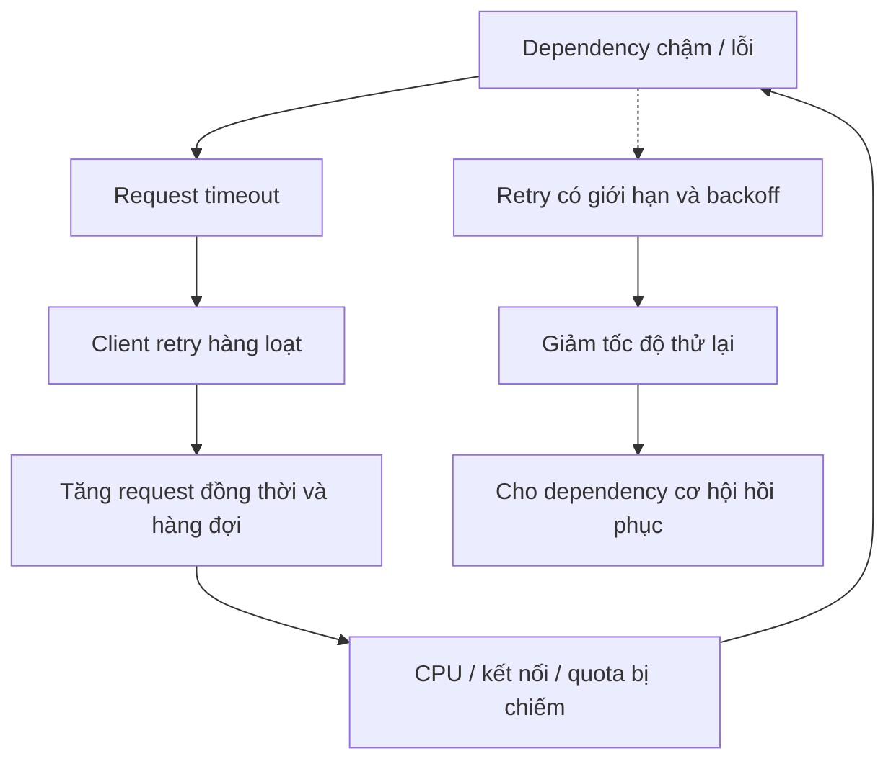
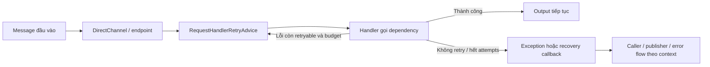
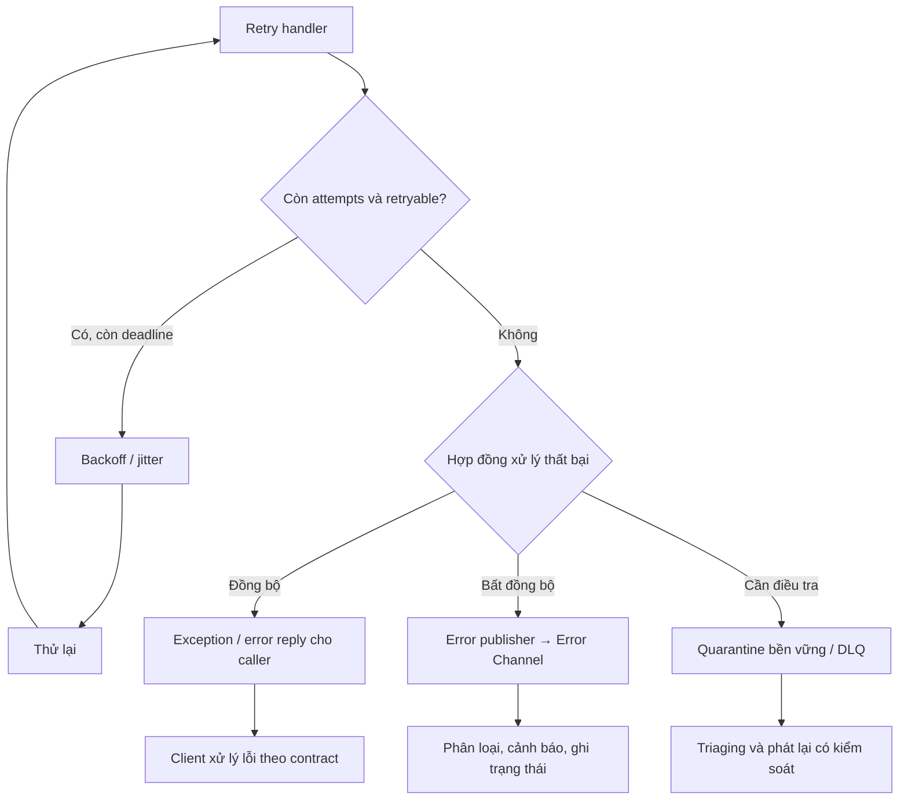

# Giới hạn retry để tránh bão tải trong Spring Integration

## 1. Bối cảnh: khi cơ chế phục hồi trở thành nguồn gây sự cố

Trong module `SPRING_INTEGRATION_PATTERN`, chúng ta triển khai **Enterprise Integration Patterns** (EIP) với Spring Integration để xây dựng các luồng thông điệp ít phụ thuộc, dễ mở rộng, có khả năng kiểm thử và quan sát. Một message có thể đi qua Router, Filter, Transformer, Splitter, Aggregator, Gateway và Service Activator trước khi gọi một dịch vụ bên ngoài. Khi bước đó timeout hoặc trả lỗi tạm thời, retry có thể giúp công việc hoàn thành mà không cần can thiệp thủ công.

Tuy nhiên, **retry không giới hạn hoặc retry quá dày có thể tạo bão tải** (*retry storm*): hệ thống đang quá tải lại nhận thêm nhiều lời gọi lặp từ các client. Độ trễ tăng, connection pool cạn, queue dài thêm, nhiều request timeout và tiếp tục kích hoạt retry. Kết quả là cả các luồng trước đó còn hoạt động tốt cũng có thể bị ảnh hưởng.

Ví dụ: Một endpoint đang nhận 1.000 yêu cầu mỗi giây. Nếu mọi yêu cầu đều thất bại và mỗi yêu cầu được gọi tối đa **3 lần, tính cả lần đầu**, số lượt gọi tới dependency có thể đạt khoảng **3.000 lượt** cho mỗi 1.000 yêu cầu gốc, trước khi xét giới hạn tốc độ, backoff, hàng đợi và các request kết thúc sớm. Nếu nhiều tầng cùng retry, mức khuếch đại còn lớn hơn.

**Mục tiêu bài học:** Thiết kế retry như một chính sách **có giới hạn, có điều kiện và có ngân sách**, thay vì chỉ “thử lại cho đến khi thành công”.

Sau bài này, bạn có thể:

- Nhận diện vòng lặp khuếch đại lưu lượng gây retry storm.
- Phân biệt `maxAttempts`, số lần retry bổ sung, backoff, jitter và deadline.
- Chọn exception có thể retry; dừng ngay đối với lỗi không thể phục hồi bằng thử lại.
- Cấu hình `RequestHandlerRetryAdvice`, `RetryTemplate`, `SimpleRetryPolicy` và `ExponentialBackOffPolicy` trong Spring Integration Java DSL.
- Viết JUnit test cho thành công sau retry, hết số lần thử và lỗi không được retry.
- Kết hợp retry với timeout, rate limiter, bulkhead, circuit breaker, Error Channel và quarantine.
- Thiết kế idempotency, correlation, metric và chính sách cho luồng đồng bộ/bất đồng bộ.

## 2. Retry storm hình thành như thế nào?

### 2.1. Vòng xoáy phản hồi dương

Khi dependency bị chậm, các lời gọi bắt đầu timeout. Caller thường giả định lỗi là nhất thời và lập tức gọi lại. Mỗi lần thử lại sử dụng thêm thread, socket, database connection hoặc quota API. Dependency càng chậm thì càng nhiều timeout, và timeout lại sinh thêm retry.



Một chu trình đặc biệt nguy hiểm xảy ra khi nhiều worker cùng nhận thấy lỗi trong cùng một khoảng thời gian, rồi cùng retry sau **một thời gian chờ cố định**. Các đợt gọi trùng nhịp tạo những đỉnh tải lặp lại (*thundering herd*). **Jitter** — độ ngẫu nhiên có kiểm soát trong thời gian chờ — giúp các worker không thức dậy cùng lúc.

### 2.2. Retry lồng nhau khuếch đại theo cấp số nhân

Giả sử có ba tầng: HTTP client → order service → payment gateway. Nếu **mỗi tầng đều thực hiện tối đa 3 attempts**, số lần gọi đến dependency cuối trong tình huống xấu có thể lên đến:

```text
3 attempts của HTTP client
  × 3 attempts của order service
  × 3 attempts của payment gateway
  = 27 lượt gọi tới dependency cuối / một yêu cầu ban đầu
```

Đây là ví dụ giả định để thấy **hệ số khuếch đại**, không phải kết quả luôn xảy ra: thời gian chờ, deadline hoặc chính sách của từng tầng có thể làm số lượt thực tế nhỏ hơn.

**Nguyên tắc:** Chỉ định **tầng sở hữu retry** đối với một thao tác. Nếu nhiều tầng bắt buộc có retry, phải chia sẻ hoặc giới hạn ngân sách tổng để không nhân số lần thử một cách vô tình.

### 2.3. Retry vô ích

Không phải exception nào cũng nên retry. Lỗi payload thiếu trường bắt buộc, số tài khoản không hợp lệ hay vi phạm business rule sẽ không tự hết sau vài trăm mili-giây. Retry những lỗi này chỉ tạo thêm tải và che khuất nguyên nhân thật.

| Nhóm lỗi | Ví dụ | Hướng xử lý |
| --- | --- | --- |
| Có thể tạm thời | Connection reset nhất thời, HTTP 503, mất kết nối ngắn | Retry giới hạn nếu thao tác an toàn và còn deadline. |
| Bị giới hạn tốc độ | HTTP 429 | Tôn trọng `Retry-After` hợp lệ, đồng thời giảm tốc độ gọi; không retry ngay liên tục. |
| Sai dữ liệu hoặc contract | Thiếu `orderId`, dữ liệu vi phạm schema, HTTP 400 | Dừng retry, trả lỗi nghiệp vụ hoặc quarantine. |
| Lỗi xác thực/ủy quyền | HTTP 401/403 | Xử lý token/quyền truy cập theo contract; không retry mù quáng. |
| Timeout trạng thái không rõ | Lệnh thanh toán có thể đã được đối tác xử lý | Đối soát trạng thái/idempotency trước khi phát lại. |
| Quá tải kéo dài | Dependency liên tục 503, pool bão hòa | Giảm lưu lượng, circuit breaker, backoff dài hoặc từ chối có kiểm soát. |

## 3. Các giới hạn cần có trong một chính sách retry

**Chỉ đặt `maxAttempts` chưa đủ**. Với hàng nghìn message cùng thất bại, mỗi message được phép thử 3 lần vẫn có thể tạo lượng lời gọi quá lớn. Nên có các giới hạn bổ sung:

| Giới hạn | Câu hỏi cần trả lời | Ví dụ chính sách |
| --- | --- | --- |
| Attempts mỗi message | Một công việc được gọi tối đa bao nhiêu lần? | 3 attempts, bao gồm lần đầu. |
| Thời gian chờ giữa các lần | Retry có dồn dập không? | Exponential backoff với jitter. |
| Ngân sách thời gian | Tổng chờ và thực thi có vượt deadline của caller không? | Không thử nếu thời gian còn lại không đủ. |
| Concurrency/bulkhead | Có bao nhiêu tác vụ cùng gọi dependency? | Giới hạn riêng cho mỗi integration. |
| Tốc độ đầu vào | Bao nhiêu request mỗi giây được phép vào dependency? | Token bucket/rate limiter. |
| Kích thước backlog | Queue chờ có thể phình lên vô hạn không? | Queue có giới hạn và chính sách khi đầy. |
| Ngân sách tổng nhiều tầng | Có retry lồng nhau không? | Chọn một owner hoặc dùng retry budget xuyên tầng. |
| Điểm kết thúc | Hết ngân sách thì message đi đâu? | Error Channel, trạng thái thất bại, quarantine hoặc reply lỗi. |

### 3.1. `maxAttempts` tính cả lần đầu

Với Spring Retry, `SimpleRetryPolicy(3, ...)` cho phép **tối đa 3 lần thực thi**, không phải một lần đầu cộng ba lần retry.

```text
Attempt 1: gọi dependency → lỗi tạm thời
             đợi backoff
Attempt 2: gọi dependency → lỗi tạm thời
             đợi backoff
Attempt 3: gọi dependency → lỗi lần nữa
             dừng, ném exception / chuyển recovery theo policy
```

Vì vậy, nếu chính sách yêu cầu “tối đa hai lần thử lại sau lần đầu”, chọn `maxAttempts=3`.

### 3.2. Exponential backoff và jitter

Với backoff tăng theo cấp số nhân, thời gian chờ có thể được tính theo dạng:

```text
delay(k) = min(maxDelay, initialDelay × multiplier^(k - 1))
```

Ví dụ `initialDelay=100 ms`, `multiplier=2`, `maxDelay=1.000 ms`:

| Lần chuẩn bị retry | Đợi trước lần gọi tiếp theo |
| --- | ---: |
| Sau attempt 1 | 100 ms |
| Sau attempt 2 | 200 ms |
| Sau attempt 3 | 400 ms — chỉ nếu còn attempts để thử. |
| Các lần sau | Tăng đến giới hạn 1.000 ms. |

Với `maxAttempts=3`, chỉ có **hai khoảng chờ**, 100 và 200 ms. Backoff không làm tăng số lần thử được phép; nó chỉ phân tán chúng theo thời gian.

Jitter giúp tránh mọi worker cùng retry ở mốc 100, 200 hoặc 400 ms. Có thể dùng chính sách backoff ngẫu nhiên của Spring Retry hoặc tự chọn một biến thể jitter phù hợp và kiểm thử phân phối độ trễ. Không nên dùng thời gian ngủ cố định giống nhau cho tất cả worker ở quy mô lớn.

### 3.3. Deadline và timeout cho từng attempt

`maxAttempts` và backoff không tự bảo đảm một request kết thúc đúng thời hạn. Nếu một lần gọi dependency có thể treo 30 giây, ba attempts có thể khiến Gateway hoặc HTTP caller timeout trước khi retry kết thúc.

Ngân sách thời gian tổng được hình dung như:

```text
Tổng thời gian ≈ Σ(thời gian attempt thực tế)
              + Σ(backoff giữa các attempts)
              + thời gian xếp hàng / điều phối
```

Hãy cấu hình **connect timeout**, **read/response timeout** và **deadline cho toàn bộ operation**. Không bắt đầu attempt mới khi gần hết deadline; việc timeout tại tầng ngoài không nhất thiết dừng ngay worker ở tầng trong.

### 3.4. Retry budget theo lưu lượng tổng

Khi hệ thống có tải gốc lớn, có thể giới hạn tỷ lệ **lượt retry bổ sung trên lưu lượng gốc** trong một cửa sổ thời gian. Ví dụ cho phép một ngân sách retry nhỏ thay vì cho mọi request thất bại cùng tạo hai lần thử thêm. Khi hết ngân sách, trả lỗi có kiểm soát, defer công việc hoặc đưa sang quarantine theo contract.

Một retry budget toàn cục/cấp service là **cơ chế bổ sung**, không được suy ra từ `SimpleRetryPolicy` per-message. Bạn phải thiết kế nó bằng rate limiter, quota, điều phối phân tán hoặc một thư viện chuyên dụng.

## 4. Retry nằm ở đâu trong Spring Integration?

Trong Spring Integration, **Retry Pattern** thường được áp dụng bằng advice bao quanh một handler hoặc endpoint, tiêu biểu là `RequestHandlerRetryAdvice` kết hợp Spring Retry `RetryTemplate`. Advice này chịu trách nhiệm thử lại thao tác được bao; nó không tự giới hạn toàn bộ các publisher khác hoặc toàn bộ ứng dụng.



**Phạm vi của advice quan trọng:** Nếu advice được gắn vào Service Activator gọi API thanh toán, nó có thể retry Service Activator đó. Nếu lỗi phát sinh ở một endpoint downstream **không nằm trong phạm vi advice**, chính sách này không mặc nhiên bao phủ endpoint downstream.

### Đồng bộ và bất đồng bộ

| Luồng | Ảnh hưởng của retry | Rủi ro chính |
| --- | --- | --- |
| `DirectChannel` đồng bộ | Advice retry có thể giữ thread gọi trong các attempts và thời gian backoff. | Tăng latency, chiếm HTTP/request threads, vượt timeout caller. |
| `ExecutorChannel` | Retry trong handler chạy ở worker nếu advice gắn tại đó. | Worker threads bị giữ trong lúc backoff; queue và backlog tăng. |
| `QueueChannel` + poller | Retry tại polling endpoint có thể lặp lại xử lý trên thread poller. | Một message lỗi chiếm poller, ảnh hưởng throughput message khác. |
| Inbound adapter/broker | Có thể có retry của adapter và redelivery của broker ngoài advice. | Retry lồng nhau, duplicate side effects, ACK/rollback sai thời điểm. |

Nếu dùng blocking backoff trong `RequestHandlerRetryAdvice`, các khoảng chờ thường giữ thread đang thực thi. Trong hệ thống nhiều request, nên cân nhắc delayed queue/scheduler hoặc redelivery có delay thay vì chiếm toàn bộ worker trong lúc đợi.

## 5. Java DSL: giới hạn attempts và chỉ retry lỗi tạm thời

Ví dụ dùng **Java 17, Spring Integration Java DSL và Spring Retry**. Trong Spring Boot có thể sử dụng `spring-boot-starter-integration`, dependency `spring-retry` và `spring-boot-starter-test` cho JUnit 5/AssertJ. Cần cấu hình dependency tương ứng với phiên bản Spring Boot mà dự án sử dụng.

Mẫu sau cố ý:

1. Áp dụng advice cho **một handler** cụ thể.
2. Giới hạn tối đa **3 attempts**, tính cả lần đầu.
3. Chỉ retry `TransientRemoteException`, kể cả khi nó nằm trong chuỗi nguyên nhân do framework bọc.
4. Sử dụng exponential backoff ngắn để bài test không chờ lâu; production cần chọn thời gian và jitter theo SLO.
5. **Không khai báo recovery callback**: khi hết retry, exception tiếp tục lan theo ranh giới thực thi; không có chuyện trả thành công giả.

```java
import java.util.HashMap;
import java.util.Map;
import java.util.Set;
import java.util.concurrent.ConcurrentHashMap;
import java.util.concurrent.CopyOnWriteArraySet;
import java.util.concurrent.atomic.AtomicInteger;

import org.springframework.context.annotation.Bean;
import org.springframework.context.annotation.Configuration;
import org.springframework.integration.channel.DirectChannel;
import org.springframework.integration.config.EnableIntegration;
import org.springframework.integration.dsl.IntegrationFlow;
import org.springframework.integration.handler.advice.RequestHandlerRetryAdvice;
import org.springframework.messaging.Message;
import org.springframework.messaging.MessageChannel;
import org.springframework.retry.backoff.ExponentialBackOffPolicy;
import org.springframework.retry.policy.SimpleRetryPolicy;
import org.springframework.retry.support.RetryTemplate;

@Configuration
@EnableIntegration
public class BoundedRetryFlowConfig {

    public enum FailureMode {
        TRANSIENT_TWICE, ALWAYS_TRANSIENT, PERMANENT
    }

    public record WorkItem(String id, FailureMode mode) {}

    public static class TransientRemoteException extends RuntimeException {
        public TransientRemoteException(String message) {
            super(message);
        }
    }

    public static class RemoteWorkService {
        private final ConcurrentHashMap<String, AtomicInteger> attempts =
            new ConcurrentHashMap<>();
        private final Set<String> completed = new CopyOnWriteArraySet<>();

        public void process(WorkItem job) {
            int attempt = attempts
                .computeIfAbsent(job.id(), ignored -> new AtomicInteger())
                .incrementAndGet();

            if (job.mode() == FailureMode.PERMANENT) {
                throw new IllegalArgumentException("Invalid payload");
            }
            if (job.mode() == FailureMode.ALWAYS_TRANSIENT
                    || (job.mode() == FailureMode.TRANSIENT_TWICE
                        && attempt <= 2)) {
                throw new TransientRemoteException(
                    "Remote service unavailable");
            }
            completed.add(job.id());
        }

        public int attemptsFor(String id) {
            AtomicInteger count = attempts.get(id);
            return count == null ? 0 : count.get();
        }

        public boolean isCompleted(String id) {
            return completed.contains(id);
        }
    }

    @Bean
    public RemoteWorkService remoteWorkService() {
        return new RemoteWorkService();
    }

    @Bean
    public MessageChannel workInput() {
        return new DirectChannel();
    }

    @Bean
    public RetryTemplate boundedRetryTemplate() {
        Map<Class<? extends Throwable>, Boolean> retryables =
            new HashMap<>();
        retryables.put(TransientRemoteException.class, true);

        // Tổng cộng tối đa 3 lần thực thi, kể cả attempt đầu tiên.
        // traverseCauses=true giúp phân loại khi SI bọc exception.
        SimpleRetryPolicy policy =
            new SimpleRetryPolicy(3, retryables, true);

        ExponentialBackOffPolicy backoff =
            new ExponentialBackOffPolicy();
        backoff.setInitialInterval(20L);
        backoff.setMultiplier(2.0);
        backoff.setMaxInterval(50L);

        RetryTemplate template = new RetryTemplate();
        template.setRetryPolicy(policy);
        template.setBackOffPolicy(backoff);
        return template;
    }

    @Bean
    public RequestHandlerRetryAdvice retryAdvice(
            RetryTemplate boundedRetryTemplate) {
        RequestHandlerRetryAdvice advice =
            new RequestHandlerRetryAdvice();
        advice.setRetryTemplate(boundedRetryTemplate);
        return advice;
    }

    @Bean
    public IntegrationFlow boundedWorkFlow(
            RemoteWorkService service,
            RequestHandlerRetryAdvice retryAdvice) {

        return IntegrationFlow.from("workInput")
            .handle((Message<?> message) ->
                service.process((WorkItem) message.getPayload()),
                endpoint -> endpoint.advice(retryAdvice))
            .get();
    }
}
```

**Vì sao dùng `traverseCauses=true`?** Spring Integration có thể bọc exception từ handler trong `MessageHandlingException` hoặc một `MessagingException` khác. Nếu retry policy chỉ nhìn exception ở lớp ngoài mà không tìm trong chuỗi `cause`, loại exception tạm thời có thể không được nhận diện đúng. Hãy kiểm thử cả lỗi có và không có lớp bọc.

Trong ví dụ, `RemoteWorkService` là mock nghiệp vụ chạy trong bộ nhớ để đếm attempts; nó không kết nối mạng, không có transaction và không cần idempotency để chạy test. Với dependency thật, các yêu cầu bảo vệ side effect phải được bổ sung.

### Dòng thời gian khi lỗi tạm thời xảy ra hai lần

```text
workInput.send(job)
  → Attempt 1: TransientRemoteException
  → Đợi khoảng 20 ms
  → Attempt 2: TransientRemoteException
  → Đợi khoảng 40 ms
  → Attempt 3: thành công
  → Handler kết thúc; DirectChannel.send() trả về
```

Với `ALWAYS_TRANSIENT`, sau attempt 3 advice dừng và ném exception. Với `PERMANENT`, lỗi `IllegalArgumentException` không thuộc tập retryable nên không thử thêm lần thứ hai. Không có recovery callback nào nuốt exception hoặc báo thành công giả.

## 6. JUnit: ba điều kiện quan trọng nhất

Test tập trung vào **số attempts thực tế**, không chỉ chờ một khoảng thời gian rồi suy đoán hành vi. Vì `workInput` là `DirectChannel`, mọi lần thử nằm trong lời gọi hiện tại; error sẽ được ném ra khi hết retry.

```java
import org.junit.jupiter.api.Test;
import org.springframework.beans.factory.annotation.Autowired;
import org.springframework.beans.factory.annotation.Qualifier;
import org.springframework.messaging.MessageChannel;
import org.springframework.messaging.support.MessageBuilder;
import org.springframework.test.context.junit.jupiter.SpringJUnitConfig;

import static org.assertj.core.api.Assertions.assertThat;
import static org.assertj.core.api.Assertions.assertThatThrownBy;

@SpringJUnitConfig(BoundedRetryFlowConfig.class)
class BoundedRetryFlowTest {

    @Autowired
    @Qualifier("workInput")
    MessageChannel workInput;

    @Autowired
    BoundedRetryFlowConfig.RemoteWorkService service;

    private boolean send(
            String id, BoundedRetryFlowConfig.FailureMode mode) {
        var job = new BoundedRetryFlowConfig.WorkItem(id, mode);
        return workInput.send(MessageBuilder.withPayload(job).build());
    }

    @Test
    void transientFailureTwiceThenSucceedsOnThirdAttempt() {
        assertThat(send("event-success",
            BoundedRetryFlowConfig.FailureMode.TRANSIENT_TWICE))
            .isTrue();

        assertThat(service.attemptsFor("event-success")).isEqualTo(3);
        assertThat(service.isCompleted("event-success")).isTrue();
    }

    @Test
    void stopsAfterThreeAttemptsWhenTransientFailurePersists() {
        assertThatThrownBy(() -> send("event-exhausted",
            BoundedRetryFlowConfig.FailureMode.ALWAYS_TRANSIENT))
            .isInstanceOf(RuntimeException.class);

        assertThat(service.attemptsFor("event-exhausted")).isEqualTo(3);
        assertThat(service.isCompleted("event-exhausted")).isFalse();
    }

    @Test
    void doesNotRetryPermanentValidationFailure() {
        assertThatThrownBy(() -> send("event-invalid",
            BoundedRetryFlowConfig.FailureMode.PERMANENT))
            .isInstanceOf(RuntimeException.class);

        assertThat(service.attemptsFor("event-invalid")).isEqualTo(1);
        assertThat(service.isCompleted("event-invalid")).isFalse();
    }
}
```

Các test xác minh ba kết quả tách biệt: **phục hồi trong giới hạn**, **hết giới hạn mà vẫn lỗi**, và **dừng ngay khi lỗi không retryable**. Không nên chỉ kiểm tra rằng exception được ném ra, vì một cấu hình sai có thể gây 20 attempts rồi vẫn ném exception — trong khi mục tiêu của bài chính là giới hạn số lần gọi.

**Giới hạn kiểm thử:** Bộ test không chứng minh hệ thống production chống bão tải: nó chưa đo nhiều message đồng thời, quota nhiều instance, queue capacity, thời gian chờ tổng, transaction hoặc ACK/redelivery của broker. Các kiểm thử khả năng chịu tải cần được xây dựng riêng ở bước tích hợp/QA.

## 7. Hết số lần thử thì làm gì?

Sau `maxAttempts`, phải có một **điểm kết thúc rõ ràng**. Việc chọn phương án tùy loại công việc và ranh giới thực thi:



Trong ví dụ Java ở trên, **không có recovery callback**, nên exception tiếp tục truyền về caller đồng bộ khi hết retry. Nếu endpoint nằm sau poller/adapter có error publisher, exception có thể được chuyển thành `ErrorMessage` và gửi đến channel lỗi được cấu hình. Không tự giả định mọi exception ở mọi adapter sẽ đi vào global `errorChannel`.

Nếu sử dụng `RecoveryCallback`, cần xác định chính xác ý nghĩa của việc callback trả về giá trị hoặc `null`. Một callback chỉ ghi log rồi return có thể khiến phía trên coi xử lý là xong dù nghiệp vụ chưa hoàn tất. Nếu quyết định chuyển sang DLQ hoặc quarantine, hãy xác nhận bản ghi đã được lưu đúng contract trước khi coi lỗi là đã bàn giao.

### Kết hợp retry và dead-letter/quarantine

**Error Channel** truyền thông tin lỗi; nó không tự retry hoặc lưu bền vững. **Dead-letter/quarantine** giữ message để điều tra và phát lại khi cần. Khi đã vượt giới hạn retry:

1. Giữ định danh nghiệp vụ và correlation ID.
2. Lưu loại lỗi, thời điểm thất bại, số attempts và phiên bản payload/schema cần thiết.
3. Loại bỏ thông tin nhạy cảm khỏi log; dữ liệu lưu bền vững phải có chính sách bảo vệ và thời hạn lưu.
4. Đánh dấu trạng thái rõ ràng: `FAILED`, `PENDING_REVIEW` hoặc `RETRY_SCHEDULED`, không đánh dấu `SUCCEEDED`.
5. Khi phát lại, kiểm tra idempotency và trạng thái công việc cũ; tránh tạo retry loop mới.

## 8. Vì sao retry có giới hạn vẫn cần rate limiter, bulkhead và circuit breaker?

Ba attempts trên mỗi message không chặn được 10.000 message đồng thời gọi dependency. Các cơ chế bảo vệ có mục tiêu khác nhau:

| Cơ chế | Bảo vệ điều gì? | Giới hạn của nó |
| --- | --- | --- |
| Max attempts | Mỗi message không retry vô hạn. | Không giới hạn tổng lượng message gốc. |
| Backoff và jitter | Phân tán các lượt retry theo thời gian. | Không tự giới hạn request đồng thời. |
| Rate limiter | Giới hạn tốc độ lời gọi vào dependency. | Không tự bảo đảm các request đã vào sẽ hoàn thành nhanh. |
| Bulkhead/concurrency limit | Ngăn một dependency chiếm hết worker, connection hoặc semaphore. | Không tự khắc phục dependency hỏng. |
| Circuit breaker | Ngăn hoặc giảm gọi vào dependency đang lỗi kéo dài. | Không thay thế timeout, retry classification và recovery. |
| Bounded queue | Tránh backlog chiếm hết bộ nhớ. | Cần chính sách từ chối/defer khi đầy. |
| Error Channel + quarantine | Xử lý phần công việc không thể hoàn tất. | Không tự phát lại hoặc quyết định idempotency. |

Ví dụ thiết kế:

```text
Message ingress
  → Rate limiter / giới hạn backlog
  → Worker pool có giới hạn (bulkhead)
  → Circuit breaker quyết định có gọi dependency không
  → Retry hữu hạn + backoff + jitter theo budget
  → Timeout / kết quả nghiệp vụ
       ├─ SUCCESS: tiếp tục flow
       └─ EXHAUSTED: Error Channel / quarantine / reply lỗi
```

Đây là **sơ đồ trách nhiệm**, không phải thứ tự advice bắt buộc cho mọi hệ thống. Thứ tự bao quanh giữa retry và circuit breaker có thể làm thay đổi số lượt circuit breaker nhìn thấy và lúc breaker chuyển trạng thái; cần quyết định theo mục tiêu và đo bằng integration test.

### Bulkhead trong hệ thống bất đồng bộ

Nếu mỗi retry giữ một worker thread trong lúc `sleep`, hệ thống có thể cạn worker dù số requests đang thật sự gọi dependency không quá cao. Với workload lớn, cân nhắc **delayed message/scheduled retry** hoặc cơ chế redelivery có delay. Cần đảm bảo message chờ được lưu bền vững nếu yêu cầu phục hồi qua restart.

### Khi circuit breaker mở

Một request bị circuit breaker từ chối thường không nên retry liên tục ngay lập tức. Hãy coi tín hiệu từ chối là một điều kiện **điều tiết**, có thể trả về trạng thái tạm thời hoặc schedule lần thử lại vào thời điểm an toàn theo chính sách. Retry một sự kiện `CallNotPermitted` liên tục có thể tạo thêm áp lực và log noise.

## 9. Idempotency: hạn chế số lần chưa đủ để tránh xử lý trùng

Retry có thể thực hiện **cùng một side effect nhiều lần**. Nếu thao tác ghi database, trừ tiền, tạo đơn vận chuyển hoặc gửi email đã xảy ra nhưng response bị mất, client có thể xem là timeout và retry.

Ví dụ:

```text
Attempt 1: payment provider đã thu tiền, response bị mất
Attempt 2: client retry cùng lệnh thanh toán
           → nếu thiếu idempotency: có nguy cơ thu lần hai
```

Với thanh toán, phải dùng **idempotency key** được đối tác hỗ trợ hoặc đối soát trạng thái theo giao dịch. `maxAttempts=3` chỉ giới hạn số lần gọi, không biến một thao tác không idempotent thành an toàn.

Đối với message sau Splitter, một phần có thể được retry độc lập. Hãy gắn khóa idempotency ở mức **đơn vị công việc thật sự**: ví dụ `orderId + itemId + operation`, thay vì chỉ dựa vào một ID ngẫu nhiên khác mỗi lần thử.

## 10. Những tương tác với Router, Gateway, Splitter và Aggregator

### Router/Filter/Transformer

Router có thể chọn retry policy theo loại công việc: thanh toán, tồn kho, thông báo. Filter nên loại bỏ input không hợp lệ hoặc chặn retry không đáng có; không nên biến dữ liệu sai thành chuỗi gọi lại liên tục. Transformer cần giữ header correlation, idempotency và deadline nếu chúng là phần của contract.

### Gateway đồng bộ

Gateway có thể chờ reply với timeout. Nếu retry 3 lần, mỗi lần 2 giây cộng backoff, caller với timeout 3 giây có thể đã rời khỏi trước khi server xử lý xong. **Ngân sách retry phải nằm trong ngân sách thời gian của Gateway hoặc được chuyển thành công việc bất đồng bộ**, với response `ACCEPTED` và mã theo dõi khi phù hợp.

Không trả thành công nghiệp vụ chỉ vì một message đã được đưa vào queue hoặc retry đã được lập lịch.

### Splitter/Aggregator và correlation

Khi Splitter tạo 10 message con, mỗi message retry tối đa 3 attempts, tổng số lượt gọi downstream cho nhóm có thể cao hơn số phần tử. Nếu một message con hết retry và không trả kết quả, Aggregator có thể đợi thiếu phần tới timeout. Error flow cần quyết định retry từng phần, kết thúc nhóm ở trạng thái lỗi, partial result hoặc bù trừ.

Trong `ErrorMessage`, hãy kiểm tra `getOriginalMessage()` hoặc `MessagingException.getFailedMessage()` nếu cần tìm `correlationId`, `sequenceNumber`, `sequenceSize`. Không mặc định các metadata luôn tồn tại và không mặc định Error Channel tự sửa release strategy của Aggregator.

### PriorityChannel và starvation

Nếu một message lỗi priority cao được retry ngay vào cùng hàng ưu tiên cao, nó có thể liên tục giành quyền xử lý với những công việc khác. Nên dùng **delay/backoff** và giới hạn retry độc lập với priority. Khi hết ngân sách, chuyển sang quarantine thay vì tiếp tục đưa vào hot queue.

## 11. Quan sát và phát hiện retry storm

Một hệ thống không thể kiểm soát retry storm nếu chỉ đếm số exception. Cần đo **lưu lượng gốc**, **lượt retry**, **độ trễ**, **backlog** và **kết quả cuối**:

| Metric hoặc tín hiệu | Ý nghĩa |
| --- | --- |
| `requests_original_total{flow}` | Số yêu cầu mới đi vào luồng. |
| `retry_attempts_total{flow,reason}` | Số lần thử **bổ sung** sau attempt đầu. |
| `retry_exhausted_total{flow}` | Số công việc hết attempts mà vẫn thất bại. |
| `dependency_calls_total{dependency,result}` | Tổng lượt gọi thực tế, bao gồm retry. |
| `dependency_inflight{dependency}` | Số lời gọi đồng thời vào dependency. |
| `retry_backoff_seconds{dependency}` | Phân phối thời gian chờ trước khi retry. |
| `queue_depth{flow}`, `oldest_message_age_seconds{flow}` | Phát hiện backlog, starvation và chậm xử lý. |
| `circuit_breaker_state{dependency}` | Phát hiện dependency đang bị bảo vệ hoặc mở mạch. |
| `recovery_final_total{flow,result}` | Bao nhiêu công việc thành công, thất bại hoặc vào quarantine. |

Một chỉ số đơn giản:

```text
retry amplification =
  total dependency calls / original eligible operations
```

Nếu giá trị này tăng mạnh trong khi tỷ lệ thành công giảm và độ trễ tăng, hãy xem lại chính sách retry và tình trạng dependency. Không dùng `eventId` hay `transactionId` làm metric label vì cardinality quá cao; các ID này phù hợp hơn cho structured log hoặc tracing.

Thiết kế cảnh báo từ **tổ hợp tín hiệu**, ví dụ `retry_exhausted` tăng, `inflight` chạm giới hạn, lỗi 429/503 tăng và backlog già đi. Một vài retries đơn lẻ trong hệ thống khỏe mạnh không nhất thiết là sự cố.

### Log đủ để điều tra nhưng không làm lộ dữ liệu

Mỗi chuỗi retry nên giữ được `eventId`, `correlationId`, tên endpoint, `attempt`, loại lỗi, quyết định `RETRY / STOP / QUARANTINE` và thời gian chờ dự kiến. Tránh log toàn bộ payload thanh toán, token hoặc dữ liệu cá nhân; khi nhiều attempt cùng lỗi, áp dụng sampling hoặc gộp sự kiện để không tạo thêm bão log.

## 12. Anti-pattern cần tránh

| Sai lầm | Hậu quả | Cách thay thế |
| --- | --- | --- |
| `while (true)` thử lại đến khi thành công | Chiếm thread, không có điểm dừng. | Giới hạn attempts, deadline và hành vi khi hết ngân sách. |
| Retry ngay lập tức ở mọi worker | Thundering herd, dependency không có thời gian hồi phục. | Exponential backoff kèm jitter. |
| Cả client, gateway và service đều retry 3 lần | Có thể khuếch đại tới 27 lượt gọi xuống đáy. | Chỉ định retry owner và ngân sách xuyên tầng. |
| Retry lỗi schema/validation | Lãng phí tài nguyên; dữ liệu vẫn sai. | Fail-fast, phản hồi lỗi hoặc quarantine. |
| Backoff không có deadline | Vượt timeout caller, công việc tiếp tục khi không còn cần. | Deadline tổng và timeout từng attempt. |
| Retry timeout thanh toán không đối soát | Có nguy cơ xử lý trùng side effect. | Idempotency key, truy vấn trạng thái giao dịch. |
| Retry trên worker pool đã bão hòa | Chiếm thread trong thời gian đợi, backlog ngày càng lớn. | Bulkhead, bounded queue, delayed retry. |
| Recovery callback chỉ log rồi trả về thành công | Che giấu thất bại nghiệp vụ. | Rethrow hoặc cập nhật trạng thái thất bại/quarantine rõ ràng. |
| Dồn mọi lỗi sau retry vào `nullChannel` | Mất cơ hội điều tra/phát lại. | Error Channel và kho bền vững theo contract. |
| Chỉ kiểm tra `send() == true` ở async flow | Nhầm chấp nhận message với hoàn tất xử lý. | Theo dõi completion/failure tách biệt. |

## 13. Bài tập thực hành

**Bối cảnh:** Hệ thống đặt hàng dùng Spring Integration gọi dịch vụ tồn kho, thanh toán và gửi thông báo. Trong đợt cao điểm, payment provider trả 503 và notification provider trả 429 liên tục.

1. Chạy ví dụ `BoundedRetryFlowConfig`; giải thích vì sao `maxAttempts=3` cho phép tối đa **hai lần retry bổ sung**.
2. Viết test cho một lỗi validation không retryable và kiểm tra handler chỉ chạy một lần.
3. Thay `ExponentialBackOffPolicy` bằng chính sách có jitter phù hợp. Mô tả cách tránh tất cả worker thức dậy cùng lúc.
4. Vẽ hệ số khuếch đại khi ba tầng độc lập đều retry tối đa 3 lần. Đề xuất một tầng làm chủ retry.
5. Chạy kiểm thử giả lập 100 message đồng thời cùng fail; đo inflight, attempts tổng, thời gian chờ và backlog. Đề xuất giới hạn concurrency/rate limit.
6. Tạo flow sau retry exhaustion: lỗi đồng bộ trả về Gateway; lỗi bất đồng bộ đưa vào Error Channel hoặc quarantine. Kiểm tra không trả thành công giả.
7. Với thanh toán timeout, bổ sung idempotency key và cơ chế đối soát; giải thích tại sao số lần retry nhỏ vẫn có thể tạo giao dịch trùng.
8. Dùng Splitter xử lý nhiều item, cho một item hết retry và thiết kế cách Aggregator kết thúc nhóm đúng contract.
9. Đề xuất các metric và ngưỡng cảnh báo để phát hiện retry storm trước khi dependency sụp đổ hoàn toàn.

**Câu hỏi tự kiểm tra:** `maxAttempts=3` có phải là ba lần thử lại **sau** lần đầu không? Vì sao backoff cần jitter? Khi nào lỗi 429 nên tôn trọng `Retry-After`? Vì sao một chính sách retries có giới hạn vẫn chưa bảo vệ được dependency trước 10.000 message đồng thời? Vì sao Error Channel không phải retry scheduler?

## 14. Ghi nhớ

**Giới hạn retry để tránh bão tải** không chỉ là đặt một con số cho `maxAttempts`. Trong Spring Integration, hãy gắn retry vào đúng endpoint, phân loại lỗi tạm thời và lỗi không thể phục hồi, giới hạn tổng số attempts **tính cả lần đầu**, sử dụng backoff và jitter, đồng thời kiểm soát deadline, lưu lượng, concurrency và backlog. Khi hết ngân sách, lỗi phải được phản hồi hoặc bàn giao minh bạch qua Error Channel/quarantine theo contract. Idempotency, correlation và các phép đo retry amplification giúp hệ thống phục hồi có kiểm soát thay vì biến một sự cố nhỏ thành quá tải dây chuyền.
