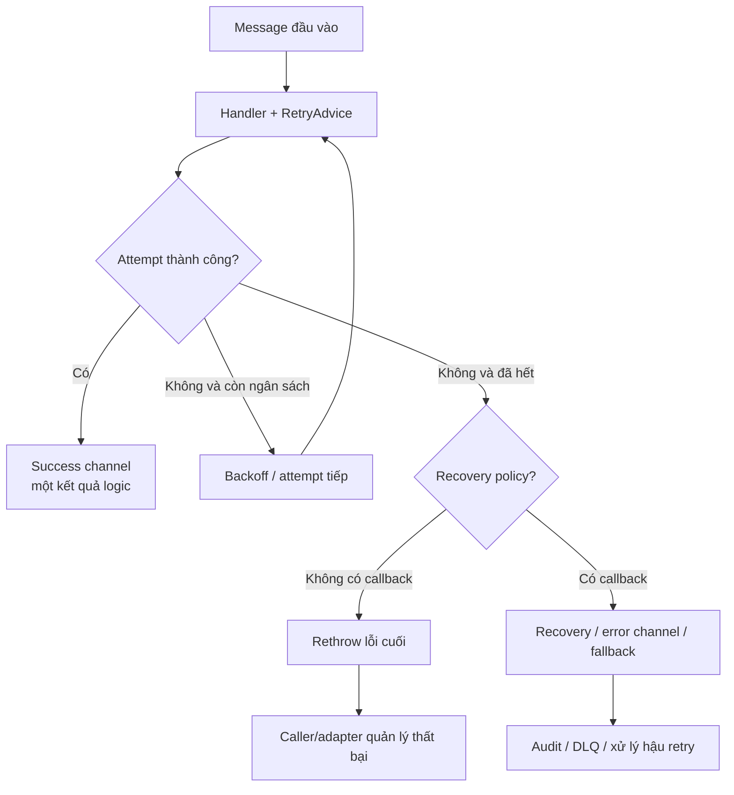
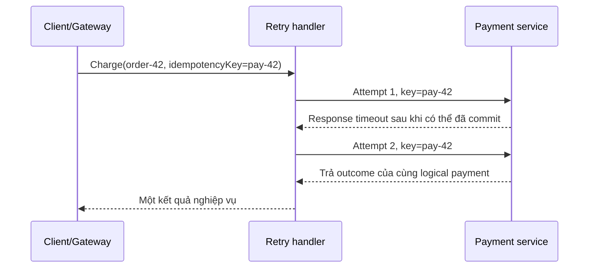

# Kiểm thử thành công sau retry và thất bại cuối cùng

Trong chương **Retry** của **SPRING_INTEGRATION_PATTERN**, một hệ thống tích hợp cần phục hồi khi dịch vụ bên ngoài lỗi tạm thời, nhưng cũng phải **dừng có kiểm soát** khi đã thử hết số lần cho phép. Nếu chỉ viết test “cuối cùng có một message thành công”, ta có thể bỏ sót hai lỗi nghiêm trọng: handler bị gọi vượt quá giới hạn retry, hoặc lần xử lý thất bại cuối cùng bị nuốt khiến upstream tưởng rằng nghiệp vụ đã thành công.

Bài này hướng dẫn kiểm thử **hai kết cục của cùng một retry policy**:

1. **Thành công sau retry:** một số attempt đầu thất bại có thể retry, attempt tiếp theo thành công trước khi hết ngân sách; chỉ kết quả thành công được chuyển tiếp.
2. **Thất bại cuối cùng:** mọi attempt được phép đều thất bại; lỗi hoặc thông điệp recovery phải đến đúng kênh/đối tượng được quy định, không có kết quả thành công giả và không thực hiện thêm attempt.

Các ví dụ dùng Spring Retry, `RequestHandlerRetryAdvice`, IntegrationFlow và JUnit 5. Đồng thời liên hệ với Router, Filter, Transformer, Splitter, Aggregator, Gateway, error channel và correlation để hiểu khi retry tác động đến toàn bộ luồng Enterprise Integration Patterns.

> **Nguyên tắc:** Kiểm thử retry phải xác minh **số lần thử, loại lỗi, kết quả đầu ra, thời điểm dừng, trạng thái nghiệp vụ và đường xử lý cuối**, không chỉ kiểm tra một assertion `assertNotNull(result)`.

## 1. Định nghĩa rõ attempt, retry và kết cục

Một *attempt* là một lần thực thi thao tác được bao bởi retry policy. Retry là việc thực thi lại sau một attempt không đạt điều kiện thành công.

Với `maxAttempts = 3` trong Spring Retry, **tổng số attempt tối đa là ba**, thường gồm lần đầu và tối đa hai lần thử lại; không phải “ba retry cộng lần đầu”.

Ví dụ:

```text
Kịch bản A — thành công sau retry
Attempt 1: IOException/TransientFailure
Attempt 2: IOException/TransientFailure
Attempt 3: SUCCESS → trả một kết quả thành công

Kịch bản B — thất bại cuối cùng
Attempt 1: TransientFailure
Attempt 2: TransientFailure
Attempt 3: TransientFailure
           → EXHAUSTED, không có attempt 4

Kịch bản C — lỗi không nên retry
Attempt 1: PermanentBusinessFailure
           → FAIL FAST theo policy đã cấu hình
```

Cần phân biệt:

| Khái niệm | Ý nghĩa | Điều phải assert |
| --- | --- | --- |
| `attemptCount` | Tổng số lần callback/handler thực thi | Đúng số lần, bao gồm lần đầu |
| `retryable exception` | Lỗi policy cho phép thử lại | Có attempt tiếp theo khi còn ngân sách |
| `non-retryable exception` | Lỗi nên dừng ngay | Không có retry nếu policy phân loại đúng |
| `success after retry` | Một attempt sau thành công | Có đúng một kết quả logic được chấp nhận |
| `retry exhausted` | Hết ngân sách mà chưa thành công | Trạng thái/lỗi cuối đi đúng đường xử lý |
| `recovery callback` | Xử lý sau khi retry kết thúc theo policy | Có thể trả fallback hoặc chuyển lỗi; phải test riêng |
| `errorChannel` | Hạ tầng nhận một số lỗi trong message flow | Không tự động nhận mọi exception trong mọi kiểu channel |

**Không dùng “có retry” làm bằng chứng tính đúng đắn.** Một dịch vụ có thể trả `200 OK` ở lần thứ ba nhưng đã ghi dữ liệu hai lần trước khi các phản hồi timeout. Kiểm thử nghiệp vụ cần đo thêm *side effect* và idempotency.

## 2. Lập test contract cho hai nhánh

Trước khi viết code, tạo bảng kỳ vọng:

| Kịch bản | Lỗi trước thành công | Số attempt kỳ vọng | Kết quả đầu ra | Đường lỗi |
| --- | ---: | ---: | --- | --- |
| Thành công ngay | 0 | 1 | Một kết quả thành công | Không kích hoạt |
| Thành công ở lần 2 | 1 | 2 | Một kết quả thành công | Không kích hoạt |
| Thành công ở lần cuối | 2 | 3 | Một kết quả thành công | Không kích hoạt |
| Hết retry | 3 hoặc nhiều hơn | 3 | Không tạo kết quả thành công | Rethrow/recovery theo cấu hình |
| Lỗi vĩnh viễn | 1 lỗi non-retryable | 1 nếu policy loại trừ | Không tạo kết quả thành công | Fail fast/recovery |
| Fallback được phép | Hết retry | Đến giới hạn | Kết quả fallback **có trạng thái riêng** | Theo hợp đồng recovery |

Tất cả các con số ở bảng này giả định **`maxAttempts=3`**, thao tác được thử một lần mỗi attempt và policy không có cơ chế stateful retry đặc biệt.

Khi kiểm thử nên assert **cả hai mặt**:

- *Positive assertion:* có message/kết quả thành công khi attempt thành công.
- *Negative assertion:* không có kết quả thành công sau terminal failure; không có attempt vượt giới hạn; không phát trùng nếu kết quả được retry hoặc redeliver.

### Một phân biệt quan trọng: exhausted không phải permanent

“Retry exhausted” chỉ có nghĩa là **chính sách thử lại đã kết thúc** trong ngân sách hiện tại, không chứng minh hệ thống ngoài đã hỏng vĩnh viễn. Có thể tiếp tục bằng DLQ, đối soát, hẹn xử lý sau hoặc báo người vận hành. “Permanent business error” lại nói về **loại lỗi** (ví dụ yêu cầu sai hợp đồng), thường không nên thử lại ngay.

## 3. Mô hình thử nghiệm dễ kiểm soát

Để tránh tạo lỗi ngẫu nhiên từ mạng thật, test có thể dùng một service giả mà lần gọi thứ `k` sẽ thành công sau một số lần lỗi đã định.

```java
import java.util.concurrent.atomic.AtomicInteger;

// Ví dụ lỗi tạm thời; ứng dụng thật phải định nghĩa
// lỗi nào thực sự có thể retry.
class TransientDownstreamException extends RuntimeException {
    TransientDownstreamException(String message) {
        super(message);
    }
}

final class ScriptedDownstreamService {

    private final AtomicInteger calls = new AtomicInteger();
    private volatile int failuresBeforeSuccess;

    void arrangeFailures(int failures) {
        if (failures < 0) {
            throw new IllegalArgumentException("failures must be >= 0");
        }
        calls.set(0);
        failuresBeforeSuccess = failures;
    }

    String process(String payload) {
        int attempt = calls.incrementAndGet();
        if (attempt <= failuresBeforeSuccess) {
            throw new TransientDownstreamException(
                    "Transient failure at attempt " + attempt);
        }
        return "processed:" + payload;
    }

    int attempts() {
        return calls.get();
    }
}
```

Ví dụ `arrangeFailures(2)` tạo hai lỗi rồi thành công từ lần thứ ba; `arrangeFailures(100)` khiến kịch bản có `maxAttempts=3` đi tới exhausted.

**Giới hạn:** Đây là *test double*, không gọi API hoặc transaction thực. Việc ghi attempt dùng `AtomicInteger` để dễ đếm; mỗi test phải cách ly state, không chạy hai test cùng thay đổi `failuresBeforeSuccess` trên một bean chia sẻ. Một test khác cần mô phỏng lỗi ACK, restart và nhiều instance.

## 4. Unit test Spring Retry: thành công sau retry

`RetryTemplate` cho phép kiểm tra policy độc lập với channel wiring. Ta cấu hình **ba attempt và không chờ giữa các attempt** để unit test chạy nhanh và xác định:

```java
import org.springframework.retry.support.RetryTemplate;

final class RetryPolicies {
    private RetryPolicies() { }

    static RetryTemplate threeAttemptsForTests() {
        return RetryTemplate.builder()
                .maxAttempts(3)
                .noBackoff()
                .build();
    }
}
```

Đây là cấu hình **chỉ cho test**. Trong production, backoff cần theo latency và tải; không nên retry dồn dập khi downstream đang quá tải.

Test thành công ở lần cuối:

```java
import static org.junit.jupiter.api.Assertions.assertEquals;

import org.junit.jupiter.api.Test;
import org.springframework.retry.support.RetryTemplate;

class RetryTemplateSuccessTest {

    @Test
    void succeedsAfterTwoTransientFailures() {
        ScriptedDownstreamService service =
                new ScriptedDownstreamService();
        service.arrangeFailures(2);

        RetryTemplate retry = RetryPolicies.threeAttemptsForTests();

        String result = retry.execute(
                context -> service.process("order-42"));

        assertEquals("processed:order-42", result);
        assertEquals(3, service.attempts());
    }

    @Test
    void succeedsImmediatelyWithoutUnnecessaryRetry() {
        ScriptedDownstreamService service =
                new ScriptedDownstreamService();
        service.arrangeFailures(0);

        String result = RetryPolicies.threeAttemptsForTests()
                .execute(ctx -> service.process("order-43"));

        assertEquals("processed:order-43", result);
        assertEquals(1, service.attempts());
    }
}
```

Các kiểm tra có ý nghĩa riêng:

- Có **một kết quả logic cuối** với payload mong đợi.
- Attempt thứ ba được thực thi sau hai lỗi; không xảy ra attempt thứ tư.
- Thành công ngay không bị chạy lặp vô ích.
- Policy không chứa `Thread.sleep` hay phụ thuộc đồng hồ hệ thống nên test không flaky do backoff.

**Lưu ý về `RetryContext`:** trong callback có thể quan sát `context.getRetryCount()`, nhưng cách diễn giải số đếm thường bắt đầu từ **0 ở lần đầu**. Nếu cần log số attempt theo cách con người đọc, phải quy đổi nhất quán; trong test trên, bộ đếm của service là số lần được thực thi thực tế.

## 5. Unit test Spring Retry: thất bại cuối cùng

Cùng policy nhưng service luôn thất bại trong ba lần được phép:

```java
import static org.junit.jupiter.api.Assertions.*;

import org.junit.jupiter.api.Test;

class RetryTemplateExhaustedTest {

    @Test
    void throwsAfterExactlyThreeFailedAttempts() {
        ScriptedDownstreamService service =
                new ScriptedDownstreamService();
        service.arrangeFailures(100);

        TransientDownstreamException thrown = assertThrows(
                TransientDownstreamException.class,
                () -> RetryPolicies.threeAttemptsForTests()
                        .execute(ctx -> service.process("order-44")));

        assertTrue(thrown.getMessage().contains("attempt 3"));
        assertEquals(3, service.attempts());
    }

    @Test
    void successOnLastAllowedAttemptIsNotExhausted() {
        ScriptedDownstreamService service =
                new ScriptedDownstreamService();
        service.arrangeFailures(2);

        String result = RetryPolicies.threeAttemptsForTests()
                .execute(ctx -> service.process("order-45"));

        assertEquals("processed:order-45", result);
        assertEquals(3, service.attempts());
    }
}
```

Không cấu hình `RecoveryCallback` trong các test này, nên khi hết retry, exception cuối được ném ra theo hợp đồng của `RetryTemplate`. Nếu ứng dụng có recovery callback, test phải thay assertion bằng **kết quả hoặc lỗi do recovery định nghĩa**.

Cần đặc biệt kiểm tra biên giữa **thành công ở attempt cuối** và **thất bại toàn bộ**. Đây là nơi dễ có lỗi off-by-one trong số attempt tối đa.

### 5.1. Không được nuốt lỗi rồi trả “thành công”

Mẫu sai:

```java
// Anti-pattern: biến lỗi cuối thành thông báo thành công.
try {
    return retry.execute(ctx -> callGateway());
} catch (RuntimeException ex) {
    return "OK"; // Sai: có thể chưa thực hiện được nghiệp vụ.
}
```

Nếu recovery trả fallback hợp lệ, phải biểu diễn rõ `FAILED/DEFERRED/FALLBACK` và kiểm tra người gọi biết đó **không phải success bình thường**.

## 6. Chỉ retry những lỗi đáng retry

Không phải lỗi nào cũng được giải quyết bằng việc thử lại:

| Nhóm lỗi | Ví dụ | Chính sách thường hợp lý |
| --- | --- | --- |
| Lỗi hạ tầng thoáng qua | Network reset, 503 tạm thời, deadlock có thể thử lại | Retry có giới hạn, backoff và jitter |
| Rate limit | 429 từ API | Chờ theo hợp đồng `Retry-After` nếu có, giới hạn tổng deadline |
| Lỗi nghiệp vụ cố định | Đơn hàng sai định dạng, thiếu quyền, dữ liệu không hợp lệ | Fail fast hoặc route tới nhánh nghiệp vụ |
| Lỗi bảo mật/quyền | 401/403 không thể tự sửa bằng retry | Không retry vô hạn; xác minh lại quyền |
| Outcome không rõ | Request timeout sau khi server có thể đã commit | Tra cứu kết quả/idempotency key trước khi gửi lại |
| Lỗi chương trình | NullPointerException, invariant violation | Phân loại/điều tra; retry bừa có thể che lỗi |

Ví dụ phân loại **lỗi tạm thời riêng** bằng Spring Retry:

```java
import org.springframework.retry.support.RetryTemplate;

RetryTemplate classifiedRetry = RetryTemplate.builder()
        .maxAttempts(3)
        .noBackoff()
        .retryOn(TransientDownstreamException.class)
        .build();
```

Đây là **mảnh cấu hình đặt trong phương thức hoặc bean**, minh họa cách giới hạn exception có thể retry. Với Spring Integration advice, exception từ handler có thể được bọc trong `MessagingException`; cần kiểm tra **cause chain và classifier của phiên bản dùng thực tế** trước khi khẳng định matcher luôn nhận ra exception gốc.

Test nên có hai nhánh:

1. `TransientDownstreamException` được retry tới giới hạn hoặc thành công.
2. `PermanentBusinessException` **không** tiếp tục attempt nếu policy không cho phép.

Với lỗi HTTP/SQL thật, cần quy tắc phân loại dựa trên mã lỗi và hợp đồng của adapter, tránh chỉ so khớp chuỗi thông báo exception.

## 7. Tích hợp Spring Integration qua `RequestHandlerRetryAdvice`

`RequestHandlerRetryAdvice` có thể áp retry vào handler trong IntegrationFlow. Để test rõ ràng, ta đặt một `DirectChannel` ở đầu vào, một `QueueChannel` ở đầu ra và dùng cùng `RetryTemplate` ba attempt không backoff.

```java
import org.springframework.context.annotation.Bean;
import org.springframework.context.annotation.Configuration;
import org.springframework.integration.channel.DirectChannel;
import org.springframework.integration.channel.QueueChannel;
import org.springframework.integration.config.EnableIntegration;
import org.springframework.integration.dsl.IntegrationFlow;
import org.springframework.integration.handler.advice.RequestHandlerRetryAdvice;
import org.springframework.retry.support.RetryTemplate;

@Configuration
@EnableIntegration
class RetryIntegrationTestConfig {

    @Bean
    DirectChannel retryInput() {
        return new DirectChannel();
    }

    @Bean
    QueueChannel retryOutput() {
        return new QueueChannel();
    }

    @Bean
    ScriptedDownstreamService scriptedService() {
        return new ScriptedDownstreamService();
    }

    @Bean
    RetryTemplate retryTemplateForTests() {
        return RetryPolicies.threeAttemptsForTests();
    }

    @Bean
    RequestHandlerRetryAdvice handlerRetryAdvice(
            RetryTemplate retryTemplateForTests) {
        RequestHandlerRetryAdvice advice =
                new RequestHandlerRetryAdvice();
        advice.setRetryTemplate(retryTemplateForTests);
        // Không thiết lập RecoveryCallback:
        // nếu exhausted, exception đi ra caller đồng bộ.
        return advice;
    }

    @Bean
    IntegrationFlow retryFlow(
            DirectChannel retryInput,
            QueueChannel retryOutput,
            ScriptedDownstreamService scriptedService,
            RequestHandlerRetryAdvice handlerRetryAdvice) {

        return IntegrationFlow.from(retryInput)
                .handle(String.class,
                        (payload, headers) ->
                                scriptedService.process(payload),
                        endpoint -> endpoint.advice(handlerRetryAdvice))
                .channel(retryOutput)
                .get();
    }
}
```

**Ý nghĩa của ví dụ:**

- `retryInput` nhận message từ test trên đường đồng bộ.
- Handler gọi `scriptedService.process(payload)`; advice thử lại khi callback ném lỗi thuộc chính sách.
- Khi thành công, một reply mang payload dạng `"processed:..."` được đưa tới `retryOutput`.
- Khi mọi attempt thất bại và không có recovery callback, lời gọi đồng bộ thất bại; **không có reply thành công** trên `retryOutput`.
- `QueueChannel` giúp test quan sát message đã được phát, nhưng không tự bảo đảm trạng thái nghiệp vụ hoặc hiệu ứng ngoài đã commit.

Lưu ý Spring Integration là một hệ sinh thái có phiên bản; nếu dự án dùng DSL hoặc Spring Retry API khác, điều chỉnh theo phiên bản thực tế. Quan trọng nhất là giữ **ranh giới advice** và hợp đồng test nhất quán.

### 7.1. Test tích hợp: thành công sau retry

```java
import static org.junit.jupiter.api.Assertions.*;

import org.junit.jupiter.api.Test;
import org.springframework.beans.factory.annotation.Autowired;
import org.springframework.beans.factory.annotation.Qualifier;
import org.springframework.integration.channel.DirectChannel;
import org.springframework.integration.channel.QueueChannel;
import org.springframework.messaging.Message;
import org.springframework.messaging.support.MessageBuilder;
import org.springframework.test.annotation.DirtiesContext;
import org.springframework.test.context.junit.jupiter.SpringJUnitConfig;

@SpringJUnitConfig(RetryIntegrationTestConfig.class)
@DirtiesContext(classMode = DirtiesContext.ClassMode.AFTER_EACH_TEST_METHOD)
class RetryFlowIntegrationTest {

    @Autowired @Qualifier("retryInput")
    DirectChannel input;

    @Autowired @Qualifier("retryOutput")
    QueueChannel output;

    @Autowired
    ScriptedDownstreamService service;

    @Test
    void successAfterTwoFailuresProducesOneReply() {
        service.arrangeFailures(2);

        assertTrue(input.send(
                MessageBuilder.withPayload("order-42").build()));

        Message<?> result = output.receive(1_000);
        assertNotNull(result);
        assertEquals("processed:order-42", result.getPayload());
        assertEquals(3, service.attempts());
        assertNull(output.receive(100));
    }

    @Test
    void exhaustedFailurePropagatesWithoutSuccessReply() {
        service.arrangeFailures(100);

        assertThrows(RuntimeException.class,
                () -> input.send(
                        MessageBuilder.withPayload("order-43").build()));

        assertEquals(3, service.attempts());
        assertNull(output.receive(100));
    }
}
```

**Vì sao dùng `@DirtiesContext`?** Mỗi test cần service có bộ đếm và kịch bản lỗi riêng. Annotation buộc Spring Test đóng/tái tạo context theo quy tắc đã chọn để tránh các test ảnh hưởng lẫn nhau. Với suite lớn có thể tối ưu bằng factory/instance tách biệt hoặc reset có kiểm soát, nhưng không nên chia sẻ mutable script giữa test chạy song song.

**Một giới hạn quan trọng:** `assertThrows(RuntimeException.class)` cố tình không khóa vào một wrapper cụ thể vì Spring Integration có thể bọc lỗi handler trong exception của messaging. Trong ứng dụng thật nên kiểm tra tiếp **cause gốc, mã lỗi và metadata message thất bại**. Các ví dụ chỉ xác minh số attempt và reply ở ranh giới trong JVM, **chưa** kiểm tra transaction, broker ACK hoặc API ngoài.

### 7.2. Test không được bị đánh lừa bởi callback sau cùng

Trong môi trường có một recovery callback, kết quả có thể không còn là exception trực tiếp. Vì thế không thể lấy riêng `assertThrows(...)` làm định nghĩa tổng quát của terminal failure. Hợp đồng sau hết retry phải chỉ rõ một trong các lựa chọn:

- **Rethrow:** exception tiếp tục đi lên caller/adapter.
- **Send to recovery/error channel:** một lỗi được chuyển sang đường xử lý lỗi đã cấu hình.
- **Return typed fallback:** caller nhận kết quả dạng `DEFERRED` hoặc `FAILED`, không phải business success.
- **Park for manual replay/DLQ:** ghi nhận sự kiện lỗi bền vững và chỉ ACK theo quy tắc bàn giao an toàn.

Nếu chuyển lỗi sang recovery channel, test phải khẳng định **chính xác một thông báo terminal** cho một lần thực thi logic retry và **không có reply thành công**. Nếu adapter hoặc broker redeliver toàn bộ message sau đó, có thể phát sinh một *retry cycle mới*; không mặc định số lần lỗi terminal toàn hệ thống luôn là một nếu chưa có idempotency.

## 8. Lỗi trong luồng đồng bộ và bất đồng bộ đi đâu?

Phải phân biệt `DirectChannel` và các kênh bất đồng bộ. Điều này quyết định **chỗ test nên tìm terminal failure**.



### 8.1. Với đường đồng bộ

Khi `DirectChannel` gọi handler đồng bộ trong cùng call stack, một exception không được recovery xử lý thường được ném về lời gọi `send()` hoặc Gateway đang gửi. Không nên viết test chỉ chờ một `ErrorMessage` ở `errorChannel` mà không cấu hình kênh hoặc cơ chế dispatch tạo message lỗi.

### 8.2. Với đường bất đồng bộ

Khi `ExecutorChannel` hoặc adapter bất đồng bộ xử lý handler trên thread khác, caller có thể đã được trả về trước khi attempt cuối diễn ra. Khi đó:

- Test chờ tín hiệu xử lý hoặc đọc thông điệp lỗi ở **đường lỗi đã cấu hình**.
- Không suy luận `input.send() == true` là handler đã thành công.
- Dùng `PollableChannel.receive(timeout)`, latch, probe/recorder hoặc Awaitility với timeout giới hạn để chờ kết quả, không đoán thời điểm bằng sleep.
- Nếu recovery gửi `ErrorMessage`, kiểm tra lỗi gốc và failed message, không nhầm lỗi với business reply.
- Phân biệt lỗi của retry advice với timeout/expiry của Aggregator hoặc Resequencer; không mặc định mọi sự kiện ấy tự đi cùng một error channel.

### 8.3. Đường recovery không được “tẩy” lỗi nghiệp vụ

Ví dụ handler gửi email chỉ khi trạng thái thanh toán đã commit. Nếu thanh toán luôn lỗi nhưng recovery callback trả về chuỗi `"OK"`, downstream có thể gửi email xác nhận thanh toán giả. Test nên assert **không có business success event** sau terminal failure, ngay cả khi lỗi được xử lý thành công về mặt vận hành.

## 9. Backoff, timeout và ngân sách thời gian

Trong production, policy thường có backoff; test cần biết tổng ngân sách có thể lớn bao nhiêu.

Giả sử:

```text
maxAttempts = 4
delay sau attempt #1 = 100 ms
delay sau attempt #2 = 200 ms
delay sau attempt #3 = 400 ms

Tổng backoff danh nghĩa = 700 ms
Tổng thời gian xử lý còn cộng thời gian mỗi attempt,
lịch của scheduler, hàng đợi, GC và mạng.
```

Nếu Gateway timeout sau `500 ms` nhưng callback retry có thể kéo dài nhiều giây, caller có thể bỏ chờ trong khi backend vẫn đang thử. Đây là nguồn của **retry chồng retry**: caller gửi lại toàn bộ request còn handler cũ vẫn xử lý, làm tăng số thao tác và áp lực trên dịch vụ ngoài.

Test production-like cần kiểm tra:

1. `maxAttempts` có đúng ngân sách không.
2. Backoff có nằm trong chính sách và không gây retry storm.
3. Deadline của caller, handler và batch có được thiết kế nhất quán không.
4. Cancellation/interruption khi dừng luồng có được xử lý phù hợp không.
5. Nếu hết deadline trước khi retry xong, kết quả được đưa vào nhánh nào.
6. Nếu API ngoài đã commit nhưng response timeout, retry có dùng idempotency key hoặc kiểm tra outcome không.

**Không cần ngủ đủ 700 ms trong mỗi unit test.** Kiểm tra thuật toán tính backoff riêng bằng mock/sleeper hoặc chính sách xác định. Chỉ một số integration/smoke test cần scheduler thật để kiểm tra wiring và timing trong một cửa sổ dung sai.

## 10. Idempotency: thành công sau retry không được làm side effect ba lần

Một service có thể thất bại theo góc nhìn của caller nhưng **đã thực hiện** tác động ở hệ thống đích. Ví dụ:

```text
Attempt 1: charge card thành công; response bị mất → timeout.
Attempt 2: charge card thành công; response bị mất → timeout.
Attempt 3: response trả về thành công.

Caller thấy success ở attempt 3.
Nhưng nếu không có idempotency: khách có thể bị thu tiền 3 lần.
```

Vì thế kiểm thử “success after retry” trong môi trường thật cần các bất biến bổ sung:

- Cùng logical operation giữ **idempotency key** qua mọi attempt.
- Downstream xử lý cùng key chỉ tạo một tác động hoặc trả lại outcome đã được ghi nhận.
- ACK hoặc kết quả trả về không đi trước điểm commit/bàn giao bền vững của nghiệp vụ.
- Nếu trạng thái kết quả **UNKNOWN**, không tự suy rằng attempt đầu chưa làm gì.
- Nếu một attempt thành công rồi ứng dụng crash, lần xử lý lại sau restart vẫn không nhân đôi tác động.



**Test nên đọc trạng thái cuối ở Payment service hoặc side-effect ledger**, không chỉ assert số callback trong RetryTemplate. Một handler có thể chạy ba lần là hợp lệ; ba giao dịch thu tiền là không hợp lệ nếu hợp đồng yêu cầu một.

## 11. Tương tác với các Integration Patterns khác

| Pattern | Khi retry có thể gây điều gì | Bất biến/test nên thêm |
| --- | --- | --- |
| **Router** | Một message được route lại sau retry, thậm chí sang nhánh khác nếu rule phụ thuộc trạng thái | Định tuyến theo dữ liệu/phiên bản ổn định hoặc có recovery rõ |
| **Filter** | Message bị lọc sau khi đã có dấu “seen” | Không mất một event chưa xử lý; kiểm tra reject/discard |
| **Transformer** | Khi retry tạo reply message mới, có thể mất header nghiệp vụ | Giữ correlation/event ID và payload mapping đúng |
| **Splitter** | Retry toàn batch tạo lại các phần đã phát | Không nhân đôi hiệu ứng; giữ `batchRunId + sequenceNumber` hợp lệ |
| **Aggregator** | Phần lỗi chưa đến, group chờ; retry hết thì không hoàn tất | Group timeout và recovery của phần thiếu |
| **Resequencer** | Retry khiến phần `#2` đến sau phần `#3` | Phát đúng thứ tự theo policy, không nhầm retry attempt thành sequence mới |
| **Gateway** | Timeout response trong khi backend còn retry | Kiểm tra deadline và outcome/idempotency |
| **errorChannel** | Terminal failure được bọc/route khác nhau tùy sync/async | Không mất lỗi, đúng nhánh và metadata |
| **Correlation** | Retry sinh message ID mới hoặc làm mất `correlationId` | Cùng logical message có correlation và event ID ổn định |

**Đặc biệt:** Retry của phần `#2/4` **không tạo một sequence number mới**. Nếu cần retry toàn batch, quyết định đó là *resume run cũ* hay *run mới* trước khi gán correlation. Một Resequencer chỉ sắp thứ tự theo metadata không tự phát hiện mọi duplicate nghiệp vụ.

## 12. Ma trận kiểm thử cần chạy

| Ca | Điều kiện thiết lập | Kết quả kỳ vọng |
| --- | --- | --- |
| Thành công ngay | Service không lỗi | 1 attempt, 1 reply, không có terminal error |
| Thành công sau 1 lỗi | Fail attempt #1 | 2 attempt, reply đúng |
| Thành công ở lần cuối | Fail #1, #2; success #3 | 3 attempt, không xem là exhausted |
| Thất bại hết giới hạn | Fail #1, #2, #3 | 3 attempt, lỗi/recovery theo hợp đồng, 0 reply thành công |
| Không vượt giới hạn | Số lỗi trước success = 100 | Không có attempt #4 |
| Lỗi non-retryable | ValidationException | 1 attempt theo classifier, fail fast |
| Lỗi bọc trong MessagingException | Handler/advice nhận exception wrapper | Classifier xử lý theo chính sách thực tế |
| Recovery callback trả fallback | Hết 3 attempt | Có trạng thái DEFERRED/FAILED rõ, không phát success giả |
| Terminal error async | ExecutorChannel hoặc adapter thread khác | ErrorMessage/recovery đi đúng channel đã cấu hình |
| ACK fail sau commit | Broker phát lại cả message | Idempotency ngăn áp thêm tác động |
| Gateway timeout | Backend đã xử lý, caller không nhận response | Retry tra cùng outcome hoặc giữ cùng idempotency key |
| Retry với backoff | 3 attempt, delay đã xác định | Không retry quá sớm, không ngủ dài trong unit test |
| Stop/cancel giữa backoff | Endpoint dừng khi còn chờ | Chính sách interruption, trạng thái message rõ |
| Crash trước kết quả | Service chưa commit rồi restart | Message có thể được xử lý lại |
| Crash sau commit | Commit rồi restart trước ACK | Không nhân đôi business effect |
| Retry trước Splitter | Chạy lại batch | Không phát trùng slot đã commit |
| Retry sau Splitter | Một phần cần thử lại | Correlation/sequence không đổi |
| Hết retry trong group | `#2` không tới Aggregator/Resequencer | Không coi group hoàn tất; timeout/recovery rõ |
| Retry thành công sau group expiry | Phần thiếu đến muộn | Late arrival theo hợp đồng, không phát batch thứ hai |
| Hai consumer cùng retry | Hai instance xử lý một key | Một effect được commit, không lost update |
| Queue/DLQ replay | Phát lại message terminal failure | Không nhầm replay mới với cùng retry cycle đã kiểm thử |

Các test đơn vị của `RetryTemplate` và test wiring `RequestHandlerRetryAdvice` nên chạy nhanh và xác định. Test broker/DB/API ngoài cần hạ tầng tích hợp riêng, chấp nhận timeout giới hạn và có khả năng chẩn đoán.

## 13. Những lỗi phổ biến khi kiểm thử retry

**1. Nhầm `maxAttempts=3` thành bốn lần gọi.** Lần đầu đã được tính là attempt thứ nhất; cần assert số lời gọi chính xác.

**2. Chỉ assert result không null.** Kết quả có thể là fallback hoặc output lỗi bị chuyển thành chuỗi success giả. Cần kiểm tra loại và ý nghĩa outcome.

**3. Quên assert không có output sau exhausted.** Một message lỗi có thể bị gửi nhầm vào channel thành công, hoặc handler trả giá trị cuối không hợp lệ.

**4. Dựa vào `Thread.sleep`.** Backoff và scheduler có độ trễ; dùng no-backoff cho unit test và tín hiệu/chờ hữu hạn cho integration test.

**5. Chỉ thử lỗi có thể retry.** Validation hoặc permission error cũng phải test fail fast để tránh lãng phí tài nguyên.

**6. Bỏ qua exception wrapping.** Messaging layer có thể bọc lỗi, ảnh hưởng retry classifier và assertion.

**7. Coi mọi `errorChannel` đều được gọi.** Phụ thuộc sync/async, adapter, gateway và recovery callback; phải xác minh đường lỗi được cấu hình.

**8. Dùng `MessageHeaders.ID` làm idempotency key.** Redelivery có thể tạo message mới với ID khác, dẫn tới side effect lặp.

**9. Quên retry chồng retry.** Caller và handler đều có policy riêng có thể nhân số lần gọi ngoài dự tính. Test phải tính *tổng* attempts ở các lớp.

**10. Không test terminal failure khi handler đã có tác động một phần.** Một exception sau commit không có nghĩa transaction/side effect ở hệ thống ngoài đã rollback.

**11. Không cách ly state của test.** Bộ đếm shared, queue còn message và group chưa cleanup khiến test phụ thuộc thứ tự chạy.

**12. Không xác định xử lý sau terminal failure.** “Ném lỗi” chưa đủ cho hệ thống chạy nền; phải có retry từ broker, recovery/DLQ, đối soát hoặc quyết định fail cuối.

## 14. Quan sát retry trong production

Một sự kiện audit/metric của ứng dụng có thể chứa:

```json
{
  "flow": "payment-processing",
  "businessEventId": "pay-42",
  "attempt": 3,
  "maxAttempts": 3,
  "outcome": "SUCCESS_AFTER_RETRY",
  "lastFailureType": "TransientDownstreamException",
  "durationMs": 824,
  "idempotencyKey": "pay-42"
}
```

Đây là **schema minh họa của ứng dụng**, không phải các header/metric Spring Integration tự tạo đầy đủ. Không đưa payload nhạy cảm, token hoặc thông tin thanh toán vào log chỉ để debug.

Các metric nên có:

| Metric gợi ý | Mục đích |
| --- | --- |
| `retry.attempts.total` | Số attempt thực thi, gồm attempt đầu |
| `retry.success_after_retry.total` | Số logical operation thành công sau ít nhất một retry |
| `retry.exhausted.total` | Số retry cycle kết thúc do hết ngân sách |
| `retry.non_retryable.total` | Số thao tác fail fast |
| `retry.backoff.duration` | Thời gian chờ backoff |
| `retry.operation.duration` | Tổng thời gian từ đầu tới kết quả |
| `retry.recovery.total` | Số lần recovery callback hoạt động |
| `retry.terminal.error.total` | Số logical failure sau policy |
| `idempotency.duplicate_prevented.total` | Số tác động lặp bị ngăn |
| `gateway.unknown_outcome.total` | Số lời gọi timeout khi trạng thái commit chưa rõ |

Tránh dùng `businessEventId` hoặc `correlationId` làm label metric cardinality cao. Dùng nhãn thấp như `flow`, `exceptionCategory` và `outcome`; để định danh chi tiết trong structured log/trace.

Nếu một hệ thống báo “số retry tăng”, điều tra xem đó là **lỗi hạ tầng thoáng qua**, **downstream quá tải**, **retry policy quá gắt**, **gateway timeout quá ngắn**, hay **một vòng lặp retry giữa các lớp**. Thay đổi số attempt mà không biết nguyên nhân có thể làm tải tăng và lỗi lan rộng.

## 15. Checklist hoàn tất bài kiểm thử

1. **Định nghĩa ngân sách rõ:** `maxAttempts` gồm attempt đầu, backoff và tổng deadline.
2. **Có ba kịch bản chính:** success ngay, success sau retry, exhausted failure.
3. **Có lỗi non-retryable:** fail fast theo classifier, không lặp vô ích.
4. **Assert đúng số attempt:** không thiếu, không vượt giới hạn.
5. **Assert đúng outcome:** đúng một business reply khi thành công, không có success reply sau terminal failure.
6. **Xác định recovery policy:** rethrow, error channel, fallback có kiểu riêng hay DLQ.
7. **Test cả sync và async nếu ứng dụng có:** lỗi được quan sát đúng ranh giới.
8. **Không dùng delay thật trong unit test:** no-backoff/fake sleeper, test backoff riêng.
9. **Giữ correlation/idempotency key:** retry từng phần không được sinh sequence hoặc logical event mới.
10. **Kiểm tra side effect và ACK:** success sau retry không đồng nghĩa nghiệp vụ chỉ commit một lần nếu không có idempotency.
11. **Tiêm lỗi quanh commit/ACK:** lỗi trước commit, sau commit, phản hồi mất, restart và replay.
12. **Cách ly trạng thái test:** reset service có kiểm soát, group ID riêng, queue/context không rò dữ liệu.
13. **Đối chiếu timeout và group lifecycle:** retry hết hoặc thành công muộn phải có chính sách khi Aggregator/Resequencer chờ thiếu phần.
14. **Có log và metric dùng được:** attempts, retry success, exhausted, non-retryable, recovery, latency và idempotency.
15. **Chỉ tuyên bố phạm vi đã test:** unit test RetryTemplate không chứng minh broker ACK, transaction hay exactly-once end-to-end.

**Kết luận:** Kiểm thử retry chất lượng cần chứng minh cả hai hướng: **hệ thống phục hồi và cho đúng một kết quả logic khi lỗi tạm thời kết thúc**, đồng thời **dừng đúng ngân sách và chuyển lỗi tới đúng nơi khi không thể phục hồi trong lần xử lý hiện tại**. Với Spring Integration, hãy kiểm thử `RetryTemplate`, `RequestHandlerRetryAdvice`, channel/recovery, số attempt và hiệu ứng nghiệp vụ như những ranh giới riêng; khi kết hợp thêm idempotency, timeout và correlation, luồng thông điệp mới an toàn trước redelivery, restart và retry nhiều tầng.

