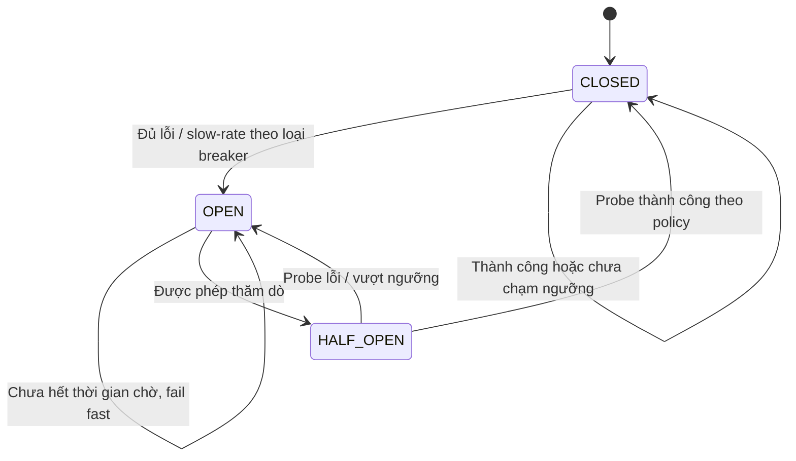
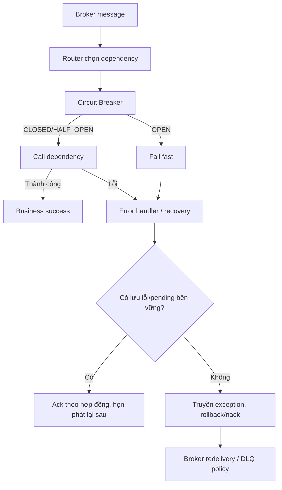

# Kiểm thử dependency chậm và dependency lỗi trong Spring Integration

## 1. Bài toán: khi đối tác chậm hoặc hỏng, luồng message phải phản ứng ra sao?

Trong một hệ thống xử lý đơn hàng, message `ShipmentRequested` đi qua Filter kiểm tra đầu vào, Transformer chuẩn hóa dữ liệu và Router chọn hãng vận chuyển. Handler gọi API hãng A để tạo vận đơn. Bình thường API trả lời sau 100 ms; khi quá tải, có thể trả lời sau vài giây, timeout, HTTP 503 hoặc đóng kết nối đột ngột.

Nếu mọi message tiếp tục đợi hoặc thử lại liên tục, thread, connection và hàng đợi sẽ dần bị chiếm hết. **Circuit Breaker** là cơ chế bảo vệ cho phép ngừng gọi một dependency đang có vấn đề, từ chối nhanh các request mới trong thời gian nhất định, rồi thăm dò có kiểm soát khi dependency có dấu hiệu phục hồi.

Bài **“Kiểm thử dependency chậm và dependency lỗi”** thuộc chương **Circuit breaker** của module `SPRING_INTEGRATION_PATTERN`. Mục tiêu là học triển khai Enterprise Integration Patterns với Spring Integration, tạo các luồng ít phụ thuộc, dễ mở rộng, kết hợp Router, Filter, Transformer, Splitter, Aggregator, Gateway, retry, error channel và correlation, đồng thời kiểm thử và theo dõi các nhánh.

Sau bài này, người học có thể:

- Phân biệt **lời gọi chậm nhưng thành công**, **lời gọi timeout** và **lời gọi thất bại tức thì**.
- Viết test kiểm tra trạng thái `CLOSED → OPEN → HALF_OPEN → CLOSED/OPEN` của circuit breaker.
- Xác minh **fail fast**: khi mạch mở, downstream **không được gọi**.
- Hiểu sự khác biệt giữa breaker mặc định của Spring Integration và breaker theo tỷ lệ lỗi/lời gọi chậm của Resilience4j.
- Kiểm thử timeout, retry, fallback, transaction/ack và side effect khi dependency chập chờn.
- Thiết kế test có thể lặp lại trên CI, không dựa quá mức vào `Thread.sleep` và thời gian chính xác đến mili giây.

## 2. Ba kiểu dependency cần được mô phỏng riêng

| Kiểu hành vi | Handler quan sát | Circuit breaker có tự coi là lỗi? | Kỳ vọng khi kiểm thử |
| --- | --- | --- | --- |
| **Thành công nhanh** | Có kết quả, không exception | Không | Tiếp tục xử lý, giữ hoặc phục hồi trạng thái đóng |
| **Chậm nhưng thành công** | Kết quả đến muộn, không exception | **Tùy thuật toán**: breaker đếm lỗi liên tiếp của Spring Integration không tự mở vì độ trễ | Đo latency, kiểm tra mạch có/không mở đúng cơ chế |
| **Timeout / lỗi kết nối** | Exception từ HTTP/JDBC/client | Có thể được tính là lỗi nếu exception tới được advice và được chính sách ghi nhận | Đủ lỗi làm OPEN, request sau fail fast |
| **Lỗi nghiệp vụ 4xx** | Client có thể trả kết quả hoặc ném exception | Tùy mapping exception | Không nên mở breaker vì dữ liệu validation sai nếu không phải lỗi dependency |
| **HTTP 503 hoặc 429** | Kết quả/lỗi từ client | Tùy mapping, loại lỗi và chính sách | Kiểm tra record/ignore, retry/backoff và rate limiting |
| **Nghẽn kết nối / thread pool** | Chờ rất lâu hoặc lỗi resource | Breaker không tự giải quyết giới hạn concurrency | Kết hợp timeout, bulkhead, giới hạn tải |

**Đặc biệt quan trọng:** Một HTTP client có thể trả về `ResponseEntity` với status lỗi nhưng **không ném exception**. Nếu advice chỉ đếm exception, request có HTTP 503 như vậy có thể bị ghi là “thành công”. Kiểm thử phải mô phỏng đúng cách adapter chuyển HTTP status thành exception hoặc kết quả nghiệp vụ.

## 3. State machine cần kiểm chứng



- **CLOSED:** Cho phép các request đi đến dependency; ghi nhận thành công, lỗi hoặc độ trễ tùy implementation.
- **OPEN:** Từ chối request mới nhanh; số lần gọi downstream không tăng trong lúc bị chặn.
- **HALF_OPEN:** Cho phép một hoặc một số lời gọi thăm dò. Kết quả probe quyết định đóng trở lại hay mở tiếp.

Không phải mọi thư viện đều chuyển trạng thái giống nhau:

| Cơ chế | Điều kiện mở | HALF_OPEN | Có ngưỡng slow-call rate? |
| --- | --- | --- | --- |
| `RequestHandlerCircuitBreakerAdvice` của Spring Integration | `threshold` **lỗi liên tiếp** | Sau `halfOpenAfter`, thử một lời gọi; lỗi mở lại, thành công đóng lại | **Không có** trong hai thuộc tính của advice này |
| Resilience4j `CircuitBreaker` | Failure rate **hoặc** slow-call rate trong sliding window, sau `minimumNumberOfCalls` | Giới hạn `permittedNumberOfCallsInHalfOpenState`, đánh giá các kết quả probe | **Có**: `slowCallDurationThreshold` và `slowCallRateThreshold` |

Ở `RequestHandlerCircuitBreakerAdvice`, mặc định `threshold = 5`, `halfOpenAfter = 1000 ms`. Đây là các tham số của **breaker tích hợp**, không phải cấu hình Resilience4j. Với Resilience4j, số cuộc gọi tối thiểu, kích thước cửa sổ và chính sách phân loại exception còn ảnh hưởng trạng thái. Không dùng một bộ kỳ vọng của Resilience4j để kiểm thử breaker tích hợp của Spring Integration.

## 4. Chọn giả lập phụ thuộc và loại test phù hợp

| Tầng test | Công cụ | Nên xác minh | Không đủ để kết luận |
| --- | --- | --- | --- |
| Unit test breaker policy | Fake dependency, JUnit 5, Resilience4j trực tiếp | Ngưỡng lỗi, slow-rate, short-circuit, half-open | Advice đã gắn đúng handler |
| Spring Integration flow test | `@SpringJUnitConfig`, `DirectChannel`, fake handler | Message có đi qua `RequestHandlerCircuitBreakerAdvice`, số calls, exception | HTTP timeout thật, broker redelivery |
| HTTP integration test | WireMock/MockWebServer/Toxiproxy hoặc server giả | Delay, 503, reset connection, timeout từ client, fallback | DB/broker transaction đúng |
| Broker/DB integration test | Testcontainers và adapter/consumer thật | Ack/rollback/retry/DLQ, idempotency, transaction | Tất cả failure mode production |
| Staging/fault injection | Thao tác kiểm soát trên dependency giả hoặc cô lập | Suy giảm tải, latency p95/p99, backlog và khả năng phục hồi | Bảo đảm tuyệt đối cho hệ thống phân tán |

Mỗi test nên tạo **breaker mới hoặc Spring context mới**; breaker là đối tượng **có trạng thái**, nếu dùng chung giữa các test sẽ khiến kết quả phụ thuộc thứ tự chạy.

## 5. Cấu hình breaker tích hợp của Spring Integration

Ví dụ dưới đây sử dụng `RequestHandlerCircuitBreakerAdvice`, có sẵn trong Spring Integration. `FakeCarrier` được dùng để mô phỏng dependency, còn `DirectChannel` đảm bảo handler được gọi đồng bộ. Không cần thêm Resilience4j cho ví dụ này.

```java
import org.springframework.context.annotation.Bean;
import org.springframework.context.annotation.Configuration;
import org.springframework.integration.channel.DirectChannel;
import org.springframework.integration.dsl.IntegrationFlow;
import org.springframework.integration.handler.advice.RequestHandlerCircuitBreakerAdvice;
import org.springframework.messaging.MessageChannel;

@Configuration
public class CarrierBreakerConfiguration {

    @Bean
    MessageChannel carrierRequests() {
        return new DirectChannel();
    }

    @Bean
    RequestHandlerCircuitBreakerAdvice carrierBreaker() {
        RequestHandlerCircuitBreakerAdvice advice =
                new RequestHandlerCircuitBreakerAdvice();
        advice.setThreshold(2);          // Hai lỗi liên tiếp sẽ mở mạch.
        advice.setHalfOpenAfter(10_000L); // Chờ 10 giây trước probe tiếp.
        return advice;
    }

    @Bean
    IntegrationFlow carrierFlow(CarrierClient client,
                                RequestHandlerCircuitBreakerAdvice carrierBreaker) {
        return IntegrationFlow.from("carrierRequests")
                .handle(client, "send",
                        endpoint -> endpoint.advice(carrierBreaker))
                .get();
    }
}

interface CarrierClient {
    void send(String shipmentId);
}
```

**Ý nghĩa cấu hình:** Với hai lần handler ném exception liên tiếp, breaker mở. Lượt request tiếp theo trong 10 giây bị từ chối trước khi gọi dependency. Một lời gọi thành công trong trạng thái đóng xóa chuỗi lỗi liên tiếp. Sau thời gian chờ, một request được phép thăm dò: probe thành công thì breaker đóng; probe lỗi thì mạch mở lại.

`setHalfOpenAfter(...)` đo bằng **mili giây**, khác với `Duration` trong nhiều API Resilience4j. Một instance breaker chia sẻ trạng thái giữa các message đi qua cùng endpoint. Nếu các nhánh Router dùng dependency khác nhau, thường cần breaker **riêng cho mỗi dependency/endpoint** để lỗi carrier A không làm ngắt nhánh carrier B.

## 6. JUnit 5: dependency lỗi làm OPEN và request sau fail fast

Kiểm thử quyết định của breaker nên dựa vào **số lời gọi downstream**, không chỉ việc caller nhận exception. Khi mạch mở, caller vẫn có thể nhận exception nhưng handler **không được chạy thêm**.

Đoạn dưới là một test Spring Integration Java DSL dùng Spring Test và JUnit 5. `@DirtiesContext` cách ly trạng thái breaker giữa các phương thức test.

```java
import java.util.concurrent.atomic.AtomicInteger;

import org.junit.jupiter.api.Test;
import org.springframework.beans.factory.annotation.Autowired;
import org.springframework.beans.factory.annotation.Qualifier;
import org.springframework.context.annotation.Bean;
import org.springframework.context.annotation.Configuration;
import org.springframework.integration.channel.DirectChannel;
import org.springframework.integration.dsl.IntegrationFlow;
import org.springframework.integration.handler.advice.RequestHandlerCircuitBreakerAdvice;
import org.springframework.messaging.MessageChannel;
import org.springframework.messaging.support.GenericMessage;
import org.springframework.test.annotation.DirtiesContext;
import org.springframework.test.context.junit.jupiter.SpringJUnitConfig;

import static org.junit.jupiter.api.Assertions.assertDoesNotThrow;
import static org.junit.jupiter.api.Assertions.assertEquals;
import static org.junit.jupiter.api.Assertions.assertThrows;

@SpringJUnitConfig(classes = CircuitBreakerFlowTest.Config.class)
@DirtiesContext(classMode = DirtiesContext.ClassMode.AFTER_EACH_TEST_METHOD)
class CircuitBreakerFlowTest {

    @Autowired
    @Qualifier("testCarrierInput")
    MessageChannel input;

    @Autowired
    FakeCarrier carrier;

    @Test
    void twoFailuresOpenCircuitAndThirdMessageDoesNotHitCarrier() {
        carrier.fail = true;

        assertThrows(RuntimeException.class, () -> send("shipment-1"));
        assertThrows(RuntimeException.class, () -> send("shipment-2"));
        assertEquals(2, carrier.invocations.get());

        // Breaker vẫn OPEN, request thứ ba phải bị từ chối ngay.
        assertThrows(RuntimeException.class, () -> send("shipment-3"));
        assertEquals(2, carrier.invocations.get());
    }

    @Test
    void slowButSuccessfulCallsDoNotTripConsecutiveFailureBreaker() {
        carrier.slowMillis = 75;

        assertDoesNotThrow(() -> send("shipment-1"));
        assertDoesNotThrow(() -> send("shipment-2"));
        assertDoesNotThrow(() -> send("shipment-3"));

        // Không có exception => cả ba request đều tới dependency.
        assertEquals(3, carrier.invocations.get());
    }

    void send(String id) {
        input.send(new GenericMessage<>(id));
    }

    static final class FakeCarrier {
        final AtomicInteger invocations = new AtomicInteger();
        volatile boolean fail;
        volatile long slowMillis;

        public void send(String shipmentId) {
            invocations.incrementAndGet();
            if (slowMillis > 0) {
                try {
                    Thread.sleep(slowMillis); // Chỉ là dependency giả.
                } catch (InterruptedException ex) {
                    Thread.currentThread().interrupt();
                    throw new IllegalStateException("Interrupted", ex);
                }
            }
            if (fail) {
                throw new IllegalStateException("Carrier unavailable");
            }
        }
    }

    @Configuration
    static class Config {
        @Bean
        MessageChannel testCarrierInput() {
            return new DirectChannel();
        }

        @Bean
        FakeCarrier fakeCarrier() {
            return new FakeCarrier();
        }

        @Bean
        RequestHandlerCircuitBreakerAdvice testBreaker() {
            RequestHandlerCircuitBreakerAdvice advice =
                    new RequestHandlerCircuitBreakerAdvice();
            advice.setThreshold(2);
            advice.setHalfOpenAfter(10_000L);
            return advice;
        }

        @Bean
        IntegrationFlow testFlow(FakeCarrier fakeCarrier,
                                 RequestHandlerCircuitBreakerAdvice testBreaker) {
            return IntegrationFlow.from("testCarrierInput")
                    .handle(fakeCarrier, "send",
                            endpoint -> endpoint.advice(testBreaker))
                    .get();
        }
    }
}
```

### Vì sao không assert exact exception type trong ví dụ?

Spring Integration có thể bọc exception gốc vào `MessageHandlingException` hoặc một `MessagingException` khác, trong khi chính breaker có thể từ chối bằng `CircuitBreakerOpenException`. Test ở đây dùng `RuntimeException` để xác nhận **đường lỗi**, sau đó dùng số lời gọi dependency để phân biệt **lỗi thật** với **short-circuit**.

Trong dự án thật, bổ sung một assertion kiểm tra cause chain có đúng exception nghiệp vụ (ví dụ `IllegalStateException`) ở hai lượt đầu, và exception báo breaker đang mở ở lượt thứ ba theo phiên bản đang chạy. Không ràng buộc test vào một chuỗi log hoặc thông điệp exception dễ thay đổi khi nâng cấp.

### Vì sao test “chậm nhưng thành công” không khẳng định hệ thống chịu tải tốt?

Test chỉ chứng minh breaker **theo lỗi liên tiếp** không tự mở do latency. Nó không chứng minh thread không bị giữ lâu, Gateway không timeout hoặc connection pool không cạn. Cần các test timeout và concurrency riêng.

## 7. Kiểm thử dependency chậm bằng cơ chế có slow-call rate

Nếu yêu cầu là **mở mạch khi quá nhiều lời gọi chậm ngay cả khi tất cả trả thành công**, dùng breaker có cơ chế slow-call rate, chẳng hạn Resilience4j, hoặc xây dựng chính sách riêng. Không gán `slowCallRateThreshold` lên `RequestHandlerCircuitBreakerAdvice` vì advice tích hợp **chỉ có** cấu hình `threshold` và `halfOpenAfter` cho thuật toán lỗi liên tiếp.

Resilience4j hỗ trợ:

- `slowCallDurationThreshold`: một lời gọi hoàn tất được coi là chậm khi thời gian thực thi vượt ngưỡng.
- `slowCallRateThreshold`: tỷ lệ phần trăm slow calls khiến breaker mở.
- `minimumNumberOfCalls`: số calls tối thiểu trước khi đánh giá tỷ lệ.
- `slidingWindowSize` và `slidingWindowType`: phạm vi thống kê.
- `permittedNumberOfCallsInHalfOpenState`: số probe tối đa ở nửa mở.

### JUnit 5 kiểm tra slow-call rate **không cần sleep**

Test sau dùng API Resilience4j để ghi trực tiếp các thời lượng giả lập; điều này giúp kiểm thử thuật toán ngưỡng một cách xác định. Trong production, nên dùng wrapper/decorator của Resilience4j để đo thời gian **thực** và gọi đủ các bước acquire permission/record outcome.

```java
import java.time.Duration;
import java.util.concurrent.TimeUnit;

import io.github.resilience4j.circuitbreaker.CallNotPermittedException;
import io.github.resilience4j.circuitbreaker.CircuitBreaker;
import io.github.resilience4j.circuitbreaker.CircuitBreakerConfig;
import org.junit.jupiter.api.Test;

import static org.junit.jupiter.api.Assertions.assertEquals;
import static org.junit.jupiter.api.Assertions.assertThrows;

class SlowDependencyCircuitBreakerTest {

    @Test
    void fourCallsWithTwoSlowSuccessesOpenCircuit() {
        CircuitBreakerConfig config = CircuitBreakerConfig.custom()
                .slidingWindowType(
                        CircuitBreakerConfig.SlidingWindowType.COUNT_BASED)
                .slidingWindowSize(4)
                .minimumNumberOfCalls(4)
                .failureRateThreshold(100.0f)
                .slowCallDurationThreshold(Duration.ofMillis(200))
                .slowCallRateThreshold(50.0f)
                .waitDurationInOpenState(Duration.ofSeconds(30))
                .build();

        CircuitBreaker breaker = CircuitBreaker.of("carrier-slow-test", config);

        // Test thuật toán thống kê; không gọi service thật và không ngủ.
        breaker.onSuccess(250, TimeUnit.MILLISECONDS);
        breaker.onSuccess(300, TimeUnit.MILLISECONDS);
        breaker.onSuccess(20, TimeUnit.MILLISECONDS);
        breaker.onSuccess(30, TimeUnit.MILLISECONDS);

        assertEquals(CircuitBreaker.State.OPEN, breaker.getState());
        assertEquals(2, breaker.getMetrics().getNumberOfSlowCalls());
        assertThrows(CallNotPermittedException.class, breaker::acquirePermission);
    }
}
```

Hai trong bốn lời gọi hoàn tất sau hơn 200 ms nên slow-call rate bằng **50%**. Khi đã ghi đủ bốn calls, breaker mở dù **không có exception nào**. Đây là đặc điểm khác hẳn `RequestHandlerCircuitBreakerAdvice`.

**Lưu ý về test kiểu “ghi trực tiếp”:** `onSuccess(...)`/`onError(...)` là các API ghi kết quả vào state machine. Unit test này dùng chúng để tạo snapshot có kiểm soát; không phải ví dụ thay thế một decorated call ở runtime. Khi dùng thật, cần gắn Resilience4j vào **đúng điểm gọi downstream**, xử lý `CallNotPermittedException`, giữ correlation ID và đo tổng latency.

## 8. Kiểm thử timeout: chậm không đồng nghĩa “timeout”

Một dependency treo 5 giây có thể vẫn trả dữ liệu hợp lệ. Nếu HTTP client có timeout 1 giây, caller sẽ nhận exception sớm hơn; breaker có thể ghi nhận đó là failure. Nhưng **circuit breaker tự nó không phải cơ chế timeout**.

Các lớp giới hạn thời gian nên được xác định:

| Giới hạn | Vai trò | Điều phải kiểm thử |
| --- | --- | --- |
| Connect timeout | Giới hạn thời gian thiết lập kết nối | Mạng không thể kết nối, exception loại nào? |
| Read/response timeout | Giới hạn chờ response hoặc dữ liệu | Server nhận request rồi cố tình chậm; client ném lỗi nào? |
| Total/overall deadline | Giới hạn toàn bộ operation gồm retry/backoff | Có còn thời gian cho attempt kế tiếp không? |
| Gateway timeout | Thời gian caller chờ reply | Caller timeout có làm backend ngừng thật không? |
| Bulkhead/concurrency limit | Ngăn quá nhiều lời gọi đang chờ | Khi full, có reject hoặc queue theo chính sách không? |
| Circuit breaker OPEN | Bảo vệ bằng fail fast | Lời gọi kế tiếp **không** tới dependency |

### Tình huống tích hợp với HTTP mock server

Giả sử HTTP client có **response timeout 300 ms**. Dùng mock HTTP server được cấu hình phản hồi sau 800 ms:

```text
Given:
  HTTP client response timeout = 300 ms
  Mock server delay response = 800 ms
  Spring Integration circuit breaker threshold = 2 failures
  Half-open wait = 10 seconds

When:
  Send request #1 and #2 to handler
  Client throws timeout exceptions for both calls
  Send request #3 immediately

Then:
  #1/#2 reach server, fail by configured timeout
  #3 is rejected by breaker before any HTTP request is sent
  HTTP server receives exactly 2 requests
  Caller gets a controlled error/fallback outcome
  No unbounded retry is triggered by error handling
```

Với lỗi kết nối reset, lỗi DNS hoặc HTTP 503, tạo các stub riêng. Tránh “giả lập timeout” bằng cách chỉ ném `RuntimeException("timeout")` khi muốn kiểm tra cả HTTP client adapter: cần chậm thật hoặc thiết lập lỗi mạng qua mock server/proxy để biết exception **thực tế** được framework chuyển vào advice.

**Chú ý:** Nếu HTTP client tự retry nội bộ thì server có thể nhận nhiều request cho mỗi lần handler gọi. Cần tắt hoặc đo riêng retry của client trong test để không nhầm số requests với số handler calls.

## 9. HALF_OPEN và phục hồi: kiểm thử có kiểm soát thời gian

Những điều cần chứng minh:

1. Mạch đã OPEN thì request trước thời điểm thăm dò không tới dependency.
2. Khi hết `halfOpenAfter`, **một request mới** được phép thăm dò; không mặc định breaker tự gọi lại dependency trong nền.
3. Probe thành công làm breaker tích hợp trở về CLOSED; message tiếp theo có thể được gửi.
4. Probe thất bại làm breaker mở lại; các request sau tiếp tục fail fast.
5. Với Resilience4j, số probe cho phép ở HALF_OPEN và cách tính tỷ lệ phụ thuộc cấu hình của nó.

### Tránh kiểm thử thời gian bằng giả định cứng

Không cần assert đúng tại 1000.0 ms. Với unit test của Resilience4j, có thể dùng state machine và sự kiện transitions để đo logic; với test tích hợp của `RequestHandlerCircuitBreakerAdvice`, dùng `halfOpenAfter` ngắn trong phạm vi được kiểm soát rồi chờ điều kiện với timeout rộng. Đảm bảo mọi test có **breaker mới** và không có request khác xen vào tiêu thụ lượt probe.

Một cách tổ chức test:

```text
Given: breaker threshold=2, halfOpenAfter=150 ms
When:
  2 lần gọi dependency thất bại
Then:
  breaker từ chối lời gọi ngay sau đó
When:
  chờ qua mốc halfOpenAfter có dư sai số
  dependency được chuyển sang trả kết quả thành công
  gửi đúng một probe
Then:
  probe chạm dependency và thành công
  request tiếp theo được cho qua
```

Nếu test dùng `Awaitility` hoặc công cụ chờ, chỉ thực hiện **probe đúng số lần dự kiến**, tránh biểu thức `untilAsserted(...)` vô tình gọi endpoint nhiều lần rồi làm thay đổi trạng thái breaker. Có thể chờ theo clock/trạng thái của test harness, sau đó gửi một probe.

## 10. Breaker kết hợp Retry: thứ tự advice ảnh hưởng kết quả test

Hai mẫu lồng advice dưới đây có ý nghĩa khác nhau:

```text
CircuitBreakerAdvice(
    RetryAdvice(
        handler()
    )
)

RetryAdvice(
    CircuitBreakerAdvice(
        handler()
    )
)
```

| Thứ tự | Breaker quan sát | Rủi ro |
| --- | --- | --- |
| **Breaker ngoài, Retry trong** | Kết quả cuối của một retry operation; một chuỗi nhiều attempts có thể chỉ được breaker tính là một thất bại hoặc một thành công | Các attempts vẫn gọi dependency nhiều lần trước khi breaker mở |
| **Retry ngoài, Breaker trong** | Có thể quan sát từng attempt đi tới handler | Khi breaker đã OPEN, retry phía ngoài có thể tiếp tục gọi lại lời gọi bị từ chối nếu không loại exception “open” khỏi retry |

Trong Spring Integration, advice ở ngoài/ở trong phụ thuộc thứ tự cấu hình `adviceChain`. Khi thiết kế test, cần ghi rõ:

- `maxAttempts`/`maxRetries` của retry policy;
- ngưỡng `threshold` hoặc failure-rate/slow-rate của breaker;
- per-attempt timeout và deadline chung;
- tập exception được retry hoặc được coi là thất bại;
- số requests thật sự tới dependency;
- kết quả của recovery callback, fallback và broker redelivery.

**Không retry vô hạn `CircuitBreakerOpenException` hoặc `CallNotPermittedException`**. Việc breaker đã mở là tín hiệu giảm tải; một retry policy vẫn gọi lại ngay exception này có thể tạo vòng lặp vô nghĩa và làm đầy log/queue.

## 11. Fallback, error channel và broker redelivery

Circuit breaker **từ chối cuộc gọi**, không tự quyết định số phận message. Trong một flow đồng bộ có `DirectChannel`, exception từ breaker có thể truyền lên sender. Với một inbound JMS/RabbitMQ/Kafka consumer, việc nhận exception có thể khiến container rollback/nack/seek tùy cấu hình, gây redelivery ngay khi mạch vẫn OPEN.



Khi dependency chậm hoặc lỗi, thường có ba hướng an toàn:

- **Fallback có nghĩa nghiệp vụ:** Ví dụ carrier A lỗi thì Router chuyển sang carrier B, nhưng chỉ khi việc đổi carrier là hợp lệ và không tạo hai vận đơn.
- **Deferred processing:** Ghi message vào hàng đợi chờ/delayed queue, hoặc lưu trạng thái `PENDING_RETRY` bền vững rồi xử lý sau; không “ack rồi quên”.
- **Failure/dead-letter:** Ghi lỗi vào recovery channel hoặc DLQ theo chính sách; phải phân biệt error channel trong ứng dụng với broker DLQ thực tế.

Nếu fallback trả kết quả `PENDING` hoặc `DEGRADED`, **không được coi như “đã tạo vận đơn thành công”**. Nếu một HTTP request trước đó đã được dependency xử lý nhưng response timeout, phải giữ `idempotencyKey` và đối soát trước khi gọi tiếp hoặc chuyển carrier.

## 12. Concurrency, backpressure và khi breaker không đủ

Breaker không tự giới hạn số request **đang chạy** khi CLOSED. Ví dụ cả trăm message đồng thời gọi API chậm, breaker chỉ nhận kết quả sau khi nhiều request đã bị giữ thread/connection. Do vậy:

| Biện pháp | Kiểm thử |
| --- | --- |
| Client timeout | Request chậm bị kết thúc theo timeout đã cấu hình |
| Bulkhead/semaphore | Số cuộc gọi đồng thời không vượt giới hạn |
| Queue capacity / backpressure | Khi backlog tăng, có reject/defer theo hợp đồng |
| Rate limiter | Không vượt hạn mức dịch vụ khi vừa phục hồi |
| Circuit breaker | Sau khi đủ tín hiệu, lời gọi mới bị fail fast |
| Retry backoff + jitter | Không dồn đồng loạt nhiều attempts vào dependency đang lỗi |

Trong test concurrency, dùng `CountDownLatch` hoặc barrier cho các lời gọi đồng thời và đo `maxInFlight`, `rejectedCalls`, số connections đang dùng, thời gian chờ hàng đợi. Đừng suy rằng OPEN là bằng 0 lời gọi đang chạy: request đã được breaker cho qua **trước** khi mạch mở có thể vẫn đang thực thi.

## 13. Ma trận kiểm thử hoàn chỉnh

| ID | Dependency / thao tác | Điều kiện và hành vi cần xác minh |
| --- | --- | --- |
| CB-01 | Thành công nhanh | Mạch đóng, đúng một downstream call |
| CB-02 | Chậm nhưng thành công | Với breaker đếm lỗi liên tiếp, không mở chỉ do latency; Gateway SLA được đo riêng |
| CB-03 | Chậm vượt client timeout | Exception timeout được truyền đúng; breaker đếm lỗi nếu chính sách phù hợp |
| CB-04 | Lỗi kết nối liên tiếp | Đủ `threshold` làm mạch OPEN |
| CB-05 | Đã OPEN, request mới | Fail fast, downstream invocation count **không tăng** |
| CB-06 | Dependency hồi phục, HALF_OPEN | Probe thành công, đóng mạch, những request sau qua được |
| CB-07 | Probe HALF_OPEN lỗi | Mở lại, request tiếp tiếp tục bị chặn |
| CB-08 | Một request thành công xen giữa các lỗi | Bộ đếm lỗi liên tiếp được reset (breaker tích hợp) |
| CB-09 | 4xx validation | Không ghi thành lỗi hạ tầng nếu hợp đồng phân loại tách riêng |
| CB-10 | Resilience4j 50% slow calls sau đủ `minimumNumberOfCalls` | Breaker mở dù tất cả calls thành công |
| CB-11 | Resilience4j chưa đủ `minimumNumberOfCalls` | Chưa mở chỉ vì vài lời gọi chậm/lỗi |
| CB-12 | Retry kết hợp breaker | Số handler attempts, số downstream calls và short-circuit phù hợp thứ tự advice |
| CB-13 | Nhiều messages đồng thời | In-flight calls không làm cạn resource, kết hợp bulkhead |
| CB-14 | Consumer nhận `CircuitBreakerOpenException` | Không requeue nóng vô hạn; deferred retry/DLQ có giới hạn |
| CB-15 | Fallback carrier B | Không tạo side effect trùng ở A/B, giữ correlation/idempotency |
| CB-16 | Gateway timeout | Caller nhận trạng thái rõ; downstream có thể vẫn xử lý |
| CB-17 | Recovery recorder không ghi được | Không ack giả như đã lưu lỗi; có phương án redelivery |
| CB-18 | Chạy nhiều node | Biết breaker state là cục bộ hay được đồng bộ, test failover rõ |

Khi viết integration test, lưu kết quả từng row trong report có các cột: `eventId`, endpoint, dependency mode, breaker state, attempts, downstream calls, fallback outcome, latency và broker deliveries. Không đo một metric duy nhất rồi kết luận tất cả các nhánh đã đúng.

## 14. Observability và khả năng chẩn đoán

Các chỉ số đề xuất:

- **State transitions:** `CLOSED→OPEN`, `OPEN→HALF_OPEN`, `HALF_OPEN→CLOSED/OPEN`.
- **Permitted/rejected calls:** số yêu cầu thực sự đến dependency và số bị từ chối nhanh.
- **Failure / slow-call rate:** theo implementation, chú ý `minimumNumberOfCalls` và cửa sổ thống kê.
- **Latency:** p50/p95/p99 của dependency, toàn bộ Gateway và thời gian queue.
- **Retry/load amplification:** số attempts trên message, số lời gọi HTTP thật, broker deliveries.
- **Fallback/recovery:** tỷ lệ trả `DEGRADED`/`PENDING`, lỗi ghi failure, số DLQ.
- **Concurrency:** in-flight calls, số requests chờ connection, thread/queue backlog.

Tùy framework và adapter, metric có thể được cung cấp sẵn hoặc cần instrumentation. Resilience4j có event publisher và metric binder; Spring Integration breaker tích hợp không nên được giả định có sẵn cùng các trường slow-call rate như Resilience4j.

Để truy vết qua Router/Splitter/Gateway, log `eventId`, `correlationId`, `partId` (nếu có), tên dependency, trạng thái breaker và loại lỗi. Không đưa từng `eventId` hoặc payload vào metric labels để tránh high cardinality; dùng structured log/tracing có quyền truy cập phù hợp.

## 15. Các sai lầm thường gặp

| Sai lầm | Hậu quả | Cách sửa |
| --- | --- | --- |
| Cho rằng breaker tích hợp mở vì response chậm | Test sai kỳ vọng; mạch vẫn CLOSED nếu success | Test timeout exception hoặc chọn slow-call rate breaker |
| Chỉ assert exception, không đo calls tới dependency | Không phân biệt lỗi thật và fail fast | Gắn fake counter / mock HTTP server |
| Quên `minimumNumberOfCalls` của Resilience4j | Breaker chưa OPEN dù một vài calls đều lỗi | Cấu hình số calls tối thiểu trong test |
| Dùng chung breaker bean giữa nhiều test | Test phụ thuộc thứ tự chạy | Isolate Spring context hoặc tạo breaker mới |
| Test HALF_OPEN với đúng timestamp mili giây | Test chập chờn trên CI | Chờ có dư sai số, hạn chế probe |
| HTTP mock trả 503 như response thành công | Advice không thấy exception | Kiểm tra mapping status/error của client |
| Breaker OPEN nhưng retry advice vẫn retry lỗi “open” | Tăng log và tải CPU vô ích | Loại `CircuitBreakerOpenException`/`CallNotPermittedException` khỏi retry |
| Chỉ có breaker, không cấu hình client timeout | Request đang chạy vẫn giữ thread rất lâu | Timeout + bulkhead + breaker |
| Ack message khi chỉ trả fallback `PENDING` nhưng chưa lưu bền | Mất công việc chưa xử lý | Lưu pending/recovery đáng tin cậy trước ack |
| Đổi carrier sau timeout nhưng không đối soát | Hai carrier cùng tạo vận đơn | Idempotency key và xác minh trạng thái provider |
| OPEN rồi lập tức requeue tất cả messages | Poison loop, backlog và retry storm | Delayed queue, delivery limit, DLQ |
| Test một node và mặc định bảo vệ cả cluster | Node khác vẫn có thể gọi dependency | Test per-instance state và global rate/concurrency |

## 16. Bài thực hành

Xây dựng flow `ShipmentRequested → Filter → Transformer → Router`. Nhánh carrier A dùng `RequestHandlerCircuitBreakerAdvice` với `threshold = 2` và `halfOpenAfter = 1500 ms`; carrier B là nhánh dự phòng có rule nghiệp vụ rõ ràng. Tạo một fake HTTP carrier có các chế độ: **nhanh/thành công**, **chậm/thành công**, **timeout**, **HTTP 503**, **lỗi kết nối**, **phục hồi**.

Thực hiện lần lượt:

1. Gửi hai message gây lỗi kết nối, xác nhận breaker mở; message thứ ba fail fast **không chạm HTTP server**.
2. Cho fake server chậm nhưng vẫn trả kết quả, xác nhận breaker đếm lỗi liên tiếp không tự mở; thêm response timeout vào client và xem sự thay đổi.
3. Chờ tới cơ hội HALF_OPEN, cho probe thành công rồi gửi message tiếp để xác nhận mạch đã đóng; lặp lại với probe lỗi.
4. Dùng Resilience4j trong một test riêng với `slowCallRateThreshold = 50%`, `minimumNumberOfCalls = 4`; mô phỏng hai lời gọi chậm trong bốn lời gọi thành công và xác nhận mạch mở.
5. Gắn thêm Retry Advice và so sánh hai thứ tự advice. Đếm retries thật sự chạm dependency, trường hợp request bị breaker từ chối và tổng timeout.
6. Kết nối consumer broker test, kiểm tra deferred retry hoặc DLQ khi breaker mở, lưu `eventId` và `correlationId` rồi xác minh không tạo vận đơn trùng nếu response đã bị mất.

**Tiêu chí hoàn thành:** Test phân biệt rõ latency với exception; ngưỡng mở và thời điểm probe hoạt động theo đúng thư viện; khi OPEN số lần gọi dependency không tăng; các nhánh fallback/recovery/ack giữ đúng trạng thái nghiệp vụ; retry không làm quá tải hoặc phát sinh side effect trùng; dữ liệu chẩn đoán theo dõi được từng message qua các mẫu EIP.

## Tài liệu tham khảo

- [Spring Integration — Circuit Breaker Advice](https://docs.spring.io/spring-integration/reference/handler-advice/classes.html#circuit-breaker-advice): `RequestHandlerCircuitBreakerAdvice`, `threshold`, `halfOpenAfter` và cơ chế đếm lỗi liên tiếp.
- [Spring Integration 6.5 — RequestHandlerCircuitBreakerAdvice API](https://docs.spring.io/spring-integration/docs/6.5.0/api/org/springframework/integration/handler/advice/RequestHandlerCircuitBreakerAdvice.html): setter và exception khi mạch mở.
- [Resilience4j — CircuitBreaker](https://resilience4j.readme.io/docs/circuitbreaker): slow-call rate, failure-rate, sliding window, state machine và half-open probes.
- [Resilience4j — CircuitBreaker API](https://javadoc.io/doc/io.github.resilience4j/resilience4j-circuitbreaker/latest/io/github/resilience4j/circuitbreaker/CircuitBreaker.html): `onSuccess`, `onError`, `acquirePermission` và metrics.
- [Spring Integration — Testing Support](https://docs.spring.io/spring-integration/reference/testing.html): kiểm thử message flow, endpoint và integration context.
