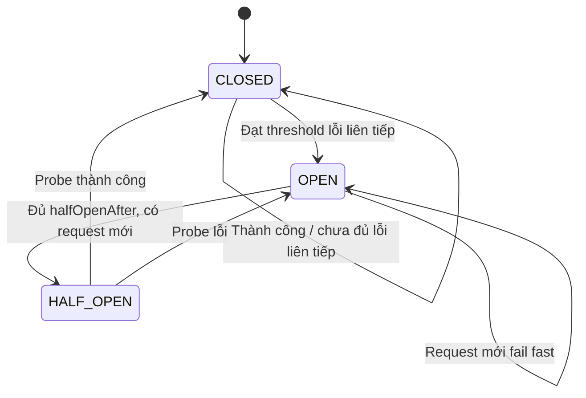
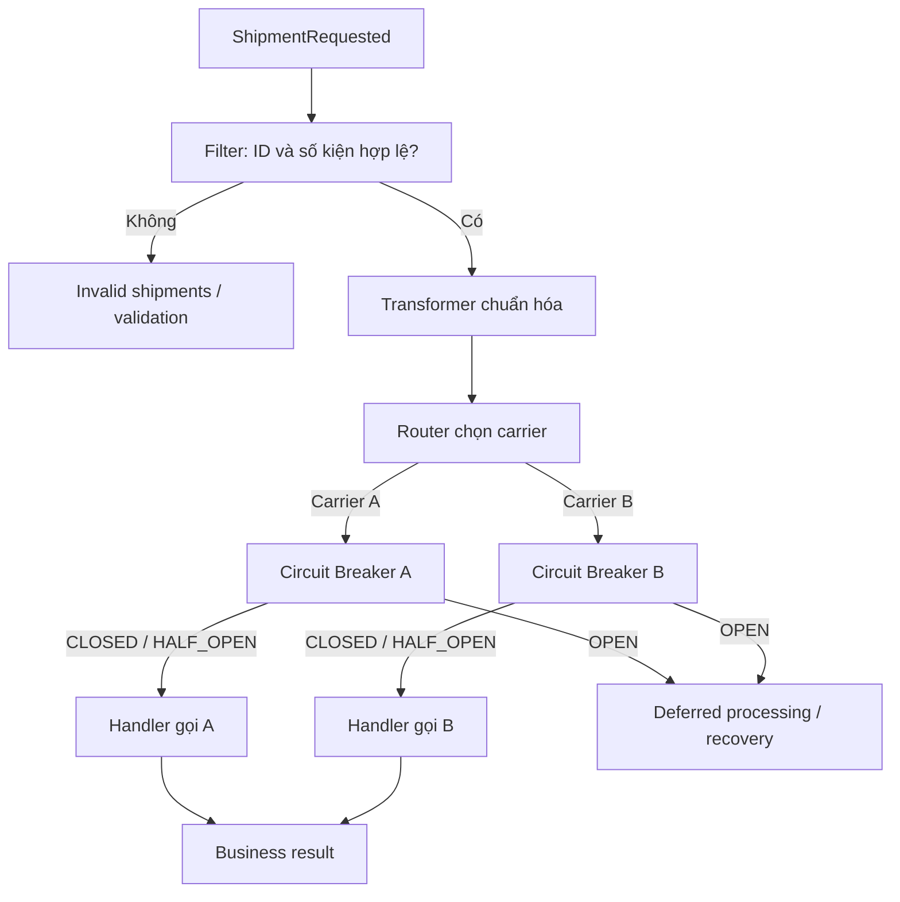

# Phân biệt Circuit Breaker với Filter trong Spring Integration

## 1. Hai cơ chế đều có thể chặn message, nhưng trả lời hai câu hỏi khác nhau

Một hệ thống vận chuyển nhận sự kiện `ShipmentRequested` rồi đi qua Filter kiểm tra dữ liệu, Transformer chuẩn hóa, Router chọn hãng vận chuyển và message handler gọi API tạo vận đơn. Khi message thiếu `shipmentId` hoặc số kiện không hợp lệ, ta **không nên gửi nó tới hãng**. Khi message hợp lệ nhưng API hãng đã timeout nhiều lần, ta **cũng không nên tiếp tục gọi hãng ngay lập tức**.

Hai quyết định có bề ngoài giống nhau: *message không tới dependency*. Nhưng nguyên nhân, trạng thái và cách xử lý khác nhau:

- **Filter** trả lời: “**Message này** có thỏa điều kiện để đi tiếp không?”
- **Circuit Breaker** trả lời: “**Dependency này, vào thời điểm này**, có nên được gọi tiếp hay phải tạm từ chối để tránh lỗi dây chuyền?”

Đây là nội dung bài **“Phân biệt circuit breaker với filter”**, thuộc chương **Circuit breaker** của module `SPRING_INTEGRATION_PATTERN`. Module hướng tới xây dựng Enterprise Integration Patterns với Spring Integration: Router, Filter, Transformer, Splitter, Aggregator, Gateway, retry, error channel và correlation, có thể kiểm thử và giám sát từng nhánh xử lý.

Sau bài học, bạn có thể:

1. Phân biệt tiêu chí quyết định và vòng đời trạng thái của Filter và Circuit Breaker.
2. Cấu hình `MessageFilter` bằng Java DSL với `discardChannel` hoặc `throwExceptionOnRejection`.
3. Gắn `RequestHandlerCircuitBreakerAdvice` vào đúng handler gọi dependency.
4. Giải thích `CLOSED`, `OPEN`, `HALF_OPEN`, `threshold` và `halfOpenAfter`.
5. Kết hợp **Filter trước, Circuit Breaker tại handler**, xử lý riêng message không hợp lệ và dependency đang lỗi.
6. Kiểm thử Gateway, broker redelivery, recovery và tác động nghiệp vụ trùng lặp.

## 2. Bảng so sánh cốt lõi

| Tiêu chí | Filter | Circuit Breaker |
| --- | --- | --- |
| Câu hỏi | “Message có được đi tiếp không?” | “Dependency có đủ khỏe để nhận lời gọi không?” |
| Mẫu thiết kế | **Message Filter** trong EIP | **Circuit Breaker**, mẫu resilience/fault tolerance |
| Dữ liệu quyết định | Payload, headers, điều kiện nghiệp vụ | Trạng thái breaker và kết quả những lần gọi dependency trước |
| Trạng thái | Thông thường quyết định từng message; selector vẫn có thể dùng state ngoài | Có state machine `CLOSED / OPEN / HALF_OPEN` |
| Khi từ chối | Discard, chuyển `discardChannel` hoặc ném `MessageRejectedException` nếu cấu hình | Fail fast bằng exception báo mạch mở, không gọi dependency |
| Thời điểm chạy | Một endpoint Filter trong flow | Advice bọc quanh handler gọi dependency |
| Có tự đo lỗi dependency? | Không | Có, theo thuật toán breaker |
| Có tự thăm dò hồi phục? | Không | Có, khi hết thời gian chờ và có request tới |
| Có tự route sang dịch vụ dự phòng? | Không; discard là nhánh xử lý rejection | Không; cần Router/fallback khác |
| Mục tiêu | Chặn message **không cần/không được** xử lý ở nhánh hiện tại | Giảm tải lên **dependency đang gặp sự cố** |

**Không dùng Filter thay Circuit Breaker** chỉ vì cả hai đều có thể chặn request. Filter kiểm tra một cờ sức khỏe chỉ là cổng điều kiện; nếu tự thêm bộ đếm lỗi, timer, probe và recovery state thì thực chất đang viết lại circuit breaker.

## 3. Filter quyết định trên đặc điểm message

Trong Spring Integration, `MessageFilter` thường ủy quyền cho `MessageSelector` trả về `boolean`. Một selector có thể đọc payload hoặc headers:

```java
import org.springframework.integration.core.MessageSelector;
import org.springframework.messaging.Message;

MessageSelector selector = (Message<?> message) -> {
    Object payload = message.getPayload();
    return payload instanceof ShipmentRequest request
            && request.parcelCount() > 0
            && request.shipmentId() != null
            && !request.shipmentId().isBlank();
};
```

Hai message liên tiếp có thể nhận kết quả khác nhau dù dependency vẫn ở cùng trạng thái:

| Message | Dữ liệu | Kết quả Filter |
| --- | --- | --- |
| A | `shipmentId = "S-101"`, `parcelCount = 2` | Cho đi tiếp |
| B | `shipmentId = ""`, `parcelCount = 2` | Loại |
| C | `shipmentId = "S-103"`, `parcelCount = 0` | Loại |
| D | `shipmentId = "S-104"`, `parcelCount = 1` | Cho đi tiếp |

### Ba cách xử lý khi Filter từ chối

| Cấu hình | Hành vi | Trường hợp phù hợp |
| --- | --- | --- |
| Không có `discardChannel`, không throw | Message không đi tiếp; từ Spring Integration 6.1 thường có log cảnh báo mặc định | Chỉ khi cố ý bỏ qua message |
| `discardChannel = "invalidShipments"` | Message chuyển tới nhánh từ chối | Ghi lại validation failure, kiểm toán hoặc trả trạng thái |
| `throwExceptionOnRejection = true` | Ném `MessageRejectedException` | Caller phải nhận lỗi hoặc consumer phải xử lý theo error policy |

Nếu cấu hình **cả discard channel và throwExceptionOnRejection**, message có thể được gửi tới discard channel **rồi vẫn ném exception**. Điều này dễ dẫn tới ghi lỗi hai lần hoặc broker redelivery message validation sai. Đừng bật đồng thời khi chưa định nghĩa rõ transaction, ack và thứ tự các tác động.

Filter không mặc định là một validator hoàn chỉnh. Với lỗi cần báo chi tiết từng trường, dùng Validator hoặc validation flow chuyên biệt có thể phù hợp hơn. Selector thuần túy, nhanh và ít side effect sẽ dễ kiểm thử hơn.

## 4. Circuit Breaker quyết định theo trạng thái dependency

`RequestHandlerCircuitBreakerAdvice` là một advice cho handler trong Spring Integration. Nó đếm **các lời gọi thất bại liên tiếp**, chuyển trạng thái và tạm ngưng gọi dependency khi mạch mở:



- **CLOSED:** Cho phép handler gọi dependency. Một lần thành công reset chuỗi lỗi liên tiếp.
- **OPEN:** Request mới bị từ chối nhanh, dependency **không được gọi**.
- **HALF_OPEN:** Sau khoảng chờ, một request mới có thể thử gọi; thành công thì đóng, lỗi thì mở lại.

Theo tài liệu chính thức, breaker tích hợp có hai tham số:

| Thuộc tính | Ý nghĩa | Giá trị mặc định |
| --- | --- | --- |
| `threshold` | Số lần gọi lỗi **liên tiếp** trước khi mở mạch | `5` |
| `halfOpenAfter` | Khoảng chờ trước khi cho phép thăm dò, **mili giây** | `1000` |

Một HTTP response chậm nhưng **thành công** không tự làm breaker tích hợp mở. Nếu cần bảo vệ theo **tỷ lệ lời gọi chậm**, cân nhắc cơ chế slow-call rate của Resilience4j; hoặc cấu hình client timeout hợp lý để một lời gọi quá hạn thực sự phát sinh exception được breaker ghi nhận.

### Ví dụ với `threshold = 2`

| Lời gọi | Handler có chạy? | Kết quả | Trạng thái sau |
| --- | --- | --- | --- |
| #1 | Có | Timeout | CLOSED, một lỗi |
| #2 | Có | Timeout | OPEN |
| #3 gửi ngay sau đó | **Không** | Fail fast | OPEN |
| #4 sau khi hết thời gian chờ | Có, probe | Thành công | CLOSED |
| #5 | Có | Thành công | CLOSED |

Message #3 có thể **hoàn toàn hợp lệ**, nhưng handler không được phép gọi dependency. Đó là khác biệt với message bị Filter loại vì dữ liệu.

## 5. Luồng kết hợp: Filter trước, Breaker tại handler



Nguyên tắc:

1. **Lọc trước khi gọi dependency:** Message không hợp lệ được chặn trước khi tiêu thụ thời gian và quota.
2. **Gắn breaker đúng handler:** Advice trên handler A không tự bảo vệ handler B.
3. **Tách trạng thái dependency:** Một breaker riêng cho A/B khi chúng có sức khỏe độc lập.
4. **Chủ động thiết kế fallback:** Breaker không tự route sang carrier khác.
5. **Giữ identity:** `eventId` và `correlationId` cần đi qua các bước để tracing, recovery và idempotency.

## 6. Java DSL: Filter kết hợp Circuit Breaker

Ví dụ sau dùng cấu hình có mặt trong Spring Integration 6.x/7.x: message bị Filter loại được chuyển vào `invalidShipments`; message hợp lệ đi đến handler `CarrierClient.send(...)` có breaker.

```java
import org.springframework.context.annotation.Bean;
import org.springframework.context.annotation.Configuration;
import org.springframework.integration.channel.DirectChannel;
import org.springframework.integration.channel.QueueChannel;
import org.springframework.integration.dsl.IntegrationFlow;
import org.springframework.integration.handler.advice.RequestHandlerCircuitBreakerAdvice;
import org.springframework.messaging.MessageChannel;
import org.springframework.messaging.PollableChannel;

record ShipmentRequest(String shipmentId, int parcelCount, String eventId) {
    boolean valid() {
        return shipmentId != null && !shipmentId.isBlank()
                && parcelCount > 0
                && eventId != null && !eventId.isBlank();
    }
}

interface CarrierClient {
    void send(ShipmentRequest request);
}

@Configuration
class ShipmentFlowConfiguration {

    @Bean
    MessageChannel shipmentsIn() {
        return new DirectChannel();
    }

    @Bean
    PollableChannel invalidShipments() {
        // Chỉ để minh họa: không phải broker DLQ.
        return new QueueChannel();
    }

    @Bean
    RequestHandlerCircuitBreakerAdvice carrierBreaker() {
        RequestHandlerCircuitBreakerAdvice advice =
                new RequestHandlerCircuitBreakerAdvice();
        advice.setThreshold(2);
        advice.setHalfOpenAfter(10_000L);
        return advice;
    }

    @Bean
    IntegrationFlow shipmentFlow(CarrierClient carrier,
                                 RequestHandlerCircuitBreakerAdvice carrierBreaker) {
        return IntegrationFlow.from("shipmentsIn")
                .filter(ShipmentRequest.class,
                        ShipmentRequest::valid,
                        spec -> spec.discardChannel("invalidShipments"))
                .handle(carrier, "send",
                        endpoint -> endpoint.advice(carrierBreaker))
                .get();
    }
}
```

Cần cung cấp bean triển khai `CarrierClient`; các bean channel và advice đã khai báo trong ví dụ. `QueueChannel` trong bộ nhớ **không bảo đảm lưu bền vững** sau restart. Trong production, nên có consumer ghi rejection vào kho phù hợp và kiểm soát kết quả lưu.

### Message bị Filter từ chối

```text
ShipmentRequest(shipmentId="", parcelCount=1, eventId="evt-1")
  -> Filter trả false
  -> invalidShipments
  -> CarrierClient.send KHÔNG chạy
  -> Breaker trên carrier handler KHÔNG được cập nhật
```

### Message hợp lệ nhưng breaker OPEN

```text
ShipmentRequest(shipmentId="S-10", parcelCount=1, eventId="evt-10")
  -> Filter trả true
  -> Handler có Circuit Breaker advice
  -> Breaker OPEN, từ chối nhanh
  -> CarrierClient.send KHÔNG chạy
  -> Exception đi theo hợp đồng error/recovery của nguồn
```

Kết quả “không gọi carrier” giống nhau nhưng **log, metric, trạng thái, quyết định retry/ack phải khác**.

## 7. JUnit 5: chứng minh hai nguyên nhân bị chặn

Test flow sau dùng Spring Integration Java DSL, Spring Test và JUnit 5. Nó xác nhận message invalid đi vào discard channel, còn message valid có thể khiến breaker mở rồi bị short-circuit. `@DirtiesContext` cách ly trạng thái breaker giữa các phương thức kiểm thử.

```java
import java.util.concurrent.atomic.AtomicInteger;

import org.junit.jupiter.api.Test;
import org.springframework.beans.factory.annotation.Autowired;
import org.springframework.beans.factory.annotation.Qualifier;
import org.springframework.context.annotation.Bean;
import org.springframework.context.annotation.Configuration;
import org.springframework.integration.channel.DirectChannel;
import org.springframework.integration.channel.QueueChannel;
import org.springframework.integration.dsl.IntegrationFlow;
import org.springframework.integration.handler.advice.RequestHandlerCircuitBreakerAdvice;
import org.springframework.messaging.MessageChannel;
import org.springframework.messaging.PollableChannel;
import org.springframework.messaging.support.GenericMessage;
import org.springframework.test.annotation.DirtiesContext;
import org.springframework.test.context.junit.jupiter.SpringJUnitConfig;

import static org.junit.jupiter.api.Assertions.assertEquals;
import static org.junit.jupiter.api.Assertions.assertNotNull;
import static org.junit.jupiter.api.Assertions.assertNull;
import static org.junit.jupiter.api.Assertions.assertThrows;

@SpringJUnitConfig(classes = FilterVsBreakerTest.Config.class)
@DirtiesContext(classMode = DirtiesContext.ClassMode.AFTER_EACH_TEST_METHOD)
class FilterVsBreakerTest {

    @Autowired
    @Qualifier("testInput")
    MessageChannel input;

    @Autowired
    @Qualifier("testRejected")
    PollableChannel rejected;

    @Autowired
    FakeCarrier carrier;

    @Test
    void invalidMessageIsDiscardedWithoutCarrierCall() {
        input.send(new GenericMessage<>(new Request("", 1, "evt-1")));

        assertEquals(0, carrier.calls.get());
        assertNotNull(rejected.receive(0));
        assertNull(rejected.receive(0));
    }

    @Test
    void validMessageReachesBreakerButNotOpenDependency() {
        carrier.fail = true;

        assertThrows(RuntimeException.class, () -> sendValid("evt-a"));
        assertThrows(RuntimeException.class, () -> sendValid("evt-b"));
        assertEquals(2, carrier.calls.get());

        // Hợp lệ ở Filter nhưng bị từ chối bởi breaker OPEN.
        assertThrows(RuntimeException.class, () -> sendValid("evt-c"));
        assertEquals(2, carrier.calls.get());
        assertNull(rejected.receive(0));

        // Message invalid vẫn theo nhánh discard.
        input.send(new GenericMessage<>(new Request("", 2, "evt-d")));
        assertNotNull(rejected.receive(0));
        assertEquals(2, carrier.calls.get());
    }

    private void sendValid(String eventId) {
        input.send(new GenericMessage<>(new Request("S-100", 1, eventId)));
    }

    record Request(String shipmentId, int parcelCount, String eventId) {
        boolean valid() {
            return shipmentId != null && !shipmentId.isBlank()
                    && parcelCount > 0
                    && eventId != null && !eventId.isBlank();
        }
    }

    static final class FakeCarrier {
        final AtomicInteger calls = new AtomicInteger();
        volatile boolean fail;

        public void send(Request request) {
            calls.incrementAndGet();
            if (fail) {
                throw new IllegalStateException("Carrier unavailable");
            }
        }
    }

    @Configuration
    static class Config {
        @Bean
        MessageChannel testInput() {
            return new DirectChannel();
        }

        @Bean
        PollableChannel testRejected() {
            return new QueueChannel();
        }

        @Bean
        FakeCarrier fakeCarrier() {
            return new FakeCarrier();
        }

        @Bean
        RequestHandlerCircuitBreakerAdvice testBreaker() {
            RequestHandlerCircuitBreakerAdvice advice =
                    new RequestHandlerCircuitBreakerAdvice();
            advice.setThreshold(2);
            advice.setHalfOpenAfter(30_000L);
            return advice;
        }

        @Bean
        IntegrationFlow testFlow(FakeCarrier carrier,
                                 RequestHandlerCircuitBreakerAdvice testBreaker) {
            return IntegrationFlow.from("testInput")
                    .filter(Request.class, Request::valid,
                            spec -> spec.discardChannel("testRejected"))
                    .handle(carrier, "send",
                            endpoint -> endpoint.advice(testBreaker))
                    .get();
        }
    }
}
```

Với `DirectChannel`, xử lý xảy ra đồng bộ nên có thể kiểm tra ngay số calls và message trong `QueueChannel`. Exception từ handler có thể được Spring Messaging bọc; test xác minh short-circuit bằng **downstream invocation count** thay vì chỉ kiểm tra loại exception.

Nên bổ sung test kiểm tra cause chain chứa lỗi từ dependency ở hai lượt đầu và thông tin breaker-open ở lượt thứ ba theo phiên bản thư viện đang dùng. Không coi việc `MessageChannel.send(...)` trả về là bằng chứng trạng thái nghiệp vụ đã commit.

## 8. Vì sao Filter không thay được Circuit Breaker?

### Trường hợp A — Filter đọc một health flag

```java
// Ví dụ một cổng điều kiện, CHƯA phải Circuit Breaker:
.filter(ShipmentRequest.class, request -> carrierAvailable.get())
```

Khi cờ `carrierAvailable` là `false`, mọi request bị loại. Nhưng ai quyết định **khi nào** bật lại? Nếu service phục hồi mà không có probe, luồng có thể chặn mãi. Nếu mỗi message tự gọi HTTP health-check, Filter lại tạo tải lên dependency đang lỗi.

Health flag có thể hữu ích như **manual maintenance switch**; nó không cung cấp đầy đủ failure count, open duration, half-open probe và reset semantics.

### Trường hợp B — Filter dùng để “fallback”

```text
if carrierAHealthy:
    send to A
else:
    drop message
```

Đây không phải fallback mà là **làm mất đường xử lý của message** nếu không có discard flow an toàn. Khi hợp đồng cho phép đổi hãng, dùng Router/error flow. Khi không thể đổi hãng, lưu `PENDING_RETRY` bền vững, đưa vào delayed queue hoặc trả trạng thái rõ cho Gateway.

### Trường hợp C — Breaker dùng thay validation

Nếu chỉ gắn breaker vào handler mà không kiểm tra `parcelCount`, message invalid vẫn tới API. Các exception validation có thể bị tính thành lỗi liên tiếp và mở mạch, khiến message **hợp lệ** khác cũng bị từ chối.

Nên dùng Filter/Validator trước handler; ngoài ra phân loại lỗi 4xx và các exception từ dependency. Với yêu cầu phân loại exception tinh vi, cân nhắc breaker có cấu hình record/ignore exception thích hợp thay vì coi mọi lỗi nghiệp vụ là dependency failure.

## 9. Trường hợp đặc biệt: Filter có advice riêng

Trong cấu hình ở trên, Circuit Breaker advice gắn vào **carrier handler phía sau Filter**. Nhưng Spring Integration cũng cho phép gắn advice trực tiếp vào Filter endpoint.

Theo mặc định, thao tác discard và `throwExceptionOnRejection` có thể chạy **bên trong advice chain** của Filter. Nếu discard handler ném lỗi, Retry advice gắn trên Filter có thể retry cả nhánh discard; nếu Filter ném `MessageRejectedException`, một advice ngoài cũng có thể quan sát exception ấy.

`discardWithinAdvice = false` chuyển thao tác discard hoặc rejection exception ra **sau** phạm vi advice; điều này quan trọng khi chỉ muốn advice quan sát việc selector đánh giá.

```java
import org.springframework.integration.annotation.Filter;
import org.springframework.integration.annotation.MessageEndpoint;

@MessageEndpoint
class ShipmentValidationFilter {
    @Filter(
            inputChannel = "beforeValidation",
            outputChannel = "afterValidation",
            discardChannel = "invalidShipments",
            adviceChain = "validationAdvice",
            discardWithinAdvice = "false")
    public boolean accept(ShipmentRequest request) {
        return request.valid();
    }
}
```

Đây chỉ là minh họa về advising filters: cần khai báo các channel và bean advice `validationAdvice`, và `ShipmentRequest` là kiểu ở ví dụ trước. **Không nên gắn Circuit Breaker vào selector dữ liệu chỉ để kiểm tra ID hoặc số lượng.**

## 10. Retry, transaction và broker redelivery

Đối với message broker, một quyết định “chặn” có thể dẫn tới các kết quả khác nhau:

| Tình huống | Message có thể được ack/commit? | Điều cần thiết kế |
| --- | --- | --- |
| Filter drop mà không ném lỗi | Có thể nếu consumer xem xử lý hoàn tất | Có cố ý bỏ message không? |
| Filter chuyển discard channel, recorder thành công | Có thể theo transaction/adapter | Recorder có lưu bền vững? |
| Filter ném `MessageRejectedException` | Có thể rollback/nack | Tránh redeliver vô hạn dữ liệu invalid |
| Breaker OPEN ném lỗi | Có thể rollback/nack/seek | Tránh requeue nóng khi dependency chưa phục hồi |
| Breaker OPEN, recovery lưu `PENDING_RETRY` rồi kết thúc | Có thể ack theo hợp đồng | Đảm bảo lưu pending thành công trước ack |
| Gateway gặp Filter rejection | Có thể không nhận reply, hoặc nhận lỗi | Trả validation result thay vì timeout mơ hồ |
| Gateway gặp breaker OPEN | Exception hoặc fallback | Trả `UNAVAILABLE`/`PENDING`, không báo success giả |

**Filter rejection** thường liên quan message hoặc điều kiện nghiệp vụ. **Breaker OPEN** là tình trạng tạm thời của dependency. Cấu hình redelivery và retry không nên áp một cách giống hệt hai trường hợp.

Đặc biệt, nếu Retry advice bọc ngoài breaker và vẫn retry `CircuitBreakerOpenException`, ứng dụng có thể lặp nhanh những cuộc gọi bị từ chối mà không tạo tiến triển. Với broker redelivery, có thể thêm một vòng lặp lớn hơn. Dùng backoff, giới hạn retry, deferred processing và DLQ phù hợp.

Một HTTP timeout cũng không chứng minh downstream chưa thực hiện side effect. Khi retry hoặc chuyển sang hãng khác, cần giữ `idempotencyKey` và đối soát.

## 11. Tương tác với Router, Splitter, Aggregator và Gateway

### Router

Filter quyết định **có đi tiếp**, Router quyết định **đi nhánh nào**, Circuit Breaker quyết định **có thử gọi dependency ở nhánh ấy**. Carrier A bị OPEN không tự khiến Router chuyển sang B; phải có chính sách fallback rõ ràng.

### Splitter và Aggregator

Một đơn gồm ba kiện có thể được Splitter chia ba part. Filter loại một part invalid, trong khi Circuit Breaker có thể chặn một part hợp lệ ở carrier A. Nếu Aggregator chờ đủ số part mà thiếu cơ chế timeout/partial result/failure signal, nhóm có thể kẹt mãi.

Giữ `correlationId`, `sequenceNumber` và `partId`. Part bị Filter loại có thể cần sửa dữ liệu; part bị Breaker chặn có thể xử lý lại sau khi dependency hồi phục.

### Gateway

Gateway đồng bộ cần kết quả rõ: rejection nên trả validation error; breaker OPEN nên trả dependency unavailable hoặc pending. Filter drop nhưng không có reply có thể chỉ khiến Gateway timeout. Fallback `PENDING` không đồng nghĩa vận đơn đã tạo xong.

### Error channel

`errorChannel` truyền `ErrorMessage` cho các lỗi được chuyển sang cơ chế bất đồng bộ/handling. `discardChannel` của Filter thường nhận **message bị loại**, không mặc định là `ErrorMessage`. Recovery channel có thể nhận `Throwable` đã được bọc. Nên test payload/header thật của mỗi nhánh.

## 12. Ma trận kiểm thử

| Kịch bản | Filter | Breaker | Downstream calls | Kỳ vọng |
| --- | --- | --- | ---: | --- |
| Message hợp lệ, carrier khỏe | Accept | CLOSED | 1 | Business success |
| ID rỗng, carrier khỏe | Reject | Không chạy | 0 | Discard/validation |
| Số kiện bằng 0, carrier lỗi | Reject | Không chạy | 0 | Không tăng failure count |
| Message hợp lệ, carrier timeout lần đầu | Accept | CLOSED, một lỗi | 1 | Lỗi dependency |
| Message hợp lệ, carrier timeout lần hai | Accept | Chuyển OPEN | 1 | Mạch mở |
| Message hợp lệ gửi khi OPEN | Accept | OPEN | 0 | Fail fast |
| Message invalid gửi khi OPEN | Reject | Không chạy | 0 | Invalid không bị nhầm với outage |
| Message hợp lệ sau `halfOpenAfter` | Accept | HALF_OPEN | 1 probe | Đóng hoặc mở lại tùy kết quả |
| Filter ném exception rejection | Reject | Tùy vị trí advice | 0 nếu breaker nằm sau | Kiểm tra rollback/requeue |
| Discard recorder bị lỗi | Reject | Tùy vị trí advice | 0 | Không nuốt lỗi lưu rejection |
| Router chọn carrier B khi A OPEN | Accept | Breaker B riêng | Tùy | Không gây side effect trùng |
| Splitter có part invalid và part bị breaker chặn | Tùy part | Tùy nhánh | Tùy | Aggregator có timeout/failure tracking |
| Recovery đã lưu `PENDING_RETRY` | Accept | OPEN | 0 | Ack chỉ sau khi lưu bền |

Đo số lần selector chạy, số message đến discard, số request thật tới dependency, breaker outcome và trạng thái nghiệp vụ cuối. Không suy luận chỉ từ một exception hoặc giá trị trả về của `send`.

## 13. Observability: không gộp hai loại rejection

Các metric gợi ý:

- `messages_filtered_total` theo endpoint và nhóm lý do validation.
- `messages_discarded_total` và `discard_recorder_failures_total`.
- `circuit_breaker_open_rejections_total` theo dependency.
- `dependency_attempts_total`, `dependency_failures_total` và latency.
- `breaker_state_transitions_total` nếu instrumentation hỗ trợ.
- `broker_redeliveries_total`, `pending_retries_total` và `gateway_timeouts_total`.
- `business_side_effects_total`, `duplicates_prevented_total` khi có idempotency.

Đây là tên metric **đề xuất của ứng dụng**, không mặc định framework xuất sẵn. `eventId`, `shipmentId` và `correlationId` là giá trị cardinality cao; nên dùng trong structured log/tracing có kiểm soát thay vì gắn vào metric labels.

```text
event=evt-1 stage=filter   outcome=REJECTED reason=INVALID_SHIPMENT_ID
event=evt-2 stage=filter   outcome=ACCEPTED
event=evt-2 stage=carrierA outcome=FAILED   error=CONNECTION_TIMEOUT
event=evt-3 stage=filter   outcome=ACCEPTED
event=evt-3 stage=carrierA outcome=BREAKER_OPEN downstream_calls=0
```

Message hợp lệ bị breaker từ chối **không** nên tăng `messages_filtered_total`; đó không phải lỗi chất lượng message.

## 14. Sai lầm thường gặp

| Sai lầm | Hậu quả | Cách sửa |
| --- | --- | --- |
| Dùng Filter đọc cờ health thay breaker | Không có threshold/probe, dễ chặn mãi | Gắn breaker tại handler dependency |
| Dùng Breaker để xử lý validation | Dữ liệu sai làm OPEN, chặn message tốt | Filter/Validator trước handler |
| Drop message nhưng nghĩ đã lưu lỗi | Không còn đường khôi phục | Discard flow và recorder bền vững |
| Breaker OPEN rồi mong tự route fallback | Message lỗi mà không có nhánh tiếp | Router/error/recovery flow chủ động |
| Dùng cùng breaker cho mọi carrier | A lỗi làm B bị chặn theo | Breaker state riêng theo dependency |
| Filter bị gắn advice ngoài ý muốn | Rejection làm tăng retry/breaker count | Kiểm tra `discardWithinAdvice` |
| `throwExceptionOnRejection` làm broker redeliver vô hạn | Poison message lặp | Xử lý lỗi validation vĩnh viễn, DLQ khi phù hợp |
| Broker requeue nóng khi OPEN | Retry storm dù dependency chưa hồi phục | Delayed retry và delivery limit |
| Chỉ assert exception, không đếm handler calls | Không chứng minh được short-circuit | Fake counter hoặc mock HTTP server |
| Filter/Breaker dùng với Gateway không có reply strategy | Caller chỉ thấy timeout | Trả trạng thái invalid/unavailable rõ |
| Timeout nghĩa là carrier chưa tạo vận đơn | Retry/fallback tạo hai vận đơn | Idempotency key, đối soát |
| Aggregator đợi part đã bị Filter loại | Nhóm kẹt | Timeout/partial result/failure tracking |

## 15. Bài thực hành

Thiết kế flow `ShipmentRequest → Filter → Transformer → Router → Carrier Handler`. Filter chấp nhận khi `shipmentId` không rỗng, `parcelCount > 0` và `eventId` hợp lệ. Router chọn carrier A hoặc B. Hai handler có breaker độc lập với `threshold = 2` và `halfOpenAfter = 1500 ms`.

Thực hiện:

1. Gửi message invalid, kiểm tra discard flow nhận message, carrier không được gọi, breaker không tăng lỗi.
2. Gửi hai message hợp lệ làm carrier A timeout, kiểm tra breaker A OPEN; message hợp lệ thứ ba fail fast. Carrier B vẫn có thể hoạt động.
3. Khi A OPEN, gửi message invalid: vẫn bị Filter từ chối, không ghi thành dependency outage.
4. Đợi cơ hội HALF_OPEN, cho A phục hồi và gửi probe để đóng mạch; lặp lại với probe lỗi.
5. Thử `throwExceptionOnRejection` trong một flow kiểm thử riêng; quan sát ack/rollback so với discard bình thường.
6. Thêm Splitter/Aggregator, mô phỏng một part invalid và một part bị breaker chặn; thiết kế timeout và kết quả lỗi cho nhóm.
7. Kiểm thử deferred queue/recovery khi OPEN, lưu `PENDING_RETRY` bền vững và giữ `idempotencyKey` qua broker redelivery.

**Tiêu chí hoàn thành:** Message không hợp lệ được Filter xử lý đúng; message hợp lệ chỉ bị Breaker từ chối do trạng thái dependency; không gọi downstream khi OPEN; các nhánh lỗi được phân loại, quan sát và khôi phục; Gateway/broker phản hồi đúng; retry/fallback không tạo side effect trùng.

## Tài liệu tham khảo

- [Spring Integration — Filter](https://docs.spring.io/spring-integration/reference/filter.html): `MessageFilter`, `MessageSelector`, `discardChannel` và `throwExceptionOnRejection`.
- [Spring Integration — Circuit Breaker Advice](https://docs.spring.io/spring-integration/reference/handler-advice/classes.html#circuit-breaker-advice): `RequestHandlerCircuitBreakerAdvice`, `threshold` và `halfOpenAfter`.
- [Spring Integration — Advising Filters](https://docs.spring.io/spring-integration/reference/handler-advice/advising-filters.html): phạm vi advice với discard và `discardWithinAdvice`.
- [Spring Integration — Java DSL](https://docs.spring.io/spring-integration/reference/dsl.html): xây dựng `IntegrationFlow` có Filter và Service Activator.
- [Spring Integration — Testing](https://docs.spring.io/spring-integration/reference/testing.html): kiểm thử luồng, endpoint và message.
